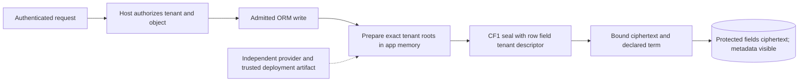
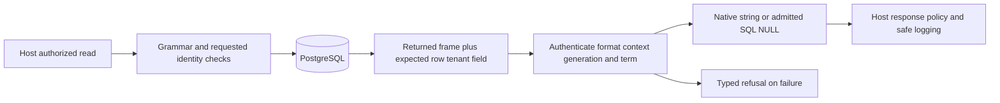
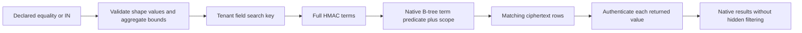
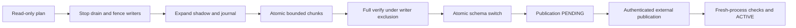
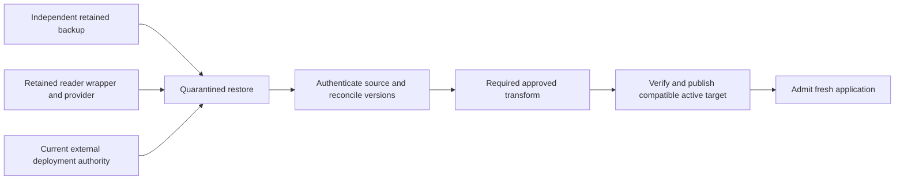
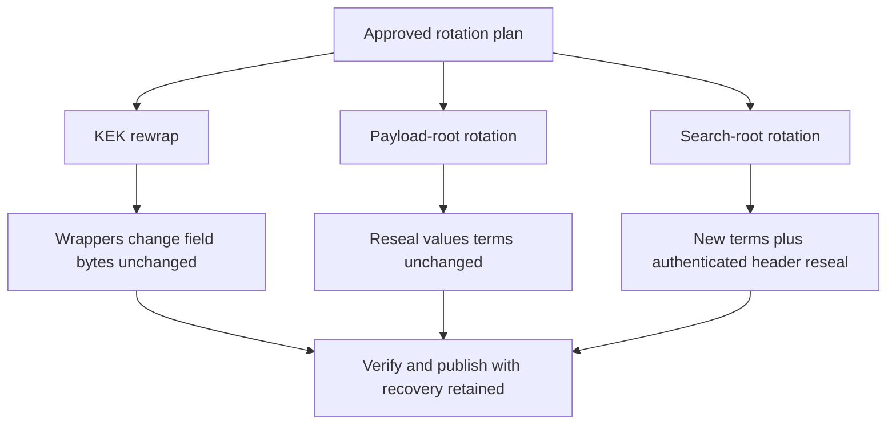
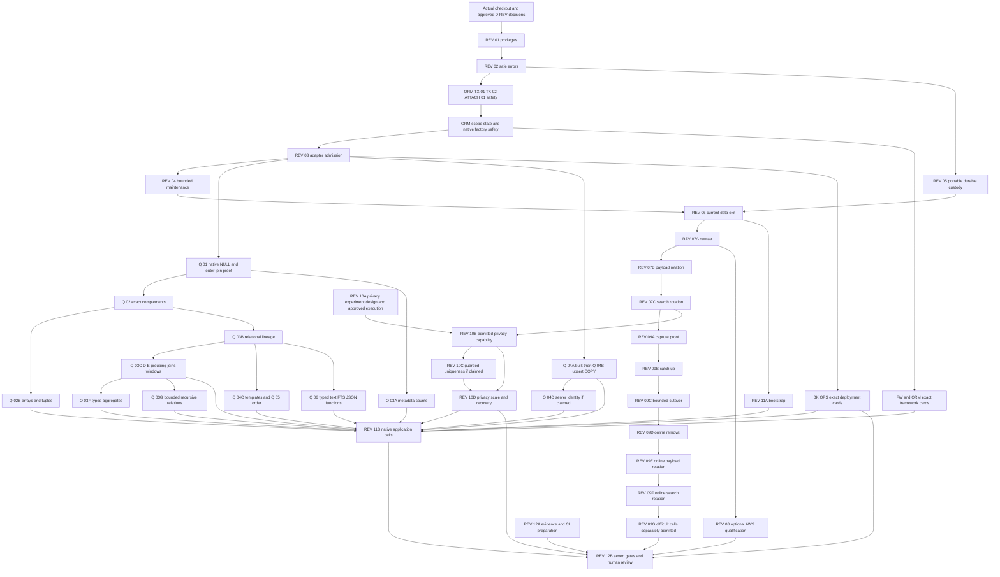

## Current master-mandate reconciliation — 2026-10-12 21:55 UTC

This section supersedes historical status claims below, not approved security contracts. Owner approval message Sentinel_e1abe646a87081d194a97aea302be80d (2026-10-11T06:48:53Z) was re-read: ASYNC-01, ACL-01, A6-COLLATION-01 and UUID-01 approved for isolated implementation; REWRAP-01 experimental only. Production, commits, pushes and deployments remain unauthorized.

The integrated installed runtime is wheel edc94f93fca363025d3dd478ba1c2cd63e49a6b98dc8a16f2ed748c97146e699. Latest full suites:1696PASS7FAIL on SQLAlchemy2.1.3;1678PASS7FAIL18pre-existing native2.1-onlySKIP on2.0.51. Seven legacy public-suffix copy/refusal assertions remain unresolved, not removed or relabelled. Separate retained-profile native metadata/value cases now pass through REMOVED. Current full-app replay:58 native+58protected including teardown,58+58package-free before/after removal. Full product gates all UNKNOWN.

Exact historical compatibility key set reverified:159normalized case IDs,554executed cells,398IDENTICAL156REJECTED-LOUD0DEFECT. Twenty historical async preparation defects now compare IDENTICAL;30 UUID cells changed from old refusal to exact native behavior under explicitly approved UUID-01, including unchanged actual driver-bound spelling. Old UUID refusal harness15FAIL per version is preserved as obsolete-contract evidence; approved native oracle15PASS per version. Remaining sparse profiles are still sparse. Ordinary bulk DELETE remains refused in the default profile; separately qualified private one-hop cascade admission is not conflated with it. Public numeric/JSON/array/time fields remain unencrypted.

Primary evidence ledger: CRYPTALIS_BUILD_CHECKLIST.md in the checkpoint root; current compatibility record CURRENT_COMPATIBILITY_CORPUS_20261012.json. S0–S5 source, receipts and archives preserve the original15-message mailbox. Fresh-cluster restore still awaits explicit test-credential approval. Online migration, production providers, complete query coverage, broad legacy-layout conversion, broad deployment portability and independent review remain open. Experimental passes do not promote public support.

# Cryptalis — Final Architecture Revamp Blueprint

**Research blueprint and ongoing executable checkpoint · 9 October 2026 · Pinned source `2ff72ea4fe7871f31a9fabbbf63f19a5cc714e43`**

Single research blueprint, now maintained in the isolated clone at `docs/research/CRYPTALIS_FINAL_REVAMP_BLUEPRINT.md`. The supplied research snapshot is preserved in the evidence inputs. The user subsequently authorized isolated execution and contract-preserving fixes, while prohibiting pushes and deployments. Earlier approvals permitted local placeholder-author commits on throwaway export branches; the latest owner instruction prohibits further commits. Preserve the existing fifteen-commit mailbox. Narrow architecture amendments are listed in the current ledger. Other proposed D-REV amendments remain unapproved. The executable ledger below supersedes earlier NOT RUN statements only for the exact cells it names. This is an ongoing checkpoint, not a final production-ready verdict.

1. [Executive verdict](#section-1)
2. [GitHub source baseline](#section-2)
3. [Competitor and academic reverse-engineering](#section-3)
4. [Security/leakage/SQL-injection threat model](#section-4)
5. [Target architecture, data flows, public developer UX and decisions](#section-5)
6. [Search capability and leakage budgets](#section-6)
7. [Migration, restore, rollback, removal, upgrade and key-rotation protocol](#section-7)
8. [Performance and scalability architecture](#section-8)
9. [File-by-file change map for product code and documentation](#section-9)
10. [Ordered implementation plan](#section-10)
11. [Seven-gate qualification plan and external blockers](#section-11)
12. [Decision register](#section-12)
13. [Annotated sources](#section-13)
14. [Executed adversarial checkpoints](#section-14)
15. [Zero surprise adoption and complete lifecycle](#section-15)

### Quick reading guide

- [Executive recommendation](#section-1) and [owner approval queue](#owner-decisions)
- [First safe implementation](#first-implementation): REV-01 remains first overall; native cleanup/transaction safety precedes query expansion
- [Full PostgreSQL/SQLAlchemy query matrix](#full-postgresql-16--sqlalchemy-2x-query-surface-design), including the Q-NULL-01 deciding regression
- [Real framework compatibility](#framework-compatibility): FastAPI/Polar, Django/NetBox and Flask/Superset
- [High-severity risk and closure index](#backend-risk-index), with all 52 detailed records and linked interaction schedules
- [Individual implementation cards](#implementation-cards), [exact decision amendments](#section-12) and [source/evidence inventory](#section-13)

### Strict type-oracle verification — CP86, 2026-10-11 02:45 UTC

Both installed strict selections pass 63 checks, including all 48 unique native/protected public-type cells across versions, ten comparator-separation cases per version and strengthened projected-Boolean guards. Reintroducing the old comparator fails all ten separation controls. No actual product value mismatch was found. The weaker earlier receipts remain superseded; the permanent regression file still awaits all four strict full-suite gates before promotion.

Active corpus: 159 case IDs / 554 cells: 348 IDENTICAL, 186 REJECTED-LOUD, 20 product DEFECT. The five architectural amendments are still unapproved. The latest promoted product remains CP84. All seven production gates remain UNKNOWN.

### CP86 oracle correction — 2026-10-11 02:33 UTC

A confirmed test-oracle defect withdraws the exact-equality claim for the newest 48 public-type cells: Python equality and normalization could hide bool/int, int/float, list/tuple, typed-value/dictionary and timezone-representation differences. Eight independent separation cases failed before correction and pass after a strict tagged comparator. No Cryptalis value mismatch is established by this finding. All 48 PostgreSQL cells must be rerun with that comparator before inclusion; promotion is blocked.

Active qualified-oracle corpus temporarily remains 147 cases / 506 cells: 300 IDENTICAL, 186 REJECTED-LOUD, 20 product DEFECT. The 12 public-type cases / 48 cells are explicitly pending re-verification, not silently abandoned or reclassified as product defects. Already-started frozen test sessions may finish, but they cannot qualify the stronger oracle. The latest promoted runtime remains CP84; original mailbox unchanged.

### Latest compatibility qualification — CP86, 2026-10-11 02:24 UTC

Forty-eight installed native/protected cells match exactly for public JSONB, numeric, timestamp, binary, array, interval and Boolean behavior beside an encrypted text field. These extra columns remain unprotected; generic reverse reconstruction is not qualified. No runtime change was needed. The self-contained regression file is undergoing full-suite integration qualification in a separate test-only candidate and is not yet promoted.

Active corpus: 159 case IDs / 554 executed cells: 348 IDENTICAL, 186 REJECTED-LOUD, 20 DEFECT; 124 complete four-cell cases and 35 sparse profiles. The five pending amendments remain unapproved. All seven production gates remain UNKNOWN. CP84 is still the latest promoted product checkpoint.

### Current compatibility evidence — CP85, 2026-10-11 02:14 UTC

After the integrated report, the core corpus was rerun: exactly the 20 known async defects remain, with no unexpected failure. Forty new bulk-DELETE cells establish native rowcount/RETURNING/state/rollback behavior and current pre-SQL refusal. Six native side-effect/cascade controls pass in each version. Bulk deletion cannot be replaced silently with instance-deletion loops. Its authenticated write-surface/tenant/cascade contract is still a proposed design, not an approved grammar change.

Active corpus: 147 case IDs / 506 executed cells: 300 IDENTICAL, 186 REJECTED-LOUD, 20 DEFECT; 112 complete four-cell cases and 35 sparse profiles. CP84 remains integrated and qualified at its stated diagnostic boundary. Five prior amendments remain unapproved. All seven production gates remain UNKNOWN.

### Latest integrated product checkpoint — 2026-10-11, CP84

The read-only staged-adoption report is now in the primary uncommitted candidate. Both full source and installed suites pass: 1,687 on SQLAlchemy 2.1.3; 1,669 plus 18 native-version-only skips on 2.0.51. Post-promotion checks: 54 PASS. Six safeguard-removal proofs fail as required. The actual unchanged FastAPI source inventory covers 40 files, finds the known UUID-input and bulk-DML sites, and issues no SQL. It is an explicitly partial advisory report, not an admission token or a passing application trial. No new commits; original fifteen-commit mailbox unchanged.

The existing current query corpus remains 137 normalized case IDs / 466 executed cells: 300 IDENTICAL, 146 REJECTED-LOUD and 20 DEFECT. Diagnostic unit tests do not inflate those counts. Five approvals are still pending: ASYNC-01, ACL-01, A6-COLLATION-01, REWRAP-01 and UUID-01. Full FastAPI adoption, searchable email, complete generic reverse lifecycle, near-zero downtime, production KMS and independent review remain open. All seven production gates remain UNKNOWN.

Local living artifacts contain current evidence. Library replacement has not succeeded; authoritative metadata checked again at 01:58 UTC still shows the older CP76 versions. The last incomplete write response is not retried automatically or represented as successful delivery.

### Latest product checkpoint — 2026-10-11, CP79–83

Both confirmed corrections are integrated into the actual primary uncommitted candidate: canonical catalog inspection and warmed ORM mapper-cache invalidation. CP80 final source/installed suites each passed1659 tests on SQLAlchemy 2.1.3 and1641with18 native-only skips on2.0.51. Post-integration42 checks passed. Exact source/test hashes match the qualified candidates. No new commits; original15-commit mailbox unchanged.

The unchanged FastAPI installed-wheel trial is20 PASS/38 FAIL/1teardownERROR, versus native58 PASS. All38 call failures stop at UUID-string record admission; teardown stops at CoreDELETE of an unprotected Item table. Actual storage was independently decrypted and matched the ORM. No complete app-adoption claim. Five amendments are pending: ASYNC-01, ACL-01, A6-COLLATION-01, REWRAP-01 and UUID-01.

One active compatibility corpus v2 now indexes137 normalized case IDs/466 executed cells:300 IDENTICAL,146 REJECTED-LOUD,20 DEFECT.102 cases have all four standard cells;35profiles explicitly lack cells. The core92 operations were rerun after integration:186 PASS/10 FAIL per version, exactly the known async failures, no unexpected failures. All20 remain release blockers. At CP83 static reporting was still pending; CP84 subsequently integrates the bounded advisory API after its stated gates. All seven production gates remain UNKNOWN.

Library saving failed before upload on two attempts; local living files are valid and preserved. Current remote versions remain the prior CP76 snapshot until a supported replacement succeeds.

### Current continuation — 2026-10-11, CP77–80

A6 is integrated into the primary uncommitted candidate. Further real-app testing confirmed a false schema-drift refusal caused by environment-dependent PostgreSQL catalog deparsing. A separate correction candidate passed79 focused checks on each SQLAlchemy cell, three removal proofs, and1651 full source tests on2.1.3. All four full source/installed cells now passed (1651 PASS on2.1.3;1633 PASS/18 native-onlySKIP on2.0.51), six removal proofs failed as required, and the correction is integrated into the primary uncommitted candidate.79 catalog/compiler post-integration checks passed.

Unchanged FastAPI native58 PASS. After the catalog correction and required parameter-redaction configuration, protected4 PASS/42 FAIL/13 ERROR. This is a failing adoption trial, with cascading session-fixture errors. An independent two-case RED confirms stale mapper-owned native write compilation after attachment; the separate cache correction passes8 focused variants per cell and its removal fails all8per cell. Its unchanged app trial improves to20 PASS/38 FAIL/1teardownERROR; full qualification is running. UUID-string primary-key reads are also refused and require native differential evidence and an explicit admission decision. Six external bootstrap lines and four fixture lines were needed; zero application source edits. Storage-only full_name is the diagnostic scope, not fulfillment of searchable email.

Existing twenty async corpus defects and five pending amendments remain open (including UUID-01). No new commits. The original fifteen-commit mailbox is unchanged. All seven production gates remain UNKNOWN.

<a id="executed-evidence-summary"></a>

### Current executable checkpoint: 2026-10-10 P1 failed-flush correction verified

**Read this ledger before historical research or old receipts below.** It supersedes historical status only for the named bounded cells. All seven full qualification gates remain **UNKNOWN**. This is an ongoing investigation, not release approval. No independent human security audit has occurred.

**CURRENT BLOCKING STATUS CP60:** product corpus92 operations/368 cells:244 IDENTICAL,104 REJECTED-LOUD,20 DEFECT. Both versions reproduce ten async method/scope failures each. A lab-only native-greenlet preparation alternative passes its first110 focused controls but changes a documented rule and awaits owner approval; it is not adopted. CP59's Core version correction has focused native evidence, not a new complete product qualification. Historical full-suite results below apply only to their named earlier coverage.

**Latest bounded correction CP55:** PostgreSQL 16.15 full suites1575 PASS on2.1.3 (238.46s) and1565 PASS+10 named SKIP on2.0.51 (244.35s), identical97-file current/archive maps. Eight omissions and four extra cancellation controls passed their required outcomes. Corpus70 operations/280 cells:176 IDENTICAL,104 REJECTED-LOUD,0 observed DEFECT. Original15-commit mailbox and earlier installed wheel lack this correction and remain unqualified. No new commits. Exact ACL restoration and rotation-successor publication remain owner decisions pending. CP53 online work is a lab-only protocol; no final-scan relaxation or production online cutover has been implemented.

- Latest uncommitted provider candidate full cells: **1480 PASS** on SQLAlchemy 2.1.3 (222.28 s), **1470 PASS / 10 SKIP** on 2.0.51 (220.99 s), identical source hashes; CP41. This is development-only persisted custody, not KMS qualification.
- Current corpus: **41 operations / 164 cells; 96 IDENTICAL, 68 REJECTED-LOUD, 0 DEFECT observed** after the bounded ordinal correction. All four original lifecycle cells now pass, including distinct public NULL/Unicode values; generic metadata repair and wider coverage remain unresolved. CP42 compares supported PostgreSQL alternatives and reproduces rewrite-snapshot and shadow-dependency hazards.
- New HIGH defect **SNAPSHOT-CUTOVER-01** exists outside that initial corpus: old forward-cutover snapshot silently sees seven NULLs versus one. CP43's candidate refusal passes nine focused controls and three removal proofs. The broad predicate exposed a real autovacuum false refusal; the narrowed predicate passed both full cells (1489 on 2.1.3; 1479 plus 10 SKIP on 2.0.51) and fresh omissions. Historical hidden-backend attribution remains UNKNOWN; failed receipts are retained. The subsequent ordinal candidate passed both full suites: 1499 on 2.1.3 (238.47 s), 1489 plus 10 named SKIP on 2.0.51 (238.59 s), with identical source/test/config maps.
- Latest owner mandate permits isolated blocker research/correction and verified legacy repair, but forbids further commits. The existing 15-commit mailbox remains unchanged. Near-zero downtime and broad native compatibility remain mandatory; conservative snapshot draining and schema rebuilding require explicit costs and limits.
- Recorded base and unchanged original investigation-branch HEAD: `2ff72ea4fe7871f31a9fabbbf63f19a5cc714e43`. Latest public read-only HEAD observation was unchanged at 2026-10-10 06:21:28 UTC (evidence/p1-public-head.json).
- Unchanged baseline: **1009 PASS,0 FAIL/ERROR/SKIP,87.36s**. Subsequent test counts must not be summed as unique coverage.
- Current exported candidate: **15 logical commits** on isolated `dot/final`, placeholder author; original branch remains uncommitted. No push or deployment. The final source/test/config bytes match all 82 files in both frozen cells.
- Last completed frozen full runs: SQLAlchemy 2.1.3 installed wheel **1410 PASS, 0 FAIL/ERROR/SKIP, 134.088059s runner time**; SQLAlchemy 2.0.51 source **1400 PASS, 10 explicitly inapplicable 2.1-only API SKIP, 0 FAIL/ERROR, 133.34s pytest time**. Each retains one intentional-fork deprecation warning. These counts describe the CP29 license-metadata candidate; all runtime module bytes are unchanged from CP25/CP26.
- Lab: PostgreSQL 16.15, Python 3.12.14, psycopg3.3.6, cryptography50.0.2. Distinct owner/runtime roles, SCRAM authentication and durability settings preserved. Each supervised session probes readiness before tests and records source hashes. Test durations during concurrent app work are not benchmark comparisons.
- CP20 lease renewal and CP21 byte bounds are verified and exported as commits 11–12. Their frozen full cells passed (1367 on 2.1.3; 1357 plus ten 2.1-only skips on 2.0.51). CP25 routine admission and CP26 print-only role templates passed final combined verification and are exported as commits 13–14.

| Workstream / requirement trace | VERIFIED bounded evidence | Remaining requirement and concrete next step |
|---|---|---|
| W1 / R01,R06 | Outer-join NULL, async cleanup/cancellation, safe HKDF/HMAC diagnostics, effective permissions incl ADMIN/SET/INHERIT, merge_all prep, parenthesized Boolean; RED/GREEN and mutations. Membership matrix75 PASS | CP25 adds conservative routine inventory and manifest review; permission changes after admission and approved-routine dependencies remain release blockers |
| W2 / R01,R06 | Owning-session native SAVEPOINT and forged-control refusal; failed-control connection quarantine; SQLAlchemy 2.0 import and actual read-only25006 error normalization. Both frozen full cells above | CP24 verifies one actual double-cancellation schedule for native and attached execution; arbitrary host-event extension interactions remain unqualified |
| W3 / R06 | FastAPI native58 PASS; Cryptalis installed/unattached58 PASS; actualSQLModel admission spike1 PASS proves AutoString refusal. Django native boundary spike2 PASS. FlaskBB nativePG700 PASS/57 FAIL/15 ERROR; independent5 PASS reproduces type/SQLite differences | Protected FastAPI amendment A6 approved on 10 October; implementation follows P1/P2. FlaskBB baseline is not green and has mapping/ID barriers. Two complete protected real-app lifecycle flows remain blocked until explicit adapter admission and S6/S7; installed-only tests do not satisfy DX07 |
| W4 / R01,R06 | IS NULL/IS NOT NULL, equality/inequality, IN/NOT IN ordinary shapes with native NULL/empty-list/outer-absence semantics;267 focused/adjacent PASS and three killed guard/term mutants; full runs above | General compound NOT and advanced queries remain unadmitted; retain full query matrix, explicit reason, alternative, admission slice and exact-result tests |
| W5 / R02,R04 | Existing protect maintenance engine; CP14 lease-expiry atomicity; CP20 provider-backed renewal and CP21 byte bounds; CP11 online coordination lemmas only | Byte bounds and chunk lease renewal are implemented and verified. Implement current-data decrypt-back/remove, three rotations, real encrypted near-online protocol and crash/recovery matrix. Full final scan remains until independently reviewed replacement proof |
| W6 / R05 | CP22: 20 bounded leakage cases, synthetic aggregate-weighted data, recovery rates and limits; owner A3 accepts disclosed leakage for the first release | CP22 executed 20 bounded measurement cases; recovery rates, aggregate-data provenance and limits are retained. Stronger mechanisms remain research-only pending admission |
| W7 / performance across R01–R07 | CP27 small matched 13 PASS; CP28 twelve million-row cells in four alternating blocks, measured renewals/recovery and full storage/WAL summaries | Four-block phase complete; one equality added-p95 budget miss remains. Next profile-driven correction, concurrency1/4/16 and warm/cold controls only for specific unresolved questions. No further scale repetition currently justified. Absolute VM numbers are not comparable with the owner's laptop |
| W8 / R01,R06 | CP25 routine admission, 65 focused routine/template/cost cases, killed mutations, full frozen cells; CP24 repeated cancellation | Complete interacting FMEA and high-severity test/owner/mitigation or explicit blocker; absence of reproduction is not safety proof |
| W9–W10 / R03,R07 | CP29: license archive RED/GREEN/mutation, identical clean rebuilds, 30 RECORD hashes, installed-wheel full suite, runtime CycloneDX graph; no real cloud call | Optional provider conformance and primary AWS/Vault/GCP research, native dependency/vulnerability audit, signing/provenance and cross-host qualification, independent review packet; real custody/human audit remain UNKNOWN |

Owner approvals are specific: A1 native owning-session SAVEPOINT; A2 second SQLAlchemy 2.0 cell; A3 disclosed equality leakage for first release with stronger privacy retained; A4 isolated S6/S7 with maintenance fallback; A5 optional KMS and no livecloudcalls. Structural admission caching may cache only a verdict keyed by SQLAlchemy's own cache key, never tenant/row/key context. SQLModel/VARCHAR/Session.exec expansion A6 is approved; current implementation still refuses until its slice is verified. The owner approved read-only routine inventory, explicit review digests and harmless admission regressions on 10 October, then approved a print-only role template. Reverse-transition A7 is approved and its state-machine specification precedes candidate implementation. CP32 records a confirmed stale-worker cutover hazard. The stronger two-role handoff amendment was approved on 10 October; CP33 records focused read-only admission and boundary mutation evidence. The candidate stays outside the patch pending complete verification. The latest owner instruction prohibits new commits; earlier throwaway-branch permission is superseded. Preserve the existing fifteen-commit mailbox unchanged. CP34 records the initial 30-operation differential corpus; CP35 records forward-cutover and optional prefix-guard findings.

Four living Outputs: `CRYPTALIS_FINAL.patch` (single git-am mailbox), `CRYPTALIS_FINAL_EVIDENCE.zip` (sanitized receipts/logs/tests/lab scripts/ledger), `CRYPTALIS_FINAL_README.md` (apply order, source/evidence status and reproduction), `CRYPTALIS_FINAL_SHA256SUMS` (integrity hashes). `NOT_INCLUDED.md` records exclusions, requirement owners and next acceptance tests; it never cancels a requirement. Unverified candidate sources may be included as labelled evidence, never silently as applied product code.


Current corpus expansion (CP49): 54 operations / 216 cells, 136 IDENTICAL, 80 REJECTED-LOUD, zero observed DEFECT. Thirteen projected three-valued truth entries passed 26 tests per SQLAlchemy cell; the UNKNOWN-to-false mutation failed both selected modes and source was restored exactly. This does not expand product admission. CP48 independently verifies that exact-root rewrapping requires new policy publication: direct frames remain readable, but deployed ORM admission and reverse planning correctly reject unapproved replacement wrappers. Successor authority design remains proposed. The permission-restoration decision is pending.

Latest frozen candidate (CP48): 1515 PASS/244.50s on2.1.3;1505 PASS/10 named API SKIP/242.07s on2.0.51. Exact before/after/current source maps agree. Root rewrap publication is pending an explicit successor-artifact decision. CP50 verified113 native VARCHAR assignment inputs per cell, including72 accepted/41 native22001 errors; actual SQLModel 2.1 is blocked by its <2.1 dependency. CP51 verified retained-reader pre-switch abort and current replan from three genuine old staging phases per cell; post-switch and fault variants remain unqualified.

Historical discovery, superseded for the working candidate by the following completion: CP52/FLUSH-PREFIX-01: native rejected-flush atomicity differs in the original exported wheel and source candidate. New correction is undergoing focused, mutation and full qualification. Earlier0-DEFECT corpus counts exclude this newly discovered family and must not be read as current release clearance. Candidate-only preparation failures now use native failed-unit rollback, including SAVEPOINT ownership and connection quarantine after cleanup failure.

**Current superseding result (CP52):** 1539 PASS/246.86s on2.1.3;1529 PASS/10 named SKIP/237.95s on2.0.51. Exact archived/before/after/current source maps match. Seven controlled removals failed. Corpus62 operations/248 cells:144 IDENTICAL,104 REJECTED-LOUD,0 observed DEFECT. The original fifteen-commit mailbox remains affected and NOT release-qualified; no new commits have been made. CP51 adds six retained-reader recovery/fault controls per cell. CP53 finite online-retirement model kills six unsafe variants but provides no PostgreSQL implementation or approval to remove the final scan. ACL restoration and successor-artifact publication decisions remain pending.

**New superseding blocker CP55:** subsequent cold-provider variants reproduced6 FAIL/2 PASS per version before implicit flush. The extended correction passes60 controls in each cell and eight controlled omissions; frozen full qualification is now running. The earlier installed candidate passed1539 tests but contains these newly found gaps. Do not call either original mailbox or that wheel release-qualified. New corpus entries are being executed, not yet counted as passing. CP53 native queue experiment passed8 bounded controls; online product migration remains unimplemented.
<a id="section-1"></a>

## 1. Executive verdict

Cryptalis’s proposition is worthwhile: protect selected values before PostgreSQL receives them, while keeping a deliberately small SQLAlchemy interface and ordinary PostgreSQL indexes. This is complementary to disk/TDE protection. It cannot protect a compromised authorized application, repair arbitrary authorization bugs, or hide every property needed for useful queries.

Recommend one extensible library architecture: retain the manifest compiler, SQLAlchemy adapter, CF1 authenticated row/tenant/field boundary, independent payload/search roots, portable `KeyProvider`, and one versioned transition engine on stock PostgreSQL 16. Complete security hardening and current-data exit/recovery/three rotations first. Qualify portable custody without an AWS dependency; offer AWS KMS as the first separately installable reference integration. Develop the selected trigger-invalidated, incrementally verified near-online protection protocol with a proved maintenance fallback. Preserve exact-HMAC equality/IN/tenant uniqueness as an explicitly leaky baseline while selecting LSDD-PG-v1 as the separate versioned indexed privacy R&D target through a bounded attack-and-cost experiment. Complete minimal-API, two-real-application adoption and independent release qualification. R01–R07 below are final requirements; the expanded full-query target and D-REV-13 explicitly go beyond current grammar; the present baseline is the safe starting point, not a substitute for that product vision.

Top five potentially irreversible risks:
1. Retiring roots, wrappers or old readers before independent backup recovery can permanently destroy recoverability.
2. Plaintext already written to WAL, backups, exports, logs or caches cannot be recalled by later encryption or removal of a column.
3. Equality/frequency and chosen-input disclosures already observed cannot be undone by changing index keys; low-domain fields should default to storage-only.
4. Incorrect switch, stale-authority restore or snapshot-style rollback can lose committed edits or admit incompatible writers.
5. An exposed application/root key or published unsafe artifact can disclose data beyond the reach of subsequent revocation.

Public main advanced during this research to `2ff72ea4fe7871f31a9fabbbf63f19a5cc714e43`, fully audited at 15:57:30 UTC and unchanged in a final main-pointer check at 16:22:38 UTC. It adds identity-only membership scanning; retain that completed optimization and the prior shared-guard/descriptor fixes. The newest receipt reports 1,009 passes with 63/63 recorded hashes matching current source. The 116.291-second million-row writer-pause profile belongs to the earlier `7edd1647` migration code and was not rerun on current main. Neither receipt establishes near-online behavior or production qualification. All seven gates remain UNKNOWN.

The backend investigation adds 52 source-inspected/proposed failure scenarios and exact native compatibility plans across four real application fixtures. Savepoint control, provider-independent async cleanup, shared mapping/engine ownership and secondary audit copies now have explicit early safety or scoped admission work. That source-only snapshot left every new risk OPEN. Subsequent isolated execution reproduced and corrected bounded NULL-join, async-cleanup and diagnostic defects, and part of effective privilege admission. Section 14 records exact evidence and limitations; it does not close the other risk cells.

Research status: **design checkpoint complete only where the Pass A–G ledger says so; research completion is PARTIAL/BLOCKED, and all seven production gates remain UNKNOWN**. The full supplied 2,104-line blueprint and both performance/security briefs were read. Public main was `7edd1647` at about 15:41 UTC, advanced at 15:49:48 UTC, and was verified as `2ff72ea4fe7871f31a9fabbbf63f19a5cc714e43` at 15:57:30 UTC. The actual user checkout is unavailable, so local HEAD, dirty changes and local-versus-main comparison remain BLOCKED. Vendor server internals, actual deployment authority, production custody, independent application execution, scale measurements and qualified human review remain unverified. No product source, tests, canonical decisions, dependencies, schema, keys or CI were changed; no product test or benchmark was run. The precise remaining evidence and next safe actions are retained below.

### Evidence labels and expanded compatibility mandate

VERIFIED is reserved for a named observation actually established in this research, such as exact public source/blob identity or document structure; it never implies unrun product behavior. SOURCE-INSPECTED is the source-only category also called STATIC/INSPECTED in the preserved evidence. REPORTED identifies an upstream receipt or vendor assertion, including its revision and limits. PROPOSED identifies design, reproduction instructions, thresholds or fixes that have not been executed or approved. UNKNOWN identifies an unestablished guarantee; BLOCKED identifies the missing prerequisite; NOT RUN states the execution fact. These labels must appear with the exact scope, not serve as a global product verdict.

The expanded backend investigation must cover real FastAPI, Django, Flask, SQLAlchemy and PostgreSQL application paths, including jobs, raw SQL, concurrency, transactions, migrations, integration and deployment. Its compatibility and failure-mode matrices must preserve the full query and lifecycle requirements above. A source-inspected risk with a proposed native reproduction remains unverified behavior until that experiment runs.

### Product requirements and cross-cutting invariants

| ID | Required final outcome | Current gap and chosen path | Observable completion and owner |
|---|---|---|---|
| R01 | Preserve authenticated row/tenant/field binding, exact supported SQL, safe diagnostics and authority separation; close demonstrated defects and admission gaps | Static F04–F09 and F16 investigation; harden effective privilege closure, resource admission and failure boundaries without CF1 rewrite | Fail-before/pass-after native PostgreSQL or independent-crypto oracles; no unauthenticated release or before-driver refusal escape. Security and ORM owners approve |
| R02 | Current-data decrypt-back, package-free exit, lossless post-cutover rollback, retained-backup restore, reversible upgrades, three distinct rotations and explicit decommission | `kind='protect'` only; generalize the same transition engine and immutable source/target/recovery artifacts | Protect → committed insert/edit/delete → remove → original app without Cryptalis; independent retained-backup recovery; every durable boundary crash-tested. Lifecycle/custody owners approve |
| R03 | Provider-agnostic durable custody, including qualifying independent local/offline or custom providers and an optional AWS KMS reference adapter | Development provider is ephemeral; specify portable conformance first and AWS in an isolated optional package surface | Core installs/imports/runs without AWS SDK/account; separate real-provider restart/context/cache/outage/backup evidence. Custody/security owners approve each provider |
| R04 | Move O(N) transform/verification work outside writer downtime; bounded catch-up, exact atomic switch, safe failures and measured total pause | Current maintenance pause includes full scans; selected trigger dirty-identity invalidation plus incremental verification and bounded closure certificate | No lost/omitted/resurrected committed data; ≤5 s illustrative 1M total writer exclusion target, 10M matched challenge, reader delay and full publication/restart included. NOT APPROVED; database/operations owners decide |
| R05 | Improve searchable privacy beyond stable full-HMAC disclosures where required while preserving exact semantics or a clearly versioned narrower API | Stable HMAC exposes equality/frequency; no claim that KMS or truncation alone repairs it | Explicit observer/leakage model, measured attack-success and cost envelope, equality/IN/NULL/pagination/update/uniqueness oracle; bounded privacy experiment and go/no-go decision. Field/security/product owners decide |
| R06 | Minimal business-logic edits, one bootstrap per engine, declarative intent, predictable ORM behavior, useful read-only diagnostics | Existing attach is narrower than README aspiration; real writers/searches may block adoption | Zero manual crypto calls; native types/results; two immutable unrelated apps, complete writer inventory, measured edit/time ledger and protect/edit/remove/package-free native suites. Product/host owners approve budget |
| R07 | Qualified independent security, crypto, database/ORM, lifecycle and supply-chain review of actual built artifacts and retained recovery | Historical receipts and AI static review do not qualify release | All seven named gates contain exact-artifact evidence, human findings disposition, reproducible install/recovery/runbooks and approved measured budgets. Release owner authorizes promotion |

Cross-cutting invariants: no plaintext fallback; no hidden approximate SQL; no weakening of authentication, tenant/row binding, durability or complete committed-data coverage for speed; no per-field remote key call; no mandatory cloud provider; byte-bounded memory/queues/caches; explicit privilege/authorization and retained-copy threat boundaries; no invented billion-row benchmark. A deferred implementation keeps a slice, responsible role, test, budget proposal and admission decision. Roles below are requested assignments, not claims that named people accepted ownership.

### Required content navigation

The mandate's 18 content requirements are consolidated into the existing 13 main sections to preserve useful prior material.

| Mandate content | Location |
|---|---|
| 1 Executive outcome | Section 1 |
| 2 Source/version inventory | Sections 2 and 13 |
| 3 R01–R07 and invariants | Section 1 and the Section 9 traceability matrix |
| 4 Complete implementation audit | Sections 2, 4, 5 and 9; full inventory in Section 13 |
| 5 Competitor and academic reverse engineering | Section 3 and its source ledger |
| 6 Threat model | Section 4 |
| 7 One target architecture/interfaces | Section 5 |
| 8 Privacy-enhanced search/R&D | Section 6 |
| 9 Near-online protocol | Section 7 |
| 10 Full lifecycle/key custody | Sections 5 and 7 |
| 11 Developer UX/adoption | Section 5 |
| 12 Performance/scale | Section 8 |
| 13 Exact 13-column traceability | Section 9 |
| 14 File-by-file change map | Section 9 |
| 15 Dependency DAG and full slice cards | Section 10 |
| 16 Seven gates/human review packet | Section 11 |
| 17 Exact decision revisions/owner approvals | Section 12 |
| 18 Glossary/bibliography/source ledger | Section 13 |

### Frozen research-pass A–G ledger (historical; see Section 14 for subsequent execution)

| Pass | Work and evidence boundary | Status at this checkpoint | Remaining evidence and next safe action |
|---|---|---|---|
| A Baseline | Full supplied blueprint/brief read; public-main/tree/blob reconciliation; all 24 product modules covered by the recorded static reads; preserved 256-file historical review-depth inventory plus 23 current additions | STATIC/INSPECTED for public bytes; BLOCKED for actual checkout | Obtain authorized connected checkout/read-only status, branch, HEAD, dirty changes and submodules; compare to public SHA before any implementation |
| B External evidence | Version-pinned AWS/Stack/Proxy mechanisms, official PostgreSQL/ORM/crypto sources and primary attack papers | STATIC/INSPECTED or vendor SPECIFIED, source-specific; no vendor execution | Keep publication/runtime/source distinctions; unavailable server internals and unresolved feature portability stay UNKNOWN; source ledger identifies exact limits |
| C Threat/protocol model | Malicious actor, concurrency/fault and operational challenges for each major proposal; attack/failure counterexamples | PROPOSED proof obligations, not theorem verification or exploit reproduction | Execute approved native schedules, independent crypto oracle and attack experiments in future isolated runs |
| D Comparison/convergence | Maintenance versus triggers/CDC/dual-write; baseline versus collision/stateful/scan/oblivious search; portable provider versus cloud coupling | PROPOSED selected architecture and bounded experiments | Owner accepts exact D-REV contracts and per-field threat/cost budgets before product admission |
| E Decomposition | R/F traceability, file map, dependency DAG and individual slice cards in this file | PROPOSED implementation handoff | Rebase each card on actual checkout; assign accountable owners and exact target/credentials before execution |
| F Independent challenge | Separate AI adversarial reviews and original-contract reread; contradictions corrected where source supports correction | Internal static challenge only; human review UNKNOWN | Qualified crypto, PostgreSQL/ORM and security/operations reviewers must evaluate implemented evidence and unresolved findings |
| G Edit/validation | Same attached Markdown revised; prior inventory/provenance retained; structural/diff/link/ID checks recorded in final validation ledger | Documentation-only validation; product execution NOT RUN | No claim of full research completion while A access and external empirical/human gates remain blocked |

At the original design-only checkpoint, source edits and execution were not authorized. The subsequent user mandate authorizes isolated tests, dependencies and contract-preserving fixes; later narrow amendments and local export commits are listed explicitly in the current ledger. Paid/cloud-provider access, pushes and deployment remain prohibited. NOT RUN is an execution fact; UNKNOWN describes the corresponding guarantee. A missing test is not a reason to stop the authorized design work, nor permission to invent its result.

<a id="section-2"></a>

## 2. GitHub source baseline

### Current GitHub source and exact revision reconciliation

Retain the compiler → immutable descriptor → SQLAlchemy adapter → CF1/KeyProvider → PostgreSQL exact-search → transition/journal → external deployment-pin architecture. The current source does not justify a rewrite. It has meaningful fail-closed mechanisms and historical native PostgreSQL negative controls. It does not implement complete production custody, current-data exit/removal, deployment rotations, near-online migration, privacy-enhanced searchable encryption, product lifecycle CLI, or independent release qualification.

Current GitHub main advanced during the audit. Initial read at 15:41 UTC found `7edd1647b39c933ec1eac14f24ce84ff7d29bfba`; final read at **2026-10-09T15:57:30.495204+00:00** confirmed **`2ff72ea4fe7871f31a9fabbbf63f19a5cc714e43`**, commit time `2026-10-09T15:49:48Z`, message `perf(migration): scan identities only for membership verification`, direct parent `7edd1647b39c933ec1eac14f24ce84ff7d29bfba`. A later read-only main-pointer check at **2026-10-09T16:22:38.472026+00:00** confirmed the same SHA; it does not relabel the earlier full-tree audit as a newly repeated blob read. Current tree is `4b843fdfcda2820a36e1f727fcae40f383f72bae`: **279 blobs, all locally verified against Git blob SHA-1**, no gitlinks, untruncated. The initial 256-blob tree remains a historical checkpoint, not the final current baseline.

The only product source delta is `src/cryptalis/migration.py` (+8/-5 lines): `_stream` can select identities only; `_scope` invokes that path. All other 23 product Python blobs are unchanged, including the complete public query grammar and SQLAlchemy attachment API. F05 is **PARTIALLY FIXED**: membership no longer reads source values, while backfill/full verification remain row-count-only, materialized and not byte bounded. The other F01–F16 taxonomies remain applicable. Same-schema guard lifecycle, descriptor reuse, requested-row admission, maintenance approval, verify-and-switch atomicity and bounded lock acquisition remain already implemented.

Sources:
- [Current main API](https://api.github.com/repos/Debrato2005/cryptalis/commits/main)
- [Current pinned commit and exact diff](https://github.com/Debrato2005/cryptalis/commit/2ff72ea4fe7871f31a9fabbbf63f19a5cc714e43)
- [Current recursive tree](https://api.github.com/repos/Debrato2005/cryptalis/git/trees/4b843fdfcda2820a36e1f727fcae40f383f72bae?recursive=1)

### Access and provenance boundary

The accessible material is a read-only public archive in the research workspace. It is not the user's checkout. `git status --short --branch` in that archive returned exit 128, “not a git repository.” No branch, local HEAD, dirty worktree, outstanding user edits, local hooks, or private release settings can be inferred from it. An empty `.git` placeholder does not establish a usable checkout. The actual user checkout was not accessible through an authorized connected environment. Local/GitHub reconciliation remains BLOCKED until that precise checkout is available through an authorized route.

The web fetch tool could not retrieve the GitHub page/API. Ordinary read-only HTTPS via curl succeeded. No access denial was bypassed, no credential was used, and no plugin or tool was installed. No Codex cloud environment was created. No project module, tests, benchmark, migration, database command, build, install, cloud-provider call, or exploit fixture was executed. Python was used only for research JSON/TOML parsing, exact commit-patch reconstruction into a disposable source snapshot, and file-hash comparison. The new archive download poll returned “automatic approval review was cancelled”; the tarball did not exist and was not retried. Instead, complete already-retrieved GitHub commit patches plus the previously verified archive reconstructed the new disposable snapshot, and every resulting blob matched the new remote tree. No missing or truncated patch was assumed complete. Read-only research evidence was retained; product source, tests, infrastructure, dependency files and canonical decisions were not changed.

Graphify is not installed on PATH here, and the remote tree contains neither `graphify-out/graph.json` nor its wiki. Source navigation used exact files and symbols; no graph claims were relied on.

Read during this pass:
- The full 230-line mandate and full 2,104-line supplied existing blueprint.
- All 24 Python files under `src/cryptalis`, 5,018 current lines total (5,015 at the initial checkpoint), including private structural research modules. These are full fresh static reads, not only carried-forward earlier notes.
- Full `AGENTS.md`, `README.md`, `docs/architecture/README.md`, `docs/security.md`, `docs/lifecycle.md`, `docs/compatibility.md`, `docs/status.md`, `docs/decisions.md`, `docs/build-guide.md`, `ENGINEERING_PLAYBOOK.md`, three walkthroughs, package metadata, MIT license, test launcher and global test fixture admission.
- Full same-schema migration regression test body; targeted native-query/requested-row/permission/failure tests; relevant benchmark and independent-vector harness sections; latest correction/performance receipts and complete receipt hash maps. After main advanced, the changed migration function chain, all three new test/profile/regression files, full new performance-checkpoint research note and complete status delta were read; receipt maps were recalculated against current source.
- Public 40-commit main history, Actions, checks, status, release and tag endpoints. The initial 256-blob and final 279-blob trees were inventoried and byte-checked; this is not a new exhaustive line-by-line audit of every historical spike/test/council transcript.

Current audit links below pin `2ff72ea4fe7871f31a9fabbbf63f19a5cc714e43`; historical receipt provenance remains explicitly separate.

### Current full control-flow review

#### Compiler and descriptors

`compile_protection` first parses bounded field intent, checks trusted-host writer/search evidence, resolves only the supplied registry, then opens a fresh REPEATABLE READ / READ ONLY catalog transaction. It checks actual read-only state and PG16/UTF8. Unqualified table names resolve before switching catalog lookup to `pg_catalog`. It compares mapping and database facts, and rejects unsupported schemas instead of silently dropping semantics. It emits canonical lock bytes, stable descriptor digests, original admitted index/constraint definitions, additive DDL and reader IDs. A previous lock is structurally reconstructed and checked before semantic diff. A digest is not policy authentication.

Normal path: `manifest/parser.py:86–112` → `declaration.py:108–167` → `compiler.py:646–755`; catalog/mapping controls `compiler.py:117–413`; descriptor/DDL/prior-lock checks `compiler.py:416–603`. Failure paths: duplicate/unknown/overdeep/oversized/invalid Unicode input; unsupported mapping/type/default/collation/identity/constraint; unknown/unexcluded writer; small-domain search; stale/inconsistent prior lock; SQLAlchemy errors sanitized to `InspectionUnavailable`. F08/F09 remain gaps at diagnostic/host-input edges.

#### Key preparation and CF1

`KeyPolicy` pins one domain/tenant, finite wrappers, unique purpose/generation and independent root identities. `Keyring` prepares all policy roots, caches only in process memory, checks PID before its mutex, uses fixed monotonic expiry, publishes only complete preparation, and discards canceled async results. It has no demonstrated single-flight across concurrent cold misses. Each crypto use checks expiry/PID again. Provider calls occur in preparation, not frame decoding.

Normal path: `keys.py:94–152` contexts/wrappers/protocol/root creation; `keys.py:205–350` policy/preparation; `cf1.py:29–84` immutable compiled descriptor; `cf1.py:87–216` strict UTF8, HKDF/HMAC, AEAD seal/open. Payload keys are per field/record under a tenant/domain root. AAD binds domain, tenant, field, typed record, immutable descriptor digest and complete header. Search uses a separate root and full 32-byte term; open authenticates, recomputes the term and decodes before release. Header generation selectors resolve only prepared admitted roots.

Failure paths reviewed: invalid context/codec/frame/format/generation; expired/missing/forked keys; wrong tag/root/context; changed term; invalid UTF8/NUL; RNG/backend error; provider denial/malformed material; partial preparation; cancellation; duplicate raw roots. HKDF/HMAC exceptions lack the AEAD's safe translation (F07). The development KEK intentionally dies with the process (F01). NULL presence and same-context replay are accepted limits, not broken AEAD.

#### Attachment, writes, reads, queries and raw routes

Actual public function: `cryptalis.sqlalchemy.attach(mapping, engine, *, lock: bytes, keys, deployment=None)` at `sqlalchemy.py:704–744`. Async attachment is awaited. `_Factory` at `692–701` requires `tenant_id`; `keys` is a `Keyring` or tenant-to-Keyring resolver. A migration-owned target requires `(MigrationPlan, DeploymentPin)`, matching lock and planned runtime role. An already-protected fixture target without journal is a distinct bounded path, not production policy authentication.

Validation: `sqlalchemy.py:303–368`; activation: `370–394`. Validate mappings/catalog/search index/check/descriptor before changing types; reject checked-out connections and unsafe logging. Activation mutates column types, clears cache and installs hooks/dialect compiler. F16 concerns injected failure during those mutations, not a reproduced exploit.

Write chain: `_Session.flush` → `before_flush` → `prepare_rows` (`512–552`) → `seal_text` → `before_execute` (`554–584`) substituting operation-bound `_Sealed` values → `_Payload.process_bind_param` → guard's permitted cursor execution. IDs/tenants must exist before flush; late Python defaults do not assign them in time. Persistent tenant/record mutation rejects. Prepared rows/material are cleaned after flush. Core/bulk/opaque/unsupported writes reject; this is not universal typed-Core support.

Read/search chain: `_execute` (`629–646`) admits statement, captures requested identity with `_points` (`180–256`), prepares tenant keys, disables protected compilation caching, rewrites declared predicates, then invokes native SQLAlchemy. `_Payload.column_expression` (`153–173`) projects hex frame + row ID + tenant through JSONB. `_ReadText` (`90–130`) checks expected tenant and captured point set before open. Protected fields authenticate per value; later stream failure does not recall already released authenticated rows.

`_sqlalchemy_search.py:28–101` admits direct field equality/reversed bind/equality-capable IS NULL and expanding IN, refuses custom/callable/ambiguous bind cases, makes separate bound placeholders per occurrence and adds tenant scope per declared comparison. Covered base-alias NULL/empty-IN forms have native-semantic tests; the composed nullable outer-join IS NULL shape has the unresolved static Q-NULL-01 concern and must not inherit that claim. `_sqlalchemy_search.py:104–152` verifies precise PG expression index and validated framing CHECK. Full HMAC equality classes and query/access/volume leakage remain visible. `IS NOT NULL` is specifically rejected (test `tests/test_sqlalchemy_search.py:388–456`, especially line 395); do not list it as implemented.

Guard chain: `_sqlalchemy_guard.py:8–139` wraps attached engine connections/cursors, rejects COPY/protocol/raw routes, permits only the checked execution context, and separately admits the dialect's fixed ping. These wrappers are trusted-process accidental-route controls, not a Python sandbox. Separate CRUD credentials still bypass attachment. No general tenant or object authorization filter is added to all selects; the host owns authorization. Even plain projections currently prepare the session's keys in `_execute`; absence of protected fields does not automatically imply a no-provider dependency for an attached session.

Normal and failure paths examined include aliases/lineage, direct projections, outer-join NULL side, requested-row substitutions, grouped/late/scalar-IN identity capture, HAVING/ON refusal, derived CTE/subquery refusal, bind collisions, forged mapping, mutation after attachment, cache reuse, async cancellation and native transaction ambiguity.

#### Transition → journal → external pin → recovery boundary

`MigrationPlan` (`migration.py:57–86`) admits only `kind=protect`. `plan` (`140–192`) compiles source, binds current target and owner/runtime role, inventories tenant policies from current rows, estimates costs, and refuses an existing schema journal. It is read-only but reads row count/size/tenant inventory; unlike the pure compiler it is not catalog-only. Cost estimates exclude lock drain, DDL, index construction and actual publication and are not ceilings.

`_executor` (`260–275`) checks external pin and `MaintenanceApproval` before its connection, validates the compiler lock, targets the original database/principal, sets synchronous commit and obtains a session advisory lock for cooperating executors. `_connection` (`224–256`) preserves primary and cleanup failures and invalidates exclusive sessions so advisory locks do not leak to the pool. An advisory lock is not independent-writer exclusion.

`_state` (`278–294`) reconciles original plan identity and durable phase with externally current pin, rejects restored-behind state and ABORTED reuse. `_save` (`297–301`) requires exactly one journal row update.

`_expand` (`401–439`) holds ACCESS EXCLUSIVE, validates source schema, creates journal with PUBLIC revoked and runtime SELECT only, installs owner-controlled SECURITY INVOKER statement fences, adds shadows/index/checks, scans original membership and atomically records EXPANDED. Same-schema tables share one guard function. An existing conflicting function is never adopted/replaced. Runtime INSERT/UPDATE/DELETE/TRUNCATE triggers use ENABLE ALWAYS; owner/DDL writers still require host exclusion. The O(N) membership scan remains inside the strong lock, but current `_scope` (`382–391`) now selects identity/tenant columns only; it no longer fetches protected source values. Full value/frame verification is separately retained.

`_backfill_chunk` (`450–472`) reinspects fence/schema, reads keyset-ordered rows into `.all()`, builds validated descriptors once per chunk, prepares per-tenant keys, builds sealed bind parameters, updates rows and progress in one transaction. Rows-only limit 1–5000 is not an aggregate byte/RSS bound.

`_verify` (`475–501`) recomputes membership, count, actual source-vs-authenticated target types/values/NULLs, generation and frame digest. `_switch` (`504–522`) obtains EXCLUSIVE, fully verifies, compares any saved VERIFIED digest, upgrades to ACCESS EXCLUSIVE, drops original columns without CASCADE, renames shadows, restores required NOT NULL and records PENDING in the same transaction. Default uninterrupted apply has one verification pass. A saved VERIFIED checkpoint does not waive a new pass. Three 100 ms strong-lock attempts with 50 ms gaps and savepoint rollback bound attempted acquisition, not holding or publication.

`_activate` (`531–539`) requires ACTIVATING external pin, locks/rechecks active schema and every fence, removes all triggers before distinct guard functions without CASCADE, saves ACTIVE. External publication occurs in the host; the package does not authenticate its provenance. `_check_connection`/`check_attachment` (`620–641`) require current ACTIVE agreement and role/target/schema consistency at startup.

`abort` (`597–617`) removes only owned pre-switch additive state, verifies source schema, retains ABORTED journal, is idempotent for the original aborted operation and refuses PENDING/ACTIVE with `switched_operation_requires_decrypt_back`. No product post-cutover reverse transform, retained-backup reader/provider recovery, removal or deployment rotation exists. Historical `contracts/transition.py` lists broad kinds but only validates private in-memory structure; historical spikes cannot supply those product capabilities.

Failure review covered missing/changed journal; restored policy mismatch; wrong target; failed guard construction/retirement; second-table rollback; owner fence bypass; schema/index/trigger drift; wrong field/tenant/row frame; missing/mutated member; lock timeout; partial chunk/marker commit; lost reply; interruption at all persisted phases; failed publication; stale activation; aborted plan reuse; and switched abort refusal. Native test evidence is REPORTED at its receipt, not newly run.


### Current receipts and public release state

### Receipt binding

`docs/_reset/audit-verification-31ac368e2bbf3bd3.json` is the newest full-suite receipt: base `7edd164`, fixing `worktree-31ac368e2bbf3bd3`, exit 0, **1009 passed**, `elapsed_seconds=102.6713031679974`; all **63/63** recorded Python source/test/script SHA-256 hashes match current `2ff72ea`. Three slice audit views repeat this same execution/time/hash map; they are not three independent runs. All seven gates stay UNKNOWN. The membership regression receipt also matches 63/63 current hashes. This confirms recorded content identity only, not a new execution, complete fixture integrity or tested wheel.

The old `step-a-corrective-final-verification-030b935c0581cb72.json` reports 1004 passes and matches 59/60 current hashes; only migration.py differs. At its 7edd checkpoint it matched 60/60. The historical optimized-million receipt now matches 23/24 current product hashes, again only migration.py differs. Do not present either as the newest current suite/run.

`docs/_reset/step-a-optimized-million-1000000-a94d3d18190b80fb.json` remains the latest **historical** million-row migration result: 1M synthetic rows, backfill 67.804s, verification 42.214s, total writer pause 116.291s and expansion reader interruption 6.106s. Backfill WAL delta 1,189,163,448 bytes is cluster-wide; equality-index growth 88,588,288 bytes is size, not physical per-index writes. Peak RSS 98.31MiB is this short-row run, not a maximum-row resource bound. Immediate test publication excludes real release delay; seed/plan/drain are not proof of included production outage. The comparison parent measured 169.145s pause with different load/memory/cache conditions. Do not call the 31.2% observation a controlled universal speedup. No current million-row rerun or 10M/100M/1B measurement exists here.

New membership measurements: all four fixed-source paired/profile receipts match 24/24 current product hashes; baseline variants differ at migration.py as expected. The same-connection five-pair wide-text median is 302.4757→16.9208ms for 5,000 rows, two 32KiB fields, three tenants; short-text median is 32.5425→30.3283ms. Separate-process wide Python allocation peak is 131,838,126→591,129 bytes; RSS high-water is 293,612→100,740KiB (286.730→98.379MiB), including setup/native allocations. Paired-process RSS includes both engines and cannot isolate memory. Data is warm and compressible; neither measurement bounds backfill/verification memory or establishes near-online availability. `tests/profile_membership.py:1–129` retains independent digest, alternating scan order, source identity checks and EXPLAIN controls.

The matched 30,000-row before/after receipts report 3.741→2.813s total pause, but unchanged backfill also speeds up and verification membership itself slows; the research note explicitly disclaims causal whole-pause improvement. The fixed after receipt matches 24/24 current sources; before matches 23/24. A five-sample clock control reports raw/CPU about 4.8% above CLOCK_MONOTONIC, with cause and historical effects UNKNOWN. Do not apply a guessed correction or treat wall-minus-CPU as isolated database time. New CPU costs are warm single-process CF1 probes with public fixture roots, not optimized cryptography, scaling or provider qualification.

`docs/_reset/slice4-performance.json` records one local warm synchronous 1M search profile: added p95 point/equality/IN-20 2.336/2.561/3.005ms and isolated column-plus-index 1.4928×. Of its 25 hashed files, 24 match current; `src/cryptalis/sqlalchemy.py` differs. Thus it supersedes older regressions as the latest historical search measurement but does not qualify current main or real cold KMS/async/sustained load. Its `limits` text mentions 40 samples while its recorded paired-sample field/current narrative says 100; use the actual run field and preserve this metadata discrepancy rather than merge them. Bench harness defaults and recorded arguments are distinct.

### Current public API state, checked at 2026-10-09 15:57:30 UTC

- [Actions for exact SHA](https://api.github.com/repos/Debrato2005/cryptalis/actions/runs?head_sha=2ff72ea4fe7871f31a9fabbbf63f19a5cc714e43&per_page=100): `total_count=0`.
- [Check runs](https://api.github.com/repos/Debrato2005/cryptalis/commits/2ff72ea4fe7871f31a9fabbbf63f19a5cc714e43/check-runs): `total_count=0`.
- [Commit status](https://api.github.com/repos/Debrato2005/cryptalis/commits/2ff72ea4fe7871f31a9fabbbf63f19a5cc714e43/status): `statuses=[]`, `total_count=0`, aggregate `state=pending`. There is no observed running or failed job. The aggregate is the empty-status state.
- Previously queried at the initial 15:41 UTC checkpoint: [Releases](https://api.github.com/repos/Debrato2005/cryptalis/releases?per_page=100) and [tags](https://api.github.com/repos/Debrato2005/cryptalis/tags?per_page=100): empty.
- No `.github` files in the current 279-blob tree. Organization rulesets, external CI, private release settings and branch-policy enforcement remain UNKNOWN; public absence does not prove external automation absence.
- `pyproject.toml` pins cryptography 50.0.2, greenlet 3.5.6, SQLAlchemy 2.1.3 and psycopg[binary] 3.3.6. `uv.lock` has 16 resolved package entries including pytest 9.1.1 with artifact hashes. Do not call runtime dependencies generally unlocked. Build requirement `uv_build>=0.12.12,<0.13` is not present in that resolved package list; freeze the build environment separately.


### Evidence vocabulary

SPECIFIED is an approved contract or named vendor specification. STATIC/INSPECTED is source/document review. REPORTED is an existing receipt or external result. REPRODUCED/MEASURED requires a run actually made in this investigation; no product test or benchmark has that label here. PROPOSED denotes design or explicitly derived analysis. UNKNOWN is insufficient evidence. BLOCKED identifies a concrete inaccessible prerequisite. A static risk is not automatically a demonstrated vulnerability. A high test count is not production qualification.

### Whole-repository coverage

The preserved 256-file historical inventory plus 23 additions in Section 13 is the complete current 279-blob inventory. All 24 current production modules have fresh static coverage; source bytes and receipt hashes were reconciled. Review depth differs for tests, archives and historical receipts and is labeled. No installed native dependencies, actual host authority or private deployment were audited.

### What was not done

No product test, benchmark, fuzz run, migration, database command, provider call, install, build, exploit, commit or push was executed. This document is the only revised deliverable.

### Existing strengths to retain

The implementation already has useful security mechanisms, not just aspirations:

- CF1 binds expected context and complete header to AEAD, checks frame bounds, uses fresh OS randomness, verifies exact admitted key generations, and recomputes the packed equality term before plaintext release. [CF1](https://github.com/Debrato2005/cryptalis/blob/2ff72ea4fe7871f31a9fabbbf63f19a5cc714e43/src/cryptalis/crypto/cf1.py#L99-L216)
- The keyring has immutable finite policy, purpose/generation lookup, process identity checks, bounded monotonic cache lifetime, staged preparation, and no remote fetch inside the frame reader. The local provider explicitly does not survive restart. [Keys](https://github.com/Debrato2005/cryptalis/blob/2ff72ea4fe7871f31a9fabbbf63f19a5cc714e43/src/cryptalis/crypto/keys.py#L155-L350)
- Query rewriting derives per-operation terms and adds tenant scope; catalog validation checks the exact expression index and framing constraint. [Search integration](https://github.com/Debrato2005/cryptalis/blob/2ff72ea4fe7871f31a9fabbbf63f19a5cc714e43/src/cryptalis/_sqlalchemy_search.py#L52-L152)
- Protected SQLAlchemy processors deliberately disable compilation caching because they hold prepared operation context. Engine activation rejects unsafe logging configuration and checked-out connections. [Attachment](https://github.com/Debrato2005/cryptalis/blob/2ff72ea4fe7871f31a9fabbbf63f19a5cc714e43/src/cryptalis/sqlalchemy.py#L90-L173); [activation](https://github.com/Debrato2005/cryptalis/blob/2ff72ea4fe7871f31a9fabbbf63f19a5cc714e43/src/cryptalis/sqlalchemy.py#L370-L409)
- Migration tracks durable operation/chunk state, verifies before switch, and separates database switch from external publication acknowledgement. [Migration](https://github.com/Debrato2005/cryptalis/blob/2ff72ea4fe7871f31a9fabbbf63f19a5cc714e43/src/cryptalis/migration.py#L450-L594)
- The engineering policy already requires negative controls, independent evidence, safe diagnostics, package-free exit, release provenance, and independent review. The work is to implement and prove these requirements, not to pretend the repository has never considered them. [Engineering playbook](https://github.com/Debrato2005/cryptalis/blob/7edd1647b39c933ec1eac14f24ce84ff7d29bfba/ENGINEERING_PLAYBOOK.md#L30-L148)

### Priority definitions

- **P0 release blocker:** must be resolved or explicitly excluded before admitting production traffic for the selected contract. It may be missing qualification rather than a confirmed exploit.
- **P1 hardening/correctness:** required for the intended supported release, with sequencing after immediate P0 mechanisms.
- **P2 maintainability/expansion:** improves engineering efficiency or future evolution, without broadening the first release.

Detailed static review findings and their source/test references follow in the final evidence register. The implementation backlog in Section 9 maps each finding to a bounded change and deciding test.

### Revalidated findings register F01–F16

Each row names current evidence and the smallest deciding test. Priority is release/work ordering, not a CVSS rating. All future tests below are NOT RUN in this pass.

| ID | Current taxonomy/status | Current evidence and precondition/impact | Smallest next change / independent oracle / owner |
|---|---|---|---|
| F01 | P0 implementation + qualification gap; unchanged | Only repository implementation is ephemeral `DevelopmentKeyProvider`; protocol can accept custom providers, so do not claim non-AWS custody is impossible. Restart loses KEK; no qualified repository durable adapter. [keys.py:131–203](https://github.com/Debrato2005/cryptalis/blob/2ff72ea4fe7871f31a9fabbbf63f19a5cc714e43/src/cryptalis/crypto/keys.py#L131-L203) | Preserve portable interface; optional AWS reference adapter plus independent non-AWS qualification. Fresh independent process restores retained backup with exact provider/context; wrong identity/denial/outage refuses. Key-custody + security owner; G-PROVIDER/G-LIFECYCLE. |
| F02 | P0 qualification gap; unchanged | Fresh nonce and per-record derivation exist; no approved aggregate/nonce/key-lifetime/cross-key review or real external authority qualification. TTL is not cryptographic usage limit. [security.md:227–276](https://github.com/Debrato2005/cryptalis/blob/2ff72ea4fe7871f31a9fabbbf63f19a5cc714e43/docs/security.md#L227-L276) | Preserve CF1 bytes/vectors pending named independent review. Reviewer signs exact usage envelope and retained-reader plan; real host publication/restore exercises. Crypto reviewer + deployment owner; G-CRYPTO/G-POLICY. |
| F03 | P0 missing lifecycle; unchanged | Product plan only protect; switched abort refuses; broad private transition enum/spike rotations are not product implementations. [migration.py:57–64](https://github.com/Debrato2005/cryptalis/blob/2ff72ea4fe7871f31a9fabbbf63f19a5cc714e43/src/cryptalis/migration.py#L57-L64), [597–617](https://github.com/Debrato2005/cryptalis/blob/2ff72ea4fe7871f31a9fabbbf63f19a5cc714e43/src/cryptalis/migration.py#L597-L617) | One versioned source/target transition engine. Native protect→insert/edit/delete→remove→original app with imports unavailable; genuine retained-backup recovery; each rotation's byte oracle. Lifecycle/recovery owner; G-LIFECYCLE. |
| F04 | P0 production-admission gap; unchanged, no deployed exploit established | Plan tests role flags, current-owner membership and role name, not full effective schema/table/journal/function privileges or all reachable role escalation. Startup checks role equality, not effective grant closure. [migration.py:158–165](https://github.com/Debrato2005/cryptalis/blob/2ff72ea4fe7871f31a9fabbbf63f19a5cc714e43/src/cryptalis/migration.py#L158-L165), [629–641](https://github.com/Debrato2005/cryptalis/blob/2ff72ea4fe7871f31a9fabbbf63f19a5cc714e43/src/cryptalis/migration.py#L629-L641) | Read-only common effective-privilege snapshot; no silent repair. Positive restricted CRUD; direct/inherited/PUBLIC dangerous privilege after plan must refuse before mutation/startup. Fixture grants alone are insufficient. PG/security owner; G-ADAPTER/G-POLICY. |
| F05 | P1 conditional resource risk; PARTIALLY FIXED | Identity-only membership is now implemented at `365–391` with native permission/oracle regression receipts. `.all()` value batches and the complete sealed parameter list still lack an aggregate byte cap; full source/frame verification remains value-wide at `475–501`. 5000×16MiB is 78.125GiB plaintext per field alone, an arithmetic envelope not observed RSS. [migration.py:365–391](https://github.com/Debrato2005/cryptalis/blob/2ff72ea4fe7871f31a9fabbbf63f19a5cc714e43/src/cryptalis/migration.py#L365-L391), [450–472](https://github.com/Debrato2005/cryptalis/blob/2ff72ea4fe7871f31a9fabbbf63f19a5cc714e43/src/cryptalis/migration.py#L450-L472) | Preserve completed identity-only scan; add size admission before value fetch and byte/row/tenant/parameter caps and explicit large-row lane. RSS/driver buffers measured on wide multi-field Unicode; crash leaves atomic marker. Runtime/lifecycle owner; G-LIFECYCLE. |
| F06 | P1 conditional resource risk; unchanged; host exposure matters | Individual `_SearchValue` encodes/HMACs; rewrite has no total IN count or UTF8-byte admission before expanding binds. [search.py:11–20](https://github.com/Debrato2005/cryptalis/blob/2ff72ea4fe7871f31a9fabbbf63f19a5cc714e43/src/cryptalis/_sqlalchemy_search.py#L11-L20), [52–101](https://github.com/Debrato2005/cryptalis/blob/2ff72ea4fe7871f31a9fabbbf63f19a5cc714e43/src/cryptalis/_sqlalchemy_search.py#L52-L101) | Approved request count/byte budget checked before HMAC/SQL. Direct/late/shared/duplicate/NULL lists just below/at/above boundary; native parity under limit and zero driver calls on refusal. Query owner; G-QUERY/G-ADAPTER. |
| F07 | P1 conditional diagnostics defect; static confirmed, fault not reproduced | `_derive` and `_term` lie outside AEAD error translation on seal/open/query and post-open term recomputation. Backend exception can bypass safe typed failure; no unauthenticated output shown. [cf1.py:99–128](https://github.com/Debrato2005/cryptalis/blob/2ff72ea4fe7871f31a9fabbbf63f19a5cc714e43/src/cryptalis/crypto/cf1.py#L99-L128), [145–216](https://github.com/Debrato2005/cryptalis/blob/2ff72ea4fe7871f31a9fabbbf63f19a5cc714e43/src/cryptalis/crypto/cf1.py#L145-L216) | Narrow safe translation preserving deliberate crypto errors/cancellation. Independent canaries in HKDF/HMAC init/update/finalize; no returned value/term/frame or echoed/chained backend message; unchanged vectors. Crypto owner; G-CRYPTO. |
| F08 | P1 diagnostic contamination; static confirmed, not SQL injection | Nonempty mapping names exclude NUL but allow ESC/newline; unresolved model name becomes `Issue.location`, directly interpolated into exception. [declaration.py:70–73](https://github.com/Debrato2005/cryptalis/blob/2ff72ea4fe7871f31a9fabbbf63f19a5cc714e43/src/cryptalis/manifest/declaration.py#L70-L73), [compiler.py:59–63](https://github.com/Debrato2005/cryptalis/blob/2ff72ea4fe7871f31a9fabbbf63f19a5cc714e43/src/cryptalis/manifest/compiler.py#L59-L63), [692–696](https://github.com/Debrato2005/cryptalis/blob/2ff72ea4fe7871f31a9fabbbf63f19a5cc714e43/src/cryptalis/manifest/compiler.py#L692-L696) | Bound/escape rendered context; retain legitimate identifier bytes in semantic input. Native unresolved-name and output-channel positive canary; no terminal control or forged log line. Compiler/diagnostics owner; G-ADAPTER/G-RELEASE. |
| F09 | P1/P2 malformed trusted-host input robustness; unchanged | `writer.table_id not in table_ids` and `review.field_id not in field_ids` precede concrete UUID validation; unhashable host input can raise TypeError. Host evidence strings can contain lone surrogates then `_canonical` UTF8 encoding raises raw UnicodeEncodeError. No approved plan follows. [compiler.py:236–281](https://github.com/Debrato2005/cryptalis/blob/2ff72ea4fe7871f31a9fabbbf63f19a5cc714e43/src/cryptalis/manifest/compiler.py#L236-L281), [101–106](https://github.com/Debrato2005/cryptalis/blob/2ff72ea4fe7871f31a9fabbbf63f19a5cc714e43/src/cryptalis/manifest/compiler.py#L101-L106) | Concrete host dataclass type/encoding validation before hashing/serialization; no guessing authority. Malformed UUID/list/string/surrogate cases give safe typed errors, no catalog/mutation when early invalid. Compiler owner. |
| F10 | P1 lifecycle/product restriction; unchanged | Tenant keys inventoried from existing rows; journal collision prevents repeat operations; nonempty model/field declaration prevents last-field empty target. Correct current refusal is not data loss. [migration.py:166–181](https://github.com/Debrato2005/cryptalis/blob/2ff72ea4fe7871f31a9fabbbf63f19a5cc714e43/src/cryptalis/migration.py#L166-L181), [declaration.py:91–94](https://github.com/Debrato2005/cryptalis/blob/2ff72ea4fe7871f31a9fabbbf63f19a5cc714e43/src/cryptalis/manifest/declaration.py#L91-L94) | External approved tenant policy inventory/update; versioned operation history and explicit last-field exit intent. Empty table first insert/new tenant, aborted/completed next operation and final-field removal. Lifecycle/policy owner; G-LIFECYCLE/G-POLICY. |
| F11 | P0 release qualification gap; unchanged, public API strengthened | No `.github` tree, published tag/release, run/check/status evidence; no source-tree SBOM/attestation. Runtime lock exists; build backend is ranged and absent from its package list. External settings remain unknown. [pyproject.toml:1–26](https://github.com/Debrato2005/cryptalis/blob/2ff72ea4fe7871f31a9fabbbf63f19a5cc714e43/pyproject.toml#L1-L26) | Frozen build toolchain, isolated already-built artifact promotion, wheel/sdist/native dependency inventory, installed tests, SBOM/provenance and independent review. Release owner; G-RELEASE. Do not call absent checks failing CI. |
| F12 | P1 evidence completeness; unchanged | Test launcher gathers Python-only hashes after `pytest.main`; excludes JSON vector fixture, pyproject/lock/backend/artifact. [test_postgres.py:101–141](https://github.com/Debrato2005/cryptalis/blob/2ff72ea4fe7871f31a9fabbbf63f19a5cc714e43/scripts/test_postgres.py#L101-L141) | Immutable pre/post input identity incl. fixtures, dependency/build inputs and tested wheel; selected/skip inventory. Change fixture between start/end must invalidate new receipt. Existing receipts remain bounded history. Evidence/release owner; all gates. |
| F13 | P0 host-security boundary/qualification obligation; not an AEAD defect | Caller supplies tenant/key resolver; no user/object authorization implementation. Safe binds/grammar do not cure host SQL injection or valid-but-unauthorized same-tenant read. [sqlalchemy.py:274–301](https://github.com/Debrato2005/cryptalis/blob/2ff72ea4fe7871f31a9fabbbf63f19a5cc714e43/src/cryptalis/sqlalchemy.py#L274-L301), [692–744](https://github.com/Debrato2005/cryptalis/blob/2ff72ea4fe7871f31a9fabbbf63f19a5cc714e43/src/cryptalis/sqlalchemy.py#L692-L744) | Explicit host auth contract; tenant from authenticated authority and an explicit authorized-load/release policy. A stronger per-user pre-decrypt rule is a separate chosen host contract, not intrinsic tenant isolation. Unauthorized same-tenant/tenant-substitution/native-route controls; no automatic RLS because compiler rejects it. Host security owner; G-POLICY/G-ADAPTER. |
| F14 | P1 accepted baseline leakage + new R05 product gap; not a primitive break | Full deterministic term reveals equality partition/frequency and query/access/volume patterns; rotations do not erase prior observation. [cf1.py:99–128](https://github.com/Debrato2005/cryptalis/blob/2ff72ea4fe7871f31a9fabbbf63f19a5cc714e43/src/cryptalis/crypto/cf1.py#L99-L128), [security.md:279–309](https://github.com/Debrato2005/cryptalis/blob/2ff72ea4fe7871f31a9fabbbf63f19a5cc714e43/docs/security.md#L279-L309) | Keep baseline opt-in; mandatory bounded privacy-enhanced backend/capability research under new mandate, with formal leakage and exact equality/IN/uniqueness or explicit narrower versioned API. Frequency/query/injection/volume attack suite vs baseline with owner-approved thresholds. Search/crypto owner; G-QUERY/G-CRYPTO. |
| F15 | P1 absent capability under current approved maintenance contract; R04 proposal needed | Durable runtime fences reject writes throughout O(N) backfill/verify; expansion holds strong lock through membership scan. Strong-lock timeout is acquisition only. [migration.py:340–439](https://github.com/Debrato2005/cryptalis/blob/2ff72ea4fe7871f31a9fabbbf63f19a5cc714e43/src/cryptalis/migration.py#L340-L439), [504–572](https://github.com/Debrato2005/cryptalis/blob/2ff72ea4fe7871f31a9fabbbf63f19a5cc714e43/src/cryptalis/migration.py#L504-L572) | Approve a new capture/coverage/verification contract before online code. Preserve maintenance fallback. Inductive coverage/token races, all mutation forms, process kills, uniqueness/NULL, failover, true drain→restart pause measured. PG/lifecycle owner; G-LIFECYCLE/G-POLICY/G-QUERY. |
| F16 | P1 untested activation atomicity hypothesis; not confirmed vulnerability | Activation mutates mappings, pool hooks and dialect in sequence; no explicit rollback/unusable-state protocol. [sqlalchemy.py:370–409](https://github.com/Debrato2005/cryptalis/blob/2ff72ea4fe7871f31a9fabbbf63f19a5cc714e43/src/cryptalis/sqlalchemy.py#L370-L409), [704–744](https://github.com/Debrato2005/cryptalis/blob/2ff72ea4fe7871f31a9fabbbf63f19a5cc714e43/src/cryptalis/sqlalchemy.py#L704-L744) | Fault injection at each activation step first. Establish full owned rollback or deterministic permanent refusal and clear remedy, with no plaintext route through partially changed state. Adapter owner; G-ADAPTER. |

No newly demonstrated plaintext-authentication bypass was established by this read-only pass. Do not replace UNKNOWN with PASS merely because no further bug was found. Do not classify a P0 qualification gap as an executed exploit.

### Hypotheses and accepted limits are separate

**Hypothesis requiring a test:** attachment activation mutates mapper types, hooks, and dialect behavior before returning. A partial failure may leave an unusable registry/engine. Establish either transactional cleanup or deterministic permanent refusal before claiming safe retry. This is not an executed failure. [Activation](https://github.com/Debrato2005/cryptalis/blob/2ff72ea4fe7871f31a9fabbbf63f19a5cc714e43/src/cryptalis/sqlalchemy.py#L370-L409).

**Qualification risk:** SQLAlchemy compiler/traversal/event hooks and psycopg wrappers are version-sensitive. The `2.x` scope declaration and `>=3.12` package metadata do not qualify every future release/platform.

**Accepted exclusions, not newly discovered bugs:** same-context replay, nullable SQL-NULL substitution, omitted rows, changed unreturned search terms, independent authorized CRUD writers, app compromise, leaked roots, and irretrievable already-released plaintext. Keep demonstrations of these boundaries in tests and documentation. Do not imply that fixing F01–F12 removes them.

### Navigation and remaining source-access limits

The retrieved current archive does not include `graphify-out/graph.json` or its wiki. AGENTS makes graph navigation conditional on those files; source navigation therefore used the complete inventory, direct source reads, symbol searches and commit delta. No Graphify package was installed or executed and no graph-generated claims were treated as evidence. [Repository navigation instructions](https://github.com/Debrato2005/cryptalis/blob/7edd1647b39c933ec1eac14f24ce84ff7d29bfba/AGENTS.md#L66-L83).

All 24 production modules received fresh full static reads; the changed migration chain was re-read after main advanced. Unchanged bytes were verified before carrying findings forward. The preserved historical 256-file inventory and 23-file current delta below record uneven review depth honestly: relevant tests/contracts were inspected, historical receipts parsed selectively, and archival material was not all deeply audited. Private deployments/local worktrees remain outside access. The fresh AWS main/tag reconciliation succeeded in this pass; the earlier timeout is historical. ZeroKMS server internals remain unavailable. Relevant AWS MaterialProviders internals were freshly inspected at exact main/release gitlinks below; only the specified files were compared and no runtime/IAM/proof qualification was performed. These limits constrain comparative confidence, not Cryptalis current-source access. Coherent immutable adoption sources were obtained in this pass; actual integration and qualification remain NOT RUN.

<a id="section-3"></a>

## 3. Competitor and academic reverse-engineering

### Version ledger and a material reconciliation

A version is a tuple of repository, commit, component, publication channel and artifact. “Latest” without those coordinates is unsafe here.

| Component | Evidence reviewed | Release boundary |
|---|---|---|
| AWS DynamoDB encryption SDK | `96d6132720b8014b8c28a051e3e7cd953d0c41bd`, 25 September; previously API/archive cross-checked | Latest-release API returned Java `v4.1.0-java`, published 29 June 2026 23:42:53Z. This is not a universal language/runtime release version. Main `project.properties` says Java `4.1.0-SNAPSHOT`, MaterialProviders Java `1.11.1-SNAPSHOT`; source is not a released artifact. The earlier request timed out; the fresh 15:42 UTC main and released-tag reconciliation in this pass succeeded at the same main pin. See the detailed ledger below. |
| CipherStash Proxy | `b9c6e29efa6e426ddde08058ff74d00f029d7ec8`, 28 September; current API agrees with existing archive | Workspace 3.0.1; public `v3.0.1` release published 5 August 2026 13:06:08Z. Main includes Unreleased changes. Client dependency exactly 0.42.2. |
| CipherStash Stack | `4c2fe08b75dc8a19c4c4b55b5556b769766dc52a`, 9 October 2026 00:55:06Z; API and tar PAX commit agree | TypeScript manifest 1.2.1; `@cipherstash/stack@1.2.1` release published 2 October 22:32:34Z. Its native FFI source pins `cipherstash-client =0.42.3`; neither this nor new Rust workspace crates should be confused with Proxy's dependency. |
| EQL, former standalone repository | `9f45c275c4531cabe70321018533c74b66bd1f16`, archive PAX commit | Its latest SQL release is `eql-3.0.5`, 19 August 02:23:02Z. This is a historical repository endpoint, not current EQL. |
| EQL, now inside Stack | Same Stack commit above, `packages/eql` | Manifest is 3.0.6. `@cipherstash/eql@3.0.6`: 2 October 07:48:07Z; `eql-bindings-v3.0.6`: 2 October 07:28:50Z; SQL `eql-3.0.6`: 3 October 00:34:34Z. Public web reference still identifies 3.0.4. |

The former standalone repository and current Stack repository publish different EQL versions. EQL 3.0.6 npm/Rust packages were published October 2; its SQL release was published October 3. Stack's pinned 3.0.6 changelog explicitly attributes the increment to repository/publishing metadata after the old repository was archived, not a cryptographic change. An exact archive date is not established by the files inspected; do not infer it from the final commit date. The old-repository README and its `latest` link remain useful historical evidence but are no longer authoritative about current releases.

[Stack manifest](https://github.com/cipherstash/stack/blob/4c2fe08b75dc8a19c4c4b55b5556b769766dc52a/languages/typescript/packages/stack/package.json), [native dependency pin](https://github.com/cipherstash/stack/blob/4c2fe08b75dc8a19c4c4b55b5556b769766dc52a/languages/typescript/packages/protect-ffi/crates/protect-ffi/Cargo.toml#L20-L38), [EQL 3.0.6 metadata](https://github.com/cipherstash/stack/blob/4c2fe08b75dc8a19c4c4b55b5556b769766dc52a/packages/eql/packages/eql/CHANGELOG.md#L1-L9), [Stack release API](https://api.github.com/repos/cipherstash/stack/releases?per_page=30), [old EQL release API](https://api.github.com/repos/cipherstash/encrypt-query-language/releases?per_page=10), [AWS release](https://github.com/aws/aws-database-encryption-sdk-dynamodb/releases/tag/v4.1.0-java), [Proxy release](https://github.com/cipherstash/proxy/releases/tag/v3.0.1).

New archive SHA256s: Stack `6059e82b2cce8b6cba60a7b0be54e6b603b3a4623b89c52d586aee92f70220ee`; standalone EQL `eb81d15bcb99d3371c087bdc67c4aaeb00ed919a3f7670c83125984cf8c70230`. API responses and archives are preserved alongside the prior source downloads. They are provenance evidence, not reproducible-build attestations.

### AWS: immutable search lifecycle is the important lesson

#### Distinguish three rotations

1. KMS root-key material rotation preserves the logical KMS resource and ability to decrypt old ciphertext. It neither re-encrypts application records nor rotates their data keys; it cannot repair a compromised data key. [AWS KMS rotation](https://docs.aws.amazon.com/kms/latest/developerguide/rotate-keys.html).
2. Hierarchical branch-key rotation creates a new active version under the same branch-key ID. Old versions remain available for decrypting historical data; only the new active version supplies future encryption wrapping-key derivation. Deleting branch keys is destructive and cache state makes delete/recreate under the same identifier unsafe. [Branch rotation](https://docs.aws.amazon.com/database-encryption-sdk/latest/devguide/rotate-branch-key.html).
3. The beacon key is separate. AWS documents exactly one beacon-key version per branch-key ID, and says it is never rotated. Standard beacon-specific HMAC keys derive from that stable root and beacon name. This is a deliberate stable-search tradeoff, not evidence of seamless index-key rotation. [Hierarchical keyring/search](https://docs.aws.amazon.com/database-encryption-sdk/latest/devguide/use-hierarchical-keyring.html).

AWS's broad planning guide says beacon configuration cannot be changed after records are written, but newer partition guidance and released source admit specific growth. The exact bounded exception, unsafe mixed-beacon counterexample and remaining numeric/artifact discrepancies are reconciled below. Adding a new beacon still does not retroactively index old records. This does not mean authorized plaintext recovery and rewrite are mathematically impossible; it means there is no automatic retroactive construction from ciphertext. [Planning beacons](https://docs.aws.amazon.com/database-encryption-sdk/latest/devguide/plan-searchable-encryption.html).

The actual source enforces one search version with writeVersion 1. The specification's future multi-version migration discussion is not an implemented dual-read capability. [ConfigToInfo.dfy:53–67](https://github.com/aws/aws-database-encryption-sdk-dynamodb/blob/96d6132720b8014b8c28a051e3e7cd953d0c41bd/DynamoDbEncryption/dafny/DynamoDbEncryption/src/ConfigToInfo.dfy#L53-L67), [search spec:150–167](https://github.com/aws/aws-database-encryption-sdk-dynamodb/blob/96d6132720b8014b8c28a051e3e7cd953d0c41bd/specification/searchable-encryption/search-config.md#L150-L167).

**ADOPT:** explicit distinct identifiers for envelope format, search schema, tenant/root epoch and authorization generation. **ADAPT:** make Cryptalis's token-root transition a real migration with persisted state, dual writes/reads if supported, backfill coverage, authenticated comparison, cutover and rollback. **REJECT:** claiming a KMS/KEK rotation changed equality leakage or healed copied search material. **COMPARE in REV-10A:** AWS-like truncation/partitions change exact-query/uniqueness costs and do not alone meet the selected R05 privacy target. They are not a baseline drop-in.

#### Key selection is not tenant authorization

A caller-selected branch/key ID is routing input, not an authorization decision. AWS's own cache specification warns that sharing an identity can allow one provider to consume material beyond its direct key-store access. Its material identity includes purpose/scope/partition/logical-keystore/key ID; the consumer's TTL still matters. [Pinned cache warning and identity](https://github.com/aws/aws-database-encryption-sdk-dynamodb/blob/96d6132720b8014b8c28a051e3e7cd953d0c41bd/specification/searchable-encryption/search-config.md#L417-L535).

**ADAPT:** authorize the workload for the tenant and operation before resolving keys and before accepting a cache hit. Bind cache entries to authorization generation, not solely a tenant-supplied key ID. A TTL is a bound on retained capability, not immediate revocation. Separate key-admin credentials from runtime credentials. The original parent archive left the MaterialProviders gitlink empty. This pass fetched the exact submodule sources and revalidated six critical paths against the released-source gitlink; see the detailed MPL ledger below. This is targeted source inspection, not live IAM/service or generated-artifact qualification.

### ZeroKMS and AWS KMS: compare trust boundaries, not slogans

Vendor cryptography documentation describes a split: ZeroKMS holds an authority key protected at rest by AWS KMS; the application retains its client key. A returned seed must be processed client-side to derive the per-value key. This reduces what compromise of the service alone or theft of the client key alone can do. It does not protect a running authorized application that can request derivations and observe plaintext. The server implementation is not published, so claims about enforcement, deletion, audit completeness and immediate revocation remain vendor claims, not conclusions from this source review. [CipherStash cryptography](https://cipherstash.com/docs/security/cryptography).

AWS envelope encryption ordinarily returns a plaintext DEK to an authorized application; ZeroKMS describes returning one component instead. That is an architectural distinction, not proof of universally stronger security or 14× real-world performance. AWS's hierarchical design caches branch material and derives unique wrapping keys, so comparing only uncached one-request-per-value KMS to batched ZeroKMS is not a like-for-like measurement. [Vendor comparison and benchmark framing](https://cipherstash.com/docs/concepts/compare/aws-kms), [AWS hierarchical design](https://docs.aws.amazon.com/database-encryption-sdk/latest/devguide/use-hierarchical-keyring.html).

**ADOPT:** explicit trust diagrams and breach cases: database-only theft; workload credential theft; client-memory compromise; KMS outage; compromised key service; replayed valid ciphertext; copied plaintext. **ADAPT:** batching bounded by tenant/identity with cancellation-safe completion and auditable operation IDs. **DEFER:** introducing a new two-party key protocol or replacing Cryptalis's KMS provider without a reviewed construction, recovery/escrow design, service exit plan and independent cryptographic analysis. **REJECT:** “every decrypt is immediately revocable” as an unconditional property: previously acquired plaintext/material cannot be recalled, and in-flight requests and retained capabilities require an explicit model.

No claim here requires copying proprietary key-service implementation. Do not translate the documentation's BLAKE3 structural-check description into an AEAD authenticity guarantee; unkeyed payload structure validation is not proof that searchable terms came from authenticated plaintext.

### CipherStash authorization has distinct workload, tenant and identity layers

Access-key roles separate runtime derivation (`member`) from keyset administration (`control`); `admin` combines both. Credential replacement changes authentication, not stored ciphertext. [Access-key roles](https://cipherstash.com/docs/reference/auth/access-keys).

Stack's pinned client contract states that configured keyset fixes encrypt/query scope, but decrypt follows the payload's own keyset subject to grants. Therefore a broadly granted service must not assume that constructing a “tenant A client” alone rejects every tenant B payload. Treat tenant ownership checks as a separate application boundary. [types.ts:143–174](https://github.com/cipherstash/stack/blob/4c2fe08b75dc8a19c4c4b55b5556b769766dc52a/languages/typescript/packages/stack/src/types.ts#L143-L174).

Identity authentication and identity-bound keys are different features. Native Stack combines the end-user federation strategy with an explicit lock context. Old `LockContext.identify()` still exists but its fetched per-operation token is no longer consumed by encryption operations, according to pinned source comments. [identity/index.ts:237–245](https://github.com/cipherstash/stack/blob/4c2fe08b75dc8a19c4c4b55b5556b769766dc52a/languages/typescript/packages/stack/src/identity/index.ts#L237-L245).

**Material runtime gap:** the WASM-inline entry explicitly documents absent lock-context plumbing. Values written there have no per-user identity condition merely because an end-user auth strategy was supplied; it also cannot read values requiring native lock context. This is visible in the public client source, not a general claim that ZeroKMS ignores identity. [wasm-inline.ts:885–907](https://github.com/cipherstash/stack/blob/4c2fe08b75dc8a19c4c4b55b5556b769766dc52a/languages/typescript/packages/stack/src/wasm-inline.ts#L885-L907).

**ADOPT:** a capability matrix by runtime and entrypoint, including negative tests for missing/wrong identity claims. **ADAPT:** derive tenant context from authenticated server-side authority, reject payload tenant mismatch before key access, maintain one bounded request context across batch/cache/decrypt. **REJECT:** equating successful JWT validation with authorization to every value; adopting an SDK-wide “same security everywhere” statement without per-runtime verification. Proxy session keyset selection is distinct again: configured default keysets forbid dynamic SET in the normal mapping path, but this is not a substitute for service-side grants. [Proxy normal keyset handling](https://github.com/cipherstash/proxy/blob/b9c6e29efa6e426ddde08058ff74d00f029d7ec8/packages/cipherstash-proxy/src/postgresql/middleware/frontend.rs#L968-L990).

### Proxy refusal and its deliberately unsafe escape valves

The prior report correctly identified type-error passthrough but understated the surrounding control paths:

- `enable_mapping_errors` defaults false; absent configuration also returns false. There is a separate global `disable_mapping` configuration. [config:60–69,249–260](https://github.com/cipherstash/proxy/blob/b9c6e29efa6e426ddde08058ff74d00f029d7ec8/packages/cipherstash-proxy/src/config/tandem.rs#L60-L69).
- The actual session setting accepted by the source is **`SET CIPHERSTASH.UNSAFE_DISABLE_MAPPING = true`**. The log message says `DISABLE_MAPPING`, which is not the same identifier. The setter recognizes a boolean and stores a connection flag; it has no visible authorization or strict-mode guard. [setter:1184–1217](https://github.com/cipherstash/proxy/blob/b9c6e29efa6e426ddde08058ff74d00f029d7ec8/packages/cipherstash-proxy/src/postgresql/context/mod.rs#L1184-L1217).
- Simple-query and extended Parse paths check this flag before normal type checking and mandatory-error classification. The former forwards statements; the latter returns passthrough. Thus setting strict mapping errors is not an end-to-end guarantee when this escape valve is permitted. [simple path:404–438](https://github.com/cipherstash/proxy/blob/b9c6e29efa6e426ddde08058ff74d00f029d7ec8/packages/cipherstash-proxy/src/postgresql/middleware/frontend.rs#L404-L438), [extended path:856–875](https://github.com/cipherstash/proxy/blob/b9c6e29efa6e426ddde08058ff74d00f029d7ec8/packages/cipherstash-proxy/src/postgresql/middleware/frontend.rs#L856-L875).

This is an intentionally named unsafe facility, not a demonstrated vulnerability in any deployed service. Upstream column domains may reject malformed plaintext; this source inspection does not establish successful plaintext persistence, privilege escalation or external exploitability. The justified lesson is narrower: security properties must include bypass configuration and who may issue SQL, not just mapper rules.

**ADOPT:** authenticated inbound-value verification plus independent term rederivation described in the pinned implementation analysis below. **ADAPT:** compiler refusal before database contact, occurrence-specific binds, transaction/schema generations. **REJECT:** any production switch that turns an unproven protected query into passthrough. If development raw access exists, give it a separate explicit API/build boundary and never represent its connections as protected. Add negative tests against every admission entrypoint, not just one mapper method.

### EQL capability is a typed contract, not arbitrary SQL over ciphertext

Current source is under Stack `packages/eql`; do not build a design from cached old snippets.

- Scalar equality, order, text matching and storage-only are separate domain capabilities. Query operands have term-only `eql_v3.query_*` domains; storage domains require ciphertext. Casting a query token to a storage domain is invalid. Untyped operands can resolve to native jsonb semantics or ambiguous overloads. [Pinned SQL support:75–95](https://github.com/cipherstash/stack/blob/4c2fe08b75dc8a19c4c4b55b5556b769766dc52a/packages/eql/docs/reference/sql-support.md#L75-L95).
- Text `@@` is probabilistic Bloom/ngram matching, not SQL LIKE/ILIKE or a guarantee of exact phrase semantics. Unsupported capability signatures are deliberately claimed and rejected. The exact failure mode varies: the pinned matrix notes scalar LIKE/ILIKE may fail at operator resolution rather than via a custom blocker. [Pinned text matrix](https://github.com/cipherstash/stack/blob/4c2fe08b75dc8a19c4c4b55b5556b769766dc52a/packages/eql/docs/reference/sql-support.md#L25-L67).
- Extracted JSON leaf equality is blocked; value equality uses document containment and value-inclusive selectors. JSON range support is narrower than the scalar inventory. The explicit non-STRICT PL/pgSQL equality blocker prevents NULL arguments from skipping rejection. [Actual JSON blocker](https://github.com/cipherstash/stack/blob/4c2fe08b75dc8a19c4c4b55b5556b769766dc52a/packages/eql/src/v3/json/operators.sql#L230-L264).
- Raw randomized payload grouping/deduplication is not plaintext grouping. Use the relevant deterministic equality/ordering extractor and a representative-value projection. The matrix's shorthand support claims require these recipes or a rewriting client. SUM/AVG are unsupported; MIN/MAX use EQL ordering-aware forms. [Grouping detail](https://github.com/cipherstash/stack/blob/4c2fe08b75dc8a19c4c4b55b5556b769766dc52a/packages/eql/docs/reference/database-indexes.md#L178-L229).
- Predicate inlining and index-ordered output are distinct. A raw-column ORDER BY is not interchangeable with ordering by the extractor for planner purposes. Use extractor sort keys and independently verify semantic results and query plans. Do not rely on broad raw ORDER BY claims across domains. [Sort-key caveat](https://github.com/cipherstash/stack/blob/4c2fe08b75dc8a19c4c4b55b5556b769766dc52a/packages/eql/docs/reference/database-indexes.md#L134-L176).

**ADOPT:** operation/operand-role capability matrices, negative NULL tests and explicit blockers where PostgreSQL fallback is otherwise silent. **ADAPT:** one source of truth generating compiler admission, SQL helpers, documentation and test inventories, with artifact parity checks. **DEFER:** ordering/Bloom/JSON search until Cryptalis has a separate leakage and semantic contract. **REJECT:** expanding release scope because a vendor README lists the feature; treating an EQL CHECK constraint as cryptographic validation; calling probabilistic matches exact equality.

### Migration and key rotation require different runbooks

EQL's pinned 3.0.2 changelog describes JSON shape/selector/nonce changes requiring re-encryption, and refuses mechanical conversion of legacy query operands missing plaintext-derived value selectors. A patch-level version number is not sufficient evidence of wire compatibility. [Pinned changelog](https://github.com/cipherstash/stack/blob/4c2fe08b75dc8a19c4c4b55b5556b769766dc52a/packages/eql/packages/eql/CHANGELOG.md).

The raw EQL SQL installer drops and recreates both EQL schemas with CASCADE. That statement does not describe every supported installer entrypoint: current `stash eql install/upgrade` wraps replacement with supported-index reconstruction and verification in one transaction and refuses unsupported dependencies. Generated raw migrations omit that wrapper. The precise entrypoint correction below supersedes any blanket manual-restoration claim. Neither path establishes a zero-downtime upgrade. [Actual schema.sql:37–58](https://github.com/cipherstash/stack/blob/4c2fe08b75dc8a19c4c4b55b5556b769766dc52a/packages/eql/src/v3/schema.sql#L37-L58), [upgrade dependencies](https://github.com/cipherstash/stack/blob/4c2fe08b75dc8a19c4c4b55b5556b769766dc52a/packages/eql/docs/upgrading/v3.0.5.md#L89-L150).

The same changelog describes one data key per structured JSON document, shared by its entries with selector-derived nonces. Therefore “one key per value” must define value granularity: it must not be read as one independently keyed JSON leaf. This is a vendor-described wire design, not an independently verified nonce-collision bound. Cryptalis should keep its own frozen field-key/nonce contract and analyze structured formats separately.

**ADOPT:** an artifact manifest and post-migration catalog/permission/index verification, plus readback under the real runtime role. **ADAPT:** separate procedures for root wrapping-key rotation, data-key replacement, deterministic search-root rotation, canonicalization change, payload schema change, tenant move, and credential revocation. Each needs its own proof of coverage and rollback boundary. **REJECT:** a blanket “automatic rotation” statement that elides search keys or historical ciphertext. **DEFER:** relying on ZeroKMS recovery/client-key/search-key rotation until a precise supported runbook and retained-capability model are obtained; public material reviewed here does not establish that end-to-end migration.

### Licensing is component-specific

- AWS root code: Apache-2.0. Specification files carry CC-BY-SA-4.0 declarations; do not conflate prose/spec reuse with code licensing. [Code license](https://github.com/aws/aws-database-encryption-sdk-dynamodb/blob/96d6132720b8014b8c28a051e3e7cd953d0c41bd/LICENSE.txt), [spec declaration](https://github.com/aws/aws-database-encryption-sdk-dynamodb/blob/96d6132720b8014b8c28a051e3e7cd953d0c41bd/specification/searchable-encryption/search-config.md).
- Proxy: PolyForm Internal Use 1.0.0; its license does not grant general redistribution. “Public source” is the precise label for this review; a website's blanket open-source characterization does not override the file. [Pinned Proxy license](https://github.com/cipherstash/proxy/blob/b9c6e29efa6e426ddde08058ff74d00f029d7ec8/LICENSE.md).
- Stack root and inspected native FFI license: MIT. Former standalone EQL root: MIT. Current EQL package is inside Stack, with package metadata and inherited root license; inspect each distributed bundle and dependencies before reuse. [Stack license](https://github.com/cipherstash/stack/blob/4c2fe08b75dc8a19c4c4b55b5556b769766dc52a/LICENSE.md), [FFI license](https://github.com/cipherstash/stack/blob/4c2fe08b75dc8a19c4c4b55b5556b769766dc52a/languages/typescript/packages/protect-ffi/LICENSE.md), [historical EQL license](https://github.com/cipherstash/encrypt-query-language/blob/9f45c275c4531cabe70321018533c74b66bd1f16/LICENSE).

**ADOPT:** original mechanisms, threat questions and independently authored tests. **DEFER:** copying code until a component-level license/dependency review and notices inventory. **REJECT:** redistributing Proxy-derived code solely because its repository is readable. These are engineering reuse constraints, not legal clearance.

### Required changes to the earlier blueprint comparison

1. Keep the earlier AWS bit-format, 254-boundary, clock/TTL, authenticity, and Proxy cache-weight observations; this pass did not overturn them.
2. Add the invariant beacon-key lifecycle and one-version implementation limit. Treat search migration as Cryptalis-owned work.
3. Qualify Proxy mandatory refusal as occurring within enabled mapping; add the actual UNSAFE_DISABLE_MAPPING entrypoint and configuration defaults without making an unsupported vulnerability claim.
4. Add workload/tenant/identity separation and the Stack WASM lock-context gap. Do not present scope-selection APIs as proof of authorization.
5. Use EQL 3.0.6 within the Stack repository for current release provenance; preserve old 3.0.5 evidence as historical and distinguish npm/Rust from SQL dates.
6. Add EQL upgrade dependency destruction, re-encryption requirements, query/storage-role casts, extractor-based grouping and probabilistic text semantics.
7. Keep all deployed-service, formal verification, benchmark, server-internal, generated-runtime parity and end-to-end rotation claims explicitly unverified.

Completion evidence is static source and vendor documentation only. Negative test bodies were inspected, not executed. The resulting ADOPT/ADAPT decisions are proposed Cryptalis requirements, not claims that Cryptalis or the vendors currently satisfy them in every deployment.


### Additional pinned implementation mechanics

### AWS: actual implementation

#### Precisely defined beacon derivation

`Beacon.dfy` defines length as 1–63 bits. `hash` computes over value bytes concatenated with partition bytes. `getHmac` invokes SHA384 HMAC and retains its first eight bytes; `BytesToHex` selects the rightmost requested bits of those eight bytes and renders a rounded-up hexadecimal length. “Truncated HMAC” alone is therefore insufficient for wire-compatible reproduction. `SearchInfo.dfy` derives beacon-specific 64-byte keys with HKDF-SHA512, no salt, with fixed domain label plus beacon name as info.

[Beacon.dfy:30–105](https://github.com/aws/aws-database-encryption-sdk-dynamodb/blob/96d6132720b8014b8c28a051e3e7cd953d0c41bd/DynamoDbEncryption/dafny/DynamoDbEncryption/src/Beacon.dfy#L30-L105)
[SearchInfo.dfy:105–136](https://github.com/aws/aws-database-encryption-sdk-dynamodb/blob/96d6132720b8014b8c28a051e3e7cd953d0c41bd/DynamoDbEncryption/dafny/DynamoDbEncryption/src/SearchInfo.dfy#L105-L136)

#### Partition boundary correction: actual maximum 254

`ConfigToInfo.dfy:336` enforces a strict upper bound below MAX_PARTITION_COUNT=255, although its error message says <=255. The test body explicitly expects maximum 255 to fail and 254 to succeed. A per-beacon constrained partition count must be strictly below the configured maximum. Random partition selection uses one random byte modulo the partition count, so this source should not be cited as demonstrating an exactly uniform distribution for arbitrary counts.

[ConfigToInfo.dfy:308–356](https://github.com/aws/aws-database-encryption-sdk-dynamodb/blob/96d6132720b8014b8c28a051e3e7cd953d0c41bd/DynamoDbEncryption/dafny/DynamoDbEncryption/src/ConfigToInfo.dfy#L308-L356)
[Boundary test:531–568](https://github.com/aws/aws-database-encryption-sdk-dynamodb/blob/96d6132720b8014b8c28a051e3e7cd953d0c41bd/DynamoDbEncryption/dafny/DynamoDbEncryption/test/BeaconPartition.dfy#L531-L568)

#### Cache and authentication sequencing

`SearchInfo.dfy` constructs the domain-separated SHA384 cache identity from resource, scope, partition, logical keystore and key ID. On hits it checks the requesting source's TTL against creation time; on misses it gets the beacon key, derives the key map, and caches materials with the raw beacon key removed. The TTL helper accepts clock values earlier than creation time, so clock rollback handling deserves an explicit Cryptalis design decision rather than silent copying.

[SearchInfo.dfy:248–258 and 330–449](https://github.com/aws/aws-database-encryption-sdk-dynamodb/blob/96d6132720b8014b8c28a051e3e7cd953d0c41bd/DynamoDbEncryption/dafny/DynamoDbEncryption/src/SearchInfo.dfy#L248-L449)

The structured encryption operation verifies header commitment, deserializes and validates footer signatures, and only then calls Crypt.Decrypt. Field AEAD receives the canonical path as AAD. Derived field material is split into a 32-byte cipher key and 12-byte nonce. Header parsing rejects unexpected trailing bytes and truncation; commitment generation retains 32 HMAC bytes. These are source-visible checks, not merely stated goals.

[Decrypt pipeline:1224–1248](https://github.com/aws/aws-database-encryption-sdk-dynamodb/blob/96d6132720b8014b8c28a051e3e7cd953d0c41bd/DynamoDbEncryption/dafny/StructuredEncryption/src/AwsCryptographyDbEncryptionSdkStructuredEncryptionOperations.dfy#L1224-L1248)
[Crypt.dfy:480–514](https://github.com/aws/aws-database-encryption-sdk-dynamodb/blob/96d6132720b8014b8c28a051e3e7cd953d0c41bd/DynamoDbEncryption/dafny/StructuredEncryption/src/Crypt.dfy#L480-L514)
[Header.dfy:335–389](https://github.com/aws/aws-database-encryption-sdk-dynamodb/blob/96d6132720b8014b8c28a051e3e7cd953d0c41bd/DynamoDbEncryption/dafny/StructuredEncryption/src/Header.dfy#L335-L389)

### CipherStash: actual implementation

#### Mapper refusal is not unconditional proxy refusal

The unifier's final pass defaults unresolved literal/parameter variables only when reachable through a projection or explicitly marked natively groundable; others return UnresolvedValue. Its unit test creates an unconstrained boolean and asserts refusal. Other test bodies assert native LIMIT/OFFSET parameters, rejection of encrypted LIMIT, and rejection of statements without inference rules.

[Unifier:101–163 and test:512](https://github.com/cipherstash/proxy/blob/b9c6e29efa6e426ddde08058ff74d00f029d7ec8/packages/eql-mapper/src/inference/unifier/mod.rs#L101-L163)
[Mapper tests:1488–1598](https://github.com/cipherstash/proxy/blob/b9c6e29efa6e426ddde08058ff74d00f029d7ec8/packages/eql-mapper/src/lib.rs#L1488-L1598)

But the frontend checks mapping_errors_enabled OR err.must_fail_closed before returning mapping errors. Otherwise it can pass the original statement through. The non-overridable list includes unmappable encrypted columns, dependent/unmodelled DDL and invalid inbound EQL payloads. Thus a strict type checker does not by itself prove an end-to-end fail-closed product. Cryptalis should prohibit this fallback for any query whose protection status cannot be established.

[Frontend:420–451](https://github.com/cipherstash/proxy/blob/b9c6e29efa6e426ddde08058ff74d00f029d7ec8/packages/cipherstash-proxy/src/postgresql/middleware/frontend.rs#L420-L451)
[Error policy:62–84](https://github.com/cipherstash/proxy/blob/b9c6e29efa6e426ddde08058ff74d00f029d7ec8/packages/cipherstash-proxy/src/error.rs#L62-L84)

#### Authenticate payload and independently verify search metadata

Inbound storage metadata validation requires schema v3, matching destination identifier and matching AEAD-covered table/column descriptor. Frontend then decrypts/authenticates the inbound ciphertext, re-encrypts the authenticated plaintext for the inferred destination, and compares derived searchable terms. Failure maps to a generic invalid-payload error. The integration test body mutates a non-root structured ciphertext and asserts INSERT rejection; related tests cover array markers and term splicing. These checks exist in the inspected main snapshot; their release-note section is Unreleased.

[Inbound metadata:94–125](https://github.com/cipherstash/proxy/blob/b9c6e29efa6e426ddde08058ff74d00f029d7ec8/packages/cipherstash-proxy/src/postgresql/inbound_eql.rs#L94-L125)
[Authentication/rederivation:1270–1327](https://github.com/cipherstash/proxy/blob/b9c6e29efa6e426ddde08058ff74d00f029d7ec8/packages/cipherstash-proxy/src/postgresql/middleware/frontend.rs#L1270-L1327)
[Tamper test:394–434](https://github.com/cipherstash/proxy/blob/b9c6e29efa6e426ddde08058ff74d00f029d7ec8/packages/cipherstash-proxy-integration/src/inbound_ciphertext.rs#L394-L434)

#### Cache detail corrects the architecture summary

The Moka cache has TTL and a weigher, but each entry receives a fixed weight from size_of<ScopedCipher>; this is not demonstrated measurement of owned heap allocations. Cache identity is explicit keyset display string or default. Cipher initialization prefers connection-selected keyset, then configured default. The shown miss path performs get, initialization, then insertion rather than establishing singleflight in the reviewed method. Cryptalis should separately budget real memory, authorization scope, simultaneous misses and keyset changes.

[ZeroKMS cache:120–214](https://github.com/cipherstash/proxy/blob/b9c6e29efa6e426ddde08058ff74d00f029d7ec8/packages/cipherstash-proxy/src/proxy/zerokms/zerokms.rs#L120-L214)

### Limits

This is representative static source inspection, not a security audit, proof verification, executed test run or vendor implementation clone. Specified MaterialProviders keyring/keystore/cache paths were inspected in the follow-through below; the rest of MPL and ZeroKMS server internals were not fully audited. Keep separate encryption-key rotation and search-key/index migration conclusions; the source excerpts do not establish a complete production rotation procedure. Licensing distinctions in this report still apply.


### Academic evidence and exact architectural consequence

All attack results are conditional on the paper's data, auxiliary knowledge and observer capabilities. None is a measured Cryptalis attack rate.

1. **Naveed, Kamara and Wright, CCS 2015:** studied deterministic/order-preserving database columns and recovery using publicly available auxiliary distributions. This establishes that a sound primitive can coexist with practically revealing equality histograms; it is not evidence that every unique-identifier column has the same risk. **ADOPT:** per-field, per-population review rather than the claim that “encrypted and indexed” implies confidentiality of values. The full-HMAC companion reveals the same equality partition relevant to this class of inference, despite differing from deterministic ciphertext internally. [Author-hosted paper, §§1 and 4–6](https://cs.brown.edu/people/seny/pubs/edb.pdf).

2. **Zhang, Katz and Papamanthou, USENIX Security 2016:** demonstrate file-injection attacks in searchable-encryption models. Cryptalis stores exact text fields rather than the paper's keyword/document structures, so the published recovery rates do not transfer. **ADAPT:** assess attacker-influenced ingestion, public registration, lookup endpoints and uniqueness errors as potential same-scope labeling oracles; evaluate the actual host's rate limits and permissions. [Original paper](https://eprint.iacr.org/2016/172.pdf).

3. **Oya and Kerschbaum, USENIX Security 2021:** show that search-pattern leakage and query-distribution knowledge can undermine defenses targeting access leakage. **ADOPT:** review query repetition separately from row-access and result-volume hiding. Randomizing tags while leaving correlated query behavior must not be called private search. [Conference paper and abstract](https://www.usenix.org/conference/usenixsecurity21/presentation/oya).

4. **Bost, Minaud and Ohrimenko, CCS 2017:** formalize forward and multiple forms of backward privacy. Informally, forward privacy prevents updates from immediately being associated with earlier searched keywords; backward privacy limits what later searches reveal about deleted matches, with different leakage variants. These properties do not erase adversarial memory of prior observations. **RESEARCH:** the explicitly selected dynamic-SSE protocol below; reject describing periodic HMAC-root rotation as forward privacy. A constant full term lets the observer associate each new occurrence with previous queries immediately. [Paper, §4](https://acmccs.github.io/papers/p1465-bostA.pdf).

5. **Xu et al., CCS 2023:** analyze leakage-abuse attacks using update and response volumes even in forward/backward-private dynamic SSE. **ADOPT:** any future protocol must state the exact allowed update/search leakage, including volumes; “forward and backward private” alone is not acceptance evidence. [Authors' paper record, DOI and manuscript](https://arxiv.org/abs/2309.04697).

6. **Gui, Paterson and Tang, USENIX Security 2023:** analyzed the interaction of the then-studied MongoDB QE design with database logs, finding statistical information outside the idealized encrypted index abstraction. **ADAPT:** qualify the entire exposure surface, including WAL/CDC, diagnostic/profiler/slow-query logs, parameters, traces, backups and replicas. This is historical research, not a claim of an unpatched 2026 vulnerability. [Conference paper](https://www.usenix.org/conference/usenixsecurity23/presentation/gui).

### Competitor lessons with the right trust boundaries

#### MongoDB Queryable Encryption

MongoDB documents randomized searchable structured encryption, protected internal metadata collections and a safe-content field. Its current security comparison explicitly distinguishes database snapshots between completed operations from persistent access and from snapshots accompanied by query transcripts/logs. **ADAPT** this explicit boundary, not the shorthand “fully encrypted therefore no leakage.” A production PostgreSQL library cannot obtain equivalent snapshot leakage merely by randomizing its payload while retaining a visible stable HMAC. [MongoDB features/threat comparison](https://www.mongodb.com/docs/manual/core/queryable-encryption/features/).

MongoDB's documented contention parameter partitions an internal occurrence counter to trade concurrent-write contention against read cost; it is not a generic anonymity budget. Its versioned guidance warns against tuning the parameter to secret data frequency. **ADAPT** workload-driven tuning and metadata lifecycle discipline; **REJECT** borrowing the parameter name to justify arbitrary Cryptalis hash partitions. [MongoDB 7.0 contention documentation, cited specifically for this mechanism rather than current defaults](https://www.mongodb.com/docs/v7.0/core/queryable-encryption/fundamentals/encrypt-and-query/).

#### Microsoft Always Encrypted

The ordinary deterministic mode supports equality operations but Microsoft warns about pattern inference on small domains. The randomized non-enclave mode cannot do the same server-side operations. **ADAPT** the honest capability/security split; Cryptalis should not advertise a query it cannot execute under its selected protection. [Always Encrypted](https://learn.microsoft.com/en-us/sql/relational-databases/security/encryption/always-encrypted-database-engine?view=sql-server-ver17).

Secure enclaves add a trusted server-side execution boundary and enclave-enabled key provisioning, with attestation behavior depending on product/enclave type. Microsoft also warns that indexes on randomized enclave-enabled columns can reveal ordering. **DEFER** enclave architecture rather than claiming enclaves universally remove inference. It would change Cryptalis's trust and deployment model, platform matrix, recovery and key-release requirements. [Enclave design, attestation and security considerations](https://learn.microsoft.com/en-us/sql/relational-databases/security/encryption/always-encrypted-enclaves?view=sql-server-ver17).

### TDE, disk encryption, Tink and platform fit

PostgreSQL 16 distinguishes disk/storage encryption, transport protection and client-side encryption. Disk encryption protects unread storage copies, but a mounted system/database can read data; server-side pgcrypto puts keys/plaintext on the server. Encrypt on the client when the database administrator is outside the trusted boundary. ADOPT TLS and storage protection as complementary controls; neither gives Cryptalis's application-held-key boundary by itself. [PostgreSQL 16 encryption options](https://www.postgresql.org/docs/16/encryption-options.html).

Current pg_tde documentation requires Percona server integration and supported PostgreSQL17+ packages, so it is not a stock PostgreSQL 16 drop-in for this architecture. It addresses at-rest storage, not confidentiality from authorized online SQL readers. DEFER a platform switch; do not claim TDE always has lower overhead without matched measurement. [Percona pg_tde documentation, checked 9 October 2026](https://docs.percona.com/pg-tde/).

Tink's envelope AEAD uses a fresh data-encryption key plus its wrapped form per ciphertext and performs remote KMS operations; its encrypted-keyset model can avoid per-value calls. ADAPT the distinction: Cryptalis's separately wrapped tenant roots and bounded memory cache amortize provider work, but broaden the consequence of root exposure relative to a narrowly scoped key. Keep existing CF1, not a casual switch to a new wire format. A mature primitive library does not supply the application's authorization, release policy or backup retention. [Tink client-side encryption](https://developers.google.com/tink/client-side-encryption).

### Mechanism decision matrix: security, costs and transfer limits

| Mechanism | Solves / evidence | Assumptions and adversary | Leakage | Cost / operations / UX | PG16 fit and non-transfer | Verdict |
|---|---|---|---|---|---|---|
| AWS record actions/signing/context | Authenticate selected record structure, with plaintext signed fields distinct from encrypted fields | Trusted client/material provider; altered database records | Names, action metadata, allowed plaintext, beacons and query patterns | Action schema and signed-only changes need migration discipline | Transfer field/context review; not DynamoDB attribute SDK APIs | ADAPT |
| AWS hierarchical materials/cache | Reduce remote provider load while retaining wrapped branch material | Trusted cache identity/TTL and branch store/IAM | Key metadata/cache activity; compromised warm client retains material | Keystore, branch versions, outages and old-data recovery | Borrow scope/epoch cache discipline; no mandatory DynamoDB key store | ADAPT |
| AWS truncated partitioned beacons | Controlled candidate collisions and group splits | Trusted postfilter and selected distribution/partition model | Residual frequency/access/volume and known-input inference | Candidate fetch/filter, fan-out, immutable config and index migration | Violates transparent native exact unique contract if substituted | DEFER |
| CipherStash typed storage/query domains | Distinguish payload versus term operand and reject unsupported types | Trusted client mapping; DB domain not AEAD verification | Terms/order/text-specific structure and query access | Install/upgrade types, casts, operators, correct parameter typing | Built-inPG types possible; extension/domain ecosystem not required by V1 | ADAPT admission discipline; DEFER wider domains |
| Proxy query translation | Map encrypted SQL parameters/operators across clients | Proxy trusted with plaintext/material; all routes must enter correct mode | Query structure and indexes; bypass flags alter boundary | Extra service/config/upgrade/hop and grammar matrix | New integration architecture, not simple library optimization | REJECT for V1 |
| ZeroKMS split material | Separate client-held factor from service authority | Vendor server enforcement plus trusted running client | Requests/identity timing and service metadata | Network/service/exit/recovery dependency; runtime feature differences | No public server audit; not KMS-compatible proof or mandatory service | DEFER |
| MongoDB QE stateful encrypted index | Reduce selected snapshot disclosure while enabling admitted queries | Trusted driver/keys; documented threat and state leakage | Query/access/volume/log-dependent limits | State collections, compaction, driver/server versions, update lifecycle | Different database/protocol, cannot graft onto B-tree tags | ADAPT lessons; compare against selected LSDD-PG-v1 program |
| Always Encrypted secure enclave | Evaluate richer operations in a trusted server-side enclave | Attestation/hardware/software/enclave trust added | Host traffic/volume and scheme-specific metadata | Attestation and enclave operations; different server platform | Not stockPostgreSQL 16; changes trust model | REJECT as default |
| Padding/fullscan/oblivious access | Hide different length/access channels when specifically designed | Correct schedule and client/trusted compute; bandwidth budget | Each leaves channels unless composed rigorously | Fixed buckets waste space; scan O(N); ORAM access overhead/state | Possible separate service/protocol; not exact-index tweak | DEFER; storage-only is immediate choice |
| RLS | Restrict rows for limited database identities | Nonowner/nonbypass roles and authentic tenant source | Does not encrypt; privileged server can bypass | Policy/connection reset/query/lifecycle tests | Compiler currently rejects RLS; no silent enabling | DEFER admission, retain host authorization |

Every adoption above still requires an independent Cryptalis oracle. Vendor public code is evidence of a mechanism, not permission to copy code under incompatible licenses and not evidence of deployed Cryptalis security.

### Fresh vendor source ledger and reconciliation

All URLs in this note were read or searched on **2026-10-09**. Main metadata was freshly requested from GitHub at approximately 15:42 UTC. Earlier local public archives were then re-inspected at those unchanged commits. This is fresh source reconciliation, not a fresh build. For documents with no publication date, access date and HTTP modification metadata do not establish when a capability shipped.

| ID | Author/component and immutable source | Version/date and access evidence | License/reuse boundary | Supported fact and limit |
|---|---|---|---|---|
| V-AWS-M | [AWS main](https://github.com/aws/aws-database-encryption-sdk-dynamodb/tree/96d6132720b8014b8c28a051e3e7cd953d0c41bd) | `96d6132720b8014b8c28a051e3e7cd953d0c41bd`; committer 2026-09-25 17:00:27Z; fresh API agrees | Root [Apache-2.0](https://github.com/aws/aws-database-encryption-sdk-dynamodb/blob/96d6132720b8014b8c28a051e3e7cd953d0c41bd/LICENSE.txt); specifications separately CC-BY-SA-4.0 | Main Java properties still `4.1.0-SNAPSHOT`; do not call the whole tree a release |
| V-AWS-J | [AWS Java v4.1.0 release](https://github.com/aws/aws-database-encryption-sdk-dynamodb/releases/tag/v4.1.0-java) and [tag source](https://github.com/aws/aws-database-encryption-sdk-dynamodb/tree/d1ee7e2b57bb131f35ddc21d85144f25bc7e1d2e) | Tag resolves freshly to `d1ee7e2b57bb131f35ddc21d85144f25bc7e1d2e`; commit 2026-06-26; release published 2026-06-29 23:42:53Z | As above; packaged transitive notices still need artifact inspection | Release includes partition/bucket-beacon feature. Fresh raw reads of `Beacon.dfy`, `ConfigToInfo.dfy`, `FilterExpr.dfy`, `Util.dfy` were byte-identical to main. Generated Java runtime and service behavior NOT RUN |
| V-AWS-N | [AWS .NET changelog](https://github.com/aws/aws-database-encryption-sdk-dynamodb/blob/96d6132720b8014b8c28a051e3e7cd953d0c41bd/CHANGELOG-net.md) | 4.1.0 dated 2026-06-26; `v4.1.0-net` resolves to `456753586650557385775a17a825eb8fff3e4eae` | Apache-2.0 source; NuGet artifact qualification missing | Changelog includes feature; no installed .NET runtime/parity test |
| V-AWS-R | [AWS Rust changelog](https://github.com/aws/aws-database-encryption-sdk-dynamodb/blob/96d6132720b8014b8c28a051e3e7cd953d0c41bd/CHANGELOG-rust.md), [crate 1.3.0](https://crates.io/crates/aws-db-esdk/1.3.0) | Changelog 2026-07-01; registry reports 1.3.0 published 2026-07-02 18:25:09Z | Apache-2.0 parent code; crate dependencies not independently audited | Do not infer exact artifact provenance or all-language parity from shared Dafny source |
| V-CS-S | [CipherStash Stack](https://github.com/cipherstash/stack/tree/4c2fe08b75dc8a19c4c4b55b5556b769766dc52a) | `4c2fe08b75dc8a19c4c4b55b5556b769766dc52a`; 2026-10-09 00:55:06Z; TS Stack/CLI manifest 1.2.1 | [MIT](https://github.com/cipherstash/stack/blob/4c2fe08b75dc8a19c4c4b55b5556b769766dc52a/LICENSE.md), component dependencies still separate | Native FFI pins cipherstash-client 0.42.3; not Proxy's client dependency |
| V-CS-E | [EQL SQL release](https://github.com/cipherstash/stack/releases/tag/eql-3.0.6) | SQL 3.0.6 published 2026-10-03 00:34:34Z; tag `23e9af3f8e28c6d0495fdafcff096f58cbf0f4f7`; Rust binding publication 2026-10-02 07:28:50Z; npm 2026-10-02 | Current EQL manifest MIT | Current EQL lives in Stack; standalone encrypt-query-language 3.0.5 is historical. A language binding's publication date is not SQL publication |
| V-CS-C | [stash@1.2.0](https://github.com/cipherstash/stack/releases/tag/stash%401.2.0) | Tag also `23e9af3f8e28c6d0495fdafcff096f58cbf0f4f7`; published 2026-10-02 07:48:04Z | MIT metadata, as above | Release reports transactional index-preserving reinstall wrapper; current source inspected below; not a claim of zero-downtime upgrade |
| V-CS-P | [CipherStash Proxy main](https://github.com/cipherstash/proxy/tree/b9c6e29efa6e426ddde08058ff74d00f029d7ec8) / [v3.0.1 release](https://github.com/cipherstash/proxy/releases/tag/v3.0.1) | Main `b9c6e29efa6e426ddde08058ff74d00f029d7ec8`, 2026-09-28 23:20:09Z; release tag `355108add9c1d517928c4f31835bcf8671723c08`, published 2026-08-05 13:06:08Z | [PolyForm Internal Use 1.0.0](https://github.com/cipherstash/proxy/blob/b9c6e29efa6e426ddde08058ff74d00f029d7ec8/LICENSE.md), not unrestricted redistribution | Workspace 3.0.1 plus Unreleased changes, client exactly 0.42.2. Do not transfer main-only guarantees to release binaries |
| V-IO | [Mondal et al. artifact](https://github.com/jgharehchamani/DSE-with-IO-Locality/tree/fc5942b0d24b7fdc5d8ee4045876d583c812382e) | Fresh main `fc5942b0d24b7fdc5d8ee4045876d583c812382e`, 2024-05-26 | GitHub license null; root listing has no LICENSE; permission for code reuse UNKNOWN | Source is experimental C++; README/compiler/cache-control assumptions and key handling are not production integration guidance |

Fresh-byte SHA256 values for AWS Java-tag comparison: `Beacon.dfy` = `db268585ef6623d0588ccbc5f1c96d8b5ff5c5d2510fb77dda88f064124805c7`; `ConfigToInfo.dfy` = `2a2ed9a838004a7498c36fb4064bfe4686e71fba534467482a6ac8a7b88d2b8b`; `FilterExpr.dfy` = `6e1015222ebf9d2c352b43909f7b39cdd1ac8620e533e6975587ea1cc8545fc7`; `Util.dfy` = `55c19f863a9ae2134fb9bf470d3886e8219c9c9bab6f3b6683a5f40a44e8ef8c`.

### AWS partition configuration conflict resolved by scope

#### 3.1 Conflicting sources

- **SPECIFIED, living user guide:** [Configuring Beacon Partitioning](https://docs.aws.amazon.com/database-encryption-sdk/latest/devguide/configuring-beacon-partitioning.html) permits increasing maximum and default counts, prohibits decreases, and gives `1 <= default <= maximum <= 255`. Direct HTTP retrieval returned Last-Modified `2026-09-22 04:56:25 GMT`. This is response metadata, not an asserted initial publication date or a guaranteed minimum library version.
- **SPECIFIED, living user guide:** [Changing configuration and associated risks](https://docs.aws.amazon.com/database-encryption-sdk/latest/devguide/changing-configuration-and-risks.html) says count changes must be monotonic; truncation and beacon key remain fixed; bad changes can make queries incomplete. No precise per-beacon compatibility theorem is supplied there.
- **SPECIFIED, conflicting broad rule:** [Planning beacons](https://docs.aws.amazon.com/database-encryption-sdk/latest/devguide/plan-searchable-encryption.html) and [Updating your data model](https://docs.aws.amazon.com/database-encryption-sdk/latest/devguide/ddb-update-data-model.html) still broadly prohibit beacon configuration changes after data exists. Their text does not identify a partition-aware exception/version. The [document history](https://docs.aws.amazon.com/database-encryption-sdk/latest/devguide/document-history.html) does not date this partition documentation change.
- **STATIC/INSPECTED, implementation history:** feature [5c53d5983a90f93cf5d85d1399704eda0d16d63a](https://github.com/aws/aws-database-encryption-sdk-dynamodb/commit/5c53d5983a90f93cf5d85d1399704eda0d16d63a) is dated 2026-06-16, despite a specification directory named `2025-08-25-beacon-partitions`. Directory date, merge date, release date and public-doc modification date must remain separate.

#### 3.2 What actually makes monotonic maximum growth possible

At the pinned released-source revision, [Util.dfy:97–106](https://github.com/aws/aws-database-encryption-sdk-dynamodb/blob/d1ee7e2b57bb131f35ddc21d85144f25bc7e1d2e/DynamoDbEncryption/dafny/DynamoDbEncryption/src/Util.dfy#L97-L106) encodes partition zero as an empty suffix; positive partitions use a one-byte suffix. [Beacon.dfy:48–105](https://github.com/aws/aws-database-encryption-sdk-dynamodb/blob/d1ee7e2b57bb131f35ddc21d85144f25bc7e1d2e/DynamoDbEncryption/dafny/DynamoDbEncryption/src/Beacon.dfy#L48-L105) HMACs the value plus suffix. Thus partition zero retains the old nonpartitioned derivation. Increasing a maximum does not change existing row bytes.

[SearchInfo.dfy:547–553](https://github.com/aws/aws-database-encryption-sdk-dynamodb/blob/96d6132720b8014b8c28a051e3e7cd953d0c41bd/DynamoDbEncryption/dafny/DynamoDbEncryption/src/SearchInfo.dfy#L547-L553) and [FilterExpr.dfy:1704–1729](https://github.com/aws/aws-database-encryption-sdk-dynamodb/blob/d1ee7e2b57bb131f35ddc21d85144f25bc7e1d2e/DynamoDbEncryption/dafny/DynamoDbEncryption/src/FilterExpr.dfy#L1704-L1729) derive query fan-out from involved beacon counts. The [pinned partition design](https://github.com/aws/aws-database-encryption-sdk-dynamodb/blob/96d6132720b8014b8c28a051e3e7cd953d0c41bd/specification/changes/2025-08-25-beacon-partitions/background.md#maximum-partitions) explicitly distinguishes maximum growth from changing constraints. Old partition IDs remain queryable when readers enumerate the larger valid set. New records can use the new partitions. Old records receive no new privacy benefit until rewritten.

**Necessary rolling-deployment condition, PROPOSED inference:** upgrade every reader to understand the new maximum and complete fan-out before a writer uses a new partition. An old reader enumerating five partitions misses rows newly written into partitions five and six after a 5→7 expansion. A writer using an old valid subset does not itself invalidate the larger reader's search, but configuration generation and query API compatibility still need tests.

#### 3.3 Why “all increases are safe” is false

Each constrained beacon uses `item_partition % beacon_partition_count`; see [Beacon.dfy:150–159](https://github.com/aws/aws-database-encryption-sdk-dynamodb/blob/d1ee7e2b57bb131f35ddc21d85144f25bc7e1d2e/DynamoDbEncryption/dafny/DynamoDbEncryption/src/Beacon.dfy#L150-L159). The pinned [constraint-change analysis](https://github.com/aws/aws-database-encryption-sdk-dynamodb/blob/96d6132720b8014b8c28a051e3e7cd953d0c41bd/specification/changes/2025-08-25-beacon-partitions/background.md#changing-beacon-constraints) gives the failure: maximum 5, unconstrained A, B constrained to 2, old item at partition 4. A uses 4 and B uses 0. Raising only B to 3 makes the corresponding query use A=4/B=1 and miss the old record. This is a correctness counterexample already documented upstream, not a reproduced Cryptalis defect.

Restricted compatible histories exist when all beacons involved in both key and filter expressions always share the same count and increase together. The source calls the broader full-filter/partition-map mechanisms hypothetical. Do not credit those mechanisms as implemented. Conservative recommendation: allow only maximum growth while retaining fixed explicit constraints unless the exact mixed-beacon history/query set has an independently proved compatibility rule. Otherwise rewrite affected beacons under an explicit migration.

#### 3.4 Numeric and runtime boundaries

- **STATIC/INSPECTED:** [ConfigToInfo.dfy:334–357](https://github.com/aws/aws-database-encryption-sdk-dynamodb/blob/d1ee7e2b57bb131f35ddc21d85144f25bc7e1d2e/DynamoDbEncryption/dafny/DynamoDbEncryption/src/ConfigToInfo.dfy#L334-L357) accepts maximum strictly below 255; an explicitly supplied nonzero default must be strictly below maximum. An omitted/zero default becomes maximum. Thus “set default equal to maximum” from current docs is not interchangeable with omission. [Boundary test body:531–568](https://github.com/aws/aws-database-encryption-sdk-dynamodb/blob/96d6132720b8014b8c28a051e3e7cd953d0c41bd/DynamoDbEncryption/dafny/DynamoDbEncryption/test/BeaconPartition.dfy#L531-L568) expects 255 to fail and 254 to pass. NOT RUN.
- Default random selection is a random byte modulo count, [ConfigToInfo.dfy:307–314](https://github.com/aws/aws-database-encryption-sdk-dynamodb/blob/d1ee7e2b57bb131f35ddc21d85144f25bc7e1d2e/DynamoDbEncryption/dafny/DynamoDbEncryption/src/ConfigToInfo.dfy#L307-L314). This is not exactly uniform for every count. Do not use a uniform-partition proof without a bias bound or different qualified selector.
- **RELEASED SOURCE:** Java 4.1.0 includes this mechanism. .NET 4.1.0 and Rust 1.3.0 changelogs report it; registry/tag evidence is in the ledger. Exact installed artifacts, generated runtime behavior, cross-language parity and live old-record migration remain UNKNOWN.
- **No Python/PostgreSQL claim:** AWS's documented design is a DynamoDB interceptor/transforms/keyring stack. A stock PG16 query can probe multiple tokens in one SQL statement; it does not need the same number of network Query calls. It still pays token derivation, index probes, candidate bytes, authentication/filtering and deduplication. None of AWS's DynamoDB branch store, GSI, paging, post-filter, signing, or migration semantics automatically applies to Cryptalis.

**Required AWS oracle, NOT RUN:** pin Java 4.0.0 and 4.1.0 artifacts plus dependencies; preserve records written before partition support; enumerate every result under 1→5→7 maximum growth; retain old values, update/delete some and add new values. Run mixed A/B constraints 2→3 as the expected-negative control. Test explicit equal default/max and maximum 254/255. For every operation compare with decrypted full-scan membership, not merely count. Verify filtering, duplicate candidates and every partition/page cursor. Record readers-first deployment and failed/lost request outcomes. Owner: vendor-research maintainer plus database reviewer. No production change should depend on the undocumented general-growth interpretation until this evidence exists.

### CipherStash current entrypoint and artifact reconciliation

#### 4.1 Capability and identity separation

Stack's [types.ts:143–174](https://github.com/cipherstash/stack/blob/4c2fe08b75dc8a19c4c4b55b5556b769766dc52a/languages/typescript/packages/stack/src/types.ts#L143-L174) says client keyset pins encrypt/query scope, but decryption follows payload keyset subject to grants. Caller keyset selection is not proof that a payload belongs to the expected tenant. [Identity documentation in source:237–245](https://github.com/cipherstash/stack/blob/4c2fe08b75dc8a19c4c4b55b5556b769766dc52a/languages/typescript/packages/stack/src/identity/index.ts#L237-L245) says old per-operation identify tokens are no longer consumed. Native identity binding needs both caller authentication and lock context.

[WASM-inline:885–907](https://github.com/cipherstash/stack/blob/4c2fe08b75dc8a19c4c4b55b5556b769766dc52a/languages/typescript/packages/stack/src/wasm-inline.ts#L885-L907) explicitly identifies missing lock-context plumbing. It does not make per-user key retrieval conditions merely because an end-user auth strategy was supplied. This is a runtime-specific source fact, not evidence of a server authorization exploit.

**ADAPT:** authorize tenant/operation before key selection/cache access; independently match payload row/tenant/field binding; distinguish workload authentication from value authorization; test every supported runtime/entrypoint. ZeroKMS server authorization, recovery and revocation internals remain vendor-reported, not source-audited. Do not import a mandatory service topology into Cryptalis.

#### 4.2 Unsafe mapping and inbound authentication

[Context setter:1184–1217](https://github.com/cipherstash/proxy/blob/b9c6e29efa6e426ddde08058ff74d00f029d7ec8/packages/cipherstash-proxy/src/postgresql/context/mod.rs#L1184-L1217) accepts `SET CIPHERSTASH.UNSAFE_DISABLE_MAPPING = true`. Simple-query [404–418](https://github.com/cipherstash/proxy/blob/b9c6e29efa6e426ddde08058ff74d00f029d7ec8/packages/cipherstash-proxy/src/postgresql/middleware/frontend.rs#L404-L418) and extended Parse [856–867](https://github.com/cipherstash/proxy/blob/b9c6e29efa6e426ddde08058ff74d00f029d7ec8/packages/cipherstash-proxy/src/postgresql/middleware/frontend.rs#L856-L867) bypass mapping before mandatory mapping-error checks. “Fail closed” is conditional on the entrypoint/configuration. Whether a bypassed statement can persist plaintext depends on actual column domains and permissions; no such exploit was run.

Within mapping, [inbound authentication/rederivation:1270–1327](https://github.com/cipherstash/proxy/blob/b9c6e29efa6e426ddde08058ff74d00f029d7ec8/packages/cipherstash-proxy/src/postgresql/middleware/frontend.rs#L1270-L1327) authenticates storage ciphertext, matches destination descriptors and independently checks derived terms. The [changelog](https://github.com/cipherstash/proxy/blob/b9c6e29efa6e426ddde08058ff74d00f029d7ec8/CHANGELOG.md#unreleased) places these changes under Unreleased. Query-only tokens lack ciphertext authentication and have a distinct shape/role validation contract.

**ADOPT mechanism, independently implemented:** authenticated incoming storage plus term rederivation. **REJECT:** a production protected-connection switch that silently forwards unproved queries. Do not copy PolyForm code into a distributed Cryptalis package without legal review/permission.

#### 4.3 EQL does not establish stronger equality privacy

The [pinned EQL SQL matrix](https://github.com/cipherstash/stack/blob/4c2fe08b75dc8a19c4c4b55b5556b769766dc52a/packages/eql/docs/reference/sql-support.md#scalar-encrypted-domains) separates storage-only, HMAC-256 equality, OPE/ORE ordering and Bloom/ngram matching. `@@` is probabilistic text matching; it is not SQL LIKE/ILIKE. A JSONB CHECK validates structure, not AEAD authenticity. Storage and query-only operand domains differ. Equality has deterministic-term leakage; order terms disclose additional relations. These are useful typed-capability lessons, not evidence that full-HMAC frequency exposure was removed. Do not replace Cryptalis's exact text codec with a vendor's canonicalization or approximate operator.

#### 4.4 Correct the upgrade comparison

[Raw schema.sql:37–58](https://github.com/cipherstash/stack/blob/4c2fe08b75dc8a19c4c4b55b5556b769766dc52a/packages/eql/src/v3/schema.sql#L37-L58) still drops/recreates disposable EQL schemas. Current [installer/index.ts:187–213](https://github.com/cipherstash/stack/blob/4c2fe08b75dc8a19c4c4b55b5556b769766dc52a/languages/typescript/packages/cli/src/installer/index.ts#L187-L213) digest-checks the bundle and invokes the wrapper. [Restoration:659–694](https://github.com/cipherstash/stack/blob/4c2fe08b75dc8a19c4c4b55b5556b769766dc52a/languages/typescript/packages/cli/src/installer/derived-search-index-restoration.ts#L659-L694) begins a transaction, takes the lifecycle lock, inspects dependencies, runs SQL, reconstructs/verifies indexes, then commits. Unsupported dependencies refuse before mutation. The release says generated raw migrations do not include these protections and this remains maintenance-window work.

**ADAPT:** a catalog dependency inventory, exact restoration verification and transaction-wide upgrade ownership. **Caution:** current outer installer error text says nothing was applied after any caught non-special error. A lost COMMIT reply is not proof of rollback; Cryptalis must classify unknown outcome from durable authority rather than copy that message. This is a static fault-model concern, not a demonstrated vendor data-loss event.


### Exact AWS MaterialProviders source follow-through

The prior empty-submodule archive was an acquisition limitation, not a permanent evidence blocker. Fresh GitHub `contents/submodules/MaterialProviders` at AWS parent `96d6132720b8014b8c28a051e3e7cd953d0c41bd` resolves the gitlink to **`f4beb3803744c588b9f868401901a8180e01a717`**, commit dated 2026-05-07 22:19:00Z. The official historical `aws-cryptographic-material-providers-library-dafny` URL redirects to [aws-cryptographic-material-providers-library](https://github.com/aws/aws-cryptographic-material-providers-library/tree/f4beb3803744c588b9f868401901a8180e01a717). The root [LICENSE](https://github.com/aws/aws-cryptographic-material-providers-library/blob/f4beb3803744c588b9f868401901a8180e01a717/LICENSE) is Apache-2.0. `project.properties` says Java MPL `1.11.1-SNAPSHOT`, Dafny 4.9.0, verification 4.9.1; these are source build coordinates, not proof of the dependency binary loaded by each released SDK.

**Release pin is different:** the Java v4.1.0 parent `d1ee7e2b57bb131f35ddc21d85144f25bc7e1d2e` gitlink resolves to [MPL `3b0ce871d3e0073704cf5d16f06ad01c659d0711`](https://github.com/aws/aws-cryptographic-material-providers-library/tree/3b0ce871d3e0073704cf5d16f06ad01c659d0711), whose `project.properties` declares Java MPL **1.11.1**. Fresh raw reads at both pins were byte-identical for `AwsKmsHierarchicalKeyring.dfy`, `StormTracker.dfy`, `LocalCMC.dfy`, `DDBKeystoreOperations.dfy`, `CreateKeys.dfy` and `KMSKeystoreOperations.dfy`. This gives released-source corroboration for those six paths only. Other paths below were inspected at the main gitlink; do not expand this comparison to the whole submodule or to loaded release binaries.

**Inspection depth:** fetched/read relevant hierarchical keyring, key-store create/get/version, KMS/DynamoDB operation, structure, local-cache and storm-cache source paths plus Java cache synchronization wrappers. This is targeted static inspection; not full MPL review, executed Dafny proofs, generated-runtime parity, Python fork safety, IAM authorization, live AWS service tests, or installable-artifact qualification.

| Mechanism | Exact inspected implementation | What it establishes / Cryptalis implication |
|---|---|---|
| Warm path and TTL | [AwsKmsHierarchicalKeyring.dfy:474–546](https://github.com/aws/aws-cryptographic-material-providers-library/blob/f4beb3803744c588b9f868401901a8180e01a717/AwsCryptographicMaterialProviders/dafny/AwsCryptographicMaterialProviders/src/Keyrings/AwsKms/AwsKmsHierarchicalKeyring.dfy#L474-L546) | Cache hit returns branch material after the requesting keyring's TTL check. Miss/expired entry fetches active branch material then caches it; non-miss cache errors propagate. Local KDF/wrapping work does not require one remote KMS operation per field. Cache lifetime is retained decryption/encryption capability, not instant revocation |
| Cache identity | [same file:412–471](https://github.com/aws/aws-cryptographic-material-providers-library/blob/f4beb3803744c588b9f868401901a8180e01a717/AwsCryptographicMaterialProviders/dafny/AwsCryptographicMaterialProviders/src/Keyrings/AwsKms/AwsKmsHierarchicalKeyring.dfy#L412-L471), [800–857](https://github.com/aws/aws-cryptographic-material-providers-library/blob/f4beb3803744c588b9f868401901a8180e01a717/AwsCryptographicMaterialProviders/dafny/AwsCryptographicMaterialProviders/src/Keyrings/AwsKms/AwsKmsHierarchicalKeyring.dfy#L800-L857) | SHA-384 namespace includes resource, encrypt/decrypt scope, cache partition, logical keystore, branch ID; decrypt identity also has branch version. Do not confuse this cache partition with beacon partition number. Cryptalis also needs authorization-generation/provider/tenant/purpose binding, not just borrowed routing labels |
| Key derivation and wrapping context | [same file:549–605](https://github.com/aws/aws-cryptographic-material-providers-library/blob/f4beb3803744c588b9f868401901a8180e01a717/AwsCryptographicMaterialProviders/dafny/AwsCryptographicMaterialProviders/src/Keyrings/AwsKms/AwsKmsHierarchicalKeyring.dfy#L549-L605) | Derives a 32-byte wrapping key with counter-mode HMAC-SHA256 and salt/purpose; wrapping AAD incorporates provider/branch/version. This supports purpose separation as a design lesson; it does not authorize changing CF1's frozen cipher/KDF format |
| Exact provider/context request | [GetKeys.dfy:124–153](https://github.com/aws/aws-cryptographic-material-providers-library/blob/f4beb3803744c588b9f868401901a8180e01a717/AwsCryptographicMaterialProviders/dafny/AwsCryptographyKeyStore/src/GetKeys.dfy#L124-L153), [KMSKeystoreOperations.dfy:282–302](https://github.com/aws/aws-cryptographic-material-providers-library/blob/f4beb3803744c588b9f868401901a8180e01a717/AwsCryptographicMaterialProviders/dafny/AwsCryptographyKeyStore/src/KMSKeystoreOperations.dfy#L282-L302) | Reconstructs branch encryption context, validates configured KMS ARN compatibility and supplies explicit KeyId/context to Decrypt; returned plaintext must be 32 bytes. Discovery/MR-discovery are separate modes. Cryptalis's first reference adapter should use exact approved account/region/ARN/context pinning, not default to discovery |
| Branch/beacon separation | [CreateKeys.dfy:480–548](https://github.com/aws/aws-cryptographic-material-providers-library/blob/f4beb3803744c588b9f868401901a8180e01a717/AwsCryptographicMaterialProviders/dafny/AwsCryptographyKeyStore/src/CreateKeys.dfy#L480-L548), [DDBKeystoreOperations.dfy:92–142](https://github.com/aws/aws-cryptographic-material-providers-library/blob/f4beb3803744c588b9f868401901a8180e01a717/AwsCryptographicMaterialProviders/dafny/AwsCryptographyKeyStore/src/DDBKeystoreOperations.dfy#L92-L142) | Versioning generates a new branch version and atomically writes version+active records. It does not write a new beacon record. Initial creation separately writes branch/version/beacon entries. Thus branch rotation is not search-root rotation |
| Consistency and unknown outcomes | [DDBKeystoreOperations.dfy:181–203](https://github.com/aws/aws-cryptographic-material-providers-library/blob/f4beb3803744c588b9f868401901a8180e01a717/AwsCryptographicMaterialProviders/dafny/AwsCryptographyKeyStore/src/DDBKeystoreOperations.dfy#L181-L203), [131–140](https://github.com/aws/aws-cryptographic-material-providers-library/blob/f4beb3803744c588b9f868401901a8180e01a717/AwsCryptographicMaterialProviders/dafny/AwsCryptographyKeyStore/src/DDBKeystoreOperations.dfy#L131-L140) | Active-key GetItem leaves ConsistentRead unset; version transaction leaves ClientRequestToken unset. Do not infer instant global rotation visibility or application-level idempotency from atomic service calls. Cryptalis must define its own durable operation-ID/unknown-result resolution; this is not a demonstrated AWS failure |
| Entry capacity and expiry | [LocalCMC.dfy:435–478](https://github.com/aws/aws-cryptographic-material-providers-library/blob/f4beb3803744c588b9f868401901a8180e01a717/AwsCryptographicMaterialProviders/dafny/AwsCryptographicMaterialProviders/src/CMCs/LocalCMC.dfy#L435-L478), [488–538](https://github.com/aws/aws-cryptographic-material-providers-library/blob/f4beb3803744c588b9f868401901a8180e01a717/AwsCryptographicMaterialProviders/dafny/AwsCryptographicMaterialProviders/src/CMCs/LocalCMC.dfy#L488-L538) | Local cache checks stored expiry, moves live hits to LRU front and evicts at entry capacity. Entry count is not a measured heap-byte bound. Cryptalis needs both count and owned-byte limits, with tests for oversized metadata and forked copies |
| Storm control versus strict singleflight | [StormTracker.dfy:4–45](https://github.com/aws/aws-cryptographic-material-providers-library/blob/f4beb3803744c588b9f868401901a8180e01a717/AwsCryptographicMaterialProviders/dafny/AwsCryptographicMaterialProviders/src/CMCs/StormTracker.dfy#L4-L45), [275–291](https://github.com/aws/aws-cryptographic-material-providers-library/blob/f4beb3803744c588b9f868401901a8180e01a717/AwsCryptographicMaterialProviders/dafny/AwsCryptographicMaterialProviders/src/CMCs/StormTracker.dfy#L275-L291) | Uses Full/EmptyWait/EmptyFetch, proactive refresh grace, bounded tracked IDs and expiry. Repeated intervals can permit another refresh; this is storm mitigation, not proof of at most one RPC for an arbitrary-duration miss. Default configuration shows 1000 entries, 10s grace/in-flight, 1s grace interval, fanOut 20, sleep 20ms; selected factory/runtime config still matters |
| Actual Java concurrency boundary | [StormTrackingCMC.java:77–132](https://github.com/aws/aws-cryptographic-material-providers-library/blob/f4beb3803744c588b9f868401901a8180e01a717/AwsCryptographicMaterialProviders/runtimes/java/src/main/java/software/amazon/cryptography/internaldafny/StormTrackingCMC/StormTrackingCMC.java#L77-L132) and [SynchronizedLocalCMC.java:16–49](https://github.com/aws/aws-cryptographic-material-providers-library/blob/f4beb3803744c588b9f868401901a8180e01a717/AwsCryptographicMaterialProviders/runtimes/java/src/main/java/software/amazon/cryptography/internaldafny/SynchronizedLocalCMC/SynchronizedLocalCMC.java#L16-L49) | Java wrappers synchronize cache operations; storm waiting sleeps outside the monitor and returns a typed InFlightTTLExceeded error. A cache-wait bound is not a total KMS/DynamoDB network deadline. No Python/Go/Rust equivalence was executed or established by this inspection |

`cacheEntryWithinLimits` uses `now - creationTime <= ttlSeconds` at [keyring lines 94–103](https://github.com/aws/aws-cryptographic-material-providers-library/blob/f4beb3803744c588b9f868401901a8180e01a717/AwsCryptographicMaterialProviders/dafny/AwsCryptographicMaterialProviders/src/Keyrings/AwsKms/AwsKmsHierarchicalKeyring.dfy#L94-L103). It supplies no independent backward-clock rejection there. Keep clock rollback, suspend/resume, hard expiry and monotonic-clock behavior as explicit runtime tests; do not infer an exploitable vulnerability from this expression alone.

The factory selection is also visible: [AwsCryptographyMaterialProvidersOperations.dfy:270–323](https://github.com/aws/aws-cryptographic-material-providers-library/blob/f4beb3803744c588b9f868401901a8180e01a717/AwsCryptographicMaterialProviders/dafny/AwsCryptographicMaterialProviders/src/AwsCryptographyMaterialProvidersOperations.dfy#L270-L323) selects a default 1000-entry cache when no cache is supplied and checks keyring TTL exceeds the storm grace period. [802–838](https://github.com/aws/aws-cryptographic-material-providers-library/blob/f4beb3803744c588b9f868401901a8180e01a717/AwsCryptographicMaterialProviders/dafny/AwsCryptographicMaterialProviders/src/AwsCryptographyMaterialProvidersOperations.dfy#L802-L838) maps Default to the synchronized storm-tracking implementation, while explicit SingleThreaded and MultiThreaded use distinct local-cache paths. The presence of thread-safe defaults does not qualify an explicitly different cache configuration.

**R03 disposition:** adopt separate encrypt/decrypt cache namespaces, explicit provider/context pinning, requester TTL checks, byte/count budgets, bounded miss coalescing and active/historical-version separation. The first optional Cryptalis AWS adapter remains direct KMS envelope custody under the portable KeyProvider contract; it does not require the DynamoDB hierarchy or AWS search SDK. A tenant/field has zero steady warm remote calls, but cold/miss/expiry/outage behavior and retained-backup restart must be measured. Do not claim independent authority/revocation from cache identity alone.

### Vendor engineering discussion corroboration

**REPORTED historical operational issue:** [CipherStash Stack issue #710](https://github.com/cipherstash/stack/issues/710), created 2026-07-20, describes encrypted Drizzle ALTER migrations created after the repair sweep and the risk of rewriting already-applied migrations into cross-environment drift. The issue was closed 2026-07-30; its body references older main revisions, so it is not evidence that the defect persists today. Fresh current [repair.ts:85–139](https://github.com/cipherstash/stack/blob/4c2fe08b75dc8a19c4c4b55b5556b769766dc52a/languages/typescript/packages/cli/src/commands/eql/repair.ts#L85-L139) reads the journal, resolves applied files, skips them and reports incomplete repair. [194–243](https://github.com/cipherstash/stack/blob/4c2fe08b75dc8a19c4c4b55b5556b769766dc52a/languages/typescript/packages/cli/src/commands/eql/repair.ts#L194-L243) also shows the scope limit: offline/no ledger warns and cannot establish applied state. The useful Cryptalis lesson is immutable applied migrations and verified live-state repair, not a current vendor-vulnerability claim.

**REPORTED protocol lesson:** [Proxy PR #441](https://github.com/cipherstash/proxy/pull/441), merged 2026-08-05 at `d3b4098b1eab11ddf2dec2f0bb2cdc38392c26a1`, reports response reordering after a mapped statement and local transformation error, especially with pooled/pipelined requests. The [v3.0.1 release](https://github.com/cipherstash/proxy/releases/tag/v3.0.1) includes that fix. Its claimed local tests remain REPORTED, not reproduced here. Current main's separate protocol-lifecycle work is under Unreleased. Add warm-connection/error/cancellation/pipeline histories to Cryptalis qualification; a successful isolated fresh-connection test does not establish lifecycle correctness.


<a id="section-4"></a>

## 4. Security/leakage/SQL-injection threat model

### Trust model and honest guarantees

| Adversary/incident | Protection the candidate can establish | Residual boundary |
|---|---|---|
| Finalized dump or read-only database access | No direct plaintext recovery of protected values without roots | Length, presence, row linkage, token frequencies, query/access patterns, unprotected columns, historical plaintext |
| Changed returned ciphertext or wrong tenant/record/field | Authentication/context rejection before that value is released | Same-context old valid ciphertext remains authentic |
| Malicious search-term mutation | A returned altered frame fails authentication/recomputation | A hidden row may never be returned; completeness is not established |
| SQL injection in the host | Safe bindings and bounded guarded routes reduce injection opportunities | Encryption cannot fix a host that authorizes arbitrary decrypted access |
| Runtime database credential misuse | Non-owner role limits schema changes; maintenance fence limits admitted writes | Independently used CRUD credentials can still alter data; host exclusion remains essential |
| Database restore | Current external policy can reject stale admitted generations/targets | It does not prove every row is current within an admitted generation |
| KMS outage | Explicit warm-cache/cold-cache behavior | Availability stops when admitted material expires; no plaintext fallback |
| Application/RCE/key compromise | No general confidentiality claim | The application legitimately holds plaintext and keys |

These boundaries intentionally match the existing threat model. Do not add an authenticated-null, freshness, completeness, or per-row authorization claim without a separate design and evidence. [Security limits](https://github.com/Debrato2005/cryptalis/blob/7edd1647b39c933ec1eac14f24ce84ff7d29bfba/docs/security.md#L103-L143).

### Write and read invariants

**Write path:** host-authenticated tenant → application-assigned record ID → supported statement validation → finite admitted keys → exact text encoding → fresh CF1 frame with declared term → atomic database write. Protected plaintext must never become a PostgreSQL bind on this path. Failure before SQL must leave the database unchanged; a lost transaction response must retain the ordinary transaction-ambiguity boundary.

**Read path:** supported projection → expected mapping/tenant/requested identity → bounded frame → exact key generation → AEAD → equality-term recomputation → strict text decode → ordinary Python value. The host must authorize the trusted application operation and prevent unapproved release to a caller, log, hook or external sink. A trusted service may load an object and then produce the same native 403 response; that is not automatically a disclosure or a violation of cryptographic tenant binding. If the deployment separately requires per-user authorization before decryption, qualify an authorization-first projection/service path, including its consistency and app-edit cost.

**Search path:** admitted text equality/`IN` → exact text bytes → tenant/field/purpose-specific HMAC term → native indexed predicate → ordinary authenticated read. No candidate post-filtering, hidden scan, or refill loop exists in the selected core.

### Failure model

Every public failure must expose a safe stable code, stage, operation ID, retry category, durable-effect state, and remedy. A sanitized exception is still a failure. Do not swallow it and continue. Preserve a primary error when rollback/close/output also fails. Distinguish `NULL`, empty text, malformed frame, missing key, denied policy, unsupported grammar, connection loss, and unknown commit outcome.

A failure on a later streamed row cannot recall already released authenticated rows. State that per-value boundary explicitly. Do not claim atomic whole-result publication unless the application deliberately buffers and validates the complete result within a bounded budget.


### Encryption is not a SQL-injection fix

Parameterized values and safe identifier composition remain mandatory. A query built from attacker-controlled SQL text can still read unprotected data, change data, or abuse an authorized decrypt path. Bound parameters do not parameterize arbitrary table names, operators, or sort directions; those require explicit trusted construction and allowlists. [OWASP SQL injection prevention](https://cheatsheetseries.owasp.org/cheatsheets/SQL_Injection_Prevention_Cheat_Sheet.html).

The Cryptalis guard is an accidental/unsupported-route boundary inside a trusted host process, not a Python sandbox against code execution. Public `_raw` fields, process memory, other database connections, or access to the provider remain available to a compromised process. Do not claim otherwise.

### Authority and query lineage are different

A protected result must be associated with the expected logical field, tenant, and record; a requested point lookup adds a host-requested identity constraint. SQL lineage helps the adapter reconstruct that association. It does not authorize a user to read a record. Database protocol metadata is not a substitute for business policy.

For a multi-tenant application, derive `tenant_id` from an authenticated server-side session/claim checked by the host, never directly from an unchecked request parameter. One cryptographic tenant may contain many application users. Preserve the application's declared object-policy and response semantics; do not equate a session key scope with per-user access. If an authorization-before-decrypt policy is selected, narrow objects before protected projection and test its race/TOCTOU behavior; otherwise prove that denied callers and side channels receive no protected value despite any authorized trusted-server load. If a central authorization callback is introduced, define its consistency/error/cancellation behavior and test it; do not automatically call it for every value without measuring semantics and cost.

If malicious database administration is in scope, an authorization table controlled by that administrator cannot be the sole trusted permission source. Narrow the guarantee or use the host's independent authority. Preserve the current statement that Cryptalis does not replace authorization.

### Grammar admission and parameter safety

Create one explicit grammar inventory tied to differential tests. Each supported node shape has its permitted contexts, bind behavior, scope constraints, and expected SQL. Default rejection must apply recursively, including nested expressions, aliases, selectable wrappers, JOIN/ON/HAVING, function calls, literal SQL, textual clauses, and bulk write variants.

For admitted equality/`IN`:

- Preserve direct/reversed/late-bound forms and shared placeholder semantics.
- Reject callable/custom bind codecs and ambiguous defaults unless separately proved.
- Do not let an execution option or user-supplied annotation manufacture internal admission.
- Preserve SQL UNKNOWN for NULLs and native empty-`IN` behavior.
- Apply the correct tenant scope to each rewritten predicate under AND/OR composition.
- Keep generation/root pins immutable for an attachment; a changed search root requires a transition/new admitted attachment.
- Validate actual index/check definition, validity/readiness, operator class, tenant key, uniqueness, and NULL contract.

Current code addresses many of these points. The task is to finish the matrix and keep mutation-sensitive regressions, not rewrite it from scratch. [Search rewrite](https://github.com/Debrato2005/cryptalis/blob/2ff72ea4fe7871f31a9fabbbf63f19a5cc714e43/src/cryptalis/_sqlalchemy_search.py#L23-L101); [catalog validation](https://github.com/Debrato2005/cryptalis/blob/2ff72ea4fe7871f31a9fabbbf63f19a5cc714e43/src/cryptalis/_sqlalchemy_search.py#L104-L152).

### Cache, ORM, and async correctness

Do not turn compilation caching back on merely to improve a benchmark. Operation-bound keys/tenant/point state must never survive into another operation's result processor. If reusable compilation is redesigned, cache only structural plans and pass operation material through an independently tested execution-local path.

Preserve ordinary strings/NULLs in mapped attributes, identity-map behavior, history tracking, relationship loading through unprotected keys, refresh, expire, merge, autoflush, rollback, and retry. Reject unsupported bulk/Core writes before SQL. Session objects follow SQLAlchemy's concurrency rules; the library must not imply that one session can be safely shared across unrelated concurrent tasks.

Async provider work must finish before synchronous type/result hooks. Test cancellation before preparation, during remote preparation, during SQL, after a committed write, and while closing. Never convert cancellation into a success or assume cancellation proves a database transaction rolled back.

### Runtime roles and bypass inventory

Runtime must be non-owner, without superuser, `BYPASSRLS`, role escalation, schema CREATE, trigger-disable, journal mutation, or migration credentials. Migration owns the approved tables/objects and uses narrowly scoped DDL. Keep secure schema qualification and catalog resolution.

Current compiler admission rejects RLS tables. Do not enable RLS as an unreviewed baseline toggle. If later admitted, account for owner/privileged bypass and test exact query/lifecycle semantics. Independently, a mutable session tenant setting is not authenticated identity; any host use needs checkout/reset, prepared-statement, transaction-error, and role-permission tests. [PostgreSQL 16 row security](https://www.postgresql.org/docs/16/ddl-rowsecurity.html).

Inventory every writer route: ORM, Core/bulk, independent psycopg, COPY/import/ETL, background jobs, admin scripts, migration tools, triggers, and alternate credentials. A guard on one engine cannot exclude another engine or process. Test the actual deployment exclusion procedure rather than treating an inventory string as proof.

### Plaintext residency, cache and writer-bypass map

| Surface | What can exist there | Selected control | Residual trust / deciding test |
|---|---|---|---|
| Python ORM identity map, request/result objects | Authorized plaintext and copied strings | Bounded request/session lifetime, no secret repr, tenant isolation | App process trusted; Python reference release is not verified erasure |
| Keyring | Root/derived material until fixed expiry | Memory-only exact identity/generation cache, PID and monotonic checks | Root theft outlives TTL; test fork, expiry, cancellation and late provider completion |
| SQL compilation/result processor | Operation-specific tenant/key/context | Current protected cache disabled; cache only immutable structural plans if redesigned | Interleave tenants and delayed result consumption; no blind cache_ok enable |
| Redis/app/result cache | Potential decrypted fields and authorization-dependent responses | Avoid caching protected plaintext by default; explicit scoped encrypted/cache policy if needed | Cryptalis cannot rewrite external cache history; test key scope/TTL/error paths |
| SQL logs, traces, exceptions, APM, metric labels | Binds, frames, terms, names and error data | hide_parameters, safe typed errors and minimal aggregate labels | Positive canary proves collector visibility; host exporters need independent audit |
| Migration buffers/temp files/swap/core dumps | Plaintext plus keys/ciphertext depending phase | Byte budgets, no spill-by-default, host crash/swap/debug policies | OS/host controls and retained copies outside Python guarantee |
| PostgreSQL WAL/replicas/snapshots/backups | Historical plaintext from before protection or during removal; new ciphertext/index metadata | Retention/custody inventory, encrypted transport/storage, explicit plaintext exposure approval | Later column drop/encryption cannot recall old bytes; independent backup tests |
| Unprotected columns/query traffic | Metadata, joins, timing/volume and correlations | Field-specific leakage review, least disclosure, TLS | Database endpoint still observes access; host schema may identify protected values indirectly |

| Writer/reader route | Library guard / database admission | What is not guaranteed |
|---|---|---|
| Admitted attached ORM flush | Encrypt before binding and validate expected schema/context | App authorization and plaintext handling outside adapter |
| Attached raw SQL/COPY/Core bulk/protocol route | Current guarded surface rejects unsupported paths | No Python sandbox; private handles or another process may bypass library |
| Independent restricted CRUD credentials | Database framing/length CHECK limits raw shape; runtime maintenance fence stops writes during transition | A plausible frame is not authentic; valid same-context replay/NULL/delete remain possible |
| Owner/superuser or role able to alter protection | Can change schema, constraints, triggers, privileges or data | No DB-only constraint can resist its own privileged administrator; threat bounded and host exclusion required |
| Dump/restore/COPY through owner | May bypass normal adapter and restore old schema/policy | Restore is quarantined and externally re-admitted; dump format is not proof of current authority |
| Another pool/connection with app keys | Same trust as a key-bearing app | Engine-local hooks do not control other processes; enumerate routes operationally |

A CHECK/domain can reject ordinary text and malformed lengths/tags without learning plaintext. It cannot authenticate an arbitrary frame without the secret or another trusted verifier; a syntactically valid forged frame is rejected when the app authenticates a returned value, not necessarily at insertion. A malicious database can hide rows or alter an unreturned term. Protected equality rewriting adds tenant scope to its own predicate; attachment is not a universal tenant filter. Host authorization and explicit tenant/object predicates remain mandatory. [Framing/index validation](https://github.com/Debrato2005/cryptalis/blob/2ff72ea4fe7871f31a9fabbbf63f19a5cc714e43/src/cryptalis/_sqlalchemy_search.py#L104-L152); [guard surface](https://github.com/Debrato2005/cryptalis/blob/2ff72ea4fe7871f31a9fabbbf63f19a5cc714e43/src/cryptalis/_sqlalchemy_guard.py); [actual attachment scope](https://github.com/Debrato2005/cryptalis/blob/7edd1647b39c933ec1eac14f24ce84ff7d29bfba/docs/walkthrough-sqlalchemy.md#L12-L43).

### Backend-risk assessment method and cross-system qualification

Research checkpoint: 2026-10-09. This is a proposed qualification design, not an executed campaign. B-INT-01–12 are combined failure schedules, not twelve newly confirmed vulnerabilities. It complements the framework, ORM and operational risk registers. No product test, benchmark, fault injection, installation or deployment occurred.

#### Evidence, severity and closure are separate facts

Use the user's requested labels precisely:

- **VERIFIED:** directly established fact with a recorded procedure and evidence, for example the Git blob identities or public-main metadata. A verified source artifact does not make its runtime behavior verified.
- **SOURCE-INSPECTED:** the cited implementation/documentation path was inspected. A constructed failure schedule derived from it remains an unexecuted reproduction candidate. State the exact preconditions and paths which could invalidate the derivation.
- **PROPOSED:** selected mitigation, contract amendment, implementation card or test/benchmark design. This is not existing product functionality.
- **UNKNOWN:** runtime behavior, security guarantee, incidence, coverage or deployment property for which deciding evidence is missing. Do not convert absence of failures into confidence without exposure and an oracle.

Historical execution receipts and public incident reports retain **REPORTED** provenance within those evidence records; they are not our independently VERIFIED runs. Every new test specification is **NOT RUN**. Keep closure separately: OPEN, MITIGATION-DESIGNED, IMPLEMENTED-UNQUALIFIED, QUALIFIED-FOR-NAMED-CELL, or explicitly ACCEPTED-RESIDUAL by an authorized owner. A high-severity row with a good plan remains open and blocks any release claim that depends on its guarantee. An owner role is a requested assignment, not a person who has accepted it.

Severity measures impact under the stated preconditions, not proof that exploitation or failure happened. CRITICAL covers plausible irreversible data/key loss or broad plaintext/tenant compromise; HIGH covers silent wrong results, committed data divergence, isolation violations, or an unsafe/indefinite transition that can cause serious data or service damage; MEDIUM covers bounded availability/usability/performance failures with clear recovery and no demonstrated security/data-integrity loss. Record exposure/likelihood and detection quality qualitatively (or UNKNOWN) with rationale. Do not multiply invented occurrence probabilities into a misleading numerical risk priority score. Prioritize severity, uncontrolled reachability, weak detection and irreversible consequences first.

Each risk row must carry a stable ID, affected runtime/deployment cell, native reproduction and expected behavior, implementation root cause or hypothesis, interaction predecessors, impact/severity rationale, current detection, selected mitigation and credible alternative, exact decision amendment, file/schema/API change, slice/dependencies, owner role, independent oracle and safety-removal control, numeric exit, unavoidable application/operations edits, residual limit and status/blocker. Link existing F/Q/lifecycle findings rather than count the same defect repeatedly.

#### Independent oracle architecture

Maintain three separately evidenced application configurations: A is the original native application; B applies only an explicitly necessary driver/runtime bridge; C adds the protected capability. Compare A-to-B separately from B-to-C. If B already changes semantics or cannot pass the application's original suite, a C pass does not establish adoption. Never replace native application tests with new library-shaped tests and call that independent evidence.

For deterministic single-statement semantics, run the original AST and parameters on an ordinary PostgreSQL 16 native fixture and the protected equivalent on the same logical data. Compare values, types, NULL/UNKNOWN, bags, promised order, SQLSTATE where the API exposes it, affected-row counts, object identity/dirty state, transaction outcome and documented side effects. Redact sensitive error contents; deliberate typed security/capability refusals are separate documented outcomes. Validate the oracle with a positive control and a deliberately weakened implementation variant. Exactness is a zero-difference requirement for the admitted profile, not a percentage score.

For concurrency, two independent executions can legally choose different commit orders. Do not falsely require their nondeterministic row sequences, victim transaction, sequence numbers or retry counts to match. First use barriers to reproduce the decisive schedule; then record histories and check the allowed outcomes for the advertised PostgreSQL isolation level. Separate serializable, repeatable-read, read-committed and application-level optimistic/versioned contracts. Do not demand global linearizability from every ordinary PostgreSQL query. Require no new anomalies relative to the declared native semantics and no violation of cryptographic/authority/lifecycle invariants.

The official PostgreSQL 16 retry guidance requires retrying the whole transaction, including the application decisions that selected its statements and values. Serialization failures use 40001; deadlocks use 40P01. Some uniqueness failures are persistent rather than retryable. Therefore Cryptalis must not silently replay an arbitrary last statement, ORM flush or application callback, especially one containing email, payment, queue or other external effects. A retry API, if proposed, needs an explicit retry scope, idempotency contract and bounded budget. [PostgreSQL 16 serialization handling](https://www.postgresql.org/docs/16/mvcc-serialization-failure-handling.html).

An unknown COMMIT outcome is neither a successful nor a rolled-back operation. Preserve an indeterminate observation and resolve through the operation's approved durable identity/read-back protocol; do not blindly retry, return success, or convert it to a known failure. External effects are not rolled back by PostgreSQL. Library-internal lifecycle operation IDs must not quietly become a mandatory business mutation ledger. If the host has no safe idempotency/reconciliation route for a relevant operation, that workload remains an explicit blocker.

Elle's research and public checker provide useful dependency-cycle techniques for suitable transactional histories; its paper does not establish complete checking of arbitrary SQL predicates. It is an optional independently pinned test tool, not a new runtime dependency or proof of Cryptalis query/crypto correctness. A register/list history projection cannot prove full-text or range completeness. Use native differential and targeted predicate schedules separately. [Elle paper](https://www.vldb.org/pvldb/vol14/p268-alvaro.pdf), [checker source](https://github.com/jepsen-io/elle).

#### Stateful and interaction campaigns

Use a rule-based state machine to generate operations as well as values, track legal model state, and check invariants after each relevant action. The public Hypothesis API supports rules, preconditions, reusable value bundles and invariants. Pin the actual package before execution and retain shrunk failures; reading its live documentation is not a package qualification. [Hypothesis stateful testing](https://hypothesis.readthedocs.io/en/latest/stateful.html).

The model is deliberately simpler than the implementation: authorized logical rows and versions; native transaction/savepoint outcomes; session ownership and identity-map visibility; current policy/descriptor/key epochs; durable migration state and outstanding obligations; known, failed or indeterminate external publications. Do not duplicate the product's queue implementation or ciphertext parser as the oracle. Crypto expected values continue to come from independent vectors/reference logic. SQL values continue to come from PostgreSQL and the original app.

Proposed starting campaign, all numbers NOT APPROVED and tests NOT RUN:

1. For every high-severity risk, at least one minimal native reproducer, one safe positive case, one independently observable failure oracle and one targeted safety-removal mutation. Zero high-severity rows lacking these or an explicit blocker.
2. Per admitted runtime cell, 100 seeded state-machine histories of at least 200 actions, including empty/one/many tenants and 1/8/32 concurrent tasks where supported. Persist seeds, full/minimized histories, software hashes and isolation/configuration. This is a minimum experiment design, not a probabilistic proof.
3. Enumerate all one-fault boundaries of each applicable lifecycle/transaction state transition, reusing the existing LC-N01–40 ledger. Select at least 12 explicit two/three-fault interaction schedules from the matrix below, repeat each 20 times on controlled schedules, and add randomized delays. Pairwise coverage alone cannot claim every interaction is covered.
4. Test process termination before/after commit request and response; socket interruption; task cancellation; provider timeout/denial; process/pool reuse; lock contention; schema/descriptor drift; worker takeover; delayed external publication. Use disposable, authorized infrastructure with synthetic data only. Disk-full or primary failover tests need separate approved targets and recovery preflight.
5. Correctness/security exits: zero wrong-row/cross-tenant releases, silent partial success, missed acknowledged writes, falsely declared rollback, stale-policy activation or unrecoverable artifacts under the stated retained-key/recovery assumptions. Preserve native legal NULL/bag/order/transaction behavior. All indeterminate operations must remain explicitly indeterminate until safely reconciled.
6. Resource/availability exits: each test cell uses the blueprint's existing approved targets or explicitly proposed workload-specific budgets. Do not replace the 3 ms equality, 8 ms IN20 or original storage targets with easier new numbers. Track full writer exclusion, reader delay, p50/p95/p99, connection/transaction age, pool wait, bytes, RSS, WAL, lock queues and cleanup state. A timeout is a failure result, not permission to omit data.

##### Interaction schedules that isolated unit tests miss

| Interaction ID | Interaction | Deciding native/failure schedule | Required oracle and ownership |
|---|---|---|---|
| B-INT-01 | Tenant authority × identity map × object reuse | Load tenant A, change request/job context to B, request an already cached identity without a SQL round trip | No A data becomes available under B authority; preserve explicit legitimate object lifecycle rather than silently relabel context. ORM/security owners choose immutable session scope or approved equivalent; test object cache as well as SQL  Linked risk details: B-ORM-01/07/12; B-FW-03. Exact cards/tests: ORM-SCOPE-01/ORM-DETACH-01/ORM-CONCURRENCY-01/FW-AUTH1; D-REV-14/15. The linked records supply the independent test files, numeric exits and host edits. |
| B-INT-02 | Lazy load/autoflush × expired key lease × savepoint | Dirty protected object triggers autoflush while entering nested transaction; provider fails or lease expires | Native transaction/savepoint state and cleanup remain coherent, no half-flushed payload/index or leaked open transaction. ORM/custody owner; provider failure cannot skip rollback  Linked risk details: B-ORM-02/08/09/15; B-OPS-17. Exact cards/tests: ORM-STATE-01/ORM-TX-01/ORM-TX-02/ORM-CACHE-01; D-REV-15/16. The linked records supply the independent test files, numeric exits and host edits. |
| B-INT-03 | Cancellation × stream prefix × pooled connection reuse | Consume authenticated rows, cancel, reconnect another tenant on the returned connection | Returned prefix cannot be recalled; no all-or-none stream promise. Cursor/transaction/context clean or connection quarantined; no next-tenant contamination. ORM/pool owners  Linked risk details: B-ORM-09/11/14/18; B-FW-07. Exact cards/tests: ORM-STREAM-01/ORM-POOL-01/ORM-FASTAPI-01; D-REV-15/16. The linked records supply the independent test files, numeric exits and host edits. |
| B-INT-04 | Unknown COMMIT × automatic job retry × external side effect | Commit accepted but response lost; worker restarts and job is redelivered | No false rollback or hidden replay guarantee; explicit host idempotency/reconciliation and correct index/payload state. Jobs/app owner  Linked risk details: B-ORM-10; B-OPS-04; B-FW-07. Exact cards/tests: ORM-RETRY-01/BK-OPS-03; D-REV-15/16. The linked records supply the independent test files, numeric exits and host edits. |
| B-INT-05 | Shared mapping × second engine × replica lag | Attach primary and replica routes to one mapping; rotate policy then replica returns old generation | Both attachments follow declared composition; retained read route or typed fence, no mixed authority or assumption replica freshness. Adapter/custody/DB owners  Linked risk details: B-ORM-13/21; B-OPS-09; B-FW-09. Exact cards/tests: ORM-ATTACH-01/ORM-ENGINE-01/BK-OPS-06 (replica); D-REV-09/14/15/16. The linked records supply the independent test files, numeric exits and host edits. |
| B-INT-06 | Schema transition × prepared statement × rolling workers | Alter active representation while old processes and pooled prepared statements remain | Preflight/epoch/cache invalidation or fenced refusal; no wrong decode/plaintext bind. Deployment/DB owner  Linked risk details: B-OPS-02/03/06/13/19; B-FW-08. Exact cards/tests: BK-OPS-01/02/04/08; REV-09C; D-REV-04/09/14/16. The linked records supply the independent test files, numeric exits and host edits. |
| B-INT-07 | Online backfill × external writer × bypassed capture | An admin/importer/replication writer mutates data after scan but outside admitted capture | Dirty coverage detects/blocks it under the admitted writer model; otherwise no safe closure claim. Lifecycle/security owner  Linked risk details: B-OPS-08/10/13/14/16. Exact cards/tests: BK-OPS-05/06 (CDC); REV-09A/B; D-REV-04/09/16. The linked records supply the independent test files, numeric exits and host edits. |
| B-INT-08 | Search rotation × unique write × retry | Concurrent duplicate logical value attempts span old/new search roots and a serialization retry | Native admitted uniqueness outcome, no mixed-key bypass, complete retry scope. Search/DB owner  Linked risk details: B-ORM-10/17; B-OPS-04/14/15. Exact cards/tests: ORM-RETRY-01/ORM-VERSION-01; REV-07C/09F; BK-OPS-05; D-REV-02/04/15/16. The linked records supply the independent test files, numeric exits and host edits. |
| B-INT-09 | Plaintext deprotection × stale encrypted reader × crash | Stage native data, crash at cutover/publication, restart an old app worker | Explicit exposure already approved; reader fenced until correct descriptor; current committed edits retained. Lifecycle/deployment owner  Linked risk details: B-FW-08; B-OPS-03/07/11/12/19. Exact cards/tests: REV-06/09D; FW-DJ4; BK-OPS-04/06/07/08; D-REV-02/04/12/14/16. The linked records supply the independent test files, numeric exits and host edits. |
| B-INT-10 | Restore × retired key × old publisher | Restore old backup after key/provider/policy rotation and let delayed publisher attempt activation | Independent recovery must actually open retained bytes; stale authority cannot resurrect; missing roots remain hard blocker. Custody/operations owner  Linked risk details: B-OPS-03/09/11/12/17/18. Exact cards/tests: REV-05/06/07; BK-OPS-06 (backup/cohort); D-REV-02/03/09/12/16. The linked records supply the independent test files, numeric exits and host edits. |
| B-INT-11 | Custom ORM extension × event ordering × internal permit | Framework/plugin installs events or a custom Session which transforms a statement after admission | Submitted final AST/provenance remains admitted; no trust based on an earlier statement or opaque extension flag. Adapter/framework/security owner  Linked risk details: B-ORM-13/19/20/21; B-FW-01/02/09. Exact cards/tests: ORM-ATTACH-01/ORM-ENGINE-01/ORM-FLASK-01; FW-DJ1/2; D-REV-13/14/15. The linked records supply the independent test files, numeric exits and host edits. |
| B-INT-12 | Long transaction × savepoints × replica pressure | Sustained writes with a long transaction and native savepoint activity while replica queries run | Preserve supported savepoint semantics; measure replica pressure/latency and avoid adding a per-row savepoint mechanism. Actual PG16 behavior needs execution, not extrapolated incident numbers. DB/performance owner  Linked risk details: B-ORM-08/09; B-OPS-09/15/16. Exact cards/tests: ORM-TX-01/02; BK-OPS-02/06 (replica); REV-09B/C; D-REV-04/07/15/16. The linked records supply the independent test files, numeric exits and host edits. |
#### Published incident as a bounded interaction lead

GitLab's September 29, 2021 engineering account reports replica stalls associated with subtransaction visibility bookkeeping, long-running transactions and write activity. Their investigation found the interaction mattered even without deep application savepoint nesting. This is a historical first-party incident, not a demonstrated Cryptalis or current PostgreSQL 16 defect. It motivates the final interaction schedule above and cautions against judging migration concurrency from primary-only throughput. Do not adopt a blanket ban on ordinary backend savepoints or a custom PostgreSQL patch solely from that historical post. [GitLab incident analysis](https://about.gitlab.com/blog/why-we-spent-the-last-month-eliminating-postgresql-subtransactions/), [GitLab operational runbook](https://runbooks.gitlab.com/patroni/postgresql-subtransactions/).

#### Usability acceptance and honest refusal

Measure application changes by category: bootstrap/session-factory integration, model/schema annotations, business query changes, transaction/job boundaries, operational privileges/writer inventory and migration/decommission procedures. Count edited files/lines/call sites and timed fresh-developer tasks separately. Cryptalis should absorb compatible mechanics through its adapter, not require developers to add crypto calls or convert ordinary ORM code into a custom query DSL. A new Django-native adapter is a separate capability, not evidence that existing SQLAlchemy hooks already protect Django.

Actionable refusal must identify a safe operation/capability code, supported version/profile, effect state (not started/rolled back/indeterminate), and the smallest documented remedy, without plaintext/key/tenant secrets. Known unsupported statement/schema/framework shapes should refuse before effects. It is impossible to promise that provider loss, network failure, external-writer races or unknown COMMIT can always be detected before any database interaction; those cases need preserved atomic boundaries, explicit indeterminate state and recovery. Never let a usability goal convert such uncertainty into success or a plaintext fallback.

A safe refusal can close a security exposure but still leave the compatibility/adoption requirement unfulfilled. Track both outcomes. An optional bounded alternative may be practical, but must be explicitly selected with exact semantics, cost and leakage and must not silently rewrite the application's behavior.


<a id="backend-risk-index"></a>

### Backend risk and closure index

All 52 records below have a concrete native reproduction, impact/root cause, selected mitigation and alternative, contract/file/slice mapping, independent fault or mutation oracle, numeric exit, minimum host edits and requested owner in the linked detailed record. Evidence and closure are separate. Severity is the maximum stated impact under that record's preconditions, not a claim that the fault or exploit occurred. Every new runtime outcome is UNKNOWN and every reproduction NOT RUN. Every high/critical claim stays OPEN/release-blocking for its affected cell until executed qualification or an explicit accountable residual decision. Static inspection or a written mitigation does not close it. This index is deliberately concise; the linked record owns the complete schedule and qualifications.

| Risk | Failure / affected native behavior | Impact severity | Evidence and runtime boundary | Selected bounded cards | Contract | Independent oracle / edits / owner | Closure |
|---|---|---|---|---|---|---|---|
| [B-ORM-01](#b-orm-01) | Identity-map scope, tenant switch and cached authorization | CRITICAL under stated conditions | SOURCE-INSPECTED or PROPOSED, as scoped in the record; runtime UNKNOWN | ORM-SCOPE-01 | D-REV-15/16 | Exact native data/schedule, mutation, numeric gate, minimum edit and accountable role in [B-ORM-01](#b-orm-01); no execution receipt | OPEN / NOT RUN |
| [B-ORM-02](#b-orm-02) | Expire/refresh/autoflush/autobegin and nested operation context | HIGH under stated conditions | SOURCE-INSPECTED or PROPOSED, as scoped in the record; runtime UNKNOWN | ORM-STATE-01 | D-REV-15/16 | Exact native data/schedule, mutation, numeric gate, minimum edit and accountable role in [B-ORM-02](#b-orm-02); no execution receipt | OPEN / NOT RUN |
| [B-ORM-03](#b-orm-03) | Relationship loading, aliases, deferred columns and result provenance | CRITICAL under stated conditions | SOURCE-INSPECTED or PROPOSED, as scoped in the record; runtime UNKNOWN | ORM-LOAD-01 | D-REV-15/16 | Exact native data/schedule, mutation, numeric gate, minimum edit and accountable role in [B-ORM-03](#b-orm-03); no execution receipt | OPEN / NOT RUN |
| [B-ORM-04](#b-orm-04) | Cascade, passive delete, delete-orphan and association tables | HIGH under stated conditions | SOURCE-INSPECTED or PROPOSED, as scoped in the record; runtime UNKNOWN | ORM-CASCADE-01 | D-REV-15/16 | Exact native data/schedule, mutation, numeric gate, minimum edit and accountable role in [B-ORM-04](#b-orm-04); no execution receipt | OPEN / NOT RUN |
| [B-ORM-05](#b-orm-05) | Callable defaults, server-generated IDs and RETURNING timing | HIGH under stated conditions | SOURCE-INSPECTED or PROPOSED, as scoped in the record; runtime UNKNOWN | ORM-ID-01 | D-REV-15/16 | Exact native data/schedule, mutation, numeric gate, minimum edit and accountable role in [B-ORM-05](#b-orm-05); no execution receipt | OPEN / NOT RUN |
| [B-ORM-06](#b-orm-06) | Mutable values, computed properties and dirty tracking | HIGH under stated conditions | SOURCE-INSPECTED or PROPOSED, as scoped in the record; runtime UNKNOWN | ORM-MUTABLE-01 | D-REV-15/16 | Exact native data/schedule, mutation, numeric gate, minimum edit and accountable role in [B-ORM-06](#b-orm-06); no execution receipt | OPEN / NOT RUN |
| [B-ORM-07](#b-orm-07) | Detached merge, rollback, expunge and stale plaintext | CRITICAL under stated conditions | SOURCE-INSPECTED or PROPOSED, as scoped in the record; runtime UNKNOWN | ORM-DETACH-01 | D-REV-15/16 | Exact native data/schedule, mutation, numeric gate, minimum edit and accountable role in [B-ORM-07](#b-orm-07); no execution receipt | OPEN / NOT RUN |
| [B-ORM-08](#b-orm-08) | SAVEPOINT admission, nested flush and rollback-to-savepoint | HIGH under stated conditions | SOURCE-INSPECTED or PROPOSED, as scoped in the record; runtime UNKNOWN | ORM-TX-01 | D-REV-15/16 | Exact native data/schedule, mutation, numeric gate, minimum edit and accountable role in [B-ORM-08](#b-orm-08); no execution receipt | OPEN / NOT RUN |
| [B-ORM-09](#b-orm-09) | Async context exit when key preparation fails or is cancelled | HIGH under stated conditions | SOURCE-INSPECTED or PROPOSED, as scoped in the record; runtime UNKNOWN | ORM-TX-02 | D-REV-15/16 | Exact native data/schedule, mutation, numeric gate, minimum edit and accountable role in [B-ORM-09](#b-orm-09); no execution receipt | OPEN / NOT RUN |
| [B-ORM-10](#b-orm-10) | Retry, ambiguous COMMIT and reseal/index atomicity | CRITICAL under stated conditions | SOURCE-INSPECTED or PROPOSED, as scoped in the record; runtime UNKNOWN | ORM-RETRY-01 | D-REV-15/16 | Exact native data/schedule, mutation, numeric gate, minimum edit and accountable role in [B-ORM-10](#b-orm-10); no execution receipt | OPEN / NOT RUN |
| [B-ORM-11](#b-orm-11) | Streaming, late authentication failure, expiry and cancellation | CRITICAL under stated conditions | SOURCE-INSPECTED or PROPOSED, as scoped in the record; runtime UNKNOWN | ORM-STREAM-01 | D-REV-15/16 | Exact native data/schedule, mutation, numeric gate, minimum edit and accountable role in [B-ORM-11](#b-orm-11); no execution receipt | OPEN / NOT RUN |
| [B-ORM-12](#b-orm-12) | Async task, thread, greenlet and generator ownership | CRITICAL under stated conditions | SOURCE-INSPECTED or PROPOSED, as scoped in the record; runtime UNKNOWN | ORM-CONCURRENCY-01 | D-REV-15/16 | Exact native data/schedule, mutation, numeric gate, minimum edit and accountable role in [B-ORM-12](#b-orm-12); no execution receipt | OPEN / NOT RUN |
| [B-ORM-13](#b-orm-13) | Multi-engine attachment, binds, replicas and distributed commit | CRITICAL under stated conditions | SOURCE-INSPECTED or PROPOSED, as scoped in the record; runtime UNKNOWN | ORM-ENGINE-01 | D-REV-15/16 | Exact native data/schedule, mutation, numeric gate, minimum edit and accountable role in [B-ORM-13](#b-orm-13); no execution receipt | OPEN / NOT RUN |
| [B-ORM-14](#b-orm-14) | Pool reset/recycle/fork and framework SET LOCAL hooks | CRITICAL under stated conditions | SOURCE-INSPECTED or PROPOSED, as scoped in the record; runtime UNKNOWN | ORM-POOL-01 | D-REV-15/16 | Exact native data/schedule, mutation, numeric gate, minimum edit and accountable role in [B-ORM-14](#b-orm-14); no execution receipt | OPEN / NOT RUN |
| [B-ORM-15](#b-orm-15) | Key-cache TTL, stampede, context isolation and policy epoch | CRITICAL under stated conditions | SOURCE-INSPECTED or PROPOSED, as scoped in the record; runtime UNKNOWN | ORM-CACHE-01 | D-REV-15/16 | Exact native data/schedule, mutation, numeric gate, minimum edit and accountable role in [B-ORM-15](#b-orm-15); no execution receipt | OPEN / NOT RUN |
| [B-ORM-16](#b-orm-16) | Unchanged protected columns, ORM/Core/bulk synchronization and RETURNING | CRITICAL under stated conditions | SOURCE-INSPECTED or PROPOSED, as scoped in the record; runtime UNKNOWN | ORM-DML-01 | D-REV-15/16 | Exact native data/schedule, mutation, numeric gate, minimum edit and accountable role in [B-ORM-16](#b-orm-16); no execution receipt | OPEN / NOT RUN |
| [B-ORM-17](#b-orm-17) | Optimistic locking, stale writers and row-lock scope | CRITICAL under stated conditions | SOURCE-INSPECTED or PROPOSED, as scoped in the record; runtime UNKNOWN | ORM-VERSION-01 | D-REV-15/16 | Exact native data/schedule, mutation, numeric gate, minimum edit and accountable role in [B-ORM-17](#b-orm-17); no execution receipt | OPEN / NOT RUN |
| [B-ORM-18](#b-orm-18) | FastAPI/SQLModel dependency, response and export lifecycle | HIGH under stated conditions | SOURCE-INSPECTED or PROPOSED, as scoped in the record; runtime UNKNOWN | ORM-FASTAPI-01 | D-REV-15/16 | Exact native data/schedule, mutation, numeric gate, minimum edit and accountable role in [B-ORM-18](#b-orm-18); no execution receipt | OPEN / NOT RUN |
| [B-ORM-19](#b-orm-19) | Flask app context, scoped Session, binds and teardown | HIGH under stated conditions | SOURCE-INSPECTED or PROPOSED, as scoped in the record; runtime UNKNOWN | ORM-FLASK-01 | D-REV-15/16 | Exact native data/schedule, mutation, numeric gate, minimum edit and accountable role in [B-ORM-19](#b-orm-19); no execution receipt | OPEN / NOT RUN |
| [B-ORM-20](#b-orm-20) | Django has a separate ORM, atomic blocks and on_commit contract | CRITICAL under stated conditions | SOURCE-INSPECTED or PROPOSED, as scoped in the record; runtime UNKNOWN | ORM-DJANGO-01 | D-REV-15/16 | Exact native data/schedule, mutation, numeric gate, minimum edit and accountable role in [B-ORM-20](#b-orm-20); no execution receipt | OPEN / NOT RUN |
| [B-ORM-21](#b-orm-21) | Failed attachment and mutation rollback | CRITICAL under stated conditions | SOURCE-INSPECTED or PROPOSED, as scoped in the record; runtime UNKNOWN | ORM-ATTACH-01 | D-REV-15/16 | Exact native data/schedule, mutation, numeric gate, minimum edit and accountable role in [B-ORM-21](#b-orm-21); no execution receipt | OPEN / NOT RUN |
| [B-ORM-22](#b-orm-22) | Errors across provider, driver, response and object logging | CRITICAL under stated conditions | SOURCE-INSPECTED or PROPOSED, as scoped in the record; runtime UNKNOWN | ORM-ERROR-01 | D-REV-15/16 | Exact native data/schedule, mutation, numeric gate, minimum edit and accountable role in [B-ORM-22](#b-orm-22); no execution receipt | OPEN / NOT RUN |
| [B-OPS-01](#b-ops-01) | transaction pooling breaks lifecycle ownership | HIGH under stated conditions | SOURCE-INSPECTED or PROPOSED, as scoped in the record; runtime UNKNOWN | BK-OPS-01 | D-REV-16 plus named lifecycle/custody contracts | Exact native data/schedule, mutation, numeric gate, minimum edit and accountable role in [B-OPS-01](#b-ops-01); no execution receipt | OPEN / NOT RUN |
| [B-OPS-02](#b-ops-02) | runtime pool state, prepared caches and representation DDL | CRITICAL under stated conditions | SOURCE-INSPECTED or PROPOSED, as scoped in the record; runtime UNKNOWN | BK-OPS-01 | D-REV-16 plus named lifecycle/custody contracts | Exact native data/schedule, mutation, numeric gate, minimum edit and accountable role in [B-OPS-02](#b-ops-02); no execution receipt | OPEN / NOT RUN |
| [B-OPS-03](#b-ops-03) | rolling workers, prefork inheritance and stale authority | CRITICAL under stated conditions | SOURCE-INSPECTED or PROPOSED, as scoped in the record; runtime UNKNOWN | BK-OPS-02 | D-REV-16 plus named lifecycle/custody contracts | Exact native data/schedule, mutation, numeric gate, minimum edit and accountable role in [B-OPS-03](#b-ops-03); no execution receipt | OPEN / NOT RUN |
| [B-OPS-04](#b-ops-04) | queue retries, lost ACK and ambiguous business COMMIT | CRITICAL under stated conditions | SOURCE-INSPECTED or PROPOSED, as scoped in the record; runtime UNKNOWN | BK-OPS-03 | D-REV-16 plus named lifecycle/custody contracts | Exact native data/schedule, mutation, numeric gate, minimum edit and accountable role in [B-OPS-04](#b-ops-04); no execution receipt | OPEN / NOT RUN |
| [B-OPS-05](#b-ops-05) | queues, caches and task diagnostics preserve plaintext outside PostgreSQL | CRITICAL under stated conditions | SOURCE-INSPECTED or PROPOSED, as scoped in the record; runtime UNKNOWN | BK-OPS-03 | D-REV-16 plus named lifecycle/custody contracts | Exact native data/schedule, mutation, numeric gate, minimum edit and accountable role in [B-OPS-05](#b-ops-05); no execution receipt | OPEN / NOT RUN |
| [B-OPS-06](#b-ops-06) | Alembic/autogenerate competes with transition ownership | CRITICAL under stated conditions | SOURCE-INSPECTED or PROPOSED, as scoped in the record; runtime UNKNOWN | BK-OPS-04 | D-REV-16 plus named lifecycle/custody contracts | Exact native data/schedule, mutation, numeric gate, minimum edit and accountable role in [B-OPS-06](#b-ops-06); no execution receipt | OPEN / NOT RUN |
| [B-OPS-07](#b-ops-07) | Django migration state, historical models and wrong database alias | HIGH under stated conditions | SOURCE-INSPECTED or PROPOSED, as scoped in the record; runtime UNKNOWN | BK-OPS-04 | D-REV-16 plus named lifecycle/custody contracts | Exact native data/schedule, mutation, numeric gate, minimum edit and accountable role in [B-OPS-07](#b-ops-07); no execution receipt | OPEN / NOT RUN |
| [B-OPS-08](#b-ops-08) | external/COPY/admin/ETL writers bypass application transformation | CRITICAL under stated conditions | SOURCE-INSPECTED or PROPOSED, as scoped in the record; runtime UNKNOWN | BK-OPS-05 | D-REV-16 plus named lifecycle/custody contracts | Exact native data/schedule, mutation, numeric gate, minimum edit and accountable role in [B-OPS-08](#b-ops-08); no execution receipt | OPEN / NOT RUN |
| [B-OPS-09](#b-ops-09) | replica lag and failover are not authenticated freshness | CRITICAL under stated conditions | SOURCE-INSPECTED or PROPOSED, as scoped in the record; runtime UNKNOWN | BK-OPS-06 | D-REV-16 plus named lifecycle/custody contracts | Exact native data/schedule, mutation, numeric gate, minimum edit and accountable role in [B-OPS-09](#b-ops-09); no execution receipt | OPEN / NOT RUN |
| [B-OPS-10](#b-ops-10) | logical replication/CDC has independent DDL, trigger and continuity rules | CRITICAL under stated conditions | SOURCE-INSPECTED or PROPOSED, as scoped in the record; runtime UNKNOWN | BK-OPS-06 | D-REV-16 plus named lifecycle/custody contracts | Exact native data/schedule, mutation, numeric gate, minimum edit and accountable role in [B-OPS-10](#b-ops-10); no execution receipt | OPEN / NOT RUN |
| [B-OPS-11](#b-ops-11) | backup success is not recoverability across key/policy/reader changes | CRITICAL under stated conditions | SOURCE-INSPECTED or PROPOSED, as scoped in the record; runtime UNKNOWN | BK-OPS-06 | D-REV-16 plus named lifecycle/custody contracts | Exact native data/schedule, mutation, numeric gate, minimum edit and accountable role in [B-OPS-11](#b-ops-11); no execution receipt | OPEN / NOT RUN |
| [B-OPS-12](#b-ops-12) | plaintext remnants survive protection, and exit creates new exposure | CRITICAL under stated conditions | SOURCE-INSPECTED or PROPOSED, as scoped in the record; runtime UNKNOWN | BK-OPS-07 | D-REV-16 plus named lifecycle/custody contracts | Exact native data/schedule, mutation, numeric gate, minimum edit and accountable role in [B-OPS-12](#b-ops-12); no execution receipt | OPEN / NOT RUN |
| [B-OPS-13](#b-ops-13) | schema, extension, privilege or operator-class drift invalidates admission | CRITICAL under stated conditions | SOURCE-INSPECTED or PROPOSED, as scoped in the record; runtime UNKNOWN | BK-OPS-05 | D-REV-16 plus named lifecycle/custody contracts | Exact native data/schedule, mutation, numeric gate, minimum edit and accountable role in [B-OPS-13](#b-ops-13); no execution receipt | OPEN / NOT RUN |
| [B-OPS-14](#b-ops-14) | uniqueness/FK/CHECK/default/RLS/partition semantics get silently weakened | CRITICAL under stated conditions | SOURCE-INSPECTED or PROPOSED, as scoped in the record; runtime UNKNOWN | BK-OPS-05 | D-REV-16 plus named lifecycle/custody contracts | Exact native data/schedule, mutation, numeric gate, minimum edit and accountable role in [B-OPS-14](#b-ops-14); no execution receipt | OPEN / NOT RUN |
| [B-OPS-15](#b-ops-15) | lock queues, deadlocks, savepoints and timeout retries compound | CRITICAL under stated conditions | SOURCE-INSPECTED or PROPOSED, as scoped in the record; runtime UNKNOWN | BK-OPS-02 | D-REV-16 plus named lifecycle/custody contracts | Exact native data/schedule, mutation, numeric gate, minimum edit and accountable role in [B-OPS-15](#b-ops-15); no execution receipt | OPEN / NOT RUN |
| [B-OPS-16](#b-ops-16) | byte-unbounded work, WAL/disk exhaustion and nonconvergent catch-up | CRITICAL under stated conditions | SOURCE-INSPECTED or PROPOSED, as scoped in the record; runtime UNKNOWN | BK-OPS-02 | D-REV-16 plus named lifecycle/custody contracts | Exact native data/schedule, mutation, numeric gate, minimum edit and accountable role in [B-OPS-16](#b-ops-16); no execution receipt | OPEN / NOT RUN |
| [B-OPS-17](#b-ops-17) | custody/authentication outage becomes a restart or retry storm | CRITICAL under stated conditions | SOURCE-INSPECTED or PROPOSED, as scoped in the record; runtime UNKNOWN | BK-OPS-02 | D-REV-16 plus named lifecycle/custody contracts | Exact native data/schedule, mutation, numeric gate, minimum edit and accountable role in [B-OPS-17](#b-ops-17); no execution receipt | OPEN / NOT RUN |
| [B-OPS-18](#b-ops-18) | multiple databases/shards and cross-system cohorts lack atomic cutover | CRITICAL under stated conditions | SOURCE-INSPECTED or PROPOSED, as scoped in the record; runtime UNKNOWN | BK-OPS-06 | D-REV-16 plus named lifecycle/custody contracts | Exact native data/schedule, mutation, numeric gate, minimum edit and accountable role in [B-OPS-18](#b-ops-18); no execution receipt | OPEN / NOT RUN |
| [B-OPS-19](#b-ops-19) | install/upgrade/removal and old migration imports break a real application | CRITICAL under stated conditions | SOURCE-INSPECTED or PROPOSED, as scoped in the record; runtime UNKNOWN | BK-OPS-08 | D-REV-16 plus named lifecycle/custody contracts | Exact native data/schedule, mutation, numeric gate, minimum edit and accountable role in [B-OPS-19](#b-ops-19); no execution receipt | OPEN / NOT RUN |
| [B-OPS-20](#b-ops-20) | safe errors, logs and monitoring can conceal the real failure | CRITICAL under stated conditions | SOURCE-INSPECTED or PROPOSED, as scoped in the record; runtime UNKNOWN | BK-OPS-07 | D-REV-16 plus named lifecycle/custody contracts | Exact native data/schedule, mutation, numeric gate, minimum edit and accountable role in [B-OPS-20](#b-ops-20); no execution receipt | OPEN / NOT RUN |
| [B-FW-01](#b-fw-01) | Exact dependency and extension Session compatibility is a release gate | HIGH under stated conditions | SOURCE-INSPECTED or PROPOSED, as scoped in the record; runtime UNKNOWN | ORM-FASTAPI-01 / ORM-FLASK-01 | D-REV-14/15 | Exact native data/schedule, mutation, numeric gate, minimum edit and accountable role in [B-FW-01](#b-fw-01); no execution receipt | OPEN / NOT RUN |
| [B-FW-02](#b-fw-02) | Django needs native lineage/write admission, not an encrypting Field or signals | CRITICAL under stated conditions | SOURCE-INSPECTED or PROPOSED, as scoped in the record; runtime UNKNOWN | FW-DJ1 / FW-DJ2 / FW-DJ3 | D-REV-14/15 | Exact native data/schedule, mutation, numeric gate, minimum edit and accountable role in [B-FW-02](#b-fw-02); no execution receipt | OPEN / NOT RUN |
| [B-FW-03](#b-fw-03) | Cryptographic tenancy and application object authorization must stay distinct | HIGH under stated conditions | SOURCE-INSPECTED or PROPOSED, as scoped in the record; runtime UNKNOWN | FW-AUTH1 | D-REV-14/15 | Exact native data/schedule, mutation, numeric gate, minimum edit and accountable role in [B-FW-03](#b-fw-03); no execution receipt | OPEN / NOT RUN |
| [B-FW-04](#b-fw-04) | Generated IDs, logical type validation and native schema are one compatibility problem | HIGH under stated conditions | SOURCE-INSPECTED or PROPOSED, as scoped in the record; runtime UNKNOWN | FW-TYPE1 / Q-04D | D-REV-14/15 | Exact native data/schedule, mutation, numeric gate, minimum edit and accountable role in [B-FW-04](#b-fw-04); no execution receipt | OPEN / NOT RUN |
| [B-FW-05](#b-fw-05) | Real framework filters, relations and pagination cannot disappear from adoption | HIGH under stated conditions | SOURCE-INSPECTED or PROPOSED, as scoped in the record; runtime UNKNOWN | FW-QUERY1 and required Q cards | D-REV-14/15 | Exact native data/schedule, mutation, numeric gate, minimum edit and accountable role in [B-FW-05](#b-fw-05); no execution receipt | OPEN / NOT RUN |
| [B-FW-06](#b-fw-06) | Transparent plaintext attributes create secondary persistence obligations | CRITICAL under stated conditions | SOURCE-INSPECTED or PROPOSED, as scoped in the record; runtime UNKNOWN | FW-SINK1 / BK-OPS-07 | D-REV-14/15 | Exact native data/schedule, mutation, numeric gate, minimum edit and accountable role in [B-FW-06](#b-fw-06); no execution receipt | OPEN / NOT RUN |
| [B-FW-07](#b-fw-07) | Request, streaming, worker and transaction lifetimes are independent scopes | HIGH under stated conditions | SOURCE-INSPECTED or PROPOSED, as scoped in the record; runtime UNKNOWN | ORM-STREAM-01 / BK-OPS-03 | D-REV-14/15 | Exact native data/schedule, mutation, numeric gate, minimum edit and accountable role in [B-FW-07](#b-fw-07); no execution receipt | OPEN / NOT RUN |
| [B-FW-08](#b-fw-08) | Migration history and package-free exit are framework API obligations | HIGH under stated conditions | SOURCE-INSPECTED or PROPOSED, as scoped in the record; runtime UNKNOWN | REV-06 / BK-OPS-04 / FW-DJ4 | D-REV-14/15 | Exact native data/schedule, mutation, numeric gate, minimum edit and accountable role in [B-FW-08](#b-fw-08); no execution receipt | OPEN / NOT RUN |
| [B-FW-09](#b-fw-09) | Engine, alias and plugin topology must be inventoried before attachment | CRITICAL under stated conditions | SOURCE-INSPECTED or PROPOSED, as scoped in the record; runtime UNKNOWN | ORM-ATTACH-01 / ORM-ENGINE-01 | D-REV-14/15 | Exact native data/schedule, mutation, numeric gate, minimum edit and accountable role in [B-FW-09](#b-fw-09); no execution receipt | OPEN / NOT RUN |
| [B-FW-10](#b-fw-10) | Native-suite parity and edit accounting are independent of safe rejection | HIGH under stated conditions | VERIFIED artifact identity only; adoption/runtime UNKNOWN | REV-11B / REV-12B | D-REV-14/15 | Exact native data/schedule, mutation, numeric gate, minimum edit and accountable role in [B-FW-10](#b-fw-10); no execution receipt | OPEN / NOT RUN |

The native framework compatibility matrix is in [Section 5](#framework-compatibility); the full query-surface matrix remains in [Section 6](#full-postgresql-16--sqlalchemy-2x-query-surface-design). Both are required for a claimed app cell. The listed cards do not supersede F01–F16 or Q-NULL-01; overlapping obligations are linked rather than reclassified as new proven vulnerabilities.

<a id="section-5"></a>

## 5. Target architecture, data flows, public developer UX and decisions

### Invariants that must survive implementation

| Area | Selected contract |
|---|---|
| Runtime | Python 3.12+, SQLAlchemy 2.x, psycopg 3 sync/async, PostgreSQL 16; exact cells require qualification |
| Protected values | Strict UTF-8 text, exact byte-preserving normalization, SQL NULL, bounded encoded length |
| Identity | Application-generated UUID or admitted signed bigint identity; immutable stable logical cryptographic IDs |
| Tenancy | Explicit tenant UUID column or explicit single-tenant declaration; never guessed |
| Queries | Storage/read/write, direct admitted projections, equality, `IN`, tenant-scoped uniqueness |
| Ciphertext | CF1 randomized authenticated payload; independent payload/search roots; expected field/tenant/record context |
| Search | Full HMAC-SHA-256 term; native PostgreSQL `bytea` B-tree expression index; no hidden filtering/refill |
| Integration | One attachment before models/sessions/statements are used; native application value types and ORM behavior preserved |
| Lifecycle | Expand → backfill → verify → switch → contract; maintenance writer stop; one active representation |
| Authority | Host business authorization, external production key custody, current deployment pin outside database restore |
| Failure | Typed refusal, no plaintext fallback, no unauthenticated release, no silent partial success |
| Exit | Decrypt current data back, preserve post-cutover edits, verify ordinary application operation, remove package last |

These are selected contracts. Their implementation and evidence status differ by slice. [Architecture](https://github.com/Debrato2005/cryptalis/blob/7edd1647b39c933ec1eac14f24ce84ff7d29bfba/docs/architecture/README.md#L23-L110); [capability matrix](https://github.com/Debrato2005/cryptalis/blob/7edd1647b39c933ec1eac14f24ce84ff7d29bfba/docs/compatibility.md#L33-L63).

### Current baseline exclusions and target admission boundaries

- Protected ranges, ordering, prefix/substring/regex/fuzzy/full-text search.
- Protected arithmetic, aggregates, general `DISTINCT`, grouping, field-to-field joins, or foreign keys on encrypted values.
- Non-text protected types, arbitrary normalizers, nondeterministic collations, or custom encrypted SQL operators.
- Universal transparent SQL, arbitrary raw SQL/COPY writers, or a PostgreSQL wire proxy.
- Malicious-server completeness, same-context rollback/freshness, or authenticated SQL-NULL presence.
- Protection after application compromise or after authorized plaintext has been copied.
- Instant key recall from arbitrary processes, per-subject cryptographic erasure, or automatic secure destruction of backups.
- Online transitions and privacy-search filtering are not admitted in the present baseline. R04 and R05 retain explicit proposed admissions below; neither permits hidden semantic changes, multiple uncoordinated writer generations or a mandatory new service.

A required application workflow outside the current scope is an adoption blocker, not permission for a silent approximation. R04/R05 extensions remain final product requirements with the admission slices and exact proposed decision changes below. Until approved, the existing process after seven build slices remains binding. [Scope decisions](https://github.com/Debrato2005/cryptalis/blob/7edd1647b39c933ec1eac14f24ce84ff7d29bfba/docs/decisions.md#L7-L20); [admission](https://github.com/Debrato2005/cryptalis/blob/7edd1647b39c933ec1eac14f24ce84ff7d29bfba/docs/compatibility.md#L96-L105).

### Decisions and rejected alternatives

| Decision | Selected design | Rejected for this release | Reason |
|---|---|---|---|
| Integration boundary | Bounded SQLAlchemy library | General SQL proxy | Preserves the current adoption model and keeps parser/protocol scope bounded |
| Payload primitive | Existing library AES-256-GCM-SIV profile | Custom AEAD or silent algorithm fallback | Avoids a gratuitous format rewrite; still requires composition/usage review |
| Equality | Existing full-length HMAC | Truncated beacon as a drop-in replacement | Truncation changes exactness, pagination, uniqueness, and leakage |
| Search separation | Independent payload/search roots | One universal global key | Limits unintended cross-field/tenant linkage and permits separate lifecycle operations |
| Provider | Qualify the portable provider contract and a durable independent route; offer optional AWS KMS as first reference adapter | Mandatory AWS SDK/account or ephemeral development keys called production | Lifecycle/recovery must work independently of one cloud vendor; each custody route qualifies separately |
| Authorization | Host-controlled authentication and authorization | Infer authorization from row metadata, ciphertext, or database login | A valid ciphertext says nothing about the requester's permission |
| Deployment authority | Existing authenticated release artifact | Database-only active-policy record | A restored database must not restore obsolete authority |
| Transition | One engine with current maintenance fallback and separately admitted trigger-based near-online protection | Uncoordinated dual writes, unbounded final scans or publication delay called near-zero | R04 moves O(N) work outside the outage only after its coverage and bounded-closure proof passes |
| Recovery | Current-data transform-back | Restore old snapshot as ordinary rollback | Snapshot rollback can discard committed post-cutover changes |
| Feature expansion | Reject until separately admitted | Copy CipherStash's broader feature set | Vendor support does not establish Cryptalis semantics or leakage acceptance |

The AWS adapter is a concrete optional reference recommendation. It is not a core dependency, exclusive provider or prerequisite for a qualifying non-AWS deployment. Actual custody identity, authority ownership, resource budgets and measured pause remain operator decisions; no invented default resolves them.


### Four product components, three external responsibilities

Keep four product components:

1. **Compiler:** parse bounded intent, inspect native mappings/schema, reject incompatible adoption, produce canonical lock and semantic changes.
2. **Adapter:** admit a bounded SQLAlchemy grammar, prepare keys and frames, rewrite declared equality, reconstruct expected context, authenticate reads, preserve native behavior.
3. **Crypto/provider boundary:** pure bounded CF1 encoding/decoding plus exact key preparation and wrapping.
4. **Transition engine:** durable maintenance transformation, verification, switch, rollback/removal, and rotations.

Keep business authorization, provider custody, and deployment publication in their existing host systems. Introduce narrow interfaces to these responsibilities; do not build a replacement identity service, distributed coordinator, or new authority service. This preserves the repository's selected component model. [Component architecture](https://github.com/Debrato2005/cryptalis/blob/7edd1647b39c933ec1eac14f24ce84ff7d29bfba/docs/architecture/README.md#L59-L88).


### Preserve CF1; qualify its composition

The code uses library AES-256-GCM-SIV, HKDF-SHA-256, HMAC-SHA-256, length-prefixed tuples, per-record payload derivation, and descriptor-bound AAD. Storage and packed equality have different validated headers; the product rejects advanced companion representations. Maintain byte-for-byte backward compatibility until an explicit new format is admitted. [CF1 source](https://github.com/Debrato2005/cryptalis/blob/2ff72ea4fe7871f31a9fabbbf63f19a5cc714e43/src/cryptalis/crypto/cf1.py#L1-L216).

The repository already contains frozen complete CF1 vectors and an independent reference generator using separately implemented RFC 8452 composition with system OpenSSL AES blocks and standard-library HKDF/HMAC. Preserve and review this evidence; do not replace it with same-library round trips. This review did not regenerate or execute the vectors. [Independent reference](https://github.com/Debrato2005/cryptalis/blob/2ff72ea4fe7871f31a9fabbbf63f19a5cc714e43/tests/reference_cf1_vectors.py); [vector comparison tests](https://github.com/Debrato2005/cryptalis/blob/2ff72ea4fe7871f31a9fabbbf63f19a5cc714e43/tests/test_cf1.py#L53-L157).

Required review and completion deliverables:

- Frozen complete vectors for both record codecs, both tenant modes, storage/equality, NULL/empty/boundary text, generations, and malformed frames.
- An independently implemented reference for tuple encoding, HKDF, HMAC, AAD, headers, and expected intermediate bytes; independent primitive vectors as well as composition vectors.
- Explicit nonce and aggregate/key-lifetime bounds approved by a cryptographer. Misuse resistance is not permission for fixed nonces or unlimited usage.
- An approved cryptographic failure model for wrong roots, changed header/term, cross-context relocation, unsupported formats, and invalid UTF-8.
- Confirmation that changing the search term or its generation requires payload resealing because the header is authenticated.
- A versioned old-reader artifact and fixtures that survive library upgrades and backup retention.

Do not add homegrown key commitment, format encryption, padding, or root derivation schemes during hardening. A composition concern may justify a format change, but only through a reviewed versioned transition with old-reader recovery.

### R03 portable durable custody and optional AWS integration

#### Implemented contract, not a proposed new API

At `src/cryptalis/crypto/keys.py:97–350`:

- `KeyContext(domain_id, tenant_id, purpose, root_id, generation)` distinguishes `payload` and `search` and an explicit generation.
- `WrappedRoot(provider_id, context, sealed)` carries bounded opaque bytes, currently 1–65,536 bytes.
- `KeyProvider` exposes `provider_id`, `wrap(root, context)`, `unwrap(wrapper, context)`, `unwrap_async(wrapper, context)` and `rewrap(wrapper, new_provider, context)`.
- `create_root` obtains independent 32-byte OS randomness and validates wrapper identity/context.
- `KeyPolicy` admits 1–32 wrappers for exactly one domain/tenant, disallows duplicate purpose/generation and root IDs, and selects payload/search generations.
- `Keyring` has one immutable policy and a process-local cache. A lease is positive and at most 300 seconds; the default is 60. It starts before provider I/O, checks PID before its mutex, stages preparation before publication, rejects equal raw roots under distinct identities, and checks expiry on actual cryptographic use through `PreparedKeys`.
- The development provider generates a fresh process-local KEK and UUID. A fresh independent process cannot recover its old wrappers. No production mode exists.

These are **STATIC/INSPECTED** facts, not custody qualifications. The existing public exports are in `src/cryptalis/crypto/__init__.py`; no AWS package appears in `pyproject.toml`. Current broad error conversion to `KeyUnavailable` discards distinctions such as permanent denial versus transient outage. Preserve sanitization while proposing a versioned, typed distinction.

#### Target boundary and packaging

**PROPOSED:** retain these five operations and their semantic context. Avoid ARN, Region, Vault path or IAM fields in `KeyContext`, CF1 or the SQL compiler. The provider owns its bounded wrapper codec and trusted provider profile. The host's independently authenticated deployment artifact binds provider UUID, profile digest, wrapper digest and admitted context. Untrusted database bytes never select an endpoint, credential, key resource, plugin import or fallback provider.

Use `cryptalis` for the portable core and a proposed `cryptalis-aws-kms` distribution for the reference adapter. Its new source can live under proposed `providers/aws-kms/src/cryptalis_aws_kms/`; its packaging metadata and dependencies are separate. Core imports do not discover/instantiate every installed entry point. The host explicitly constructs its selected provider. An optional convenience extra can depend on the adapter later, but installing the base package must not resolve boto3/botocore or contact AWS. Preserve core CF1 compatibility and public key types.

The first adapter does not designate the product's only production provider. The release packet has two distinct provider cells:

| Cell | What it qualifies | Must be absent or separate |
|---|---|---|
| Core plus independently qualified non-AWS provider | Clean install/import, protected PostgreSQL CRUD/search, cold fresh-process restart, retained backup, lease/authority/rewrap semantics | AWS SDK, AWS account, AWS network, AWS credentials and AWS control-plane availability |
| Core plus optional AWS adapter | Same portable oracles plus actual AWS identity/context/role/key and service failures | No substitution for the non-AWS portability cell; no mandatory per-field KMS request |

A fake proves deterministic edge handling. It cannot fill the first row's real custody requirement. Select a durable host-supplied offline implementation backed by an existing OS keystore or qualified PKCS#11/hardware custody route, or a real non-AWS remote provider. An offline profile must recover after loss of the original process and its warm heap, restore the actual keystore/hardware dependency through an independently exercised approved procedure, and authenticate policy outside database restore. Filesystem permissions alone are not evidence of independent custody. A local plaintext KEK stored beside database backups does not meet the stated backup-compromise boundary.

Different deployment needs may qualify an OS-keystore, HSM or custom implementation independently. This is a qualification path, not a requirement to implement all three backends or a new Cryptalis key service. Custody backend selection, its backup/disaster policy, OS/service identity and the exact threat boundary require an owner. The first product checkpoint should establish the contract and core dependency isolation, not introduce an unreviewed local persistent KEK store.

#### Provider profile and capability record

For each exact provider implementation and deployment, retain a small versioned, authenticated qualification record:

| Field | Meaning and deciding check |
|---|---|
| Provider/profile identity | Stable provider UUID, implementation wheel hash, approved resource identity and transport/authentication identity; exact mismatch refuses |
| Context encoding | Canonical version/domain/tenant/purpose/root/generation tuple; all members authenticated; changing one member fails |
| Authority | Runtime unwrap; separate provision, rewrap, key admin and recovery powers; denial tested using actual identities |
| Rewrap capability | Exact source/destination topology, whether plaintext enters caller memory, and whether AAD/context is preserved; no inferred universal capability |
| Preparation | Sync or genuine async path, overall deadline, socket deadlines, attempt cap, queue/concurrency byte limits and cancellation semantics |
| Cache | Fixed lease, process and policy binding, aggregate tenant/byte bound, and explicit maximum revocation window |
| Recovery | Durable wrapper/key dependency, independent restart and retained-backup proof, supported version/algorithm/reader set |
| Failure taxonomy | Safe invalid/configuration, denied, retired/disabled, transient/unavailable, deadline/cancelled and ambiguous-publication categories |
| Audit | Safe operation IDs and result categories; provider audit covers preparation, not every cached field use; positive privacy-collector control |

Keep the actual `rewrap(wrapper, new_provider, context)` signature for compatibility unless an approved API revision changes it. The qualified host profile selects a permitted native route or an explicit bounded trusted-memory unwrap/wrap route. If neither is authorized/supported, return a safe typed unsupported-operation failure. Do not silently downgrade from native conversion to a root-exposing route. A capability declaration is an admission input backed by tests, not authority that a plugin can grant itself.

#### AWS reference profile

**PROPOSED first optional cell:** one exact partition/account/Region, customer-managed symmetric `ENCRYPT_DECRYPT` key, `SYMMETRIC_DEFAULT`, immutable key ARN and a selected workload-role mechanism. Alias resolution is a provisioning decision, not a runtime trust shortcut. Pin expected request/response key identity, Region, algorithm, bounded blob and 32-byte root length. Supply the expected `KeyId` on Decrypt; do not accept ciphertext-selected keys. Encrypt wraps a root, never a protected field. [AWS Encrypt API](https://docs.aws.amazon.com/kms/latest/APIReference/API_Encrypt.html), [Decrypt API](https://docs.aws.amazon.com/kms/latest/APIReference/API_Decrypt.html).

Map the portable context into a small exact non-secret string map. Reject missing, extra, changed and case-varied members. Context is visible in provider logs, so use approved opaque identifiers, not values, names, tokens or secrets. Key-context authentication does not authorize a business user: a shared role with all-tenant decrypt rights can request any permitted tenant context. Host authorization precedes key selection. [AWS context](https://docs.aws.amazon.com/kms/latest/developerguide/encrypt_context.html).

Runtime normally receives only unwrap capability. Provisioning, native `ReEncryptFrom`/`ReEncryptTo`, grant/policy management, disablement and deletion use separately authorized principals. Test the complete effective policy, including alternative grants, inherited role paths and endpoint/organization restrictions where present. Select the actual workload identity route and test refresh plus disallowed static-profile/environment fallbacks. Boto3's credential chain can prefer explicit or environment credentials over workload mechanisms; a developer's successful call does not qualify the deployed role. [Boto3 credentials](https://docs.aws.amazon.com/boto3/latest/guide/credentials.html).

For native AWS rewrap, pin source and destination key IDs and contexts; validate returned identities and algorithms. Persist a staged wrapper, independently verify it, then publish replacement policy with expected-old-policy comparison. Active policy retains one wrapper for each root, because current `KeyPolicy` disallows duplicates. Keep old wrappers in the recovery catalog. Rewrap changes no CF1 frame or equality term; independent root rotations are different operations. A lost ReEncrypt response does not authorize retirement or policy publication. [AWS ReEncrypt](https://docs.aws.amazon.com/kms/latest/APIReference/API_ReEncrypt.html).

No automatic multi-Region promise is implied. Regional key routes, policies, backup availability and current-policy publication need a separate finite DR profile. Never try arbitrary Regions after authorization failure. Retiring a provider requires dependency inventory and tested alternate recovery. Pending deletion is unavailable and completed deletion can be irreversible; an old wrapper cannot be recreated after the only key is gone. Cloud deletion is not erasure of exfiltrated roots or plaintext. [AWS deletion](https://docs.aws.amazon.com/kms/latest/developerguide/deleting-keys.html).

#### Vault Transit comparison: a precise portability test

**STATIC/INSPECTED:** official Vault release v2.1.2, released 2026-10-07, resolves to `76fdd6587523c4c6cb079635075e019714d23470`. Its API distinguishes key-derivation `context` from AEAD `associated_data`. A provider must not translate AWS encryption context to Vault derivation context merely because both fields are named context. [Vault API](https://developer.hashicorp.com/vault/api-docs/secret/transit), [release](https://github.com/hashicorp/vault/releases/tag/v2.1.2).

The pinned paths give a narrower, useful result:

- `builtin/logical/transit/path_encrypt.go:556–562` and `path_decrypt.go:210–216` append `AssocDataFactory` for nonempty AAD.
- `path_rewrap.go:22–52` declares `AssociatedData` in its batch record, but its request schema/single-input construction does not pass an AAD member, and neither crypto-call factory list in `pathRewrapWrite` includes `AssocDataFactory` (`:209–278`).
- `sdk/helper/keysutil/policy.go:1150,2257` obtains `AdditionalData` through `AssociatedDataFactory`; `SymmetricDecryptRaw` and `SymmetricEncryptRaw` pass that value to AEAD `Open`/`Seal` (`:2198,:2139`).

Thus the inspected native rewrap path does not establish AAD-preserving support for a wrapper encrypted with nonempty AAD. The deciding future oracle is: encrypt a 32-byte synthetic root with the exact portable AAD; decrypt with matching AAD; show wrong AAD fails; attempt native rewrap using the documented and batch routes; then decrypt the result with the original AAD and show wrong AAD still fails. **NOT RUN.** Until this oracle passes on a supported release, mark native AAD-preserving rewrap unsupported. An explicitly authorized unwrap/wrap path is possible, with a different plaintext-custody boundary. Never omit AAD to make rewrap appear portable.

Vault native rewrap is also scoped to the named key's version family; it does not inherently provide arbitrary cross-key/provider conversion. Trusted profile identity must bind server/namespace/mount/key and avoid auto-creating an unintended key. This comparison validates a portable interface and honest capability negotiation; it does not mandate Vault implementation or deployment. Vault's inspected source is BUSL-1.1 with an additional use grant and later MPL change terms. Do not copy or embed it under an assumed permissive license. The design here uses an API comparison only.

#### Cache, outage and revocation state table

| State/event | Required behavior | Recovery and observable oracle |
|---|---|---|
| Fresh process, persisted wrappers | Authenticate external current policy, resolve exact provider, stage all required roots, publish only complete valid material | Empty-heap process reads retained CF1 and reproduces search terms; no parent-process secret transfer |
| Warm valid lease, provider outage | Continue only within the explicitly admitted fixed lease; no remote request per field | Provider-call counter remains zero during admitted warm crypto; disclose lease-bound revocation window |
| Cold/expired lease, outage or denial | Fail before protected SQL/value release; no stale-on-error extension or development fallback | Restore provider/authority, then prepare afresh; denial is not retried forever |
| Slow preparation past lease | Reject before publication; do not restart the lease clock at response arrival | Clock/latch oracle plus selected provider deadline observation |
| Cancellation with late SDK result | Cancel waiter; drop its usable capability and staged result; enforce bounded outstanding work | A synchronous thread can finish later; no caller receives late authorized material |
| Concurrent misses | Single-flight only if justified, keyed to exact wrapper/profile/policy; bounded callers and queue bytes | One successful unwrap per shared cold wrapper in the selected contract; waiter cancellation cannot poison peers |
| Fork/inherited mutex | Check PID before acquiring inherited lock; refuse old material | New process initializes custody and DB pools independently |
| Provider identity/context substitution | Refuse without trying other keys/endpoints | Negative matrix across purpose/generation/root/tenant/profile; old wrapper remains intact |
| Rewrap staged, publication fails | Preserve both recovery routes, keep old active authority, record staged identity | Inspect operation before retry; do not delete old key |
| Publication reply lost | Keep traffic stopped/blocked if current state is ambiguous | Inspect journal and independently authenticated external current policy; no guessed rollback |
| Provider permanently unavailable/deleted | Use only a pre-existing tested admitted recovery route; otherwise report unrecoverable dependency | Do not derive a new root, silently skip rows or claim eventual recovery |
| Suspected root exfiltration | Stop new admission and plan independent payload/search-root transitions as appropriate | Rewrap alone does not cure copied roots; already leaked values/patterns remain leaked |

Cache expiry bounds future permitted cryptographic use, not all database commits. A previously sealed value can commit later. Report last unwrap, last cryptographic use/value release and last commit separately. Python object deletion does not prove zeroization. Host heap dumps, swap, debugging, APM, plaintext caches and output channels remain part of the threat boundary.

Provider cost is principally cold admitted wrapper preparations, not row count: in a retry-free cold process with W wrappers, W unwrap calls; in the warm row path, zero. Across P processes and T active tenants, cold demand can approach P×T×W and rise further with churn/retries. The current per-keyring wrapper bound does not bound the number of host-created rings. Add aggregate byte/tenant/queue admission. Count wrapper bytes and Python object copies, not only 32-byte roots.

### External current policy

A lock digest is content integrity, not publication authority. The trusted deployment artifact must bind target, plan/lock digest, admitted formats/generations, exact wrapper identities, runtime role, and phase. Load it through the host's authenticated deployment mechanism, outside the database snapshot. The library can validate its structure and agreement; it cannot manufacture the host's trust.

Fail startup if authority is unavailable or mismatched. During database switch/publication gaps, keep writers stopped. After restore, quarantine the database, compare against the current external artifact, and transform/verify before admission. Do not accept the restored journal as its own authority. [Selected publication/restore model](https://github.com/Debrato2005/cryptalis/blob/7edd1647b39c933ec1eac14f24ce84ff7d29bfba/docs/lifecycle.md).

### Actual public API versus the proposed boring surface

STATIC/INSPECTED: the top-level package does not export the README's aspirational `attach(..., manifest=..., keys=provider)` example. The implemented function is `cryptalis.sqlalchemy.attach(mapping, engine, *, lock: bytes, keys, deployment=None)`. It attaches an already transformed target; it does not migrate the database. Its returned factory requires `tenant_id`. For AsyncEngine the attach call is awaited. Only admitted ORM flush writes are supported. [Actual signature and activation](https://github.com/Debrato2005/cryptalis/blob/2ff72ea4fe7871f31a9fabbbf63f19a5cc714e43/src/cryptalis/sqlalchemy.py#L704-L744); [walkthrough](https://github.com/Debrato2005/cryptalis/blob/7edd1647b39c933ec1eac14f24ce84ff7d29bfba/docs/walkthrough-sqlalchemy.md#L12-L35).

The actual unprotected starting point is ordinary SQLAlchemy, for example:

```python
from sqlalchemy.orm import sessionmaker
native_sessions = sessionmaker(engine)
with native_sessions() as session:
    found = session.get(Customer, authorized_record_uuid)
```

The host still owns authorization in this baseline. Moving to attachment adds the compiled declaration/lock, schema transformation, explicit tenant resolver, pre-flush IDs, safe logging and deployment/provider setup shown below. It does not make those obligations disappear because the runtime example is short.

After protection, implemented scoped usage (host-supplied names below are explicit prerequisites, not new Cryptalis APIs):

```python
from sqlalchemy import select
from cryptalis.sqlalchemy import attach

# Base/Customer are the app's existing mapped classes. The owner has already
# run the approved protection transition. The host authenticated this lock,
# deployment tuple and tenant-to-keyring resolver, and hid SQL parameters.
trusted_lock_bytes = migration_plan.lock_bytes
deployment_binding = (migration_plan, authenticated_active_pin)
sessions = attach(Base.registry, engine, lock=trusted_lock_bytes,
                  keys=tenant_keyrings.__getitem__, deployment=deployment_binding)
with sessions(tenant_id=authenticated_tenant_uuid) as session:
    session.add(Customer(id=app_assigned_uuid,
                         tenant_id=authenticated_tenant_uuid, note="text"))
    session.commit()
    # Ordinary host authorization predicates are still necessary.
    found = session.scalar(select(Customer).where(
        Customer.tenant_id == authenticated_tenant_uuid,
        Customer.id == authorized_record_uuid))
```

The host must supply the exact documented deployment binding expected by the selected lifecycle, not construct authority from database rows. This snippet illustrates the implemented call shape; it is not a complete runnable production setup. For protected equality on `note`, its manifest must admit equality and accepted leakage. Storage-only `note` cannot be searched.

Target simplification, PROPOSED: keep the implemented call shape as the compatibility baseline. Separately consider `attach(..., session_factory=existing_factory)` to preserve a qualified existing Session/AsyncSession/SQLModel family. That parameter does not exist today. Its admission must prove subclass methods such as `exec`, result shapes, options, bind routing, events and transaction semantics, with no arbitrary inheritance claim. Count any host changes if safe preservation fails.  Supply a small approved deployment loader/helper returning validated lock, tenant key resolver and deployment binding, rather than adding cryptographic parameters to every call. Do not change mapped field access or add manual encrypt/decrypt calls. The proposed convenience README example becomes runnable only after a separate API decision and test; do not ship both a new manifest loader and a second source of policy truth just to save one line.

Proposed developer workflow: declare → read-only plan → stage application suite → maintenance apply → authenticated publication → one attach → ordinary admitted ORM usage. Diagnostic output must identify the affected model/field/operation, reason, supported alternative, and exact source of an UNKNOWN. Examples: `unsupported_server_generated_id`, `unsupported_protected_operator`, `writer_inventory_unverified`, `provider_not_qualified`, `publication_pending`. These are suggested safe code families, not currently exported error names.

A standalone `cryptalis doctor` was expressly removed in approved decisions. Preserve diagnostics inside plan/status/startup; optionally propose a read-only alias only through decision D-REV-06 below. Do not resurrect a diagnostic service or claim the command exists. [Removed mechanisms](https://github.com/Debrato2005/cryptalis/blob/7edd1647b39c933ec1eac14f24ce84ff7d29bfba/docs/decisions.md#L46-L54).

### End-to-end flows and boundaries

All diagrams describe the recommended architecture. Dashed external responsibilities are not guarantees supplied by the library; reverse/rotation paths remain proposed until implemented and qualified.














### Independent adoption update and preserved provenance

The earlier Polar candidate `9b01d5b6262f08abd559daf939afc5a50e81e781` was identified but could not be acquired in that earlier pass; its mixed-main observations were not a coherent baseline. This is historical acquisition evidence only. This pass obtained a different complete immutable Polar snapshot and the FastAPI reference application below; these pinned observations supersede the old mixed-main descriptions and close source acquisition, not runtime/adoption qualification. All Cryptalis comparison code now refers to the Section 2 current `2ff72ea4fe7871f31a9fabbbf63f19a5cc714e43` baseline; unchanged adapter bytes are explicitly reconciled.

### Two independent application source and adoption protocols

Archives were obtained from public immutable codeload URLs, inspected without executing code, and all blob contents were checked using Git blob SHA-1 against a non-truncated Git tree. Symlinks were hashed as link-target bytes and were not materialized. The exact archives and blob checks were retained as research evidence; no application was executed or changed.

| Fixture | Full SHA; source tree | Archive SHA-256; checked content | Lock / license / status |
|---|---|---|---|
| FastAPI full-stack reference application | `7257e606cb94eada1dca40173e2b7f99dd549bc6`; tree `234d3025cc3af728ebcae85083c4e80072628f1e`; commit date 2026-10-08 | `8dd883a647736480829910f2911c983aabc40cd6c239725714f7800793e6a205`; 252/252 Git blobs match, including 4 symlinks; 248 regular files | Root `uv.lock`: `f5c52dc9fba8dd607ccdbcbd68b37d67eb8feb7055350309f1e6b8bae7e76fd1`; MIT, preserve notices; source ACQUIRED, runtime NOT RUN |
| Polar, difficult application | `6d5e2fca0ee8519936afb5d7a0da801633339a70`; tree `ae901afac24ed66466be243259dd9731dea9abcf`; commit date 2026-10-09 | `1a10fdf258aa3b06c17ccd77e572c72fca9c038f1a01b5c2e9f3ea7feee6becb`; 5,971/5,971 Git blobs match, including 7 symlinks; 5,964 regular files | `server/uv.lock`: `1a98e07797199c9868c23a71b932032e4e9f1444e32230ea1d073b79255be58d`; root Apache-2.0, preserve notices and check component notices before redistribution; source ACQUIRED, runtime NOT RUN |

Canonical immutable sources: [FastAPI commit](https://github.com/fastapi/full-stack-fastapi-template/commit/7257e606cb94eada1dca40173e2b7f99dd549bc6), [FastAPI archive](https://codeload.github.com/fastapi/full-stack-fastapi-template/tar.gz/7257e606cb94eada1dca40173e2b7f99dd549bc6), [Polar commit](https://github.com/polarsource/polar/commit/6d5e2fca0ee8519936afb5d7a0da801633339a70), [Polar archive](https://codeload.github.com/polarsource/polar/tar.gz/6d5e2fca0ee8519936afb5d7a0da801633339a70).

The discarded Open WebUI candidate was also coherently acquired at `8bd8b4fac5e059578ac0c74b3c18d11139f88b7d`, archive SHA-256 `8cebfa46e10e8bb693593305a5ea3550db07f1766b5865051d7a9601f9ac578f`; all 5,065 blobs match. It has a real psycopg3 async runtime, but this tree exposes no native executable test suite, has incompatible string IDs and package pins, and a branding-restricted Open WebUI license rather than assumed MIT. Its frontend test command allows no tests. Keep it as an exploratory negative, not one of the two deciding adoption fixtures. This avoids turning a conveniently empty suite into success.

#### Aligned fixture: source and native test protocol

**STATIC/INSPECTED:** `fastapi/full-stack-fastapi-template` is driver/ORM-family aligned. Its lock selects psycopg 3.3.6, SQLAlchemy 2.0.51, SQLModel 0.0.47 and greenlet 3.5.2. Python requires >=3.14. Cryptalis pins SQLAlchemy 2.1.3 and greenlet 3.5.6. Thus psycopg matches, but the whole runtime cell does not. `>=3.12` metadata alone does not qualify Python 3.14. No dependency resolution or install was attempted.

| Exact upstream path / symbol | Native behavior that must survive | Deciding native source |
|---|---|---|
| `backend/app/core/config.py::_use_psycopg_driver`; `app/core/db.py::engine,init_db` | Native PostgreSQL psycopg3 engine and bootstrap; no driver conversion is needed for this selected route | `backend/tests/conftest.py::db` uses the native engine and initial data |
| `backend/app/models.py::User,Item` | UUID `default_factory`; ordinary Python strings/NULL; owner relationship and cascade; bounded string metadata | `backend/tests/api/routes/test_items.py`, `test_users.py`; `tests/crud/test_user.py` |
| `backend/app/api/deps.py::get_db,get_current_user` | SQLModel `Session(engine)` factory, `session.get`, JWT user lookup, active-user and superuser rules | `test_login.py`, `test_users.py`, item not-enough-permissions tests |
| `backend/app/api/routes/items.py::{read_items,read_item,create_item,update_item,delete_item}` | `Session.exec` result shape, count plus ordered/offset list, per-owner authorization, model validation, commit/refresh and ORM delete | `test_create_item`, `test_read_item`, `test_read_items`, `test_update_item`, `test_delete_item` and their not-found/permission negatives |
| `backend/app/crud.py::{create_user,get_user_by_email,authenticate,create_item}` | Native equality, unique email, Session.exec, commit/refresh and password-hash handling | `tests/crud/test_user.py`; login bcrypt-upgrade/Argon2 tests remain unchanged |
| `backend/app/initial_data.py`; `tests/conftest.py` | Additional direct Session construction and Core cleanup writers must be inventoried | Do not instrument only HTTP dependency and omit startup/tests |

Static inventory finds five native `test_*.py` files and 58 syntactic test definitions, not 58 executed tests; parametrization/collection can change the actual count. Native command path is `backend/scripts/tests-start.sh` → `backend/scripts/test.sh` → coverage/pytest `tests/`. Preserve all applicable native tests, including `test_private.py`, and all fixture behavior. Later native runs use a disposable PG16 instance and no real SMTP/telemetry; document boundary stubs. No test was collected or run here.

**Initial field proposal:** Item.description storage-only, then an independently declared exact-equality trial if the native workload needs it. Use explicit single-tenant deployment identity for this application unless an owner approves a different tenancy model; user ownership is still application authorization. Do not silently reinterpret `owner_id` as Cryptalis tenant: the superuser path legitimately lists multiple owners and its count/order/pagination must remain exact.

Current compiler admits exact SQLAlchemy `Text` / native PostgreSQL `text`, not SQLModel's automatic bounded character mapping. Current Cryptalis Session does not establish SQLModel `Session.exec` compatibility. These are source-backed preflight blockers. Prefer an explicit product compatibility admission for the selected native type/typmod, result and subclass behavior. Do not coerce native VARCHAR to text, erase database length behavior, rewrite every `exec`, or remove superuser/list/count behavior and call the result a low-edit success. Test UUID availability before the exact flush path rather than assume every callable default fires on construction.

#### Difficult fixture: pinned Polar requirements

**STATIC/INSPECTED:** Polar's lock selects SQLAlchemy 2.0.52, asyncpg 0.31.0, psycopg2-binary 2.9.13, cryptography 50.0.1 and greenlet 3.5.6; its project requires Python >=3.14. These are all from the acquired SHA, not the earlier main pages.

| Exact upstream path / symbol | Required workload or problem | Native oracle / negative control |
|---|---|---|
| `server/polar/postgres.py::{create_async_engine,create_async_read_engine,create_sync_engine}` | HTTP/worker/read-replica asyncpg plus script psycopg2 routes | Baseline A remains native drivers; baseline B separately qualifies any psycopg3 adaptation |
| `server/polar/kit/db/postgres.py::{create_async_engine,create_async_sessionmaker}` | Driver-specific connect arguments, JSON serialization, transaction/session options, statement cache | Changing URL alone is insufficient; compare timeout/cancel/result/error semantics |
| `server/polar/kit/db/models/base.py::IDModel`; `customer/repository.py::create` | UUID column default; Customer assigns missing ID after `super().create`; `flush=True` can flush before that assignment | Native create/flush tests plus explicit omitted-ID and flush-before-seal negatives; do not claim every Polar path already supplies an ID |
| `server/polar/models/customer.py::Customer` | Organization UUID, relationships, lower(email) partial uniqueness with deleted_at and NULLS NOT DISTINCT, GIN search vector; server-generated short_id is not the primary key | Schema/index/source-trigger inventory; reject incompatible protected-field constraints before migration |
| `server/polar/customer/repository.py::{get_by_email_and_organization,search_by_query,get_statement_by_org_ids}` | `lower(email)` equality; case-insensitive substring over external ID/name/billing name/email; authorized organization sets | `tests/customer/test_repository.py::TestSearchByQuery::test_escapes_special_like_characters`, `test_matches_external_id_substring`; native endpoint suite |
| `server/polar/customer/repository.py::{increment_invoice_next_number,lower_first_user_event_at,increment_receipt_next_number}` | Core updates on a table containing protected fields; unchanged protected values still need correct admission | Native repository tests; no blanket business-writer rewrite hidden in B1 |
| `server/polar/worker/_sqlalchemy.py::{setup_sqlalchemy,SQLAlchemyMiddleware,AsyncSessionMaker}` | Separate background pools, optional read replica, task commit/rollback and instrumentation | `server/tests/customer/test_tasks.py` plus worker/bootstrap/reconnect controls |
| `server/polar/customer/{service,endpoints}.py`; `server/polar/authz/` | Actual customer create/update/delete and organization/object authorization | `server/tests/customer/{test_service,test_endpoints,test_repository,test_tasks,test_schemas,test_short_id}.py`; `server/tests/authz/{test_service,test_policies,test_endpoints,test_user_personal_dependencies}.py` |

The customer test directory has six test files and 164 syntactic test definitions; authz has four and 63. These counts are **STATIC/INSPECTED**, not collected/executed totals. Pin the fixture's entire original native suite, then declare the first selected scenario set without deleting unrelated failing tests. Record all test skips and external-service stubs. Payments, email, webhooks, analytics and jobs must be synthetic/stubbed at explicit external boundaries while real repository, service, authorization and transaction code remains in use.

Both proposed sensitive fields are intentionally difficult: email requires normalization/partial uniqueness and substring behavior; billing_name participates in substring search. Current exact-HMAC/storage-only support cannot protect them while preserving every native workflow. This is a legitimate failed current adoption. Do not exclude the field or remove its search endpoint after observing failure and still report success. A narrower field trial can be reported separately only with the original failed workload retained. Server-generated-ID negative cases supplement, but do not masquerade as, native Polar behavior: its customer short_id is server-generated while its actual primary ID is a UUID default.

#### A/B/C data and runtime baselines

For **each** app, freeze the selected field set, native scenario set, dataset seed, DB schema, role inventory and external boundary stubs before editing.

- **A: pristine upstream** at its immutable SHA and locked native runtime/driver. It establishes the actual application's result/types/NULL/order/permissions/transaction behavior and cost.
- **B: platform-only qualified adaptation**, only when needed. For the reference app this may be an explicitly reviewed SQLAlchemy/SQLModel/greenlet compatibility cell; for Polar it may be a psycopg3 driver conversion, including connection arguments and replica/background paths. Alternative: separately admit the app's native platform in Cryptalis. Do not call either alternative already supported.
- **C: B plus Cryptalis**, with protection, admitted custody and external deployment policy. If no B is necessary, C compares directly to A. Report B−A, C−B and C−A. Product-side changes and host-side changes are separate ledgers.

Use identical logical data and fully consumed results across A/B/C. Protect → native create/edit/delete/search → current-data removal → clean original app restart with Cryptalis imports unavailable must preserve exact current membership, types, constraints and committed edits. Independently restore a retained encrypted backup with a retained reader and fresh custody. A copied model in a synthetic harness is supplemental evidence, never the native-app outcome.

#### Measurable edit and operations budget

No host integration diff or time-to-integrate measurement exists. **Actual changed host LOC/call sites/time: UNKNOWN, not zero.** The source inventories above are a starting denominator, not an edit measurement.

Count B1 bootstrap/dependencies, B2 models/identity/schema, B3 authorization/tenant bindings, B4 business queries/writers, B5 deployment/lifecycle/operations and B6 tests/docs/service stubs. Report existing/new/deleted files, added/deleted lines, nonblank handwritten runtime lines, generated/lockfile churn separately, factory/query/writer/model call sites with path/symbol anchors, and all changed/skipped native behaviors. Count both original and added helper files. Record developer/reviewer hours, elapsed integration time, operator actions and necessary recurring services. Publishing only the attach call is not accounting.

**Illustrative initial envelope, NOT APPROVED:** zero business encrypt/decrypt calls, zero changed protected Python attribute types, zero silently omitted/changed workflows, zero B4 semantic rewrites for the declared low-edit workload; one attachment site per engine and one tenant-binding site per existing authentication/worker boundary. Candidate cap: at most three existing runtime boundary files and 60 changed handwritten runtime lines across B1–B3, including new helpers; at most one engineer-day for initial bounded fixture integration, plus separately reported B5/B6 work and all-in time. These figures are hypotheses, not measured/derived product commitments. The owner must set final budgets after an initial timed native baseline and before deciding the trial outcome. Do not retrospectively relax them to fit the result.

If a correct functional integration exceeds these limits, report its measured cost. If an essential native operation is safely refused, safety evidence can pass while drop-in adoption fails. Native-suite parity, security negatives and edit-budget success are distinct verdicts.

### Native baseline and version compatibility contract

| Versioned surface | Required compatibility rule | Upgrade/downgrade test |
|---|---|---|
| Package/runtime dependencies | Qualify exact Python/SQLAlchemy/psycopg/crypto/platform cell, not wildcard promises | Same native behavioral oracle plus private-hook changes; clean installed artifact |
| CF1 envelope and codecs | Unknown format/algorithm fails closed; logical IDs and text/record encodings stable | Old retained ciphertext/vector corpus readable by approved reader; unknown version refuses |
| Manifest/lock schema | Canonical bytes and semantic diff; previous lock authenticated by host, not its own digest | Rename physical SQL object without changing stable crypto identity; identity changes require transition |
| Journal/operation state | Versioned resume semantics; existing active operation not reinterpreted by new binary | Crash with old binary, inspect/resume with declared compatible reader; incompatible executor refuses |
| Search schema/root generation | One active exact representation; new root/representation requires verified rebuild/reseal | No old/new uniqueness gap; backups retain old reader/key route |
| Provider wrapper/config | Versioned exact provider/identity/context and root purpose | Rewrap changes wrapper only; old backup unwrap remains available until approved retirement |
| Deployment artifact | Authenticated current target/phase/lock/wrapper authority outside restore | Old snapshot never self-authorizes; stale workers refuse after managed restart |

Schema changes: preserve logical domain/table/field IDs across physical rename only when reviewed descriptor/source-lock rules permit it. Do not treat a column rename as permission to reuse an old field ID for new semantics. Type, normalizer, collation, tenancy, identity codec or capability changes need explicit compile/admission/transition review. Never downgrade a binary across an unreadable active format/journal merely because an older wheel installs successfully. Source: [compiler previous-lock checks](https://github.com/Debrato2005/cryptalis/blob/2ff72ea4fe7871f31a9fabbbf63f19a5cc714e43/src/cryptalis/manifest/compiler.py#L442-L644), [decisions](https://github.com/Debrato2005/cryptalis/blob/7edd1647b39c933ec1eac14f24ce84ff7d29bfba/docs/decisions.md), [lifecycle](https://github.com/Debrato2005/cryptalis/blob/7edd1647b39c933ec1eac14f24ce84ff7d29bfba/docs/lifecycle.md).

<a id="framework-compatibility"></a>

### Real-framework compatibility and usability

Research date: 2026-10-09 UTC. Cryptalis baseline: `2ff72ea4fe7871f31a9fabbbf63f19a5cc714e43`, rechecked in the source ledger at 16:22:38 UTC. This is a research contribution to the single final blueprint. R01–R07, complete PostgreSQL/query capability ambition, stronger privacy, near-online lifecycle, performance and optional AWS remain intact. Framework integration is an additional admission layer, not a substitute for any of them.

#### Framework — Deciding conclusions and evidence vocabulary

1. **SOURCE-INSPECTED:** the current adapter accepts a SQLAlchemy registry, PG16/UTF8 with the psycopg dialect, trusted compiled lock and tenant keyrings. It returns its own Session/AsyncSession family. It neither accepts Django Models/QuerySets nor composes automatically with SQLModel `exec()` or Flask-SQLAlchemy's scoped Session/bind routing. No Django or Flask compatibility PASS is justified.
2. **SOURCE-INSPECTED:** real NetBox and Superset workloads expose more than an attachment problem: generated integer identities, native bulk fixtures, framework-managed sessions, relationship/object permissions, typed serializers, search/filter/report routes, jobs and migration history. NetBox also copies logical field values into JSONB change-history records. Protecting one primary column does not protect those copies.
3. **PROPOSED:** preserve the core architecture. Add finite framework adapters over common catalog/descriptor/operation/CF1/provider/lifecycle contracts. A native Django backend/compiler adapter is a distinct, meaningful roadmap objective. An explicit SQLAlchemy repository/service integration can be a useful interim Django integration, but must be labeled service integration, with its transaction and call-site changes counted. Neither route requires rewriting the entire application.
4. **SOURCE-INSPECTED:** published incidents corroborate specific regression mechanisms: FastAPI dependency cleanup versus streaming in 0.106.0–0.117.x; Flask-SQLAlchemy 3.x nested-context session splitting during Superset's upgrade; Django 5.2.1–5.2.4 PostgreSQL bulk-insert strategy regression. None was reproduced here and none is evidence of a Cryptalis exploit.
5. **UNKNOWN:** all native integrations, actual changed LOC, installability, tests, benchmarks, protect/upgrade/deprotect/package-free runs and full production gates. Exact reproduction and acceptance below are **PROPOSED / NOT RUN / OPEN**. A source-derived failure expectation is not a failing test receipt.

**VERIFIED** below means a fact actually checked in this research, such as Git blob equality or an inspected API's merged timestamp. **SOURCE-INSPECTED** means an observed code/document mechanism, not runtime behavior. **PROPOSED** is a design/test/threshold requiring authorization and execution. **UNKNOWN** is unresolved evidence. Evidence classification and issue closure are separate: source confirmation does not close a remediation.

No product import, application code, test collection, test, installation, database statement, cloud operation, exploit, migration, commit/push or Codex cloud environment was run. Only public-source acquisition, source/text/JSON reading and hashing, and this research document were performed. Existing FastAPI/Polar immutable acquisition evidence is reused, not replaced.

#### Framework — Credible pinned application and framework cells

##### Framework — Additional real applications

| Fixture | Immutable source and acquisition | Exact relevant native platform | Why selected / limits |
|---|---|---|---|
| NetBox v4.4.0 | Commit `d8822c8bca10bc3d9b1556e1602d7765fc0763d6`; tree `93827466c926f785b908c5c03a81716a4715ea00`, untruncated 2,168 entries. First 24 selected blobs independently matched Git blob SHA-1. Seven further relevant pinned paths inspected separately | `requirements.txt`: Django 5.2.5, DRF 3.16.1, django-filter 25.1, psycopg `[c,pool]` 3.2.9, django-rq 3.1, rq 2.5.0. Native CI declares Python 3.10/3.11/3.12 and an unpinned `postgres` service image, so no exact server version can be inferred | Mature Django/PostgreSQL application, API/forms/bulk/permissions/change logging and native tests. Selected-path source inspection, not a full archive audit or executed deployment. Apache-2.0 `LICENSE.txt` inspected; retain notices and inspect component licenses before redistribution |
| Apache Superset 5.0.0 | Commit `465e2a9631994892cf399d13dd926c56cecd58ca`; tree `b4410e15f2114cab60beb88dc433c90c1c111405`, untruncated 7,037 entries. First 22 selected blobs independently matched Git blob SHA-1; six additional pinned paths inspected | `requirements/base.txt`: Flask 2.3.3, Flask-AppBuilder 4.5.5, Flask-SQLAlchemy 2.5.1, SQLAlchemy 1.4.54. `pyproject.toml`: SQLAlchemy `<2`, PostgreSQL extra psycopg2-binary 2.9.6. Native CI explicitly uses `postgres:15-alpine`, Redis7 and psycopg2 | Real Flask application with metadata ORM, auth, dashboards, exports, Celery and broad native PostgreSQL integration suite. This historical stable fixture intentionally exposes legacy extension/version compatibility. It is not a recommendation to deploy the old release today. Apache-2.0 inspected; bundled notices apply |

The source audit verified all 46 initial selected app blobs with zero Git blob mismatches and separately hashed/inspected 31 additional pinned paths. This is selected-path coverage, not complete application writer coverage. Public source URLs and exact acquisition scope are retained below. Runtime patch/security support for a future release candidate must be rechecked separately.

Immutable links: [NetBox requirements](https://github.com/netbox-community/netbox/blob/d8822c8bca10bc3d9b1556e1602d7765fc0763d6/requirements.txt), [NetBox license](https://github.com/netbox-community/netbox/blob/d8822c8bca10bc3d9b1556e1602d7765fc0763d6/LICENSE.txt), [Superset lock](https://github.com/apache/superset/blob/465e2a9631994892cf399d13dd926c56cecd58ca/requirements/base.txt), [Superset metadata](https://github.com/apache/superset/blob/465e2a9631994892cf399d13dd926c56cecd58ca/pyproject.toml), [Superset license](https://github.com/apache/superset/blob/465e2a9631994892cf399d13dd926c56cecd58ca/LICENSE.txt).

##### Framework — Existing independent fixtures remain mandatory

Reuse the full verified snapshots and original unmodified suites in Section 5's original two-app adoption evidence:

- FastAPI full-stack template `7257e606cb94eada1dca40173e2b7f99dd549bc6`, MIT, 252/252 blobs; lock FastAPI 0.141.1, SQLModel 0.0.47, SQLAlchemy 2.0.51, psycopg3.3.6, Python>=3.14. Native `backend/tests/api/routes/{test_items,test_users,test_login,test_private}.py` and `backend/tests/crud/test_user.py` remain the deciding fixture. It is an upstream reference app, not evidence of an unrelated deployed installation.
- Polar `6d5e2fca0ee8519936afb5d7a0da801633339a70`, root Apache-2.0, 5,971/5,971 blobs; lock FastAPI0.142.1, SQLAlchemy2.0.52, asyncpg0.31.0, psycopg2-binary2.9.13, Python>=3.14. Keep `server/tests/customer/` and `server/tests/authz/`, async read/write/replica and background factories, and the normalized email uniqueness/ILIKE/FTS requirements.

NetBox/Superset add Django/Flask coverage. They do not count as executions of or substitutes for these two fixtures. All four require A pristine native, B separately qualified platform-only adaptation, and C B+Cryptalis baselines. Report B−A, C−B and C−A; changing the database, framework, ORM, driver or field type is never hidden inside C.

##### Framework — Native NetBox scenario and test map

At the pinned source:

| Source seam | Native behavior to preserve | Actual upstream test/oracle |
|---|---|---|
| `netbox/tenancy/models/contacts.py:44–103` | Contact phone is CharField(50), email EmailField, address CharField(200), normal strings; M2M contact groups; ordering by name with natural_sort. Contact has no direct tenancy column | `netbox/tenancy/tests/test_api.py::ContactTest`; `test_views.py::ContactTestCase`; validator and malformed-input additions are supplemental |
| `netbox/tenancy/api/serializers_/contacts.py::ContactSerializer` | DRF derives logical fields, returns ordinary strings; nested groups/contact assignments retain authorization and shape | Inherited APIViewTestCases in `netbox/utilities/testing/api.py`; preserve brief/full fields, create/update/permission/error cases |
| `netbox/tenancy/filtersets.py:67–98` | q search ORs icontains across name/title/phone/email/address/link/description/comments; no safe inference that a sensitive contact field is storage-only in the real app | `test_filtersets.py::ContactTestCase::{test_q,test_name,test_description,test_group}` plus exact protected-field Unicode/escape cases |
| `netbox/tenancy/tests/test_api.py:183–220`, `test_views.py:190–239` | Fixtures bulk_create contacts with generated IDs, M2M attachments, UI/CSV updates and comments | Run the real fixture setup; do not replace bulk_create with artificial preassigned-UUID stubs |
| `netbox/utilities/querysets.py::RestrictedQuerySet.restrict` | Superuser/exempt policy, anonymous denial and permission-constrained `pk__in` subquery; avoids duplicate M2M rows without globally forcing DISTINCT | Native inherited API/view permission cases, plus overlapping groups and denied contacts across eager/prefetch/scalar forms |
| `netbox/netbox/models/features.py::ChangeLoggingMixin`; `utilities/serialization.py`; `core/models/change_logging.py` | Snapshot before/after logical values; JSONField history used for display/diff, not merely debug logging | `netbox/core/tests/test_changelog.py`: create/update/delete/bulk change and no-change cases |
| `netbox/core/jobs.py`; `netbox/netbox/middleware.py` | Request processors and rq jobs have distinct lifetime/authentication; HTTP middleware alone is not a writer inventory | Native job paths plus proposed separate-process context/retry/commit oracle |

Native CI path is [`coverage run --source="netbox/" netbox/manage.py test netbox/ --parallel`](https://github.com/netbox-community/netbox/blob/d8822c8bca10bc3d9b1556e1602d7765fc0763d6/.github/workflows/ci.yml#L28-L106), preceded by `makemigrations --check`, with `NETBOX_CONFIGURATION=netbox.configuration_testing`. Later targeted command may select `tenancy.tests` and `core.tests.test_changelog`, followed by the complete applicable suite. These are commands to preserve, **not executed commands**. A disposable PG16 matrix cell requires explicitly replacing the native unpinned server image, recording that B adaptation. Do not claim PG16 from the original CI file.

##### Framework — Native Superset scenario and test map

Proposed initial selected field: `Dashboard.certification_details` (Text, ordinary string exposed by native API/schema/export), then `Dashboard.description` for export/import paths and dashboard_title only when its bounded-string/search profile qualifies. This is a declared staged fixture, not permission to discard a failing field after trial.

| Source seam | Native behavior to preserve | Actual upstream oracle |
|---|---|---|
| `superset/extensions/__init__.py:126`; `initialization/__init__.py` | Flask-AppBuilder SQLA extension owns db.session and app bootstrap; global replacing it after use is unsafe | Real app creation from `tests/integration_tests/conftest.py`, `base_tests.py`, all selected native tests |
| `superset/models/dashboard.py:127+` | Integer server-allocated PK; Text certification_details/description; String(500) title; M2M owners/roles; ordinary Python attributes and export_fields | `tests/integration_tests/dashboards/api_tests.py::{test_create_dashboard,test_update_dashboard,...}`; DAO and security suites |
| `superset/daos/dashboard.py::get_by_id_or_slug`; `dashboards/filters.py` | Owner/role joins, filtered query and additional `raise_for_access`; UUID branch uses Dashboard.get before later access check | `tests/integration_tests/dashboards/security/security_rbac_tests.py`; API not-owned/guest/role cases; no assumed pre-decrypt per-user guarantee |
| `superset/dashboards/{api,schemas}.py` | Marshmallow string/null/input errors, list/detail and relationship load semantics, permission decorators | API create validation cases: title/slug/owners/roles/JSON, list and update cases |
| `superset/commands/dashboard/{create,update}.py`; `utils/decorators.py` | Command transaction decorator, validation, DAO mutation and error rollback | `tests/integration_tests/dashboards/{dao_tests,api_tests}.py`; fault at commit and serialization |
| `superset/tasks/celery_app.py:43–71` | Child-process pool disposal, app creation, task postrun commit option and session removal | `tests/integration_tests/reports/commands/execute_dashboard_report_tests.py::{test_report_for_dashboard_with_tabs,test_report_with_header_data}` plus real-worker lifecycle probes |
| `superset/commands/dashboard/export.py`; `models/dashboard.py::export_fields` | Authorized logical exports, including protected values once opened; payload outside DB has a separate custody boundary | Native export/import API tests; synthetic collector for unauthorized caches/logs/jobs |

Native PostgreSQL CI uses [`scripts/python_tests.sh`](https://github.com/apache/superset/blob/465e2a9631994892cf399d13dd926c56cecd58ca/scripts/python_tests.sh): `superset db upgrade`, `superset init`, `superset load-test-users`, then pytest over `tests/integration_tests`; [`superset-python-integrationtest.yml`](https://github.com/apache/superset/blob/465e2a9631994892cf399d13dd926c56cecd58ca/.github/workflows/superset-python-integrationtest.yml#L76-L132) configures real PG15/Redis/Celery. The test config defaults to SQLite unless the PostgreSQL environment override is supplied. A green SQLite run cannot qualify this PostgreSQL claim. All prerequisites and side effects await a later authorized disposable run.

#### Framework — Full framework compatibility matrix

Each target row remains OPEN until its exact runtime/app/native suite and fault controls have receipts. Current claims below are bounded source facts, not a universal unsupported verdict.

| Surface | FastAPI / SQLModel and Polar | Django / NetBox | Flask / Superset | Required product/host contract |
|---|---|---|---|---|
| ORM architecture | SQLAlchemy family is aligned; SQLModel exec and native drivers/pins unqualified | Native Django ORM is a different compiler/connection system; no current adapter | SQLAlchemy family, but extension Session and exact platform differ | Named adapter and exact version cell; no framework-name inference |
| Bootstrap | Existing get_db/lifespan, startup and workers all inventoried | DATABASES backend/AppConfig plus per-alias admission proposed | Extension init_app creates engines/session; bind registry must survive | Attach once before traffic/checkouts; no startup schema changes |
| Session/result API | Preserve SQLModel exec scalar/entity shape and AsyncSession methods/options | Preserve QuerySet, values/values_list, iterator, deferred/select_related/prefetch semantics | Preserve db.session, Model.query, pagination, get_or_404, bind selection and teardown where admitted | Finite Session-family/result card; no duplicate identity maps per operation |
| Auth/tenant identity | Single crypto tenant may encompass user owners; Polar org membership remains native | Contact group/NetBox Tenant is not automatically a crypto tenant; global contact records exist | Dashboard owners/roles/guest permissions differ from crypto tenant | Authenticated principal and operation scope; host object permission is separate |
| Validation/serialization | Pydantic/SQLModel logical string/None and exclude_unset remain | DRF/model/form validators retain blank versus null, max_length/email and unique checks | Marshmallow strings/allow_none and FAB validators retained | Ciphertext bytes never replace public Python field type; logical type metadata preserved |
| Admin/UI/filtersets | FastAPI has no built-in ORM admin; integrated admin package is an extra card | Native admin search/list/order/actions plus NetBox custom forms/filtersets count | FAB forms/search/list, legacy Query and pagination count | Exact operation admission; unsupported UI action is a visible gap, not silent omission |
| Native IDs | UUID default must exist before sealing; Polar early flush checked | BigAutoField/default generated ID blocks current AAD contract | Integer PK is a different codec/type and generated ID | Qualify reservation/returning protocol or count app-assigned IDs; no plaintext placeholder |
| Bulk/set operations | Public Core DML currently refused; Polar uses it | bulk_create/update, QuerySet.update bypass Model.save/signals; native fixture depends on them | DAO/Query bulk/delete and extension cleanup need inventory | Per-row authority/identity sealing and transaction semantics; signals alone insufficient |
| Query completeness | Polar normalized uniqueness/ILIKE/FTS remains hard target | Contact q icontains, permission subqueries, public natural sort, M2M bags | Owner/role joins, search, order/count/pagination/export | Full query roadmap applies; no ciphertext ordering, candidate counts or false-positive pages |
| NULL and deferred/lazy reads | Async lazy load/response consumption may outlive endpoint | Deferred values/asynchronous access have native restrictions; values projections lack model instance | Lazy relationships and nested serialization can trigger later queries | Result provenance/authentication lasts through consumption; no global tenant fallback |
| Transactions | Preserve commit/refresh, nested savepoints, cancellation | atomic/on_commit; ATOMIC_REQUESTS covers view, not all middleware/streaming | Existing command decorator and scoped UoW own commit | Never silently add auto-commit; no split ORM transactions pretending atomic |
| Background jobs | FastAPI BackgroundTasks and Polar workers need fresh scopes | RQ, management commands, signals, data migrations need authority | Celery eager/remote/prefork paths differ | Pass bounded identity/job data, reauthorize in job, fresh keys/pool; no serialized ORM/session/key objects |
| Async | One AsyncSession per task, exact async driver card | Django5.2 transactional work stays in one sync function via sync_to_async; don't disable async safety | Flask WSGI async loop lifetime is not an async worker platform | Do not infer async support from function syntax or provider await method |
| Multiple databases/binds | Polar primary/read replica/script engines each admitted | routers, .using(alias), raw connections, test aliases and DB wrappers inventoried | FSA binds, metadata registries and external analytical engines separate | Engine/alias/policy binding, wrong-bind refusal; runtime and migration DSNs distinct |
| Secondary data | Error telemetry, events/search/analytics inventory | ObjectChange JSONB snapshots copy plaintext unless explicitly covered | Exports/report payloads/cache and extension logging inventory | Declared per-sink copy policy with authorized display; no blanket no-plaintext claim |
| Migrations | Alembic metadata must distinguish logical/native restored schema from physical protected columns | Migration historical models/custom field paths and backend state must survive upgrades/removal | Flask-Migrate/Alembic old scripts and binds retained | External lifecycle authority, reversible schema inventory and explicit native-migration coordination |
| Upgrade | Dependency lifecycle changes replayed; lock differences visible | Compiler/bulk/historical-model changes require version-specific tests | FSA2→3 scope and SQLAlchemy1.4→2.0 are semantic changes | No arbitrary subclass/MRO or supported-version-range promise |
| Deprotect / uninstall | Current committed data restored then original imports/settings and native suite | Remove backend/custom-field/history dependencies only after replay proof | Restore db.session/bootstrap/native metadata and package-free commands | No lost edits; no runtime/migration import of removed package; old backup reader retained separately |
| Provider | Common portable custody contract | Same core; not a new Django key scheme | Same core; no Flask-specific key cache singleton | Optional AWS unchanged; independently qualified non-AWS path mandatory |

#### Framework — Proposed common boundary and finite native Django design

**Canonical amendment D-REV-14 (proposed; requires owner approval):** “Compatibility is qualified for an exact framework/ORM/driver/database/type/session/extension cell and declared native workload. Framework adapters share the immutable descriptor, authenticated operation authority, CF1 and portable custody/lifecycle contracts. They neither infer host object permissions from tenant identity nor silently drop native operations. Django native ORM support is a separate finite adapter roadmap; using a SQLAlchemy service from Django is explicitly service integration.”

##### Framework — Reuse, not wholesale redesign

Keep `manifest/{parser,declaration,compiler,descriptor}.py`, `crypto/{cf1,keys}.py`, `migration.py`, authenticated deployment pins and query-capability cards. Factor only the existing mapping-specific evidence into a small versioned mapping description: physical relation/column identity, logical type/typmod/collation/null/default/constraint, record/tenant codec and source lineage. A Django inspector reads `_meta`; the existing SQLAlchemy inspector keeps reading its registry. Catalog verification remains authoritative, so an inspector cannot self-approve a schema.

Proposed framework operation record: adapter/version+connection alias, authenticated deployment/policy digest, immutable crypto tenant, host actor/scope reference, admitted query/write-plan identity, result provenance and transaction owner/lifetime. It contains no caller-authored “already safe SQL” flag. Result processing checks the record at materialization, including scalar/stream/deferred rows. Fixed leases, prepared-key expiry, fork checks and unsupported-before-driver behavior remain common invariants.

##### Framework — Finite Django-native adapter objective

Preferred proposed paths: `integrations/django/src/cryptalis_django/{mapping.py,backend/{base,operations,compiler}.py,context.py,migrations.py}`, `integrations/django/pyproject.toml`, and `tests/frameworks/django/`. This is one optional separately installed `cryptalis-django` distribution; do not add Django as an unconditional core import. Exact internal compiler seams are version-pinned compatibility work, not claimed stable public APIs.

- **DJ1:** Model `_meta`/catalog preflight and read-only diagnostics; no protected queries admitted yet. Preserve logical field type for forms/DRF. Backend alias is explicit and composes with the selected existing backend (NetBox can use django-prometheus's backend); do not silently remove instrumentation.
- **DJ2:** bounded scalar/entity point read plus ordinary create/save/delete for a chosen logical text profile, app-assigned supported identity first. Compiler adds mechanically derived row/tenant provenance before Django converter execution; write compiler seals each row before bind. Public `values/values_list` shape is unchanged. At first release unknown query families fail before SQL.
- **DJ3:** native generated-ID and bulk path after Q-04D/Q-04A; then public joins/permission subqueries, related/deferred reads and required text search after matching Q cards. NetBox end-to-end adoption cannot pass until its native fixtures and selected field queries work.
- **DJ4:** schemas/historical migrations and package-free exit, including logical type state separate from physical bytea/index state, identity restoration and historical import elimination. No release before this path is qualified.

Why a Field alone is insufficient: Django5.2.5 `SQLCompiler.apply_converters` passes `(value, expression, connection)` to field conversion; it does not pass the current model instance or full row. `get_db_prep_save` similarly lacks per-row PK/tenant context. `bulk_create` explicitly skips Model.save and save signals. A row-bound AEAD field needs query/write-plan machinery, not thread-local “last row” or save-signal-only encryption. Backend `execute_wrapper` gets SQL strings/params at a late point and is temporary/thread-local; it can enforce a permit/guard but cannot safely reconstruct ORM lineage by regex. Source: [compiler](https://github.com/django/django/blob/a3b1107a4955bdd994908efb4c6e1d03c281e69f/django/db/models/sql/compiler.py#L1513-L1544), [field preparation](https://github.com/django/django/blob/a3b1107a4955bdd994908efb4c6e1d03c281e69f/django/db/models/fields/__init__.py#L988-L1012), [bulk](https://github.com/django/django/blob/a3b1107a4955bdd994908efb4c6e1d03c281e69f/django/db/models/query.py#L745-L770), [instrumentation contract](https://docs.djangoproject.com/en/5.2/topics/db/instrumentation/).

##### Framework — Practical service integration when a native adapter is not ready

A Django view/job may call a small explicit repository using the existing admitted SQLAlchemy engine/factory for a finite protected table/aggregate. Keep surrounding Django auth/forms/URLs/ORM unchanged. Count the one repository boundary, rewritten affected query/write call sites, returned DTO mapping and deployment/migration ownership. The Django ORM must not independently map/read/write the same protected fields with plaintext expectations; dual writers require exclusion or a qualified protocol.

An in-process SQLAlchemy session and a Django `atomic()` block normally own different connections/transactions. A service call or HTTP service cannot be advertised as automatically atomic with Django changes. Choose an independent bounded business operation, or an explicit durable outbox/idempotent workflow with approved semantics; a distributed transaction manager is not a default minimal fix. No separate network service is mandatory. A service-backed plain form/serializer is useful but does not establish native QuerySet/admin filtering support. This alternative remains available without making a wholesale Django-to-SQLAlchemy rewrite a prerequisite.

##### Framework — Flask/SQLModel composition boundary

Do not solve FSA support by replacing `db.session` with an arbitrary Cryptalis factory after the extension has registered teardown and bind behavior. FSA3.1.1 supports a `session_options['class_']` class that accepts its `db` argument; it supplies app-context scoping and model bind selection. A proposed supported session-class adapter must combine those behaviors with Cryptalis admission/key/flush hooks and establish one identity map per native scope. It must refuse a session changing crypto tenant after construction. SQLModel similarly needs a product-supported class/result adapter preserving `exec()`; “subclass it somehow” is not an implementation contract. Source: [FSA customization](https://flask-sqlalchemy.palletsprojects.com/en/stable/customizing/#session-class), [pinned extension factory](https://github.com/pallets-eco/flask-sqlalchemy/blob/b9821789edfafbf7d29d0df7da2b167168dd89cd/src/flask_sqlalchemy/extension.py#L389-L449), [native session tests](https://github.com/pallets-eco/flask-sqlalchemy/blob/b9821789edfafbf7d29d0df7da2b167168dd89cd/tests/test_session.py).

#### Framework — Source-backed interaction findings and bounded remediation cards

All findings are **OPEN**. Severity rates the stated failure mode/claim impact, not an unobserved exploit. Every reproduction is **PROPOSED / NOT RUN**. Proposed paths do not imply existing product files. Numeric criteria below are candidate acceptance gates; budgets beyond correctness must be explicitly approved before a PASS can be declared.

<a id="b-fw-01"></a>

##### B-FW-01 — Exact dependency and extension Session compatibility is a release gate

**Closure: OPEN; mitigation PROPOSED; native reproduction and qualification NOT RUN.**

- **Evidence:** SOURCE-INSPECTED Cryptalis `pyproject.toml` pins SQLAlchemy2.1.3, psycopg3.3.6, greenlet3.5.6; current `_Factory` forbids `class_`, `binds` and alternate sync Session class. Superset5.0 requires SQLAlchemy<2 and locks FSA2.5.1; FastAPI/Polar native locks also differ. This is a definite metadata/API mismatch, not a failed install receipt. [Current factory](https://github.com/Debrato2005/cryptalis/blob/2ff72ea4fe7871f31a9fabbbf63f19a5cc714e43/src/cryptalis/sqlalchemy.py#L692-L744).
- **Severity / impact:** HIGH adoption/reliability blocker; arbitrary forced installs or replacing the extension session can lose guards, routing, result semantics or teardown. Safe rejection today is not a security failure.
- **Exact reproduction:** in future clean native Superset5 PG15/psycopg2 A cell, attempt the declared current Cryptalis dependency set; then separately test a fully declared B upgrade, create app, nested app contexts, `db.session.query(Dashboard)`, multi-bind query and teardown. For SQLModel, execute the existing Item list/count/CRUD through unchanged `Session.exec` call sites.
- **Expected:** either typed, actionable preflight incompatibility with no protected deployment change, or exact native session/results/identity-map semantics on an admitted cell. No `--no-deps`/private-MRO workaround counted as support.
- **Root cause:** a web framework does not define its ORM extension's session construction or dependency graph. Current API owns its own factory rather than integrating another factory protocol.
- **Safest fix / alternatives:** qualify one modern FSA3/SQLAlchemy cell and a SQLModel card through supported explicit session-class composition; keep native app baseline A. A separately approved older SQLAlchemy adapter or an in-process isolated repository is an alternative; upgrading Superset to its independently pinned newer branch is a B adaptation, never a hidden prerequisite or same-fixture claim.
- **Contract amendment / slice:** D-REV-14 plus ORM-FASTAPI-01/ORM-FLASK-01, dependent on R01 operation authority and REV-11A/B. Admit one single-engine Session family first, then FSA binds. Exact shape and hooks are versioned; arbitrary subclass injection stays refused.
- **Files:** existing `sqlalchemy.py::_Session,_AsyncSession,_Factory,attach`; proposed `src/cryptalis/integrations/{flask,sqlmodel}.py` with optional framework imports; native `superset/extensions/__init__.py`, `initialization/__init__.py`, template `core/db.py,api/deps.py`.
- **Independent oracle / numeric acceptance:** native FSA3.1.1 `tests/test_session.py::{test_scope,test_custom_scope,test_session_class,test_session_uses_bind_key,test_session_multiple_dbs}` as upstream library probes (some use SQLite), plus full selected native app suites against real PG; ≥1,000 alternating app/scope sessions, 0 wrong binds/identity sharing, 0 lost rollback/teardown, 0 native result-shape differences. Dependency resolver/wheel receipt on each exact cell remains required.
- **Unavoidable edits / minimization:** one extension/bootstrap registration per engine family and native request factory binding; dependency changes counted separately B1. No necessary per-field business crypto calls. Measured existing/new LOC remains UNKNOWN; native Superset5 platform-upgrade cost cannot be claimed within a 60-line convenience budget.
- **Owner / blockers:** framework adapter maintainer accountable; app maintainer and independent SQLAlchemy/FSA reviewer approve. Blocked by approved API/class composition, exact runtime cell and native execution, not by missing willingness to rewrite the app.

<a id="b-fw-02"></a>

##### B-FW-02 — Django needs native lineage/write admission, not an encrypting Field or signals

**Closure: OPEN; mitigation PROPOSED; native reproduction and qualification NOT RUN.**

- **Evidence:** SOURCE-INSPECTED Django5.2.5 converter/write signatures and bulk behavior in the Django-native design; current Cryptalis compiler takes SQLAlchemy registry/mappings. NetBox fixture setup calls `Contact.objects.bulk_create` with generated IDs.
- **Severity / impact:** HIGH unsupported native integration; CRITICAL if a proposed shortcut released values under the wrong row/tenant or left bulk writes plaintext. Those consequences are hypotheses, not current Cryptalis bugs.
- **Exact reproduction:** create two Contacts with identical plaintext, fetch full objects, `values('email')`, `values_list('email',flat=True)`, deferred `.only('id')` then email, select_related/prefetch and two aliases; swap a physical frame between row IDs; bulk_create/update and QuerySet.update outside Model.save. Interleave two authority scopes and `.using()` aliases.
- **Expected:** same logical native results for admitted shapes, every protected value bound to its actual origin ID/tenant/policy, bulk sealed per row, unsupported AST refused before SQL. Field conversion must not depend on “last seen ID” or mutable global request state.
- **Root cause:** field-level conversion sees value/expression/connection rather than sufficient authenticated row/write-plan provenance; signals do not cover native bulk/set paths; a SQL string wrapper is too late to infer authoritative ORM structure.
- **Safest fix / alternatives:** FW-DJ1→FW-DJ2→FW-DJ3 native mapping/catalog frontend and version-pinned compiler/connection guard, sharing common crypto/lifecycle; service/repository integration from the explicit service-integration alternative is an honest finite alternative. Do not remap all Django models to SQLAlchemy or introduce universal runtime monkey patches.
- **Contract amendment / slice:** FW-DJ1 preflight; FW-DJ2 point/entity/ordinary writes; FW-DJ3 bulk/relations, with Q-04D, Q-04A, Q-03B and Q-06A dependencies. Current Django state remains unsupported until each admission qualifies.
- **Files:** existing `manifest/compiler.py`, descriptor and core crypto; proposed `integrations/django/src/cryptalis_django/mapping.py`, `backend/{operations,compiler,base}.py`, `context.py` in that distribution; native `_meta`, `DatabaseOperations.compiler_module`, `SQLCompiler.get_converters/apply_converters`, `SQLInsertCompiler` and connection wrapper boundaries, pinned to a3b1107….
- **Independent oracle / numeric acceptance:** original NetBox tenancy API/views/filtersets and Django `tests/bulk_create/tests.py` plus supplemental adversarial suite, all real PG. ≥10,000 generated row/type/null/projection cases; ≥1,000 swapped-row/alias/context negatives; 0 authenticated wrong-origin values, 0 plaintext driver binds, 100% retained native expected cases, 0 reclassified skips. Wrong-frame oracle derived independently from physical origin identity, not the adapter's metadata assertion.
- **Unavoidable edits / minimization:** explicit Django backend alias/AppConfig registration, model/field manifest and authority entry points; native model fields remain logical types if backend mapping is selected. A custom Field alternative requires counted declarations and migration-history implications. Broader query support is product work rather than thousands of host encrypt/decrypt calls.
- **Owner / blockers:** Django adapter maintainer accountable, independent Django/PG reviewer plus crypto reviewer; exact compiler seam stability, supported backend wrapper composition, full writer inventory and native execution remain UNKNOWN.

<a id="b-fw-03"></a>

##### B-FW-03 — Cryptographic tenancy and application object authorization must stay distinct

**Closure: OPEN; mitigation PROPOSED; native reproduction and qualification NOT RUN.**

- **Evidence:** SOURCE-INSPECTED FastAPI pinned `items.py:53–57,86–90,106–110` loads Item then checks owner and returns native403 for another user. One crypto tenant can intentionally contain many application users. NetBox filters objects using RestrictedQuerySet; Superset applies dashboard query filters and later `raise_for_access`, with a UUID branch loading before the latter. [FastAPI source](https://github.com/fastapi/full-stack-fastapi-template/blob/7257e606cb94eada1dca40173e2b7f99dd549bc6/backend/app/api/routes/items.py#L48-L113), [NetBox restriction](https://github.com/netbox-community/netbox/blob/d8822c8bca10bc3d9b1556e1602d7765fc0763d6/netbox/utilities/querysets.py#L38-L70), [Superset DAO](https://github.com/apache/superset/blob/465e2a9631994892cf399d13dd926c56cecd58ca/superset/daos/dashboard.py#L49-L84).
- **Severity / impact:** HIGH authorization-integration risk if caller-controlled tenant selection or unauthorized sink release occurs. Trusted-server pre-check decryption alone is not cross-tenant disclosure, a broken native403 or a crypto vulnerability. A stricter per-user pre-decrypt requirement is an explicit policy option.
- **Exact reproduction:** two users in one crypto tenant, one owns Item, the other GET/PUT/DELETEs its UUID; separately two crypto tenants, forged tenant header, expired/inactive identity, superuser list and role/guest dashboard paths. Instrument authorized response, errors, hooks and logs with synthetic sentinels. Race an ownership change between any public authorization projection and protected load.
- **Expected:** preserve native404/403, owner/superuser/role behavior and no unauthorized caller/log/hook release; deny cross-crypto-tenant scope before protected access. If stronger pre-decrypt policy is selected, 0 denied-object CF1 opens is an additional criterion rather than an unstated baseline assumption.
- **Root cause:** tenant key selection establishes crypto domain, not all host object/user policy. ORM loading and serialization can happen at different points than authorization.
- **Safest fix / alternatives:** bind crypto tenant from authenticated server-side context, preserve native object authorization and audit sinks. For stronger policy, use public id/owner/permission preflight then an authority-bound protected fetch (or a mechanically scoped loader) with recheck/locking/snapshot semantics and unchanged missing-versus-forbidden behavior. Do not replace owner_id with crypto tenant or disable superuser lists.
- **Contract amendment / slice:** FW-AUTH1 states two separate guarantees: native authorization/sink nonrelease required; pre-decrypt per-user policy only when explicitly approved. It binds authorization lifetime to final result consumption and records TOCTOU semantics. Depends on Q-03B/NULL provenance, not merely a request header middleware.
- **Files:** template `api/{deps.py,routes/items.py}`; Polar `authz/` and organization-scoped repository; NetBox `RestrictedQuerySet.restrict`, serializers/viewsets; Superset `DashboardDAO.get_by_id_or_slug,Dashboard.raise_for_access`; proposed framework context integration.
- **Independent oracle / numeric acceptance:** unchanged native permissions tests plus ≥1,000 denied/allowed interleavings across 2 tenants×3 roles and 100 owner/role-change races; 0 unauthorized sentinel releases or wrong-tenant opens, exact status/body policy. Inject missing tenant and deliberately disabled auth/sink filter; test must fail. Optional stronger pre-decrypt gate counts opens independently.
- **Unavoidable edits / minimization:** one authenticated tenant resolver per request/job boundary. Existing post-load app checks may stay under the trusted-app policy. Stronger option adds shared loader plus the three FastAPI Item paths, counted as B4 business/auth edits; no universal redesign mandate.
- **Owner / blockers:** host authorization owner accountable, framework/security reviewer independent; exact tenant mapping, stronger policy choice, sink inventory and race policy require approval. Actual disclosure and native test outcomes remain UNKNOWN.

<a id="b-fw-04"></a>

##### B-FW-04 — Generated IDs, logical type validation and native schema are one compatibility problem

**Closure: OPEN; mitigation PROPOSED; native reproduction and qualification NOT RUN.**

- **Evidence:** SOURCE-INSPECTED NetBox `DEFAULT_AUTO_FIELD=BigAutoField`; Contact CharField/EmailField metadata. Superset Dashboard `Integer` server-generated PK, String(500) title and Text fields. Current attachment admits Uuid/BigInteger identities without actual DB defaults and protected Text mappings, not all native strings/integers. A current rejection protects safety but blocks native adoption.
- **Severity / impact:** HIGH creation/validation/exit parity blocker. Changing IDs or VARCHAR silently can break foreign keys, validators, uniqueness, exports and original-schema removal.
- **Exact reproduction:** native API create without ID; fixture bulk_create; invalid email, blank/None, max_length N and N+1, multi-byte Unicode, omitted versus explicit-null PATCH, auto-generated ID with rollback and concurrent inserts. Then deprotect and rerun the same native cases.
- **Expected:** logical strings/None and declared blank/null/length/error behavior unchanged; stable row identity before AEAD sealing; exact native constraints/type/sequence restored. No plaintext insertion merely to obtain a PK, and no random ciphertext passed to validators.
- **Root cause:** encryption AAD requires identity before payload bind; native ORM obtains database-generated identity later. Physical bytea cannot stand in for logical max_length/email metadata; migration state and restored schema need both representations.
- **Safest fix / alternatives:** finite ID reservation card for the existing PostgreSQL owned sequence/identity, sealing with the reserved ID in the same transaction, exact RETURNING and conflict handling; preserve Integer's native range even if a separately admitted lossless int64 context encoding is reused. Alternatively preassign supported UUID/int IDs at a central factory, counting actual app/schema change. Logical CharField/EmailField/VARCHAR cards retain typmod/constraints rather than coercing everything to Text. Preserve enforcement stage: Django Model.save does not automatically invoke full_clean; a new adapter must not silently add form validation to every raw model write. Field.pre_save is distinct from pre_save signals and may run in bulk compilation; it still does not solve missing generated identity or read-side row provenance.
- **Contract amendment / slice:** FW-TYPE1 depends on Q-04D and type/NULL cards; adds logical/native physical type, validation stage and original restoration to descriptor admission. Sequence gaps from rollback remain valid PostgreSQL behavior; no gapless guarantee. [PostgreSQL sequence rules](https://www.postgresql.org/docs/16/functions-sequence.html).
- **Files:** existing `manifest/compiler.py` mapping/catalog/type/default checks; `sqlalchemy.py::validate,prepare_rows`; common descriptor; proposed native compiler ID preallocation; native Contact model/forms/DRF, Superset schemas and Dashboard.
- **Independent oracle / numeric acceptance:** ≥1,000 concurrent ID reservations/inserts plus 100 rollback/crash schedules; 0 duplicate/misbound IDs or plaintext placeholder writes; boundary matrix `{missing,None,'',N,N+1,Unicode}` over every selected logical field; 100% exact native API/model/form outcomes and post-exit schema constraints. Driver result-return ordering checked independently.
- **Unavoidable edits / minimization:** product-side reservation/type support can avoid host model PK changes; one manifest field declaration and central config. Client-ID workaround changes each creation source and possibly schema, explicitly counted B2/B4. Actual numbers UNKNOWN.
- **Owner / blockers:** data-model/adapter owner accountable, DB semantics and app validation reviewers; exact sequence privileges, identity mode, type cards and errors under the chosen runtime remain unqualified.

<a id="b-fw-05"></a>

##### B-FW-05 — Real framework filters, relations and pagination cannot disappear from adoption

**Closure: OPEN; mitigation PROPOSED; native reproduction and qualification NOT RUN.**

- **Evidence:** SOURCE-INSPECTED NetBox Contact q includes protected-candidate phone/email/address/comments icontains; permission scope is a subquery. Superset dashboard owner/role joins and pagination operate through FAB Query. Polar native normalized email/partial uniqueness, ILIKE and FTS remain. Current bounded exact equality grammar cannot supply these workflows.
- **Severity / impact:** HIGH functional/adoption blocker; wrong candidate counting, ciphertext ordering or missing authorization relationships can cause wrong results or disclosure. Refusal is safe but is not feature parity.
- **Exact reproduction:** native contact q across fields including literal `%`, `_`, backslash, mixed case/Unicode/empty/null; combine group permission, sort and page; Superset two owners×two roles create duplicate join matches and compare page/count; Polar original wildcard escaping, normalized uniqueness and substring tests.
- **Expected:** native PostgreSQL boolean/null/collation/order/bag/count/page/permission behavior, including full results after candidate verification. Ordinary public name natural_sort need not become protected ordering merely because contact email is protected; every actual interaction is inventoried.
- **Root cause:** framework-generated SQL combines predicates, distinctness, joins and pagination. A single field's encryption/search method cannot guarantee complete statement semantics.
- **Safest fix / alternatives:** admit finite native query AST through common Q-01/REL/TEXT/PAGE/AGG/function cards and independently qualified exact evaluator/index leakage contract. An explicitly redesigned bounded search endpoint or narrower storage-only trial is an alternative with counted lost/changed behavior, not a passing original trial.
- **Contract amendment / slice:** FW-QUERY1 maps each native call site to canonical Q cards, preserving all full-SQL/privacy ambition. An unimplemented feature remains a prioritized OPEN capability; no permanent framework exclusions smuggled into the current status matrix.
- **Files:** `_sqlalchemy_search.py`, `sqlalchemy.py::admit,_points`; proposed Django compiler; native NetBox filtersets/RestrictedQuerySet, Superset API/filters/DAO, Polar repository.
- **Independent oracle / numeric acceptance:** all original selected query/permission tests unchanged plus ≥10,000 typed PostgreSQL-equivalence cases, page sizes1/10/100 across duplicates/false positives; 0 missing/duplicate/unauthorized rows, exact counts/nulls/errors. Maintain approved point/equality added-p95≤3ms, IN20≤8ms, selected storage≤2×; broader text/joins get separately approved budgets, not those benchmarks borrowed unchanged.
- **Unavoidable edits / minimization:** zero per-query business rewrites is the desired low-edit outcome after product admissions; capability declarations and indexes count in B2/B5. Any endpoint workaround counts B4 and its semantic delta, including changed counts/search/permissions.
- **Owner / blockers:** query compiler owner accountable; independent PG semantic/leakage reviewer and app owner; exact ILIKE/collation/FTS/negative completeness mechanism and native runtime remain OPEN.

<a id="b-fw-06"></a>

##### B-FW-06 — Transparent plaintext attributes create secondary persistence obligations

**Closure: OPEN; mitigation PROPOSED; native reproduction and qualification NOT RUN.**

- **Evidence:** SOURCE-INSPECTED NetBox ChangeLoggingMixin serializes logical model values into ObjectChange pre/post JSONField data through `utilities.serialization.serialize_object`; full path inspected. Superset Dashboard export_fields includes description/certification_details. Ordinary API outputs/authorized exports are intentional plaintext boundaries, but DB audit copies, queues or logs are not automatically protected by the source-column adapter. [NetBox snapshot](https://github.com/netbox-community/netbox/blob/d8822c8bca10bc3d9b1556e1602d7765fc0763d6/netbox/netbox/models/features.py#L81-L126), [serializer](https://github.com/netbox-community/netbox/blob/d8822c8bca10bc3d9b1556e1602d7765fc0763d6/netbox/utilities/serialization.py), [history columns](https://github.com/netbox-community/netbox/blob/d8822c8bca10bc3d9b1556e1602d7765fc0763d6/netbox/core/models/change_logging.py#L91-L103).
- **Severity / impact:** CRITICAL to any advertised database/backup plaintext-exclusion claim covering these logical values; HIGH privacy/retention integration risk. No actual plaintext dump was acquired or database executed here.
- **Exact reproduction:** protect Contact.email/comments, create and update synthetic unique sentinels through API/UI, inspect ObjectChange logical/native DB storage and backup under the proposed fixture; view history/diff as authorized and unauthorized users; repeat bulk update/rollback/no-change. Exercise Superset authorized export/import and inspect unintended cache/log/job copies with independent collectors.
- **Expected:** all in-scope persisted copies obey declared protection policy, authorized history/export still returns correct logical values, and forbidden sinks contain zero sentinel variants. Do not claim an exported user-owned plaintext file remains encrypted simply because the database was protected.
- **Root cause:** transparent ORM decryption intentionally restores application strings; downstream serializers/signals/extensions can persist them elsewhere outside the selected field manifest.
- **Safest fix / alternatives:** explicit per-sink registry/policy. Qualify a versioned encrypted audit payload with origin/event/tenant binding and authorized logical diff/read, retaining history semantics; use an opaque document capability where the actual workload permits, or native protected-JSON card where database JSON operations must survive. An approved redaction/minimization policy is an alternative with counted history losses. Do not silently disable history or encrypt only the primary column and advertise whole-database exclusion.
- **Contract amendment / slice:** FW-SINK1 extends R02/R06 writer/copy inventory, privacy oracle and lifecycle to derived stores; depends on selected type/query/identity/lifecycle cards. Credentials, password hashes, arbitrary request bodies and all app fields are not automatically pulled into the protection scope.
- **Files:** proposed framework sink-policy adapter plus common descriptor; native `ChangeLoggingMixin`, `utilities/serialization.py`, `core/models/change_logging.py`; Superset export/import/cache/task integrations as actually selected. No generic serializer monkey patch.
- **Independent oracle / numeric acceptance:** native `core/tests/test_changelog.py` create/update/bulk/delete/no-change assertions retained; ≥100 sentinel mutations through API/UI/jobs, all named DB/backup/log/cache/queue sinks scanned, 0 forbidden sentinel/base64/hex variants. Positive-control deliberately unprotected copy must be detected. Exact authorized history diff/export parity and current-data exit required. A negative canary search is scoped to the inventoried collectors, stores, encodings and decoded containers: enumerate compression/serialization/redaction/sampling/retention coverage and positive controls. It is not proof of universal absence, erasure or unseen historical/backed-up copies. Inherit the B-OPS privacy collector caveats.
- **Unavoidable edits / minimization:** one central change-log/export sink seam per copy family rather than every business write; additional audit-payload field policy and readers/migrations count B2/B5. Redaction changes behavior and requires explicit owner approval. Actual sink coverage and edit counts UNKNOWN.
- **Owner / blockers:** host data-protection owner accountable, application audit/history owner and independent privacy reviewer; retained history semantics, old plaintext-history remediation, backup scope and qualified JSON/opaque-payload representation remain decisions.

<a id="b-fw-07"></a>

##### B-FW-07 — Request, streaming, worker and transaction lifetimes are independent scopes

**Closure: OPEN; mitigation PROPOSED; native reproduction and qualification NOT RUN.**

- **Evidence:** SOURCE-INSPECTED FastAPI official cleanup history; Flask async WSGI loop ends with request; Django5.2 async transactions need a synchronous boundary, and ATOMIC_REQUESTS excludes middleware/streaming. Superset pinned Celery file resets pool after fork and removes task sessions; newer merged source avoids nested app contexts in eager mode. These do not prove Cryptalis framework lifecycle support.
- **Severity / impact:** HIGH reliability/atomicity; wrong retained tenant/session or late task use can become HIGH confidentiality risk. Original process prepared keys cannot be inherited as valid forked custody.
- **Exact reproduction:** endpoint yields streamed protected rows then client disconnects/key lease expires; auth dependency finishes before slow stream; nested app context calls eager Celery task before parent commit; separate worker retries after unknown commit; Django on_commit job callback under nested rollback; child process receives inherited engine/cache; two simultaneous async tasks attempt one shared Session.
- **Expected:** one task/thread/session owner, operation authority through actual value consumption, cleanup on error/cancel, no late result publication, no job before an aborted transaction commits, and reconciliation after ambiguous commit. An authenticated stream prefix may already have been released; never report it as a complete success.
- **Root cause:** frameworks' request context, database transaction, stream iterator, key lease and queue job have different start/end boundaries. A request middleware or async keyword does not unify them.
- **Safest fix / alternatives:** existing queue boundaries receive IDs plus bounded authorization reference and re-establish tenant/policy/fresh session in worker; explicit commit/outbox semantics where exactly-once business effects matter. Streaming holds only required scope and bounded buffers. Django transaction code stays in one sync function invoked thread-sensitively; no DJANGO_ALLOW_ASYNC_UNSAFE. Early DTO materialization is an explicit bounded nonstream alternative, not an unbounded list fallback.
- **Contract amendment / slice:** ORM-STREAM-01/BK-OPS-03 worker/scope card, dependent on R03 lease/fork behavior and common lifecycle operations; ties into B-OPS job/pool/commit cards. No all-framework generic transaction manager.
- **Files:** `sqlalchemy.py` async/session/result seams and `crypto/keys.py`; native template `get_db`, Polar `worker/_sqlalchemy.py`, NetBox `core/jobs.py`, Superset `tasks/celery_app.py,initialization/__init__.py`; proposed framework job/context helpers.
- **Independent oracle / numeric acceptance:** native selected task/report suites plus framework dependency/session tests; ≥20 distinct fault points×3 repetitions each, 100 concurrent request/job authority interleavings; 0 cross-scope values, 0 orphan checked-out connections after declared drain timeout, 0 acknowledged commits lost, 0 duplicate business effects where idempotency is promised. p99 loop lag/cleanup deadline/RSS budgets must be approved and measured separately.
- **Unavoidable edits / minimization:** one job entry/context hook per existing worker framework plus explicit auth payload where absent; do not pass live ORM objects/sessions or prepared keys. Commit/outbox adjustment only for a selected business atomicity requirement; report B4/B5 costs.
- **Owner / blockers:** runtime/framework owner accountable; app transaction owner and independent concurrency reviewer; exact stream policy, worker auth, retry/idempotency and cleanup deadlines remain unqualified.

<a id="b-fw-08"></a>

##### B-FW-08 — Migration history and package-free exit are framework API obligations

**Closure: OPEN; mitigation PROPOSED; native reproduction and qualification NOT RUN.**

- **Evidence:** SOURCE-INSPECTED Django migration serialization retains custom field import paths/historical models; old field classes may need retention while referenced. Current Cryptalis supports protect and pre-switch abort, not current-data deprotect/removal. Superset native test startup runs Alembic upgrades and historical scripts. Decrypting a column alone cannot prove future migration replay without the package.
- **Severity / impact:** HIGH lifecycle/lock-in; deleting the package prematurely can break fresh install, upgrades or restored databases even if the running app displays plaintext.
- **Exact reproduction:** native A schema→protection→native inserts/updates/deletes and audit changes→app migration adding/renaming nullable/validated field→mixed old/new workers→current-data deprotect→uninstall in clean process. Then fresh empty DB native migration replay and upgrade from a retained pre-exit DB, plus separate retained encrypted-backup recovery using old reader.
- **Expected:** exact latest committed rows/IDs/types/null/default/constraints/sequences, native migration history and application behavior; zero runtime or migration import requirement on Cryptalis after declared package-free exit. Retained encrypted backup uses its retained reader/provider independently; uninstall is not key destruction.
- **Root cause:** physical encrypted schema and logical ORM migration state diverge; historical field/backend paths and generated migration comparisons outlive the active model code.
- **Safest fix / alternatives:** versioned migration coordination uses one owner and explicit state/database separation; suspend/prove compatibility of DDL against protected fields. On exit retain native field import paths when possible; if custom fields were used, approved migration squash/state-only/native shim handover removes package imports after cross-version deployment proof. Leaving the package installed is a temporary operational alternative, explicitly failing package-free acceptance.
- **Contract amendment / slice:** REV-06/BK-OPS-04/FW-DJ4 plus lifecycle L removal/upgrade cards and B-OPS-06/07 native-DDL boundary; every framework adapter ships reverse/current-data and historical-replay support alongside adoption.
- **Files:** existing `migration.py`, manifest original-schema records; proposed `integrations/django/src/cryptalis_django/migrations.py`; native Django migration modules/backend settings, Superset `migrations/env.py`, Flask-Migrate and Alembic metadata. New module must not replace the approved external deployment/journal authority.
- **Independent oracle / numeric acceptance:** 3 independent clean-process rehearsals for each of four apps, 20 migration/exit fault boundaries, ≥1,000 post-protect edits including insert/delete/NULL and relationship changes; 0 lost committed changes or schema mismatches; 0 Cryptalis imports/residual active encrypted columns/indexes/triggers after exit; all native selected and startup/migration suites pass unchanged. Package import absence checked from a clean installed artifact/environment, not grep alone.
- **Unavoidable edits / minimization:** explicit migration state/operations metadata, deployment/backend registration then removal, and any custom-field history rewrite/shim count B2/B5/B6. No “reverse migration from old backup” accepted as removal of current data.
- **Owner / blockers:** lifecycle/migration owner accountable, application migration maintainer and independent recovery reviewer; product removal absent, historic-version policy and actual replay/backup proof UNKNOWN. [Django historical migrations](https://docs.djangoproject.com/en/5.2/topics/migrations/), [custom fields](https://docs.djangoproject.com/en/5.2/howto/custom-model-fields/).

<a id="b-fw-09"></a>

##### B-FW-09 — Engine, alias and plugin topology must be inventoried before attachment

**Closure: OPEN; mitigation PROPOSED; native reproduction and qualification NOT RUN.**

- **Evidence:** SOURCE-INSPECTED current attach rejects checked-out engine, mutates mapped column physical types and compiler hooks; guards apply to attached engines, not all independent connections. FSA manages multiple engines/metadata binds; NetBox may use a Prometheus PostgreSQL backend and DATABASES aliases; Polar has primary/read-replica/script/worker factories. Superset analytical datasource engines are distinct from metadata DB.
- **Severity / impact:** HIGH missed-writer/bypass and startup availability risk; CRITICAL only if actual unprotected writers/sinks invalidate the approved confidentiality boundary. Coverage outside inspected paths remains UNKNOWN.
- **Exact reproduction:** two Flask apps initialized in one process with shared extension, nested contexts and different metadata binds; raw helper/new engine writes; Django `.using('secondary')` and router failover; worker reconnect after fork; activate late after an extension first checks out; replica lag during policy/key/schema upgrade.
- **Expected:** attachment before protected use on every admitted relevant engine/alias, wrong-target policy refusal, no contamination across Flask apps/engines; metadata protection does not alter arbitrary user analytical databases. Existing metrics/health checks remain admitted explicitly without giving arbitrary raw SQL permits.
- **Root cause:** bootstrap/extension and replica topology determine actual execution routes. A single attach call cannot discover or constrain unrelated future connections; global mapping mutation is not tenant/connection isolation.
- **Safest fix / alternatives:** engine registry manifest with exact app/alias/role/DSN fingerprint, startup preflight and two-phase validate/activate rollback; fail traffic admission on unknown protected route. Keep runtime pool qualification separate from direct/session-affine lifecycle DSN. A deliberately isolated protected repository/engine is an alternative with counted route changes.
- **Contract amendment / slice:** ORM-ATTACH-01/ORM-ENGINE-01 depends on F16 transactional activation and B-OPS pool/deployment cards; no request-time attach, no provider calls selected from untrusted DSN/state, no arbitrary metadata-wide crypto enablement.
- **Files:** `sqlalchemy.py::_Attachment.validate,activate,attach`, `_sqlalchemy_guard.py`; proposed framework bootstrap registry; native `core/db.py`, Polar factories, NetBox DATABASES/AppConfig and backend composition, Superset initialization/extensions.
- **Independent oracle / numeric acceptance:** ≥2 apps×2 engines×2 tenants×3 entry types (request/job/CLI), inject failure after each activation mutation and 100 reconnect/fork cycles; 0 cross-engine mutation, 0 uncovered known protected writer, 0 usable half-attached state. Native extension hooks preserved; negative raw-route test must fail before SQL.
- **Unavoidable edits / minimization:** one startup hook per distinct engine family, explicit writer inventory/config, CLI/worker inclusion and independent migration DSN. B1 and B5 counted separately; no redundant encryption in each route.
- **Owner / blockers:** deployment/framework integration owner accountable, independent engine/pool reviewer; full host writer inventory and backend-wrapper composition absent, no execution proof.

<a id="b-fw-10"></a>

##### B-FW-10 — Native-suite parity and edit accounting are independent of safe rejection

**Closure: OPEN; mitigation PROPOSED; native reproduction and qualification NOT RUN.**

- **Evidence:** VERIFIED source pins and selected app blobs only; no installed integration, native test collection, user stopwatch or diff exists. Native tests have inherited classes, parameterization, global state, migrations and external-service boundaries; static test-name counts cannot be used as executed PASS totals.
- **Severity / impact:** HIGH product-claim risk and developer-cost uncertainty, not a runtime vulnerability.
- **Exact reproduction:** give an independent maintainer the built package, approved manifest/docs and pristine pinned app; record the complete A/B/C integration, protect/edit/remove/package-free workflow with real native suites, no privileged secrets or real external messages/payments.
- **Expected:** same selected native behavior, honest safe refusals and failure/skips; complete measurable human/runtime/ops edit burden. Do not replace copied native business models with a synthetic harness or omit default fixture cleanup/bulk behavior.
- **Root cause:** counting only attach or passing generated library tests hides framework/model/query/job/operations work; resolver/platform adaptations can dominate cost.
- **Safest fix / alternatives:** immutable native scenario/evidence bundle and measured change ledger before optimization. A proof-of-concept can be published as such with failures preserved; never rename it drop-in/native production support.
- **Contract amendment / slice:** REV-11B expands REV-11B and G-ADAPTER/G-LIFECYCLE/G-RELEASE with four fixture cells, independent native suites and edit ledger. The original two remain mandatory, extra two add coverage.
- **Files:** proposed `tests/adoption/{fastapi,polar,netbox,superset}/` manifests/orchestrators, package/version/source receipts and docs; upstream test paths in the pinned framework application map unchanged. Orchestrators do not silently copy/reimplement app logic.
- **Independent oracle / numeric acceptance:** 100% declared native scenario outcomes retained; 0 concealed skips/removed tests/changed assertions, 0 business encrypt/decrypt calls, 0 changed public Python types. Proposed low-edit target for bounded aligned integration: ≤3 existing runtime boundary files and ≤60 changed handwritten runtime lines B1–B3 including new helpers, ≤1 engineer-day initial integration; explicit B4/jobs/operations/test totals also reported. These are hypotheses awaiting approval, not limits to force onto Django native adapter development or a Superset major upgrade.
- **Unavoidable edits / minimization:** full categories in the framework edit ledger; distinguish product adapter work from app integration. If zero B4 rewrites proves impossible, report exact operations/LOC and native semantic differences rather than weakening tests.
- **Owner / blockers:** developer-experience owner accountable, independent app maintainer/test reviewer; authorized execution, exact runtime locks, real custody and full product lifecycle all missing. All outcomes UNKNOWN.

#### Framework — Genuine published regressions, corroboration and exact replay plans

These are historical upstream engineering incidents, not current-vulnerability claims. An issue or author's CI claim is not an independently executed result. This investigation uses separate official release/issue records and immutable code/patch inspection; all replays remain NOT RUN.

##### Framework — I-FW-1: FastAPI dependency cleanup versus streaming

**SOURCE-INSPECTED history:** the 0.106.0 change moved dependency-yield cleanup earlier; before 0.118.0 this could close a dependency-held database session before StreamingResponse consumed it. Version0.118.0 restored cleanup after response completion. Official [advanced-dependency history](https://fastapi.tiangolo.com/advanced/advanced-dependencies/#dependencies-with-yield-and-streamingresponse-technical-details) and merged [PR14099](https://github.com/fastapi/fastapi/pull/14099) corroborate the mechanism. Independently inspected tag0.118.0 resolves to `333f1ba737be6507fc707278f6b69cf1f81efdc1`; [`routing.py:88–115`](https://github.com/fastapi/fastapi/blob/333f1ba737be6507fc707278f6b69cf1f81efdc1/fastapi/routing.py#L88-L115) encloses response execution within the dependency exit stack; pinned [release notes](https://github.com/fastapi/fastapi/blob/333f1ba737be6507fc707278f6b69cf1f81efdc1/docs/en/docs/release-notes.md#L10-L24) describe the fix.

**Reproduction/expected:** dependency opens session and yields; streaming iterator delays then fetches next protected row; instrument close, query, send, key-expiry and cancellation. Replay a historical affected version versus fixed version plus the actual selected 0.141.1/0.142.1 app versions. Require no use-after-close, bounded retained resources and final cleanup after disconnect. Ordinary response serialization, HTTPException after yield, nested dependencies and background tasks are separate variants. Native `tests/test_dependency_contextmanager.py` helps but is not sufficient streaming coverage by itself; add the PR's streaming regression and Cryptalis fault oracle.

**Lesson:** B-FW-07 must pin dependency scope on the chosen FastAPI version. Do not downgrade the real app to reproduce history and count it as current qualification. Background tasks establish their own resources even where a version happens to keep request resources alive.

##### Framework — I-FW-2: Flask-SQLAlchemy application-context scope change and real Superset upgrade

**SOURCE-INSPECTED history:** FSA3.0 changed default scope from thread/local-stack identity to app-context identity. [Official changes](https://flask-sqlalchemy.palletsprojects.com/en/stable/changes/#version-3-0-0) and [issue944](https://github.com/pallets-eco/flask-sqlalchemy/issues/944) explain the earlier nested-context teardown problem. At pinned3.1.1 `b9821789edfafbf7d29d0df7da2b167168dd89cd`, `_make_scoped_session` defaults to `_app_ctx_id`; [`session.py`](https://github.com/pallets-eco/flask-sqlalchemy/blob/b9821789edfafbf7d29d0df7da2b167168dd89cd/src/flask_sqlalchemy/session.py#L109-L111) resolves actual current app-context identity.

A distinct real-app regression is recorded by Superset [PR42803](https://github.com/apache/superset/pull/42803), merged 2026-08-13 (timestamp independently checked through GitHub API). It reports nested/eager task contexts receiving a different Session and losing visibility of parent uncommitted work during FSA3 migration. Merge commit `8014f782d3c702487c6afaa40e2389210a915f91` independently contains [extension scope selection](https://github.com/apache/superset/blob/8014f782d3c702487c6afaa40e2389210a915f91/superset/extensions/__init__.py#L158-L169), using greenlet identity where available and thread fallback, and [AppContextTask](https://github.com/apache/superset/blob/8014f782d3c702487c6afaa40e2389210a915f91/superset/initialization/__init__.py#L155-L172), avoiding a redundant app-context push. These code facts corroborate the root cause; upstream reported CI was not rerun here. The earlier PR42542 is titled a driver compatibility bump; do not mislabel it as the final fix or independent Cryptalis incident.

**Reproduction/expected:** add/flush a Dashboard in outer context without commit, invoke Celery eager path that pushes a nested context, compare db.session identity and visibility, then raise and verify full native rollback. Repeat real worker after commit, separate Flask apps, teardown, threads and greenlets. Expected session scope follows the exact selected app's declared policy and never switches tenant accidentally. FSA3's default is intentional; globally reverting all apps to thread scope is not the safe general answer. This ties B-FW-01/07/09 together.

**Upgrade limit:** this newer Superset merge still declares SQLAlchemy `<2.1` and FSA>=3.1.1, while current Cryptalis pins2.1.3. Upstream's successful 1.4→2.0 transition does not remove Cryptalis's exact-version qualification burden or supersede the pinned5.0 fixture.

##### Framework — I-FW-3: Django5.2 PostgreSQL bulk-insert strategy regression

**SOURCE-INSPECTED history:** Django [ticket36502](https://code.djangoproject.com/ticket/36502) identifies a 5.2.1 regression disabling UNNEST bulk inserts for foreign-key fields; [5.2.5 release notes](https://docs.djangoproject.com/en/5.2/releases/5.2.5/) record the correction. Exact backport [3df1ad57bfcabaf75e4617064d79610f185f3f9f](https://github.com/django/django/commit/3df1ad57bfcabaf75e4617064d79610f185f3f9f) changes type eligibility to resolve `field.target_field` for relations and adds `tests/backends/postgresql/test_compilation.py::BulkCreateUnnestTests.test_unnest_eligible_foreign_keys`. Commit JSON/patch independently inspected. The fixed logic appears in pinned Django5.2.5 [`postgresql/compiler.py`](https://github.com/django/django/blob/a3b1107a4955bdd994908efb4c6e1d03c281e69f/django/db/backends/postgresql/compiler.py).

**Reproduction/expected:** native PostgreSQL Reporter+two Articles with FK using upstream test, comparing affected5.2.4 versus fixed5.2.5; retain native results and inspect actual parameterization/query strategy. Then proposed protected per-row bulk with FK+mixed nulls and batch sizes1/10/100/1000, verifying row identity and typed array/binary binding. B-FW-02/04 must not encrypt an entire column-array as if it were one row or mistake a performance-only fallback for data corruption. NetBox's pinned5.2.5 already includes the upstream fix. No failure at that pin is alleged.

##### Framework — I-FW-4: Published framework constraints that are not bugs

[Django5.2 async guidance](https://docs.djangoproject.com/en/5.2/topics/async/) requires transactional code in a synchronous boundary and warns about persistent connections in async mode. [Django transactions](https://docs.djangoproject.com/en/5.2/topics/db/transactions/) distinguish view transaction, middleware/template rendering and stream iteration. [Flask async guidance](https://flask.palletsprojects.com/en/stable/async-await/) explains WSGI per-request event-loop lifetime and spawned-task cancellation. These are documented contracts, not “incidents” or broken-framework anecdotes. They establish concrete fault schedules for B-FW-07 and prevent an unsupported promise that all async views have one persistent event loop, shared AsyncSession or shared transaction.

#### Framework — Minimum unavoidable changes and measurement, without universal app redesign

These are predicted integration seams, **not measured changes**. No LOC/time/call-site count may be published as actual until A/B/C diffs and native runs exist. Existing and new helper files both count. Product implementation is recorded independently of host edits.

| Change ledger category | FastAPI template / Polar | NetBox native Django adapter | Superset Flask adapter | Minimization and anti-cheating rule |
|---|---|---|---|---|
| B1 bootstrap/factory/dependency | Existing engine and get_db / async worker factories; exact lock differences | Backend alias/AppConfig, selected DB-wrapper composition, optional adapter package | Existing SQLA extension init/session options; app factory; major dependency adaptation separate | One attachment per engine family; no request-time DDL, global raw permit or no-deps install |
| B2 models/identity/schema | Manifest; SQLModel VARCHAR card; UUID-before-flush if needed | Contact field manifest; native BigAutoField and logical field cards; explicit history payload | Text field manifest; Integer/sequence card; no mandatory PK-to-UUID migration | Prefer product type/ID admission over weakening native max_length/default constraints; count schema changes honestly |
| B3 auth/tenant context | Verified deployment tenant or Polar organization, existing owner rules retained | Fixed deployment crypto tenant or approved partition, not automatic ContactGroup/NetBox Tenant inference | Deployment tenant or approved partition, not dashboard owner/role as key identity | One authenticated resolver per boundary; no caller-controlled fallback tenant |
| B4 business query/writer/auth changes | Desired zero for admitted original workload; optional stronger per-user pre-decrypt loader affects three Item paths; Polar unsupported query costs retained | Native QuerySet path aims to avoid business rewrites, but still requires product bulk/relations/text support | Preserve Query/FAB/DAO forms and filters; optional scoped repository must enumerate call-site rewrites | No excluding original searches, raw cleanup, bulk fixtures, admin actions or permission checks to fit budget |
| Job/context subledger of B1/B3/B4 | FastAPI BackgroundTasks, Polar worker, replica and script paths | RQ worker/management command/data-migration authority | Celery worker/eager/prefork/postrun scopes | Count per worker framework and every rewritten payload/transaction boundary; no live Session/keys in queue |
| B5 deployment/lifecycle/ops | Trusted policy/custody, direct migration route, change/rollback/exit | Native migration-state coordination/history reader/exit settings | Alembic/FSA bind compatibility, job rollout and exit | Recurring services, provider setup, backup reader, operational steps and tenant enrollment are real cost |
| B6 tests/docs/stubs | Original suites plus independently authored negatives; external payments/email/webhooks stubbed only at boundary | Native inherited API/UI/filter/history tests; supplemental admin/ASGI/field cases | Native PG integration and worker/security/export suites; additional FSA scopes | Never treat modified assertions, removed tests, SQLite-only pass or mocked repositories as unchanged native parity |

Report for each category: existing/new/deleted files; added/deleted physical lines; nonblank handwritten runtime LOC; generated/lock churn separately; factory/model/query/writer/job call sites; semantic deltas; engineer/reviewer/elapsed hours; operator actions and required persistent services. The previous illustrative ≤3 files/60 B1–B3 lines/one engineer-day target is a bounded aligned-app hypothesis. It does not entitle narrowing security/query/lifecycle scope, and is not a credible pre-committed cost for implementing a new Django adapter or upgrading an old Superset release.

##### Framework — Serialization/admin/validation-specific acceptance

- Keep Python attributes logical (`str`, `None`, declared nested types), exact API schema and input error stages. Test DRF automatic field inference, explicit serializer fields, read_only/write_only/partial updates and email validation; Pydantic model_validate and exclude_unset; Marshmallow allow_none/missing/default behavior. A bytes return type, auto-base64 wrapper or changed blank/null distinction fails native usability.
- Django Model.save does not automatically run full_clean; preserve rather than invent that behavior. Add independent model-full_clean/form/serializer/database tests, because they are different enforcement points. [Model validation](https://docs.djangoproject.com/en/5.2/ref/models/instances/#validating-objects), [DRF fields](https://www.django-rest-framework.org/api-guide/fields/).
- NetBox uses its own UI forms, not proof of every Django admin action. A native Django admin supplemental fixture must cover search_fields (usually text lookups), ordering, list filters, autocomplete/related choices, change forms, delete/bulk actions and protected values in LogEntry/custom audit sinks. Generic admin support remains UNKNOWN until this separate selected profile passes. [Django admin API](https://docs.djangoproject.com/en/5.2/ref/contrib/admin/).
- Extensions such as debug toolbars, query recorders, signals, model versioning, caches and audit/history can change query count or capture values. Preserve extension behavior that is in scope and qualify its sinks; turning it off is a measured, approved alternative with explicit impact. No “all Flask/Django plugins supported” claim.

#### Framework — Framework implementation ownership

The complete canonical cards are in Section 10. Optional native Django work uses FW-DJ1–4; logical type/identity admission uses FW-TYPE1 and Q-04D; host policy uses FW-AUTH1; whole-query workflow validation uses FW-QUERY1; secondary history uses FW-SINK1. SQLModel and Flask Session composition use ORM-FASTAPI-01 and ORM-FLASK-01. Safe bootstrap uses ORM-ATTACH-01/ORM-ENGINE-01 and BK-OPS profiles. Native history and exit use REV-06, BK-OPS-04 and FW-DJ4. REV-11B freezes and qualifies all selected native app cells; REV-12B remains the seven-gate release decision. Each card is one bounded run; no pass transfers to another framework or subfamily.

#### Framework — Upgrade, deprotect and package-free decision matrix

| Transition | Required deciding experiment | Fail-safe outcome / claim |
|---|---|---|
| Patch upgrade inside admitted framework cell | Compare native SQL/param/result/hook topology and actual native regressions, plus B-FW negatives; Django UNNEST example shows patch changes matter | Hold prior candidate until delta qualification; do not relax strict pins blindly |
| SQLAlchemy1.4→2.x or FSA2→3 | Independent A/B platform native suite and driver/database performance/transaction/extension compatibility before C | Explicit app upgrade cost; no Cryptalis blame/credit for unrelated native break; no old suite replacement |
| Django compiler/backend upgrade | Revalidate mapping/catalog frontend, query conversions, generated IDs/bulk, backend wrapper, migrations and all admitted native app paths | Version not in support matrix refuses clear startup; native platform upgrade is optional until qualified |
| Crypto schema/reader rollout with running web and jobs | Compatible reader set, no stale worker write under wrong policy, explicit DB/journal/external-policy authority; replica route admitted separately | Fence/stage/reconcile within approved lifecycle protocol; no request-time opportunistic schema repair |
| Protected native app migration | Migration planner distinguishes logical declaration and physical protected schema, respects actual ownership; historical models/RunPython/RunSQL inventoried | Typed refusal before destructive DDL for unqualified change, with reviewed migration recipe; no SQL text allowlist bypass |
| Current-data deprotect | Latest inserts/updates/deletes/relationships/audit copies restored and native types/constraints/defaults/sequences rechecked | Do not revert old backup or simply rename old shadows; failed verification keeps known reader and keys |
| Package-free exit | Native process/CLI/worker startup and full relevant suite with package unavailable; fresh DB migration replay and prior-state upgrade replay | Temporary retained shim/package is disclosed and not package-free PASS; immutable native migration artifacts must stop importing it |
| Retained encrypted backup after live exit | Fresh process/host restore with retained compatible reader, admitted provider and independently current policy/recovery authority | Separate recovery environment/reader retained; live uninstall does not prove recoverability or authorize key deletion |

#### Framework — Source and completion ledger

Official versioned docs establish semantic constraints but are not executable artifact pins. Immutable app/framework source and exact selected path manifests establish inspected code, not full dependency closure or a runnable release. All statements about new adapter behavior, numeric gates and safety fixes are proposals awaiting independent execution and review.

| Source group | Exact anchor / evidence | Supported conclusion / limit |
|---|---|---|
| Current Cryptalis | [adapter](https://github.com/Debrato2005/cryptalis/blob/2ff72ea4fe7871f31a9fabbbf63f19a5cc714e43/src/cryptalis/sqlalchemy.py), [compiler](https://github.com/Debrato2005/cryptalis/blob/2ff72ea4fe7871f31a9fabbbf63f19a5cc714e43/src/cryptalis/manifest/compiler.py), [package](https://github.com/Debrato2005/cryptalis/blob/2ff72ea4fe7871f31a9fabbbf63f19a5cc714e43/pyproject.toml) | Existing framework/type/version/factory boundaries; current core source reused, no application qualification implied |
| NetBox application | [Contact](https://github.com/netbox-community/netbox/blob/d8822c8bca10bc3d9b1556e1602d7765fc0763d6/netbox/tenancy/models/contacts.py), [filtersets](https://github.com/netbox-community/netbox/blob/d8822c8bca10bc3d9b1556e1602d7765fc0763d6/netbox/tenancy/filtersets.py), [API tests](https://github.com/netbox-community/netbox/blob/d8822c8bca10bc3d9b1556e1602d7765fc0763d6/netbox/tenancy/tests/test_api.py), [UI tests](https://github.com/netbox-community/netbox/blob/d8822c8bca10bc3d9b1556e1602d7765fc0763d6/netbox/tenancy/tests/test_views.py) | Actual native type/search/bulk/forms fixture requirements; selected paths, not app-wide audit |
| NetBox history | [history tests](https://github.com/netbox-community/netbox/blob/d8822c8bca10bc3d9b1556e1602d7765fc0763d6/netbox/core/tests/test_changelog.py), snapshot/serialization/JSONField sources in B-FW-06 | Real secondary persistence path and unchanged native history oracle; no runtime dump observed |
| Superset application | [Dashboard model](https://github.com/apache/superset/blob/465e2a9631994892cf399d13dd926c56cecd58ca/superset/models/dashboard.py), [API](https://github.com/apache/superset/blob/465e2a9631994892cf399d13dd926c56cecd58ca/superset/dashboards/api.py), [schemas](https://github.com/apache/superset/blob/465e2a9631994892cf399d13dd926c56cecd58ca/superset/dashboards/schemas.py), [Celery](https://github.com/apache/superset/blob/465e2a9631994892cf399d13dd926c56cecd58ca/superset/tasks/celery_app.py) | Real extension/data/result/job surfaces; does not generalize to every datasource backend/plugin |
| Superset native suites | [dashboard API tests](https://github.com/apache/superset/blob/465e2a9631994892cf399d13dd926c56cecd58ca/tests/integration_tests/dashboards/api_tests.py), [RBAC tests](https://github.com/apache/superset/blob/465e2a9631994892cf399d13dd926c56cecd58ca/tests/integration_tests/dashboards/security/security_rbac_tests.py), [report tests](https://github.com/apache/superset/blob/465e2a9631994892cf399d13dd926c56cecd58ca/tests/integration_tests/reports/commands/execute_dashboard_report_tests.py) | Preserved independent upstream tests; real PG environment override required; no run reported |
| Django5.2.5 source | `a3b1107a4955bdd994908efb4c6e1d03c281e69f`, compiler/field/QuerySet source in the framework adapter design, official [QuerySet](https://docs.djangoproject.com/en/5.2/ref/models/querysets/), [multi-DB](https://docs.djangoproject.com/en/5.2/topics/db/multi-db/) | Finite native frontend/AST/connection/row provenance and transaction obligations; internal hooks are version-coupled |
| Native migration state | [SeparateDatabaseAndState](https://docs.djangoproject.com/en/5.2/ref/migration-operations/#separatedatabaseandstate), historical/custom field docs in B-FW-08 | Potential state/schema coordination mechanism, not an implemented safe migration or permission to change production |
| Upstream incidents | Exact issue/release/commit/source corroboration in the framework regression ledger | Genuine published mechanisms; no inference from unsupported anecdote, no independently rerun upstream CI |

##### Framework — Framework requirement linkage and remaining decisions

Framework risks implement R01 safety, R02 current-data lifecycle and native exit, R03 portable custody, R04 complete writer enrollment in online transitions, R05 exact/privacy-aware query requirements, R06 measured native usability, and R07 artifact/human qualification. The central R01–R07 register is authoritative.

Unresolved owner decisions: exact first modern Flask/SQLModel and Django runtime cells; approved mapping/Session composition API; crypto tenant topology and optional stronger per-user pre-decrypt policy; generated-identity/type admissions; exact text/JSON/FTS/negative-completeness mechanisms; secondary-history protection/retention policy; allowed backend wrappers/engine routes; migration-history exit strategy; native edit/performance budgets and human reviewers. No particular external human has accepted accountability; ROLE names above designate needed ownership.

**Completion status:** framework research, immutable selected-path provenance, native reproduction plans, finite architecture amendments, compatibility/upgrade/exit matrix and ten traceable findings are complete. Product implementation, installations/native tests/benchmarks, production proof, real adoption edits and all execution-dependent findings remain OPEN/UNKNOWN. The report does not change the original full ambition or close a gate by writing a plan.

<a id="orm-failure-register"></a>

### Native ORM runtime and transaction failure register

Research handoff, 2026-10-09 UTC. This is proposed blueprint input, not a product implementation or an approved capability. **All new reproductions, regression, fault, mutation, framework and application tests below are NOT RUN. Every runtime closure remains OPEN/UNKNOWN.** No product import, installation, test collection, test execution, database access, cloud change, commit or push occurred. Only source, official documentation and published upstream incidents were read; the resulting evidence is incorporated in this single blueprint.

#### ORM — Findings that change the plan

The architecture can remain compiler → descriptor → adapter → context-bound crypto → native PostgreSQL. The missing work is not merely more SQL operators. Transaction-control statements, object lifetime, framework Session types, implicit loads, pool lifecycle and returned-result lifetime are additional contracts.

The most concrete SOURCE-INSPECTED candidates are:

1. **B-ORM-08:** SAVEPOINT/ROLLBACK TO/RELEASE use SQLAlchemy control clauses, but attachment admits only SELECT or flushing DML. Native nested transactions therefore have an apparent compatibility failure. This is supported by the exact SQLAlchemy 2.1.3 dialect source, not an assumption that savepoints are opaque strings.
2. **B-ORM-09:** `_AsyncTransaction.__aexit__` awaits key preparation before entering native cleanup on a normal exit. A provider failure or cancellation at that await can skip native transaction finalization. Existing cancellation tests explicitly roll back; they do not decide this context-exit boundary.
3. **B-ORM-13:** Attachment mutates mapped columns to owner-bound `_Payload`; a second attachment validates the same mapping as native `Text`. Shared primary/replica mappings and reattachment after disposal need an explicit design, rather than silently duplicating every model or engine.
4. **B-ORM-14:** Polar's actual worker begin hook calls `exec_driver_sql("SET LOCAL idle_in_transaction_session_timeout ...")`; current guard rejects raw execution. The application should not have to lose its timeout policy to adopt encryption.
5. **B-ORM-16:** Polar's invoice and receipt counters use atomic Core UPDATE…RETURNING, modifying only ordinary columns of a table with protected fields. Current statement admission refuses them. Replacing these with unlocked read/increment/write would introduce a race and is not an acceptable low-edit workaround.
6. **B-ORM-01/07:** Already-loaded or detached plaintext can be returned by the identity map without a new SQL/decrypt event. This is native object behavior, not an AEAD break or proof that a hostile principal obtained a previously unavailable value. Session-scoped cryptographic tenancy must not be described as per-attribute authorization or memory revocation.

Basic state/loader/cancellation coverage already exists in `tests/test_sqlalchemy_adapter.py`; preserve it and add the interacting failure paths below. REV-01 effective-privilege work remains the first overall implementation slice. These rows become dependencies within the existing safety-first plan; discovery does not authorize implementation or close a gate.

#### ORM — Evidence and precise boundaries

##### ORM — Frozen sources inspected

- **Cryptalis C1**, `2ff72ea4fe7871f31a9fabbbf63f19a5cc714e43`, same adapter bytes as previous verified checkpoint: [adapter](https://github.com/Debrato2005/cryptalis/blob/2ff72ea4fe7871f31a9fabbbf63f19a5cc714e43/src/cryptalis/sqlalchemy.py), [guard](https://github.com/Debrato2005/cryptalis/blob/2ff72ea4fe7871f31a9fabbbf63f19a5cc714e43/src/cryptalis/_sqlalchemy_guard.py), [keys](https://github.com/Debrato2005/cryptalis/blob/2ff72ea4fe7871f31a9fabbbf63f19a5cc714e43/src/cryptalis/crypto/keys.py), [native adapter tests](https://github.com/Debrato2005/cryptalis/blob/2ff72ea4fe7871f31a9fabbbf63f19a5cc714e43/tests/test_sqlalchemy_adapter.py). Full relevant code was read in this pass. Source acquisition/hash provenance is the existing current-baseline report; the user's private worktree is still UNKNOWN.
- **FastAPI F1**, `7257e606cb94eada1dca40173e2b7f99dd549bc6`: [models](https://github.com/fastapi/full-stack-fastapi-template/blob/7257e606cb94eada1dca40173e2b7f99dd549bc6/backend/app/models.py), [dependency](https://github.com/fastapi/full-stack-fastapi-template/blob/7257e606cb94eada1dca40173e2b7f99dd549bc6/backend/app/api/deps.py), [item routes](https://github.com/fastapi/full-stack-fastapi-template/blob/7257e606cb94eada1dca40173e2b7f99dd549bc6/backend/app/api/routes/items.py). Actual source has SQLModel Session.exec, UUID default_factory, owner permissions, commit/refresh, cascading User→Item deletion. SOURCE-INSPECTED, native suite NOT RUN.
- **Polar P1**, `6d5e2fca0ee8519936afb5d7a0da801633339a70`: [engine factories](https://github.com/polarsource/polar/blob/6d5e2fca0ee8519936afb5d7a0da801633339a70/server/polar/postgres.py), [session options](https://github.com/polarsource/polar/blob/6d5e2fca0ee8519936afb5d7a0da801633339a70/server/polar/kit/db/postgres.py), [worker](https://github.com/polarsource/polar/blob/6d5e2fca0ee8519936afb5d7a0da801633339a70/server/polar/worker/_sqlalchemy.py), [transaction middleware](https://github.com/polarsource/polar/blob/6d5e2fca0ee8519936afb5d7a0da801633339a70/server/polar/middlewares.py), [customer repository](https://github.com/polarsource/polar/blob/6d5e2fca0ee8519936afb5d7a0da801633339a70/server/polar/customer/repository.py), [customer export](https://github.com/polarsource/polar/blob/6d5e2fca0ee8519936afb5d7a0da801633339a70/server/polar/customer/endpoints.py), [base ID](https://github.com/polarsource/polar/blob/6d5e2fca0ee8519936afb5d7a0da801633339a70/server/polar/kit/db/models/base.py), [repository create](https://github.com/polarsource/polar/blob/6d5e2fca0ee8519936afb5d7a0da801633339a70/server/polar/kit/repository/base.py), [customer-meter race](https://github.com/polarsource/polar/blob/6d5e2fca0ee8519936afb5d7a0da801633339a70/server/polar/customer_meter/repository.py). These exact files and paths, not illustrative copies, were inspected.

Existing suite evidence is source-level here, not a new execution receipt: `test_native_state_flush_refresh_merge_autoflush_and_rollback`, `test_native_entities_scalars_aliases_outerjoins_relationships_and_streaming`, sync/async interleaved-tenant tests, `test_async_alias_streaming_preserves_native_partitions`, `test_async_cancellation_during_key_preparation_has_no_database_effect`, `test_async_database_cancellation_preserves_rollback_and_recovery`, and `test_expired_context_survives_plaintext_only_update_and_delete`. Existing tests explicitly establish the distinction between independent runtime tampering, replay, NULL and deletion; do not rebrand their intended residual threat as a newly demonstrated exploit.

##### ORM — Official native contracts and incident ledger

All original official URLs were opened during this pass; exact immutable SQLAlchemy links below replace their resolved version tag. Read-only GitHub API resolved `rel_2_1_3` to commit `e6398ea7f263d851082ebd2edab7e76763602ce5` (artifact VERIFIED). Four exact-commit source files were downloaded without import/execution. SHA-256: engine/default.py `9a92107da1c58688d84c9b8c9b15a936fb6fad94d8c9b8e36690bf169e5e7958`; engine/base.py `de49e59123dd4e6118784c1b82415127f120a8ad38ef86973ab5fc28605378d9`; ext/asyncio/session.py `fbb4af715b286902f302042a0903fa41cde1facd5103e4bf9025b38cc5ea6db9`; pool/impl.py `d7c6b18d03f220856bf10be241231dd39a24ef58fa6188f99d88334ae0a58e0e`. Line anchors below use actual downloaded source, not web extraction line numbers that omit blank lines. `/en/20` pages identified themselves as SQLAlchemy 2.0.54; they are version-family documentation, not evidence that all patch versions behave identically. The product pins 2.1.3, F1 pins 2.0.51 and P1 pins 2.0.52. Run each declared cell; a pass on one does not qualify the other.

- **O1:** [Session basics](https://docs.sqlalchemy.org/en/20/orm/session_basics.html), [state/merge](https://docs.sqlalchemy.org/en/20/orm/session_state_management.html). Identity-map hits may avoid SQL; expiration, merge and rollback have native object-state semantics. These sources support the baseline; proposed security invariants below are additional design decisions.
- **O2:** [transaction/savepoint semantics](https://docs.sqlalchemy.org/en/20/orm/session_transaction.html); [2.1.3 dialect source](https://github.com/sqlalchemy/sqlalchemy/blob/e6398ea7f263d851082ebd2edab7e76763602ce5/lib/sqlalchemy/engine/default.py#L1006-L1013) directly emits SavepointClause, RollbackToSavepointClause and ReleaseSavepointClause through Connection.execute. [2.1.3 async transaction exit](https://github.com/sqlalchemy/sqlalchemy/blob/e6398ea7f263d851082ebd2edab7e76763602ce5/lib/sqlalchemy/ext/asyncio/session.py#L2205-L2208) delegates to sync transaction exit; the distinct [outer Session exit](https://github.com/sqlalchemy/sqlalchemy/blob/e6398ea7f263d851082ebd2edab7e76763602ce5/lib/sqlalchemy/ext/asyncio/session.py#L1377-L1378) closes through its completion helper. The [engine savepoint path](https://github.com/sqlalchemy/sqlalchemy/blob/e6398ea7f263d851082ebd2edab7e76763602ce5/lib/sqlalchemy/engine/base.py#L1167-L1189) and [before_execute dispatch](https://github.com/sqlalchemy/sqlalchemy/blob/e6398ea7f263d851082ebd2edab7e76763602ce5/lib/sqlalchemy/engine/base.py#L1595-L1640) complete the guarded control-flow trace.
- **O3:** [async task/implicit I/O contract](https://docs.sqlalchemy.org/en/20/orm/extensions/asyncio.html), [loader strategies](https://docs.sqlalchemy.org/en/20/orm/queryguide/relationships.html), [ORM result options](https://docs.sqlalchemy.org/en/20/orm/queryguide/api.html). AsyncSession is not a concurrent shared-task object; eager loading, explicit refresh and result-consumption modes are meaningful parts of the API.
- **O4:** [cascades](https://docs.sqlalchemy.org/en/20/orm/cascades.html), [mutable extension](https://docs.sqlalchemy.org/en/20/orm/extensions/mutable.html), [defaults](https://docs.sqlalchemy.org/en/20/core/defaults.html), [version counters](https://docs.sqlalchemy.org/en/20/orm/versioning.html), [bulk/DML synchronization](https://docs.sqlalchemy.org/en/20/orm/queryguide/dml.html), [Session events](https://docs.sqlalchemy.org/en/20/orm/session_events.html), [multi-engine persistence](https://docs.sqlalchemy.org/en/20/orm/persistence_techniques.html).
- **O5:** [pooling](https://docs.sqlalchemy.org/en/20/core/pooling.html), [connection/disconnect FAQ](https://docs.sqlalchemy.org/en/20/faq/connections.html), [2.1.3 pool implementations](https://github.com/sqlalchemy/sqlalchemy/blob/e6398ea7f263d851082ebd2edab7e76763602ce5/lib/sqlalchemy/pool/impl.py). Pool rollback resets transactions, but does not erase every session resource; inherited sockets require process-boundary handling. A liveness ping does not retry an interrupted transaction.
- **O6:** PostgreSQL 16 [isolation/retries](https://www.postgresql.org/docs/16/transaction-iso.html) and [SET/SET LOCAL](https://www.postgresql.org/docs/16/sql-set.html).
- **O7:** FastAPI [yield dependency/stream timing](https://fastapi.tiangolo.com/advanced/advanced-dependencies/); the documented exit timing changed across releases, including 0.118.0. Flask-SQLAlchemy 3.1 [app-context Session scope](https://flask-sqlalchemy.palletsprojects.com/en/stable/contexts/) and [bind routing](https://flask-sqlalchemy.palletsprojects.com/en/stable/binds/). Django 5.2 [transactions](https://docs.djangoproject.com/en/5.2/topics/db/transactions/), [QuerySet](https://docs.djangoproject.com/en/5.2/ref/models/querysets/), [async constraints](https://docs.djangoproject.com/en/5.2/topics/async/).
- **I1, published upstream incident, not current Cryptalis evidence:** SQLAlchemy [#8145](https://github.com/sqlalchemy/sqlalchemy/issues/8145) reports cancellation leaving async connections checked out and discusses cleanup shielding. Historical closed issue; do not claim the old bug persists in the product pin.
- **I2, published upstream incident, not a product repro:** maintainer-filed [#12710](https://github.com/sqlalchemy/sqlalchemy/issues/12710), opened 2025-07-02, demonstrates cancellation around async connection creation and orphaned connections. Closed upstream status was visible. Its PostgreSQL 17/asyncpg example is a test-shape lead, not qualification for PostgreSQL 16/psycopg.
- **I3, concrete production report, not an independently verified incident:** [#13241](https://github.com/sqlalchemy/sqlalchemy/issues/13241) reports SQLAlchemy 2.0.46, asyncpg 0.31.0, PostgreSQL 16 and Python 3.14: mid-transaction timeout can surface as an unexpected asyncpg error and poison a pool despite pre-ping. The reporter describes a FastAPI production cascade. Exact resolution applicability to P1's 2.0.52 is UNKNOWN here; reproduce against the selected pin instead of copying a workaround.

##### ORM — Status, threat and acceptance discipline

- **VERIFIED** is reserved for a checked artifact or observed result. Source-proven control flow is labeled SOURCE-INSPECTED; it is never a verified runtime outcome. **SOURCE-INSPECTED** means the cited control flow or native app use exists. **PROPOSED** identifies changes and unexecuted tests. **UNKNOWN** covers unmeasured behavior, qualification and timing.
- FMEA uses qualitative severity CRITICAL/HIGH/MEDIUM, structural/conditional/unknown exposure, and a detection rationale. These are triage judgments, not measured occurrence probabilities. There is no invented numerical risk-priority score. Every CRITICAL/HIGH row needs an owned deciding test or an explicit blocker regardless of how readily refusal is detected.
- Failure stages differ. Admission can refuse before the affected statement reaches the driver; a previous autoflush may already have staged uncommitted writes. An authentication error is detected while decoding a returned field. A connection failure during COMMIT may have unknown effects. A streaming error cannot recall already returned authenticated rows. Do not promise all errors pre-driver, no effects for all exceptions, or atomic streaming.
- Cryptographic tenancy does not replace application authorization, RLS, owner filters or organization sets. AEAD authenticates a presented non-NULL frame and its bound context; it does not authenticate row omission, association membership, count, NULL presence or current freshness. These remain explicit threat limitations unless a separately designed authenticated-structure/freshness mechanism is added.
- Plaintext already delivered to Python, detached objects, external caches, response buffers or user code cannot be revoked or reliably zeroized by closing a Session or expiring a key. Do not store Session/ORM objects across request/tenant boundaries as an integration shortcut.

#### ORM — Common native reproduction protocol

Every B-ORM test is an exact future specification. It runs through the existing two-role PostgreSQL harness after separate authorization: `.venv/bin/python scripts/test_postgres.py -- tests/test_sqlalchemy_transactions.py` or the named proposed test module. These files do not yet exist. The launcher must receive its existing private credential-file inputs and perform fresh probes; this handoff does not request or expose them. No fallback SQLite, simulated DB, installed dependency or collected test counts as a native result.

Use three isolated schema/data copies and the unchanged A/B/C procedure in Section 5's A/B/C adoption protocol: A original application/native lock; B platform-only explicitly qualified adaptation; C B plus Cryptalis. Product fixtures use paired native plaintext and protected physical schemas with identical logical data, actual PG16, SQLAlchemy's native Session and actual psycopg. Never obtain the native expected result by decrypting the result under test or calling the same adapter helper.

**F0, deterministic supplemental fixture:** use existing `app.Customer`/`app.Article` fixture conventions. Customer has explicit UUID id, UUID tenant_id, unprotected name/rank, nullable protected note and equality-protected secret. Use tenant T=`00000000-0000-0000-0000-000000000001`, U=`00000000-0000-0000-0000-000000000002`; Customer IDs A=`10000000-0000-0000-0000-000000000001`, B=`10000000-0000-0000-0000-000000000002`, C=`10000000-0000-0000-0000-000000000003`. Initial committed rows are A/T/note=`alpha`/secret=`same`/rank=1 and B/U/note=`beta`/secret=`same`/rank=2. All new rows explicitly supply non-null IDs except B-ORM-05's deliberate default tests. Pass explicit tenant predicates when reading mixed fixture membership. `sessions(tenant_id=T)` is the native/protected factory shim already used by existing tests; native ignores cryptographic tenant, so host-authorization assertions use the same explicit host filter in A and C.

Schema variants are explicit: F1 adds protected `Article.body`, UUID tenant and simple many-to-one Customer FK; F2 adds an ordinary association table and delete-orphan/passive-delete variants; F3 adds integer version_id and native mapper versioning; F4 changes only ID/default/type for the stated capability test. Each schema variant must compile or produce the declared preflight refusal before running dependent operations.

For every row, record exact source/package/driver/server/config hashes, isolated fixture seed, expected and actual values/types/row identity, driver bind capture, independent raw-storage/row-count observation, exceptions/SQLSTATE, Session state, pool checked-out count and where effects became known. A deliberately unprotected canary proves the plaintext collector can see binds. Mutations run only in an isolated copy with the guard/assertion named below removed; the deciding test must then fail. No mutation is a supported production fallback.

Hard semantic acceptance unless a row narrows it: **0 mismatched native values/types/membership/authorization outcomes; 0 protected plaintext binds; 0 silently swallowed authentication errors; 0 unaccounted committed writes; 100% named fault positions exercised.** Proposed repetition counts and 5-second disposable-fixture cleanup deadlines are engineering acceptance candidates, not measured production SLOs. Approve resource budgets before qualification rather than adjusting them afterward. Every CRITICAL/HIGH risk remains OPEN until native execution and independent review.

#### ORM — B-ORM failure register and exact bounded remedies

<a id="b-orm-01"></a>

##### B-ORM-01 — Identity-map scope, tenant switch and cached authorization

**Closure: OPEN; mitigation PROPOSED; native reproduction and qualification NOT RUN.**

**Evidence/status.** SOURCE-INSPECTED: `_Session` records `_tenant` once (C1:594–599); `do_orm_execute` and read processors authenticate only on execution/results. There is no public tenant-switch API or per-attribute authorization interceptor. O1 describes identity-map hits. **Potential host/adapter contract failure, not a demonstrated crypto escape.** CRITICAL severity; conditional exposure through reused requests/cached objects; difficult detection because no SQL/error may reveal the mistake.

**Exact native repro/oracle.** `sT.get(Customer,A)` loads alpha; repeat `get` and assert the identical object and zero new SELECT. Keep `obj`, close/expunge Session and read `obj.note` while it remains loaded. Native returns alpha. Separately invoke two authenticated HTTP requests T then U; deliberately reuse the Session or request cache as a mutation, and request A through the existing permission path. The application oracle is its exact 403/404 behavior, not `get()` automatically filtering by tenant. For the task interaction, carry a parent ContextVar to an asyncio child while a new U request begins; each separately owned Session must retain its own T/U identity and explicit host policy.

**Safest remedy/alternatives.** Immutable tenant/attachment identity per Session, one lifetime per authenticated request/job, validate bound tenant at public entries and ordinary object attach/merge boundaries. Product-side guards should catch accidental cross-tenant attachment; the host must still enforce access on every request. An identity_token/sharded Session is a distinct capability, not a tenant switch. Reject the entire unsupported reuse route rather than clear an identity map and pretend external references were revoked.

**Contract amendment.** “An attached Session has one immutable cryptographic tenant; loaded Python objects can satisfy native identity-map reads without reauthentication. Closing/rebinding does not revoke delivered plaintext. Request authorization remains the host's responsibility.”

**Slice/files/tests.** ORM-SCOPE-01: existing `sqlalchemy.py::_Session,_Factory,_execute`, plus proposed `tests/test_sqlalchemy_scope.py`; docs/compatibility.md and docs/security.md. Depends REV-01 and unchanged app authorization baselines. Native FastAPI item get/update/delete owner/superuser tests and Polar authz tests remain deciding. Mutation: reuse T Session as U; remove attach-scope rejection. Acceptance: 10,000 alternating T/U requests, 0 wrong-owner responses, 0 context swaps, expected identity-map query counts unchanged. **Owner:** adapter owner + host authorization owner. **Developer edits:** one existing auth/job factory boundary each, no per-attribute crypto; inventory caches. **Blockers:** no approved host tenancy model or native run; memory revocation is explicitly outside the promise.

<a id="b-orm-02"></a>

##### B-ORM-02 — Expire/refresh/autoflush/autobegin and nested operation context

**Closure: OPEN; mitigation PROPOSED; native reproduction and qualification NOT RUN.**

**Evidence/status.** Existing basic state/expiration tests are SOURCE-INSPECTED. `prepare_rows` reloads an expired tenant via `getattr` inside flush (C1:527–533); `_execute` and `flush` nest/reset ContextVar tokens. Integration under failures remains UNKNOWN. HIGH severity; structural exposure to common implicit operations; detection is difficult when the failure is late or leaves plausible stale values.

**Exact native repro/oracle.** Load A, set note=`unflushed`; `expire(obj,['note'])`; reading it returns committed alpha because expiry discards that unflushed attribute. Repeat with `refresh(obj,['note'])`; pin the native result and flush trace. In a separate transaction set note=`changed`; selecting Customer.rank autoflushes, then rollback and fresh Session returns alpha. Repeat under `no_autoflush`, `autoflush=False`, `autobegin=False` with explicit begin, `expire_on_commit=True/False`, and full expiry followed by an ordinary-column edit. Inject a decrypt error into the expired-tenant reload; assert no subsequent operation inherits the interrupted operation permit or keys.

**Remedy/contract.** Preserve native Session options and event order; operation tokens must restore the outer operation in finally, not clear it indiscriminately. Do not globally disable expiration/autoflush to make encryption easier. “Implicit loads and flushes use the same admitted context and native dirty/expiry semantics; a failed implicit load never converts pending plaintext to a committed value.”

**Slice/files/tests.** ORM-STATE-01, existing `sqlalchemy.py::prepare_rows,_Session.flush,_execute`; proposed `tests/test_sqlalchemy_state_failures.py`, extend existing expiration tests. Independent observer snapshots after rollback; native response refresh in F1. Mutation: remove one token reset or force `expire_on_commit=False`. Acceptance: all 2×2 option cells plus explicit-autobegin cell, 50 fault repetitions/cell, 0 stale commit or context leak. **Owner:** ORM adapter owner. **Edits:** zero host business edits; Session options stay at factory. **Blockers:** native results for discarded dirty state must be captured before changing adapter semantics.

<a id="b-orm-03"></a>

##### B-ORM-03 — Relationship loading, aliases, deferred columns and result provenance

**Closure: OPEN; mitigation PROPOSED; native reproduction and qualification NOT RUN.**

**Evidence/status.** C1 `_points` admits unconditional PK equality/IN and refuses PK constraints in unsupported forms; `_ReadText` binds returned record/tenant and captured point sets. Existing simple selectin/joined coverage is SOURCE-INSPECTED, expanded loader combinations are PROPOSED. CRITICAL severity; conditional exposure in complex loader shapes; wrong-parent/alias values can look plausible and escape ordinary result checks.

**Repro/oracle.** F1 has A with two children, another T parent with one child, and a parent with no children. Query the parents ordered by unprotected ID using lazy, selectinload, joinedload, contains_eager from an explicit join, aliased child, load_only/defer then explicit refresh, and selectinload followed by expiration. Native yields the same object graph; joined collection results require native `.unique()` and preserve its error when omitted. A left-join absent child is None, not an empty record. Tamper only the second child's returned frame/record/tenant in a driver-result fault fixture; that protected value must never be released. Changing a valid association to another valid row is a separate membership-integrity limitation, not necessarily an AEAD error.

**Remedy/contract.** Qualify each loader's compiled lineage and parent/child point contract, preserve host `with_loader_criteria` propagation, and keep aliases distinct. Do not globally swap loader strategies or silently broaden a point set. “Authentication binds each emitted protected value to its own qualified row, field and tenant; relationship membership and completeness remain host/database guarantees.”

**Slice/files/tests.** ORM-LOAD-01, existing `_points,_Payload.column_expression,_ReadText,_execute`, proposed `tests/test_sqlalchemy_loaders.py`; depends Q-03B capability work in query matrix and ORM-SCOPE-01. Mutation: use parent record for child or omit alias lineage. Acceptance: 8 named load shapes × null/non-null child × sync/async, 0 graph/value differences; all substitutions refused at their actual decode boundary. Native FastAPI cascade/serialization and Polar repository `contains_eager` paths must remain unchanged. **Owner:** query/ORM owner. **Edits:** zero endpoint loader rewrites for admitted shapes; explicit unsupported-card refusal otherwise. **Blockers:** composite keys/inheritance remain separate preflight capability blockers, not silently covered by this fixture.

<a id="b-orm-04"></a>

##### B-ORM-04 — Cascade, passive delete, delete-orphan and association tables

**Closure: OPEN; mitigation PROPOSED; native reproduction and qualification NOT RUN.**

**Evidence/status.** Native F1 User.items uses cascade_delete and Item.owner_id has ON DELETE CASCADE. C1 prepares explicit Session.new/dirty/deleted members, allows flush DML and does not authenticate omission. HIGH severity; structural exposure when cascade/orphan paths are used; wrong membership may remain silent until independent row-count checks.

**Repro/oracle.** F2: delete a parent with two loaded children; repeat with unloaded collection for passive_deletes=False/True and DB ON DELETE CASCADE; separately remove one child from a delete-orphan collection and remove one many-to-many edge. Rollback once, commit once. Independently inspect parent, child and association row counts: rollback restores initial counts; committed parent removal deletes its designated children/edges, not unrelated rows; orphan removal deletes only that child. Inspect in-memory collections before and after native expiration, without requiring immediate Python list surgery SQLAlchemy never promised. Repeat after corrupting a child frame: an unloaded DB cascade may delete without ever decrypting it, so authentication failure is not guaranteed.

**Remedy/contract.** Maintain catalog-approved FK/cascade policy and native unit-of-work behavior; migration must retain FK definitions and ON DELETE action. Include association tables in writer/schema inventory even without protected payloads. “Delete/cascade authenticates no proof of prior plaintext and promises no omission detection.” Do not force-load every child merely to add crypto reads; use explicit audited delete policy if the host needs that guarantee.

**Slice/files/tests.** ORM-CASCADE-01, existing compiler FK admission and `sqlalchemy.py::prepare_rows,before_execute`; proposed `tests/test_sqlalchemy_cascades.py`. Depend lifecycle exact-constraint preservation and ORM-LOAD-01. Mutation: drop one cascade action/skip an association delete. Acceptance: 12 loaded/unloaded/delete modes, 0 membership/constraint deltas versus native and 0 undeclared child SELECTs beyond the selected native strategy. **Owner:** ORM + schema/lifecycle owners. **Edits:** preserve model relationships; no per-child encryption code. **Blockers:** authenticated relationship membership would require a separate design/leakage/budget decision.

<a id="b-orm-05"></a>

##### B-ORM-05 — Callable defaults, server-generated IDs and RETURNING timing

**Closure: OPEN; mitigation PROPOSED; native reproduction and qualification NOT RUN.**

**Evidence/status.** C1 validates some callable/scalar identity defaults but requires actual identity before sealing (337–339, 525–550); protected defaults are refused (348–351). P1 IDModel uses a callable UUID default; CustomerRepository.create assigns ID only after RepositoryBase.create may already flush. This precise `flush=True` ordering is SOURCE-INSPECTED. HIGH severity; structural exposure in common omitted-ID constructors; initial refusal is easy to detect, while an incorrect workaround could misbind records.

**Repro/oracle.** F4 UUID mapping `default=uuid4`, instantiate without id, add, flush: native obtains UUID and persisted note; current protected candidate refuses before payload bind. Repeat actual `await CustomerRepository.create(Customer(...),flush=True)` versus `flush=False`, preserving all required native fields. Then separate cases for SQL `gen_random_uuid()` and BIGINT GENERATED ALWAYS AS IDENTITY, omitted protected field with server default, explicit None versus omitted, and INSERT…RETURNING id/note. Native exact results and when defaults execute are recorded independently. These are not all native Polar cases: Polar's short_id is server-generated but its primary ID is a Python UUID default.

**Remedy/alternatives.** First qualify a narrow deterministic client-ID provisioning card at product construction/preflush integration; do not invoke arbitrary default functions twice or before their supported context. A one-place explicit UUID assignment in an existing repository constructor is an honest, counted temporary host edit. Server-generated identities need a separately proved reservation/two-phase protocol compatible with NOT NULL, triggers, IDENTITY and rollback; blindly inserting NULL then updating is unacceptable. Retain preflight refusal until that proof exists.

**Contract amendment.** “A declared identity/default strategy must supply the final authenticated row identity before any frame is stored and preserve the native default and RETURNING contract. Unsupported server generators fail at compilation, not after a partial application write.”

**Slice/files/tests.** ORM-ID-01: existing compiler default admission, `sqlalchemy.py::validate,prepare_rows`, proposed `tests/test_sqlalchemy_defaults.py`; coordinate Q-04A and the assembler's Q-04D server-ID card, which remains the authority for the generator protocol. Acceptance: 6 named default modes, each native parity or explicit capability refusal; 100 batched inserts with unique assigned IDs and 0 double default calls; failed transaction creates 0 committed rows. **Owner:** ORM/type owner + app owner. **Edits:** target zero business edits; any temporary early-ID helper counted B2/B4, not hidden. **Blockers:** server generator protocol and native runtime authorization; UNKNOWN default timing cannot be waved away with UUID examples.

<a id="b-orm-06"></a>

##### B-ORM-06 — Mutable values, computed properties and dirty tracking

**Closure: OPEN; mitigation PROPOSED; native reproduction and qualification NOT RUN.**

**Evidence/status.** Current product protects native Text, not general JSON or arbitrary Python mutable objects. P1 billing_name property returns `_billing_name or name`; its repository deliberately inspects `_billing_name` history. Current schema/type rejection is SOURCE-INSPECTED; JSON compatibility is PROPOSED. HIGH severity; conditional exposure on newly admitted mutable/default/property cards; lost updates may appear as successful flushes.

**Repro/oracle.** Current Text: A.note=`alpha`; assign same string then flush and verify native dirty-history/UPDATE behavior; change to empty string and None, checking physical and Python distinction. P1 set billing_name empty and nonempty and inspect `_billing_name` plus actual_billing_name and emitted update event data, not only the fallback getter. Proposed JSON card: mapped MutableDict with nested dict; mutate top-level key, then nested key with/without a native recursively tracking type. The protected adapter must match the actual native tracking policy, not falsely promise that plain JSON detects all nested mutation. Omitted, null and empty object remain distinct.

**Remedy/contract.** Preserve native attribute descriptors, property backing names and mutable instrumentation; use immutable serialization snapshots only at actual dirty flush. Do not replace application attributes with ciphertext/wrapper objects or add surprise automatic deep tracking. “Protection preserves admitted native value/dirty-tracking behavior; each mutable codec declares its supported mutation depth and canonical representation.”

**Slice/files/tests.** ORM-MUTABLE-01, current `prepare_rows`/compiler; new codec only after Q-06C capability approval, proposed `tests/test_sqlalchemy_mutable.py`. Mutation: ignore a changed tracked field or coalesce empty to None. Acceptance: 12 mutation/null/property cases, 0 native event/value/history divergence; unchanged fields keep stored ciphertext unchanged where native emits no field update. **Owner:** codec/ORM owner. **Edits:** zero custom encrypt/decrypt/property rewrites; existing native mutable setup remains. **Blockers:** JSON codec/search admission and recursive-mutation semantics are unimplemented; classify as capability roadmap, not current bug.

<a id="b-orm-07"></a>

##### B-ORM-07 — Detached merge, rollback, expunge and stale plaintext

**Closure: OPEN; mitigation PROPOSED; native reproduction and qualification NOT RUN.**

**Evidence/status.** Existing simple merge/rollback coverage is SOURCE-INSPECTED. No ordinary attach event in C1 validates a foreign-tenant detached object before an identity-map return. CRITICAL severity for conditional cross-request cache misuse; difficult detection because identity-map returns need no SQL. The caller already possessed the source plaintext.

**Repro/oracle.** Load A under T, expunge it while note is loaded, `sU.add(obj)` then `sU.get(Customer,A)` before any flush. Native can return that same loaded object without SQL. Adapter target: reject cross-tenant ordinary attachment before it becomes a U Session member, rather than claiming another decryption happened. Same-tenant `merge(load=True)` of note=`edited` returns a different managed object; flush then rollback, fresh Session reads alpha. Preserve detached source object's remaining `edited` string as native behavior; rollback cannot recall it. Test clean detached `merge(load=False)`, missing attributes, duplicate identity already in Session, and a pending new row expelled by rollback. Use host cache invalidation for application-level stale responses.

**Remedy/contract.** Validate loaded tenant/provenance on ordinary attach/merge, fail if required context is absent and cannot be safely resolved; support same-tenant merge with native dirty/expired state. Never mark arbitrary caller-provided detached values as freshly authenticated DB reads. “Rollback restores database/managed state per native semantics; detached copies remain ordinary caller-owned plaintext.”

**Slice/files/tests.** ORM-DETACH-01, existing `_Session` and proposed attach/merge event handling; `tests/test_sqlalchemy_detached.py`, depends ORM-SCOPE-01/ORM-STATE-01. Mutation: remove tenant attach check or stamp merge output as authenticated irrespective of source. Acceptance: all 6 variants × both Session modes, 0 cross-tenant attachments, exact native same-tenant identities/state and independently observed rollback result. **Owner:** ORM/security boundary reviewer. **Edits:** replace cross-request ORM cache with existing DTO/ID cache boundary if needed; count as actual host cost. **Blockers:** legitimate multi-tenant admin graph requires a separate explicit model, not a broad bypass.

<a id="b-orm-08"></a>

##### B-ORM-08 — SAVEPOINT admission, nested flush and rollback-to-savepoint

**Closure: OPEN; mitigation PROPOSED; native reproduction and qualification NOT RUN.**

**Evidence/status.** SOURCE-INSPECTED candidate defect: C1 admit:421–425 permits SELECT or flushing INSERT/UPDATE/DELETE. O2 exact 2.1.3 source sends three Savepoint clause classes through Connection.execute. Engine guard therefore meets a non-admitted control statement. No reproduction was run. HIGH severity; structural exposure whenever actual native savepoint control executes, with obvious refusal but substantial workflow impact. P1 uses `begin_nested` in customer-meter get_or_create and several service races.

**Exact repro/oracle.** Begin outer transaction; insert C with note=`outer`, flush. Begin nested; insert duplicate A so PG raises 23505 inside savepoint; catch IntegrityError outside nested block; insert a new D and commit outer. Native final rows include original A, C and D exactly once. Add a normal successful nested update and a manual nested rollback; verify outer transaction stays usable and values reflect only committed segments. Also add pending C before `begin_nested` with autoflush=False: native pre-savepoint flush must still occur. Observe emitted SAVEPOINT, ROLLBACK TO and RELEASE separately through independent native tracing.

**Remedy/alternatives.** Add narrow structured transaction-control admission bound to the active owned Session/Connection and actual native transaction/savepoint object. Track permitted create/release/rollback names and nesting; handle cleanup even when query operation ContextVar has unwound. Do not allow arbitrary text, raw cursor SQL, user-supplied SAVEPOINT strings or global bypass permits. Whole-transaction rollback is a documented temporary limitation, not equivalent native behavior.

**Contract amendment.** “Admitted native nested transactions preserve pre-savepoint flush, rollback scope and outer-transaction usability; structured transaction control receives a purpose-specific permit that grants no DML or raw-SQL authority.”

**Slice/files/tests.** ORM-TX-01: existing `sqlalchemy.py::_Session,_AsyncTransaction,_Attachment.admit`, `_sqlalchemy_guard.py`; proposed `tests/test_sqlalchemy_transactions.py`. Depends REV-01 and transaction-provenance design review before implementation. Mutation: admit every TextClause or remove savepoint ownership; both raw-route negative and valid nested oracle must fail. Acceptance: 3 control types × sync/async × success/23505/cancel, 0 lost outer writes, 0 raw permits; actual P1 get_or_create race remains correct. **Owner:** transaction/adapter owner. **Edits:** zero service try/except rewrites; preserve existing `begin_nested`. **Blockers:** native repro, safe public hook selection and exact version-cell proof.

<a id="b-orm-09"></a>

##### B-ORM-09 — Async context exit when key preparation fails or is cancelled

**Closure: OPEN; mitigation PROPOSED; native reproduction and qualification NOT RUN.**

**Evidence/status.** SOURCE-INSPECTED candidate defect: C1:654–657 prepares keys before native `__aexit__` on a normal body exit; 659–661/async commit wrappers have the same pre-commit await. Already-exceptional body exit skips this preparation and delegates directly to native cleanup. Existing tests cancel and explicitly rollback; they do not prove cleanup when preparation interrupts a normal context exit. An enclosing AsyncSession context or explicit finally-close may still clean up later; the candidate is not a claim that every session pattern leaks. HIGH severity; conditional exposure to failed preparation on normal context exit; retained locks/checkouts can be hard to diagnose from apparently ordinary context-manager code.

**Exact repro/oracle.** Construct an async Session outside the transaction context. Provider succeeds at initial `async with s.begin()`, allowing query of A; use a controlled monotonic clock/provider boundary to expire prepared material and make next preparation raise KeyUnavailable just before context exit. Catch outside the transaction context and, before outer Session.close, assert the transaction is inactive/rolled back, independent observer sees alpha, and the transaction context has released its connection according to its defined native lifecycle, checking the baseline ownership trace rather than assuming every logical transaction immediately checks in every externally owned connection. Repeat while pending note=`changed`, during nested exit, with CancelledError at preparation, during rollback, and rollback itself failing. Native no-provider baseline proves ordinary `async with begin` commits on success and rolls back body exception. The injected provider failure is adapter-specific: desired safe contract is known-not-committed with cleanup, not a fictitious identical native exception.

**Remedy/contract.** Preparation needed for writes must remain inside a cleanup-preserving transaction lifecycle; failed preparation must invoke the native rollback/close path and preserve the original safe exception. Shield only bounded cleanup, not the entire business transaction; invalidate uncertain/broken connections and await cleanup tasks. Avoid fresh provider work for a known read-only exit when the design can prove no protected flush. “No extra await before transaction finalization may bypass cleanup; cancellation stays cancellation, cleanup failures are secondary, and ambiguous commit is classified separately.”

**Slice/files/tests.** ORM-TX-02, existing `_AsyncTransaction`, `_AsyncSession._prepare`, `_async_method`, proposed `tests/test_sqlalchemy_async_cleanup.py`; depends ORM-TX-01 for nested variant, not for basic repro. Mutation: restore pre-super await without cleanup. Acceptance: 6 injection boundaries ×100 repetitions; within candidate 5-second fixture cleanup deadline, 0 leaked checkouts/active transactions or orphan tasks; uncommitted writes absent; original exception identity/family preserved. **Owner:** async runtime owner. **Edits:** zero application `try/finally` patches at every call. **Blockers:** actual fault execution, approved provider timeout and cancellation cleanup budget.

<a id="b-orm-10"></a>

##### B-ORM-10 — Retry, ambiguous COMMIT and reseal/index atomicity

**Closure: OPEN; mitigation PROPOSED; native reproduction and qualification NOT RUN.**

**Evidence/status.** C1 clears operation prepared/rows in flush finally and seals at each changed-field flush. It has no business idempotency protocol. PostgreSQL O6 and connection O5 require transaction-level reasoning. CRITICAL severity; conditional exposure to retry/ambiguous-commit faults; duplicated durable effects can remain unnoticed without a business-operation ledger.

**Repro/oracle.** F0 update note=`n1` and secret=`s1`, flush then force 40001/40P01 at a controlled actual transaction conflict; rollback and rerun the entire unit from fresh reads. Raw observer verifies one committed frame and matching exact-search term, never new frame/old term. Separate network fault drops the reply only after server COMMIT; request with fixed business operation UUID must reconcile that UUID on a fresh connection before retrying. Outcomes are committed exactly once or explicitly UNKNOWN awaiting reconciliation; a caught connection exception alone is not evidence of rollback. Add autoflush before the conflicting SELECT and two retries; capture generated nonce/frame bytes across attempts to ensure no application-level cache reuses an old ciphertext under changed data/context.

**Remedy/alternatives.** Adapter exposes sanitized failure stage/effect classification and leaves whole-unit retry to an existing transaction/repository boundary. Preserve host idempotency key or same-DB unique operation ledger/outbox for side effects; do not auto-retry individual INSERT/UPDATE/COMMIT or reuse ORM instances after failure without native rollback/state reset. Fresh seal on an actual repeated write; no nonce reuse guarantee inferred from equal plaintext. Ambiguous state must be reconciled, not “fixed” by another write.

**Contract amendment.** “Retryable transaction abort, definitely unexecuted statement and unknown commit are distinct. Crypto state/index updates are atomic with their row; external jobs and business side effects need host idempotency.”

**Slice/files/tests.** ORM-RETRY-01, adapter exception boundary + existing crypto/sealing, proposed `tests/test_sqlalchemy_retry.py`; coordinate Q-04A/Q-04B and lifecycle ambiguity contract. Acceptance: 100 forced abort schedules, 2 lost-commit-reply timings, 0 duplicate operation IDs or split row/index states; 0 plaintext binds; 100% unknown outcomes stay unknown until independently resolved. Mutation: retry commit blindly or cache `_Sealed` across transactions. **Owner:** transaction owner + host business owner. **Edits:** one existing retry/idempotency boundary if absent, explicitly B4/B5; cannot truthfully promise zero edits for a host lacking idempotency. **Blockers:** authorized real fault target and exact operation-reconciliation contract.

<a id="b-orm-11"></a>

##### B-ORM-11 — Streaming, late authentication failure, expiry and cancellation

**Closure: OPEN; mitigation PROPOSED; native reproduction and qualification NOT RUN.**

**Evidence/status.** C1 read processor captures PreparedKeys/tenant/point provenance; its key resolver checks expiry on actual use. Existing six-row async partition tests do not cover late corrupt row, expired batch, generator close or pool reuse. P1 customer export yields CSV header before its protected stream and uses the read dependency Session. CRITICAL severity for conditionally misbound late values; HIGH severity for partial-export availability. Detection is late, often after HTTP headers or earlier valid rows.

**Repro/oracle.** Five T rows notes `[alpha,beta,gamma,delta,epsilon]`, unprotected rank order, yield_per=1. Consume first two; corrupt the third frame through the isolated authorized fault fixture, or expire captured PreparedKeys, then fetch next. Already emitted alpha/beta remain valid, third emits no plaintext and raises; no success trailer/completeness claim is sent. Run a separate case deleting the third row: omission alone does not cause AEAD failure. Cancel after first partition, explicitly close result/generator and Session, then a U request checks out the same size-1 pool and returns only U values. Test end-of-stream and disconnect separately; buffers may contain more than one internally fetched row, so record actual release boundaries.

**Remedy/contract.** Carry immutable operation provenance through full result lifetime; on close/cancel, deterministically close result and rollback/return or invalidate the connection. Do not extend expired material merely because a stream started. Choose an explicit chunk/lease policy for long streams with approved limits, or fail and expose partial-result status. Fully bounded materialization may support all-or-nothing delivery only within an approved memory/size ceiling; it is not the default for large exports.

**Slice/files/tests.** ORM-STREAM-01, existing `_ReadText,_AsyncSession` and new result-lifetime helper only if needed; proposed `tests/test_sqlalchemy_stream_lifecycle.py`; depends ORM-TX-02, scope card and Q-03B result-provenance. Mutation: resolve current global tenant at fetch time or swallow third-row authentication error. Acceptance: 5 injection positions ×100 repetitions; 0 unauthenticated released values, explicit partial result at every late failure, 0 leaked checkouts after 5-second fixture deadline; native clean ordering/types/partitions unchanged. Native P1 customer export endpoint and repository generator are deciding E2E paths. **Owner:** async/result owner + API owner. **Edits:** one shared export/response boundary may need partial-result semantics; no per-row decrypt calls. **Blockers:** resource ceiling, stream timeout and external HTTP partial-response contract.

<a id="b-orm-12"></a>

##### B-ORM-12 — Async task, thread, greenlet and generator ownership

**Closure: OPEN; mitigation PROPOSED; native reproduction and qualification NOT RUN.**

**Evidence/status.** ContextVar isolation is SOURCE-INSPECTED, but `_Operation` ownership checks are not a substitute for Session concurrency ownership. Exact SQLAlchemy 2.1.3 AsyncSession also exposes [merge_all/delete_all](https://github.com/sqlalchemy/sqlalchemy/blob/e6398ea7f263d851082ebd2edab7e76763602ce5/lib/sqlalchemy/ext/asyncio/session.py#L975-L1020); the current adapter's explicit preparation-wrapper list omits both. A cold inherited merge_all that needs a SELECT, or delete_all that triggers a cascade load, can reach the sync _Session with no prepared keys. This is an additional SOURCE-INSPECTED compatibility candidate, independently source-challenged but NOT RUN, not a demonstrated plaintext bypass. A delete_all with no unloaded cascade may defer SQL to the correctly wrapped flush and need not fail; warm-key expiry is a separate actual-use refusal. `_prepared` is one mutable slot per async Session. O3 says sessions are per task. CRITICAL severity; conditional exposure to unsupported sharing/inherited live Sessions; misbinding can hide inside plausible interleaved results.

**Repro/oracle.** Positive: 20 tasks each create their own Session, alternate T/U, synchronize at prepare/flush/read barriers and execute 500 total operations. Same SQL object reused across Sessions must preserve tenant/point provenance. Negative: share one AsyncSession between `asyncio.gather` branches for flush/stream/commit; share sync Session across two worker threads; hand a live result/generator to another task after original request finishes. Native does not promise these unsafe patterns work. Target rejects unsupported overlap deterministically before a second owned operation uses the connection, or produces the selected native concurrency error without plaintext/result misbinding. Test sequential same-thread use and native `run_sync` separately so the guard does not reject legitimate bridges. Version-surface subcase: in a fresh cold async Session run native `await session.merge_all([clean_detached_A])` with load=True, and `await session.delete_all([parent_with_unloaded_children])`; preserve their native returned collection/delete/cascade behavior without requiring the caller to run an unrelated execute first. Repeat warm/cold keys and provider cancellation, and enumerate the declared pin's entire public I/O Session surface instead of maintaining an assumed-complete method list.

**Remedy/contract.** Bind active Session work to one task/thread ownership token with reentrant allowances for native nested calls/greenlet bridge; immutable per-operation key snapshots; release ownership in finally. Extend preparation at the supported native API boundary for each version, including merge_all/delete_all where available, without nesting unrelated query work or calling synchronous provider preparation on the event loop. Do not claim thread-safety from locks around key preparation. “Session per thread/task; factory and immutable policy may be shared. Concurrent Session use and cross-request live results are not admitted.”

**Slice/files/tests.** ORM-CONCURRENCY-01, existing `_Session,_AsyncSession,_Operation`; proposed `tests/test_sqlalchemy_concurrency.py`; depends ORM-SCOPE-01/ORM-STATE-01/ORM-STREAM-01. Mutation: share `_prepared` globally or remove overlap guard. Acceptance: positive 500-operation run ×20 seeds, 0 misbinding; 100 negative overlaps fail safely, 0 leftover ownership tokens or deadlocks; both newly identified API methods preserve cold/warm native behavior in all 4 load/cascade cases without prior warmup. **Owner:** runtime/ORM owner. **Edits:** reuse existing request/task factories; replace shared singleton Session once. **Blockers:** supported sync-to-async bridge contract and framework scheduling cells must be explicitly pinned.

<a id="b-orm-13"></a>

##### B-ORM-13 — Multi-engine attachment, binds, replicas and distributed commit

**Closure: OPEN; mitigation PROPOSED; native reproduction and qualification NOT RUN.**

**Evidence/status.** SOURCE-INSPECTED blocker: C1 validation needs native Text (348), activation replaces it with owner-bound `_Payload` (382), `_Factory` forbids bind/binds/class_/sync_session_class (697–698). Shared P1 primary/read-replica mappings and Flask binds cannot be assumed supported. HIGH severity; structural exposure in shared-mapping/multi-engine apps and easily detected refusal; an improvised authority bypass creates CRITICAL integrity risk.

**Repro/oracle.** One mapping, two independently admitted engines to the same protected schema; attach E1 then E2 and query A through both. Check mapping type/owner and both engines after the second attempt. Conditional on successful earlier physical/schema checks, current source suggests E2 refuses at its native-Text check; there is no claim that E2 steals owner E1. Repeat engine.execution_options child engine, disposal/reconnect, independent replica DSN with matching active policy, and different deployment pin negative. Add same-schema-name/different database, changed restricted role, replica restored behind the active epoch, mixed reader/payload/search generations, promoted replica with a new authority identity, and same tenant UUID under a different domain. Native bind-routing fixture maps ordinary/protected models to two engines and verifies route choice. A two-engine transaction failing after first commit is not atomic absent a qualified two-phase protocol.

**Remedy/alternatives.** Separate immutable mapping/type instrumentation from per-engine/database/deployment-policy/key authority. Idempotently accepting an existing owner-bound _Payload is insufficient. Preserve standard Session factory/get_bind/binds behavior only for a finite explicitly registered set of cells, each carrying verified physical database/role identity, registry capability, deployment/policy digest, allowed replica role and key generations. Resolve the actual bind and verify that cell before acquiring its crypto authority or emitting SQL; retained result processors pin that selected cell and cannot inherit another engine's cached closure. A replica read must satisfy the declared policy/restore epoch and generation agreement; native replication lag is not automatically a crypto error but stale authority/unsupported generations must refuse. Route transaction and result permits to the verified actual engine. If registry mutation must remain initially, report single-engine-per-registry as an explicit blocker; duplicating all models or routing all reads to primary is a materially different adoption profile, counted and separately approved. Do not silently claim cross-engine atomic commit.

**Contract amendment.** “Each engine/bind/replica is separately admitted and bound to its deployment identity; shared mappings are supported only by the qualified mapping-ownership card. Atomicity is per database transaction unless a separate 2PC card is admitted.”

**Slice/files/tests.** ORM-ENGINE-01, existing `validate,activate,_Payload,_Factory,_check`, guard install lifecycle; proposed `tests/test_sqlalchemy_multiengine.py`. Depends attachment rollback B-ORM-21, REV-01 and provider/policy admission. Acceptance: E1/E2 100 alternating reads/writes where appropriate, 0 foreign target/owner dispatch; failed second attach leaves first byte-identical in behavior; 0 unqualified replica reads; all 6 topology/restore/generation negatives refuse without using authority from another cell. **Owner:** adapter architecture owner + deployment owner. **Edits:** one attach per engine, preserve central bind factory; no copied model graph. **Blockers:** actual primary/replica lag/failover cell and 2PC if required, current drivers not admitted.

<a id="b-orm-14"></a>

##### B-ORM-14 — Pool reset/recycle/fork and framework SET LOCAL hooks

**Closure: OPEN; mitigation PROPOSED; native reproduction and qualification NOT RUN.**

**Evidence/status.** C1 guard wraps newly connected DBAPI handles and permits dialect ping; it does not generically admit administrative/session SQL. P1 worker `_sqlalchemy.py:84–95` registers raw SET LOCAL at begin. C1 unconditionally calls `pool.checkedout()`, while SQLAlchemy NullPool has no QueuePool checkedout method: SOURCE-INSPECTED pool-class compatibility candidate, NOT RUN. Key PID protection exists, but sockets and cached objects need their own lifecycle. CRITICAL severity for conditional wrong session state/cross-process context, with difficult detection; structural timeout-hook/NullPool refusal is HIGH and visibly detected.

**Repro/oracle.** Size-1 pool: begin T, apply existing host transaction timeout policy, commit; U next checkout must see its own policy and no surviving T session variable. Test SET LOCAL rollback-to-savepoint and full rollback against PG16 native results. Enable P1's actual timeout begin hook and issue first ORM query: compare native success versus protected guard path. Force connection termination before next checkout, exercise pre_ping/recycle, and inspect reinstalled guard. Separate authorized process fixture forks after pool/key initialization: child must not use parent socket or PreparedKeys and must initialize its own engine/key preparation. NullPool cell must either attach through an intentional admission path or preflight explicitly as unsupported. Current attach catches its incidental missing-method error and translates it to PolicyMismatch; this is a generic missing-method-derived refusal, not an asserted unhandled AttributeError.

**Remedy/contract.** Admit narrowly parameterized internal lifecycle commands from a registered trusted hook with bounded names/values, scoped permit and explicit cleanup; no generic raw execute allowance. Prefer transaction-local GUCs; reset/invalidate dirty connections and retain DBAPI rollback synchronization. Dispose/recreate pools after fork and reject inherited sessions. Use a pool capability interface/event-based active-connection inventory rather than assume QueuePool methods. “Pooling does not authenticate app session variables; approved connection setup/reset hooks are first-class and survive reconnect.”

**Slice/files/tests.** ORM-POOL-01: existing guard/connect/ping lifecycle, `sqlalchemy.py::attach,activate`; proposed `tests/test_sqlalchemy_pool_lifecycle.py`; depends REV-01/ORM-TX-01. Mutation: raw SQL blanket exemption or omit reset/PID check. Acceptance: 1,000 alternating checkouts, 100 forced reconnects, 10 fork fixtures, 0 inherited sessions/state/unguarded handles; both positive timeout policy and raw SQL negative pass; chosen 5-second fixture recovery bound. **Owner:** driver/pool owner + host operations owner. **Edits:** one shared lifecycle-hook registration, not delete timeout controls; worker boot after-fork boundary if already present. **Blockers:** pool/proxy exact deployment cell, cancellation recovery I1–I3 not qualified for current drivers.

<a id="b-orm-15"></a>

##### B-ORM-15 — Key-cache TTL, stampede, context isolation and policy epoch

**Closure: OPEN; mitigation PROPOSED; native reproduction and qualification NOT RUN.**

**Evidence/status.** SOURCE-INSPECTED: Keyring has finite per-policy wrapper cache, PID and actual-use expiry checks; publication is locked but misses unwrap outside the lock, so concurrent cold misses can duplicate provider work. Adapter `search_pins` grows per tenant and has no eviction in inspected code. Real tenant-scale memory/call behavior UNKNOWN. Separately, C1 _execute unconditionally calls session._keys when constructing the operation, and every async execute/scalar/get wrapper prepares before it knows crypto demand. Consequently public projections/counts can depend on cold custody availability even when the selected shape needs no payload crypto; this is a SOURCE-INSPECTED demand-path observation, behavior NOT RUN, not a claim the current contract promised independence. CRITICAL severity for conditional isolation errors that require cross-context controls to detect; HIGH severity for structurally possible cold-miss stampedes, observable through provider-call/resource counts.

**Repro/oracle.** Twenty concurrent tasks request the same cold T wrapper behind a provider barrier; count calls, then repeat with U and same numeric generation but different domain/root/policy. Cancel half before publication and make one unwrap fail; no partial/wrong policy snapshot may escape. Expire while a result remains open (B-ORM-11). Replace resolver's ring for T with a changed search wrapper: current search pin must reject drift. Traverse 10,000 distinct admitted tenants and measure retained search-pin/cache memory; do not treat this proposed scale probe as a measured leak. Demand subcase: with no pending new/dirty/deleted objects and a cold deliberately denied provider, run `select(Customer.rank).where(Customer.tenant_id==T)`, `select(func.count()).select_from(Customer).where(Customer.tenant_id==T)`, and an admitted Q-01 null-metadata projection/predicate. Independent native returns rank `[1]`, count `1`, and the seeded null truth/result set; proposed metadata-only contract requires 0 provider calls and 0 seal/open/HMAC calls. Then add a dirty protected note before the same public SELECT: native autoflush creates real crypto demand, so custody denial must safely fail that write and cannot be skipped. Also test pending implicit loader/RETURNING and protected predicates so result-only classification cannot bypass crypto.

**Remedy/contract.** Key snapshots keyed by full provider/domain/tenant/purpose/generation/root/policy identity, bounded single-flight with waiter-safe cancellation, no partial publication and fixed maximum age. Search-pin eviction must never permit forgotten policy drift; use authenticated policy/epoch authority or bounded declared tenant set before eviction. Add an explicit minimal-key-demand analysis for statement plus pending autoflush/implicit loads/RETURNING: Q-01 metadata-only and Q-03A count/public shapes need no prepared roots only when proved independent of crypto work. Keep deployment, schema, scope, authorization, capability and guard checks even when key demand is empty. An opaque or unknown shape never earns a no-auth fast path. Cache and already-delivered plaintext have different revocation properties. “Revocation latency is at most the admitted material lifetime for future crypto uses, unless an authenticated online epoch check makes it stricter; already-delivered values are unaffected.”

**Slice/files/tests.** ORM-CACHE-01, existing `crypto/keys.py` prepare/publish and `sqlalchemy.py::_ring,search_pins`; proposed `tests/test_keyring_concurrency.py`; depends custody/policy contracts, not a blanket caching rewrite. Mutation: omit tenant from cache key, publish partial root set or let cancellation publish. Acceptance: 0 cross-context roots; 0 provider/crypto calls for each proved no-pending-write metadata-only case (Q-01/Q-03A), 100% dirty-flush demand negatives preserved; candidate <=1 concurrent unwrap per exact wrapper per process; 0 partial publication; 100% expiry checks at use; memory bounded by approved declared tenant/cache limit, numeric limit set before test. **Owner:** key-custody/runtime owner. **Edits:** none in business code; configuration includes finite tenancy/cache budget. **Blockers:** policy-authority/eviction design and measured provider latency budget; no production memory ceiling yet approved.

<a id="b-orm-16"></a>

##### B-ORM-16 — Unchanged protected columns, ORM/Core/bulk synchronization and RETURNING

**Closure: OPEN; mitigation PROPOSED; native reproduction and qualification NOT RUN.**

**Evidence/status.** SOURCE-INSPECTED adoption failure: P1 customer/repository.py:501–513 and 597–609 implement atomic counter increments using UPDATE…RETURNING; `_Attachment.admit` rejects them before execution even if only invoice_next_number changes. General bulk/query semantics remain in the full query matrix, not duplicated here. HIGH severity for structural, visibly refused native counter operations; an improvised read/increment/write workaround creates CRITICAL conditional duplicate-number risk that serial tests can miss.

**Repro/oracle.** Actual P1 `increment_invoice_next_number`: starting counter 1, two concurrent independently committed calls return exactly `{1,2}`, final DB counter 3; repeat receipt counter. Load Customer in same Session before update, execute synchronize_session='fetch'/'evaluate'/False and compare native in-memory state, expiration and returned value. For admitted protected bulk UPDATE…RETURNING use a frozen row set, exact requested values and native result shape/order guarantees; do not invent order where native has none. Preserve native unique/FK/version error behavior.

**Remedy/contract.** First bounded card: admit proved ordinary-column-only DML on an attached table, preserving predicates/RETURNING/native synchronization, while proving no protected write/expression/trigger side effect. Qualification must inspect server triggers and generated dependencies. General protected DML needs operation-local row identities and authenticated returned provenance, separate from flush permits. Never exempt an entire table from the guard or rewrite atomic increments into ORM read/modify/write.

**Slice/files/tests.** ORM-DML-01, existing `admit,before_execute,_execute`; proposed `tests/test_sqlalchemy_unprotected_dml.py`, link Q-04A; depends REV-01 and catalog trigger policy. Mutation: classify by SET target only and ignore protected RETURNING/predicate or remove atomic update. Acceptance: 100 concurrent counter pairs yield exact 1…200 sequence/set and final 201; 0 lost increments; 3 sync modes match native; 0 protected bind leakage. **Owner:** ORM/Core owner + P1 repository owner. **Edits:** zero repository rewrites for the first card; one factory integration. **Blockers:** current driver/runtime mismatch, native suite execution and protected DML full capability proof.

<a id="b-orm-17"></a>

##### B-ORM-17 — Optimistic locking, stale writers and row-lock scope

**Closure: OPEN; mitigation PROPOSED; native reproduction and qualification NOT RUN.**

**Evidence/status.** C1 exact PK admission does not itself provide version conflict detection; SQLAlchemy native `version_id_col` participates in per-row flush, whereas arbitrary bulk paths differ (O4). This is a PROPOSED qualification requirement, not a claim current ORM versioning fails. CRITICAL severity; conditional concurrent-writer exposure; silent lost updates can restore stale plaintext while all tags remain valid.

**Repro/oracle.** F3 initial version=1/note=alpha. Two Sessions load A; first writes beta/commits; second writes gamma/flushes and must get native StaleDataError, leaving beta/version=2 durable. Repeat after commit with expire_on_commit=False, detached merge and retry. Separately use SELECT FOR UPDATE NOWAIT with two connections; preserve lock target/SQLSTATE and retry behavior. A valid old frame copied back with same identity is replay, not automatically detected by AEAD. PK/tenant are unchanged in all cases.

**Remedy/contract.** Preserve native version predicates, affected-row counts and version increment/RETURNING. Require a separate monotonic freshness design for malicious rollback/replay protection; version columns under the same untrusted writer are not a complete authority. Never suppress StaleDataError as a crypto retry. “Concurrency control follows the admitted native version/lock mode; frame authenticity is not row freshness.”

**Slice/files/tests.** ORM-VERSION-01, existing `prepare_rows,before_execute,_points`; proposed `tests/test_sqlalchemy_versioning.py`; depends ORM-RETRY-01 and the existing Q-04A locking/concurrency oracle and ORM-VERSION-01 scope. Mutation: remove version WHERE or accept rowcount=0. Acceptance: 100 two-writer schedules, exactly one winner and one conflict in each conflicting pair; 0 lost updates; original native SQLSTATE/exception categories retained. **Owner:** ORM/concurrency owner. **Edits:** preserve pre-existing version mapping; adding versioning to a host that lacks it is a separate B2 behavioral decision. **Blockers:** no current malicious-replay freshness mechanism, and no runtime versioning result.

<a id="b-orm-18"></a>

##### B-ORM-18 — FastAPI/SQLModel dependency, response and export lifecycle

**Closure: OPEN; mitigation PROPOSED; native reproduction and qualification NOT RUN.**

**Evidence/status.** SOURCE-INSPECTED F1 uses SQLModel Session.exec and model_validate/commit/refresh. C1 factory selects its own SQLAlchemy Session and forbids class_, so Session.exec compatibility is not established. P1 middleware commits at http.response.start; export's generator continues later using a yielded read Session. HIGH severity; structural exposure in the selected native API/lifecycle; basic factory errors are obvious, but response-start/late-cleanup errors need E2E observation.

**Repro/oracle.** Run unchanged F1 native test_items CRUD/permission suite plus test_users/login with Item.description chosen. Verify `exec(select(Item)).all()` returns model objects, `exec(count).one()` returns native count, UUID/date serialization and explicit None/omitted update behavior. Superuser list must cover all owners without reinterpreting owner_id as crypto tenant. P1 export: capture response start, then disconnect after two rows; confirm read Session lifetime and cleanup under actual locked FastAPI version. Inject protected decode failure after response start; response cannot be retroactively changed into an ordinary JSON error. Trigger expired lazy attribute during Pydantic serialization and compare native allowed/error behavior.

**Remedy/contract.** Product-supported native Session-subclass/factory compatibility preserving SQLModel.exec overload/results and instrumentation; keep dependency scope and transaction ownership aligned with framework version. Separate read-stream lifetime from response-start commit and do not move host commit policy globally as a shortcut. “Framework support is an exact version/type/session/response card, including error timing and teardown, not an import-name claim.”

**Slice/files/tests.** ORM-FASTAPI-01, existing factory/async transaction; proposed `src/cryptalis/integrations/sqlmodel.py` only if a small extension is needed, `tests/integrations/test_fastapi_sqlmodel.py`. Depends ORM-STATE-01/ORM-SCOPE-01/ORM-STREAM-01 and native VARCHAR type card. Deciding original F1/P1 test modules remain unchanged. Mutation: replace exec with execute or close dependency before generator consumption. Acceptance: 100% frozen native cases, 0 added skips/permission changes, 0 response/result-type deltas, 0 post-disconnect checkouts after fixture deadline. **Owner:** framework/UX owner + host API owner. **Edits:** bootstrap and dependency factories only within approved edit budget; no mass exec rewrites. **Blockers:** current type/version/driver mismatches, no native execution or measured integration diff.

<a id="b-orm-19"></a>

##### B-ORM-19 — Flask app context, scoped Session, binds and teardown

**Closure: OPEN; mitigation PROPOSED; native reproduction and qualification NOT RUN.**

**Evidence/status.** Official Flask-SQLAlchemy 3.1 uses app-context-scoped Sessions and bind routing; current factory offers neither a Flask Session class nor a proven scoped_session integration. The framework investigation has SOURCE-INSPECTED Apache Superset 5.0.0 at commit `465e2a9631994892cf399d13dd926c56cecd58ca`; see its §2.4 and B-FW-01/07 for native source/test maps. Its original SQLAlchemy 1.4.54/Flask-SQLAlchemy 2.5.1/PG15 cell is not the modern 3.1/SQLAlchemy 2.x target; A→B adaptation is explicit. No adoption was executed, so “works with Flask” remains UNKNOWN. HIGH severity; conditional exposure once Flask integration is attempted; scope/bind leakage requires multi-request native checks, while obvious missing APIs are easy to detect.

**Repro/oracle.** Proposed independent Flask fixture: create_app with two app instances, each its own DB configuration; two sequential request contexts under different authenticated tenants plus a CLI app context and background job. Keep native `db.session.get/add/commit`, `__bind_key__` routing and teardown removal. Raise in view after flush, ensure native rollback and no pending Session leaks into next request. Access outside app context must preserve native RuntimeError. Push nested app contexts, pop inner and verify correct Session ownership without inheriting another app's mapping/keys.

**Remedy/contract.** Native Flask-SQLAlchemy extension hook/session class adapter rather than replacing `db.session` at every call. Attach each configured engine after app initialization, before first checkout; auth tenant binding in one request hook and one existing CLI/job boundary. Scoped Session must remove on teardown; do not use one global test app context for all requests. “Flask support includes app factory, context, bind and CLI lifecycle at a pinned extension version.”

**Slice/files/tests.** ORM-FLASK-01, proposed `src/cryptalis/integrations/flask.py`, `tests/integrations/test_flask_sqlalchemy.py`; existing attachment/factory changes only after ORM-ENGINE-01/ORM-SCOPE-01/ORM-POOL-01. Mutation: make scope key global or omit teardown remove. Acceptance: 2 apps ×2 binds ×100 request pairs, 0 cross-app/tenant identity reuse, exact native outside-context failure and rollback; preserve the pinned Superset dashboard API/DAO/security and Celery/report native suites from the framework report as real-app deciding oracles. **Owner:** Flask integration owner. **Edits:** one extension/init hook plus existing tenant boundary; zero db.session business rewrites. **Blockers:** Superset source acquisition is complete for selected paths; modern platform adaptation, extension composition, binds qualification and runtime execution remain OPEN. Do not substitute a synthetic fixture for the Superset native suite. This remains an honest framework research blocker, not a PASS.

<a id="b-orm-20"></a>

##### B-ORM-20 — Django has a separate ORM, atomic blocks and on_commit contract

**Closure: OPEN; mitigation PROPOSED; native reproduction and qualification NOT RUN.**

**Evidence/status.** SOURCE-INSPECTED scope boundary: current product exports a SQLAlchemy registry/Engine attachment, not a Django database backend/ORM adapter. Official Django 5.2 contracts cover atomic savepoints, deferred callbacks, evaluated QuerySets and bulk operations. The framework report selected NetBox v4.4.0 commit `d8822c8bca10bc3d9b1556e1602d7765fc0763d6`, Django 5.2.5/DRF 3.16.1/psycopg 3.2.9; its §2.3 and B-FW-02/04 supply exact Contact API/view/filterset, bulk fixture, generated-ID, permission and changelog oracles. Selected-path source is acquired; native execution remains NOT RUN. CRITICAL severity if the structural absence of a native adapter is hidden behind a transparent-Django claim; bulk bypass may remain undetected without driver/storage oracles.

**Repro/oracle.** Proposed native Django PG16 fixture retains CharField/TextField, Model.save/update_fields, deferred fields, select_related/prefetch_related, QuerySet.update/bulk_create/bulk_update, get_or_create race, transaction.atomic nested 23505 recovery and on_commit callbacks. Outer rollback must leave no row changes and invoke zero queued callbacks; successful outer commit invokes each intended callback once. StreamingHttpResponse iterator outside request transaction must have explicit independent read lifetime. Async ORM routes and sync atomic bridge must follow the selected Django version rather than pretend all transactions are async-safe. Model instances retain in-memory values on rollback per native semantics.

**Remedy/alternatives.** Create a separate native Django integration using the shared descriptor/crypto core only after its write/compiler/result interception design is reviewed. A field declaration may minimize host configuration but is not a security interception design: native field converters lack the full current row/tenant, save preparation lacks final row identity, and bulk paths skip model save/signals. Any field-facing adapter requires the framework report's version-pinned compiler/write-plan admission and mechanically derived result provenance, while preserving Python values, forms, migrations and bulk paths; count any field declaration edits. Never route Django queries through hidden SQLAlchemy connections or protect only save() while QuerySet.update writes plaintext. Unsupported routes must be preflight-visible, not discovered after a partially adopted application ships.

**Contract amendment.** “SQLAlchemy support does not imply Django ORM support. Django admission covers its native schema, query compiler, values/defaults, transactions, bulk paths and connection lifecycle; each missing path is a declared blocker.”

**Slice/files/tests.** ORM-DJANGO-01 is a design+native-oracle slice first: proposed `tests/frameworks/django/` native oracle and a reviewed `docs/design/django-adapter.md`; reuse the framework report's proposed `integrations/django/src/cryptalis_django/{mapping.py,backend/{base,operations,compiler}.py,context.py,migrations.py}` plan. Version-pinned backend/compiler hooks remain proposed compatibility work, not a proved stable public interface. Depends core capability/type cards, no silent alternate engine. Mutation oracles: bypass bulk protection; fire on_commit during inner savepoint; pass unqualified connection. Acceptance: 12 named native operations ×commit/rollback, 0 plaintext writes or callback-count mismatches, 100% unchanged pinned NetBox Contact API/view/filterset and core changelog tests, including native bulk_create fixtures; exact edit budget approved before trial. **Owner:** named Django adapter owner + independent Django reviewer. **Edits:** settings/app bootstrap and possibly one declaration per protected field; count model edits honestly, minimize through reusable integration. **Blockers:** human owner assignment, reviewed exact interception architecture, generated-ID/bulk/search dependencies and native NetBox run. Immutable selected source is already acquired by the framework pass. No promise of zero-model-edit Django support today.

<a id="b-orm-21"></a>

##### B-ORM-21 — Failed attachment and mutation rollback

**Closure: OPEN; mitigation PROPOSED; native reproduction and qualification NOT RUN.**

**Evidence/status.** SOURCE-INSPECTED candidate hazard matching baseline F16: activation mutates schemas/types, clears compiled cache, installs events and changes dialect compiler sequentially without an inspected rollback transaction. Runtime failure impact UNKNOWN. CRITICAL severity; conditional exposure to activation failures; partial guard/type state may not be noticed until later use. No bypass was demonstrated.

**Repro/oracle.** On a disposable fresh mapping/engine, inject a deterministic exception after each activation step: first field mutation, second field mutation, guard event install, compiler replacement. Snapshot all column schemas/types, event/dialect state and checked-out handles before and after. Attempt native usage only according to the resulting published state. Accept either complete rollback to exactly unattached state or an unmistakably poisoned engine that refuses every application checkout until disposed/rebuilt; never a partly attached usable engine. Repeat clean retry only with a newly validated state and same source pin.

**Remedy/contract.** Stage complete validated attachment plan, make activation idempotent/transactional at Python state level where safe, and poison/dispose on irrecoverable partial changes. Keep original handles and exact cleanup actions; do not quietly stack duplicate event listeners on retry. “Attachment returns a usable factory only after all guards/types/compilers are installed; failure leaves restored or closed state, never assumed success.”

**Slice/files/tests.** ORM-ATTACH-01, existing `activate,attach` and guard installation; proposed `tests/test_sqlalchemy_attachment_failures.py`; prerequisite for ORM-ENGINE-01, after REV-01. Mutation: skip rollback/poison step. Acceptance: all 4+ enumerated mutation boundaries ×sync/async; 0 usable partial attachment, clean retry does not double-execute any listener; 0 original mapping drift on rollback path. **Owner:** adapter lifecycle owner. **Edits:** zero host changes beyond startup failing safely and normal restart. **Blockers:** actual injected-failure proof and public-event rollback feasibility.

<a id="b-orm-22"></a>

##### B-ORM-22 — Errors across provider, driver, response and object logging

**Closure: OPEN; mitigation PROPOSED; native reproduction and qualification NOT RUN.**

**Evidence/status.** C1 exception families and hidden-parameter guard exist; baseline F07/F08 remain relevant. P1 IDModel repr intentionally avoids triggering expired loads while error reporting serializes objects. This pass does not establish a new leakage exploit. CRITICAL severity for conditionally exposed secrets in logs/telemetry, difficult to detect without a proved collector; HIGH for cleanup errors masking the causal failure.

**Repro/oracle.** Supply unique synthetic protected canary in pending A.note, trigger native 23505, decrypt failure on refresh, provider timeout at exit, and rollback failure. Capture app logs, SQLAlchemy logging, exception str/repr/chaining and synthetic telemetry serialization. A native unprotected-canary control must prove capture coverage. The primary error retains safe family/stage/retry/effect classification; no canary, term, frame or root is exposed by added diagnostics. Serialization must not lazily load expired protected attributes during exception formatting. Repeat in F1 HTTP validation and P1 worker failure path using stubs, without contacting real Sentry/logging services.

**Remedy/contract.** Stage-specific sanitized adapter errors; preserve meaningful native SQLSTATE and conflict category without parameter-bearing exception repr. Secondary cleanup error is recorded safely without replacing the primary cause. Expose a read-only diagnostic reference, not full ORM object/SQL/keys. “Failures are classified by stage and known effects; diagnostics never expand plaintext exposure or trigger protected I/O.”

**Slice/files/tests.** ORM-ERROR-01, existing adapter/crypto error boundaries, proposed `tests/test_sqlalchemy_failure_diagnostics.py`; coordinate baseline F07/F08 rather than duplicate their fixes. Mutation: include original driver params or stringify a protected ORM object in the logger. Acceptance: 0 canary matches in all capture channels, 100% negative-control detections, correct primary/secondary classification at all 4 fault classes. **Owner:** security diagnostics owner + app observability owner. **Edits:** one shared logging/error boundary if needed; no per-query exception wrappers. **Blockers:** native log/telemetry fixture and approved diagnostic taxonomy, production telemetry access not assumed.

#### ORM — Interaction chains that must be tested together

1. **Tenant switch → identity-map hit → async task inheritance (01+07+12):** T value is already in Python; U request inherits a live Session or detached graph and no SQL executes. Per-value AEAD sees nothing. Fix request/task ownership and attach/merge scope, keep host permission check, assert native 403/404. A stronger crypto claim cannot repair a skipped application authorization check.
2. **Autoflush → serialization failure → retry → nonce/index state (02+10+17):** SELECT triggers flush before read; PG aborts transaction; retry from stale managed state can reapply an operation or carry old index state. Whole-unit retry/rollback and version/idempotency oracle must show exactly one final row state and matching search term. Test 40001, 40P01 and unknown COMMIT separately.
3. **Cancelled export → incomplete generator cleanup → pool reuse (09+11+14+18):** a late protected decode/cancel happens after HTTP headers; cleanup awaits fail; a size-1 pool returns dirty state to U. Assert no invalid value, explicitly incomplete export, bounded cleanup and correct next-tenant request. No promise of retracting transmitted rows.
4. **Rollback → expunge → stale detached plaintext → cache response (02+07+18/19/20):** DB reverted but caller-owned source/cached object still holds edited plaintext. Do not call that restored DB state. Native object semantics plus cache invalidation at the existing host boundary are required.
5. **Savepoint → unique race → on-commit job (08+10+20):** adapter rejection or wrong nested rollback scope aborts an otherwise recoverable native race; premature callback schedules work for nonexistent state. P1 get_or_create and Django on_commit counts decide the relevant cards independently.
6. **Replica attach → shared mapping mutation → cached compiled result (13+21+03):** another engine cannot inherit a processor capturing the first owner/policy. Failed attachment must not alter a working engine. Snapshot mapping/events, interleave matching SQL and check immutable provenance.
7. **TTL expiry → concurrent cold misses → provider outage → async exit (15+09):** repeated unwrap amplifies latency and failure; cleanup cannot depend on newly available crypto material. Count unwraps, fault every waiter edge and verify no lock/connection leakage or partial root publication.
8. **Unchanged-field counter update → business rewrite → lost update (16+17+10):** refusal is safe but adoption failed. A manual read/add/flush workaround changes atomicity. The exact native two-writer number sequence is the independent oracle.
9. **DB cascade/NULL substitution/row omission → apparently valid empty result (04+03+11):** no frame is authenticated for absent or NULL data. Preserve the documented limitation; only a separately scoped authenticated presence/membership design may make stronger claims.

#### ORM — Implementation order, developer-disruption accounting and stopping rules

Canonical proposed decisions: D-REV-15 owns Session/transaction contracts; D-REV-14 owns framework cells; D-REV-16 owns operational profiles. Each B-ORM row below has one explicit ORM-* implementation-slice ID; these are expanded into the blueprint's complete 13-field execution cards. Section 5’s framework investigation owns Superset/NetBox pinning and native-framework design; source acquisition is not a remaining global blocker.

1. **Retain REV-01 first overall.** Freeze official/native sources and unmodified native oracles before the first adapter edit. No high-severity row is “resolved by design.”
2. Small first failure probes: ORM-TX-01 savepoint; ORM-TX-02 cleanup; ORM-ATTACH-01 partial activation. Their positive and negative controls precede permissive changes. Keep all current raw-route, scope and expiry negatives.
3. Scope/state/detach/ownership cards establish object/operation lifetime; then loader/cascade/version cards. Engine/pool support depends on attachment safety and transaction provenance. First untouched-column DML card is independent of general encrypted query implementation and should rescue actual P1 counters without rewriting business logic.
4. Framework cards follow their real lower-level dependencies, not a blanket “framework-neutral” label. F1 SQLModel compatibility needs type and Session surface; P1 additionally needs driver/replica/raw-hook/search/default cards. Flask and Django now have pinned Superset/NetBox selected sources, but still require native A/B/C baselines; they cannot inherit an A/B/C pass from FastAPI.
5. The full query matrix in Section 6 remains the semantic authority for supported predicates/NULL/order/relational/aggregate/text/JSON/bulk operations. B-ORM adds runtime/transaction interactions and native-app lifetime oracles; it must not silently narrow those target capabilities. Q-NULL-01/F17's source-inspected LEFT JOIN null-extension and per-predicate tenant-conjunction challenge remains separately tracked. Empty-IN semantics remain separately in Q-02. New Q-02B arrays/tuples, Q-03F typed aggregates, Q-03G recursion and Q-04D server IDs remain their dedicated query designs; this report does not replace them.
6. Count unavoidable edits B1 bootstrap/dependency, B2 model/default, B3 authorization/tenant, B4 business writer/query, B5 operations/lifecycle and B6 tests. Product-side compatibility work is preferable to per-query host changes. Target zero manual crypto calls, zero Python protected-value type changes, zero suppressed native tests or silently removed workflows. Exact LOC/time budgets remain Section 5's A/B/C adoption protocol's **illustrative, unapproved** hypotheses until frozen by the owner. A correct integration above budget is a reported cost, not a false low-disruption success.
7. Stop a slice when its specific native scenario, declared faults, mutation negative and app E2E oracle all pass at the exact recorded cell and an independent owner reviews the result. If a capability is refused, classify safe refusal separately from adoption parity. If no exact semantic mechanism or bounded cleanup/provider policy exists, keep that card BLOCKED with the owner and next decision above. Never convert a framework/source-inspection finding into a PASS.

#### ORM — Deliverable and residual blockers

This report adds 22 source-backed/proposed FMEA rows, nine interaction chains, exact expected native state/results, bounded product-side remedies, developer edit accounting, role ownership and negative controls. It does not prove an exploit, reproduce the candidate bugs, qualify any driver/framework, measure performance, or complete a full release gate.

Still required: explicit future execution authorization; intended real checkout/worktree reconciliation; authorized disposable PG16 two-role target; native F1/P1 locked baseline installation/run in the approved environment; native Superset/NetBox A/B/C qualification using the acquired pinned sources; qualified runtime/type/driver cells; named human role assignments; approved provider/stream/cleanup/cache resource limits; source-pinned installed artifacts and independent security/ORM review. All high-severity candidates are OPEN until that evidence exists.

<a id="section-6"></a>

## 6. Search capability and leakage budgets

### The selected equality contract

Keep the full 32-byte HMAC-SHA-256 term inside the authenticated CF1 header. Keep purpose, field, tenant/domain, key generation, codec, and normalizer separation. Keep the B-tree expression index over the term and the declared tenant key. The index enforces practical exact uniqueness under the explicit full-HMAC collision assumption, while the returned payload authenticates the term and value relationship. [CF1 term and reader](https://github.com/Debrato2005/cryptalis/blob/2ff72ea4fe7871f31a9fabbbf63f19a5cc714e43/src/cryptalis/crypto/cf1.py#L99-L128); [term verification](https://github.com/Debrato2005/cryptalis/blob/2ff72ea4fe7871f31a9fabbbf63f19a5cc714e43/src/cryptalis/crypto/cf1.py#L175-L216).

Do not describe HMAC as information-free encryption. A database observer can identify repeated terms and frequency within their scope. Chosen inserts/queries or auxiliary distributions can label classes. A low-cardinality secret can be exposed through its pattern even if no cryptographic primitive breaks. The compiler's search-domain review is a host assertion; it cannot prove that a domain is safe.

Fields that cannot tolerate equality leakage should remain storage-only. Do not silently trade exactness for collisions to avoid this decision.

### Exact text must stay exact

The current selected codec is strict UTF-8 with identity normalization. Composed and decomposed Unicode remain distinct; case and whitespace are not normalized. SQL NULL is distinct from empty text. Protected text must reject NUL and exceedance of the admitted encoded bound before SQL. Search, storage, query binds, and uniqueness must use the same versioned encoding.

A lowercasing/email-normalization feature is a schema-semantic change, not a convenience patch. It can merge formerly distinct values and cause uniqueness conflicts. Treat it as a separately admitted codec/normalizer, migration, and leakage review. Retain qualified deterministic exact collation; do not infer parity with `citext`, padding-aware `char`, or nondeterministic locale equivalence. [Native-semantic restrictions](https://github.com/Debrato2005/cryptalis/blob/7edd1647b39c933ec1eac14f24ce84ff7d29bfba/docs/compatibility.md#L65-L80); [text encoder](https://github.com/Debrato2005/cryptalis/blob/2ff72ea4fe7871f31a9fabbbf63f19a5cc714e43/src/cryptalis/crypto/cf1.py#L87-L96).

### Full-length collision assumption

Original analysis: for `D` distinct canonical values and ideal independent uniform `b`-bit tags, the union-bound probability of any accidental tag collision is at most:

`D × (D − 1) / (2 × 2^b)`.

For `b = 256` and `D = 10^9`, this is approximately `4.32 × 10^-60`. This is a model of accidental collisions under the cryptographic assumption, not a proof of implementation safety or resistance to frequency inference. Key compromise, malformed encoding, wrong scope, stale terms, or query-rewrite bugs are different risks.

The core deliberately avoids post-filtering. An artificially forced HMAC collision therefore does not become exact SQL equality by magic. A test that replaces HMAC with a tiny hash must document the violated assumption rather than silently changing the core into a candidate engine. Independent vectors, exact-domain tests, mutation tests, and scope-separation tests are the required core evidence.

### Why an AWS-style truncated beacon is not a drop-in improvement

Original comparison model: let `N` be rows in the authorized scope, `D` distinct values, `m` true matching rows, `b` beacon bits, and `B = 2^b`. Assume one stable token per value, an ideal keyed PRF, and a dataset chosen independently of the key.

- Expected false-positive rows: `(N − m) / B`.
- Expected candidate rows: `m + (N − m) / B`.
- Expected other colliding distinct values: `(D − 1) / B`.
- Probability of no other distinct collision: `(1 − 1/B)^(D − 1)`.

For `N = 1,000,000`, `D = 100,000`, `m = 10`:

| Beacon bits | Expected false-positive rows | Expected total candidates | Probability no other distinct value collides |
|---|---:|---:|---:|
| 16 | 15.26 | 25.26 | About 21.7% |
| 14 | 61.03 | 71.03 | About 0.22% |

These are expectations over hash assignments. They are neither privacy scores nor individual-query limits. If a distinct value occupies 900,000 rows, a rare value collides with that whole group with probability `1/B`. The candidate tail can be severe even when the average is modest.

For a proposed hidden-variant construction that queries `P` independent variants in one shared namespace, an unrelated stored token matches at least one queried value with probability `1 − (1 − 1/B)^P`, approximately `P/B` when small. A design that exposes partition IDs and matches `(partition, token)` pairs has different work and leakage. These equations are design analysis, not an assertion that every AWS construction has this exact distribution.

### Work required before any future candidate-search admission

A separately admitted candidate API would need all of the following:

1. Authenticated decryption and original-predicate verification for every candidate.
2. Exact treatment of SQL NULL and Boolean composition.
3. Pagination that advances over candidates without skipping verified rows left in a fetched batch.
4. Explicit incomplete/resumable outcomes when bounded work is exhausted; never false exhaustion.
5. Deduplication across token variants/generations before visible results.
6. Defined snapshot/concurrent-update semantics.
7. Exact verified aggregates or typed rejection; never count candidates as true matches.
8. Verified row-ID mutations with concurrency checks before UPDATE/DELETE.
9. A separate uniqueness protocol, because truncated tokens falsely reject unequal colliding values and hidden variants can miss equal values.
10. Skewed-data, rare/hot/absent-query, correlation, chosen-input, and auxiliary-knowledge attack evaluation.

This is not a drop-in change to the present exact API. R05 is retained as the bounded privacy research/admission program below and in Section 10; finish its prerequisite lifecycle work before production implementation. Research may proceed in parallel without silently changing the approved contract.

### What observers learn: a precise disclosure contract

The following is an analysis of Cryptalis's selected design, not a proof that its implementation satisfies a formal leakage function. The application, its plaintext/key memory, and host business authorization remain trusted.

| Observer | Selected design exposes | It does not follow that… |
|---|---|---|
| One database snapshot without keys | Row/table/tenant organization; clear metadata and SQL NULL; ciphertext/frame lengths; exact equality classes and their multiplicities within each search scope | Every class can always be named, or the HMAC key can be recovered |
| Repeated snapshots | Changed rows, class membership changes, and correlations via stable row identities; old and new search generations can be linked through unchanged records | Search-root rotation erases a previously learned mapping |
| Database/query observer | Repeated query terms, `IN` term count and overlaps, accessed/returned rows, result cardinalities, SQL structure, timing, and update behavior | TLS hides these facts from the database endpoint |
| Observer able to induce authorized application operations | Known-value inserts or searches can label matching term classes in the same scope; uniqueness errors may expose membership | Authentication and AEAD stop inference through otherwise authorized operations |
| Application compromise | Plaintext and prepared keys available to that process | Database encryption protects a compromised trusted application |

Different leaks require different controls. Equality classes are a **setup/snapshot** leak. Search repetition is the **search pattern**. The identities of retrieved records form the **access pattern**. Number of results/bytes is **volume**. Query frequency is not the same as value frequency: unique stored emails can still have heavily skewed lookup frequencies. SQL NULL is visible absence, not authenticated protected content; no blanket claim that storage-only hides every bit of field information is justified.

Randomized payloads do not remove equality leakage when the same row also exposes a deterministic tag. Conversely, a keyed HMAC is not an unkeyed hash: a snapshot-only attacker cannot simply compute tags for a public dictionary without the key or an applicable oracle. Frequency, auxiliary information, known records and chosen inputs remain separate inference avenues.

**Tenant and field separation:** different authenticated tenant/field domains prevent direct token equality from becoming a universal cross-tenant/cross-field join key, assuming correct derivation and no root compromise. They do not hide each tenant's histogram, row-level correlations with other columns, activity, or membership. A smaller tenant population is not automatically safer: it may reduce samples while making the population and auxiliary knowledge more specific. A known-value oracle in tenant A should not label tenant B's tags, but an oracle legitimately available in tenant B remains dangerous. Tenant identifiers must come from trusted request context; cryptographic separation is not authorization.

### Distribution examples: high cardinality is not a security certificate

The next examples all have **N = 1,000,000 rows**, one tenant/field/key-generation scope, and no SQL NULL. Assume an ideal keyed PRF, values chosen independently of its secret key, and the stated artificial distribution. They illustrate mechanisms, not real email/city/ZIP demographics or approved field classifications.

| Artificial field distribution | Full-term snapshot observation | Consequence for adoption |
|---|---|---|
| 1,000,000 unique emails | 1,000,000 singleton classes; no stored duplicate-frequency ranking | Better than a repeated category for this particular attack surface; still leaks lengths, query repetition and record association. A known lookup can label one row. Unique does not mean anonymous. |
| 1,000 city strings, uniformly 1,000 records each | 1,000 equal-size groups | Histogram alone cannot label equal-frequency groups; real skew, geography in other fields or known records can break that symmetry. Do not generalize the artificial uniform result. |
| 10,000 ZIP strings, uniformly 100 records each | 10,000 equal-size groups | Still a finite, meaningful domain. Joint correlation with city, merchant, branch or tenant identity can be more informative than marginal counts. |
| Textual Boolean values, 99%/1% | Two groups of 990,000 and 10,000 | If the population's label prevalence is known, labels can be inferred without key recovery. Even 50/50 reveals membership in two classes; one known row can label a class. |

The Boolean example is about text values in the current text-only contract; it does not add native Boolean support. Likewise an “email” remains an exact UTF-8 string, not an automatically lowercased/canonicalized email address. Any domain normalization changes equality and uniqueness and requires separate admission.

**Practical default:** storage-only for sensitive low-cardinality fields unless the owner can specifically justify exposure; full exact search for necessary lookup identifiers only after reviewing both data and query distributions, other visible attributes, and attacker-controlled input. No universal distinct-value-count threshold proves that equality leakage is acceptable.

### Why truncation and partitions do not rescue the exact contract

#### Collision arithmetic, with the assumptions visible

For a b-bit stable token, B = 2^b, D distinct values, N total rows and m true matching rows:

- Expected false-positive rows = (N − m)/B.
- Expected other colliding distinct values = (D − 1)/B.
- Probability no other distinct value collides = (1 − 1/B)^(D − 1).
- Any accidental full-tag collision is union-bounded by D(D − 1)/(2 × 2^256).

At D = 10^9 the last bound is about 4.32 × 10^-60, under the PRF/uniform-output model. It is not zero, an inference-privacy score, a key-recovery bound, or evidence that framing and domain encoding are correct.

With **16-bit truncated tags**, the examples above give:

| Distribution / selected query | Expected false positives | Expected total returned candidates | Probability the queried value has no colliding distinct value |
|---|---:|---:|---:|
| Unique email, m = 1, D = 1,000,000 | 15.2588 | 16.2588 | Approximately 0.0000236% |
| Uniform city, m = 1,000, D = 1,000 | 15.2435 | 1,015.2435 | Approximately 98.49% |
| Uniform ZIP, m = 100, D = 10,000 | 15.2573 | 115.2573 | Approximately 85.85% |
| Rare Boolean text, m = 10,000, D = 2 | 15.1062 | 10,015.1062 | 99.998474% |

The rare Boolean expectation is particularly misleading: in 65,535 of 65,536 ideal tag assignments there are **zero** false positives and the exact two-class histogram survives; in the remaining assignment the query pulls all 1,000,000 rows. It does not usually add fifteen helpful decoys. Skew correlates false-positive rows in groups because every occurrence of a value shares a token. Average candidate count is neither a privacy score nor a worst-case resource bound.

#### Partition models are different constructions

- **Public partition plus partition-specific token:** suppose each row independently chooses one of P visible partitions, and every query searches one correctly scoped token in every partition. An unrelated row is compared with the query token in its own partition, so its collision probability is **1/B**, not P/B. The operation pays P probes. A common value's expected count is m/P in each partition, but the observer sees the partition and can link matching partition terms from query transcripts. This is not an oblivious index.
- **Hidden variant, shared token namespace:** suppose a row stores one of P independent variants and a query sends all P variants without visible partition pairing. An unrelated stored token matches at least one query token with probability **1 − (1 − 1/B)^P**, approximately P/B for small P/B. Candidate overlap/deduplication and query co-occurrence create additional complexity and leakage. This equation assumes independent variant PRF outputs; it is not a blanket description of AWS or MongoDB internals.
- **Partition chosen deterministically by plaintext:** does not split occurrences of the same value. It preserves repeated-value clustering and potentially discloses the partitioning rule.

#### Uniqueness is a decisive constraint

A native unique index on truncated tags rejects some unequal values. A unique index on independently assigned `(partition, token)` variants can admit equal plaintexts in different partitions. Keeping an extra stable full-value uniqueness tag reintroduces the equality linkage the variant index was intended to suppress. Application “check then insert” races without a correctly serialized uniqueness protocol; decrypting a candidate after the fact does not undo a wrong rejection or admitted duplicate.

V1 therefore keeps one active full-term generation and the native tenant-scoped uniqueness contract, with a qualified transition pause. No truncated tag, variant, hidden post-filter, refill loop or alternate uniqueness token may enter this path. Deliberately replacing HMAC with a tiny fake hash in a test violates its collision assumption; it does not justify silently turning exact search into a candidate API.

### What the main alternatives actually buy

| Mechanism | Benefit and boundary | Cryptalis decision |
|---|---|---|
| Randomized storage-only AEAD | Removes a deterministic equality companion. Length, NULL, clear row metadata and access patterns remain. | **ADOPT now** as the available privacy-preserving fallback within the current contract. Current grammar admits no storage-only protected-field predicate; Q-01 explicitly adds scalar NULL/NOT NULL metadata predicates without a new search token. |
| Deterministic AEAD | Authenticated context and a standard deterministic primitive; same plaintext/context repeats. Tink explicitly documents equality/length exposure and known-message labeling. | **REJECT as a secrecy upgrade** over the existing randomized payload plus full equality term. Do not change CF1 merely to match a library API. [Tink](https://developers.google.com/tink/deterministic-aead). |
| Full client-side scan | Reading the same complete authorized set and evaluating locally can avoid revealing which rows matched that predicate to the database. It must not stop early or perform selective follow-up reads. | **SELECT as a measured control and possible explicitly bounded small-scope API**, never a hidden ORM fallback. Its admission and exact native semantics remain gated by the Q cards. For 10,000 records × 1 KiB, each scan transfers at least 9.77 MiB before protocol overhead; at 100 scans/s, about 976.6 MiB/s. This is arithmetic, not a benchmark. |
| Padding | Fixed payload buckets can reduce length precision; result padding can coarsen cardinality. Neither removes visible full tags, index accesses or repeated query tokens. | **DEFER format/protocol change.** Fixed result padding to k is a cap only if maximum true results ≤ k; overflow/extra batches leak unless explicitly handled. Dummies must be indistinguishable to the relevant observer. |
| ORAM | Hides logical address access patterns under a specified model. Path ORAM accesses and rewrites paths and maintains client state. | **DEFER new storage protocol.** Position maps/stashes, durable recovery, concurrent clients and transaction coupling are new obligations. Variable operation counts and timing still need treatment. [Path ORAM](https://pages.cs.wisc.edu/~yxy/pubs/PathORam.pdf). |
| Frequency smoothing | PANCAKE transforms accesses for encrypted key-value storage under its model; useful evidence that workload shaping is distinct from index-token truncation. | **DEFER**, not transferable SQL performance evidence. Its reported ratios cannot be applied to Cryptalis equality/`IN`/uniqueness. [PANCAKE](https://www.usenix.org/conference/usenixsecurity20/presentation/grubbs). |
| Dynamic forward/backward-private SSE | Restricts linkage around updates/deletions according to the selected formal leakage function. | **SELECT L-SDd[1C] → LSDD-PG-v1 for the bounded R05 research program**, with protocol/version/state/recovery proof obligations and REV-10A–D. No claim that it hides result volumes or previous observations. |

### V1 acceptance evidence: leakage decisions become reviewable work

The following are proposed deliverables, not claims that tests were executed:

1. For every searchable field, record purpose, tenant population, expected distinct count, common-value skew, uniqueness, query skew, visible correlated columns, attacker-controlled writes/lookups, and explicit owner acceptance of the disclosure contract. Store sensitive distribution evidence in the authorized security review, not public manifests or logs.
2. Prove byte-identical value semantics across storage, query and uniqueness: strict UTF-8, identity normalization, NULL/empty separation, field/tenant/generation/codec separation, and declared length constraints.
3. Negative controls must show cross-tenant same-value queries do not link/search each other's terms; changing term/header/context or relocating ciphertext prevents plaintext release. Index shape and tenant scoping are verified independently from successful round trips.
4. Validate result semantics for equality/`IN`, duplicates/NULL rules, late/shared binds, pagination and tenant uniqueness without candidate post-filtering. Concurrency tests must establish one winning insert for duplicate canonical plaintext in the same tenant and permitted duplicates across separate tenants under the actual declared constraints.
5. Inspect emitted SQL, driver parameters, failed statements, slow-query/profiler output, logs, metrics/traces, WAL/CDC and backup artifacts. Tokens are sensitive correlatable identifiers even if they are not plaintext. Minimize their retention/access; do not claim logging controls remove leakage visible to the database itself.
6. Exercise deletion and search-root rotation with retained snapshots. The expected disclosure is that old observers may retain old labels and correlate through row IDs; deleting or rekeying live data does not retract learned information.
7. Keep a plain-language adoption blocker: if a field requires searchable confidentiality against equality/frequency or persistent access-pattern inference, V1 does not satisfy it. Storage-only or a different explicitly reviewed system is required.

### R05 admission gate and bounded research decision

The current mandate authorizes this documentation-only backend investigation. Product implementation still requires a named workload that cannot use storage-only and cannot accept full-term leakage, plus approval of D-REV-05. The review packet must contain:

- A formal observer model and leakage function for setup, search, insert, update, delete, compaction, recovery and concurrent clients; include logs and traffic, not just idealized index storage.
- A concrete measurable objective, such as removing snapshot equality histograms under a stated snapshot model. “More private,” a shorter tag, or a lower average candidate count is insufficient.
- Exact equality/`IN` and tenant uniqueness semantics, or a separately named API that explicitly narrows them; original V1 API behavior remains unchanged.
- Independent cryptographic composition review and a maintained implementation/license assessment. No custom primitive or copy of public-but-restricted code.
- A workload set including unique identifiers, uniform and highly skewed categories, rare/common/absent queries, repeated queries, chosen inserts, deletes, multiple snapshots and query transcripts; quantify attack success with uncertainty, not just candidate counts.
- Measured p50/p95/p99 latency, total bytes/probes, worst-case memory, index amplification, write contention, crash recovery, retained-backup restore, key rotation and state rollback resistance against the full-tag baseline and a bounded full-scan baseline.
- An explicit decision: adopt only if the named privacy objective is achieved at approved cost while correctness and recoverability pass; otherwise stop and retain V1. Performance wins cannot waive the leakage target, and a formal proof cannot waive deployment leakage or recovery evidence.

This is one bounded R05 program with an accountable go/no-go experiment and a selected capability path, not an indefinite deferral or ten product architectures. A failed experiment keeps R05 unmet and triggers the explicitly reviewed next backend decision rather than relabeling baseline leakage as fixed.

### Current baseline capability and leakage matrix

This table records the current narrow baseline, not the final product scope. The [full target query-surface matrix](#full-postgresql-16--sqlalchemy-2x-query-surface-design) and Q cards below own proposed additions. Examples below are conceptual SQLAlchemy shapes on declared protected text `T.secret`; the native SQL uses the compiled packed-term expression and qualified tenant column. Host authorization remains separate. Admitted statement context is as important as the operator; unsupported nested/aliased/transformed shapes require the current grammar oracle, not automatic support.

| Shape / capability | Representation, index and scope | Leakage / attack | Cost / false positives / filtering | Error and migration consequence |
|---|---|---|---|---|
| ORM flush insert/update of string or None | Randomized CF1 bytea; optional packed full HMAC; expected row/tenant/field | Length/presence/write timing; equality only if declared | Seal per non-NULL field; no remote per-field RPC intended; no candidate filtering | Missing ID/tenant/key/schema refuses; plan transforms schema before attach |
| Direct admitted entity/scalar read by authorized identity | CF1 plus reconstructed expected context | Access/result volume; replay/omission/SQL NULL limits | Authenticate every returned non-NULL value; no index needed for storage-only | Bad context/header/term refuses before that value release; no plaintext fallback |
| `T.secret == bindparam("v")`, admitted reversed equality | Full HMAC-SHA256, tenant+field/purpose/generation separation; native bytea B-tree expression index | Equal classes/frequency, repeated query, known-input labeling | Native exact result under collision assumption; no routine false positives/postfilter | Storage-only or unadmitted shape refuses; search-root change needs reindex/reseal |
| `T.secret.in_(values)` and admitted expanding late bind | Same terms/index; tenant scope added per rewrite | Set size/overlap, accessed rows and volume | HMAC per admitted distinct/input semantics; aggregate count/bytes proposed; no hidden refill | Preserve empty/NULL/duplicate SQL semantics; reject excessive aggregate before effects |
| Tenant-scoped UNIQUE | Native unique index on tenant+full term with selected native NULL semantics | Conflict reveals membership; exact term histogram remains | Native concurrent conflict; cryptographic collision risk is negligible assumption, not mathematical impossibility | Tenant/search-generation transition must preserve full uniqueness; no simultaneous disjoint token generations |
| `IS NULL` in the current admitted equality-field grammar | Native SQL NULL; no cryptographic null marker | Nullness and malicious substitution visible | Native three-valued logic; result is true exactly for SQL NULL | Does not authenticate presence; exact current shapes only |
| `IS NOT NULL` on protected fields | Currently rejected; ordinary SQL NULL-presence check requires no new cryptographic mechanism | Nullness is already visible in baseline; no added equality leakage from this predicate | Prioritize as a low-complexity explicit query-admission slice, with native positive/negative parity | PROPOSED support only after approval and E2E; not current capability |
| Relationship/join on unprotected application IDs | Ordinary native keys; protected payload may be projected under admitted read rules | Row relationship metadata remains visible | Ordinary join cost plus authenticated returned values | Protected-field join or ambiguous projected context refuses |
| Protected field-to-field equality/join, FK, DISTINCT/group/aggregates | Not admitted | Would create new equality linkage/semantics | No shortcut by comparing randomized bytes | Typed unsupported before SQL; separate capability decision |
| Protected range/order, LIKE/prefix/contains/regex/fuzzy/fulltext | No V1 terms/index | Range/order exposes ordering and queried bounds; prefix/ngram reveals overlapping token sets and lengths; fuzzy/text adds access/volume correlations | Probabilistic matches require candidate semantics, verified filtering and a new pagination/limit API; vendor support is not native equivalence | Refuse; any extension needs a versioned index/API, explicit leakage opt-in and independent admission; leave field unprotected or choose another approved architecture |
| Host-side bounded scan of storage-only values | Randomized CF1 only; filter in authorized app code | Scan membership/access/volume and returned content to host | O(N) decrypt/network; no claim of native indexed pagination | Separate explicit application workflow, never hidden adapter fallback |

[Current grammar/representation owner](https://github.com/Debrato2005/cryptalis/blob/7edd1647b39c933ec1eac14f24ce84ff7d29bfba/docs/compatibility.md); [rewrite and index checks](https://github.com/Debrato2005/cryptalis/blob/2ff72ea4fe7871f31a9fabbbf63f19a5cc714e43/src/cryptalis/_sqlalchemy_search.py#L23-L152). For every row record exact positive statement variants and nearest negative variants in the qualification inventory. NULL/empty semantics, LIMIT/OFFSET and ordering on unprotected fields must remain native; a future probabilistic candidate scheme would need a new contract for all of them.

### R05 selected indexed research architecture

#### 5.1 Why L-SDd[1C], and what the paper does not establish

Mondal, Ghareh Chamani, Demertzis and Papadopoulos, [USENIX Security 2024](https://www.usenix.org/conference/usenixsecurity24/presentation/mondal), present de-amortized, I/O-aware dynamic indexes. The [paper, §§2–4](https://www.usenix.org/system/files/usenixsecurity24-mondal.pdf) gives L-SDd[1C] linear encrypted-index space, logarithmic locality, polylogarithmic read overhead and O(log² U) worst-case update work in its model. Here U counts retained update entries, not live application rows. The construction uses encrypted add/delete records, level state and an oblivious merge. Its forward/BP-II privacy still permits search/access patterns and matching-update history; it does not defeat all leakage attacks. The paper describes constant permanent client storage and bounded temporary work space. Our durable PG manifest/state design below is an additional adaptation. No paper benchmark is a PG16/SQLAlchemy measurement.

Choose this target because it directly addresses a scalable dynamic index, avoids making a new online key service mandatory, admits exact set membership, and names the expensive operation whose correctness/privacy must be preserved. Prefer the linear-space instantiation for the first cost decision. Do not simultaneously adopt NlogN/3N, Findex, beacons and ORAM as four product backends. If this target fails, the owner must decide whether to stop or authorize a different bounded experiment.

Reference-artifact warning: at [DeAmortizedSDdGeneral.cpp](https://github.com/jgharehchamani/DSE-with-IO-Locality/blob/fc5942b0d24b7fdc5d8ee4045876d583c812382e/DeAmortizedSDdGeneral.cpp#L23-L36), key buffers are initially zeroed; [line 267](https://github.com/jgharehchamani/DSE-with-IO-Locality/blob/fc5942b0d24b7fdc5d8ee4045876d583c812382e/DeAmortizedSDdGeneral.cpp#L260-L270) uses `rand()%256`; key-file reads/writes also appear. These observations do not refute the abstract construction. They prohibit treating the benchmark artifact as a qualified implementation. Use independently specified CSPRNG, AEAD, binding, persistence and zeroization rules; obtain code rights before reuse.

#### 5.2 Comparison matrix

| Candidate | Benefit beyond row HMAC | Residual leakage / semantics | Real PG cost and reason for decision |
|---|---|---|---|
| **Selected L-SDd[1C]→LSDD-PG-v1** | Goal: remove stable value-equality labels linking active row ciphertexts; formal dynamic-index reference | Search/access/volume/update history remains; PG composition and malicious completeness unproved. Exact equality/IN via authenticated results; uniqueness via distinct guarded contract | Per-level lookup plus candidate/result payload work; oblivious merge, padded blocks, durable state and epoch rebuild. Named scalable research target, conditional GO only |
| Truncated/partitioned beacons | Split/merge visible classes; small engineering delta | Statistical ambiguity only; chosen searches label candidate unions; skew tails, equality/IN post-filter; no native exact uniqueness without full tags or trusted validation | Indexed candidates with mP probes; bounded bytes and refill needed. Comparative control, not default stronger guarantee |
| MongoDB QE-style stateful index | Documented snapshot-oriented randomized searchable storage | [Vendor limits](https://www.mongodb.com/docs/manual/core/queryable-encryption/reference/limitations/) exclude persistent/log transcript adversaries and encrypted unique indexes | Mature design evidence, but server/driver integration is not transferable PG code. Learn state/recovery contracts; no silent MongoDB dependency |
| PANCAKE frequency smoothing | Passive persistent KV access-distribution protection under its model | Not chosen-input/active adversary equivalence to ORAM; multimap response volume/IN/uniqueness require new proof | Replication, fake accesses, batching, trusted scheduling/distribution adaptation; library-only integration would need a coordinator. Do not select before real workload and owner-approved topology |
| ORAM-backed authenticated dictionary/multimap | Can target much stronger access-pattern privacy with a suitable construction | Must still pad result volume and IN arity; authorization/oracles/downstream actions remain; freshness needs anchor | Position maps/stash, serialized state, bandwidth and recovery. Strong-observer alternative; likely pressure on 3ms/8ms/2× goals, unmeasured. No blanket “ORAM is impossible” claim |
| Full authorized-scope scan | Predicate-independent DB reads if complete scope/projection fetched before release | Public scope/length/timing/selected later actions; malicious omission and uniqueness separate | O(scope rows/bytes), practical only below measured caps. Privacy control/fallback; not the ambitious indexed destination |
| Findex / concurrent SSE | [2024 preprint](https://eprint.iacr.org/2024/1541) explicitly targets linearizability and persistency-log security | Exact leakage/proof-to-PG adaptation not fully verified here; abstract performance is not library benchmark | Credible alternate if concurrency disqualifies selected scheme; full PDF access returned 403, thus source-depth BLOCKED. [Current source](https://github.com/Cosmian/findex) identifies BUSL-1.1; no code adoption based on “open source” shorthand |

Tink provides encryption primitives, not a general private-query/unique-index solution. Deterministic encryption has equality leakage; randomized AEAD alone has no value index. [SQL Server enclave documentation](https://learn.microsoft.com/en-us/sql/relational-databases/security/encryption/always-encrypted-enclaves?view=sql-server-ver17) also excludes unique constraints on randomized enclave-enabled columns. Adding enclaves changes trust/deployment assumptions and does not establish a stock-PG16 library capability.

#### 5.3 Beacon analytic control, including cross-partition false positives

For m distinct non-NULL query values, P hidden partitions and b-bit tokens, up to mP query tokens are generated. With no visible partition predicate, an unrelated row can collide with any query token. Under an ideal-PRF, independent-input model, expected false candidate probability is `1 - (1 - 2^-b)^(mP)`, approximately `mP/2^b` when small. It is not generally `1/(P*2^b)`. Giving the DB a clear partition predicate changes the formula and the leakage contract.

**AWS encoding caveat, STATIC / NOT RUN.** The independent-input formula additionally requires pairwise-distinct encoded PRF inputs. At inspected `96d61327`, the ordinary string path supplies UTF-8 value bytes and `Beacon.dfy` hashes value bytes followed by partition bytes under the beacon key; partition 0 encodes empty and partition 98 encodes `0x62`. Consequently `'ab'`/partition 0 and `'a'`/partition 98 have the same HMAC input whenever partition 98 is admitted. This is a constructed false-candidate example, not a measured frequency or authentication break. Exact post-filtering must reject the unrelated value. A native vendor-oracle fixture should exercise this pair, default/explicit maximum partition settings, and the associated query tokens before using the ideal independent-input cost model. The input encoding does not justify a stronger privacy claim. Source chain: [Beacon generation](https://github.com/aws/aws-database-encryption-sdk-dynamodb/blob/96d6132720b8014b8c28a051e3e7cd953d0c41bd/DynamoDbEncryption/dafny/DynamoDbEncryption/src/Beacon.dfy#L46-L80), [partition-byte encoding](https://github.com/aws/aws-database-encryption-sdk-dynamodb/blob/96d6132720b8014b8c28a051e3e7cd953d0c41bd/DynamoDbEncryption/dafny/DynamoDbEncryption/src/Util.dfy#L97-L106). The observed construction is limited to the inspected string path.


At one million unrelated rows, b=16/P=16 predicts about 244 false candidates for equality and 4,871 for IN-20; b=12/P=16 predicts about 3,899 and 75,160. These are expectations over the idealized hash assignment, not tail guarantees. Repeated hot values create correlated candidate bursts; measure hot/rare collisions separately. At one KiB projected ciphertext, 4,871 false candidates already imply about 4.76 MiB before protocol overhead. Truncation can be an unacceptable cost even when average lookup count looks modest.

### LSDD-PG-v1 implementation-grade research contract

#### 6.1 Threat and leakage target

Use a manifest field profile with explicit `mode`, observer class, codec version, index format, leakage policy, size limits and authority generation. Full-HMAC native mode remains available only where its per-field disclosure was explicitly approved. A randomized mode must remove the full term from **CF1 representation as well as companion index**; dropping the B-tree alone does not remove a term embedded in an authenticated header.

**Proposed logical-snapshot target:** for two histories with the same public tenant/field/row metadata, NULL positions, length buckets, retained update count/capacity, public transition phases and explicitly released operation metadata, a fresh logical snapshot must not add the protected-value row equality partition. No direct full-value row tag, value-keyed lock name, value-specific table, clear posting count or plaintext-term log may restore it. The cryptographer must write the actual simulator/leakage function for the PG representation before admission. An empirical classifier test supports engineering checks but is not a proof.

**Persistent leakage declared, not promised away:** query equality, touched index blocks, matching row fetches, result/candidate count buckets, latency, update timing/row identity, dead tuples/WAL and query logs, errors and migration/compaction traces. BP-II is not erasure of observations or backups. For uniquely constrained fields, every insert/update may cause an existence search: this adds a protected-value search/access/error/timing transcript to the business write. Do not call the combined workflow forward-private merely because its index primitive has that property.

**Physical-snapshot/rollback challenge:** a disk image or physical backup can contain dead tuples, WAL, old state, aborted transactions and speculative merge writes. It is not the logical-live S1 view. Atomic COMMIT does not erase ciphertexts/tokens already observed from an aborted transaction. The crypto reviewer must analyze cancellation, rollback, retries, repeated key/nonce/state use and old-state replay; correctness-preserving retries can still create a different leakage transcript. Add explicit physical-backup and failed-transaction attack cells. If the real deployment's snapshot includes these histories, the narrow logical-S1 target requires explicit owner acceptance or is NO-GO.

**Integrity boundary:** each released plaintext must authenticate expected tenant, table, row, field, codec and payload generation. The initial research profile assumes an honest executing DB for query completeness, freshness and uniqueness. A malicious DB can omit a valid posting or replay an old complete state; per-row AEAD does not detect that. If R01 deployment policy requires malicious-server complete/fresh answers, this profile is NO-GO until authenticated index completeness and an independent latest-state anchor are selected and qualified. No silent empty result or successful duplicate insert may be represented as Byzantine-safe.

#### 6.2 Storage and durable ownership

PROPOSED new module family `src/cryptalis/search/` with `capabilities.py`, `verified.py`, `lsdd_pg.py`, `state.py`, `cursor.py`. Existing integration points to rebase against current source: `manifest/declaration.py`, `manifest/compiler.py`, `manifest/descriptor.py`, `_sqlalchemy_search.py`, `sqlalchemy.py`, `crypto/cf1.py`, `contracts/active_state.py`, `contracts/transition.py`, `migration.py`.

- Store fixed-size authenticated encrypted index blocks in ordinary tables keyed by public tenant/field, index epoch, level, slot and opaque block address. Do not store the plaintext term or full deterministic value tag on payload rows. Public block positions belong to the chosen construction, not an improvised per-value directory.
- Store the authoritative level manifest, update counter, merge phase/progress, key commitments and wrapped client state transactionally with affected block/payload changes. Encrypt sensitive state as one bounded scope record or padded fixed-page structure, never as a server-readable map of values/counts. Epoch/format/tenant binding is authenticated. The application holds only an epoch-bound cache; no in-process counter is the sole durable authority.
- Key separation is a reviewed format decision, not implicit reuse of the CF1 search key. The present provider purposes are payload/search. Prefer a reviewed, versioned derivation tree beneath the approved search root, with separate index-block, client-state, search-token and cursor-binding/encryption domains, each bound to tenant/table/field/index epoch/algorithm format. If that cannot fit the existing contract safely, introduce a new purpose only through explicit provider/manifest/reader D-REV approval. CF1 payload keys and existing full-HMAC terms must never be reused directly. Specify state/cursor AEAD associated data, nonce/retry rules and cross-tenant/cross-epoch rejection vectors before implementing. Any key commitment or root-validation mechanism mentioned here is a construction/proof obligation, not permission to invent an unreviewed hash-based crypto scheme.
- The proposed PG manifest contains O(log U) level bookkeeping. This is our explicit adaptation, not a correction to the paper's client-storage statement. Bound its encoded bytes and temporary merge buffers. Use immutable per-step operation IDs so failed RPCs cannot apply the same logical update twice.
- One public tenant/field guard serializes modifying operations and index state advance in the first qualified design. Different scopes may run concurrently. Multi-field/tenant moves acquire guards in canonical byte order before row locks. No secret-value-derived advisory lock is permitted.
- Atomic PostgreSQL transactions commit the row payload, add/delete entry, necessary merge step and next client-state version. The new level is not searchable until its completion/root validation is committed. Old searchable levels remain until atomic manifest replacement; no reader combines old and new aliases by guessing.
- Preserve oblivious merge's access sequence, input/output unlinkability, fixed-width encoding and incremental-work properties through SQL, WAL, buffer writes and retry paths. Query batching does not authorize replacing an oblivious sort with ordinary server ORDER BY on a sensitive key. A comparison result must never reach PG plaintext.

#### 6.3 Exact query contract

`verified_search.v1` is a proposed explicit adapter API, not a statement that arbitrary SQLAlchemy SELECT can transparently be split into safe client work.

1. Initial admitted predicates: positive exact scalar equality and positive IN over one protected field, plus approved public scope filters. Match the frozen strict UTF-8 and native type contract. No implicit case fold/trim/Unicode normalization. Distinct operands are canonicalized/deduplicated inside the trusted client; repeated posting hits are deduplicated by authenticated identity within this explicitly single-base-relation search API. This does not authorize deduplicating SQL join, UNION ALL or grouped row occurrences; a later relational lowering must preserve native bags.
2. NULL follows PG WHERE semantics: equality to NULL is not true; NULL in a positive IN list does not make NULL rows match; empty IN matches no rows under the admitted contract. `IS NULL` is a separate public-null capability. `NOT IN`, arbitrary NOT, protected joins, aggregations, ORDER BY protected value and mixed Boolean rewrites refuse before SQL until separately proved. Explicit AND/OR support must evaluate the same three-valued logic after completeness is established.
3. Read all index levels needed for every admitted operand and complete authenticated candidate resolution under one REPEATABLE READ transaction snapshot. Fetch payloads from that same snapshot. Epoch manifest and payload/index generations must agree. Treat missing required block/authentication/epoch mismatch as a typed error, not no-match.
4. For explicitly admitted public ordering, using a proved PostgreSQL-equivalent comparator/collation/NULL contract (initially the qualified UUID/int64 profiles, not generic Python sorting), fetch all matching authenticated candidates, then sort and paginate in the trusted client; or use a separately proved merged ordered iterator. First research implementation uses bounded completed materialization. A page limit is applied after verification/deduplication. Candidate SQL LIMIT, candidate COUNT and candidate-driven bulk mutations are disallowed.
5. Multi-page results use an authenticated/encrypted opaque cursor or a random server-side handle bound to principal/tenant/field, query, index epoch, materialized snapshot handle, order, expiry and codec. Query binding must be a secret domain-separated keyed construction inside the protected cursor/state; an exposed unkeyed predicate hash permits dictionary labeling of low-domain queries, even if the cursor is signed. Do not expose search operands or deterministic plaintext-query digests. Materialization can be encrypted in a qualified cache with byte/TTL/eviction limits; a lost/expired materialization returns `SEARCH_CURSOR_EXPIRED`, never restarts a different snapshot under the same cursor.
6. A cap on candidates/bytes/IN arity/time returns `SEARCH_BUDGET_EXCEEDED` without claiming exhaustion or a complete count. Do not silently return fewer rows or switch to full HMAC. For hot values exceeding the envelope, offer a separately explicit streaming/batch/export contract only after approval; small pages do not erase the work required for exact query completion.
7. IN exposes the composition of its operand searches and overlap; a point-query theorem alone does not cover that transcript. Include duplicate and overlapping operands, query permutations, cancellation and reconnect in the proof/attack suite.

#### 6.4 Exact tenant uniqueness: a separate versioned write contract

Initial default for LSDD-PG-v1 is `unique=unsupported`, enforced at manifest compilation. An explicit `guarded_unique.v1` experiment may qualify logical tenant uniqueness without a full server-side equality tag. This is not a PG UNIQUE constraint, and no claim of transparent `ON CONFLICT`, deferrable constraints, FK references or arbitrary SQL writers is allowed.

Protocol: begin governed transaction; acquire all public scope guard rows `FOR UPDATE` in fixed order; **then issue a fresh READ COMMITTED statement** to read the authoritative index state and exact candidate set; authenticate/decrypt and compare values; reject a real duplicate; otherwise atomically mutate payload/index/state and commit. Hold guards through commit. For a batch, check duplicates within the batch and against committed state, ignoring the same authenticated row on a no-value-change update. Acquire guard before deriving state from any snapshot. A long-lived REPEATABLE READ snapshot taken before waiting on the guard is unsafe; refuse it for this first contract.

All inserts, changed values, NULL transitions, deletes, tenant moves, bulk operations, migration repair and background jobs must use the protocol. A guard is cooperative; it cannot force an arbitrary direct writer to honor it. Restrict database grants to the governed runtime, diagnose unmanaged writer paths, and state that stolen runtime credentials/host compromise are outside this guarantee. PostgreSQL itself cannot decrypt an app-only value to impose equality. The public NULL-unique behavior must match the selected original constraint (`NULLS DISTINCT` or explicitly admitted `NULLS NOT DISTINCT`), with tests; otherwise refuse.

Lower-bound contention model: if the guarded critical section takes average t seconds, one scope cannot complete more than roughly 1/t sequential unique writes per second before queueing. At t=5 ms the upper bound is about 200/s; at t=20 ms about 50/s, before transaction/network contention. These are arithmetic ceilings, not measurements. A popular tenant can invalidate adoption even if global throughput looks good.

#### 6.5 Fault/recovery and update-history limits

| Event | Required result and recovery | Leak/operational implication |
|---|---|---|
| Crash before COMMIT | Old payload/index/state remain authoritative; retry under same operation identity after rollback is established | Never advance cached counter independently |
| Lost COMMIT reply | Mark outcome UNKNOWN; reconnect and resolve durable operation ID/state; do not blindly append another add/delete | Error must not say rollback merely because client saw an exception |
| Two writers / stale cache | Guard serializes; re-read state after acquisition; stale state generation refuses | Throughput budget includes contention, not just cipher CPU |
| Interrupted oblivious merge | Old levels searchable; encrypted continuation and new buffer resume from committed step | Resume trace must satisfy leakage model; no unlogged secret-dependent shortcut |
| Authentication/missing block | Abort query/write; emit safe code; no partial plaintext-as-complete | Malicious full-state omission remains outside first integrity profile |
| Concurrent delete / tenant move / NULL | Same transaction removes old membership and writes new membership/payload; lock scopes in canonical order | Tests need cross-field deadlocks and duplicate swaps |
| Replica/failover/backup restore | Restore matching payload, all index blocks, continuation, wrapped client state and supported reader; fence old workers by independent authority epoch | Do not recreate state from a surviving warm process |
| Index-root rotation | Build new index epoch with authenticated coverage and dual-write/read rules; guarded uniqueness checks complete committed membership across epochs before cutover | No mixed-epoch uniqueness gap; old snapshots retain old leakage |
| Update-history capacity | Track U, physical bytes, obsolete/update ratio and merge backlog; stage epoch rebuild before approved limit; refuse further writes if safe capacity cannot be guaranteed | U may greatly exceed live N; deletion is not automatic size reclamation |
| Full backend rollback | Before writes to new format: retain old authoritative representation. After writes: reverse through a covered migration, never restore an old snapshot over committed edits | Retained old reader/keys mandatory |

A proposed initial research envelope rebuilds before U exceeds 4× live membership or a measured byte cap, whichever comes first; this 4× trigger is NOT APPROVED and not a theorem about optimal compaction. Rebuilding is a lifecycle operation with online coverage and an atomic epoch switch; privacy of rebuilding and removal of old state must be reviewed. Rebuild frequency itself is leaked unless padded/scheduled by public policy.

### R05 three adversarial reviews and attack-cost gate

#### 7.1 Confidentiality/integrity attacks

- Snapshot equality-class recovery: full-HMAC positive control, storage-only negative control, selected index, and beacon grid `b={8,12,16,20}`, `P={1,4,16}`. Test binary 99:1, Zipf hot tail, uniform/high-cardinality, public attribute correlations and tenant-specific priors. Include ciphertext length, index dictionary size and byte-level metadata, not only token strings.
- Search-frequency/access/volume recovery: Oya–Kerschbaum SAP, Jigsaw-style distinctive-query anchoring, update-leakage inference, intermittent observations and chosen-write injection. Train on disjoint auxiliary samples with both accurate and misspecified priors. Record attacker knowledge exactly. Selected index is expected to retain attackable P-model leakage; report it rather than average it into S1 success.
- Uniqueness oracle: adversarially chosen authorized inserts/updates, repeated duplicate errors, rate-limited/error-shaped controls, and timing under lock contention. Do not promise encryption can hide a value from an authorized actor able to test every candidate.
- Malicious row/term/state attacks: splice tenant/field/row, truncate/substitute/replay blocks, replay complete prior epoch, omit last posting, tamper merge continuation, force cursor eviction, add a duplicate through an unmanaged writer. Separate detected authentication failures from expressly unprotected completeness/availability attacks.

#### 7.2 Fault/concurrency attacks

Test native PG16 schedules for two equal inserts; unrelated colliding terms; update/delete while querying; batch duplicates; tenant move crossing two scopes; guard acquired after stale snapshot; cancellation between index/payload/state writes; failure during each merge phase and epoch switch; lost commit reply; cache reuse across tenants; restore during an unfinished merge. A transaction-history oracle must compare the final decoded index and payload membership with the committed plaintext operation log. At every observed snapshot there must be one correct index generation, or a typed refusal. Zero lost committed edits, false duplicates, admitted duplicates or incomplete successful query results are acceptance conditions.

#### 7.3 Operations/adoption attacks

Force high-churn U/N growth; cold cache; 1 KiB and 16 KiB projections; wide Unicode; 1/20/100/1000 IN operands; 1/100/10,000-result predicates; low-selectivity binary predicates; 1/8/32 simultaneous writers to one scope and many scopes; slow readers pinning vacuum; backlog during backup/failover; replica delay; p99 rebuild and guard latency. Count required DDL objects, grants, application query rewrites, unsupported upserts/COPY routes, cursor cache infrastructure, new error handling, operator steps and retained recovery bytes. A design that needs an undeclared side service, unbounded warm memory, hidden O(N) query or constant emergency intervention fails adoption.

#### 7.4 Measurable acceptance and bounded stop/go

**Owner must approve per field before any production qualification:** observer class, allowed leakage, maximum query-recovery advantage, supported cardinality/selectivity, row/byte/IN/time caps, acceptable uniqueness semantics, update throughput and latency/storage budget. No single global “90% safer” statement is valid.

Illustrative NOT-APPROVED attack threshold: for the S1 equality-partition experiment, upper 95% confidence bound on chosen pair/classification advantage over the same auxiliary-only attacker <=2 percentage points, while the full-HMAC positive control must detect the equality relation. Use at least five independent dataset/key seeds and report macro/micro/top-k recovery, pairwise equality accuracy/ARI, rare-value risk and worst tenant; a mean alone fails. For empirical P-model improvement targets, require a separate owner-approved threshold and declare NO-GO if repeated-search leakage already exceeds it. Security proof obligations are separate from these finite attack tests.

**Production budgets remain the approved values:** added p95 <=3 ms equality, <=8 ms IN-20, and protected-column-plus-index <=2× matched native storage. Include auxiliary tables, dictionaries, encrypted state, padding, merge buffers and retained live epochs in the measured footprint. A separate backend envelope must be an explicit proposed decision; do not quietly exempt the privacy target. An illustrative research-only kill threshold can be <=10× native index+column bytes and <=10× native latency to avoid spending implementation effort on an obviously impractical transplant, but it confers NO release permission.

**Decisive experiment, not indefinite DEFER:**

1. **REV-10A specification:** cryptographer maps the exact selected construction to PG observables, authenticated format, IN composition and state/restore protocol. Deliver a proof-obligation/known-leakage packet plus exact vectors; reject on hidden deterministic row labels, unbounded state or impossible writer coverage. No code reuse without rights.
2. **REV-10B scoped prototype, only in a separately authorized future implementation run:** exact equality/IN read API, single governed writer per scope, payload/index atomicity and crash oracle at 10k and 1M live rows with U/N 1/2/4. Compare native/HMAC/scan/beacons under matched hardware and dataset. Do not add range/text/joins.
3. **REV-10C uniqueness and multiworker gate:** add guarded_unique.v1 only if its workload requires it; run the full concurrency/unknown-outcome suite and owner-approved contention envelope. If it fails, uniqueness remains refused for this mode and R05 remains incomplete for apps that require it.
4. **REV-10D scale and human review:** paired independent runs at 1M/10M, then 100M/1B only with actual authorized capacity. Measure p50/p95/p99, CPU/DB time, block I/O, WAL, temporary bytes, RSS, guard waits, write throughput, build/rebuild duration and restore. Independent crypto/database review must accept all residual leakage and failures before release.

GO only when all selected field requirements and budgets pass. NO-GO if stronger observer/unique semantics are required but missing, attacks beat the approved threshold, compaction cannot converge, PG traces invalidate the construction, artifact/license rights are absent for planned reuse, or cost exceeds the approved envelope. Outcome must be one of approved indexed backend, explicit owner-authorized revised envelope/contract, or unsupported protected search for that workload. Scan/HMAC remains only an explicitly accepted fallback, never an automatic downgrade or a claim that R05 is finished.

### Contemporary primary literature and consequences

| Source | Version/publication; license evidence | Supported lesson and transfer limit |
|---|---|---|
| Naveed, Kamara, Wright, [Inference Attacks on Property-Preserving Encrypted Databases](https://cs.brown.edu/people/seny/pubs/edb.pdf) | ACM CCS 2015; author-hosted primary paper; no code-reuse clearance inferred | Equality/order structure plus auxiliary distributions can reveal values. Include dump-only attacks; this is not evidence that randomized AEAD itself is broken |
| Bost, Minaud, Ohrimenko, [Forward and Backward Private Searchable Encryption from Constrained Cryptographic Primitives](https://acmccs.github.io/papers/p1465-bostA.pdf) | CCS 2017; ACM publication rights | Distinguish forward privacy, backward-privacy flavors and residual query leakage; no automatic PostgreSQL uniqueness/restore guarantee |
| Grubbs et al., [PANCAKE](https://www.usenix.org/conference/usenixsecurity20/presentation/grubbs) / [paper](https://www.usenix.org/system/files/sec20-grubbs.pdf) | USENIX Security 2020, not 2024 despite ePrint crawl date; primary conference version | Replication/fake accesses/batching/distribution adaptation target passive persistent KV observations. Active chosen access/injection is a different model. Variable-result database queries, distribution shifts, exact uniqueness and multi-process recovery require additional work. Do not transfer its reported KV throughput to PG |
| Oya, Kerschbaum, [Hiding the Access Pattern Is Not Enough](https://www.usenix.org/conference/usenixsecurity21/presentation/oya) | USENIX Security 2021 | Search-pattern leakage itself enables inference. Token randomization or padded rows alone does not establish query privacy |
| Zhang, Katz, Papamanthou, [All Your Queries Are Belong to Us](https://www.usenix.org/conference/usenixsecurity16/technical-sessions/presentation/zhang) | USENIX Security 2016 | Chosen injected records can label queries; admission/authentication and realistic application oracles matter |
| Gui, Paterson, Tang, [Security Analysis of MongoDB Queryable Encryption](https://www.usenix.org/conference/usenixsecurity23/presentation/gui) | USENIX Security 2023 | Operational logs can invalidate a narrow abstract snapshot argument. This is a historical analysis, not a claim of an unpatched current MongoDB bug |
| Mondal et al., [I/O-Efficient Dynamic Searchable Encryption meets Forward & Backward Privacy](https://www.usenix.org/conference/usenixsecurity24/presentation/mondal) | USENIX Security 2024; paper/artifact separate; artifact pin above has no declared license | Selected construction reference. Oblivious merge and update-log size make I/O, state and rebuild costs explicit. Its fixed-block research benchmarks are not ORM/PG/wide-row results |
| Boldyreva, Gui, Warinschi, [Understanding Leakage in Searchable Encryption: a Quantitative Approach](https://petsymposium.org/popets/2024/popets-2024-0127.php) | PoPETs 2024(4), 503–524, DOI 10.56553/popets-2024-0127; CC-BY-4.0 | A simulation theorem relative to allowed leakage does not say the leakage is harmless. Use quantitative per-field privacy objectives alongside proofs |
| Haltiwanger, Hoang, [Exploiting Update Leakage in Searchable Symmetric Encryption](https://vtechworks.lib.vt.edu/server/api/core/bitstreams/4ab70667-1f9f-4319-9e51-45abfbe9e10a/content) | CODASPY 2024, June 19–21; author university repository | Include update timing/type/history in attack corpus. Forward/backward privacy alone does not establish resistance to query recovery |
| Nie et al., [Jigsaw](https://www.usenix.org/conference/usenixsecurity24/presentation/nie) | USENIX Security 2024 | Distinctive high-volume/frequency queries can anchor recovery of others. Test rare/hot strata and correlation, not only average frequency matching |
| Liu et al., [d-DSE](https://www.usenix.org/conference/usenixsecurity24/presentation/liu-dongli) | USENIX Security 2024 | DISTINCT-oriented volume protection is not preservation of row multiplicity. Adding unique row IDs to recover exact rows can undo the benefit. Do not substitute distinct values for exact ORM rows |
| Brézot, Hébant, [Findex](https://eprint.iacr.org/2024/1541) | Received 2024-10-02, approved 2024-10-04; explicitly preprint; CC-BY-NC-ND paper; full PDF retrieval blocked | Concurrent/log-aware SSE is directly relevant and a credible alternative. No unverified abstract-to-production transfer; BUSL source/third-party binding license needs its own review |
| Le, Hoang, [Hermes: Efficient and Secure Multi-Writer Encrypted Database](https://thanghoang.github.io/publication/25_sp_hermes/25_sp_hermes.pdf) | Author-hosted 2025 IEEE S&P paper | Multi-writer cryptographic authorization is a separate problem from several trusted ORM workers sharing one tenant authority. Do not import public-key/pairing complexity without that requirement; different work from earlier Hermes I/O research |
| Nie et al., [Peekaboo](https://arxiv.org/abs/2509.03806v1) | arXiv v1, 2025-09-04; preprint, no peer-review status established; reuse rights not assumed | Intermittent observations can reconstruct search patterns; “not continuously watched” is not equivalent to a single snapshot. Its reported attack percentages are dataset-specific, not Cryptalis measurements |
| Blackley, Moyer, Papamanthou, Kornaropoulos, [How Query Distribution Knowledge Breaks Multidimensional Encrypted Range Queries, With Guarantees](https://arxiv.org/abs/2508.11563v2) | v2 2026-05-07; v1 2025-08-15 had an older title; CC-BY-4.0 | Actual 2026 primary update. Query-distribution knowledge plus access patterns can reveal multidimensional coordinates; motivates a separate range gate. Does not directly prove an equality-only backend broken |

No claim here rests on a community post, search-result timestamp, or vendor marketing benchmark. Fresh literature discovery found 2024–2026 work, but no universal low-cost, arbitrary-SQL, native-private-uniqueness construction for this exact PG16 library contract was established. That is the reason for the bounded indexed decision, not grounds to remove the ambition.


The central REV-10 cards and D-REV-05 own this proposal. The selected indexed research direction is LSDD-PG-v1, not an unresolved menu. Publication of a paper, an experimental artifact or this design does not approve its PG composition. Full-HMAC and bounded scan are explicit controls/fallbacks only; neither is relabeled completion of searchable privacy.


<a id="full-postgresql-16--sqlalchemy-2x-query-surface-design"></a>

### Full PostgreSQL 16 / SQLAlchemy 2.x query-surface design

**This section answers the expanded query mandate. It changes the target research/design scope, not the current implementation or an approved default. No query experiment was run.** The small current grammar is a baseline to improve, not a declaration that the product objective is permanently limited to equality. Every additional capability below remains **PROPOSED / NOT APPROVED / NOT RUN** until its exact card passes. The independent static review is incorporated below, including its outer-join counterexample. The canonical proposal is D-REV-13; every row maps directly to a full implementation card in Section 10.

#### Scope, mechanisms, and contracts common to every row

**Native baseline.** Compare one exact PostgreSQL 16 build, database encoding, collation provider/version, SQLAlchemy minor/patch, driver, parameter values, isolation snapshot, schema constraints, application authorization and native query AST. SQLAlchemy 2.0 documentation describes operator families; it does not establish that this repository's pinned 2.1.3 cell or the apps' 2.0.51/2.0.52 cells are interchangeable. A deliberate driver/runtime bridge must first pass Section 5's adoption baseline A/B/C. Source `TEXT COLLATE "C"` currently supplies exact UTF-8 equality; relaxing it to a locale, normalized email, VARCHAR or JSON changes the capability contract.

**Current implementation, precisely.** `_sqlalchemy_search.py:search_shape` accepts a directly mapped equality-enabled protected scalar column with typed ordinary bind `=` or expanding-bind `IN`, and `IS NULL`. It rejects storage-only `IS NULL`, all protected `IS NOT NULL`, and the other protected predicates in the tables below. Native entity/scalar/label/ordinary-alias reads, public-key joins and ORM Unit-of-Work writes exist under additional admission checks; protected derived relations, protected ON/ORDER/GROUP/HAVING, arbitrary functions, public Core/bulk/raw/COPY routes do not. `COUNT(*)` has an explicit safe-star exception. `sqlalchemy.py:activate` rejects DISTINCT involving a protected statement. AND/OR compositions are limited to admitted leaves; protected NOT is not generally admitted. Current refusal is a safety state and an adoption gap, not completion of the target feature.

**Capability mechanisms used below:**

| Code | Proposed mechanism and authority boundary | Leakage and cost that must be stated |
|---|---|---|
| N0 | Native metadata/relational operation that does not inspect plaintext content: physical SQL NULL, public-key relation, COUNT(*) or proved COUNT(non-NULL payload). No new token or cryptographic primitive | Existing nullness, relation/cardinality/access/result-volume disclosure remains. Metadata output is not authenticated SQL execution; generally no per-row decryption for a scalar count |
| E1 | Existing full 256-bit HMAC equality domain with exact declared tenant/field/codec/search-generation semantics. Extend typed AST lowering, not byte order | Reuses deterministic equality/frequency linkage. Cryptographic collision assumption persists; returned plaintext candidates still authenticate. Negative queries often scan/return most rows; `O(k)` input-term work, output/scan cost cannot be hidden |
| E2 | New explicitly declared equivalence/transform/join domain, implemented with a versioned canonicalizer and domain-separated exact term or separately qualified stronger-private-search backend | New cross-field/table linkage, normalized equality or key/state surface. Requires owner leakage decision, index lifecycle, migration/rotation/removal; never silently reuse E1 across field descriptors |
| C1 | Approved candidate mechanism, such as bounded buckets, ngrams, lexemes or a selected dynamic private-search structure, followed by an exact authenticated evaluator of the **same declared native semantics** | Candidate membership/access/size, index expansion and false-positive amplification; evaluate all needed candidates before final LIMIT/negative/group result. Candidate budgets never authorize truncation. This is not an automatic choice of any particular backend |
| B1 | Explicit bounded exact evaluation over a complete authorized snapshot, preserving bag multiplicity and source provenance. Enabled only for a finite proved semantic profile and disclosed cost envelope | App sees/decrypts its authorized input; full-scope transfer/CPU/memory can be linear. Use row and byte/deadline budgets. Python's ordinary operators are not a proof of PG collation, JSONB, regex or FTS equivalence |
| T1 | An independently approved trusted semantic executor able to implement the chosen PostgreSQL-equivalent profile | New deployment/trust boundary, operational/recovery burden and plaintext access. Not installed, selected by default, or implied by this blueprint. Sending plaintext to the existing untrusted PG is prohibited |
| TY | New protected type/codec, not merely serializing a value into today's text payload | Type coercion, null representation, length/precision, comparison and function contracts, frame/version lifecycle and schema restoration all require their own proof |

A matrix row naming C1/B1/T1 is a **mechanism candidate requiring its specified proof**, not an assertion that such a component exists. The selected stronger-private-search architecture elsewhere in the blueprint must publish its own row-by-row capability card; equality/IN admission does not automatically grant complement, joins, aggregates, ordering, FTS, JSON or writes. Backend selection must be deterministic and visible before SQL. Missing support raises a stable typed pre-driver error with capability/reason/remedy, never plaintext fallback or a silent switch to weaker search leakage.

**Authorization and authenticity.** The host owns object/tenant authorization; a session tenant is not an inferred application access policy. Freeze the explicitly authorized relation and key authority separately from predicate truth. Scope must hold for the whole query, including OR/NOT, correlation and nullable joins; do not inject a filter that changes authorized superuser/multi-organization behavior. An identity-deduplicated search API is not a relational bag engine: joining or grouping must preserve each native occurrence and its multiplicity after candidate ID deduplication. Every present protected value released uses the actual source table/field/tenant/record descriptor and expected operation authority. Carry provenance through aliases and derived output slots, including distinguishable real SQL NULL versus null-extended absent row. AEAD does not prove database query completeness, counts, absence, freshness or honest predicate execution. Those guarantees require a separately selected authenticated-query mechanism; do not imply them for N0 or ordinary E1 SQL.

**Native errors and unknowns are results.** Compare bags for unordered queries, sequences only where native order is fully specified, predicate projections as TRUE/FALSE/SQL NULL, type/shape, exact SQLSTATE code where the admitted native API exposes it, row counts, identity-map state and transaction outcome. Native semantic SQLSTATE parity excludes deliberate typed pre-driver security/admission/budget errors and does not require sensitive backend message-body parity; safe diagnostic redaction remains mandatory. A WHERE-only test can hide FALSE-versus-UNKNOWN mistakes. SQL NULL is not `''`, JSON null, absence or an invalid frame. A malformed present frame never becomes NULL. Inspect every expression branch still present in the submitted AST/template, including an apparently dead CASE/AND/OR branch; evaluation order is not an authorization mechanism. SQLAlchemy may simplify a Python expression before submission, and the adapter cannot recover a source branch no longer represented. Dead-branch tests must retain the unsupported node in the submitted AST.

#### Shared measurable oracle and performance gates

The following **proposed experiment envelopes need owner approval; they do not replace the existing Section 8 targets**. Existing point/equality added-p95 ≤3 ms, IN20 ≤8 ms and storage ≤2× continue to apply to their original deciding workloads. It is invalid to substitute a looser new illustrative target when one of those existing targets applies.

- **G-SEM:** at least 10,000 seeded native differential cases per newly admitted family/signature, plus every named edge below. Include SQL NULL, empty string, duplicate values/rows, empty/one/many relations, 0/1/50/100% NULL fractions, both tenancy modes, sync/async and selected runtime cells. Enumerate all 27 TRUE/FALSE/UNKNOWN triples for nested Boolean operations. Require **zero** bag/sequence/value/type/3VL/error/transaction differences under the declared native contract. Ordered ties are compared according to the original query's freedom; no secret tie-breaker is inserted.
- **G-SEC:** at least 1,000 forged/unsupported/dead-branch/cross-tenant/context/cache mutation shapes per family; **zero** unsafe driver submissions, unauthenticated values released, protected plaintext literals/binds in SQL/log captures, unauthorized key use or silent fallback. Selected test-only weakened variants must be detected by their intended oracle. Metadata-only output has the honest-query-execution boundary above; a frame-opening gate is not falsely required when no protected value is read.
- **G-NULL:** 1M-row native physical-null baseline at 0/1/50/100% NULL; proposed added p95 ≤2 ms and p99 ≤5 ms for isolated predicate overhead or a predeclared bounded-output metadata-only query; **zero new search-index bytes and zero per-row crypto/provider calls** for metadata-only execution. Returning encrypted field values still incurs authenticating decryption.
- **G-TERM:** arities 0,1,20,100,1,000, duplicate/NULL/late/shared binds; proposed admission cap 1,000 operands, 1 MiB encoded input, 4,096 AST nodes/depth 64. Existing applicable latency targets remain; complements report complete returned volume and proposed p95 ≤2× matched native scan +10 ms on the fixed host. Never claim sublinear negative-query cost.
- **G-REL:** empty/one/many and join fan-out 0/1/10/100; proposed bounded evaluator cap of 100,000 combined authenticated input rows and 64 MiB encoded input, at most 1,000,000 candidate pairs and 100,000 output rows/64 MiB output, with peak added RSS ≤128 MiB. These are combined admission limits, not a 100k-by-100k Cartesian-product allowance; fail before partial page/aggregate output when a cap is exceeded. Metadata counts: proposed p95 ≤1.25× matched physical-native +5 ms. Cap breach produces a typed error before any partial aggregate/page result.
- **G-ORDER:** 100,000 values with ties, Unicode, boundary lengths and NULL; at least 10,000 differential ranges/pages; page sizes 1/20/100, offsets 0/100/10,000, ASC/DESC and each NULL placement. Proposed bounded exact mode ≤100k rows/64 MiB and p95 ≤2 s on a fixed declared host. Zero false negatives/omissions/extra rows against the same snapshot. This is not a 1B-row latency claim.
- **G-TEXT:** for each exact matching/FTS/path/function signature/configuration, ≥10,000 native differential cases and a 1M-row candidate workload; proposed ≤10,000 candidates/16 MiB fetched/p95 ≤1 s. **Zero false negatives and zero false positives after exact evaluation.** Record candidate amplification, token/index bytes, write/WAL amplification and leakage; if the exact matcher is unqualified the row remains unsupported regardless of candidate recall.
- **G-WRITE:** batches 1/10/100/1,000 rows, proposed ≤16 MiB aggregate encoded input, 10,000 adversarial identity/nonce/context cases; at least 20 defined failure checkpoints per operation × sync/async. Zero wrong-row decryptions, partial committed batches under the promised transaction scope, payload/index divergence or false success after ambiguous commit. Proposed throughput ≥80% of the matched native writer, otherwise explicit NO-GO or a separately approved budget. Sequence allocation/nontransactional external side effects are not promised to roll back.

Every performance receipt includes five independent paired runs on fixed hardware, p50/p95/p99, CPU/RSS, rows and bytes fetched, SQL shape/plans, network round trips, DB I/O/WAL/storage, cold and warm custody, 1/8/32 concurrent tasks, skew and cancellation. Separate fixture-native baseline A, admitted-driver/type bridge B, and protected C. G-SEM/G-SEC zero-error gates are correctness requirements; numeric workload/cap/latency examples require the proposed query decision before being used as promotion thresholds. Nothing here is a result receipt.

**Native E2E locations.** New product semantic tests (proposed files, not existing) are `tests/test_query_nulls.py`, `test_query_boolean.py`, `test_query_relations.py`, `test_query_counts.py`, `test_query_grouping.py`, `test_query_typed_aggregates.py`, `test_query_order.py`, `test_query_text.py`, `test_query_json.py`, `test_query_functions.py`, and `test_query_bulk.py`; database scenarios run through the existing `scripts/test_postgres.py` harness after authorization. Application deciding oracles remain the native FastAPI `backend/tests/api/routes/test_items.py`, `test_users.py`, `test_login.py` and `tests/crud/test_user.py`, and Polar `server/tests/customer/` plus `server/tests/authz/`, using the exact pins/entrypoints in Section 5. Generated product cases supplement these suites; they are not mislabeled as native app tests.

#### Ordinary predicates and Boolean semantics

SQL snippets denote the original native AST on `t.c`, with a separately explicit authorized relation. They are test specifications, not emitted plaintext protected SQL. `:q` is a late typed bind; list notation denotes SQLAlchemy expanding binds, not literal invalid `IN ()`. `Q(...)` denotes a SELECT over that relation. Each row inherits G-SEM/G-SEC and its listed gate.

| Operation / exact deciding shape | Native NULL and semantic requirement | Current 7edd / 2ff query baseline | Selected next mechanism; leakage/cost | Slice, exact E2E and numeric exit; practical alternative |
|---|---|---|---|---|
| Scalar `c IS NULL`; SQLAlchemy `c.is_(None)` | TRUE only for actual scalar SQL NULL; projected bool is never UNKNOWN. Test equality-enabled, storage-only, matched and null-extended slots | Equality-enabled direct leaf admitted; storage-only refused. Current tenant-leaf composition has Q-NULL-01 risk below | **N0**, preserve physical NULL. No new equality token needed; nullness already visible | **Q-01**, native `SELECT id,c IS NULL ...` plus WHERE versions and Q-NULL-01; G-NULL. Priority first feature/fix. Until qualified, typed refusal only for unproved composition, not “cryptographically impossible” |
| Scalar `c IS NOT NULL`; `.is_not(None)`; compile-time `c != None` | Native complement of scalar IS NULL; empty string and malformed non-NULL frame are not NULL. Malformed present frame must fail if returned/opened | Protected form refused, including equality-enabled fields | **N0**, ordinary physical `IS NOT NULL`; no new crypto or token. Scan/selectivity cost measured | **Q-01**, direct/alias/outer-join/Boolean/projection matrix, G-NULL. This is an ordinary immediate roadmap capability, not an advanced-search defer |
| Scalar `c = :q`; `:q = c`; `.in_([:q])` one value | Runtime SQL NULL bind yields UNKNOWN for ordinary `=`; compile-time `c == None` is IS NULL. UTF-8/C equivalence; no unsolicited casefold | Direct ordinary typed bind EQ (including reversed bind) and one-element IN admitted, equality-enabled only | **E1** current domain; preserve context/full term and search generation. Existing frequency leakage and constant-size term; application full-HMAC collision assumption unchanged | **Q-02**, retain current `tests/test_sqlalchemy_search.py` and extend predicate projections/shared binds/runtime NULL; G-TERM + existing ≤3 ms EQ. Storage-only callers can explicitly request an equality capability/lifecycle card |
| `c <> :q` / `!=` | UNKNOWN on either SQL NULL, unlike NULL-safe distinctness; do not append tenant predicate inside a negated leaf | Refused | **E1**, exact term inequality only within its qualified domain; negative scan/result can approach entire authorized relation. Authenticate returned values | **Q-02**, rows NULL/'a'/'b', bind NULL/'a', projected predicates and OR/NOT; G-TERM. Explicit complete bounded B1 evaluation only if its contract passes; no lossy-candidate complement |
| `c IN :values` | Preserve RHS NULL/duplicates; empty expanding list is FALSE even for SQL NULL via native empty-set adaptation; no literal `IN ()` | Expanding ordinary binds admitted for exact field; subquery/tuple/array forms not thereby admitted | **E1**, per-element runtime term derivation, no query plaintext cache; native expansion codec preserved | **Q-02**, arities 0/1/20/100/1000, shared params/native field reuse/NULL; G-TERM + existing IN-20 ≤8 ms. Capability negotiation may reject over-budget input before driver; never silently truncate |
| `c NOT IN :values`; `NOT(c IN :values)` | `NULL NOT IN []` is TRUE for the native empty-set lowering; with RHS NULL a nonmatch may be UNKNOWN. Preserve duplicates/bags and projected UNKNOWN | Refused, including `not_(in_)` | **E1** same exact equality domain may lower native full-term NOT IN after proof. For **C1**, U\candidates is invalid: candidates include false positives. Requires exact classification against complete authorized U/snapshot or another proved mechanism | **Q-02**, full truth table NULL/'a'/'b' × [],['a'],['a',NULL],[NULL], duplicate values; G-TERM. No server complement of Bloom/ngram/truncated/dynamic candidate hits |
| `c IS DISTINCT FROM :q`; `IS NOT DISTINCT FROM`; `.is_distinct_from()` | Two-valued NULL-safe comparison: NULL distinct from non-NULL, NULL not-distinct from NULL. Not ordinary `<>`/`=` | Refused | **N0+E1**, explicit physical-NULL branches plus exact term comparison; same linkage as E1; no extra token | **Q-02**, both operands NULL/non-NULL and runtime bind; G-TERM. Do not emulate with ordinary equality and hope WHERE hides UNKNOWN |
| `(A AND B) OR C`, `NOT(A OR B)`, Boolean predicate projection | All 27 ternary truth assignments; PostgreSQL WHERE retains TRUE only, whereas SELECT exposes UNKNOWN. Relational authorization must surround authorized inputs, not selected leaves | AND/OR over limited admitted leaves. Current equality, IN(NULL) and empty-IN predicate projections are tested; arbitrary Boolean projection closure and protected NOT remain unqualified | **N0/E1** compositional typed 3VL lowering after relation/authority proof; C1 requires full exact Boolean classifier, especially negation | **Q-02**, generated trees depth 64/node 4096 limit plus CASE/dead branches; G-TERM. Outside admitted algebra: stable pre-driver refusal with named unsupported node |
| `c = ANY(:arr)`, `c <> ALL(:arr)`, `SOME`, arrays with NULL | Empty ANY FALSE / ALL TRUE; NULL array or NULL elements require operator-specific UNKNOWN rules. Distinguish NULL array from empty array | Refused protected shapes; expanding list support does not grant array support | **E1+TY** typed parameter-array contract and exact operators only; array cardinality/NULL structure disclosed. No persisted protected-array type inferred | **Q-02B**, typed text[] binds NULL/empty/mixed NULL and cardinalities; G-TERM. Use admitted expanding IN only when caller intentionally chooses its equivalent semantics and parameter contract |
| Tuple/row `(c,p) IN (...)`, row equality/order, `ROW(...) IS [NOT] NULL` | Row nullness has special composite semantics; mixed NULL fields can make both IS NULL and IS NOT NULL FALSE. Row comparison stops/propagates according to native operator, not scalar conjunction guessed from Python | Refused | **TY + explicit relational tuple algebra**, E1 only for individual exact equality components; order needs Q-05. Carries every component's type/domain/lineage | **Q-02B**, native mixed NULL tuples, typed bind coercion, unequal arity and errors; G-TERM. Scalar NULL slice is expressly not a tuple-support claim |

#### Q-NULL-01 deciding regression before Q-01 admission

The following is a **static candidate semantic defect, NOT RUN**, traced through current admission rather than merely a rejected hypothetical. For equality-enabled `Customer.name`, aliases L/R and authorized left rows with no `rank=99` right rows:

```python
select(L.rank, R.name).select_from(L).outerjoin(
    R, and_(L.id == R.id, R.rank == 99)
).where(L.tenant_id == TENANT, R.name.is_(None))
```

The public-key ON shape passes current admission. Native PG null-extends R and its `R.name IS NULL` is TRUE. Current `_sqlalchemy_search.py:77–94` adds `R.tenant_id=session_tenant AND R.name IS NULL`; the absent R tenant makes the conjunction UNKNOWN and WHERE removes the row. Existing outer-join projection tests do not exercise this composition. Add that exact native-vs-attached E2E **before** modifying admission, then matched real-NULL, matched non-NULL and absent-row cases in both tenancy modes, sync/async, with predicate projections. Required difference count is zero. Do not repair by undeclared global tenant filtering, moving ON predicates to WHERE, or a generic `OR id IS NULL`. A proved nullable-side origin sentinel is valid only in its precise lineage contract; it does not authenticate malicious DB omission. The admission trace is: public ON at `sqlalchemy.py:441–442`; valid alias lineage at 449–467; selected-column/WHERE admission at 469–511; no rejected PK bind in `_points:233–255`; generated predicate permit at 554–557. The exact E2E above is the deciding evidence still to obtain.

##### Full admission trace, not just a leaf observation

- `sqlalchemy.py:429–437`: a Select is an admissible statement family.
- `sqlalchemy.py:441–442`: the ON clause contains public identity/rank fields, so the protected-ON rejection does not apply.
- `sqlalchemy.py:449–467`: ordinary aliases retain real column lineage; this is not a forged table or protected derived relation.
- `sqlalchemy.py:469–511`: R.name is a selected column and its direct IS NULL is the WHERE predicate. The protected predicate matches `search_shape`.
- `sqlalchemy.py:233–245`: the WHERE has no primary-key predicate. `251–255` does not reject `L.id = R.id`, which has no bind, or `R.rank = 99`, which has no primary key.
- `sqlalchemy.py:629–644`: admission and point capture precede rewriting; protected cache reuse is disabled.
- `_sqlalchemy_search.py:35–45`: equality-enabled scalar IS NULL is admitted. `77–94` lowers physical nullness and adds the tenant comparison.
- `sqlalchemy.py:554–557`: the second admission accepts operation-generated nodes.

Current positive outer-join tests at `tests/test_sqlalchemy_adapter.py:155–156` and `842–851` cover NULL-valued projection, without protected null filtering. `tests/test_sqlalchemy_search.py:171–235` covers equality/IN/null predicates on explicitly tenant-scoped base aliases, without outer null extension. These are valuable but do not settle their composition. Current unsupported-grammar test `388–456`, especially `395`, explicitly rejects IS NOT NULL; it does not reject the above public-ON shape by intent.

##### Decision and oracle

Add one native-vs-attached E2E first, sync and async, using the same query and data; compare ordered rank/name results and a projection of the null predicate. Extend with a matched right row whose real protected value is SQL NULL, a matched non-NULL row, unmatched rows, both tenant modes, and LEFT/RIGHT/FULL semantics as each family is admitted. Include explicitly authorized relation inputs. Zero row/bag/TRUE-FALSE-UNKNOWN differences is the gate.

The host currently owns tenant/object authorization. Do not repair this by an undeclared global filter, moving a condition from ON to WHERE, broad `OR primary_key IS NULL`, or assuming every returned NULL means an absent entity. Any relocation of protection scope must be a declared relational lowering with preserved host-authorized native semantics and authenticated base-row lineage. A nullable-side primary-key sentinel is valid only with proven non-null identity, trusted alias lineage and the precise join boundary; it does not authenticate DB omission or a forged all-NULL result.

Primary reference: PostgreSQL's [table-expression semantics](https://www.postgresql.org/docs/16/queries-table-expressions.html) distinguish ON processing, null extension and later WHERE filtering.

##### Native negative-predicate truth table and lossy-candidate counterexample

**Required semantic oracle**

Use rows x = SQL NULL, 'a', 'b', with SQLAlchemy native expressions, not a hand-written Python truth model. Expected projection examples:

| Expression | NULL row | 'a' row | 'b' row |
|---|---:|---:|---:|
| x <> 'a' | UNKNOWN | FALSE | TRUE |
| x NOT IN ('a', NULL) | UNKNOWN | FALSE | UNKNOWN |
| x NOT IN ('a') | UNKNOWN | FALSE | TRUE |
| SQLAlchemy x.not_in([]) | TRUE | TRUE | TRUE |
| x IS DISTINCT FROM 'a' | TRUE | FALSE | TRUE |
| x IS NOT DISTINCT FROM NULL | TRUE | FALSE | FALSE |
| x IS NOT NULL | FALSE | TRUE | TRUE |

An empty Python expanding list must retain SQLAlchemy's backend-defined empty-set lowering; literal PostgreSQL `NOT IN ()` is invalid SQL. Compile-time `x != None` becomes IS NOT NULL, whereas `x != bindparam('q')` with a runtime SQL NULL bind remains an ordinary comparison yielding UNKNOWN. Do not conflate them. IN/NOT IN also require list/subquery/tuple variants, NULL-bearing tuples, duplicates, typed NULL binds, empty RHS, scalar-subquery cardinality errors, ANY/ALL and mixed Boolean nesting.

PostgreSQL's [comparison reference](https://www.postgresql.org/docs/16/functions-comparison.html), [subquery reference](https://www.postgresql.org/docs/16/functions-subquery.html), and SQLAlchemy's [operator reference](https://docs.sqlalchemy.org/en/20/core/operators.html) are the native contract. Row-valued IS NULL and IS NOT NULL are not scalar complements; do not extend Q-01's scalar proof to composite records.

**Mechanism distinction**

For the admitted full-HMAC equality domain, native term `<>`/`NOT IN` can preserve scalar comparison truth under the existing negligible-collision assumption only if SQL NULL is retained, every operand uses the same declared field/tenant/codec/search generation, authorization is not embedded in a negated leaf, and exact relational context is admitted. It exposes deterministic classes and potentially scans almost the entire relation. No new order relation is provided.

For a lossy candidate index, let true matches M be a subset of candidates C. Taking authorized universe U minus C loses true negative rows in C minus M. It is an under-approximation and cannot implement exact NOT, NOT IN, anti-joins or “does not contain.” Authenticate and exactly classify candidates, account for SQL NULL/UNKNOWN, then compute against a complete authorized universe under a consistent snapshot; or use a separately proved exact backend. The database complement of a positive candidate list is never an exact answer. This applies equally to Bloom/ngram/truncated beacons, dynamic posting candidates and approximate text retrieval.

A SELECT DISTINCT or client set difference must not erase original SQL bag multiplicity. A LIMIT on candidates must not precede exact filtering, grouping, ordering or final OFFSET. Budget exhaustion is a typed failure, never “no more results.”


#### Ranges, ordering, pagination and relational composition

| Operation / exact native shape | Native NULL / bag / provenance contract | Current baseline | Proposed mechanism; leakage/cost | Slice + deciding E2E / numeric exit; practical alternative |
|---|---|---|---|---|
| `<`, `<=`, `>`, `>=`; `c BETWEEN :lo AND :hi`, NOT BETWEEN, BETWEEN SYMMETRIC | Typed comparator/collation; NULL operands generally UNKNOWN; bounds/reversed bounds and symmetric expansion exact. Negation needs exact classification, not candidate complement | Refused for protected values | **C1+B1** approved order buckets plus exact comparator, or complete bounded exact evaluation; **T1** only by separate topology approval. Existing HMAC/ciphertext bytes provide no plaintext order. ORE/OPE is not a default workaround; any choice requires an explicit increased-leakage decision | **Q-05**, boundary/equal/reversed/NULL/Unicode native cases, G-ORDER. Practical current path: order/filter on legitimate unprotected business key, or explicit bounded exact API after qualification; no renamed native SQL claim |
| `ORDER BY c ASC/DESC NULLS FIRST/LAST`, multi-key order | Collation/operator class, ties, per-key NULL placement; implicit defaults differ with ASC/DESC. Preserve original tie freedom unless caller asks for stable unique tie-breaker | Protected ORDER and textual protected-label order refused; admitted public ordering stays native | **B1** exact complete comparator or separately approved ordered backend; no HMAC/ciphertext sort. Sorting costs n log n/memory or external trusted spill, whose plaintext storage policy must be reviewed | **Q-05**, comparator laws plus exact native sequences/tie classes and NULL placement; G-ORDER. Unprotected order remains practical. No silent `ORDER BY id` substitution |
| `LIMIT :n OFFSET :m`, public-key keyset `(created_at,id) > (...)`, protected-key keyset | LIMIT/OFFSET operate after native filtering/order. Candidate LIMIT before exact filtering loses rows. Without sufficient order native pages are not stable; concurrent snapshots matter | Public order/page around admitted protected projections exists; protected order/keyset unsupported | **N0** for proved exact current rowset/public order; **B1/C1** must exhaust enough exact candidates and sort before final page. Counted candidate/page budget explicit; keyset comparison contract separate | **Q-05**, all G-ORDER page sizes/offsets, false-positive candidates straddling boundaries, concurrent insert/update snapshot; zero missing/duplicate rows under fixed snapshot. Keep native public-key pagination where possible |
| INNER/CROSS join on public PK/FK; select protected values | Native multiplicity, public join condition, app's explicit multi-tenant authorization and each output's real identity. No inferred single-tenant filter across a legitimate multi-org query | Public-key joins/protected projections supported subject current guards/identity restrictions | **N0** plus authenticated output-slot lineage; repeated same value in join fan-out need not acquire keys per output. Cost output cardinality, tuple/frame decoding and authenticated reads | **Q-03B**, fan-out 0/1/10/100, aliases/duplicate names, explicit multi-org auth; G-REL. Retain this native path, qualify each new Session/runtime separately |
| LEFT/RIGHT/FULL OUTER join on public keys; predicates in ON versus WHERE | Null extension is relation-specific; real protected NULL differs from missing entity. ON filtering and WHERE filtering are not interchangeable; authenticate every present returned frame | Some public LEFT outer projection exists; full family/composed predicates not qualified; Q-NULL-01 candidate above | **N0** with explicit nullable-side lineage; no decrypt call on a fabricated absent-row context, no skip-auth on present frame. Result-volume/NULL-extension leakage already relational | **Q-01→Q-03B**, exact Q-NULL-01 then three-state rows and full/right variants, predicate SELECT/WHERE/ON; G-REL zero differences. Refuse unproved family, not all public joins |
| Protected equijoin `a.c=b.c`, NULL-safe protected join, equality plus public constraints | Same field aliases may share an equality domain; unrelated field/table descriptors do not. Ordinary equality never matches SQL NULL; NOT DISTINCT can match both NULL. Duplicate fan-out/tenant authority preserved | Protected ON and field-to-field predicates refused, even same-field alias | **E1** only for provably identical declared domain; otherwise **E2 join domain** or stronger backend explicitly designed for cross-field matching. Cross-table equality/frequency leakage and fan-out can increase sharply | **Q-03D**, same-field/cross-field/cross-tenant/NULL-safe and duplicate fan-out with original AAD per output; G-REL. Public surrogate-key join is practical; adding join token needs approval/migration, never copy existing field terms |
| Non-equi/range/LIKE joins; lateral per-row protected search | SQL comparison semantics inside ON plus lateral correlation and potentially quadratic pairs. Outer-preservation and UNKNOWN remain exact | Refused | **Q-05/Q-06A plus B1/C1** bounded qualified join algorithm; cannot infer support from scalar predicate admission. Exact input/output/candidate cap and search authority per outer row | **Q-03D**, A 100k-by-100k source population with selective authorized scopes and hot keys; admit at most 100k combined input rows/64 MiB, 1,000,000 candidate pairs and 100k output rows/64 MiB under the proposed G-REL limits. Refuse over-budget work before partial aggregate/page output. Prefer public join key or separately reviewed query redesign |
| `EXISTS(SELECT ... WHERE ...)`, NOT EXISTS; correlated predicates | EXISTS is presence of qualifying row, not value/non-NULL count. NOT EXISTS differs from NOT IN on NULL. Correlated references must resolve to actual authorized outer/inner scopes | Protected derived/correlated expressions not generally admitted; public-only subqueries may work under guards | **N0/E1** exact relation lineage with EXISTS lowering; C1 existence requires exact verification before TRUE and complete exhaustion before FALSE | **Q-03B**, empty inner relation, all NULL, duplicates, correlated tenants and outer NULL with native bool projection; G-REL. Explicit two-stage app query can be offered only with declared snapshot/atomicity differences |
| `c IN (SELECT d...)`, NOT IN subquery, scalar subquery `c=(SELECT...)`, quantified ANY/ALL(subquery) | Empty RHS, RHS NULL, scalar zero rows→NULL and more-than-one-row error, correlation. Full-term compatibility not implied by common SQL type | Refused protected IN-subquery and derived protected expressions | **E1/E2** exact domain-compatible subquery algebra plus lineage/cardinality/error behavior. Lossy negative/subquery paths need complete exact relation | **Q-03B**, empty/one/many/NULL/cross-domain cases and native cardinality errors; G-TERM+G-REL. Explicit frozen authorized operand list can replace only an intentionally approved equivalent query |
| Derived tables, CTEs incl materialized/not, nested SELECT, aliases/lateral; recursive CTE | Output-slot field/record/tenant provenance cannot be inferred from labels. CTE evaluation/correlation/recursive cycles and order are not flattenable by assumption | Ordinary mapped aliases exist; protected columns sourced from Subquery/CTE explicitly refused | **N0/E1** typed lineage graph through finite safe relational operators. Recursive protected-data CTE requires separate bounded recursive card, not automatic admission | **Q-03B for nonrecursive relations; Q-03G for recursive relations**, duplicate labels,multiple fields, the same frame under a wrong row, and three-level nesting plus depth 64/node 4096 cap; G-REL. Keep public-only derived operations native, materialize explicit authenticated app data only under B1 contract |
| UNION/UNION ALL, INTERSECT/ALL, EXCEPT/ALL | UNION ALL preserves bags; distinct variants need equality classes and NULL grouping rules; ALL variants require correct multiplicity arithmetic. Output source context may vary row by row | Non-Select CompoundSelect is refused by current adapter | **N0** lineage for UNION ALL; **E1/E2/B1** exact equality classes for set variants, separate cross-domain admission. Never dedupe ciphertext bytes or lose AAD origin | **Q-03E**, branch source, order, type coercion, NULL, duplicate counts 0/1/2 and authorization per branch; G-REL. App concatenation only if explicitly equivalent to UNION ALL and preserves streaming/error contract |
| Window ROW_NUMBER/RANK/DENSE_RANK, LAG/LEAD/FIRST_VALUE/LAST_VALUE; window aggregate | Partition/order/frame/peer rules; ROWS/RANGE/GROUPS/exclusion distinct. LAG/LEAD moves protected values, so retain source identity rather than current row's AAD | Protected window/function expressions refused; selected public-only windows not blanket promised | **N0** for public ranking over proved rowset; protected partitions require E1/E2; protected order Q-05; moved values need typed source-slot provenance | **Q-03E**, peers/NULL/default frame/empty frame and moved-value identities; G-REL+G-ORDER where needed. Public rank plus ordinary protected projection remains possible only for admitted shape; exact client analytics is explicit B1 |

#### Aggregation, DISTINCT, grouping and conditional expressions

Every row inherits G-SEM/G-SEC. The SQL shapes identify exact native oracle cases; implementation proceeds only through the named card.

| Operation and native oracle | Native semantics and current status | Proposed mechanism, leakage and cost | Slice, numeric gate and practical alternative |
|---|---|---|---|
| `COUNT(*)` over an admitted WHERE and joined relation | Counts surviving rows, including duplicates and NULL-valued cells; empty input gives zero. Current count-star exception exists when the remaining statement passes admission | N0 native metadata count. Cardinality is disclosed and DB execution is trusted. A candidate search must finish exact classification before its matches can be counted | Q-03A; empty, duplicate and outer-join fixtures; G-REL count gate. Retain native counts for admitted exact predicates; counting candidates is not an answer |
| `COUNT(c)` and `COUNT(c) FILTER (WHERE P)` | Counts non-NULL values; empty input gives zero. FILTER retains TRUE only. Current protected COUNT(c) is refused | N0 physical payload nullness after relation proof, including storage-only fields. No decryption is required solely for this count, and no new term is required | Q-01 → Q-03A; real NULL, absent joined row, duplicates and ternary FILTER cases; G-REL. COUNT(*) is not an equivalent substitute |
| `COUNT(DISTINCT c)` | Counts distinct non-NULL equality classes; excludes NULL. Currently refused | E1 under its exact equality contract, or separately approved E2/B1. Grouping randomized ciphertext gives the wrong classes. Counts retain the honest-query-execution boundary | Q-03C; empty, all-NULL, duplicate, collation and search-generation cases; G-REL. Explicit complete B1 deduplication is available only after its equality profile is qualified |
| `SELECT DISTINCT c`, DISTINCT over `(c,p)`; `DISTINCT ON (c) ORDER BY ...` | NULL values form one distinct class; tuples compare all projected components. DISTINCT ON chooses according to ORDER BY and native tie freedom. Current protected DISTINCT is explicitly refused | E1/E2 group keys plus an authenticated representative tuple whose payload, row identity and tenant come from the same source row. Never combine independently chosen MIN(payload) and MIN(id). DISTINCT ON also depends on order support | Q-03C; duplicate values from different IDs, NULL, multiple columns and reordered representatives; G-REL, plus G-ORDER where needed. ORM `.unique()` is not a replacement for SQL DISTINCT |
| `GROUP BY c`, `(c,p)`; HAVING aggregate or protected predicate | SQL NULL forms one group; duplicates retain multiplicity. HAVING follows grouping and ternary truth. Illegal non-grouped projections must retain native errors. Protected GROUP/HAVING are refused today | E1/E2 exact group keys with native public aggregates; protected representatives retain matching AAD provenance. Candidate groups cannot be aggregated before exact verification | Q-03C; NULL groups, join fan-out, empty input, all HAVING truth values and illegal projections; G-REL. Complete authenticated snapshot analytics is an explicit B1 API, not an implicit rewrite |
| `MIN(c)`, `MAX(c)` | Plaintext type/collation order; NULL ignored, empty/all-NULL gives NULL. Tied values may have different record identities. Current protected functions are refused | Qualified Q-05 comparator plus B1 or an approved exact ordered backend. HMAC/ciphertext order is unrelated to plaintext order. Return the winning value with its real source context. An exact streaming minimum can be linear without sorting | Q-03F; NULL, empty, ties, Unicode and each selected collation profile; G-ORDER/G-REL. A bounded exact scan is explicit; native public extrema remain available |
| SUM/AVG, statistics, Boolean aggregates, percentiles, string_agg/array_agg/json_agg | Each signature has its own type, overflow, precision, NULL, empty-input, delimiter and order rules. Today's text protection does not imply numeric, array or JSON support. Protected functions are refused | TY plus qualified B1/T1 semantics; E1 cannot compute sums. Ordered aggregates also need Q-05. Structured results need a defined output type/provenance contract. No homomorphic primitive is silently introduced | Q-03F; at least 10k native cases per signature, including overflow, empty input, FILTER, DISTINCT and order; G-REL. A separately designed trusted analytics service remains an explicit trust/deployment decision |
| Aggregate FILTER, WITHIN GROUP, aggregate over an expression | Exact relation, exact expression and exact aggregate must compose. A function may introduce NULL, so COUNT simplifications are not automatic. Current protected compositions are refused | Admit only finite signatures whose dependencies are already qualified. C1 candidates must be exactly classified before aggregation; B1 must cover the complete declared snapshot | Q-03F; CASE-generated NULL, filtered empty input, ordered-set ties and native errors; G-REL. A differently specified application analytics API must be named honestly |
| CASE, COALESCE, NULLIF | CASE conditions, common result types and NULL behavior follow PG. COALESCE chooses the first non-NULL value. NULLIF uses native equality/coercion. Every branch requires admission even if apparently dead. Current protected forms are refused | N0/E1 for finite structural-selection and null-rule profiles, with a per-output source-origin tag; E1 may serve qualified NULLIF equality. Protected plaintext constants must not leak into emitted SQL. Other cases need qualified B1/T1 | Q-06D; each branch, NULL, late binds, coercion/errors and forged origins; G-REL/SEM/SEC. Explicit application formatting after authenticated reads is a separate API, not assumed SQL equivalence |
| GREATEST/LEAST, casts, concatenation, length, substring, lower/upper, arithmetic | Each typed signature defines coercion, NULL, collation and errors. PG's GREATEST/LEAST NULL rule must be tested. Character length is not UTF-8 byte length. Current protected transforms/functions are refused | Finite Q-06D registry. E2 for a proved versioned transform term; N0 only for a proved metadata function; otherwise qualified B1/T1, with TY for new types. No generic Python function mapping | Q-06D; ≥10k cases per signature, including combining characters, non-BMP text, overflow and casts; G-TEXT/G-REL as applicable. Unsupported signatures retain a typed pre-driver error |

#### Text, FTS, JSON, functions and opaque SQL

The practical fallback for an unqualified text/JSON evaluator is explicit storage-only/object retrieval or a deliberately redesigned application workflow. It is **not** a claim that Python casefold, regex, tokenization or dictionary operations preserve PostgreSQL semantics. No fallback sends plaintext to the protected untrusted PostgreSQL server.

| Operation and exact native oracle | Native profile and current status | Candidate mechanism, leakage and cost | Slice, numeric gate and practical alternative |
|---|---|---|---|
| LIKE / NOT LIKE, ESCAPE, startswith/endswith/contains | Preserve `%`, `_`, escape, empty/NULL and SQLAlchemy autoescape options. Negative results require exact classification. All protected forms are refused | C1 prefix/ngram candidates plus an exact qualified LIKE evaluator, or complete bounded B1. Prefix/substring frequency, candidate volume and index/write amplification require approval | Q-06A; literal wildcard/escape, empty and Unicode patterns; native Polar substring/escaping tests unchanged; G-TEXT. Qualified object retrieval plus an explicitly specified search workflow is the interim alternative |
| ILIKE / NOT ILIKE, icontains; `lower(c)=lower(:q)` | Pin locale/collation and case conversion. SQLAlchemy PG uses native ILIKE. Normalized equality is distinct from substring matching. Current C-equivalence cannot preserve Polar's lower(email) uniqueness | E2 for a proved versioned normalizer; C1 plus qualified B1/T1 for ILIKE. Case-normalized linkage and version coupling must be disclosed. An exact PG-equivalent evaluator remains an open research blocker until named and qualified | Q-06A; Polar `test_escapes_special_like_characters` and `test_matches_external_id_substring`, plus ≥10k locale cases; G-TEXT. A finite C/UTF8 profile requires proof; other locales remain explicit open capabilities |
| POSIX regex `~`, `~*`, `!~`, `!~*`; SIMILAR TO and regex functions | Pin PG dialect, flags, classes, anchors, captures, errors, collation and NULL. Python `re` equivalence is not established. Current protected forms are refused | Exact finite B1/T1 profile, optionally with C1 candidates. Independent match deadlines and denial-of-service controls; negatives require complete authorized scope | Q-06A; ≥10k native patterns, including pathological, capture and invalid cases; G-TEXT plus a declared match deadline. A different named application-regex API is allowed only as an explicit semantic choice |
| `to_tsvector(config,c) @@ plainto_tsquery(config,:q)`; SQLAlchemy `.match()` | Pin parser, configuration, dictionaries, stopwords and lexemes. PG `.match()` in SQLAlchemy 2 uses plainto_tsquery. NULL is not an empty document unless the caller asks for COALESCE. Current protected FTS is refused | C1 lexeme/posting mechanism with a fully qualified semantic profile. Positions and weights are required where used. Query, lexeme, access and update leakage/cost are explicit | Q-06B; Polar search_vector call sites plus an independent native PG oracle, ≥10k cases per configuration; G-TEXT. A public FTS sidecar exposes derived sensitive information and needs an explicit separate decision |
| to_tsquery, websearch_to_tsquery, phrase/prefix/Boolean FTS, rank and headline | Different parsers/errors; positions, weights, proximity, rank and ties. A lexeme set alone cannot reproduce phrases or ranking. Headline emits derived plaintext. Currently refused | Separate C1 plus qualified semantic-engine subcards, or approved T1. Positional/ranking metadata increases leakage; top-k must follow exact verification | Q-06B; stopwords, phrases, negation, prefix, weights, rank ties and top-k boundaries; G-TEXT/G-ORDER. A finite exact search API may precede general AST support if its different surface is explicit |
| SQL NULL JSON column, JSON null, missing path, `JSON.NULL`, `none_as_null` | SQL NULL, JSON null, missing key and string 'null' are distinct. Persistence None policy differs from comparison. There is no current protected JSON/JSONB type; serialized text is not native JSON support | TY first, with an explicit document codec and SQL NULL representation. JSON and JSONB have different representation and numeric contracts. The text NULL slice cannot establish JSON semantics | Q-06C; SQL NULL, `{}`, JSON null, empty strings, top-level scalars, arrays and duplicate keys; ≥10k cases under G-SEM/SEC. Whole-document storage-only TY can be useful without a query claim |
| JSON `->`, `->>`, `#>`, `#>>`, `?`, `?\|`, `?&`; array/path extraction | Missing/wrong shapes, JSON null and extracted SQL NULL differ; existence has its own truth value. Include negative/out-of-range array indexes and wrong containers. Unsupported today | TY plus E2/C1 path/type/value/existence tags and exact evaluation. Bind output to its actual document/path/source. Path structure and frequency leakage is explicit; do not index every path by default | Q-06C; the state table below, arrays, wrong containers, missing paths and numeric labels; G-TEXT. Authenticated object retrieval plus a separately named application JSON API is not automatically native SQL |
| JSONB containment, equality/order; JSONPath `@?`, `@@`, lax/strict and functions | Preserve JSONB numeric/key canonicalization, containment rules and JSONPath error suppression/UNKNOWN. Unsupported JSON equality must remain a native error where applicable. Unsupported today | TY plus C1 and qualified B1/T1 canonical semantics. Negative containment needs complete classification. Bound path fan-out, index growth and updates | Q-06C; numbers 1/1.0, duplicate keys, arrays, nesting, type errors, lax/strict and NULL; ≥10k cases per signature under G-TEXT. Python dict/list equality is not an exact substitute |
| Arbitrary built-in, extension operator, UDF, custom type/domain/cast | Resolve schema/OID/signature, input/output types, collation, strictness, volatility, errors and dependency version. Names alone are insufficient. Current unrecognized protected expressions are refused | Q-06D finite capability registry tied to a catalog contract; TY where needed. UDF execution may require a new T1 trust boundary. Unknown signatures retain pre-driver refusal; no universal all-functions promise | Q-06D; overloads, schema shadowing, search_path, volatility, dead branches and extension changes, ≥1k negatives; G-SEC. An application function after authenticated retrieval is an explicit different contract |
| Nested CASE → JSON path → function → aggregate → window; labels and aliases | Admission must be compositional and typed. A supported inner leaf does not authorize the outer clause. Every output keeps source or qualified derived-value provenance. Current grammar is limited | Bounded typed AST capability composition, with complete admitted dependency closure. No SQL-string rewrite or caller-issued trusted bypass | Q-06D; ≥10k nested cases and ≥1k forged/dead-branch cases; depth 64/node 4096 proposal; all applicable resource gates. Errors identify the exact unsupported node and practical remedy |
| text(), raw SQL, textual/literal fragments | Resolve AST, binds, catalog objects, clauses, write authority and output lineage; comments, quoted names and search_path matter. Current attached textual/raw routes are refused | Q-04C compiler-generated typed template or trusted parsed/resolved AST mechanically bound to a catalog and descriptor. Regex rewriting and caller assertions are insufficient | ≥10k typed-template equivalents and ≥1k comment/shadowing/injection/forged-descriptor negatives; G-SEC. Use ordinary admitted SQLAlchemy AST; do not label a separate unprotected connection as protected raw support |

**Required JSON state oracle**, tested against the selected native PostgreSQL type rather than hand-written Python expectations:

| Document | `j IS NULL` | `j->'k'` | `j->>'k'` | JSONB `j ? 'k'` |
|---|---|---|---|---|
| SQL NULL | TRUE | SQL NULL | SQL NULL | UNKNOWN |
| `{}` | FALSE | SQL NULL | SQL NULL | FALSE |
| `{"k":null}` | FALSE | JSON null | SQL NULL | TRUE |
| `{"k":"null"}` | FALSE | JSON string | text 'null' | TRUE |
| `{"k":""}` | FALSE | JSON empty string | empty text | TRUE |

These are proposed oracle expectations, not execution receipts. Add top-level JSON null, wrong containers, arrays and typed SQLAlchemy persistence/comparison modes before admission.

#### Writes, bulk, locking and transaction semantics

| Operation and native oracle | Required semantics and current status | Proposed mechanism and cost | Slice, numeric gate and alternative |
|---|---|---|---|
| ORM add/flush/update/delete; relationships and cascades | Real app-assigned row/tenant identity before sealing; native NULL/default, dirty tracking, authorization, identity map and rollback. Guarded UoW exists. Missing/server-generated IDs and identity mutation are refused | Existing context-bound AEAD plus exact search state; qualifying Session/type cards preserve native workflows. Seal changed fields rather than untouched values | REV-11B / Q-04A; FastAPI CRUD/permission and Polar create/update/anonymize suites unchanged; G-WRITE. Existing UoW is the baseline |
| Public bulk INSERT, executemany, insertmanyvalues, heterogeneous dictionaries | Each row has its own identity/AAD/nonce; omitted default differs from explicit NULL. No first-row identity inheritance. Current non-flush DML is refused; internal flush batching is not public bulk support | Typed per-row write plan with frozen authority/keys and atomic payload/index updates. Preassigned IDs first; server identities require a separate protocol | Q-04A; batch sizes 1/10/100/1000, mixed tenant/default/NULL input, wrong-row and nonce controls; G-WRITE. ORM flush remains practical until this route qualifies |
| Set UPDATE/DELETE; expression updates; RETURNING | Exact authorized targets and concurrency behavior; row count, triggers, constraints, old-value dependencies, identity-map synchronization and returned identities. Current public set DML is refused | Target discovery plus lock/version/recheck, per-row seal and atomic write. Exact predicates only; expression updates need their function cards. Do not use Python 'evaluate' as an exact protected-query engine | Q-04A; zero/one/many targets, concurrent updates/deletes, trigger/default errors, rollback and RETURNING order/sentinels; G-WRITE. Per-entity UoW is the correct, potentially slower baseline |
| ON CONFLICT / upsert; protected uniqueness; MERGE | Native conflict domain, NULLS DISTINCT rules, partial/expression indexes, atomic races and RETURNING. Polar lower(email) partial uniqueness is not case-sensitive E1. Only selected simple E1 uniqueness exists currently | Qualified E1/E2 equivalence domain plus atomic mutation protocol. Search rotation must preserve uniqueness throughout overlap. Partial normalized uniqueness is a separate card | Q-04B; concurrent duplicates, NULL, soft deletion, case normalization and two generations; G-WRITE. A manual ORM transaction is not automatically an equivalent conflict contract |
| Server-generated IDs/defaults, generated columns and triggers | Identity must exist before AAD sealing. Plaintext-dependent server triggers cannot operate on ciphertext. Sequence gaps are normal native behavior. Current primary keys must be app-assigned | Approved ID reservation or compatible client allocation with a separate schema/API card. Public defaults may remain native when their identity/output contract is proved | Q-04D; early flush, bulk defaults, rollback sequence gaps and stale trigger context; G-WRITE. Preassigning UUIDs is a real counted app edit, not zero-edit support |
| Typed encrypting COPY/import/export | Per-row identity, NULL and text/binary encoding; explicit transaction/chunk scope and bounded staging. Raw COPY is currently blocked | Separate typed writer/reader, backpressure, atomic payload/search state. Chunk commits imply a resumable non-atomic whole import unless one actual transaction encloses all chunks | Q-04B; native COPY formats, Unicode, error rows, chunk sizes 1/100/1000 and 20 fault points; G-WRITE. Batched ORM flush is the interim path |
| FOR UPDATE / SKIP LOCKED / NOWAIT with protected target predicates | Native contention/skip behavior is observable. Locking false-positive candidates can change behavior. Lost commit replies require reconciliation. All compositions are not qualified today | Exact relation-locking protocol. C1 cannot lock an arbitrary candidate superset and claim native equivalence. Measure deadlock/retry/timeout bounds | Q-04A; independent concurrent transactions, lock timeout, deadlock, cancellation and ambiguous commit; G-WRITE. Public-ID locks with qualified UoW mutations are preferred |
| Multiple statements, mixed writers, async streams, cancellation and retry | Host inventory must cover every writer. Current guards cover attached routes, not independent connections. A stream may release earlier authenticated rows before a later failure; those rows cannot be recalled | Shared operation authority, finite cancellation/rollback state and mandatory guard entry. Release no unauthenticated value; surface terminal stream failure and never present a prefix as complete. Aggregate/page APIs may separately require atomic release | Q-06D / Q-04A; web/worker/CLI/cleanup inventory, thread/process/async interleaving and ≥20 fault points; G-SEC/G-WRITE. Keep uncovered routes blocked and count the workflow gap in B1–B6 |

### Query scope decision and remaining evidence

D-REV-13 is the exact canonical-contract amendment for this matrix. The individually scoped Q cards in Section 10 resolve every row's implementation ownership; one finite signature or subfamily is selected per execution run. Q-01 is the first query expansion, while REV-01 remains the first overall implementation. The selected direction is native metadata for scalar nullness and proved counts, full-HMAC for qualified exact complements, provenance-first relational expansion and per-row typed bulk. An exact PostgreSQL-compatible locale/text/FTS/JSON/function evaluator, new join/transform/type domains, negative/completeness behavior for stronger-private search, resolved raw templates, concurrent bulk/default/upsert semantics and approved numeric budgets remain explicit owner-gated research/implementation obligations. None is claimed implemented or qualified.

#### Query source ledger

Sources observed 2026-10-09. PG16 and SQLAlchemy versioned documentation branches are semantic references, not immutable binary pins. Every future receipt must identify exact server/package/build and collation versions. Proposed mechanisms and thresholds are not vendor guarantees.

| ID | Primary source | Claim and evidence limit |
|---|---|---|
| Q-CODE1 | Cryptalis [`_sqlalchemy_search.py`](https://github.com/Debrato2005/cryptalis/blob/2ff72ea4fe7871f31a9fabbbf63f19a5cc714e43/src/cryptalis/_sqlalchemy_search.py), `search_shape:25–45`, `rewrite_search:48–100` | Current grammar and predicate-local tenant condition; Q-NULL-01 is a static candidate, not reproduced |
| Q-CODE2 | [`sqlalchemy.py`](https://github.com/Debrato2005/cryptalis/blob/2ff72ea4fe7871f31a9fabbbf63f19a5cc714e43/src/cryptalis/sqlalchemy.py), `_ReadText`, `_Payload`, `_points:205–257`, `admit:425–511`, `prepare_rows/before_execute:512–584`, `_Session` | Current relation, identity, output provenance and guarded writer boundaries |
| Q-CODE3 | [`test_sqlalchemy_search.py`](https://github.com/Debrato2005/cryptalis/blob/2ff72ea4fe7871f31a9fabbbf63f19a5cc714e43/tests/test_sqlalchemy_search.py#L171-L235), [refused shapes](https://github.com/Debrato2005/cryptalis/blob/2ff72ea4fe7871f31a9fabbbf63f19a5cc714e43/tests/test_sqlalchemy_search.py#L388-L456), [`test_sqlalchemy_adapter.py`](https://github.com/Debrato2005/cryptalis/blob/2ff72ea4fe7871f31a9fabbbf63f19a5cc714e43/tests/test_sqlalchemy_adapter.py#L134-L163) | Existing equality/IN predicate projections, unsupported operations and outer-join projections; expanded grammar remains unqualified |
| Q-PG1 | PG16 [comparison](https://www.postgresql.org/docs/16/functions-comparison.html), [row/array comparison](https://www.postgresql.org/docs/16/functions-comparisons.html), [subqueries](https://www.postgresql.org/docs/16/functions-subquery.html) | Scalar/composite NULL, IN/ANY/ALL and subquery contracts |
| Q-PG2 | [Table expressions](https://www.postgresql.org/docs/16/queries-table-expressions.html), [SELECT](https://www.postgresql.org/docs/16/sql-select.html), [set operations](https://www.postgresql.org/docs/16/queries-union.html) | Null extension, clause placement, bag and set semantics |
| Q-PG3 | [Aggregates](https://www.postgresql.org/docs/16/functions-aggregate.html), [windows](https://www.postgresql.org/docs/16/functions-window.html), [conditional expressions](https://www.postgresql.org/docs/16/functions-conditional.html) | Count distinctions, empty/NULL input, frames and typed conditional rules |
| Q-PG4 | [Ordering](https://www.postgresql.org/docs/16/queries-order.html), [LIMIT/OFFSET](https://www.postgresql.org/docs/16/queries-limit.html) | Order, NULL placement and page contract |
| Q-PG5 | [Pattern matching](https://www.postgresql.org/docs/16/functions-matching.html), [text-search controls](https://www.postgresql.org/docs/16/textsearch-controls.html) | Exact text and FTS profiles, not Python approximations |
| Q-PG6 | [JSON operators/functions](https://www.postgresql.org/docs/16/functions-json.html) | JSON/JSONB, missing paths and NULL distinctions |
| Q-PG7 | [Expression evaluation](https://www.postgresql.org/docs/16/sql-expressions.html#SYNTAX-EXPRESS-EVAL), [isolation](https://www.postgresql.org/docs/16/transaction-iso.html), [INSERT](https://www.postgresql.org/docs/16/sql-insert.html) | Evaluation order, concurrency, upsert and transaction limits |
| Q-SA1 | SQLAlchemy [operators](https://docs.sqlalchemy.org/en/20/core/operators.html), [expression constructs](https://docs.sqlalchemy.org/en/20/core/sqlelement.html) | Empty expanding IN, compile-time None versus runtime NULL and typed AST families |
| Q-SA2 | [ORM DML](https://docs.sqlalchemy.org/en/20/orm/queryguide/dml.html), [PG FTS](https://docs.sqlalchemy.org/en/20/dialects/postgresql.html#full-text-search), [JSON type](https://docs.sqlalchemy.org/en/20/core/type_basics.html#sqlalchemy.types.JSON) | Bulk execution modes, RETURNING, synchronization, FTS parser and JSON None policy; not runtime qualification |
| Q-REVIEW | In-document Q-NULL-01 regression, the ordinary-predicate matrix negative-query argument and the JSON state oracle below JSON state oracle | Independent static challenge incorporated here. No external scratch report is needed by the final reader; all deciding cases appear in the blueprint |

**Status:** Every requested operation family has an explicit implemented status, proposed mechanism/authority/cost, native semantic oracle, bounded slice, numeric experiment gate and practical alternative. Many target rows remain unimplemented and unqualified. This is a completed roadmap/design, not a full-SQL-support or production-PASS claim.


<a id="section-7"></a>

## 7. Migration, restore, rollback, removal, upgrade and key-rotation protocol

### Keep one transition engine and one active representation

Current product migration accepts `kind='protect'`; pre-switch abort is implemented, but switched rollback needs a future decrypt-back path. The public lifecycle command set is still not implemented by the research CLI. Old spikes are reference experiments, not drop-in completion of product slices 6 and 7. [Plan kind](https://github.com/Debrato2005/cryptalis/blob/2ff72ea4fe7871f31a9fabbbf63f19a5cc714e43/src/cryptalis/migration.py#L56-L65); [abort boundary](https://github.com/Debrato2005/cryptalis/blob/2ff72ea4fe7871f31a9fabbbf63f19a5cc714e43/src/cryptalis/migration.py#L597-L617); [CLI parser](https://github.com/Debrato2005/cryptalis/blob/2ff72ea4fe7871f31a9fabbbf63f19a5cc714e43/src/cryptalis/cli.py#L106-L160).

Generalize the existing engine by an explicit operation kind and source/target representation contract. Reuse locking, durable journal identity, atomic chunk markers, complete verification, and publication handling. Do not create independent protect/remove/rotate implementations that gradually diverge in crash behavior.

Required operation kinds are protection, decrypt-back/removal, current-data transform-back, payload-root generation change, search-root generation change, and root rewrap. A representation transition must state which physical bytes, descriptors, constraints, readers, and key dependencies are supposed to change and which must remain identical.

### Phase contract

| Phase | Required state and checks | Failure/recovery rule |
|---|---|---|
| Preflight/plan | Trusted target, exact source/desired lock, effective role checks, full writer inventory, provider/reader inventory, schema compatibility, measured cost estimates | Read-only; no schema/data effects; stale facts require a new inspected plan |
| Writer stop | Operator stops jobs/processes, drains transactions, excludes alternate writer credentials and reconnects | Do not confuse an empty activity snapshot with future exclusion |
| Expand | Durable operation ID; additive shadows/indexes; runtime write fence; exact owner/trigger inventory | Resume only the original operation; abort removes only owned eligible objects |
| Backfill | Keyset/streamed bounded chunks; authenticated source if protected; atomic target rows plus completion marker | Preserve committed frames; failed chunk rolls back; unknown commit needs inspection |
| Verify | Full membership/value/type/NULL/term/generation/constraint/index checks under writer exclusion | A counter/checkpoint is not proof; resumed verification must re-establish current truth |
| Database switch | Verification and switch share the required locks/transaction; select complete target representation | No partial-generation query or uniqueness gap; failures retain previous committed state |
| Policy publication | Database is PENDING; exact external artifact published by authorized host mechanism | Keep writers stopped through interruption; do not self-authorize from restored journal |
| Activation | Fresh workers/empty caches, exact ACTIVE pin/target/schema/key policies/role checks | Missing or mismatched authority blocks admission |
| Contract/retirement | Dependencies inventoried, recovery tested, explicit finalization approved | Retain historical reader/key route until approved retirement; report obligations |

The current product uses an owner-controlled statement trigger to keep restricted runtime writes stopped between chunks. This is stronger than an advisory lock alone. It still cannot fence a privileged owner/administrator; the operator must exclude those writers. [Fence implementation](https://github.com/Debrato2005/cryptalis/blob/2ff72ea4fe7871f31a9fabbbf63f19a5cc714e43/src/cryptalis/migration.py#L304-L439).

### Resource-bounded chunking

A row-count limit does not bound memory. The current backfill materializes rows and sealed payloads; up to 5,000 rows can be selected. With one admitted 16 MiB field per row, plaintext alone could total 78.125 GiB, before frames, driver objects, and other fields. This is a static worst-case arithmetic observation, not a reproduced outage. [Stream/backfill](https://github.com/Debrato2005/cryptalis/blob/2ff72ea4fe7871f31a9fabbbf63f19a5cc714e43/src/cryptalis/migration.py); [chunk construction and row limit](https://github.com/Debrato2005/cryptalis/blob/2ff72ea4fe7871f31a9fabbbf63f19a5cc714e43/src/cryptalis/migration.py#L450-L472); [apply bounds](https://github.com/Debrato2005/cryptalis/blob/2ff72ea4fe7871f31a9fabbbf63f19a5cc714e43/src/cryptalis/migration.py#L547-L553).

Add an aggregate encoded-byte budget, row budget, maximum single-row policy, bounded outstanding provider work, and observed peak-RSS target. A stream may need to inspect the next row's size before admitting it to a chunk; a single row above the chunk budget must have a documented bounded path or explicit refusal. Never partially transform a row. Make membership-only scans project identity/tenant only, without copying plaintext columns.

Avoid a superficial generator refactor that still buffers all frames/parameters in the driver. Measure the complete memory path. Preserve atomic target updates plus chunk marker and inspectable resumption.

### Current-data rollback and removal

Rollback after switch reads **current** active values, including edits/inserts/deletes since protection. It does not replay the pre-protection snapshot. Keep the active representation if a current value cannot fit the prior type, nullability, or constraint contract; report the conflict class safely.

Before any plaintext staging write, obtain explicit approval for target scope, plaintext exposure, WAL/backups, and retained recovery obligations. Then:

1. Stop/drain/exclude writers and confirm recovery material.
2. Authenticate current frames and write native target values in atomic chunks.
3. Verify complete current membership, values, types, NULLs, constraints, and indexes.
4. Switch schema and publish the matching deployment artifact under the same maintenance rules.
5. Run the original application in a fresh process with Cryptalis and crypto-reader imports blocked. Test native reads, writes, queries, and post-switch edits.
6. Remove only eligible generated objects and then the package.
7. Retain immutable encrypted-backup readers/wrappers/keys or an explicitly approved loss disposition.

Dropping a column is not physical erasure. PostgreSQL can retain dropped-column bytes in existing rows; WAL, backups, replicas, snapshots, dumps, and exports require their own retention/custody disposition. [PostgreSQL 16 ALTER TABLE](https://www.postgresql.org/docs/16/sql-altertable.html).

### Three rotations with different invariants

| Operation | Changed | Must remain unchanged unless separately requested | Release test |
|---|---|---|---|
| Provider/KEK rewrap | Wrapper protection/provider metadata and admitted wrapper identity | Exact root material, CF1 payload bytes, search terms | Old/new authorized unwrap yields same roots; byte-for-byte field comparison; fresh-process recovery |
| Payload-root rotation | Payload root/generation and every affected CF1 payload with fresh nonces | Search root/term, exact plaintext, query/uniqueness result | Decrypt parity, generation coverage, retained term bytes, rollback/recovery |
| Search-root rotation | Search root/generation, terms/indexes, authenticated headers and payload resealing | Exact plaintext and declared tenant uniqueness | Complete reindex/reseal, no mixed active generation, native-query/constraint parity |

Native KMS key-material rotation is not any of these field/search transformations. It does not cure exposure of a Cryptalis payload/search root. Old snapshots also retain earlier equality leakage. [AWS key rotation](https://docs.aws.amazon.com/kms/latest/developerguide/rotate-keys.html).

Keep writers stopped for the selected transition. Do not add dual-generation OR predicates or allow concurrent uniqueness decisions across different token generations. A future online rotation requires a separately approved consistency protocol; it is not hidden implementation detail.

### New tenants, empty tables, and repeated operations

Current planning inventories tenant key policies from observed rows, so an empty table may have no inventoried tenant and a new tenant later fails the deployed policy check. The schema also permits one journal and refuses a new plan when it already exists. These are bounded prototype restrictions, not reasons to weaken policy validation. [Tenant inventory and journal admission](https://github.com/Debrato2005/cryptalis/blob/2ff72ea4fe7871f31a9fabbbf63f19a5cc714e43/src/cryptalis/migration.py#L166-L181); [pinned policy resolution](https://github.com/Debrato2005/cryptalis/blob/2ff72ea4fe7871f31a9fabbbf63f19a5cc714e43/src/cryptalis/migration.py#L131-L136).

Add an explicit host-approved tenant-policy publication procedure using the existing deployment artifact. Test empty-table initialization, first insert, new tenant onboarding, wrong tenant, restart, and stale artifact refusal. For sequential operations, retain immutable operation history and make the active operation explicit; do not delete a journal simply to bypass `existing_transition_requires_inspection`. Test aborted and completed operations followed by a new approved one.

### First deployment runbook

1. Verify the exact approved release artifact, compatibility cell, independent review, provider identity, and residual-risk record.
2. Confirm application authorization, supported queries, app-assigned IDs, exact collation, writer inventory, role grants, and current external policy provenance.
3. Restore a representative staging backup and prove the reader/key recovery route.
4. Run native/protected application tests, provider tests, and measured maintenance rehearsal; approve the concrete pause/storage/WAL estimates.
5. Stop and drain every writer, including jobs/alternate credentials; preserve authenticated operator evidence of exclusion.
6. Execute the reviewed plan; inspect durable progress and do not retry an ambiguous effect blindly.
7. Complete whole-scope verification and database switch; remain stopped while external policy is pending.
8. Publish the exact artifact, start fresh workers with empty caches, and verify startup role/target/policy/schema/key agreement.
9. Run safe known-value/known-query controls and observe errors/latency before broader traffic admission.
10. Keep reverse/recovery dependencies until explicit finalization. Record remaining plaintext backup/WAL custody.

### Failure decision table

| Observation | Immediate safe response | Resume condition |
|---|---|---|
| Authentication/context mismatch | Stop release of the affected value; preserve safe incident evidence; investigate tampering/wrong context | Trusted source/keys/context established; never return raw frame or old plaintext fallback |
| KMS denial/outage | Enforce fixed cache policy; bound retries; surface typed unavailability | Admitted authority restored and fresh preparation passes |
| Policy/target/schema mismatch | Deny startup/transition; keep writers stopped | Authenticated current artifact and independently inspected target agree |
| Lost COMMIT reply | Mark outcome unknown; inspect original operation on trusted current primary after original transaction is terminal | Matching durable marker/data or established noncommit; account for failover loss |
| Disk/WAL/temp/memory exhaustion | Stop transition; retain committed chunks and active source | Capacity/remedy approved; actual operation state reinspected; full verification still required |
| Publication interrupted after database switch | Keep PENDING and writers stopped | Exact authorized artifact published and activation checks pass |
| Old backup restored | Quarantine; no production writer credentials/traffic | Current policy, readers/keys, schema/data validation and required transformation complete |
| Key/root compromise | Stop new affected admission; scope exposed data; plan correct root rotation/reindex | Corrected release/provider/policy and verified transformation; old disclosure acknowledged |
| Old recovery dependency proposed for deletion | Do not delete based on live-row count alone | Backup/replica/export/rollback inventory and explicit approved disposition complete |

No ready-to-run destructive production SQL or provider deletion commands are included. Those operations require inspected targets and explicit action authorization.

### Critical-flaw response

Maintain a verified security-reporting owner and a tested response process. For a critical implementation/format/provider flaw, stop new adoption of affected versions, preserve an isolated old-reader route needed for recovery, publish bounded affected-version guidance, and prepare reviewed replacement/re-encryption/reindexing. Rewrap does not fix an exposed data root. Key deletion before corrected recovery can convert a confidentiality incident into permanent data loss.

Separate software rollback from data representation rollback. A prior binary may not understand a new format/policy; downgrade only to an admitted reader/writer combination. Rehearse the exact compatibility matrix before release, and retain what the old backup needs.

### Decision: safe V1, one bounded path to less downtime

**Preferred V1:** finish the existing fenced-maintenance engine, current-data decrypt-back, independent recovery, and three distinct rotations. Preserve exact equality, native tenant uniqueness, CF1, application-held keys, and one active application representation. Refuse adoption where the measured pause exceeds the application's approved outage budget. Do not call a two-minute synthetic pause a general near-zero-downtime guarantee.

**One proposed evolution:** operation-scoped PostgreSQL trigger capture of changed identities, atomic invalidation of stale shadow values, bounded application-side transformation, and incremental verification, followed by a short writer-fenced cutover. This is an explicitly new lifecycle admission, not an implementation shortcut within today's contract. Begin with initial protection on an admitted ordinary table with immutable identities, unchanged text normalization/uniqueness semantics, no conflicting user triggers, no DDL/TRUNCATE during the operation, and a single qualified primary. Add other transition types only after separate evidence.

The essential decision is verification: **online backfill plus today's mandatory full final verification still has an O(N) write pause.** A short final pause requires approval of an inductive, incrementally maintained verification proof. Preserve the full final pass until that replacement is independently reviewed and fault-tested. A deployment that cannot accept this proof change can still use online preparation to shorten part of the pause, but must budget the remaining full pass honestly.

### Current source: where downtime actually occurs

The latest correction fixes shared-schema guard creation/retirement and prepares immutable field descriptors once per chunk/pass. It also explicitly upgrades cutover locks with three 100 ms attempts separated by 50 ms gaps. It does not add online writes, reverse migration, rotations, or parallel workers. Current membership scans select identity/tenant columns only. Value backfill still materializes `.all()` and sealed bind parameters, uses one cursor per model, writes progress with rows atomically and verifies all values before switch. The O(N) membership phase remains under the expansion lock. [Current migration source](https://github.com/Debrato2005/cryptalis/blob/2ff72ea4fe7871f31a9fabbbf63f19a5cc714e43/src/cryptalis/migration.py#L340-L571)

| Phase | Current source behavior | Availability consequence |
|---|---|---|
| Expand | ACCESS EXCLUSIVE; create durable rejecting guard, shadows, indexes, constraints; scan original membership before commit | Ordinary reads and writes can wait for the whole expansion, including the O(N) membership scan |
| Backfill | Restricted runtime writes rejected by durable guard between chunk transactions; owner executor transforms bounded row-count chunks | Ordinary reads continue, but the application is not writable |
| Verify | EXCLUSIVE table locks; membership pass and full source/authenticated-target comparison | Plain reads allowed; writes and locking reads excluded |
| Switch | Same transaction as verification; explicit ACCESS EXCLUSIVE upgrade; transactional drop/rename and journal PENDING | Brief DDL interruption if lock acquisition and schema operations are short; source data remains if transaction fails |
| Publish/activate | External current deployment pin published separately; inspect matching state before removing guard | Writers must remain stopped through actual publication and restart, not just SQL commit |

PostgreSQL's EXCLUSIVE lock admits ordinary ACCESS SHARE readers; ACCESS EXCLUSIVE excludes them. Session advisory locks coordinate only participants. The implementation's acquisition retry budget does not bound time holding a successfully acquired lock, waiting for worker drain, publication delay, or the sum across many tables. [PG16 locking](https://www.postgresql.org/docs/16/explicit-locking.html)

The historical7edd1647 optimized million-row receipt reports 67.804 s backfill, 42.214 s verification, 116.291 s writer pause, and 6.106 s observed expansion reader wait. At that historical checkpoint it superseded the older statement that no new million-row pause had been measured; no current2ff72ea million-row rerun is established. The receipt excludes a real deployment publication delay and uses synthetic data/public test roots; it is not production or reverse-lifecycle qualification. [Current status and limitations](https://github.com/Debrato2005/cryptalis/blob/7edd1647b39c933ec1eac14f24ce84ff7d29bfba/docs/status.md#L10-L85); [instrumented receipt](https://github.com/Debrato2005/cryptalis/blob/7edd1647b39c933ec1eac14f24ce84ff7d29bfba/docs/_reset/step-a-optimized-million-1000000-a94d3d18190b80fb.json)

#### V1 improvements that do not require online application writes

1. Preserve current identity-only scope discovery, implemented by `2ff72ea4fe7871f31a9fabbbf63f19a5cc714e43`. Add remaining byte bounds to value backfill/full verification; do not reschedule the completed optimization.
2. Separate durable guard installation from the long membership scan, while preserving a proved fence and exact schema reinspection between transactions. Commit the guard/additive state first; compute scope under an appropriate writer-excluding lock that permits ordinary reads. This is still maintenance, and changes crash states, so add tests before merging. An O(N) scan should not remain under ACCESS EXCLUSIVE merely because initial DDL was convenient there.
3. Avoid full-table constraint validation while holding the strongest lock where admitted PostgreSQL validation procedures can move that work earlier. A valid proving CHECK can avoid a later SET NOT NULL scan; NOT VALID CHECK followed by validation is a distinct staged operation with its own journal/resume checks. Never infer this optimization from a constraint name alone. [PG16 ALTER TABLE](https://www.postgresql.org/docs/16/sql-altertable.html)
4. Compare incremental index maintenance against building the target index after bulk fill. Under maintenance, a regular build may be simpler and faster; require valid/readiness/uniqueness checks before switch. Record actual index timing and disk peaks. Do not remove exact uniqueness from the final active representation.
5. Bound bytes, transaction duration, SQL parameters, tenant-key working set, and pipeline depth. Descriptor reuse is already implemented; do not recommend it as still missing.

### Candidate comparison and selection

All costs are analytical until measured. All methods still need external writer admission, current authority, exact schema semantics, and a safe fresh-process activation boundary.

| Candidate | Capture/completeness mechanism | Main cost and failure surface | Selection |
|---|---|---|---|
| Existing maintenance | Durable pause; atomic chunks; final full membership/value/type/NULL/term verification and switch | O(N) stopped work; full scan/restarts; simple accounting. Improve byte bounds and publication measurement, but do not relabel it online | Retain and complete as reference/fallback |
| Trigger dirty identities + same-row shadows | Source mutation, invalidation, dirty obligation commit atomically. Range proof covers pre-existing rows; dirty proof covers later changes | Added write/WAL/row width; dirty metadata and counter contention; trusted triggers/permissions; formal incremental proof | Preferred near-online strategy for the admitted PG16 cell |
| Logical decoding + exported snapshot | Snapshot at a consistent slot boundary, plus every later committed transaction from that slot; ordered durable application and ACK | Long snapshot/vacuum horizon, WAL retention, replica identity/TOAST handling, transaction replay, slot loss and failover, separate apply ordering | Bounded alternative experiment; not a second default engine |
| Transactional app dual-write | Every admitted writer seals both generations in the same transaction; baseline establishes missing old rows | Two crypto paths and keys in every writer; all bulk/jobs/raw SQL must participate; rolling deployment/fence; dual constraints/deadlocks | Optional future strategy only if a real app proves writer closure and lower total cost |

#### Credible CDC protocol, rather than a straw man

A CDC candidate must create a logical slot and retain the exported snapshot through import by baseline readers. Pin the slot's consistent point, output-plugin/version, relation identity, schema, and lineage. Import the exact snapshot before scanning. Stage snapshot rows in a separate operation representation. Do not let a late snapshot row overwrite a later replayed UPDATE/DELETE: either finish all snapshot application before replay, or apply a proved per-key transaction-order scheme. Process each source transaction atomically, including key changes and deletes; persist the target effects and the last fully applied commit position in the same durable database transaction. ACK no farther than that position. Replayed changes after a crash must be idempotent. A maximum observed LSN is not proof that all earlier transactions were applied.

The slot must retain the bridge from snapshot to stream. A lost exported snapshot before import, missing WAL, invalidated slot, wrong timeline/primary, or lost durable apply position stops the candidate. Recreate and resnapshot only under a new operation with inspected source authority; never skip to current WAL. Long transactions and streamed in-progress transactions need explicit buffering and rollback semantics. `REPLICA IDENTITY` must supply old row identity for UPDATE/DELETE, and unchanged TOAST values must be reconstructed rather than treated as NULL. DDL, sequences, and the deployment artifact need separate handling.

The preferred dirty protocol reads current source values, so it does not need full old-row CDC images. CDC can instead feed a dirty-set strategy, but then it inherits the same shadow invalidation and completeness issues unless target uniqueness is staged after replay. This is not automatically cheaper.

**Version correction:** PostgreSQL 16 can decode on a standby, but PG17 introduced built-in failover-slot controls/synchronization and upgrade preservation for eligible later-version clusters. Do not import PG17/18 slot continuity into a stock PG16 design. The PG16 candidate needs an independently qualified continuity mechanism or an explicit restart/resnapshot rule. [PG16 logical decoding and snapshot bridge](https://www.postgresql.org/docs/16/logicaldecoding-explanation.html), [PG16 replication protocol](https://www.postgresql.org/docs/16/protocol-replication.html), [PG16 replication restrictions](https://www.postgresql.org/docs/16/logical-replication-restrictions.html), [PG17 release changes](https://www.postgresql.org/docs/17/release-17.html).

#### Credible app dual-write protocol

Deploy readers that continue to use only the source. Deploy a single admitted writer adapter which prepares source and target keys before its transaction, transforms both complete representations, and commits them with one source revision. Fence/drain older writers before declaring dual-write coverage active; a deployment percentage does not prove closure. Baseline workers lock the current row and write only missing/stale targets. Existing and target indexes enforce the same semantics. On cutover, select one active representation and refresh processes. Remove dual writing only after closure and rollback dependency review.

Its advantage is synchronous target freshness, which can permit prevalidated non-null targets. Its cost is permanent hot-path complexity during the transition and exclusion of unadapted writers. Separate transactions, asynchronous jobs, or `after_commit` hooks are not transactional dual-write. The comparison experiment must include async sessions, ORM bulk operations, `COPY`, background jobs, deadlocks, provider outage, and partially deployed applications. If a writer can bypass the adapter, qualify a database rejection mechanism or refuse.

### Initial supported cell and honest extensions

**STATIC/INSPECTED:** current compiler admission is text, explicit `pg_catalog.C` equality for searchable fields, application-assigned UUID/int64 IDs, explicit tenancy, immediate tenant-scoped uniqueness with ordinary distinct-NULL semantics. `sqlalchemy.py:prepare_rows` rejects persistent row-ID or tenant changes. The compiler rejects affected foreign-key/CHECK/exclusion constraints and unsupported dependencies; the proposed engine must not claim generic dependency restoration is already solved. [Compiler admission](https://github.com/Debrato2005/cryptalis/blob/2ff72ea4fe7871f31a9fabbbf63f19a5cc714e43/src/cryptalis/manifest/compiler.py#L350-L386), [runtime identity admission](https://github.com/Debrato2005/cryptalis/blob/2ff72ea4fe7871f31a9fabbbf63f19a5cc714e43/src/cryptalis/sqlalchemy.py#L515-L538).

**PROPOSED first online cell:** one qualified PG16 primary; logged ordinary base tables; READ COMMITTED writer/worker transactions; a bounded atomic table cohort; immutable row/tenant identities; exact existing text/NULL/unique semantics; no unreviewed user triggers/rules or concurrent DDL; no application prepared transactions; no replication-apply writer; no owner/superuser bypass. Known tenants only unless an atomic tenant-policy extension has been approved. Empty tables and later inserts for known tenants are required cases.

This is the first build cell, not the final ambition. The following extensions retain a concrete owner, design, and admission experiment:

| Extension | Planned design | Exit evidence / stop condition |
|---|---|---|
| Row ID or tenant move | Explicit authenticated move operation; atomically transform source context, invalidate target, record old/new identities, check destination uniqueness and authorization | Adversarial two-tenant/key-crossing and delete/reinsert suite; no old-context frame under new identity. Ordinary unsupported SQL move refuses before effects until admitted |
| New tenant during transition | Versioned tenant-policy inventory extension; key preparation plus transactionally enforced admission epoch; no unpinned tenant use | Insert racing admission, missing provider, abort extension, restore old policy; otherwise delay that tenant's protected writes |
| `NULLS NOT DISTINCT` | Operation-validity-filtered unique shadow index, then a separately qualified final index/constraint strategy | True NULL versus invalidated NULL distinction; exact duplicates before/after switch and restore; partial-index constraints cannot masquerade as native UNIQUE |
| Deferrable uniqueness | A complete same-transaction target update model or a reviewed deferred conflict protocol | Multi-row swaps, deferred violations, savepoint rollback, and native commit parity; otherwise maintenance refusal, not semantic weakening |
| Trigger/rule composition | Pin ordering/dependencies; invalidate after every final source-producing effect; prove recursion and actual-row capture | Trigger changes source after Cryptalis's BEFORE trigger, skips row, raises error, cascades update, or alters tenant; refuse unproved compositions |
| Alternate isolation/partition/replication writers | Separate capture and fence proof for that cell | Old snapshots, row movement, child triggers, apply modes and failover; cannot inherit READ COMMITTED qualification |
| Complex dependent schema | Compiler-owned lossless rewrite with dependencies/types/defaults restored | Native app and restore differential tests; refuse rather than drop/recreate by guessed SQL |

### Durable state: one operation, four proof components

The following schema is **PROPOSED**, not SQL to run. Concrete object names are compiler-owned and collision-checked. All tables are logged. No raw root, plaintext value, search tag, or ciphertext is copied into progress metadata. Same-row shadows hold the only target values. The dirty set stores ordinary row identity, which is already visible in the base table.

- `Operation O`: immutable operation ID, plan digest, target/lineage ID, source and target descriptor/lock digests, kind, strategy, generation/wrapper inventory, range-plan digest, metadata schema version, allowed isolation/writers, approval references, phase, coordinator epoch, publication intent and confirmed authority identity.
- Base-row transition metadata: nonreused source revision `rev`, explicit target validity `valid`, verified revision `vrev`, and operation identity. The compiler may factor constant operation/descriptor facts into the immutable plan instead of repeating wide digests per row. A valid NULL target has `valid=true`; a cleared/unprocessed target has `valid=false`.
- `Dirty(O, table_id, identity)`: one outstanding membership per source identity; token `t`, reason and optional bounded size hints. A newer change replaces its token; it does not create an event log. Token values identify revisions, not commit order.
- `Range(O, table_id, range_id)`: immutable ordered key interval, committed cursor, phase, lease epoch/owner, and bounded work statistics. At most R preapproved ranges per cohort. Dynamic splitting requires a separately proved atomic replacement rule and is excluded initially.
- `DirtyBucket(O, bucket_id)`: B fixed rows. Each exact nonnegative count equals dirty membership assigned to that bucket. Hash only table/ordinary identity, never protected values. Fixed B and R are plan limits independent of N. Illustrative B=256 and R≤256 require owner/measurement approval, not default promises.
- `Effect/Recovery inventory`: immutable operation outputs, wrapper identities, compatible reader artifacts and retained-backup dependencies. Any publication attempt is tied to exact digest, expected authority predecessor, effect identifier, and an outcome state.

The operation identity isolates sequential operations. Never clear an old journal or reset live counters to start the next operation. Keep terminal history separately from active work rows. A transition-format version change must not reinterpret an old `protect/v1` artifact as an online operation.

#### Permission and authority boundary

Runtime has only admitted source-column mutation privileges. Revoke broad table grants that would override narrow column grants. Runtime must not write shadows/revisions/validity, dirty/range/counter state, trigger definitions, or operation phase; change owner; assume maintenance roles; set bypass-trigger settings; or call generic privileged helpers. Capture functions use a minimal trusted owner, fixed safe `search_path`, schema-qualified references, and no PUBLIC execution. Avoid `CURRENT_USER` as the runtime identity inside a SECURITY DEFINER function: it becomes the function owner. Separate invoker fence logic from narrowly privileged capture, and explicitly test `SET ROLE` and inherited roles.

The proof trusts PostgreSQL execution/durability and the maintenance authority. It does not establish completeness/freshness against a malicious database owner or compromised worker with keys. AEAD binds values to context, but cannot detect an invisible omitted row or same-context historical replay by itself. Privilege/capture drift breaks admission; a scan after an untrusted interval does not retroactively prove that all edits were preserved. [Effective grants](https://www.postgresql.org/docs/16/sql-grant.html), [safe definer functions](https://www.postgresql.org/docs/16/sql-createfunction.html#SQL-CREATEFUNCTION-SECURITY).

### Named inductive invariant: VDRC

VDRC lifetime is capture installation through atomic switch. After switch, the active runtime and staged constraints protect current writes; the retired source-shadow predicate no longer applies. DELETE uses a fresh nonreused tombstone token, never OLD.rev; token gaps are harmless, but reset/wrap/exhaustion refuses.

Call the proposal **VDRC: Valid-or-Dirty-or-Range Coverage**. Its lifetime is capture installation through the atomic representation switch. After switch, ordinary active-runtime integrity/authorization and any staged constraints govern new writes; the retired source-to-shadow invariant is not applied to post-switch edits. Let a state mean a committed pre-switch database state of one admitted operation. Let K(r) be a live source row's identity, C(r) its tenant/row/field context, S(r) its complete source representation, and T(r) its same-row target representation.

- **V(r), verified-current validity:** `valid=true`, `vrev=rev`, and the target has been fully verified under O's exact descriptor/generations/context. Its decoded value, Python/SQL type, and NULL state equal the source. For protected sources, source authentication succeeded first; for searchable targets, the authenticated term equals recomputation under the target policy.
- **D(k), dirty obligation:** one durable `Dirty` membership exists for k under O. A dirty token may remain after a target is already valid; redundant work is safe.
- **U(k), unfinished coverage:** k lies in the unprocessed suffix of an unfinished immutable range, according to the admitted key ordering. A complete range has no U keys.
- **C(b), exact dirty accounting:** bucket b's count equals the number of actual D memberships assigned to b, not the number of updates or sequence values.

Required invariant conjunction:

1. For every live row r: `V(r) OR D(K(r)) OR U(K(r))`.
2. `NOT V(r)` implies every associated target payload/term is cleared to SQL NULL, or is otherwise excluded by the specifically approved target-index rule. The initial design uses cleared NULL shadows.
3. `V(r)` can be set only by the trusted worker's atomic transform/verification transaction. A source/context change clears validity before any target uniqueness can inspect the resulting row.
4. Target values reside on the same base row. There is no independently live target row for a deleted source identity. This prevents target-only resurrection.
5. Every bucket has exact C(b), and all range intervals form the immutable complete, gap-free key domain.
6. No admitted source write can commit without its corresponding capture effect; no worker acknowledgement can erase a different token.

These are a design proof obligation, not a machine-checked or independently human-certified theorem. The induction below is sufficient to identify the concrete implementation and test obligations.

#### Base case: capture installation

In one short metadata transaction, install operation identity, gap-free fixed ranges, empty dirty set, zero counters, nullable shadows, and capture. Existing rows start invalid and are covered by U. No O(N) row enumeration, membership hashing, ordinary index creation, validation scan, or volatile-default rewrite is allowed in this transaction. Constant metadata defaults must be proven rewrite-free for the exact emitted DDL; target checks begin unvalidated if they would scan.

The installation transaction acquires the required relation lock before creating the capture boundary. Earlier writers holding conflicting locks finish before installation can commit. A transaction that began earlier but writes later must execute current trigger code and either be captured or refused. The initial profile requires READ COMMITTED; a retained old snapshot is not allowed to silently miss O. Hardcode the operation identity into the owned capture definition or use an equivalent non-skipping admitted mechanism. Do not interpret an invisible metadata row as 'no active migration'.

#### Mutation and worker cases

| Event | Required transaction actions | Why VDRC remains true |
|---|---|---|
| INSERT | BEFORE assigns fresh rev, clears target/validity; AFTER actual insertion adds/replaces D | New row has D regardless of cursor position; valid source NULL is not mistaken for processed |
| Real source UPDATE | BEFORE compares all protected source bytes/values and context using exact NULL-aware predicate, clears target/validity, changes rev; AFTER updates D | An old V becomes D in the same commit; old target uniqueness reservation disappears atomically |
| Non-source UPDATE | Preserve rev, target and validity; no capture mutation | S and C are unchanged, so existing proof disjunct is unchanged |
| Worker target-only UPDATE | Source predicate is false; no requeue/revision change; worker sets V only after full verification | Worker cannot invalidate its own target or loop indefinitely |
| DELETE | Row and same-row targets disappear; AFTER adds/replaces D tombstone obligation | No live-row proof remains; tombstone makes stale work observable, without storing a target copy |
| Worker verifies live row | Lock/recheck current row; verify S→T; set V; conditionally delete only matching D; advance range only for completed members | A removed D/U is replaced by V atomically |
| Worker observes absence | Sample token first, prove absence in its current READ COMMITTED observation, delete D only if token still matches | No current row loses its only proof; a concurrent reinsert commits a fresh D |
| Range reaches end | Mark complete only after a current scan found no remaining key and all prior selected rows committed valid or remain explicitly dirty | Rows appearing behind/ahead of cursor after observation are captured by D |
| Savepoint/statement/transaction rollback | Source, invalidation, dirty effects, counter deltas, target, and cursor all roll back together | Previously committed state is restored; sequence gaps are harmless |
| Operation abort before switch | Stop workers; inspect authority/source; remove O-owned capture/targets only in approved cleanup boundary | VDRC is retired only when source remains the sole authoritative representation |

#### Closure theorem and absence of a final full scan

Assume source mutations and workers are actually fenced/drained, every range is complete, every exact bucket count is zero, and capture/catalog/privilege/generation assumptions still hold. Since exact C gives no D and complete ranges give no U, invariant 1 gives V for every live source row. Same-row residency gives exact current membership: deleted rows cannot survive in a separate target. The unique-index subset argument below supplies target uniqueness. Atomic metadata switch can therefore select this complete representation without another O(N) source verification scan.

A row count, aggregate hash, percent-complete display, sampled audit, maximum sequence/LSN, or approximate queue length is not this theorem. A full independent online audit is useful defense in depth and qualification evidence, but does not replace mutation capture after each row is read.

The final proof inspects O(B+R+number of owned schema objects) logical records, not O(N) source rows or O(total historical chunks). This is an algorithmic property only. MVCC chains, cold I/O, lock waits, vacuum lag, metadata bloat, checkpoint stalls, failover, and external services can still delay it. Five seconds requires measured whole-system admission, not a complexity slogan.

### Exact capture, scheduling, and ownership protocol

#### BEFORE invalidation and AFTER actual-row capture

Use `BEFORE INSERT/UPDATE` to modify NEW's transition metadata and clear target fields before constraint/index maintenance. Use `AFTER ROW INSERT/UPDATE/DELETE` to capture changes that actually happened. DELETE allocates a fresh tombstone token instead of reusing OLD.rev. A token source must be operation-scoped and nonreusing: sequence gaps are allowed, resets/wraparound are forbidden, and exhaustion fails the source transaction safely. Source/context-changing UPDATE is based on final admitted source semantics, not just `UPDATE OF column` syntax. In the first cell no later user trigger can mutate that source. Operation-generated worker writes touch target metadata only and are recognized by the same source-change predicate, not a caller-settable session flag.

PostgreSQL can run both INSERT and UPDATE trigger paths for `ON CONFLICT DO UPDATE`; a BEFORE INSERT may run when no insert ultimately occurs. Therefore the token allocation may have gaps, but dirty membership follows actual rows. A `DO NOTHING` does not create an essential phantom obligation. A constraint failure rolls back capture. AFTER trigger ordering observes the statement's effects; multi-row visitation order is not assumed. `MERGE` has action-specific triggers and needs a separate admitted adapter path. [Trigger overview](https://www.postgresql.org/docs/16/trigger-definition.html), [CREATE TRIGGER](https://www.postgresql.org/docs/16/sql-createtrigger.html), [trigger data visibility](https://www.postgresql.org/docs/16/trigger-datachanges.html).

`COPY FROM` can fire ordinary triggers, but trigger coverage does not admit a protected-runtime COPY path: values still need application-side encryption, row/tenant authorization, and adapter semantics. Direct source COPY during initial protection is a separately inventoried writer, not automatic support. `TRUNCATE` does not give DELETE row events; deny it with privileges and an owned statement trigger in the initial cell. Never truncate/reset D or counters while capture is active. [COPY](https://www.postgresql.org/docs/16/sql-copy.html), [TRUNCATE](https://www.postgresql.org/docs/16/sql-truncate.html).

#### Live-row worker transaction

1. Before opening the row-locking transaction, prepare the bounded tenant/key working set. Choose an admitted byte/row batch, including driver buffering, plaintext/ciphertext copies and maximum single-row memory.
2. At READ COMMITTED, lock O `FOR SHARE` and verify phase/epoch/target/current authority. Lock the selected range/job lease row `FOR UPDATE`; verify its claim token. A stale worker rolls back before target effects.
3. Lock source rows in deterministic table/key order. Re-read source, context, revision, size and key expiry. If keys are missing/expired or data exceed the admitted batch, roll back and prepare outside the lock. No network provider request under source row locks.
4. Read the corresponding dirty token only after the source row is locked. Authenticate protected source; construct complete target; store it; decode/read back through the runtime verifier and compare all required semantics. This is not a claim that a second independent cryptographic implementation runs per row; independent qualification uses a separately implemented oracle. This per-row verifier can reuse immutable descriptors but must retain row/tenant/field and generation checks.
5. Set validity and verified revision. Delete D only with the exact token condition. Commit target, validity, range cursor, dirty membership and bucket delta together. Preserve already committed bytes on resume.
6. Release transaction locks. Rate-limit and yield according to foreground-latency, WAL/disk and backlog-age feedback.

For catch-up, sample candidate dirty keys without locking dirty rows first. Then take source-before-dirty order. For absent rows, sample t before the absence observation; conditional delete does not erase t2 from a concurrent reinsert. Batch size bounds do not promise deadlock freedom: application transactions can lock rows in other orders. Retry only known rolled-back transactions, with bounded backoff and a deadline; an unknown commit is a different state.

#### Range progression and lease arithmetic

The range plan covers the complete identity ordering and is fixed before scanning. Initial cursor is the interval lower boundary. Select a bounded ordered batch strictly beyond the committed cursor. Do not advance past a locked or unprocessed row. The first implementation uses bounded wait/rollback and another range rather than `SKIP LOCKED`; a future skip strategy must create durable hole work before advancing. No OFFSET/ctid/time-derived cursor is allowed. [Locking SELECT caveat](https://www.postgresql.org/docs/16/sql-select.html).

A range lease is only a scheduling hint until a database transaction locks its lease row and validates the claim. Takeover increments an epoch under a lock that conflicts with old workers. `FOR KEY SHARE` is insufficient for an epoch update that does not modify a key: use `FOR SHARE` versus exclusive takeover, and hold it through commit. A coordinator needs an exclusive O lock to change phase/epoch; it waits for old worker transactions, then rejects every later stale-epoch start. Lease expiry never proves a backend is dead and never authorizes a conflicting external effect. Transactions have time/resource limits so a stalled worker can cause a typed retry/blocked state rather than indefinite hidden work. PostgreSQL deadlock handling remains part of the qualified behavior. [Locks and advisory-lock limits](https://www.postgresql.org/docs/16/explicit-locking.html).

#### Exact dirty-bucket accounting, and its cost

Initialize empty D and B zero counters in the same capture-install transaction. Use dedicated dirty-table AFTER INSERT and AFTER DELETE triggers, or an equally reviewed branch-exact routine. On actual new membership, increment its bucket by one. On actual deletion, decrement by one. A token-only UPDATE changes neither count. `ON CONFLICT` coalescing, conditional-delete misses, rolled-back inserts and deletes, and aborted subtransactions must therefore have zero incorrect net effect. Do not infer an insert/update branch from undocumented `xmax` heuristics. Counter overflow/negative count is a typed failure that rolls back the transaction, not a reset instruction.

Induction for C: empty base case; actual membership INSERT adds one to both sides; actual DELETE subtracts one from both; UPDATE changes neither; rollback restores both. Fixed operation-scoped hash assignment cannot change while O is active. No cleanup routine may delete D without the same accounting path. No approximate telemetry counter is used for closure.

This costs a bucket-row update on membership changes and can serialize a hot bucket. More buckets reduce contention but increase final logical checks, cache footprint and metadata upkeep. Coalesced updates of an already dirty key avoid the count update but still contend on that D row. Multi-row statements can deadlock through opposite dirty/bucket acquisition order; PostgreSQL may abort one. Measure the actual source p99/error/retry rate. If counter overhead breaches the approved budget, reduce competing workers, alter the reviewed sharding plan before a new operation, or fail the online candidate. Do not silently remove exact accounting or claim a new hard time bound.

An independent oracle enumerates D and compares exact counts during qualification and online audits outside the cutover. A malicious counter rewrite could fool the bounded proof if trusted-code/storage assumptions are violated. The protocol does not claim runtime detection of every privileged corruption. Trigger/catalog hash drift stops the operation; a trusted full rebuild/reverification is required after a known capture gap.

### Identity movement, deletion, and statement-order challenges

The currently admitted runtime refuses persistent identity/tenant changes. The first online engine must enforce the same boundary against every admitted writer, not merely ORM history checks. A raw UPDATE that changes context must refuse before any source effect. This satisfies safety for the initial cell; it does not claim that arbitrary context moves are supported.

For a future move-enabled cell, use an explicit host-authorized move operation. If source is protected, authenticate it with OLD tenant/row context, then seal the authoritative source with NEW context and the correct destination keys in the same transaction. Merely changing the tenant column makes the old CF1 invalid. Destination tenant authorization and generation readiness are independent from migration completeness. The capture layer then clears target, assigns a new revision, and records both old and new identities. With same-row targets, the old target is removed automatically. A target transform reads only the current admitted source context. Lock old/new identities consistently; fail/retry uniqueness or deadlock conflicts without losing source edits.

| Adversarial order | Required result |
|---|---|
| Worker locks A, then application updates A | Application waits; worker may commit V(x); later source update atomically clears it and creates D(y) |
| Application updates A, then worker locks it | Worker sees current y/revision under READ COMMITTED and verifies y, or retries after rollback |
| A=x has target H(x); A→y commits; B→x commits before catch-up | A's target was cleared with A→y; B's correct target has no stale reservation from A |
| DELETE A commits; old worker still holds sampled token | Source lookup is absent; conditional acknowledgement cannot create a target row |
| DELETE A and INSERT A happen in one transaction | Final inserted row is invalid+dirty under fresh token; source unique/PK semantics decide whether sequence is legal |
| Worker samples t1, observes A absent; concurrent INSERT A creates t2 | DELETE D WHERE token=t1 either removes old work before t2 is inserted or misses t2. It never removes the new obligation |
| A→B key move crosses an already completed range | Future admitted move creates D(B), so cursor/range completion cannot hide B. D(A) is later cleared only after absence/current observation |
| Two tenants simultaneously exchange or compete for same value | Existing source uniqueness and destination authorization remain authoritative. Target terms are tenant-scoped and never compared across tenant root domains as a substitute for SQL scope |
| Multiple updates A:x→y→z within one transaction | Capture may coalesce to newest token; only final committed source state matters. Target remains invalid until verified |
| UPDATE SET x=x with NULL/non-NULL values | Actual NULL-aware source equality leaves revision unchanged; syntax alone is not the predicate |
| BEFORE trigger alters x after invalidation's predicate | Initial cell refuses that trigger inventory. Composed cell must prove final-value invalidation; otherwise the test must fail admission |
| `ON CONFLICT DO UPDATE` takes UPDATE path after BEFORE INSERT | Speculative token gaps are harmless; actual UPDATE's final source change and AFTER event create correct D |
| Savepoint rolls back the second of two mutations | First committed-in-transaction state/obligation remains; second revision/dirty/counter changes roll back |
| Bulk multi-row key ordering differs between writers | Deadlock is allowed as a typed transaction failure; retry known rollback. No claim of deadlock-free execution |

### Exact constraints, NULL, and index lifecycle

#### Initial unique-index contract

For each searchable unique field, require unchanged C-text equality, codec and tenant scope, immediate uniqueness, non-null tenant identity, and ordinary distinct-NULL behavior. Keep the source unique constraint/index throughout bulk work. The target expression is the existing packed CF1 full-term extraction or another separately approved representation, using the exact descriptor generation. SQL NULL source produces SQL NULL payload/term; many valid NULLs are permitted by ordinary uniqueness.

For every non-NULL target entry, VDRC makes it the exact representation of the current source value. Clearing invalid shadows makes target entries a subset of current source entries. Thus, under the accepted full-HMAC collision assumption and unchanged normalization, a successful target build cannot create a semantic duplicate that the source allows. A cryptographic term collision is not mathematically impossible; fail closed on a detected inconsistent conflict and retain source. Do not claim an injective map from unbounded text into 256 bits. No target failure is permission to drop source uniqueness or silently normalize values.

The index lifecycle is `ABSENT → BUILD_REQUESTED → BUILDING/UNKNOWN → VALIDATED_CATALOG → ADMITTED`; failures become `INVALID_NEEDS_INSPECTION`, not success. Inspect exact relation/definition/opclass/collation/predicate and `indisvalid`, `indisready`, `indislive`, `indisunique`, `indimmediate`, `indnullsnotdistinct`. A failed concurrent unique index may still affect writes. An index of the expected name alone is insufficient. Cleanup may remove only the proven operation-owned index, using the reviewed concurrent path where applicable, then rebuild. All scans happen while the source continues serving. [Concurrent index behavior](https://www.postgresql.org/docs/16/sql-createindex.html), [catalog index flags](https://www.postgresql.org/docs/16/catalog-pg-index.html).

#### Non-null fields: no hidden validation scan

The asynchronous protocol intentionally clears a non-null source's shadow. Therefore final target NOT NULL cannot be enforced during capture. A condition such as `NOT valid OR target IS NOT NULL` is transition-compatible but does not prove final non-nullness to PostgreSQL.

**PROPOSED selected concession:** at the fenced, proved-complete switch, add `CHECK (target IS NOT NULL) NOT VALID` for logically non-null fields. The database enforces it on subsequent inserts/updates; the incremental proof establishes the old rows. Admit a specifically versioned `ACTIVE_VALIDATING` schema. Validate online, then perform a separately bounded metadata step to set native NOT NULL using the validated proving CHECK. Do not drop the proving CHECK in the same step if that would prevent the scan-avoidance rule from applying. Catalog equality is restored before `ACTIVE_VALIDATED`/complete removal.

This temporarily changes reflection/catalog/error behavior. A CHECK violation is not automatically the same SQLSTATE or constraint identity as a native NOT NULL violation. The adapter, diagnostics, dump/restore, Alembic and real application must qualify the transitional state; applications depending on exact `23502` rather than a `23514` check error cannot silently receive a parity claim. If immediate native NOT NULL/catalog/error parity is required, refuse this online path or qualify a synchronous dual-write phase that keeps shadows non-null before validation. An honestly measured longer maintenance pause is the fallback. Nullable-only qualification is a milestone, not completion of all non-null field support. [Constraint semantics](https://www.postgresql.org/docs/16/ddl-constraints.html), [ALTER TABLE validation and scan rules](https://www.postgresql.org/docs/16/sql-altertable.html).

#### NULLS NOT DISTINCT and deferred constraints

Current code rejects these cells. Preserve that refusal until approved. An unfiltered `NULLS NOT DISTINCT` shadow index immediately conflicts on multiple unprocessed NULL shadows. A partial unique index restricted to verified rows can exclude invalid placeholders while retaining true source NULLs, but requires a new predicate-aware query/catalog/runtime contract and an activation scheme that keeps every active row indexed. A partial/expression index cannot simply be attached as a native table UNIQUE constraint. The future design must either retain an admitted partial-index contract or build a final index online after activation while an equivalent interim constraint continues enforcement. Prove inserts and updates never leave the interim predicate, and preserve the exact final dependency/constraint identity. A proof for ordinary NULL-distinct terms is not enough.

Deferrable uniqueness is different again. A native transaction may swap values or defer conflict until COMMIT; an immediate shadow index can reject a legal intermediate state. No target-only workaround may narrow committed native semantics without a versioned capability decision. Keep the source enforced and choose a separately proved target transaction protocol or refuse.

### Cutover, external publication, and honest time bounds

#### Readiness before the writer gate

Require:

- Source runtime accepts the owned additive transition schema on a fresh restart; target runtime is built and cold-start rehearsed.
- R ranges complete; dirty residual admitted in rows AND encoded bytes AND worst single-row time; oldest backlog age bounded.
- All target indexes are fully admitted; no pending concurrent index build, constraint rewrite, unknown source transaction, or undecided schema dependency.
- Keys and wrappers prepared, fresh authorization/current deployment artifact available, destination policy pre-staged but not active.
- Catalog/trigger/permission digest rechecked; no missing capture interval; no prohibited DDL/replication/prepared writer.
- Counter/range metadata health and closure latency sampled under realistic churn; capacity remains for WAL, temp, retained old data, dead tuples and replicas.
- Host owner can close admission, stop or drain every writer/job and worker, prevent reconnect under old identity, refresh readers/pools/prepared statements and activate exact target code.

#### Fenced transition steps

1. Record monotonic `t_stop` when the first admitted writer is prevented from beginning or completing because of the cutover gate. Include attempted but aborted cutovers in disruption receipts.
2. Close the host mutation gate and stop new backfill claims. Drain running app/worker transactions. A successful cancellation signal is not terminal state; include prepared transactions and alternate credentials. Do not kill user transactions without the separately approved policy.
3. In the fence-install transaction, acquire the coordinator's exclusive operation lock/epoch and the cohort's writer-excluding relation locks in deterministic order. This proves old worker transactions have ended. Keep ordinary readers where possible; record locking-reader effects separately.
4. Install/verify a statement-level rejection fence whose decision does not depend on an old MVCC snapshot. Persist FENCED_READY with the fence and COMMIT this transaction before claiming that the database gate is crash-durable. If this COMMIT is uncertain, inspect its terminal outcome. A crash before commit leaves the prior source/capture state, with the host gate awaiting inspection. Only the explicitly trusted transition principal may execute approved residual/switch work. Trigger-based fencing does not constrain an unrestricted database owner; host exclusion remains required.
5. In a new switch transaction, reacquire operation/cohort locks and recheck the committed fence and phase. Complete only preadmitted residual work within the overall deadline. Check exact B counts and R completed markers, admitted index/catalog state, current authority and descriptor/key readiness. No source membership scan, full decrypt pass, validation scan, index creation, table rewrite, total historical receipt aggregation, or physical vacuum is permitted here. Both fence commit and lock reacquisition count toward total exclusion.
6. Acquire the final strong DDL lock only for reviewed bounded metadata changes. Atomically switch columns/active descriptor and journal to `SWITCHED_POLICY_PENDING`. Remove or replace source capture in the same schema transition without creating an unfenced write interval. Preserve the durable rejection fence.
7. Establish the switch transaction's actual terminal outcome on the trusted current primary. Publish only the exact committed desired artifact through the existing host release system. Reconcile uncertain publication replies. Activate fresh target workers/connections under the same artifact, target/lineage and key policy.
8. Verify the target deployment is ready and the external authority is current. Remove the database fence with an admitted transactional change; open the host gate only when old writers cannot return. Record `t_open` after ordinary target mutations can succeed. This includes any restart/pool refresh needed by the real host.
9. Validate staged constraints and retire eligible source/shadow metadata online. Any later short catalog lock is separately measured and included in the operation's total disruption report.

A queued strong lock can delay later readers before it is granted. Report acquisition queue delay, granted-lock hold, total reader stall, writer-exclusion interval, and cumulative failed attempts separately. `lock_timeout` bounds lock acquisition, not holding time; PostgreSQL 16 `statement_timeout` is not a whole multi-statement transaction deadline. Use an external monotonic deadline and verified rollback/termination; do not promise that a failed machine can obey a timer. [Timeout definitions](https://www.postgresql.org/docs/16/runtime-config-client.html), [backend signaling](https://www.postgresql.org/docs/16/functions-admin.html), [prepared transactions](https://www.postgresql.org/docs/16/sql-prepare-transaction.html).

#### External publication race and stale coordinator

Database locking does not fence an already dispatched remote publication. A stale publisher can otherwise overwrite a newer authority after coordinator takeover.

The existing host publisher must provide one of these qualified routes:

- Conditional update tied to the expected predecessor authority revision/digest and exact operation effect identity, with an inspectable actual current result; or
- Strict single-publisher serialization with proof that every prior potentially conflicting publication attempt is terminal before a different artifact/revision can be published.

Retrying the same exact desired digest may be idempotent, but that does not authorize conflicting later operations while an older attempt remains ambiguous. A database epoch passed as decorative metadata is insufficient unless the destination enforces it. No new mandatory authority service or distributed CAS platform is selected. If the existing host cannot supply either route, the operator must remain pending and resolve the effect; online publication qualification is BLOCKED. Maintenance does not magically solve this race either, but can use a slower explicitly supervised route.

#### Numerical envelope: all proposed, not approved

`T_writer_exclusion = t_open - t_stop`, including drain, final reconciliation, lock waits, DDL/commit, external publication, cold/fresh activation and gate release. Also report expansion locks, later constraint-finalization locks and cumulative disruption across retries. A graph showing only `_switch` duration is not the R04 metric. The separately committed fence, lock reacquisition, switch commit and fence-removal commit are all included.

Illustrative ordinary-case target: **≤5.0 s total writer exclusion on a controlled 1M-row workload**, then repeat under a matched **10M-row workload**. These are research/stretch qualification targets, NOT APPROVED, NOT MEASURED, and not a failure-time SLA. Example engineering allocation: drain 1.00 s; residual 0.75 s; closure/final lock acquisition 0.10 s; metadata/commit 0.25 s; publication/fresh activation 2.00 s; margin 0.90 s. An allocation is not evidence; sums of component p99 values do not establish an end-to-end p99.

Propose reader strong-lock hold ≤250 ms, queued acquisition attempt ≤50 ms or NOWAIT, and foreground migration p95/p99 degradation ≤10% versus matched native workload. All three require owner approval and real distributional measurement; current approved runtime added-p95 and isolated-storage targets remain separately in force. Scope tables, field-size distribution, tenant/key working set, concurrent writers, long-transaction policy, replica durability, storage hardware, provider cache state, publication mechanism, and gate/restart behavior explicitly.

For each actual attempt derive residual admission from conservative measured service rates in bytes, rows, and maximum single-row cost. Require `T_drain + T_residual + T_closure + T_DDL + T_publish_activate + margin ≤ approved budget`. Monitor dirty arrival and service rates with skew; coalesced identity rate differs from statement rate. If sustained service capacity cannot exceed arrivals with headroom, refuse cutover and throttle/abort safely. A proposed factor of 2 headroom is a measurement hypothesis, not a proved liveness theorem.

**Failure envelope:** pre-switch deadline exhaustion may return to source only after source authority and rollback/fence-removal outcome are proven. After committed switch or unknown commit, remain fenced. Publisher/primary/provider loss can make the outage arbitrarily long absent explicit infrastructure availability assumptions. Owner must separately approve RTO/RPO by failure class. A finite illustrative recoverable-process RTO target can be proposed only after the selected host procedure is measured; this document does not invent a universal five-second crash guarantee.

### Complete state and failure table

Core proposed states:

`PLANNED → CAPTURE_ACTIVE → BASELINE → CATCH_UP → READY → FENCING → FENCED_READY → SWITCHED_POLICY_PENDING → ACTIVE_VALIDATING → ACTIVE_VALIDATED → CONTRACTED`.

`ACTIVE_VALIDATING` can be skipped for already final admitted constraints. Transient `PAUSED_RETRYABLE`, `OUTCOME_UNKNOWN`, `QUARANTINED`, `RECOVERY_REQUIRED`, and `ABORTED_SOURCE_ACTIVE` always carry last durable phase, attempted effect, target/operation/epoch, safe error code, writer state, required observation and owner. They are not alternative data authorities. A known terminal committed phase and an unknown last response may coexist.

| Durable phase / event | Authoritative data and writer state | Required recovery transition | Forbidden shortcut / deciding negative oracle |
|---|---|---|---|
| PLANNED; preflight fails | Source; normal source service | No effects. Replan only changed intent/facts | Never create partial owned objects after admission failure |
| Capture-install transaction fails | Source; transaction rolls back | Inspect absence or complete committed O; retry exact plan if unchanged | No source commit without capture boundary; kill every DDL boundary |
| Capture install reply lost | Source, capture outcome UNKNOWN | Inspect correct primary after original transaction terminal; either O fully exists or did not commit | Missing first read is not rollback proof |
| CAPTURE_ACTIVE; old transaction writes later | Source; known writers only | Capture current code or refuse unsupported isolation | Invisible O row must not disable capture |
| BASELINE; worker dies before COMMIT | Source; app may continue | Database rollback leaves cursor/D unchanged; resume claim | No cursor advance without target+validity |
| BASELINE; COMMIT reply lost | Source; affected worker outcome UNKNOWN | Wait original backend transaction terminal; inspect operation/cursor/revision/bytes on current primary | Do not regenerate committed ciphertext or retry unknown transaction blindly |
| CATCH_UP; stale worker after lease expiry | Source; app may continue | Epoch/lease lock check rejects stale work or takeover waits for prior transaction | Clock expiry alone cannot authorize overlapping target writes |
| CATCH_UP; row changes after transform | Source; app continues | Source update clears V and replaces D token atomically | Remove invalidation mutant must fail independent value oracle |
| CATCH_UP; delete/reinsert crosses ACK | Source; app continues | Exact-token delete preserves newer D | Unconditional queue delete mutant must fail |
| Any capture phase; app savepoint rollback | Prior source state | Dirty/counter/rev/target effects roll back with mutation | Queue/counter side effects must not escape savepoint |
| Any pre-switch phase; deadlock/serialization error | Source; failed transaction rolled back | Bounded retry only after known rollback, preserve fair backlog service | Do not treat deadlock as missing work or completed range |
| Index BUILDING; cancel/deadlock/duplicate | Source unique constraint remains | Inspect actual invalid/readiness/enforcement state; remove only owned object; rebuild online | Expected name or command return is not catalog admission |
| Any phase; provider absent/expired | Source before switch; fenced target pending after switch | Stop transform; prepare outside locks; resume only with exact allowed keys | No cached wrong-generation fallback or lock-held remote request |
| Any pre-switch phase; disk/WAL/temp high-water | Source; capture still mandatory | Throttle work, free only approved owned resources, or inspected abort. Hard exhaustion may fail writes | Never drop D or disable capture to keep writes green |
| Capture/privilege/schema drift | Last trusted source; operation QUARANTINED | Stop, establish actual writer/capture interval, trusted rebuild/new verification boundary | Re-enable trigger and declare gap harmless |
| Counter negative/overflow or mismatched audit | Source; paused/QUARANTINED | Preserve transaction atomicity; diagnose, rebuild trusted metadata with full proof | Never zero/repartition counters while live |
| READY; new dirty work appears | Source; normal traffic | Readiness is withdrawn, return CATCH_UP | READY is not irreversible authority |
| FENCING; drain or lock deadline expires | Source, gate may be closed | Known pre-switch rollback; verify fence/gate cleanup; reopen source or remain blocked | Cancellation signal success cannot prove drain |
| FENCED_READY; final residual exceeds budget | Source; durable fence | If no switch effect, inspected source reopen with capture intact; otherwise UNKNOWN | Do not continue unbounded residual work under a five-second label |
| FENCED_READY; coordinator crashes | Source; database fence remains | New coordinator inspects current O, source and authority; finish or safe abort | Session advisory lock disappearance must not reopen traffic |
| Switch transaction SQL/DDL failure | Source if rollback known; otherwise UNKNOWN | Atomic rollback restores source schema; inspect terminal outcome | Partial field/table activation is forbidden |
| Switch reply lost | Source or target unknown; fenced | Determine actual transaction terminality and committed O/schema on trusted primary | Never choose representation by timeout |
| SWITCHED_POLICY_PENDING; publisher fails | Target committed; writers fenced | Retry/inspect exact artifact with qualified host-effect fencing | Never reopen old source clients or publish guessed policy |
| Publisher reply lost; old coordinator resumes | Target; fenced until current authority proven | Conditional publish or prior-effect terminal proof; reconcile exact current authority | Old external response cannot overwrite newer publication |
| Target worker cold start fails | Target; fence/gate remain | Diagnose keys, schema, driver/pools, artifact; restart admitted code | Warm old worker is not fresh-process activation evidence |
| Fence-removal reply lost | Target; DB gate state uncertain, host gate closed | Inspect transaction/fence/authority; reopen only matching target | Do not repeat arbitrary DDL or open before inspection |
| ACTIVE_VALIDATING; validation fails | Target; logical constraints enforced for new writes | Treat as invariant/schema defect; block affected scope, preserve evidence; repair via approved current-data operation | Never mark validated manually or suppress bad rows |
| ACTIVE; request data rollback | Current target including new edits | New reverse operation from current data with exact desired representation | Frozen old column/snapshot is not lossless rollback |
| CONTRACT; cleanup dependency error | Current target; safe retained objects remain | Inventory exact dependent object, retry approved cleanup later | No CASCADE cleanup or premature key deletion |
| Source shadow/target shadow lost BEFORE switch | Source still intact | Stop; rebuild lost target and its proof under same/new inspected O | Completion markers alone cannot certify missing target |
| Source data corrupted/lost BEFORE switch | Source authority cannot be established | Quarantine and recover backup/WAL; a partial target is not a complete source | No silent promotion of incomplete target |
| Target active data lost AFTER switch | Active representation unavailable | Restore current recovery point or approved source-to-current reconstruction; honor RPO | Frozen source is stale after post-switch writes |
| Dirty/range/counter metadata lost | Proof unavailable | Keep source; rebuild trusted capture/coverage from a new boundary; post-switch recover current data separately | Empty recreated D is not evidence of no changes |
| Physical failover | New primary must be verified; old primary fenced | Establish lineage, O/schema/trigger/metadata durability and external authority; reacquire ownership before any worker | Lease or matching operation UUID alone cannot fence split brain |
| Restore old backup | Historical database; production writers stopped | Quarantine, retained keys/readers, current external authority, verified transform then fresh activation | Restored journal cannot authorize old access |
| Permanent provider/key loss | Recoverable only through retained independent route | Identify irrecoverable scopes; refuse incomplete success | Fresh key generation cannot decrypt old rows |
| Authority provenance lost, keys intact | Data potentially readable; service denied | Restore trusted current host authority; inspect pending effects | Database's old pin is not replacement authority |
| Removal partially complete | Native current data or protected current data per durable phase | Finish proof, native app restart, dependency cleanup; package last | Package uninstall is not proof of data removal |
| Key retirement requested | Current service may work; backups may depend on key | Explicit asset dependency review and separately authorized provider action | Zero live old-generation rows does not authorize retirement |

Primary failure safety is conditional on admitted database durability. Setting `synchronous_commit=on` for migration transactions does not strengthen asynchronously acknowledged application commits or asynchronous standby failover. The library must add no loss within the host's approved durability envelope; it cannot create a stronger RPO than storage/replication provides. [Asynchronous commit](https://www.postgresql.org/docs/16/wal-async-commit.html), [standby durability](https://www.postgresql.org/docs/16/warm-standby.html).

### Recovery and permanent exit are first-class deliverables

#### Independent recovery kit

Retain a documented CF1 format/descriptor specification, independent known-answer vectors, schema/manifest history, exact reader artifact and dependencies, tenant/root/generation inventory, wrapped-root records, provider/context identifiers, backup lineage, and a tested authority-reestablishment procedure. Keep recoverable wrapping material and authorization in approved custody, never plaintext roots in ordinary report/log artifacts.

“Independent” must mean a fresh process and clean environment can recover an actual retained backup using independently retained keys/readers without contacting Cryptalis's author/service or relying on the currently installed package. A standalone recovery reader may use standard audited cryptographic dependencies; “without Cryptalis” does not mean hand-writing AES. Preserve source/specification and reproducible reader artifacts so an old wheel alone is not the only exit. Release qualification must exercise this route, not just copy rows into another local process that inherited keys.

Restore initially to quarantine with no production writer credentials. Restore data and required wrappers, authenticate source values, compare representation to the externally current deployment policy, and transform to current admission if needed. A database-restored journal cannot restore present-day permission. If current authority cannot be established, keep production stopped. If every necessary key/reader is gone, report irrecoverable scopes rather than returning partial plaintext as success. [Selected lifecycle contract](https://github.com/Debrato2005/cryptalis/blob/7edd1647b39c933ec1eac14f24ce84ff7d29bfba/docs/lifecycle.md)

#### Deprotect without losing current edits

Approve plaintext exposure before the first staging write, including the target database, WAL, replicas, backup destinations, operators, and retention obligations. Transform **current active values** into ordinary original SQL types; verify exact values/types/NULLs and all admitted defaults, constraints, collations, and dependent objects; switch while fenced. Preserve inserts, edits, and deletes committed after initial protection. An old pre-protection snapshot is disaster recovery with a recovery-point loss, not lossless removal.

Run the actual ordinary application in a clean environment with Cryptalis imports/attachment unavailable. Prove normal read/write/query/transaction behavior after removal, then retire eligible companions, indexes, shadows and internal metadata, and remove the package last. Retained encrypted backups still require the recovery kit or a separately approved disposition. No timer should silently force loss of this route.

#### Three rotations, three different costs

| Operation | Required invariant | Scale |
|---|---|---|
| Provider/KEK rewrap | Recovered roots unchanged; row CF1 and equality bytes unchanged; new unwrap context works in independent process | Wrapped-root inventory, not row count |
| Payload-root rotation | Current values preserved; new payload generation/nonces; search-root/term stable where semantics unchanged | All affected protected payloads plus full verification |
| Search-root rotation | New complete equality terms/indexes and authenticated header resealing; exact uniqueness before activation | All affected searchable values, resealing, index work, verification |

Provider-native KEK material rotation is another provider operation, not synonymous with any row transform. Rewrap does not cure an exposed payload/search root. Old keys/readers must survive while required backups or reverse routes remain authorized; cryptographic compromise may make continued historical recoverability a deliberate risk decision. Online rotation is not admitted merely because the initial-protection proposal works.

#### Plaintext residue and honest decommissioning

Protection does not erase plaintext already present in heap remnants, WAL archives, replicas, snapshots, dumps, logs, exports, caches, or copied backups. Dropping a PostgreSQL column hides it logically without immediately removing stored bytes. A rewrite may replace a live relation but does not prove secure destruction of older filesystem/storage/backup copies. [PG16 ALTER TABLE](https://www.postgresql.org/docs/16/sql-altertable.html)

WAL archiving intentionally retains recovery history and can reproduce past database states; retention and archive access control therefore belong in the exposure inventory. [PG16 continuous archiving](https://www.postgresql.org/docs/16/continuous-archiving.html) After deprotect, newly written plaintext also enters the applicable durability/recovery paths. Encryption-at-rest of disks/backups can protect those media but does not make the values absent or revoke authorized restore access.

Decommission status must distinguish live encrypted objects retired, current application package-free, old readers retained, key deletion requested, provider deletion observed, cached/copied keys unresolved, and physical backup retention expired. Deleting a wrapper while backed-up wrappers and a shared KEK survive is not cryptographic erasure. Package removal and key destruction are different approval decisions.

### Complete lifecycle: one engine, operation-specific oracles

The engine shares plan admission, byte-bounded chunks, source authentication, verification, effect inspection, publication, current-data rollback and retention. It does not pretend that all operations have identical byte invariants. Maintenance and online strategies use the same transformation specification; online is qualified separately for each operation kind.

| Operation | Source and target | Exact deciding oracle | Recovery / retirement rule |
|---|---|---|---|
| Protect | Native admitted current text → CF1 under selected payload/search generations | Full current membership; exact type/value/NULL/context; recomputed term; source and target unique behavior; unchanged admitted query results | Before switch source remains authoritative; after switch reverse current CF1. Historical plaintext residue remains a retention issue |
| Decrypt-back | Current authenticated CF1 → native text/type/collation/NULL/schema contract | Protect→create/edit/delete→decrypt back: compare exact membership and every value; preserve post-protection edits/inserts/deletes | Approval precedes first plaintext shadow write. A bad tag halts before releasing/staging that value |
| Full package removal | Deprotect last field plus cleanup | Original application clean-start with Cryptalis/reader imports unavailable; native reads/writes/search/relationships/transactions and schema parity; empty protected manifest works | Remove only proven generated objects; package last; encrypted backup key/reader obligations survive |
| Current-data rollback | Current active representation → approved earlier/lossless compatible representation | Post-switch insert/update/delete and type boundary values remain current; no resurrected deleted row | New operation, not rename of frozen old shadow. Refuse incompatible current values without truncation |
| Provider/root rewrap | Same root material/context → new wrapper custody | Every live row/frame/search term byte-identical; independent unwrap recovers identical root for every required purpose/generation | Persist old+new wrappers until independent fresh restore succeeds; new wrapper identity adopted only after verified result |
| Payload-root rotation | CF1 old payload root → fresh payload root/generation, same search root | For equality frames, bytes `[14:46]` term unchanged and `[10:14]` search generation unchanged; `[6:10]` payload generation changes; plaintext/context exact; nonce fresh and AEAD valid | Keep old payload keys/readers for retained assets and rollback. Rotation does not unexpose copied old ciphertext/roots |
| Search-root rotation | CF1 old search generation → new terms/index and authenticated header, same admitted plaintext | `[10:14]` new search generation, terms recomputed with new root; full header authenticated/resealed; exact equality/IN/tenant-unique parity; no active mixed-generation query | Source generation enforces until atomic switch; old search and payload materials retained as required by backups |
| Search normalizer/capability change | Current descriptor → distinct desired descriptor/domain | Exact new equivalence semantics, duplicate detection, native query oracle; reseal when authenticated metadata changes | Not a root rotation alias; separate semantic approval; preserve source if new duplicates exist |
| Format/codec upgrade | Old readable representation → new explicitly versioned representation | Golden old-reader fixtures, independent old backup decode, source-to-target semantic parity, malformed/unknown-version fail-closed | Deploy dual-capable readers before new writers; preserve old reader artifact. Never relabel bytes in place |
| Restore/admission | Historical backup+metadata → current permitted policy/representation | Fresh independent process, oldest retained backup, correct lineage, denied stale authority, actual decrypt/query/write after approved transformation | Quarantine until current external authority and key route proven; journal is history |
| Decommission | Native or intentionally abandoned data plus explicit retained-asset dispositions | No active dependency on removed package/objects; every retained encrypted asset has tested recovery or explicit approved loss disposition | Key deletion is separate authorized provider action; no instantaneous erasure claim |

The byte offsets above are zero-based CF1-v1 inspection facts, not a proposed new format. SQL NULL has no frame/header; it must still participate in coverage and semantic oracles. Fresh random nonces do not warrant an absolute no-collision assertion; test the intended fresh-nonce generation path and usage bounds, not a claim that probability is zero. [Pinned CF1 implementation](https://github.com/Debrato2005/cryptalis/blob/2ff72ea4fe7871f31a9fabbbf63f19a5cc714e43/src/cryptalis/crypto/cf1.py).

#### Maintenance reference path

Keep the existing writer-pause, full terminal verification and atomic switch contract until the owner approves the incremental alternative. Improve byte limits before fetch, exact writer/privilege admission, safe typed failures, complete pause accounting and sequential operations. Do not remove full terminal verification from the maintenance strategy to improve a benchmark. Extend it first to current-data decrypt-back and then the three rotations in the currently approved order. Full verification checks current membership, source/target values/types/NULL/context/generations, term recomputation, exact constraints and all admitted dependencies.

The fixed source `_scope` count/membership digest is correct only under complete maintenance exclusion. Online cannot retain that frozen membership definition when new rows and deletes are allowed. Conversely, a planned online marker is not permission to weaken the maintenance contract. Treat strategy identity as part of the immutable plan and restore record.

#### Deprotect and plaintext authorization

Plan must identify target database/schema/fields/tenants, resulting replicas/WAL/backups/exports, access roles, expected staging duration and cleanup/retention consequences. Obtain explicit approval before the first plaintext staging write. Online deprotect intentionally exposes plaintext for the long backfill interval; it cannot be described as a last-second disclosure. Encryption during transport and role restrictions reduce exposure but do not change that fact.

Authenticate source first; prepare native shadows using the admitted current SQL type and collation. Capture applies to the current protected source and must preserve authentication of every concurrently changed frame. Host write authorization remains separate. If current values do not fit the target type/default/constraint contract, report safe conflict class and count; preserve current active representation. No coercion, truncation, row omission or old-snapshot substitution.

Before declaring removal complete, restore native constraints/defaults/dependency behavior, finish staged NOT NULL, retire query indexes/CF1-specific functions/guards only after exact ownership checks, and test the ordinary application without Cryptalis. Reprotect then remove again, including a fresh tenant and an empty protected manifest; no journal deletion workaround. A mixed table with some fields still protected is a partial deprotect, not package-free removal.

#### Wrapper-only rewrap

Freeze or version the root inventory. New tenant/root creation cannot escape wrapper coverage. For each exact root context, persist a destination wrapper and a verified relation to the source root before making it selectable. Where AWS is chosen, native `ReEncrypt` operates on compatible KMS ciphertext, not arbitrary CF1 row frames; pin source/destination key identities and contexts. Cross-provider rewrap may need a trusted process to unwrap and rewrap; that process is part of the custody boundary. Core remains provider-agnostic and has no AWS SDK dependency.

A lost response does not justify adopting an unverified wrapper. Retries may return different encrypted wrapper bytes for the same root; the oracle is recovered-root identity and context, not wrapper byte equality. Keep an immutable adopted-wrapper record. Rewrap every required generation, not just the active payload root. Switch wrapper selection under exact current policy and prove a fresh independent restart. Do not delete old routes while retained backups need them. [AWS ReEncrypt](https://docs.aws.amazon.com/kms/latest/APIReference/API_ReEncrypt.html).

Native KMS material rotation keeps its logical key identity and historical decrypt route; it is separate from replacing a Cryptalis payload/search root. Scheduling KMS deletion already makes the key unavailable for cryptographic operations. A deletion waiting period is not a recovery window with ordinary unwrap still working. [AWS rotation](https://docs.aws.amazon.com/kms/latest/developerguide/rotate-keys.html), [AWS deletion](https://docs.aws.amazon.com/kms/latest/developerguide/deleting-keys.html).

#### Recovery inventory and format upgrades

For each live representation, backup, replica/snapshot, export, interrupted operation and rollback window, retain:

- Immutable manifest/descriptor/lock and transition versions; source/desired policy identity; database lineage/recovery point
- Payload/search generations, root IDs, wrapper records, exact provider/key/context identity and independent recovery principal
- Compatible installed wheel/reader artifact and dependency versions, checksums/signatures/provenance, instructions and test fixture
- Retention/expiry owner, last successful independent recovery date and any explicit loss decision

The kit must work in a clean process/environment using a genuinely retained backup and separately obtained authorized key route. A fork inheriting warm keys is not independent recovery. A wheel plus wrapped roots is not provider-independent recovery when the only wrapper requires an unavailable provider. Preserve an offline/local/custom qualifying route where the owner selected one; do not silently add escrow or export raw roots.

Upgrade boundary: before capture, old source runtimes may run only if they accept the explicitly owned expansion schema. During bulk, they still write only source. Before activation, new readers must understand target format and every retained generation needed for current data. After new-format writes, an old package may restart only if it explicitly admits the current manifest/CF1/journal/policy; otherwise software downgrade refuses. Data downgrade is a new current-data transformation. A reader-compatible payload does not imply journal-compatible migration code. Keep format registry/version negotiation explicit and reject unknown mandatory fields/versions before effects.

### File-by-file implementation and format map

Existing paths below were observed at the pinned source. Proposed files are labeled. This map requests no edits in this research run.

| Existing file / proposed new file | Concrete change | Contract and backward boundary |
|---|---|---|
| `src/cryptalis/migration.py` | Generalize plan kind/strategy without duplicating engine; preserve maintenance `_verify`; add current-data source descriptors, sequential operation history, byte-bounded chunks, exact commit-outcome inspection, index/publication state | Existing `protect/v1` artifacts remain readable/executable only under their admitted maintenance semantics; old bytes not reinterpreted |
| `src/cryptalis/contracts/transition.py` | Align structural kinds with actual implemented kinds; add separately versioned online strategy admission and fixed resource/coverage bounds | Recognized kind does not imply implemented capability. Existing offline header stays valid; unknown version/strategy refuses |
| `src/cryptalis/contracts/active_state.py` | Bind target representation/operation and publication predecessor to host-authenticated current artifact; keep structural validation distinct from authentication | No database-restored authority or new mandatory authority service |
| `src/cryptalis/contracts/development_authority.py` | Extend local model fixtures only as needed for new phases; retain development-only label | Local simulation does not become production publisher |
| `src/cryptalis/manifest/compiler.py` | Reverse/current schema compiler; transition-owned expansion/staged constraint catalogs; exact writer privileges; immutable key/tenant admission; no hidden O(N) DDL; defaults/dependencies accounted | Existing source schema and C-text/NULL uniqueness semantics retained; staged catalog acceptance needs explicit version |
| `src/cryptalis/manifest/declaration.py`, `parser.py`, `canonical.py`, `descriptor.py`, `header.py` | Add operation/strategy inputs only when approved; stable digests; empty desired protected manifest for removal; separate semantic change versus rotation | Do not change CF1 descriptor digest merely to add runtime progress; version any changed security meaning |
| `src/cryptalis/sqlalchemy.py` | Accept approved source expansion and target `ACTIVE_VALIDATING` schemas; cold target activation; phase/generation cache isolation; preserve context-change refusal | One attach per engine; no business crypto calls or implicit migration; old pools cannot cross cutover unnoticed |
| `src/cryptalis/_sqlalchemy_guard.py`, `_sqlalchemy_search.py` | Admit only exact active representation; fail before SQL on unsupported move/bulk/NULL/index cells; preserve single-generation equality/IN/uniqueness | No OR-across-generations fallback; no protected raw COPY admission by accident |
| `src/cryptalis/crypto/cf1.py` | Reuse checked open/seal and exact search-term recomputation; operation-specific byte/generation oracles; retain format/usage checks | Trigger capture does not change CF1-v1. A future CF2/codec is a separate approved version |
| `src/cryptalis/crypto/keys.py` | Inventory-bound old/new generation preparation, wrapper rewrap verification, bounded key preparation outside row locks | Keep portable KeyProvider; no per-field remote RPC or persisted raw-key cache |
| `src/cryptalis/cli.py`, `__init__.py` | Expose only implemented lifecycle through approved existing workflow; plan/status/resume/abort show strategy, writer state, unknown effects, backup duties and total pause | Current CLI primarily manifest inspection; do not call proposed lifecycle commands implemented. No extra doctor/restore/shred command without separate approval |
| **Proposed new** `src/cryptalis/_migration_capture.py` | Compiler-owned capture/invalidation SQL and permission/catalog identity; exact dirty membership/counter transitions | Internal module, no general trigger platform or privileged helper exposed to applications |
| **Proposed new** `src/cryptalis/_migration_online.py` | VDRC range scheduling, worker epoch/claim checks, byte limits, logical closure and staged index/constraint orchestration | Internal strategy under same public engine, not a second workflow engine |
| **Proposed new** `src/cryptalis/_migration_recovery.py` | Shared effect outcome reconciliation, recovery inventory checks and current-data reverse dispatch | No independent authority; no automatic destructive retirement |
| `tests/test_migration.py`, `test_migration_audit.py`, `test_migration_pause.py`, `test_migration_multitable.py`, `test_migration_lock_queue.py` | Preserve existing regression oracles; add maintenance lifecycle semantics and true total-pause tracing | The 1,004-pass receipt is historical; current 1,009 receipt remains REPORTED, not rerun here |
| `tests/migration_worker.py`, `migration_commit_proxy.py`, `regress_migration*.py` | Extend real process/transport faults and destructive test mutants in authorized disposable fixtures | No test execution in this research; one authorized slice per future run |
| **Proposed new** `tests/test_migration_online.py`, `test_migration_online_faults.py`, `test_lifecycle_exit.py`, `test_lifecycle_rotations.py` | Native PG schedules, exact counter oracle, true NULL/unique cases, package-free real app, distinct rotations | Tests fail with removed safety mechanism; mocks alone cannot qualify database locks/indexes |
| `tests/reference_cf1_vectors.py`, `test_cf1.py`, `test_transition.py`, `test_active_state.py`, `test_protection_compiler.py`, `test_sqlalchemy_adapter.py`, `test_sqlalchemy_search.py` | Independent decoder/golden fixtures; unsupported old formats; source/target context and semantic parity | Runtime round-trip verification and independently implemented qualification oracle are different evidence |
| `tests/profile_migration.py`, `profile_migration_step_a.py`; **proposed** `tests/profile_migration_online.py` | Separate history from new matched 1M/10M trials; all-in gate timestamps, WAL/disk/latency/backlog and state traces | At least five paired independent trials where feasible; never relabel historical maintenance timing |
| `docs/lifecycle.md`, `docs/architecture/README.md`, `docs/security.md`, `docs/compatibility.md` | Canonical lifecycle/proof/permission/format/recovery contracts after approval | Blueprint proposes; these documents authorize only after owner's decision |
| `docs/decisions.md`, `docs/build-guide.md` | Record approved D-REV text and dependency-correct additions after explicit authorization | Remain unchanged in this run; one bounded production slice per run remains |
| `docs/status.md`, `docs/research/CRYPTALIS_FINAL_REVAMP_BLUEPRINT.md` | Evidence status and integrated design provenance | Only the requested blueprint is the final documentation deliverable in this mandate |

#### Proposed format changes

- Preserve `cryptalis.transition/v1` as the historical maintenance protect format. Propose `cryptalis.transition/v2` with explicit kind, strategy, source/target lock digests, catalog/admission policy, fixed range plan, B/R limits, generation/wrapper inventory, resource budget, publication predecessor/intent, reader/recovery inventory and approval references.
- Propose a versioned journal body such as `cryptalis.transition-state/v2`; do not rely on one monolithic JSON document for all parallel row/cursor updates. Store normalized operation/range/dirty/bucket records with strict ownership. Exact SQL layout is owned by the migration/compiler contract, not an undocumented runtime convenience.
- Preserve `cryptalis.lock/v1` and `cryptalis.context/v1` only where their byte-level meaning is unchanged. If staged schemas require extra admitted states, use a separately versioned transition schema contract rather than silently weakening the existing exact catalog digest. A compiler-lock format change needs a reader compatibility decision; it does not automatically require new CF1 bytes.
- Add explicit min/max journal/descriptor/CF1 reader compatibility to recovery artifacts. Reader compatibility is not inferred from package version ordering.
- Publication phase names are not authority; every pin is still externally authenticated and bound to target, operation, plan and admitted schema/generations.


### Performance model: 1M to 1B without invented benchmarks

Let N be rows; F protected non-NULL values per row; L their mean encoded bytes; S source bytes read; C target CF1 bytes; J index bytes; W WAL bytes; Rb/Rv measured backfill/verification rates; B effective bottleneck bandwidth; K per-chunk rows; P workers; and Q catch-up identities. Per-value CF1 overhead is 42 bytes for storage or 74 bytes for packed equality, before PostgreSQL tuple/TOAST/index overhead. [Current CF1 implementation](https://github.com/Debrato2005/cryptalis/blob/2ff72ea4fe7871f31a9fabbbf63f19a5cc714e43/src/cryptalis/crypto/cf1.py)

Maintenance pause is approximately drain + expand + N/Rb + N/Rv + final DDL + external publication/restart. Each measured rate already incorporates its own fetch/CPU/write pipeline; do not add overlapping CPU/SQL timers to it. Extra saved verification passes or retries add work. A lower bound also follows from total bytes divided by sustainable read/write/WAL/replication throughput; CPU worker multiplication cannot overcome it.

#### Arithmetic illustrations, explicitly not forecasts

| Rows | Source at 256 B/row | One packed CF1 value at 330 B/row | One pass at 10k rows/s | One pass at 50k rows/s |
|---:|---:|---:|---:|---:|
| 1M | 256 MB | 330 MB | 100 s | 20 s |
| 10M | 2.56 GB | 3.30 GB | 16.7 min | 3.3 min |
| 100M | 25.6 GB | 33.0 GB | 2.78 h | 33.3 min |
| 1B | 256 GB | 330 GB | 27.8 h | 5.56 h |

Decimal units; one non-NULL protected value per row; excludes row identities, heap/TOAST overhead, original unprotected columns, indexes, dead tuples, WAL, replication, backups, and Python object expansion. Two equally expensive passes double the pass time. At 1B rows, even an ideal 42.214 microseconds/row verification extrapolated from the single reported million-row receipt is about 11.7 hours. This is arithmetic illustrating why an O(N) cutover is problematic, **not** a measured 1B prediction.

The latest receipt reports about 1.189 GB cluster-wide WAL advancement during 1M backfill and 88.6 MB equality-index growth. Multiplying gives 1.189 TB WAL and 88.6 GB index growth at 1B only if that workload, checkpoint state and amplification were unchanged, which is unproved. Cluster-wide WAL is not attributed table WAL, index growth is not physical index writes, and synthetic short strings are not a wide-field workload. These measurements are inputs for choosing experiments, not capacity reservations.

#### Bound bytes before fetching them

The current 16 MiB per-value bound permits 1,000 maximum-size values to represent 15.625 GiB of plaintext alone. A 5,000-row allowed chunk can reach 78.125 GiB per field before target frames, Python strings, driver buffers or copies. Row count is not a memory bound.

Propose an independently configurable encoded-byte batch cap, maximum rows, maximum total fields, maximum transaction duration, maximum encoded SQL parameters, and per-worker RSS guard. For example, evaluate an 8 MiB aggregate source budget and 32–64 MiB ordinary working buffers as tuning candidates, not supported defaults. A single admitted 16 MiB value requires a separate explicitly budgeted oversized-row lane; otherwise such a budget would silently change the accepted data contract.

A true cap cannot be implemented by fetching an unbounded chunk and measuring it afterward. First fetch bounded identities and size metadata, choose a byte-bounded group, then fetch the values under the relevant fence/row-lock protocol and recheck sizes. Include all protected columns per row and driver prefetch behavior. Never split one AEAD value into invented streaming records without a separate format approval. Streaming cursors alone do not guarantee the driver or application avoids prefetch/materialization.

Model peak memory as P × (source representation + target frames + codec/crypto copies + driver buffers + tenant material) plus fixed process overhead. In-memory Unicode and parameter object overhead require measurements; do not assume encoded UTF-8 size equals RSS. Disk headroom includes old live storage + new target + indexes + unreclaimed old versions + temporary index space + WAL/replica lag + safety reserve. A migration that depends on vacuum reclaiming pinned versions on schedule is not bounded.

#### Parallelism: bounded workers, not a flag on the current cursor

Current apply is a serial executor with one advisory lock and one JSON journal state. Adding workers to that state would risk cursor skips/lost updates or serialize on the same marker. A proposed parallel maintenance extension requires immutable disjoint range assignments, per-range transactional markers, one coordinator, explicit worker ownership/reconciliation, and complete global coverage/verification before the existing serial cutover.

Use stable `(schema, table, tenant scope, record range)` identities, not physical `ctid` or OFFSET pagination. Keep a deterministic lock order. Cap worker count by total byte/RSS budget, database connection budget, WAL and replica lag, provider limits, and measured p95 application read latency. Begin qualification with 1, 2, and 4 workers; “20 CPUs available” is not evidence of 20× speedup. A process must prepare its own permitted key material; do not assume inherited process caches are safe.

The backfill can parallelize disjoint ranges in the proposal; DDL/policy switch remains one serialized coordinator effect. Full verification can partition work only if every partition is bound to the same protected source state and its completion ledger is durable and gap-free. In current V1, final transaction locks still define the global proof boundary. PostgreSQL B-tree index construction can itself use parallel workers, but its resource limits differ from application workers; benchmark their competition rather than oversubscribing both. [PG16 CREATE INDEX](https://www.postgresql.org/docs/16/sql-createindex.html)

For online catch-up, convergence requires sustained effective service rate μ greater than distinct dirty-arrival rate λ with operational headroom; repeated updates may coalesce but hot rows can starve. Approximate drain time Q/(μ−λ) while writes continue and Q/μ once writers stop, with overhead and long-transaction drain added. If λ approaches μ, “almost caught up” is unstable. Queue capacity must cover the actual workload and interruption window, and exhaustion policy must preserve capture, even if that means stopping the migration or rejecting further affected writes before disk exhaustion. Never drop dirty work to maintain throughput.

#### Qualification workload and acceptance record

Measure 1M first, then controlled larger scales as capacity permits, reporting actual largest tested size; a 1M extrapolation does not qualify 1B. Cover skewed tenants, UUID/bigint identity locality, NULL/empty/Unicode, realistic and near-limit lengths, hot updates, deletes/reinserts, equality uniqueness, cold/warm cache, index sizes beyond RAM, constrained disks, replica lag, and real provider cache refresh. Record backfill and verification separately; measure writer outage and reader delay separately; distinguish lock acquisition from lock holding.

Capture max/p95 RSS, encoded bytes/chunk, batch transaction duration, row/byte rates, CPU, SQL calls, commit latency, WAL bytes and archive/replica lag, temporary/durable disk growth, index validity, queue size/oldest age, key preparation/provider calls, pause components, and failed attempts. Test restoration from interrupted states at these scales. Do not equate sampled wait counts to seconds or classify combined server/network/scheduler time as pure database execution.

### Lifecycle decisive negative controls and independent oracles

All are NOT RUN. The test harness needs authorized disposable service-mode PG16, separately least-privileged owner/runtime accounts, process and transport fault injection, actual source and target applications, a real host publication fixture, controlled storage faults and independent retained-key/backup custody. No mock-only result establishes locking, unique-index, WAL, failover or package-removal behavior.

| ID | Scheduled attack/failure and deliberate mutant | Independent observable oracle |
|---|---|---|
| LC-N01 | Remove source invalidation after V(x); commit x→y | Target decode differs from committed source in external snapshot; cutover must not pass |
| LC-N02 | Keep stale H(x) when A→y and B→x | Legal native transaction succeeds; transformed target must not suffer false unique reservation |
| LC-N03 | Replace token-conditional ACK with unconditional D delete | Delete/reinsert t1/t2 schedule leaves inserted row dirty or current-valid; mutant loses obligation and independent scan detects it |
| LC-N04 | Remove source row lock/revision recheck | Barrier forces worker x, concurrent y; stale target must never become valid |
| LC-N05 | Advance range cursor with SKIP LOCKED and no hole | Locked middle row is absent from target verification; independent full membership oracle fails |
| LC-N06 | Omit one range or mark it complete early | Generated identities in boundary gap remain uncovered; plan validator or independent invariant check rejects |
| LC-N07 | Use NULL target as completed marker | Source NULL/non-NULL transitions expose false completion; explicit validity required |
| LC-N08 | Queue in a separate transaction | Crash between source commit and capture yields untracked edit; reference commit log detects it |
| LC-N09 | Dirty counter increment suppressed on actual membership insert | Independent D enumeration disagrees with counters. Mutant's false READY is a test failure, not production self-detection claim |
| LC-N10 | Increment counter on token UPSERT, or decrement on failed conditional DELETE | Exact per-bucket D counts after races/savepoint rollback disagree; safe code never enters false clean/negative state |
| LC-N11 | Reset/repartition/truncate D while active | Command denied or whole operation quarantined; no zero-count clean claim |
| LC-N12 | Lease expires but old worker transaction remains | Takeover waits for conflicting DB lock; stale epoch after takeover cannot mutate. FOR KEY SHARE mutant demonstrates wrong epoch lock choice |
| LC-N13 | Lose worker COMMIT reply before terminal outcome | Independent backend/operation observation distinguishes committed, aborted and still unknown; committed target bytes unchanged on resume |
| LC-N14 | Start READ COMMITTED writer before capture install, write after | Current trigger captures or operation refuses; a missing O lookup cannot skip capture |
| LC-N15 | Try REPEATABLE READ old snapshot or prepared transaction | Initial admission refuses; no stale metadata or hidden prepared writer crosses fence |
| LC-N16 | Runtime inherits table-wide target-write privilege or owner role | Plan/effect reinspection refuses before source changes; direct forged validity/dirty/counter calls denied |
| LC-N17 | Disable capture, alter function body/search_path, SET ROLE/trigger mode | Catalog/privilege rejection, not silent partial protection; temp-schema shadow function cannot redirect capture |
| LC-N18 | Raw ID/tenant move during initial cell | Refuses before SQL/effects; future admitted move authenticates OLD and reseals NEW with exact authorization and old/new D |
| LC-N19 | ON CONFLICT DO NOTHING/UPDATE, zero-row update, multi-row cascade, savepoint rollback | Actual source membership and D accounting match native PostgreSQL; no speculative insert counted as completed row |
| LC-N20 | Malformed valid-length CF1, valid wrong row/field/tenant, stale term/generation | No target validity/plaintext staging; independent decoder uses externally supplied expected context |
| LC-N21 | Preinstall final target NOT NULL while capture clears target | Test must expose legitimate source-update failure; selected staged path permits it without weakening post-switch logical non-null |
| LC-N22 | ND or deferred unique source silently admitted | Plan refusal; future separate fixture compares true NULL duplicates, swaps and deferred commit behavior |
| LC-N23 | Kill unique CIC during first/second scans | Actual catalog readiness/validity/enforcement inspected; invalid object never selected; source uniqueness persists |
| LC-N24 | Install fence and mark durable without COMMIT | Crash rolls back fence; negative test demonstrates why separate FENCED_READY commit is required |
| LC-N25 | Kill after committed fence, before switch | Database runtime write refusal survives connection loss; source readable; correct resume or approved abort |
| LC-N26 | Queue strong DDL behind long reader, start later readers | Independent clients measure queue stall, lock hold and cumulative retry delay; no 'zero reader blocking' claim |
| LC-N27 | Switch commits; publisher fails or old request returns late | No writer activated on mismatched authority; stale conflicting publication rejected/serialized. DB lease-only mutant fails |
| LC-N28 | New target artifact publishes but fresh worker cannot load keys | Remains fenced; no old warm process used as activation oracle |
| LC-N29 | Fail over with unreplicated journal/data or old primary still writable | Quarantine or explicit RPO event; never claim zero-loss beyond storage contract; old primary must be externally fenced |
| LC-N30 | Exhaust disk/WAL/temp under sustained random insert/delete churn | Capture obligations never dropped; operation/write failure typed; last committed membership intact within durability envelope |
| LC-N31 | Delete target shadow/metadata before switch | Rebuild proof from intact source; markers alone not adopted; source corruption instead triggers recovery |
| LC-N32 | Post-switch edit/insert/delete then reverse | Exact current membership and values survive; stale-column rollback mutant fails |
| LC-N33 | Rewrap accidentally generates new root | Row bytes unchanged but old frames fail independent decrypt; wrapper/root equivalence oracle catches it |
| LC-N34 | Payload rotation changes search root/term | Byte comparison `[10:14]`/`[14:46]` fails; query index untouched when planned stable |
| LC-N35 | Search rotation edits header without reseal or mixes active generations | AEAD and exact uniqueness/query oracle fail; no OR query papering over missing coverage |
| LC-N36 | Retire old key because no live row uses it | Fresh oldest retained backup fails; retirement gate must refuse while dependency remains |
| LC-N37 | Restore old journal/current-authority record from backup | External current authority denies stale activation; fresh process uses correct retained route |
| LC-N38 | Remove package before native application can restart | Clean process with blocked Cryptalis imports fails; removal incomplete and package retained |
| LC-N39 | New format consumed by old runtime/journal code | Unknown version refuses safely; deliberate silent reinterpretation mutant fails golden fixture |
| LC-N40 | Metadata churn grows while final D cardinality is zero | Measure final logical records, buffers/IO/time after long snapshots; a cheap row count cannot conceal physical tail costs |

Reference semantics use an independent native application/database history and externally retained committed operation IDs. Qualification must distinguish rollback from ambiguous business writes: a client timeout is not evidence that an application transaction failed. For lossless comparisons, include only independently established commit outcomes, then separately test the unresolved-outcome behavior. Runtime round-trip decode is not independent cryptographic implementation evidence. Mutation tests must deliberately break one safety mechanism and demonstrate the oracle fails, then restore it and rerun in the authorized future slice.

#### Matched performance and scale protocol

1. Use the same source revision, installed artifact, PostgreSQL settings/hardware/storage, dataset seed, text/Unicode/NULL/large-value distribution and tenant hotness for native and transition runs. Record host load/caches/checkpoints and randomize/alternate run order.
2. Test 1/2/4 workers and fixed B/R choices, with sustained app reads/writes and random insert/delete churn. Tombstone dirty identities can exceed live-row count; budget queue cardinality/bytes independently of N.
3. Record source p50/p95/p99 latency, errors/retries, dirty arrival/service/age, backfill bytes and rows/s, worker transactions, lock waits/holds, CPU/RSS/driver buffering, provider cold/warm/expiry/outage, WAL/archive/replica lag, peak disk/temp/TOAST/index/dead tuples and counters' contention.
4. Establish small exhaustive race correctness first, then 1M and matched 10M. At least five paired independent trials support comparisons where feasible; five cutovers do not establish a reliable p99 cutover tail. Report sample count and uncertainty, all failures and maximum observed exclusion. Larger 100M/1B objectives remain capacity-qualified work, not extrapolated results.
5. Include long snapshots/idle transactions, cold metadata pages, storage pressure, checkpoint bursts and publisher restart. Confirm final logical work remains B/R/schema-bounded while disclosing any physical/time growth.
6. If the five-second proposal fails, show which admitted component exceeds budget, give the observed distribution and safe abort/failure behavior, and request a larger workload-specific budget or reject the online release cell. Never waive authentication, exactness, durability or negative tests for throughput.


### Approval decisions and release-blocking evidence

1. Approve the exact production environment and maximum writer outage/reader-delay budgets; otherwise maintenance feasibility is UNKNOWN.
2. Approve the existing maintenance contract for V1, or explicitly approve developing the bounded trigger protocol and its incremental-verification change. Current contracts remain unchanged until then.
3. Decide whether schema changes needed for transient shadow invalidation, queue/validity metadata, and trigger ownership are acceptable. Approval of “minimal downtime” alone does not authorize unreviewed mixed-generation runtime behavior.
4. Approve plaintext exposure for deprotect, including WAL/backup destinations and retention; separately approve any deliberate loss of old-backup recovery or key destruction.
5. Assign current external deployment authority, writer-fencing owner, recovery-custody owner, and failover/restore admission owner. Missing ownership keeps apply blocked.
6. Require independent review and destructive fault tests for source-before-capture transactions; insert behind cursor; delete/reinsert; changing NULL; stale shadow uniqueness; queue token races; trigger bypass; stale worker reconnect; lost COMMIT reply before original termination; marker tampering; index build interruption; disk/WAL exhaustion; provider failure; crash at both publication boundaries; and old backup restored under newer policy.

No test results for this proposed online protocol are claimed. Its value is a concrete, bounded route to moving O(N) work outside the write outage while making the new proof obligations visible. Until those obligations are implemented and qualified, the maintenance path remains the only selected Cryptalis lifecycle contract.

<a id="operational-failure-register"></a>

### Operational compatibility and failure register

Research handoff, 2026-10-09 UTC. Integrate into the existing blueprint; this is not a second canonical contract. Scope: R01–R07 operational interactions with minimal application changes. All native schedules, faults, property campaigns, installation checks and performance trials below are **NOT RUN**. No product code/tests were edited or imported; no installation, database command, migration, provider call, cloud environment, commit or push was performed.

#### Operations — Decision and evidence boundary

**SOURCE-INSPECTED:** Preserve the compiler → immutable descriptor → application-side CF1/KeyProvider → guarded SQLAlchemy → native PostgreSQL search/index → one transition engine → externally authenticated deployment policy architecture. It supports neither arbitrary backend writers nor a universal encrypted database facade. Public main `2ff72ea4fe7871f31a9fabbbf63f19a5cc714e43` is the verified 2026-10-09T16:22:38Z baseline. This pass re-read relevant code in the already verified disposable snapshot: `manifest/compiler.py`, `sqlalchemy.py`, `_sqlalchemy_guard.py`, `migration.py`, `crypto/keys.py`, compatibility and decisions. The snapshot is not the user's checkout. Current baseline F01–F16, lifecycle LC-N01–40, provider qualification, optional AWS, full-query ambition, R05 privacy research and independent review remain in force.

**VERIFIED (document existence/content only):** official PostgreSQL 16, PgBouncer, psycopg, SQLAlchemy, Alembic, Django, Celery, RQ, Gunicorn and Uvicorn documents below were retrieved. This does not verify a Cryptalis deployment. Versioned incident claims are bounded in §8. Floating documentation labels and the tested artifact/version must be recorded separately.

**PROPOSED:** qualify a small complete deployment profile first: exact PG16 patch/build, pinned Python/SQLAlchemy/psycopg/libpq, one primary/cohort, direct or session-affine migration connection, one ordinary runtime connection profile, fresh per-process bootstrap, known job/writer identities and an existing host release/backup procedure. Extend profiles by evidence; do not add a mandatory proxy, broker, key service, CDC service or operator daemon. A deployment profile is an authenticated file/record consumed by existing plan/attach/lifecycle tools, not another controller.

The most important new interaction is session affinity. [Current migration.py:260–275](https://github.com/Debrato2005/cryptalis/blob/2ff72ea4fe7871f31a9fabbbf63f19a5cc714e43/src/cryptalis/migration.py#L260-L275) sets session `lock_timeout` and `synchronous_commit`, takes `pg_try_advisory_lock`, commits, then continues. A transaction pool may move subsequent transactions to another backend; a different logical client may obtain the old backend and inherit its session lock. Lifecycle traffic therefore needs a direct/session-affine route until a different ownership protocol is approved. Runtime pool support is a separate question; this finding alone does not prove that every runtime transaction-pool use fails.

##### Operations — Severity method

- **CRITICAL:** plausible irreversible data/key loss or broad plaintext/tenant compromise under the stated preconditions.
- **HIGH:** silent wrong results, committed divergence, isolation violation or an unsafe/indefinite transition causing serious data/service damage.
- **MEDIUM:** bounded availability/usability failure or safe explicit refusal without demonstrated data/security loss.
- Severity follows the parent method, not a numeric ranking. A correctly refused unsupported framework is MEDIUM; a dangerous bypass can be HIGH/CRITICAL. Each claimed high-impact cell remains release-blocking until qualified.
- **Exposure:** structural = normal feature combination creates the condition; conditional = requires specific privilege/fault/configuration; unknown = evidence not available. These are not measured probability estimates.
- **Detection:** loud = immediate typed/native error; delayed = only later startup/restore detects it; silent = plausible normal-looking wrong result. No numerical RPN is invented without failure-rate data. Every HIGH/CRITICAL row has a mitigation, owner role, implementation slice and deciding oracle or a named blocker.

##### Operations — Native reproduction convention

Schedules use an authorized disposable service-mode PG16 fixture through the repository's required `scripts/test_postgres.py` wrapper, never production. R0 is the unmodified native application; R1 is its protected counterpart with identical seed/history. A/B/C are independent database connections or real processes. Barrier-controlled schedules use synthetic canaries, externally recorded committed operation IDs and a separate oracle identity. They are specifications, not commands executed in this research. No fixture may silently swap database targets after a failed credential/role probe. Independent oracles do not call the production decoder/rewrite path being tested. The existing LC-N schedules remain the authoritative detailed lifecycle fault matrix; the B-OPS campaign adds deployment interactions around them.

#### Operations — B-OPS risk register and execution cards

<a id="b-ops-01"></a>

##### B-OPS-01 — transaction pooling breaks lifecycle ownership

**Closure: OPEN; mitigation PROPOSED; native reproduction and qualification NOT RUN.**

**Closure: OPEN; mitigation designed, not implemented/qualified by this research. All reproductions and tests: NOT RUN.**

**Status/root:** SOURCE-INSPECTED mechanism, PROPOSED fault. HIGH; structural if lifecycle uses transaction pooling; silent concurrent ownership or loud lock/setting drift. Session advisory ownership and session settings span multiple commits, while PgBouncer's backend ownership does not. A client-side single SQLAlchemy Connection does not establish server-session affinity. PostgreSQL session locks are reentrant for the same backend. [PG16 lock semantics](https://www.postgresql.org/docs/16/explicit-locking.html), [PgBouncer feature matrix](https://www.pgbouncer.org/features.html).

**Native schedule/expected:** configure transaction pool size 1. A takes the operation advisory lock and commits. While A is idle, B takes that same lock through the pool. The native control shows B can reuse the owning backend; then repeat with pool size 2, keep the first backend busy and make A's next transaction run elsewhere. Record backend PIDs, lock owner, `SHOW lock_timeout` and durability settings. The qualified product must refuse this lifecycle profile before mutation, or implement and prove an alternative database-fenced ownership protocol. Direct/session-pooled positive control permits exactly one coordinator.

**Fix/alternative/contract:** safest initial fix is one explicit migration endpoint plus an authenticated session-affinity declaration verified by a qualification trial. Do not attempt unreliable URL heuristics or infer directness from a single PID sample. Alternative: row/epoch ownership fenced in every mutation transaction, with exact takeover locks and independent publication fencing, as LC-N12/27 require. Transaction-scoped advisory locks alone do not exclude another executor between chunks. Add to `docs/lifecycle.md`: “The admitted maintenance executor requires one server session for its complete operation. Transaction/statement-pool endpoints are rejected unless a separately versioned ownership strategy qualifies them.”

**Slice/owner/oracle:** BK-OPS-01; `migration.py:_executor/_connection`, plan deployment profile, CLI admission diagnostics; PostgreSQL lifecycle maintainer + deployment owner. Test 100 barrier schedules, 0 simultaneous admitted coordinators, 0 leaked session locks after successful cleanup or a verified owning PostgreSQL backend disconnect under the admitted direct/session-affine teardown (logical PgBouncer frontend disconnect alone is insufficient); missing affinity evidence is a blocker. Mutant removes endpoint admission and must expose the two logical coordinators. Operational change: one migration DSN/role in existing release tooling, not an application query rewrite. UNKNOWN: actual pool route/configuration and native result.

<a id="b-ops-02"></a>

##### B-OPS-02 — runtime pool state, prepared caches and representation DDL

**Closure: OPEN; mitigation PROPOSED; native reproduction and qualification NOT RUN.**

**Closure: OPEN; mitigation designed, not implemented/qualified by this research. All reproductions and tests: NOT RUN.**

**Status/root:** PROPOSED compatibility cell, not a confirmed current result bug. HIGH, potentially CRITICAL only for broad tenant disclosure through host session state; structural for untracked session settings, delayed for cached plans. Pool checkout is not a guarantee that server session settings, temporary objects, advisory locks or a previous prepared result type still apply. Current source freezes qualified table schema and operation-bound tenant context, which must be preserved; do not invent a current session-GUC tenant dependency.

**Native schedule/expected:** two tenants alternate 100 transactions through two logical clients/one server. Plant a host `SET` tenant/role/search_path setting in one transaction, release it, and read as the other. Separately warm protocol prepared queries beyond the exact driver's prepare threshold, perform the authorized text→bytea or reverse DDL with traffic gated, then restart and reconnect; test the cold and warm path. With tracking disabled/incompatible versions, native controls demonstrate statement/state failures. R1 must either refuse the profile or match R0's explicitly chosen transaction semantics with 0 cross-tenant outputs. Repeated stale-plan errors must not be retried inside an aborted transaction.

**Fix/contract:** require transaction-local host authorization setup where needed, explicit qualified identifiers, no hidden session assumptions, and fresh pool/driver/prepared state at representation cutover. Prepared statements may initially be disabled for this profile (`prepare_threshold=None`, configured before guard attachment); or qualify protocol prepared support. Psycopg's current documentation says 3.2+ requires PgBouncer ≥1.22 and nonzero `max_prepared_statements`; client libpq ≥17 supplies close-prepared support, with a documented deallocation-disabled alternative for older libpq. PG server 16 does not imply client libpq 16. SQL `PREPARE` is a different, untracked mechanism. Do not infer compatibility merely from PgBouncer 1.21's feature announcement. [Psycopg requirements](https://www.psycopg.org/psycopg3/docs/advanced/prepare.html), [PgBouncer config](https://www.pgbouncer.org/config.html).

**Slice/owner/oracle:** BK-OPS-01/02; `sqlalchemy.py:activate`, `_sqlalchemy_guard.py`, release pool disposal recipe and proposed profile fields; adapter maintainer + DBA. 100 tenant alternations, 100 post-cutover queries per sync/async path, 0 value/tenant mismatches, 0 post-admission stale-plan errors. Mutants omit per-transaction setup or cache refresh. No mandatory pool replacement; a driver option and a deployment restart are the minimum where needed. UNKNOWN: exact psycopg 3.3.6 wheel's libpq, production pool patch/config and adapter-hook compatibility.

<a id="b-ops-03"></a>

##### B-OPS-03 — rolling workers, prefork inheritance and stale authority

**Closure: OPEN; mitigation PROPOSED; native reproduction and qualification NOT RUN.**

**Closure: OPEN; mitigation designed, not implemented/qualified by this research. All reproductions and tests: NOT RUN.**

**Status/root:** SOURCE-INSPECTED PID-bound key material; PROPOSED complete deployment check. CRITICAL; conditional on mixed epochs/inherited resources; often delayed. A warm old worker, Celery child, websocket, cron process or rollback master can survive a deployment. Crypto lease validity does not establish that its deployment generation is still authorized. Current attachment performs deployment checks at startup; key leases do not retroactively revoke already released plaintext or sealed transactions.

**Native schedule/expected:** start old web+job worker with a warm key and open transaction. Start a new worker, hold the old one after request acceptance, execute the gate/cutover/publication sequence, then release the old write and request an old-generation read. Repeat Gunicorn preloaded master→fork with parent pool and keys initialized, and Uvicorn's spawn worker startup. Kill a new worker after readiness starts but before attach/key preparation finishes. The inherited material refuses; fresh child creates fresh pool/keyring. No old worker may regain business traffic or commit outside the declared transition's drain/fence policy. A supervisor's “running” status is not readiness.

**Fix/contract:** use one shared per-process bootstrap for web, job and CLI entry points. Initialize engine/pool/custody after process creation; discard inherited pools without damaging the parent's active connections. Gate traffic, drain or fence all admitted writers, publish exact policy, start fresh workers and perform real protected readiness before reopening. The existing orchestrator is sufficient. Future bounded rolling compatibility requires an explicit version/generation compatibility window, not both-generation OR search. [SQLAlchemy process guidance](https://docs.sqlalchemy.org/en/20/core/pooling.html#using-connection-pools-with-multiprocessing-or-os-fork), [Gunicorn signals](https://gunicorn.org/signals/), [Uvicorn deployment](https://www.uvicorn.org/deployment/).

**Slice/owner/oracle:** BK-OPS-02 + LC-N12/25/27/28/29; `sqlalchemy.attach`, `keys.py` PID checks, lifecycle release/runbook; deployment owner + adapter/provider owners. For 100 barriers at each startup/fork/drain point, 0 inherited-key uses, 0 old-epoch writes after the gate's proved boundary, 0 readiness successes before full admission. Mutants delete PID check, omit job worker drain, or accept readiness before attach. Minimal host change: one bootstrap hook and one shared readiness/gate integration. UNKNOWN: complete worker inventory and real orchestrator fencing; block release until supplied.

<a id="b-ops-04"></a>

##### B-OPS-04 — queue retries, lost ACK and ambiguous business COMMIT

**Closure: OPEN; mitigation PROPOSED; native reproduction and qualification NOT RUN.**

**Closure: OPEN; mitigation designed, not implemented/qualified by this research. All reproductions and tests: NOT RUN.**

**Status/root:** PROPOSED integration risk; HIGH for extra committed effects/omissions relative to the native task contract; CRITICAL only where those effects cause irreversible loss or broad disclosure; structural asynchronous boundary; silent duplication possible. Broker acknowledgement, a PostgreSQL commit and an external side effect are not one transaction. Celery `acks_late` alone does not guarantee redelivery after every worker death; RQ retry/scheduler configuration also affects eventual execution. Neither gives application exactly-once behavior. [Celery task semantics](https://docs.celeryq.dev/en/stable/userguide/tasks.html), [RQ retries](https://python-rq.org/docs/exceptions/).

**Native schedule/expected:** enqueue operation ID J and row identity, then kill at (1) before DB transaction, (2) after business row update before COMMIT, (3) after server COMMIT before reply, (4) after known commit before broker ACK. Repeat duplicate delivery while the first worker remains alive and provider outage at task start. R0 and R1 must each satisfy the selected native task/isolation contract under the controlled schedule; independent concurrent runs need not choose identical commit order or victims. Timeout does not mean rollback. If the selected task promises idempotency or library-managed safe replay, retry observes its atomic dedup/result record or reports unresolved outcome. An ordinary host-owned at-least-once job need not be redesigned as exactly-once merely to use Cryptalis; the library must not add effects or stronger replay claims.

**Fix/alternatives/contract:** where the host already has idempotency/outbox infrastructure, reuse it. Otherwise require a host operation-ID unique record and business state in the same database transaction; use existing outbox delivery for external effects with recipient idempotency. Scope this to retryable jobs, not every CRUD call. No broker is a required Cryptalis dependency. Library failures distinguish retryable outage, permanent policy denial, rollback-established conflict and commit-unknown. Only the host can decide whole-business-transaction replay; Cryptalis must not auto-retry arbitrary flush/COMMIT. Queue retry budgets and dead-letter/failed registries require a human owner.

**Slice/owner/oracle:** BK-OPS-03; safe error taxonomy in adapter/provider boundaries, actual-app job fixture and existing host job wrapper; application owner + job-platform owner. 100 kill/redelivery barriers per point; exactly 1 committed business effect per J for the explicitly idempotent profile; otherwise no extra effects/anomalies relative to the declared native contract, 0 lost acknowledged effects within the broker/storage durability contract, every unknown outcome visible. Retry cap example ≤3 attempts is PROPOSED per task, not a universal default. Mutant moves dedup insertion after commit or retries COMMIT blindly; external history must catch it. UNKNOWN: task's intended idempotency and broker durability. Unresolved external effect with no status/idempotency API blocks library-managed automatic replay of that effect, not necessarily the original host-owned task under its declared contract.

<a id="b-ops-05"></a>

##### B-OPS-05 — queues, caches and task diagnostics preserve plaintext outside PostgreSQL

**Closure: OPEN; mitigation PROPOSED; native reproduction and qualification NOT RUN.**

**Closure: OPEN; mitigation designed, not implemented/qualified by this research. All reproductions and tests: NOT RUN.**

**Status/root:** PROPOSED deployment boundary; CRITICAL confidentiality; structural if task arguments/result caches contain sensitive values; silent. Field encryption protects storage reached after transformation, not serialized ORM objects, broker payloads, result stores, HTTP caches, APM locals or task tracebacks. Redacting argument display does not encrypt actual messages. RQ stores exception information in its failed-job registry; Celery has result and event surfaces. This is host dataflow, not a CF1 primitive defect.

**Native schedule/expected:** use unique synthetic text canaries in protected input, job arguments, result, raised exception and cached response. Capture broker wire/storage, task events/failed registry, Redis persistence, application/APM/error collector and proxy/access logs. Include an intentionally unredacted synthetic positive control in a separate approved channel proving each collector sees data. Cause provider denial, DB unique error, cancellation and retry. R1 must release plaintext only to explicitly approved application destinations; no forbidden collector contains a canary. Do not claim absence in an unobserved sink.

**Fix/contract:** pass opaque task/tenant/row IDs and reauthorize/reload through the attached session at execution; avoid serializing live sessions, keyrings or decrypted models. Store only approved non-sensitive result metadata. Apply specific cache key tenant scope, lifetime and invalidation policy; field-at-rest encryption does not automatically qualify a plaintext cache. If business needs plaintext messages/cache/export, document and obtain the host's explicit trust/retention decision rather than covertly moving it. Redact before exception chaining/export, not only when formatting the top-level message.

**Slice/owner/oracle:** BK-OPS-03/07; shared job bootstrap, diagnostics in `sqlalchemy.py`/`crypto/keys.py`/CLI, host serializer and telemetry configuration; application security + observability owner. 0 protected canaries in every forbidden sink across 4 fault classes, positive controls detected in 100% of instrumented channels, 0 cross-tenant cache hits in 100 alternations. Mutant embeds plaintext in task args, chained exception or unscoped cache key. Minimal change is ID-based job payload and centralized redaction, not encrypted queue middleware by default. UNKNOWN sinks/retention block a broad “no plaintext logs/caches” claim.

<a id="b-ops-06"></a>

##### B-OPS-06 — Alembic/autogenerate competes with transition ownership

**Closure: OPEN; mitigation PROPOSED; native reproduction and qualification NOT RUN.**

**Closure: OPEN; mitigation designed, not implemented/qualified by this research. All reproductions and tests: NOT RUN.**

**Status/root:** SOURCE-INSPECTED Cryptalis mutates mapped storage type/schema at attach; PROPOSED migration-tool conflict. CRITICAL; structural two-schema ownership; delayed destructive diff. Unattached model Text and protected database bytea differ. Attached metadata is mutated and is not automatically a stable native migration model. Autogeneration does not understand an encrypted lifecycle, and table/column rename recognition is limited. Autocommit blocks commit preceding work; a single migration file is not necessarily atomic. [Alembic autogenerate](https://alembic.sqlalchemy.org/en/latest/autogenerate.html), [autocommit contract](https://alembic.sqlalchemy.org/en/latest/api/runtime.html#alembic.runtime.migration.MigrationContext.autocommit_block).

**Native schedule/expected:** on R0 generate ordinary schema diff; on R1 generate it once before and once after Cryptalis attach. Propose an unrelated column change, protected-field rename and remove-field change. Review generated operations before execution. In a disposable approved prototype, fail after a nontransactional concurrent-index step but before migration history update; resume with exact catalog/history checks. Expected: no implicit bytea→text cast, destructive drop/add, disappearance of owned indexes/guards, or “stamp head” repair. Unrelated native changes retain native behavior.

**Fix/contract:** proposed narrow Alembic integration exposes a stable logical schema plus explicit compiler-owned physical objects and a deterministic comparator/filter. It refuses protected representation changes and emits a lifecycle operation reference; it must not merely hide every diff. One reviewed host env.py hook is preferable to per-model edits. Applied migration files remain immutable; repair is a new revision based on actual live state. Additive native DDL and Cryptalis transitions have one serialized deployment order. Online index phases have explicit nontransactional checkpoints, catalog validity inspection and cleanup ownership.

**Slice/owner/oracle:** BK-OPS-04; proposed `integrations/alembic.py`, `manifest/compiler.py` physical-schema ownership record, `migration.py` state reconciliation, `tests/test_alembic_lifecycle.py`; migration-tool maintainer + DBA. 0 destructive inferred representation operations; 0 unreviewed differences after no-op generation; exact schema/data parity after 100 injected boundaries and repeated generation; mutant broad-ignore or rename-as-drop must fail an independently diffed catalog/history oracle. Framework plugin is new capability, NOT IMPLEMENTED. UNKNOWN actual Alembic version/history and tool-hook design block transparent adoption claims.

<a id="b-ops-07"></a>

##### B-OPS-07 — Django migration state, historical models and wrong database alias

**Closure: OPEN; mitigation PROPOSED; native reproduction and qualification NOT RUN.**

**Closure: OPEN; mitigation designed, not implemented/qualified by this research. All reproductions and tests: NOT RUN.**

**Status/root:** current Cryptalis has a SQLAlchemy adapter, not Django support. MEDIUM for current explicit unsupported status; HIGH if an unsafe integration bypasses required protection; structural absent adapter; generally loud until a data migration bypasses it. Django historical models do not reuse arbitrary current model methods, data migrations use the historical registry, PostgreSQL migrations are atomic by default, and custom fields can remain referenced by old migrations. `SeparateDatabaseAndState` can deliberately diverge state and database if mishandled. [Django 5.2 migrations](https://docs.djangoproject.com/en/5.2/topics/migrations/), [migration operations](https://docs.djangoproject.com/en/5.2/ref/migration-operations/).

**Native schedule/expected:** build a small real Django app with an old historical data migration, UUID assigned before save, a protected default, a tenant-scoped unique field, two database aliases and one unrelated native field. Replay from empty database, upgrade an existing native database, reverse after new data changes, and replay after package removal. Route migration on alias B while A has identical table names. Current product must explicitly refuse Django protection; a future adapter must use historical schema/alias identity and must never rewrite plaintext through an unguarded historical model.

**Fix/contract:** if Django becomes a priority, a separately admitted thin field/connection + migration-operation adapter should call the same crypto/compiler/lifecycle contracts. Preserve migration serialization/import compatibility until safe squash/baseline policy removes old dependencies. Never claim package-free removal if historical migrations still import Cryptalis for a new installation. Do not bypass by installing global monkey patches or applying SQLAlchemy attachment to a Django model. This is an explicit new capability with a measured change budget.

**Slice/owner/oracle:** BK-OPS-04 plus framework investigation's Django admission slice; proposed Django integration module, versioned migration operation/state representation and `test_django_history.py`; framework maintainer + application migration owner. 0 writes to wrong alias, 0 silently bypassed data migrations, 100% selected migration histories rebuild from empty DB and current-data exit matches native app. Mutants use current model import, default alias or leave historical package import. Minimum developer delta: one app bootstrap/config hook and reviewed generated migration operations, once implemented. UNKNOWN adapter and real app history are blockers, not waived because the database is PostgreSQL.

<a id="b-ops-08"></a>

##### B-OPS-08 — external/COPY/admin/ETL writers bypass application transformation

**Closure: OPEN; mitigation PROPOSED; native reproduction and qualification NOT RUN.**

**Closure: OPEN; mitigation designed, not implemented/qualified by this research. All reproductions and tests: NOT RUN.**

**Status/root:** SOURCE-INSPECTED bounded guard and compiler writer assertions; CRITICAL; conditional on alternate credentials/routes; potentially silent malformed/current-but-unauthorized data. `_sqlalchemy_guard.py` refuses public COPY and raw routes on the attached engine. It cannot control a second library, native connection, administrator, BI refresh, import tool, logical apply process or another service. A framing CHECK is not proof of correct encryption; a valid-looking forged bytea can enter with enough privilege and fail only when read.

**Native schedule/expected:** enumerate web, jobs, cron, psql/admin, COPY importer, ETL/BI service, ORM bulk and replication identities. For each, independently attempt ordinary CRUD, COPY FROM, `TRUNCATE`, direct shadow/validity mutation, trigger disablement and SET ROLE/session_replication_role where permitted. During online scan, make an alternate writer change a just-verified row. In the current cell, unsupported paths either have native permission denial or protection planning refuses their declared use; zero unexpected mutation. For a future admitted import path, native history and LC-N01/08/16/17/19 prove every commit is captured/transformed. PG16 COPY FROM invokes destination triggers/checks; it is not inherently trigger-free. Replication trigger modes are a separate issue. [PG16 COPY](https://www.postgresql.org/docs/16/sql-copy.html), [replication-role semantics](https://www.postgresql.org/docs/16/runtime-config-client.html#GUC-SESSION-REPLICATION-ROLE).

**Fix/alternatives/contract:** shared effective-privilege inventory at plan, pre-mutation and activation, plus externally controlled owner/DDL credentials during operation. Prefer one existing application import function using typed authenticated writes; a future bounded streaming import adapter may avoid per-row developer changes. An approved staging table still holds plaintext and requires its own exposure/retention contract. BI may read unprotected fields or an explicit authorized export, but ordinary plaintext SQL over protected bytea is not transparent. Do not give database servers keys simply to preserve an old importer.

**Slice/owner/oracle:** BK-OPS-05 + F04/F13 and LC-N16/17; `manifest/compiler.py` writer admission, `migration.py` privilege/schema checks, `sqlalchemy.py` typed bulk admission, host importer; DBA/security owner + each writer owner. Inventory 100% of principals/routes; every forbidden privilege tested directly and by PUBLIC/membership; 0 alternate writes cross the fence. Mutant grants inherited UPDATE on a shadow or disables capture and must break the oracle. Minimal unavoidable change: enumerate and revoke or adapt each real protected writer once. UNKNOWN writer completeness is an explicit release blocker; source scanning alone cannot close it.

<a id="b-ops-09"></a>

##### B-OPS-09 — replica lag and failover are not authenticated freshness

**Closure: OPEN; mitigation PROPOSED; native reproduction and qualification NOT RUN.**

**Closure: OPEN; mitigation designed, not implemented/qualified by this research. All reproductions and tests: NOT RUN.**

**Status/root:** current one-target attachment and source guards; PROPOSED replica profile. HIGH when stale/omitted data is represented as current or recovery stalls; CRITICAL if acknowledged data is irrecoverably lost; structural asynchronous replicas; silent stale read possible. AEAD authenticates a row's context, not that it is the newest row or that the server returned all matches. A standby can lag the operation journal/schema/key generation, cancel conflicting reads, or serve an old image with valid ciphertext. Address/name/OID target facts are not sufficient independent cluster lineage. [PG16 standby replication](https://www.postgresql.org/docs/16/warm-standby.html), [hot standby behavior](https://www.postgresql.org/docs/16/hot-standby.html).

**Native schedule/expected:** pause replay, commit an update/new tenant or rotation on primary, route a subsequent read to standby, then resume replay. Repeat through active cutover with old reader policy, and promote the lagging standby while keeping old primary isolated. Read-after-write must follow the host's declared native consistency contract: route to primary or wait for an established replay fence with deadline; an explicitly eventual-read contract may return old committed data, but cannot claim freshness. Unknown generation/schema refuses rather than attempts keys chosen by server bytes. Promotion with missing acknowledged WAL is an explicit RPO event, not a library-repair success.

**Fix/contract:** proposed replica admission binds authenticated cluster/lineage, replay/read-only role, reader format/key set and current policy. Use host router's existing write pinning or verified LSN/transaction fence. Do not choose `synchronous_commit=remote_apply` universally; it trades latency/availability for the selected replica contract and still requires correct routing. Initial simplest cell keeps protected queries on the primary. Future replicas need independent engines/registries if current shared attachment cannot compose; coordinate with ORM B-ORM risks. Old primary fencing is infrastructure-owned.

**Slice/owner/oracle:** BK-OPS-06; deployment identity/profile, `migration.py:_target/_check_connection`, attach multi-engine contract and host read router; DBA/HA owner + adapter owner. 0 falsely current responses, 0 dual writable admitted primaries, 100 replay/cutover barriers; all deadline failures typed; exact observed RPO/RTO reported against owner-approved numbers. Mutant accepts restored/lagging journal as authority or omits read fence. Minimum change: one router policy/bootstrap per endpoint, not query-by-query crypto calls. UNKNOWN real HA control and freshness requirement block replica claims.

<a id="b-ops-10"></a>

##### B-OPS-10 — logical replication/CDC has independent DDL, trigger and continuity rules

**Closure: OPEN; mitigation PROPOSED; native reproduction and qualification NOT RUN.**

**Closure: OPEN; mitigation designed, not implemented/qualified by this research. All reproductions and tests: NOT RUN.**

**Status/root:** PROPOSED extension; current first online cell excludes replication-apply writers. HIGH for committed divergence; CRITICAL for irrecoverable loss; structural if database triggers/DDL are assumed universal; silent missing updates possible. PG16 logical replication omits schema DDL and sequence state; incompatible target schema stops apply. It can skip UPDATE/DELETE when a target row is absent, and constraints can stop replication. Default-origin triggers do not automatically fire under replica apply. PG16 must not inherit PG17 failover-slot synchronization promises. [PG16 restrictions](https://www.postgresql.org/docs/16/logical-replication-restrictions.html), [PG16 conflicts](https://www.postgresql.org/docs/16/logical-replication-conflicts.html), [PG17 release notes](https://www.postgresql.org/docs/17/release-17.html).

**Native schedule/expected:** initial snapshot plus concurrent insert/update/delete and TOAST value; stop consumer after target commit but before source ACK, then replay. Change a protected representation while subscriber remains old schema. Delete a subscriber row before UPDATE; set apply trigger mode in the authorized fixture; lose slot/WAL during failover. A qualified profile must preserve snapshot-to-stream coverage and atomic durable apply position, or stop and resnapshot under a new inspected operation. It may not skip to current LSN or call zero lag proof of row completeness. Pre-existing plaintext CDC destinations remain exposed even after primary protection.

**Fix/alternatives/contract:** default retain trigger-dirty strategy from Section 7's VDRC protocol; CDC remains an optional separately budgeted experiment, not a mandatory new service. Inventory every publication/subscription/output plugin/filter/slot and downstream retention. If replicating CF1 bytes, all context/identity remains stable and target consumers need explicit approved decryption/adapters. If replication writes the transition source, prove ALWAYS-trigger/capture composition and role permissions rather than toggle a trigger and assume it works. DDL and artifact rollout are separate coordinated steps. Native sequence state remains host-owned even where protected IDs are application-assigned.

**Slice/owner/oracle:** BK-OPS-06 + REV-09A optional CDC research and LC-N08/17/29/30; profile, compiler replication catalog inspection and proposed CDC apply ledger; DBA/CDC owner + lifecycle reviewer. 100 replay/ACK cut points, 0 missed or duplicated logical effects, exact transaction boundaries, no ACK beyond durable applied commit, finite configured slot-retention ceiling with alert before exhaustion. Mutants ACK early, drop a DELETE or omit unchanged TOAST. UNKNOWN exact plugin/version/failover mechanism blocks this cell. No ordinary app change when CDC remains excluded; downstream jobs need an explicit representation contract if used.

<a id="b-ops-11"></a>

##### B-OPS-11 — backup success is not recoverability across key/policy/reader changes

**Closure: OPEN; mitigation PROPOSED; native reproduction and qualification NOT RUN.**

**Closure: OPEN; mitigation designed, not implemented/qualified by this research. All reproductions and tests: NOT RUN.**

**Status/root:** required but unqualified product/host boundary. CRITICAL; conditional disaster/retirement; delayed until restore. Recoverability requires database bytes, all needed WAL/metadata, key custody, wrappers, compatible reader artifacts and independently current authority. A data-only dump may omit required objects; a physically consistent backup can still lack external keys. Retiring a root because live rows no longer use it destroys older backups that still do. PITR does not restore externally changed configuration/policy. [PG16 backup choices](https://www.postgresql.org/docs/16/backup.html), [PITR prerequisites](https://www.postgresql.org/docs/16/continuous-archiving.html).

**Native schedule/expected:** retain genuine pre-protection, mid-transition, pre-rotation and post-rotation backups with independently recorded synthetic committed IDs. Restore each into isolated quarantine with cold process/empty heap; old journal/old publisher must not self-admit. Supply only the documented recovery dependency set, then omit one wrapper, old reader artifact, WAL segment and external policy in separate trials. The good set restores exact declared logical state and passes native app reads; each bad set refuses safely with an exact missing dependency. Test the oldest still-retained backup before retirement, not just a fresh snapshot.

**Fix/contract:** one recovery inventory binds backup/PITR interval to ciphertext generations, wrappers/provider resources, format readers, schema/tool versions and external authority. Key deletion/finalization checks all retained dependencies, including legal holds and offline copies known to the owner. Restore is quarantine→identify→verify→explicit admit; no automatic policy rollback from restored DB. Existing backup system remains; attach a Cryptalis dependency manifest and a cold restore drill. A missing sole root is irrecoverable without an independently retained recovery copy.

**Slice/owner/oracle:** BK-OPS-06 + LC-N29/31/36/37/39; lifecycle recovery catalog and finalization, provider wrapper inventory, release artifact retention; backup/DR owner + custody owner. 100% retained generation families have at least one actual oldest-backup restore, 0 lost committed IDs inside the selected RPO, 0 stale-policy auto-activation. RPO/RTO numerical targets are owner decisions and remain UNKNOWN until measured; do not substitute “backup job green.” Mutant drops old wrapper/reader dependency or trusts restored authority. Minimal ops edit: enrich current backup manifest and restore procedure. Missing real provider/backup access is a release blocker.

<a id="b-ops-12"></a>

##### B-OPS-12 — plaintext remnants survive protection, and exit creates new exposure

**Closure: OPEN; mitigation PROPOSED; native reproduction and qualification NOT RUN.**

**Closure: OPEN; mitigation designed, not implemented/qualified by this research. All reproductions and tests: NOT RUN.**

**Status/root:** inherent operational limit, not a missing cipher feature. CRITICAL confidentiality; structural historical exposure; often invisible to app tests. Previous plaintext can remain in heap/TOAST dead tuples, dropped-column storage, WAL, physical replicas, snapshots, logical exports and operator devices. `DROP COLUMN` does not immediately erase its storage. Future writes encrypted before SQL do not retroactively erase old observations. Deprotection deliberately writes plaintext again, including the durability/backup path. [PG16 ALTER TABLE notes](https://www.postgresql.org/docs/16/sql-altertable.html), [PG16 WAL/archive model](https://www.postgresql.org/docs/16/continuous-archiving.html).

**Native schedule/expected:** seed unique synthetic canaries in native text, record pre-protection backup/WAL/CDC output, protect and finalize, then inspect approved forensic copies with a collector validated on the known plaintext source. Repeat decrypt-back staging and crash. Classify each artifact by generation/exposure rather than requiring impossible disappearance. Current protected application storage should contain no fresh plaintext value at the adapter driver boundary; pre-existing artifacts remain disclosed dependencies with retention controls. A raw byte grep is a useful positive demonstration but absence is not proof against compression/encoding or unobserved storage copies.

**Fix/contract:** separate “future application writes protected,” “active logical source removed,” “physical remnant cleanup completed for inventoried media,” and “historical exposure cannot be undone.” Have the owner approve deprotection's plaintext destinations and retention before starting. Database rewrite/vacuum/reindex can reduce active remnants under an independently inspected plan but cannot sanitize remote backups/SSD snapshots globally; do not promise cryptographic erasure of earlier plaintext. Whole-volume/cloud encryption helps a different threat boundary and is not a substitute for field encryption.

**Slice/owner/oracle:** BK-OPS-07 + REV-06/LC-N32/36; `docs/security.md` exposure contract, lifecycle finalization/CLI authorization record, host retention inventory; data owner + DBA/backup/privacy owner. 100% known artifact classes assigned owner/retention state, 0 undisclosed new plaintext sinks, 0 fresh protected write canaries in observed driver path. Mutant marks physical erasure complete after DROP only, or stages plaintext before approval; audit must reject. Unavoidable change is operational retention/exit approval. Unknown copies or legal retention mean an explicitly ACCEPTED-RESIDUAL boundary, never an erasure PASS.

<a id="b-ops-13"></a>

##### B-OPS-13 — schema, extension, privilege or operator-class drift invalidates admission

**Closure: OPEN; mitigation PROPOSED; native reproduction and qualification NOT RUN.**

**Closure: OPEN; mitigation designed, not implemented/qualified by this research. All reproductions and tests: NOT RUN.**

**Status/root:** SOURCE-INSPECTED catalog validation at plan/attachment and transition checks, with F04 effective-ACL gap; PROPOSED lifetime controls. HIGH for silent schema/privilege divergence; CRITICAL if broad disclosure or irreversible loss follows; conditional DDL/admin/upgrade; delayed until next admission. Metadata digest is not protection against an owner changing trigger/function/index/role after validation. Extension-owned views/types/operators, search_path-dependent routines, collations and generated expressions can change behavior without editing a model. Current compiler rejects many such dependencies; no required PG extension exists.

**Native schedule/expected:** after plan but before apply, and after attach before a protected query, alter one of: CHECK definition, equality index expression/opclass/readiness, trigger body/search_path, role membership/PUBLIC grants, table ownership, default, RLS, user rule, extension version or collation. Use a distinct privileged actor. Verify mutation-time and activation-time reinspection, and separately demonstrate what live already-admitted traffic can or cannot detect. Expected current initial cell requires an enforced administrative freeze/serialization; it cannot claim every post-start drift is detected before SQL if there is no per-operation check.

**Fix/contract:** share read-only exact catalog/effective-privilege checks across plan/apply/attach and require all authorized DDL through one existing release gate. Bind extension/collation/operator/function identities relevant to the field, reject unknown dependencies, invalidate/requalify profiles on upgrade. For deployments needing concurrent DDL, design a transaction-fenced schema epoch or database enforcement with a demonstrated lock protocol. A best-effort periodic monitor is detection, not prevention. No blanket installation of event triggers or a new watcher service.

**Slice/owner/oracle:** BK-OPS-05/08; `manifest/compiler.py:_schema_facts`, `migration.py:_facts/_active_schema`, adapter startup profile, release dependency inventory; DBA/security owner + compiler maintainer. All listed drift classes tested at both boundaries; 0 admitted mutations under mismatched catalog, 0 claimed continuous guarantees without enforcement. Mutant compares only trigger-present boolean or index name. Minimal ops change is serialized DDL plus restart/requalification; application code need not poll schemas. UNKNOWN administrative controls block continuous-drift claims.

<a id="b-ops-14"></a>

##### B-OPS-14 — uniqueness/FK/CHECK/default/RLS/partition semantics get silently weakened

**Closure: OPEN; mitigation PROPOSED; native reproduction and qualification NOT RUN.**

**Closure: OPEN; mitigation designed, not implemented/qualified by this research. All reproductions and tests: NOT RUN.**

**Status/root:** SOURCE-INSPECTED deliberate restrictions; HIGH if native constraints are weakened; CRITICAL only for ensuing irreversible loss/broad disclosure; MEDIUM honest refusal. Compiler admits ordinary logged tables and immediate tenant-scoped text uniqueness with distinct NULLs; rejects RLS, inheritance/partition, user triggers/rules, protected defaults/generated values and affected FK/CHECK/exclusion constraints. These refusals protect semantics but leave broad usability unfinished. A deterministic token is not a universal replacement for every native constraint, and application validation is not concurrency-safe uniqueness.

**Native schedule/expected:** native schema set includes duplicate NULLs versus NULLS NOT DISTINCT, deferred two-row unique swap, unprotected-ID FK cascade, protected-value FK, CHECK `length(v)>0`, database default, BEFORE trigger changing value/tenant, RLS authorized/unauthorized rows, and tenant partition attach/row movement. Run exact transactions and compare values, constraint timing/SQLSTATE and admitted visibility. Current product must accept only its documented cell and refuse other schemas before effects. Future extension must preserve each native property, not merely successful single-row CRUD. FK checks can bypass RLS and reveal information; partition unique constraints require all partition-key columns. [PG16 constraints](https://www.postgresql.org/docs/16/ddl-constraints.html), [RLS](https://www.postgresql.org/docs/16/ddl-rowsecurity.html), [partition limits](https://www.postgresql.org/docs/16/ddl-partitioning.html).

**Fix/contract:** preserve unprotected identity relationships and compile lossless dependent-DDL handling incrementally. Add one independently versioned schema cell at a time: staged constraints from LC-N21/22; safe trigger ordering; tenant-authority-aware RLS composition; partition-aware identity/coverage/uniqueness; defaults only with a reviewed evaluation point and semantics. Moving database defaults to application code changes bypass-writer and statement semantics, so it is an explicit alternative, not an automatic repair. Protected-FK/shared-search domains add leakage and must pass query/privacy admission. Full-query ambition remains; rejection cannot be relabeled completion.

**Slice/owner/oracle:** BK-OPS-05 + compiler/query/lifecycle extension slices; `manifest/compiler.py`, descriptor/plan version, reverse DDL and appropriate framework adapter; compiler maintainer + DBA/semantic reviewer. 0 semantic differences for admitted schemas; every unsupported schema refuses pre-effects; 100 uniqueness races with legal native outcomes, not necessarily the same winning transaction. Mutants omit tenant index term, weaken deferred constraint, or lose RLS/trigger on reverse. Developer change target is a manifest and generated reviewed DDL; schema redesign requires explicit choice. UNKNOWN broad dependency restoration remains an R06/R02 blocker.

<a id="b-ops-15"></a>

##### B-OPS-15 — lock queues, deadlocks, savepoints and timeout retries compound

**Closure: OPEN; mitigation PROPOSED; native reproduction and qualification NOT RUN.**

**Closure: OPEN; mitigation designed, not implemented/qualified by this research. All reproductions and tests: NOT RUN.**

**Status/root:** SOURCE-INSPECTED current strong-lock/maintenance protocol; PROPOSED wider workload failure. HIGH availability and CRITICAL only if an unsafe retry loses/duplicates data. Structural lock compatibility, conditional long transactions. A queued ACCESS EXCLUSIVE request can delay later readers behind it even while it is waiting. `lock_timeout` limits acquisition, not total lock hold or cumulative retries. Deadlock/serialization victim and commit order are nondeterministic; last-statement replay is not a whole-transaction retry.

**Native schedule/expected:** A holds an ordinary read transaction. B attempts transition strong DDL. C starts later ordinary read. Observe all three with independent lock timestamps. Separately have A lock row1 then row2 and B row2 then row1; add a nested savepoint/ORM autoflush, expired key and cancellation. Include an already-accepted COMMIT with lost reply. R1 preserves allowed native outcomes and SQLSTATE/error category, rolls back failed transaction state, and exposes indeterminate commit. Do not turn a deadlock into partial successful batch or rerun callbacks that already sent an external message. Crosslink LC-N13/15/23/26 and B-INT-02/04/12.

**Fix/contract:** deterministic global table/row ordering for library-owned locks, bounded NOWAIT/short acquisition attempts with jitter and total budget, no indefinite retry loop, no long provider I/O while holding affected locks. Retry known deadlock/serialization failures only at a host-approved whole-transaction boundary. Native savepoints remain supported where the adapter supports them; avoid a new savepoint per migrated row. Long prepared transactions require explicit inventory/admission, not surprise termination. [PG16 retry guidance](https://www.postgresql.org/docs/16/mvcc-serialization-failure-handling.html), [PG16 timeouts](https://www.postgresql.org/docs/16/runtime-config-client.html), [PG16 lock behavior](https://www.postgresql.org/docs/16/explicit-locking.html).

**Slice/owner/oracle:** BK-OPS-02/03 and REV-09C; `migration.py:_lock_tables/_connection`, adapter transaction cleanup and typed retry disposition, real-app concurrency fixture; PostgreSQL maintainer + application transaction owner. Zero false successful/rolled-back outcomes; all admitted post-error sessions either work correctly after explicit rollback or remain unusable with a remedy; 20 controlled repeats per schedule plus common state machine. Proposed online acquisition ≤50 ms, reader strong-lock hold ≤250 ms and all-in writer exclusion ≤5 s remain stretch targets on the defined 1M then 10M cell, not failure SLAs. Mutants retry one statement, skip rollback or exclude queue delay. UNKNOWN native fault and host budgets block claimed availability.

<a id="b-ops-16"></a>

##### B-OPS-16 — byte-unbounded work, WAL/disk exhaustion and nonconvergent catch-up

**Closure: OPEN; mitigation PROPOSED; native reproduction and qualification NOT RUN.**

**Closure: OPEN; mitigation designed, not implemented/qualified by this research. All reproductions and tests: NOT RUN.**

**Status/root:** SOURCE-INSPECTED F05/F06 and online proposal; HIGH outage, CRITICAL only if obligations are discarded or false cutover occurs. Current backfill/verification materialize row-count chunks; many maximum-size fields can exceed memory. Wide rows, random churn, long snapshots and maintained indexes amplify WAL/TOAST/temp/disk. Near-online capture cannot converge if sustainable catch-up capacity is not above distinct dirty arrivals with headroom.

**Native schedule/expected:** run skewed rows at 1 byte, 32 KiB and the admitted 16 MiB value ceiling, multiple fields and many tenants. During catch-up create a hot-key set plus uniform inserts/deletes, hold a long snapshot, slow replica/archive consumption, fill an approved capped data/WAL/temp volume, and kill/restart coordinator. Preserve source authority and every committed dirty obligation; refuse readiness when backlog/capacity or resource limits fail. An OOM is not permission to skip a row, count only small rows or silently lower protection. Distinguish PG storage's durability envelope from simulated catastrophic media loss.

**Fix/contract:** aggregate encoded-byte/row/tenant bounds before crypto/SQL, bounded maximum-row lane, backpressure, bounded active workers and preflight storage/WAL headroom. Derive cutover residual allowance from measured conservative service rates and total pause budget. Explicitly stop transition or affected writes before capture storage is exhausted; never drop dirty identities to preserve throughput. Keep progress accounting exact under savepoints/crashes. Logical slot retention gets a finite configured ceiling and explicit resnapshot failure path, not unlimited disk debt.

**Slice/owner/oracle:** BK-OPS-02/06 + F05/F06, REV-09B/09C, LC-N09/10/30/40; `migration.py:_stream/_backfill_chunk/_verify`, `_sqlalchemy_search.py` aggregate IN admission, proposed `_migration_online.py`, telemetry; performance/DBA owner + lifecycle maintainer. 0 OOM in admitted bounded cell, 0 dropped obligations, RSS ≤ approved measured cap, no cutover under unsustainable backlog. Preserve approved added-p95 point/equality ≤3 ms, IN20 ≤8 ms and isolated storage ≤2×; workload-specific write/migration/WAL caps remain explicit proposals. Mutants omit byte accounting, advance cursor on skipped oversized row or zero dirty count after disk fault. Minimal developer change: choose workload resource profile once. UNKNOWN actual distribution/capacity blocks general scale guarantees, including billion-row claims.

<a id="b-ops-17"></a>

##### B-OPS-17 — custody/authentication outage becomes a restart or retry storm

**Closure: OPEN; mitigation PROPOSED; native reproduction and qualification NOT RUN.**

**Closure: OPEN; mitigation designed, not implemented/qualified by this research. All reproductions and tests: NOT RUN.**

**Status/root:** SOURCE-INSPECTED fixed leases and per-process policies; production providers unqualified. HIGH availability; CRITICAL if fallback/stale authority is allowed. Cold processes × tenants × wrappers can multiply remote unwrap and auth-refresh demand; rolling restart during KMS or identity-provider outage can remove all warm capacity. A successful pool login does not prove current business authorization or KMS privilege. Broadly catching “unavailable” can retry permanent denial forever.

**Native schedule/expected:** warm then expire all process key leases at the same barrier. Launch 1/8/32 workers, make provider respond slow, deny, return malformed context, rotate workload credentials, lose auth DNS/network and cancel half the waiters. Try with one independently qualified non-AWS provider; optional AWS gets a separate exact service/role cell. Warm admitted use may continue only within the fixed existing lease; expired/cold use refuses before protected output/SQL, with no stale extension, development fallback or arbitrary endpoint/key search. Already returned plaintext and presealed commits are separately accounted.

**Fix/contract:** staged all-root preparation, bounded concurrency/queue bytes, fixed overall deadlines and retry categories, optional single-flight keyed to exact authenticated profile/policy/wrapper, jittered background preparation only within the same fixed expiry contract. Host rolling readiness keeps sufficient already-qualified capacity without pretending leases are immediate revocation. Query warm path still makes zero remote provider calls. Identity refresh must not select a developer's ambient credentials unexpectedly. Use the portable provider contract; no mandatory AWS account/service.

**Slice/owner/oracle:** BK-OPS-02/07 plus Section 5's portable provider profiles; `crypto/keys.py`, optional provider package, deployment readiness and safe taxonomy; custody/security owner + deployment owner. 0 use after admitted expiry/PID mismatch, 0 plaintext fallback, 0 late-cancelled usable material, bounded requests/queue per profile; for a retry-free cold process W required wrappers means W successful unwraps, warm row work 0. Retry/deadline numerical limits require provider owner approval; record actual amplification. Mutants renew lease on error or publish partial preparation. Minimum host change is provider/credential profile and readiness hook. UNKNOWN real durable non-AWS route and optional AWS evidence remain blockers, not replaced by mocks.

<a id="b-ops-18"></a>

##### B-OPS-18 — multiple databases/shards and cross-system cohorts lack atomic cutover

**Closure: OPEN; mitigation PROPOSED; native reproduction and qualification NOT RUN.**

**Closure: OPEN; mitigation designed, not implemented/qualified by this research. All reproductions and tests: NOT RUN.**

**Status/root:** SOURCE-INSPECTED one-engine database transaction and target facts; PROPOSED distributed extension. HIGH if falsely claimed atomic across independent databases; CRITICAL for ensuing irreversible data loss; structural no shared commit; silent partial business state possible. Names/OIDs can coincide across clones. A transaction in one database cannot atomically switch another database or publish a host artifact. Django routers and SQLAlchemy bind maps also can route different parts of one business operation differently. Ordinary PG constraints do not establish cross-database referential integrity. [Django multi-database limits](https://docs.djangoproject.com/en/5.2/topics/db/multi-db/).

**Native schedule/expected:** two independent PG16 databases with the same schema/table/record IDs, different synthetic tenant values and distinct approved lineage IDs. Plan for A then substitute B endpoint; cut over A, fail B, and attempt shared deployment publication. Repeat alias/tenant misrouting. Expected initial profile treats cohorts per database, rejects wrong identity before effects, and keeps any globally dependent traffic gated until all required states are reconciled. It must report partial multi-database progress rather than pretend rollback of A happened when only B failed.

**Fix/contract:** retain independent per-database operation IDs/plans/policies and explicit authenticated lineage. Prefer existing application/database boundaries where each cohort can migrate independently. If a business operation requires global all-or-none behavior, the host must provide an explicitly qualified orchestration/compensation or distributed commit contract; adding 2PC is not a free library change and prepared-transaction liveness/fencing must be proved. Do not create a mandatory distributed coordinator to hide this limit. Cross-database joins, uniqueness and tenant moves are separate full-query capabilities.

**Slice/owner/oracle:** BK-OPS-06; deployment target profile, `migration.py:_target/plan`, host bind/router bootstrap, per-cohort release ledger; application architecture owner + DBA/HA owner. 0 wrong-database writes/reads, 0 falsely global ACTIVE states, 100 endpoint/switch/publication cut points; every partial result visible and recoverable under approved plan. Mutant compares only database name/OID or publishes after first cohort. Minimum edit is one explicit route/profile per bind; no per-field code. UNKNOWN global consistency requirements and host coordination mean distributed atomicity is an unresolved blocker.

<a id="b-ops-19"></a>

##### B-OPS-19 — install/upgrade/removal and old migration imports break a real application

**Closure: OPEN; mitigation PROPOSED; native reproduction and qualification NOT RUN.**

**Closure: OPEN; mitigation designed, not implemented/qualified by this research. All reproductions and tests: NOT RUN.**

**Status/root:** SOURCE-INSPECTED pinned runtime dependencies but ranged/unlocked build backend; release artifacts/CI/provider/removal unqualified. HIGH operability, CRITICAL if downgrade guesses a new frame or recovery artifact is discarded. Core Python ≥3.12 and exact pinned SQLAlchemy/psycopg/cryptography versions may conflict with existing apps; resolver success on the source tree does not establish installed-wheel behavior. Native libpq/OpenSSL/CPU/OS/architecture and build dependencies matter. Current adapter has no generic graceful compatibility layer for every SQLAlchemy 2.x minor.

**Native schedule/expected:** in authorized fresh exact supported OS/Python cells, install only the prebuilt core wheel and the real application's lock; exercise startup/CRUD/query/jobs/migrations without AWS SDK/account/network. Compare original app A, minimum runtime bridge B and protected C separately. Upgrade old→new artifact with an in-progress journal and old backup; downgrade new journal/frame into old reader must reject unknown formats. Complete current-data deprotection, edit/insert/delete, then start the original app with Cryptalis/crypto imports blocked and rebuild a fresh database from its migration history. Removal must preserve both existing deployment and new-install path.

**Fix/contract:** bounded compatibility matrix, optional separate AWS distribution, frozen build toolchain/provenance/SBOM, installed-artifact promotion and artifact retention. Do not hand-edit a host lock to force incompatible transitive versions. Provide a narrow tested dependency range only after tests justify it; a runtime bridge is an explicit cost. Uninstall follows verified native schema/app/history operation; do not remove historic migration import shims or reader packages needed for retained backups prematurely. Package presence is separate from active protection.

**Slice/owner/oracle:** BK-OPS-08 plus release/provider/REV-06 slices; `pyproject.toml`, build/release configuration, optional-provider package, clean-app fixtures, lifecycle removal; release maintainer + application owner. 100% declared cells test installed wheel; 0 core AWS imports/dependencies/network attempts; 0 forbidden imports after promised package-free exit; all old retained artifacts recover or safely reject by version. Mutants add unconditional boto import, read new journal as old, or omit historic reader. Measure changed files/lines and fresh developer time, not just install success. UNKNOWN actual app resolver matrix, artifacts, independent human release audit and complete removal remain blockers.

<a id="b-ops-20"></a>

##### B-OPS-20 — safe errors, logs and monitoring can conceal the real failure

**Closure: OPEN; mitigation PROPOSED; native reproduction and qualification NOT RUN.**

**Closure: OPEN; mitigation designed, not implemented/qualified by this research. All reproductions and tests: NOT RUN.**

**Status/root:** SOURCE-INSPECTED F07/F08/F09 and safe-error intent; PROPOSED whole-stack observability qualification. HIGH diagnosis/availability, CRITICAL for sensitive-data export or hidden loss. Drivers can include SQL/binds; provider exceptions can include resource/context data; a safe outer exception can retain a sensitive chained cause/traceback. Metrics labels can expose tenants or values and create unbounded cardinality. A job can log success while publication/cleanup is still unresolved; a backup alert channel can itself fail.

**Native schedule/expected:** inject distinctive synthetic secrets into KDF/HMAC exception, driver error detail, provider response, unknown identifier with newline/control characters, malformed host metadata and cleanup failure. Fail the primary notification channel. Observe application logs, standard error, tracing/APM locals, DB logs, pooler logs, task failure registry and CLI JSON. Safe error preserves operation ID, phase, rollback/commit-unknown state, SQLSTATE/category where safe, cleanup result and exact remedy, without canary/terminal-control output. The independent collector must prove it captures positive controls before zero matches count.

**Fix/contract:** centralized bounded structured errors, escaped display context, no raw exception chain export, protected bind hiding at every collector and explicit unknown-effect status. Maintain bounded safe counts/latencies: phase, lock wait, pool wait, rows/bytes processed, provider category, backlog, WAL lag, oldest transaction and restore-test age. Names/values/terms/roots/ciphertext never become metric labels by default. Alert delivery has an independent tested failure indication. No blanket catch-and-success and no silent retry to improve dashboards. [PG16 logging settings](https://www.postgresql.org/docs/16/runtime-config-logging.html).

**Slice/owner/oracle:** BK-OPS-07 + baseline F07–F09; `crypto/cf1.py`, `manifest/compiler.py`, safe exception adapters/CLI, collector configuration and `tests/test_operational_diagnostics.py`; security/observability owner + relevant module maintainers. 0 canaries in forbidden sinks, 100% positive controls observed, 100% indeterminate/cleanup failures remain non-success, bounded error length and metric-cardinality ceiling explicitly set in the profile. Mutants retain cause, interpolate raw location or emit success before publication. Minimum change is shared logger/collector config and one error boundary. UNKNOWN downstream collectors and actual failure delivery block broad privacy/operability claims.

#### Operations — Coverage map into the existing bounded fault campaign

Use Section 4's single backend-risk oracle/severity/state-machine method. The following map makes coverage auditable without duplicating LC-N01–40 or claiming all pairwise combinations are sufficient. All are NOT RUN. B-INT numbers refer to the 12 interactions in their listed order.

| Combined campaign | B-OPS coverage / dependencies | Decisive extra operational evidence |
|---|---|---|
| Pool backend reassignment × lifecycle executor × disconnect | 01/02/15; BK-OPS-01; LC-N12/13 | Backend lock ownership, not logical socket identity; direct/session positive and unsafe topology negative |
| B-INT-06 representation DDL × prepared cache × old workers | 02/03/06/13/19; BK-OPS-01/02/04/08 | Old/new process policy, native cached-plan failure, fresh readiness, no autogenerate damage |
| B-INT-04 unknown commit × redelivery × external effect | 04/05/15/20; BK-OPS-03/07; LC-N13 | Allowed native task history, explicit unknown outcome, idempotency only where selected, observed broker/results/APM sinks |
| B-INT-02/03 lease × savepoint/autoflush × cancellation/pool reuse | 03/05/15/17/20; BK-OPS-02/03/07 | No inherited/cancelled authority, coherent native rollback, prefix stream disclosure and clean next tenant |
| B-INT-05 shared mapping × replica lag × rotation | 02/03/09/17; BK-OPS-01/02/06R | Read consistency explicitly chosen; replay/format/policy mismatch fenced, not hidden by key fallback |
| B-INT-07 online scan × alternate writer × trigger mode | 08/10/13/14/16; BK-OPS-05/06C; LC-N01/08/16/17/19/30 | Every real writer identity and actual commit/capture obligation, including COPY/admin/apply preconditions |
| B-INT-08 search rotation × uniqueness × retry | 04/14/15; BK-OPS-03/05; LC-N21/22/35 | Native legal winner/constraint timing, no mixed-generation duplicate or last-statement replay |
| B-INT-09 plaintext exit × old reader × crash | 03/07/11/12/19; BK-OPS-02/04/06B/07/08; LC-N25/27/32/38/39 | Authorized exposure, current committed data, package-free existing app and empty-history rebuild |
| B-INT-10 retained restore × retired root × stale publisher | 03/09/11/12/17/18; BK-OPS-06 (backup/multi-database) and BK-OPS-07; LC-N29/36/37 | Cold actual retained bytes plus external current authority, route/lineage and explicit RPO |
| B-INT-12 long transaction × savepoints × replica/WAL pressure | 09/15/16; BK-OPS-02/06R; LC-N26/30/40 | Primary and replica latency/resource tail, queue and total interruption, exact dirty membership |
| Historical migration × wrong alias × package upgrade/removal | 06/07/13/18/19; BK-OPS-04/08 | Native app migration suite and catalog/history from clean install and upgraded data; no wrong bind |
| Provider/auth outage × rollout fan-out × failed alert channel | 03/05/17/20; BK-OPS-02/07 | Actual fixed expiry, bounded cold demand, safe events, independently visible unresolved failure |

This map covers B-OPS-01–20. Risk-specific minimal schedules remain mandatory even when two cards share a combined campaign. Independent mutations must fail for the intended reason, not a fixture setup/permission error. Restore the safety mechanism and repeat the positive case. The initial parent envelope of 100 seeded histories × at least 200 actions, concurrency 1/8/32 where supported and at least 20 controlled repeats per combined schedule is a proposed starting experiment. Specific cards requesting 100 cut-point repeats are deeper selected-cell qualification. None is a statistical proof or a new product SLA.

#### Operations — Minimize developer changes without hiding operational work

| Integration area | Absorb in product | Smallest honest host change | Measure / release blocker |
|---|---|---|---|
| Bootstrap | One compatible adapter/session factory, process-safe preparation and safe readiness | One existing dependency/provider hook per process family; explicit authenticated tenant/object context | Count process entry points and changed call sites; hidden alternate worker blocks closure |
| Pools | Profile validation and safe errors | Separate lifecycle DSN/factory; selected runtime pool settings and post-DDL disposal | No forced runtime pool replacement; exact topology/config evidence needed |
| Jobs | Shared scope/error/lease mechanics | ID-based payload where confidentiality requires it; native retry contract declared; reuse existing idempotency/outbox only when required | No crypto calls in task body; no imposed exactly-once redesign for ordinary at-least-once work |
| Migrations | Stable logical/physical schema mapping and generated reviewed operations | One env.py/backend migration hook; explicit transition step in existing deploy | Native history replay and decommission must work |
| External writers | Typed streaming/bulk adapter where admitted, effective role checks | Inventory every route; revoke unsupported route or adapt one centralized importer | Can't hide owner/ETL/BI/CDC changes behind “one attach” |
| Constraints | Preserve supported DDL through compiler | Manifest/schema declaration; explicitly approve any requested schema redesign | Refusal is safe but remains compatibility gap |
| Recovery/retention | Emit dependency/exposure manifest and inspect safe current state | Existing backup system keeps roots/readers and runs real restore; owner selects RPO/RTO | Missing oldest backup/keys/readers blocks retirement |
| Packaging | Optional provider distributions, frozen artifacts, compatibility diagnostics | Resolve declared app/platform cell and retain approved artifacts | Core works without AWS; no broad unknown-version claim |

Concrete real-app stress evidence from the framework source audit: NetBox v4.4.0 at `d8822c8bca10bc3d9b1556e1602d7765fc0763d6` pins Django 5.2.5, psycopg 3.2.9 and RQ 2.5.0, whereas Cryptalis pins different driver/runtime dependencies. Its native Contact fixtures use `bulk_create` and generated identities; permissions, q-search and change-log JSON copies matter. [Pinned requirements](https://github.com/netbox-community/netbox/blob/d8822c8bca10bc3d9b1556e1602d7765fc0763d6/requirements.txt), [native Contact tests](https://github.com/netbox-community/netbox/blob/d8822c8bca10bc3d9b1556e1602d7765fc0763d6/netbox/tenancy/tests/test_api.py#L183-L220), [job integration](https://github.com/netbox-community/netbox/blob/d8822c8bca10bc3d9b1556e1602d7765fc0763d6/netbox/core/jobs.py). This is SOURCE-INSPECTED evidence from that workstream, not executed migration-history qualification. B-OPS-07/19 must use its actual migration suite/historical imports once inventoried; the minimal Django reproducer cannot substitute for NetBox adoption. Full framework source and native-oracle paths are in Section 5.

#### Operations — Irreversible limits and open blockers

1. **No retroactive secrecy.** Already observed plaintext, search patterns, exports and copied roots cannot be recalled by encrypting rows or rewrapping roots. Owner: security/data owner; D-REV-12 exposure boundary. Mitigate future flow and retention; do not claim erased historical knowledge.
2. **No recovered root from nothing.** If all necessary custody/recovery material is irreversibly gone, correct failure is unrecoverable dependency. Owner: custody/backup owner; BK-OPS-06B. Actual retained cold restore is still UNKNOWN.
3. **No completeness/freshness from AEAD alone.** A malicious or stale database may omit/replay otherwise authentic rows. Owner: query/security/deployment owners; dedicated authenticated-completeness scope only if separately selected. Native eventual-read behavior can remain explicit; exact query plaintext equivalence does not establish adversarial history integrity.
4. **No cross-system atomicity from a local transaction.** Broker ACK, provider publication, two databases and external side effects have independent outcomes. Owner: application/deployment owner; BK-OPS-03/06M. Current-data rollback cannot mean restoring an obsolete snapshot after later valid writes.
5. **No finite crash guarantee without dependency availability.** Database failover, provider loss, publisher ambiguity or disk failure can keep traffic fenced beyond any illustrative ordinary-case pause target. Owner: deployment/DR owner; separate RPO/RTO decisions, not a false online guarantee.
6. **No key-bearing untrusted writer compatibility for free.** An unadapted external plaintext writer cannot transparently preserve row-bound AEAD without an admitted transformation/trust boundary. Owner: each writer/application owner; BK-OPS-05. Plan refusal is safe, but the adoption requirement remains open.
7. **No independent audit by AI sign-off.** Named human crypto, PostgreSQL/operations and release review plus exact artifact receipts remain required. Owner roles are not appointed people. All seven gates remain UNKNOWN.

#### Operations — Published failures: bounded primary evidence, not current-bug claims

- **GitLab.com, 2017-01-31; PostgreSQL 9.6 server and pg_dump 9.2 client. REPORTED first-party incident.** A wrong-host deletion combined with unusable recovery paths. The report identifies a mismatched backup binary and rejected email failure notifications. Use this for B-OPS-11/18/20: verify exact backup tool/version/target, actual restore and independent failure reporting. It is not a PostgreSQL 16 or Cryptalis incident, and historical duration/data-loss estimates are not current performance predictions. [First-party postmortem](https://about.gitlab.com/blog/postmortem-of-database-outage-of-january-31/).
- **PostgreSQL 14.4, 2022-06-16 fix. REPORTED official release issue.** PGDG reported possible silent corruption associated with CREATE INDEX CONCURRENTLY/REINDEX CONCURRENTLY and provided upgrade/reindex guidance. Do not assign that old bug to PG16. It motivates exact patch identity, index validity/independent semantic checks and retained negative controls in B-OPS-13/14/19 and LC-N23, rather than declaring a valid index universally corruption-proof. [PGDG announcement](https://www.postgresql.org/about/news/postgresql-144-released-2470/).
- **PgBouncer 1.24.1, 2025-04-16, CVE-2025-2291 fix. REPORTED official advisory.** The announcement describes password expiry bypass in earlier PgBouncer versions when `auth_user`/`auth_query` did not enforce PostgreSQL VALID UNTIL; custom queries also needed review. It also names a PAM regression in 1.24.0 repaired in 1.24.1. B-OPS-02/17/19 must record exact pooler authentication route/configuration and current patch review; installing a newer binary alone does not prove a custom auth_query is correct. No affected Cryptalis deployment is known. [Official advisory](https://www.pgbouncer.org/2025/04/pgbouncer-1-24-1).
- **GitLab, 2021 long-transaction/subtransaction/replica incident. REPORTED, already in Section 4's risk method.** Reuse its official analysis/runbook and bounded B-INT-12 schedule. Do not treat it as evidence that ordinary PG16 savepoints must be banned or that Cryptalis needs a patched database.
- **CipherStash Stack #710, 2026 migration repair.** Reuse the versioned source/closed-issue analysis in Section 3's vendor source analysis. Its useful lesson is immutable applied migrations and live-state reconciliation, not a present vendor vulnerability. No proxy/service is added to Cryptalis by this comparison.

#### Operations — Primary-source locator and version discipline

The links embedded in each B-OPS row support the specific upstream behavior; proposed Cryptalis fixes/schedules are this analysis, not upstream promises. Principal current Cryptalis source anchors:

- [Migration session ownership and settings](https://github.com/Debrato2005/cryptalis/blob/2ff72ea4fe7871f31a9fabbbf63f19a5cc714e43/src/cryptalis/migration.py#L212-L275), [target identity](https://github.com/Debrato2005/cryptalis/blob/2ff72ea4fe7871f31a9fabbbf63f19a5cc714e43/src/cryptalis/migration.py#L116-L135), [attachment policy check](https://github.com/Debrato2005/cryptalis/blob/2ff72ea4fe7871f31a9fabbbf63f19a5cc714e43/src/cryptalis/migration.py#L620-L641).
- [Guarded public driver routes](https://github.com/Debrato2005/cryptalis/blob/2ff72ea4fe7871f31a9fabbbf63f19a5cc714e43/src/cryptalis/_sqlalchemy_guard.py), [attachment schema/type mutation and pool hooks](https://github.com/Debrato2005/cryptalis/blob/2ff72ea4fe7871f31a9fabbbf63f19a5cc714e43/src/cryptalis/sqlalchemy.py#L303-L418), [actual public factory](https://github.com/Debrato2005/cryptalis/blob/2ff72ea4fe7871f31a9fabbbf63f19a5cc714e43/src/cryptalis/sqlalchemy.py#L692-L744).
- [Compiler table/schema restrictions](https://github.com/Debrato2005/cryptalis/blob/2ff72ea4fe7871f31a9fabbbf63f19a5cc714e43/src/cryptalis/manifest/compiler.py#L283-L413), [current key policy and process lease](https://github.com/Debrato2005/cryptalis/blob/2ff72ea4fe7871f31a9fabbbf63f19a5cc714e43/src/cryptalis/crypto/keys.py#L205-L350), [package metadata](https://github.com/Debrato2005/cryptalis/blob/2ff72ea4fe7871f31a9fabbbf63f19a5cc714e43/pyproject.toml).

PG16 sources are version-pinned documentation, not exact patch qualification. Alembic docs retrieved identified 1.20.0, Celery stable docs 5.6.3, psycopg live docs 3.3.7.dev1 while Cryptalis pins 3.3.6; the text cites explicitly stated version conditions and does not silently claim tests on those versions. RQ, Gunicorn, Uvicorn and PgBouncer live pages need exact installed artifact/config recording at execution. The framework investigation independently pins real app/framework sources. No libraries or test services were installed here. All new acceptance metrics remain PROPOSED/NOT RUN; all affected operational support remains OPEN until the named cell receives executable and independent-review evidence.

<a id="section-8"></a>

## 8. Performance and scalability architecture

### Measure the complete path

Preserve the approved targets: added p95 at most 3 ms for point/equality reads, at most 8 ms for `IN` with 20 values, and at most 2× isolated protected-column-plus-equality-index storage versus the matched native baseline. Write-throughput and maintenance-pause budgets are still undecided; select them with the operator before a release decision. [Performance contract](https://github.com/Debrato2005/cryptalis/blob/7edd1647b39c933ec1eac14f24ce84ff7d29bfba/docs/compatibility.md#L107-L124).

Historical search and current migration evidence are reconciled in the measurement table below. No benchmark was executed for this report.

Benchmark identical native/protected application queries and result consumption across:

- Small/typical/large/multibyte text and multiple protected fields.
- Storage-only/equality/unique, sparse/dense NULLs, distinct/skewed values.
- Point, absent/equality/hot-key, `IN`-20 and admitted bounds, full-entity pages filtered on unprotected fields.
- Many tenants, hot tenant, cold tenant, sync/async, concurrency and connection reuse.
- Warm/cold/expired/provider-denied/provider-outage states.
- Steady reads/writes and migration/rotation/removal under the approved maintenance conditions.

Measure p50/p95/p99 with sample counts and uncertainty, throughput at the chosen latency objective, CPU, allocations/RSS, connection waits, KMS rate/cache hits, database plans, index/table/TOAST growth, WAL/temp space, replication lag, lock wait, backfill/verify throughput, and total pause through real publication/restart. The old full-entity page anomaly remains a profiling obligation; its plaintext filter does not mean it avoids protected email decoding.

### Safe operational telemetry

Emit aggregate counters/timings and opaque operation/phase/code identifiers. Avoid plaintext, SQL binds, token values, ciphertext bodies, keys, wrappers, connection strings, raw provider exceptions, and high-cardinality sensitive labels. Even tenant/key identifiers may create correlation or expose commercial relationships; choose and document the minimum safe label set.

Useful signals: typed auth/format/key/policy failure rate, unsupported-query refusal, key preparation latency/cache state, active generation/policy mismatch, migration phase/progress, byte/row budget rejection, lock wait, publication pending duration, and recovery dependencies. Rate-limit repeated error logging without hiding the first failure or losing total counts.

A dashboard does not enforce security. Alerts require an owner, severity, runbook, and tested failure injection. Keep diagnostics in the existing host observability system rather than building another service.

### Historical measurements, current receipts, and non-measured scale model

| Evidence | Source revision and scope | Reported observation | Interpretation limit |
|---|---|---|---|
| Slice 4 warm synchronous search | Earlier slice 4 source, local development keys | Added p95 point/equality/IN-20: 2.336/2.561/3.005 ms; column-plus-index 1.4928× | Local recorded goals met; not current release/cold KMS/async production qualification |
| Instrumented parent million-row protect | `0383cec`, 500 chunks of 2,000 rows | Backfill 98.126 s, 10,191 rows/s; verify 65.404 s; writer pause 169.145 s | Excludes seeding, plan, drain and real external publication |
| Optimized million-row protect | 24 product hashes match historical7edd1647; 23/24match current2ff72ea | Backfill 67.804 s, 14,748 rows/s; verify 42.214 s; writer pause 116.291 s | One recorded run with changed load/cache conditions; independent decoder checked eight representative rows, not every million row |
| Optimized resources | Same optimized receipt | Peak process RSS 98.31 MiB; cluster WAL 1,189,163,448 bytes; equality-index growth 88,588,288 bytes | Cluster WAL is not table-attributed; physical per-index writes unknown; memory not maximum-row proof |
| Reader interruption | Parent → optimized expansion | Observed plain reader wait 5.496→6.106 s | Backfill remained maintenance writer-paused; strong-lock retry improvements do not make total pause 100 ms |

[Historical status and exact receipt links](https://github.com/Debrato2005/cryptalis/blob/7edd1647b39c933ec1eac14f24ce84ff7d29bfba/docs/status.md#L10-L82); [historical search evidence](https://github.com/Debrato2005/cryptalis/blob/7edd1647b39c933ec1eac14f24ce84ff7d29bfba/docs/compatibility.md). These numbers are REPORTED historical measurements, not REPRODUCED/MEASURED results from this investigation. The observed pause reduction is approximately 31.2%; descriptor CPU reduction supports reduced Python work. Do not attribute every wall-time difference causally to code or compare the older 508.7s profile as a controlled baseline.

Analytical scaling only: if the optimized rate remained constant, backfill at 1M/10M/100M/1B rows would take about 67.8 s / 11.3 min / 1.88 h / 18.8 h; verification at the recorded million-row time would take 42.2 s / 7.04 min / 1.17 h / 11.7 h. These are arithmetic lower-complexity illustrations, not forecasts: cache, index depth, WAL/checkpoints, provider tenant cardinality, I/O, replication, constraints and skew change at scale. The combined linear backfill+verify estimate alone approaches 30.6 h at 1B, before lock/publication/restore. The maintenance architecture is therefore inappropriate for a strict short pause at that scale unless measurements prove the deployment tolerates it; Section 7 defines the separately proposed online path and safe fallback.

Prioritize measured immutable-descriptor reuse (already present) and memory-bounded batching before parallelism. Profile Python CPU, sealing, verification, driver CPU, network/server combined time and actual database waits separately. Do not relabel non-CPU wall time as PostgreSQL wait. Pipelines reduce round trips but do not remove server work, per-row integrity or atomic journal requirements. Parallel workers need a new durable work-claim/coverage design and are not a harmless executor toggle.

Proposed benchmark protocol: pin native/protected artifacts and data seed; randomize run order; collect at least five independent repetitions per selected load point and enough requests for stable tail intervals; report sample count and bootstrap confidence intervals; measure completion including result consumption, not only execute-call time. Run concurrency 1, 4, 16 and the approved saturation point, warm/cold/expired/outage key states, and distributions from Section 6. Record failed/timed-out operations, not only successful latency. Full 1B execution is not required to admit a 1M deployment; capacity extrapolation never qualifies a larger untested cell.

Owner must approve write throughput floor, sustained read/write p99, provider cold-start deadline/error budget, peak RSS, temporary disk/WAL/replication lag, maximum writer pause including drain/publication, maximum reader blocking, independent restore/removal RTO and RPO. Existing added-p95/read/storage targets are retained. Missing budgets remain UNKNOWN, not default PASS. Every optimization requires before/after matched workload evidence and unchanged negative controls.

### Optimization dispositions, in dependency order

| Idea | Decision | Why and required proof |
|---|---|---|
| Immutable descriptor reuse | KEEP current change; inspect wider reuse only after profiling | Already once/chunk/model; never cache tenant/request material in shared descriptor |
| Identity-only scope projection | KEEP completed 2ff72ea change | Native identity-permission/digest regression and five-pair profile are REPORTED; preserve completed optimization, still qualify byte-bounded value work |
| Byte-bounded chunks and streaming | ADOPT | Row count cannot cap memory; include driver parameter buffers and largest row; preserve atomic marker |
| Batch/pipeline SQL and pooling | KEEP/MEASURE | Current500 batches/sync points already measured; fewer calls is not less WAL; cancellation/unknown COMMIT needs same proof |
| ORM structural compilation fast path | DEFER until isolation proof | Current disable avoids operation-context reuse; benchmark only after cross-tenant delayed-result tests |
| Concurrent index build | DEFER per phase | PG concurrent build has separate transactions/invalid-index cleanup; full unique coverage and atomic switch need redesigned lifecycle |
| Parallel migration workers | DEFER after lifecycle slices | Requires durable disjoint claims, coverage and crash protocol; current single cursor cannot simply be shared |
| Threads/processes/native extension | PROFILE first, DEFER architecture change | Determine actual GIL/native release and CPU/I/O mix; processes multiply key custody/cache and termination obligations |
| Lazy/deferred decryption | REJECT implicit semantics change | Can alter errors/result lifetime and leak keys across sessions; explicit optional API would need separate contract |
| HOT/index/WAL tuning | MEASURE, no blanket benefit | Updating indexed expressions and new shadows changes eligibility; actual plans/WAL, not assumed HOT savings |
| Unlogged staging/disabled fsync/skipped verification | REJECT | Violates recovery/integrity evidence; speed cannot be bought by discarding durability |

Additional denominator check, PROPOSED arithmetic: with a 53-byte payload, CF1 equality's 74-byte frame overhead gives raw frame/payload ratio 127/53≈2.396 before PostgreSQL storage. This does not contradict the REPORTED 1.4928× column-plus-index result, which uses a different matched native denominator. Empty/highly compressible/very short fields may miss the approved ≤2× isolated-storage target. Report physical heap/TOAST/index and transition peak separately; do not promise universal 2× storage.

### Layer-by-layer optimization experiments

| Experiment | Exact seams / method | Adversarial and cost decision |
|---|---|---|
| Stage timing and allocation | Existing `tests/profile_sqlalchemy_{adapter,search}.py`, `profile_migration_step_a.py`; instrument public request through result consumption | Timing itself must not log values/terms or materially alter shape; preserve positive privacy collector; first quantify bottleneck |
| Descriptor and derivation reuse | `crypto/cf1.py`, `manifest/descriptor.py`, `_sqlalchemy_search.py`; avoid rebuilding immutable data already reused | No “fix” for already repaired descriptor work; only bounded operation-scoped additional reuse; fixed vectors identical and lease checks remain |
| Safe structural compile cache | `sqlalchemy.py::_ReadText,_Payload`, `_sqlalchemy_search.py`, `_sqlalchemy_guard.py` | Cache only immutable structure keyed to exact mapping/policy/format/dialect; bind/results resolve operation authority afresh; cross-tenant/generation/engine/late-result tests must fail safely |
| Native psycopg batching/pipelines | `migration.py::_backfill_chunk`, SQLAlchemy DML paths and exact psycopg/libpq cell | `executemany` already uses pipeline from supported versions; count wire synchronization, not Python calls; segment error, cancellation and unknown COMMIT oracles; no incompatible COPY/streaming claim |
| Async scheduling and pools | Async prepare before sync hooks; bounded SDK offload; separate AsyncSession/task and total connection budget | `run_sync` is not a CPU or blocking-I/O offload. Measure loop lag, result-decoding bursts, pool waits and cancellation; no shared Session/Connection across tasks/workers |
| Threads | Serial versus bounded batches on pinned interpreter and cryptography/native wheel | Do not infer GIL behavior from hashlib. Measure small/large-field CPU/RSS/p99 at equal resources; bounded submission; cancelled awaiter does not stop running work |
| Processes | Explicit spawn/start method, fresh independent provider policy/cache and DB pools; bounded IPC and disjoint work | Include startup, copies, multiplied custody/connection/provider costs; stale worker cannot publish; no inherited prepared keys or live connections |
| Free-threaded Python/native extension | Separate explicitly admitted runtime experiment | Dependency wheels can change runtime behavior; review shared-state assumptions; do not widen support from a speed result alone |
| SQL shape and index layout | Entity/scalar/relationship/alias/NULL-join/count/IN/page cases; EXPLAIN in authorized later disposable cell; packed term/TOAST alternatives | Native result and rejection oracles precede speed; count B-tree, heap, TOAST, HOT, WAL, vacuum and storage migration costs; stable term does not prove unchanged index cost |

Official constraints: [psycopg pipelines](https://www.psycopg.org/psycopg3/docs/advanced/pipeline.html), [SQLAlchemy async](https://docs.sqlalchemy.org/en/21/orm/extensions/asyncio.html), [pool/fork guidance](https://docs.sqlalchemy.org/en/21/core/pooling.html), [bulk DML/RETURNING](https://docs.sqlalchemy.org/en/21/orm/queryguide/dml.html), [Python 3.14 futures](https://docs.python.org/3.14/library/concurrent.futures.html), [async offload](https://docs.python.org/3.14/library/asyncio-task.html), [free-threaded builds](https://docs.python.org/3.14/howto/free-threading-python.html), [PG16 TOAST](https://www.postgresql.org/docs/16/storage-toast.html), [PG16 HOT](https://www.postgresql.org/docs/16/storage-hot.html). Documentation versions are not substituted for tested runtime versions.

No universal percentage speedup is promised. Before a later optimization run, choose a minimum useful gain from the measured bottleneck and engineering cost. A useful illustrative threshold is ≥10% useful-throughput gain or ≥0.5 ms tail reduction at equal resource/error budgets, NOT APPROVED; intervals that include no useful gain are inconclusive. Reject an optimization that weakens isolation, authority, authentication, durable completion or recovery regardless of speed.


### Proposed quantitative envelope and scale admission

All numbers in the next table except the approved read/storage targets are illustrative, NOT APPROVED, NOT MEASURED. They make the next owner decision concrete. Choose them from native baseline, actual workload SLO/error budget, field distribution, maximum value, deployment topology and capacity; do not adopt them as universal defaults.

| Surface | Existing commitment or proposed experiment budget | Measurement and refusal rule |
|---|---|---|
| Baseline point/equality and IN-20 | SPECIFIED added p95 ≤3 ms point/equality and ≤8 ms IN-20 | Matched native/protected full result consumption; keep failures and confidence interval; no provider/authentication shortcut |
| Isolated protected storage | SPECIFIED protected column plus equality index ≤2× matched native | Report heap/TOAST/index denominator and whole-row/WAL separately; zero-length/short and realistic fields both included |
| Sustained writes | PROPOSED ≥80% native throughput at same latency/error objective; capture-only phase ≥90% | Same durability/constraints/load; p95/p99 and failed operations determine saturation. Below threshold is a decision, not discarded outlier |
| Online foreground tax | PROPOSED ≤10% p95/p99 degradation during backfill versus matched native service | Measure read/write separately at fixed offered load and saturation; throttle/stop before violating admitted capacity |
| Total online cutover | PROPOSED ≤5.0 s controlled 1M target, matched 10M challenge | From first denied/drained writer through external publication, cold/fresh activation and successful resume. Report every failed attempt and later constraint-finalization interruption |
| Reader interruption | PROPOSED ≤250 ms strong-lock hold and bounded ≤50 ms acquisition attempt or NOWAIT | Queue-induced reader delay measured separately; acquisition cap is not holding or total-pause cap |
| Catch-up | PROPOSED μ≥2λ measured distinct-identity service/arrival headroom | Include hot-key fairness, bytes and maximum-row time; do not cut over merely because instantaneous queue length looks small |
| Ordinary migration batch | PROPOSED 8 MiB encoded source budget, reviewed rows/parameters/transaction cap | Measure before fetch and include source/target/codec/driver buffers; largest admitted 16 MiB value needs a separate explicit lane |
| Migration process | PROPOSED ≤256 MiB RSS per bounded worker for selected ordinary workload | Wide/multifield/Unicode/max-row tests establish actual budget; worker multiplication respects total RSS/DB pool/WAL caps |
| Provider preparation | PROPOSED cold p95 ≤250 ms in selected reference topology; warm path 0 per-field RPC | Run cold/warm/expired/denied/throttled/offline separately; fixed lease ≤selected current policy bound, no sliding expiry; provider-specific service SLO governs |
| Recovery | PROPOSED no loss of acknowledged commits within qualified storage/replication envelope; recoverable worker crash RTO ≤5 min in 1M rehearsal | Actual restore/backup RTO owner-selected from measured backup size and provider/authority availability. Permanent provider loss and async failover cannot inherit this bound |
| Aligned application integration | PROPOSED zero B4 business-semantic rewrites; ≤3 existing runtime boundary files and ≤60 handwritten B1–B3 runtime lines including helpers; ≤1 engineer-day after native baseline | Count bootstrap/model/query/writer/auth/deploy/tests separately; no hidden feature deletion. One bootstrap/engine and zero manual crypto are absolute stated requirements |
| Privacy capability | Per-field privacy and cost envelope selected by REV-10A, not automatic reuse of exact-index budget | Compare prior-only and full-HMAC attack success/advantage with confidence intervals; proposed logical-snapshot upper 95% advantage≤2 percentage points is only an example. Candidate p99/bytes/incomplete rate must also pass |

Scale ladder: 1k schedules and exhaustive edge fixtures → 100k resource and native-plan checks → controlled 1M paired qualification → matched 10M cache/index/WAL challenge → 100M sustained churn/restore only with reserved capacity → 1B deployment-specific qualification only when actually run. Stop each promotion if earlier semantic, loss, resource or recovery gates fail. Lack of 100M/1B capacity is an explicit BLOCKED measurement with next action to authorize a representative environment, never a claimed extrapolated capability. The product path to billions retains byte-bounded work, fixed logical cutover metadata, resumable range decomposition and measured storage/WAL growth; it is not a billion-row benchmark.

Pair at least five independent native/protected runs per selected conclusion where feasible; vary run order, preserve warmup/sample counts/seed and report dispersion/bootstrap intervals. For attack experiments use enough independent keys/datasets to distinguish algorithm variance from attacker success. Record noncompletion/timeouts, SQL and provider calls, client CPU, driver/DB wall time, p50/p95/p99, peak and p95 RSS, TOAST/temp/index/WAL bytes, replica lag, lock wait/hold, backfill/verify/catch-up and all publication/restart timestamps. Do not sum overlapping timers or component p99 values as an end-to-end percentile.


<a id="section-9"></a>

## 9. File-by-file change map for product code and documentation

This is one implementation plan, not parallel replacement architectures. File names for new seams are illustrative until the maintainer approves implementation. Preserve current public behavior first; split modules only where it makes a security contract easier to review/test. Every task requires a failing behavioral test before implementation, observed GREEN evidence, and an updated evidence boundary.

### M1. Manifest and schema admission

**Files:** `src/cryptalis/manifest/{parser,declaration,compiler,canonical}.py`; targeted tests in `test_manifest_*`, `test_protection_declaration.py`, and `test_protection_compiler.py`.

**Preserve:** bounded JSON/depth, duplicate/unknown-member rejection where schema requires it, stable IDs, no string-to-import resolution, read-only compiler transaction, exact native text/C-collation admission, application-assigned ID refusal, writer/search host evidence, deterministic lock and semantic diff.

**Implement:**

1. Extract a shared immutable typed schema/privilege snapshot boundary used by plan and startup; do not maintain subtly different dictionaries for the same security facts.
2. Add effective runtime-role and ownership qualification, including direct/inherited/PUBLIC grants and reachable role changes. Inspect only; do not silently repair privileges.
3. Admit empty-table/new-tenant policy inventory explicitly rather than inferring authority solely from current data.
4. Make source/target representation contracts sufficient for removal and rotation while retaining strict original-schema restoration facts. Define an explicit last-field/last-table removal route because the current intent parser requires nonempty declarations; empty input must never silently weaken protection.
5. Add aggregate declaration/model/field bounds only if resource tests justify them; the existing total byte/depth limit does not establish every downstream work bound.
6. Keep public lock structure validation distinct from trusted artifact provenance.
7. Validate concrete host-evidence UUID/string types before hashing or encoding; escape and bound human diagnostic context while preserving legitimate identifier values. Add newline/ESC, long-name, unhashable-ID, and lone-surrogate cases.

**Deciding tests:** repeat compilation produces identical bytes; schema unchanged; renamed SQL names preserve logical identity; changed stable IDs reject; unsupported constraints/defaults/RLS/triggers/partition/inheritance reject; grant drift refuses before effects; prior-lock tampering cannot alter restored DDL or descriptors; empty/new tenant has an explicit admitted or typed-refused outcome.

The compiler currently rejects RLS, rules, inheritance, and user triggers, and rejects affected unsupported constraints/dependencies rather than promising to preserve arbitrary ones. Keep these conservative refusals until their exact semantics are separately admitted. [Compiler admission](https://github.com/Debrato2005/cryptalis/blob/2ff72ea4fe7871f31a9fabbbf63f19a5cc714e43/src/cryptalis/manifest/compiler.py#L284-L413).

### M2. CF1 and safe crypto diagnostics

**Files:** `src/cryptalis/crypto/{cf1,keys}.py`; `tests/test_cf1.py`, frozen vectors, independent reference generator.

**Implement:** wrap HKDF/HMAC backend failures in the same safe public error boundary as AEAD, without catching deliberate typed validation/authentication errors into the wrong category. Preserve cancellation. Keep complete frame/AAD/KDF bytes unchanged. Add precise return types and documented internal material interfaces where they improve review; do not expose raw roots as public convenience API.

**Deciding tests:** independently inject a canary-bearing failure in HKDF, HMAC init/update/finalize, seal, open, and query-term generation; assert typed safe error, no returned output, no secret/chained backend text, and later fresh operation recovery. Existing complete vectors remain identical. Expiry during crypto and late streaming consumption refuses at the documented use boundary.

### M3. Production provider

**Files:** new isolated distribution `cryptalis-aws-kms`, proposed `providers/aws-kms/src/cryptalis_aws_kms/provider.py` and `providers/aws-kms/pyproject.toml`; separate adapter lock/dependencies; provider tests separate from pure format tests.

**Implement:** the Section 5 pinned-KMS contract, explicit production profile, bounded timeouts/retries/concurrency, safe errors, workload-identity integration, native rewrap, and fresh-process recovery. Keep development provider easy to use only under explicit development configuration.

**Deciding tests:** selected real KMS account/key/context identity; unauthorized workload; wrong ARN/context; disabled/throttled/outage; cold/warm/expired; canceled/late async result; cache miss stampede; independent restart; old-backup recovery; wrapper substitution; provider retirement. Fakes are for deterministic failure injection, not custody certification.

### M4. SQLAlchemy grammar and resource admission

**Files:** `src/cryptalis/sqlalchemy.py`, `_sqlalchemy_search.py`, `_sqlalchemy_guard.py`; adapter/search tests.

**Implement:**

1. Define admitted expression contexts and unsupported families in one reviewable grammar table.
2. Add `IN` list-count and aggregate encoded-byte admission before HMAC/SQL, including late/shared binds.
3. Retain operation-local processors; optimize only after cache-isolation tests demonstrate equivalent safety.
4. Make attachment failure deterministic: either validate before mutation and roll back owned changes, or mark that registry/engine unusable with a typed remedy. Do not allow an ambiguous partially attached retry.
5. Add exact-version compatibility checks for compiler hooks, execution events, pre-ping/reconnect, and async transaction entry points.
6. Keep ORM flush writes and supported raw-route rejection explicit; do not advertise all typed Core/bulk writes merely because they are not text SQL.

**Deciding tests:** every supported shape matches a native PostgreSQL oracle; every rejected shape fails before driver execution; interleaved two-tenant sync/async operations, prepared/cached/cloned statements, late binds, cancellation, failed-flush cleanup, alternate mappings, aliases, empty/NULL/duplicate `IN`, all pages, and connection reuse. A known unprotected canary proves bind/log collectors actually work.

### M5. Effective deployment privilege checks

**Files:** shared schema/role inspection seam used from compiler, `migration.plan/apply`, `check_deployment`, and `check_attachment`.

**Implement:** explicit runtime/maintenance/restore role inventory; owner/schema CREATE/trigger/journal/grant-option/role-membership checks; read-only drift validation immediately before mutation and at startup. Use PostgreSQL effective privilege semantics, not only `rolsuper` and a role name. Qualify the exact deployment's identity/failover semantics separately from database name/OID/address.

**Deciding tests:** add each forbidden privilege by direct grant, inherited membership, and PUBLIC where applicable; admission refuses before effects. Restore expected privileges and native CRUD passes. Test drift after plan and before expand, and after switch before startup. Later administrator changes remain outside any claim that one startup check prevents all future drift.

### M6. Migration memory and crash behavior

**Files:** `migration.py` stream/scope/backfill/verify; migration tests/proxy/worker/profiles.

**Implement:** byte-bounded streaming chunks, preserve implemented identity-only membership scans, bounded parameter buffering, documented single-row limits, safe cancellation, current state inspection after lost replies, and compatible persisted operation state for later operation kinds.

**Deciding tests:** maximal/multifield/skewed values under memory limits; kill at each transaction boundary; original process independent restart; duplicate executor; runtime reconnect; source mutation; missing row/marker; bad frame/term/index; lock timeout; real bounded disk/WAL/temp exhaustion; unknown commit remains UNKNOWN until terminal-state evidence. Never run exhaustion tests on shared or production storage.

### M7. Decrypt-back/removal

**Files:** same transition engine, versioned reader inventory, original-schema restoration helpers, public CLI composition; new product tests.

**Implement:** approved slice 6 exactly as Section 7 (current-data removal). Preserve current post-switch writes and original ordinary schema semantics. Explicitly expose unresolved backup/reader obligations in status. No timer forces finalization.

**Deciding tests:** protect → insert/edit/delete → remove; interrupted reverse operation; invalid source; incompatible previous constraint/type; missing old reader/key; fully package-free fresh-process application behavior; retained real backup recovery. A same-process copied row is not a backup-recovery test.

### M8. Three rotations

**Files:** same engine plus provider boundary; new product lifecycle tests.

**Implement:** approved slice 7, with separate operation kinds and byte/semantic invariants from Section 7 (three rotations). Serialize maintenance and verify complete coverage before publication.

**Deciding tests:** unchanged field bytes under rewrap; unchanged search terms under payload rotation; complete new search terms/header reseal under search rotation; uniqueness races after activation; crash/resume; stale policy; old backup; missing generation; lost provider reply; no premature key retirement.

### M9. Product CLI and diagnostics

**Files:** `cli.py` and `__main__.py`; CLI tests and walkthroughs.

**Implement:** specified public commands as thin composition of shared compiler/provider/engine checks: plan/apply/status/rollback/keys rotate/remove and any already selected initialization behavior. Keep structural research inspection clearly separate. Do not invent a second transition state machine or claim command availability before implementation.

Stable command outcomes must include operation identity, durable phase, pending effect, safe cause, retry policy, and remedy. Human and machine-readable output should agree. Detect short writes, broken pipes, flush errors, and partial receipt output; preserve the primary operation failure when reporting also fails. No stdout/stderr path may print binds, plaintext, keys, wrapper bodies, credentials, or raw provider errors.

**Deciding tests:** help reflects actual commands; unsupported actions reject before connections/effects; approval absence prevents maintenance; JSON schema stable; broken stdout/stderr and collector failure do not produce success; resume targets the original operation; stale plan never authorizes changed effects.

### M10. Research/product boundaries and public API

**Files:** package exports, `contracts/*`, `_candidate_*`, examples, packaging selection, canonical docs.

**Implement:** inventory consumers of structural history/candidate parsers and in-memory authority models. Keep them explicitly research-only or move them out of runtime packaging with a documented compatibility decision. Do not conflate F1/W1 structural parsing, broad scalar experiments, or hash-chain history with production CF1 authentication/current authority. Preserve useful tests as research evidence where warranted.

Reduce cross-module imports of private internals by promoting only narrow shared validated interfaces. Do not publish every helper. Keep one canonical owner for each contract; archive stale material without deleting provenance or letting it become normative again.

**Deciding tests:** installed package exposes only the intended supported surface; no accidental research dependency/network/startup behavior; examples state implemented versus specified; supported imports and CLI work from a clean installed wheel; no sequence-preallocation or timed plaintext mirror returns through copied spike code.


### Coding practices

Retain strong existing practices: immutable context records, explicit type/shape checks at security boundaries, purpose-separated keys, qualified identifier composition, safe exception classes, and real negative controls. Improve maintainability without blanket rewrites:

- Use explicit typed internal records for policy/schema/operation data that crosses modules. Reserve raw dictionaries for bounded decoded data before validation.
- Separate parsing, semantic validation, trusted admission, and effect execution. A constructor or digest must not accidentally become authorization.
- Centralize the few shared policy/schema checks used by plan/startup/resume; avoid drift between duplicated conditionals.
- Make effectful functions visibly effectful and keep pure format code free of I/O.
- Prefer narrow exception boundaries. Preserve intentional validation/authentication errors; sanitize backend errors once; never catch merely to continue.
- Keep cleanup in `finally`, preserve cancellation, and report both primary/cleanup failures safely.
- Avoid long compressed one-line statements in policy and transition code. Name conditions so a reviewer can inspect the invariant.
- Comment why a security restriction exists and which regression proves it. Do not restate every line.
- Document public compatibility, ownership, thread/task safety, and lifecycle. Private helpers do not become permanent public APIs.
- Add formatting/lint/type checks gradually against a reviewed baseline; do not confuse a clean linter or coverage percentage with security evidence.
- Every security-sensitive change gets a native positive control and a specific failing negative or mutation test.

### Current packaging facts

The package pins cryptography `50.0.2`, greenlet `3.5.6`, SQLAlchemy `2.1.3`, and psycopg binary `3.3.6`. `uv.lock` contains resolved versions and artifact hashes, including dev/transitive packages. It is incorrect to say the project is generally unlocked because `pytest` is unconstrained in the manifest. However, the build backend is a range, `uv_build>=0.12.12,<0.13`, and is not included in the inspected lock inventory. An isolated build therefore needs a separately frozen build toolchain. [Package configuration](https://github.com/Debrato2005/cryptalis/blob/7edd1647b39c933ec1eac14f24ce84ff7d29bfba/pyproject.toml#L1-L26); [lock](https://github.com/Debrato2005/cryptalis/blob/7edd1647b39c933ec1eac14f24ce84ff7d29bfba/uv.lock).

The archive has no `.github` workflow directory, release artifact, SBOM, or publication attestation. This establishes their absence from this tree, not the absence of organization-level settings or external automation. Inspect those separately before release. The engineering playbook already specifies the intended controls. [Release policy](https://github.com/Debrato2005/cryptalis/blob/7edd1647b39c933ec1eac14f24ce84ff7d29bfba/ENGINEERING_PLAYBOOK.md#L98-L148).

### Proposed CI lanes

| Lane | Inputs/authority | Required work | Must not do |
|---|---|---|---|
| PR static/document | Untrusted PR checkout; no secrets | Syntax, formatting/lint/type baseline, links/examples, manifest/fixture consistency, dependency diff | Publish, access production DB/KMS, execute trusted release steps from PR content |
| Deterministic tests | Reviewed offline test boundary once created | Parsers/codecs/vectors/state-machine/fault injection | Claim provider or PostgreSQL qualification |
| PostgreSQL integration | Disposable isolated PG16, distinct runtime/maintenance roles, approved preflight | Native/protected differential suite, grammar/role/fault controls, sync/async | Substitute a database after probe failure, target shared production resources |
| Provider qualification | Protected approved environment and short-lived identity | Real KMS identity/context/cache/outage/recovery tests | Put cloud credentials into arbitrary PR jobs |
| Lifecycle/resource | Disposable bounded storage/compute | Crash/restart/lost reply/restore/removal/rotations/exhaustion | Exhaust a shared host or delete actual recovery material |
| Performance | Stable exact artifact/cell and reproducible dataset | Matched warm/cold/sustained/lifecycle measurements | Compare mismatched native/protected workloads or call a microbenchmark production evidence |
| Release build | Reviewed immutable revision; no publish credentials | Frozen build inputs, wheel/sdist, SBOM, inspection, tests from installed artifact | Rebuild different bytes during publishing |
| Publish | Protected release approval and publisher identity | Publish the already-reviewed digest and attestations | Accept mutable unchecked inputs or untrusted caches |

Pin CI actions/tool revisions immutably, minimize permissions, and verify any workflow/action identity used for publication. Use mature PyPA/Sigstore/CycloneDX/provenance tools consistent with the existing playbook. Configure actual security-reporting ownership; do not invent an email address or assume private vulnerability reporting is enabled.

### Artifact and dependency acceptance

1. Freeze build frontend/backend, runtime/dev dependencies, native wheels, and platform inputs with hashes.
2. Inspect the actual wheel/sdist contents, license files/metadata, entry points, executable `.pth` files, accidental research files, and installation/import behavior.
3. Test from a clean installed wheel, not only editable source imports. Compare the tested wheel digest with the published artifact.
4. Declare project URLs, description, license metadata, development status, and the actually qualified Python/platform matrix.
5. Decide whether a public typing contract/`py.typed` marker is supported; do not imply one from incidental annotations.
6. Produce an SBOM with completeness limits. Scan dependencies and review results; a scanner finding needs contextual triage, and a clean scan is not proof of safety.
7. Record independent rebuild results where feasible. Claim reproducibility only when byte equality was observed; investigate differences.
8. Keep old reader artifacts and dependency locks for retained backups in an isolated recovery route.

Do not automatically upgrade dependencies in the name of hardening. A changed SQLAlchemy/psycopg/native crypto cell needs the relevant regression/compatibility suite and reviewed release notes. Security-critical fixes may change urgency, not the need for evidence.

### Documentation and example hygiene

The canonical ownership map is sound. Add a clean-checkout checker for links/anchors, implemented-versus-specified examples, capability matrix consistency, evidence source hashes, and command availability. Do not reuse historical checkers that depend on ephemeral baselines or obsolete test counts.

Retain archive banners and dates on old research. Explicitly prohibit copying sequence preallocation, broad scalar search, old plaintext rollback mirrors, or simulated policy authority into product claims. A historical word search match is not automatically a current contradiction; determine its owner and scope.

### Full requirement-to-evidence-to-implementation traceability

This is the mandated 13-column matrix: seven requirement rows, sixteen existing finding rows and the new Q-NULL-01 conditional query-semantics row. F01–F12 are the static/qualification register; F13–F15 are explicit threat/scope limits and F16 is a hypothesis, not sixteen confirmed exploits. Current-source reconciliation in Section 2 controls each historical pin. New modules are labeled proposed. Numeric design envelopes marked proposed remain NOT APPROVED and all listed future test execution is NOT RUN. No owner role below asserts a person's acceptance.

| Req/Issue ID | Desired guarantee | Current evidence+revision | Proposed design | Exact module(s)/schema/API | Decision/ADR | Slice ID and dependencies | Independent test/failure oracle | Numeric acceptance | Recovery/rollback | GATE | Approval/owner | Status/blocker |
|---|---|---|---|---|---|---|---|---|---|---|---|---|
| R01 | Authenticated values, exact admitted SQL, safe errors/limits and privilege/host-authority boundaries | STATIC/INSPECTED public source at 2ff72ea; F04–F09/F13/F16; current delta reconciled; F05 partly fixed | Small privilege/error/adapter corrections; retain CF1 and operation-local context; explicit host authorization | manifest/compiler.py; crypto/cf1.py; sqlalchemy.py; _sqlalchemy_search.py; _sqlalchemy_guard.py; migration.py | D-REV-01/08/09/10 | REV-01→02→03→04 | Native grant-drift and grammar oracle; independent CF1 vectors; canary/no-driver collector with positive control | 0 unauthenticated releases; 0 rejected-input driver effects; 100% declared-case native parity; current read targets | No frame change; safe registry refusal; keep current source/journal on effect uncertainty | G-ADAPTER/G-CRYPTO/G-QUERY/G-POLICY | Security/ORM/maintainer roles to assign | Design selected; tests NOT RUN; actual checkout/deployment BLOCKED |
| R02 | Current-data lossless exit, package-free use, retained-backup restore, upgrades, three rotations | SOURCE-INSPECTED protect-only and switched abort refusal unchanged at 2ff72ea; REPORTED historical maintenance receipts | One versioned source/target transition engine, independent recovery kit and explicit retirement | migration.py; manifest/compiler.py/declaration.py; crypto/keys.py; CF1; journal/deployment schema; CLI | D-REV-02/09/12 | REV-04+05→06→07A→07B→07C | Untouched native app protects/edits/inserts/deletes/removes; fresh retained-backup restore; separate rotation byte oracles | 0 lost acknowledged commits within declared durability; 0 value/type/NULL/member differences; rewrap: 0 row-byte changes | Current-data reverse only; retain old reader/wrappers; quarantine restores; versioned resume | G-LIFECYCLE/G-PROVIDER/G-POLICY/G-RELEASE | Lifecycle/data/recovery custodians to assign | Selected; implementation NOT RUN; exposure/authority/recovery evidence missing |
| R03 | Independent durable custody without mandatory AWS; optional KMS reference, exact context/cache/outage behavior | STATIC DevelopmentKeyProvider ephemeral; portable interface remains unchanged at 2ff72ea; vendor API evidence external | Portable conformance and independent provider first; separately installable optional AWS distribution | crypto/keys.py; proposed providers/aws-kms/src/cryptalis_aws_kms/provider.py and providers/aws-kms/pyproject.toml in a separate cryptalis-aws-kms distribution; wrapper/policy versions | D-REV-03/07/09 | REV-05 before independent R02 recovery; REV-08 after recovery harness | No-AWS clean install; real provider restart/retained backup; wrong ARN/context/role; expired/fork/cancel/stampede | 0 warm per-field RPC; exactly 32-byte roots; ≤policy TTL without refresh-on-hit; measured provider budgets owner-approved | Keep old provider/wrappers until new recovery verified; no silent fallback or auto deletion | G-PROVIDER/G-CRYPTO/G-POLICY | Custody/security owner selects deployment; each provider separately | Optional AWS selected reference; no provider run; real identity/permissions BLOCKED |
| R04 | Near-online complete committed-data transform with bounded actual cutover and safe maintenance fallback | REPORTED 1M writer pause 116.291 s, reader delay 6.106 s at 7edd; no online implementation | VDRC source invalidation/dirty capture, fixed ranges/exact counters, epoch-locked workers and externally fenced publication | migration.py; compiler.py; proposed _migration_online.py; online journal/dirty/range/bucket/validity schema | D-REV-04/07/09/10 | REV-09A→09B→09C, then separately 09D/E/F and 09G after REV-06/07C | Native independent full-scan oracle outside cutover; exhaustive schedule/crash/NULL/delete/reinsert/counter/old-publisher faults | 0 lost/omitted/resurrected rows; proposed ≤5 s at 1M rows total exclusion; matched 10M challenge; reader/p99/WAL caps NOT APPROVED | Pre-switch source+capture retained; post-switch PENDING fenced; explicit maintenance replan on NO-GO | G-LIFECYCLE/G-POLICY/G-QUERY/G-RELEASE | Independent database/protocol reviewer+operations/product owners | Selected proposal; no native protocol run; incremental/constraint/publisher admission pending |
| R05 | Stronger searchable privacy with explicit exact or versioned narrower semantics and honest uniqueness | STATIC full HMAC equality/frequency leak; attack literature conditional; no Cryptalis attack measurement | Selected LSDD-PG-v1/verified_search.v1 evaluated by bounded attack/cost experiment; baseline unchanged; no stable hidden uniqueness tag | _sqlalchemy_search.py; descriptors/compiler; proposed search/capabilities.py, verified.py, lsdd_pg.py, state.py and cursor.py; versioned search/API/continuation/index formats | D-REV-05/10 | REV-10A research→GO→REV-10B→10C if uniqueness claimed→10D; required lifecycle and Q capability cards separately | Independent native predicate/3VL/uniqueness/page oracle; strong frequency/query/chosen-input attacks with prior-only/full HMAC baselines | 0 silent approximation/omissions; privacy threshold per field; proposed S1 upper 95% advantage≤2 percentage points NOT APPROVED; measure tails | Versioned index/state reader and current-data transition; NO-GO keeps requirement unmet | G-QUERY/G-CRYPTO/G-LIFECYCLE/G-POLICY | Field owner+cryptographer+ORM/product owners | Bounded selected research; no privacy claim PASS; attack/semantics/cost evidence missing |
| R06 | Ordinary ORM with minimal counted edits, explicit lowering, one bootstrap and safe diagnosis in two real apps | STATIC actual attach narrower than README; immutable app evidence in Section 5; actual retrofit NOT RUN | Small validated loader; optional read-only doctor; close low-complexity SQL gaps and count complete adoption burden | sqlalchemy.py; cli.py; __init__.py; walkthroughs; pinned FastAPI/Polar upstream seams; proposed adoption harness | D-REV-06/07/10 | REV-11A→11B after REV-06 and applicable query tiers | Untouched native suites, denied writers/object access, protect/edit/remove/package-free; independent count ledger | 0 manual crypto; 1 bootstrap/engine; 100% admitted parity; proposed 0 B4 semantic rewrites,≤3 boundary files / 60 B1–B3 lines / 1 day NOT APPROVED | Retain original app diff; remove current data before package; failed app remains documented failure | G-ADAPTER/G-QUERY/G-LIFECYCLE/G-RELEASE | Product/host owners choose supported workflows/budget | Design selected; native fixture execution and edit/time measurements NOT RUN |
| R07 | Independent assurance and reproducible exact-artifact release with actual recovery | REPORTED 1,009-pass receipt with 63/63 hashes matching current 2ff72ea; historical 1,004 receipt now matches 59/60; current public tree inventory/CI absence; no independent human review | Immutable build/test/publish digest, full evidence schema, SBOM/provenance/licenses, seven-gate human packet | scripts/test_postgres.py; pyproject.toml; uv.lock; proposed .github/workflows; docs/status.md; recovery kit | D-REV-11/12 | REV-12A preparation continuous; REV-12B after claimed capability evidence | Fixture/build mutation invalidates receipt; clean wheel install; independent rebuild; human reviewer selected negatives/restore | 7/7 applicable gates PASS only with actual evidence; 0 unexplained skips/digest mismatch; numeric product budgets retained | Unreleased failed candidate; retain qualified compatible reader/artifact and incident current-data plan | G-ADAPTER/G-CRYPTO/G-QUERY/G-LIFECYCLE/G-PROVIDER/G-POLICY/G-RELEASE | Release owner plus qualified independent humans | All seven UNKNOWN; no build/test/provider/audit execution in research |
| F01 | Durable restart/custody | P0 missing implementation; keys.py development-only at 2ff72ea; current delta ledger reconciled | Portable durable contract plus optional AWS | crypto/keys.py; proposed provider adapters | D-REV-03 | REV-05→08 | Fresh independent backup unwrap; no inherited process state | 0 loss for retained approved recovery scope; 0 AWS core dependency | Retain prior wrapper/provider | G-PROVIDER/G-POLICY | Custody owner to assign | Missing real provider/recovery evidence; status UNKNOWN/PROPOSED |
| F02 | Qualified CF1 composition and usage | P0 evidence gap; CF1/source security contract at 2ff72ea; current delta ledger reconciled | Retain primitives; independent composition/lifetime review | crypto/cf1.py; tests/reference_cf1_vectors.py; fixtures/cf1_vectors.json | D-REV-11 | REV-02+12B | Independent intermediate/final vectors and cryptographer review | 0 vector byte drift; cryptographer approves nonce/aggregate bound | Retained old-reader format and key route | G-CRYPTO | Cryptographer/crypto owner to assign | No independent human review; vectors not rerun; status UNKNOWN/PROPOSED |
| F03 | Complete current-data lifecycle | P0 missing product remove/rotate; protect-only plan at 2ff72ea; current delta ledger reconciled | Versioned same-engine reverse/rotations | migration.py; source/target lock and journal | D-REV-02/12 | REV-06→07A/B/C | Current edit/member/type oracle and package-free application | 0 lost committed edits/deletes; full generation coverage | Current-data reverse; no stale snapshot | G-LIFECYCLE/G-RELEASE | Lifecycle/recovery owner to assign | Implementation NOT RUN; backup evidence missing; status UNKNOWN/PROPOSED |
| F04 | Effective privilege admission | P0 deployment gap; role flags/name not closure at 2ff72ea; current delta ledger reconciled | Shared read-only direct/inherited/PUBLIC/role inspection | migration.py; manifest/compiler.py; proposed _privileges.py | D-REV-01/09 | REV-01 | Grant drift after plan; unchanged data/catalog on refusal | 0 forbidden effects; positive restricted CRUD preserved | No automatic permission repair; unsafe admission blocked | G-ADAPTER/G-POLICY | Security/deployment owner to assign | Fresh native test NOT RUN; actual role grants unknown; status UNKNOWN/PROPOSED |
| F05 | Bound migration memory | P1 PARTIALLY FIXED: identity-only membership complete; value chunks .all() still row-only at 2ff72ea; current delta ledger reconciled | Pre-fetch byte budget and oversized-row lane | migration.py::_stream/_scope/_backfill_chunk; profile harness | D-REV-08 | REV-04 | Measured process+driver RSS on maximal multicolumn rows | Proposed 8 MiB ordinary batch/256 MiB RSS; approved maximum value retained | Atomic chunks and original marker inspection | G-LIFECYCLE | Operations/lifecycle owner to assign | No resource execution; limits NOT APPROVED; status UNKNOWN/PROPOSED |
| F06 | Bound aggregate IN | P1 conditional workload risk; per-value only at 2ff72ea; current delta ledger reconciled | Before-HMAC count/encoded-byte admission | _sqlalchemy_search.py; sqlalchemy.py; search tests | D-REV-08 | REV-03 | Late/shared binds boundary±1; no driver call | 0 overbudget SQL/HMAC work beyond admitted validation; IN-20 added p95 ≤8 ms | Document compatibility bound; no truncation | G-QUERY/G-ADAPTER | ORM/product owner to assign | Limit approval and negative run absent; status UNKNOWN/PROPOSED |
| F07 | Safe crypto backend errors | P1 diagnostic gap outside AEAD boundary at 2ff72ea; current delta ledger reconciled | Narrow typed HKDF/HMAC error translation | crypto/cf1.py; tests/test_cf1.py | D-REV-01 | REV-02 | Canary HKDF/HMAC/seal/open failure; independent vectors | 0 secret/backend canary echoes; 0 bytes changed | No format change; safe fresh operation after failure | G-CRYPTO/G-RELEASE | Crypto/security owner to assign | Injected tests NOT RUN; no plaintext-release exploit claimed; status UNKNOWN/PROPOSED |
| F08 | Safe diagnostic rendering | P1 control-char contamination; not SQL injection at 2ff72ea; current delta ledger reconciled | Escape/bound rendered location without renaming identifiers | manifest/declaration.py; compiler.py; CLI diagnostics | D-REV-06/08 | REV-02 | ESC/newline/long identifier and positive log collector | 0 unescaped control chars; bounded output; valid ID byte parity | Identity/manifest semantics preserved | G-ADAPTER/G-RELEASE | API/security owner to assign | Static concern; diagnostics run NOT RUN; status UNKNOWN/PROPOSED |
| F09 | Typed host-evidence validation | P1/P2 malformed trusted dataclass robustness at 2ff72ea; current delta ledger reconciled | Concrete UUID/string checks before hash/UTF8 | manifest/compiler.py::_host_evidence; canonicalization tests | D-REV-01 | REV-02 | Unhashable ID/lone surrogate/wrong type native no-effects | 0 raw TypeError/UnicodeEncodeError through public API | No approved plan on malformed input | G-ADAPTER/G-POLICY | Compiler owner to assign | Static behavior; full regression NOT RUN; status UNKNOWN/PROPOSED |
| F10 | Empty/new tenants and repeated final exit | P1 current lifecycle restriction at 2ff72ea; current delta ledger reconciled | Explicit policy inventory/operation history/final-field intent | migration.py::plan; manifest/declaration.py; deployment artifact | D-REV-02/09 | REV-06 | Empty table first insert; new tenant race; abort/complete then next; last field | 0 inferred authorization from observed rows; 0 lost history | Keep immutable prior operation/recovery evidence | G-LIFECYCLE/G-POLICY | Host/lifecycle owner to assign | Procedure and implementation pending; status UNKNOWN/PROPOSED |
| F11 | Qualified release controls | P0 absent tree artifacts/workflows; settings unknown at 2ff72ea; current delta ledger reconciled | Frozen build, installed tests, protected publish/provenance | pyproject.toml; uv.lock; proposed .github/workflows | D-REV-11 | REV-12A→12B | Wheel/sdist digest and installed native suite; untrusted PR boundary | 0 published/tested digest mismatch; all qualified cells evidence | Retain prior compatible artifact/readers | G-RELEASE | Release/security owner to assign | No build/install/publish/audit; private settings blocked; status UNKNOWN/PROPOSED |
| F12 | Complete immutable receipts | P1 Python-only post-run hashes miss fixtures/build/wheel at 2ff72ea; current delta ledger reconciled | Before/after complete input/artifact receipt schema | scripts/test_postgres.py; proposed evidence schema/tests | D-REV-11 | REV-12A | Fixture/build/wheel substitution invalidates evidence | 100% selected input inventory; 0 silently ignored mismatch | Keep old receipts historical with original schema | G-RELEASE | Evidence/release owner to assign | No receipt generator changed or executed; status UNKNOWN/PROPOSED |
| F13 | Bound SQL injection and authorization claim | P0 host obligation/accepted limit; not discovered universal vulnerability at 2ff72ea; current delta ledger reconciled | Explicit lowering/binds/grammar, host tenant/object check, writer closure | sqlalchemy.py; _sqlalchemy_guard.py; host service policies | D-REV-09/10 | REV-03+11B | Same-tenant unauthorized object and alternate raw/COPY routes | 0 releases outside the declared host policy; 0 loads outside any separately approved pre-decrypt policy; native denial semantics preserved; no arbitrary SQL claim | Stop unsafe host scope; no insecure fallback | G-POLICY/G-ADAPTER | Host security owner to assign | Host application authority not audited; encryption not authorization; status UNKNOWN/PROPOSED |
| F14 | Improve equality/frequency privacy | P1 inherent baseline disclosure; not HMAC primitive break at 2ff72ea; current delta ledger reconciled | Per-field exact baseline or versioned privacy capability via attacks | CF1 term; proposed search/capabilities.py, verified.py, lsdd_pg.py, state.py and cursor.py; capability descriptor | D-REV-05/10 | REV-10A→10B | Frequency/query/chosen-write attacks, native uniqueness/pages | Per-field threshold NOT APPROVED; 0 hidden full unique tag in claimed-private cell | Keep old reader/search route and disclosure history | G-QUERY/G-CRYPTO | Field owner/cryptographer to assign | R05 experiment NOT RUN; existing observations cannot be erased; status UNKNOWN/PROPOSED |
| F15 | Near-online migration | P1 unmet product need; current contract intentionally offline at 2ff72ea; current delta ledger reconciled | VDRC fixed closure and externally fenced cutover | migration.py; proposed online protocol/schema | D-REV-04/07/09 | REV-09A→09B→09C | Commit-order/token/counter/epoch/NULL/index/publisher fault oracles | Proposed ≤5 s at 1M rows plus a 10M challenge; 0 lost commits; bounded bytes | Maintenance explicit fallback; post-switch fence retained | G-LIFECYCLE/G-POLICY | Database/operations owner to assign | Proof/admission and execution absent; no zero-downtime guarantee; status UNKNOWN/PROPOSED |
| F16 | Deterministic failed attachment | P1 hypothesis; activation mutates types/hooks/dialect at 2ff72ea; current delta ledger reconciled | Prove cleanup or permanently refuse affected registry/engine | sqlalchemy.py::_Attachment; adapter tests | D-REV-01/06 | REV-03 | Injected failure at each mutation then native retry/rejection | 0 ambiguous half-attached successful reuse; 0 cross-context leak | Fresh registry/engine only if cleanup unproved | G-ADAPTER | ORM owner to assign | Hypothesis not reproduced; test before fix; status UNKNOWN/PROPOSED |
| Q-NULL-01 | Preserve native outer-join NULL predicates and tenant authority without dropping null-extended rows | STATIC conditional concern at 2ff72ea: search.py77–94 appends tenant comparison; sqlalchemy.py441–511 admits public-key outer join; native reproduction NOT RUN | Explicit relational tenant authorization and null-lineage-aware lowering; prioritize Q-01 before widening operators | _sqlalchemy_search.py; sqlalchemy.py; tests/test_sqlalchemy_search.py; tests/test_sqlalchemy_adapter.py | D-REV-13/10 | Q-01 after REV-03; full query admission DAG | Aliased LEFT JOIN with no right match; native WHERE right.secret IS NULL returns left rows; guarded lowering must match or refuse before SQL; positive/mutation controls | 0 false omitted rows and 0 releases outside the declared host policy; exact bag/NULL/type parity | No format change; retain prior supported API; reject unsafe shape until qualified | G-QUERY/G-ADAPTER/G-POLICY | ORM/database/security owners to assign | STATIC candidate, not reproduced or exploit-severity claim; exact native RED/GREEN required |

The backend extension adds B-ORM-01–22, B-OPS-01–20 and B-FW-01–10 under the [risk index](#backend-risk-index). They refine R01, R02, R03, R04, R05, R06 and R07 rather than replace their rows. Their complete reproduction/fix/file/card/oracle/numeric/edit/owner/closure records and B-INT cross-links are mandatory for each claimed framework/deployment cell. D-REV-14–16 make the new authority and compatibility changes explicit.

### Exact documentation and file ownership repairs

These changes are proposed for later bounded implementation runs. They do not authorize rewriting approved decisions now. Every code slice includes its canonical documentation change in the same review; do not publish speculative command help as working.

| Current file(s) | Exact edit target | Prerequisite | Acceptance evidence |
|---|---|---|---|
| `README.md` | Replace ambiguous aspirational adoption example only after API implementation; retain clear IMPLEMENTED/SPECIFIED blocks; add storage-only recommendation and link exit/provider blockers | M3/M7/M9/API decision | Every implemented snippet imports/runs on installed artifact; no missing command advertised |
| `docs/architecture/README.md` | Component boundaries, actual lock/attach inputs, target authority and context flows; link one canonical grammar/crypto owner | M1/M4 | Diagram arrows agree with source call paths and unsupported-path tests |
| `docs/security.md` | Separate snapshot/search/access/volume leakage; query oracle and SQLi/IDOR boundary; caches/logs/WAL/backup exposure; nonce/usage review result | M2/M4/independent review | Every positive guarantee maps to a test/review; residual limits demonstrated |
| `docs/compatibility.md` | Shape-level grammar, exact qualified version cell, count/byte limits, NULL/uniqueness semantics, current versus historical benchmarks | M4/resource decisions | Machine checked admission inventory agrees with E2E cases; no blanket SQLAlchemy 2.x qualification |
| `docs/lifecycle.md` | Per-operation journal version/phase, lost-reply inspection, lock acquisition versus hold, restore quarantine, reverse current-data semantics, reader retirement | M6–M8 | Each transition/branch maps to crash test and operator runbook |
| `docs/decisions.md` | Add only owner-approved D-REV-01 through D-REV-16 changes, dated rationale and superseded clause; leave rejected/deferred choices explicit | Owner accepts exact change | No contradiction with architecture/security/build guide |
| `docs/build-guide.md` | Preserve one-slice-per-run order; insert hardening prerequisites and concrete exit criteria; online/query expansion remains after required admission | M1–M10 scope review | Each slice has source diff, independent RED/GREEN evidence, next checkpoint |
| `docs/status.md` | Keep 1,004/1,009 and million-row receipts as historical scoped observations; attach new artifact hashes/limitations; leave seven gates UNKNOWN until actual qualification | Each executed future slice | New receipt paths resolve; hashes match source/artifact; no merged-run claim |
| `docs/walkthrough-sqlalchemy.md`, `docs/walkthrough-search.md`, `docs/walkthrough-migration.md` | Update only implemented signatures/grammar/lifecycle; clarify host tenant/object filtering, developer keys, pause and publication | Respective product slice | Clean installed-artifact walkthroughs with disposable target and negative controls |
| `docs/prior-art.md` | Pin EQL/Proxy/AWS versions; distinguish current Stack from retired standalone branch, DynamoDB fit, disclosure/cost/licensing | Source review | Links/revisions verified, every comparison has mechanism and transfer verdict |
| `AGENTS.md`, `ENGINEERING_PLAYBOOK.md` | Preserve safe credential wrapper and source/research separation; clarify frozen build inputs/fixture hashes and external review evidence ownership if needed | Maintainer review | No workflow bypass; no tool badge substituted for review |
| `pyproject.toml`, `uv.lock` | Add only approved provider extras/build metadata; freeze builder separately; declared matrix and package data decisions | M3/M10 | Installed wheel/sdist inventory and locked native dependencies reviewed |
| `src/cryptalis/__init__.py`, `cli.py`, `__main__.py` | Export only approved supported names; route implemented CLI to existing compiler/engine; keep research inspectors separate | M9/M10 | Help/import/exit-code/JSON output tests; no fictitious doctor or lifecycle commands |
| `tests/reference_cf1_vectors.py`, `tests/test_cf1.py`, vector JSON | Preserve independent vectors; add focused malformed/error vectors rather than same-code oracle | M2 | Frozen bytes, independent review, deliberate safety-removal failures |
| `tests/test_migration.py`, multi-table and lock queue tests, `tests/regress_migration.py` | Preserve repaired shared-guard and queued-lock regressions; add byte bounds/reverse/rotation/restore cases per slice | M6–M8 | Existing positive/negative controls remain sensitive; full-scope crash coverage |
| `scripts/test_postgres.py`, receipt schema | Hash immutable pre/post inputs, actual wheel/build/fixtures, selection/skip details; preserve fresh two-role probe | F12 evidence work | Stale credentials and changed inputs refuse/mark run invalid safely |
| `examples/*`, `contracts/*`, `_candidate_*`, `spikes/revamp/*` | Inventory public consumers; label historical examples; exclude unintended research modules from release through approved packaging decision | M10 | Clean artifact has only intended runtime surface; no spike import in product |

New files should be few and justified: one provider adapter, one shared validated schema/privilege seam if duplication demands it, focused tests and CI workflows. Function decomposition is a reviewability choice, not permission to manufacture framework layers. No source, examples, tests or spike files were edited during this report.

### Symbol-level product edit anchors

| Current file and symbol | Bounded intended change / unchanged invariant | Required dependency and exact acceptance family |
|---|---|---|
| `manifest/compiler.py::_host_evidence`, `PlanningRejected`, `_schema_facts`, `_compile_model`, `compile_protection` | Validate concrete input types; render safe bounded Issue locations; share effective-role facts; preserve read-only deterministic lock and conservative schema rejection | M1/M5; malformed-host/no-effects/schema/privilege oracle |
| `manifest/declaration.py::_name` and declaration parsing; `manifest/canonical.py` | Preserve identifiers; render-escape elsewhere; explicit approved last-field removal representation, no empty-manifest silent deprotection | M1/M7 decision; deterministic bytes and removal intent negatives |
| `crypto/cf1.py` derive/term/seal/open paths | Add narrow safe backend exception translation around HKDF/HMAC; do not modify byte composition | M2; injected canaries and unchanged independent vectors |
| `crypto/keys.py::KeyProvider`, `DevelopmentKeyProvider`, `Keyring`, `KeyPolicy` | Preserve exact finite policy/PID/expiry; integrate reviewed production adapter and bounded preparation/singleflight if measured | M3; real identity/recovery plus fake cancel/fork/timeout controls |
| `_sqlalchemy_search.py` expression rewrite and bound-value processing | Count/byte budget before HMAC/expanding bind; preserve native NULL/equality/IN | M4/D-REV-08; late/shared-binds native oracle and before-driver refusal |
| `sqlalchemy.py::_Attachment`, `_ReadText`, `_Payload`, `_Factory`, `attach` | Deterministic failed activation, exact version admission and operation-local context; no automatic host authorization | M4; injected activation/async cancellation/tenant isolation |
| `_sqlalchemy_guard.py` engine/connection/cursor guards | Consolidate actual guarded-route inventory; no trusted-marker forgery/passthrough | M4; raw/COPY/bulk/protocol and alternate-route negative controls |
| `migration.py::plan`, `_facts`, `check_deployment`, `_check_connection`, `check_attachment` | Use shared inspected privilege facts; explicitly validate target/tenant/version/authority before effects | M5/M1; stale-plan/deployment/restore and effective-grant matrix |
| `migration.py::_stream`, `_scope`, `_backfill_chunk` | Preserve completed identity-only membership projection; add byte-aware value fetch/transform/bind bounds; same atomic progress | M6; large-skew RSS and lost reply/chunk fault oracle |
| `migration.py::_guard_names`, `_drop_guards`, `_lock_tables`, `_expand`, `_verify`, `_switch`, `_activate` | Preserve new shared-guard/lock fixes; add evidence for all owned fences and resource/reader hold budgets; no weakening full verification | M6; multitable atomic failure and lock-queue mutation tests |
| `migration.py::MigrationPlan`, `_state`, `_save`, `apply`, `verify`, `abort` | Versioned additional reverse/rotation kinds with original-operation resumption; switched abort is not snapshot rollback | M7/M8; current-data/package-free/rotation/crash coverage |
| `cli.py`, `__main__.py`, package exports | Thin actual command composition and safe machine/human statuses; keep unavailable commands out of help | M9; installed-artifact command/output failure tests |

Names not exposed publicly stay private unless a reviewed shared seam is needed. All links resolve through the pinned tree; the inventory in Section 13 provides every current path. A new provider module name remains proposed. Do not generate code from this table without rechecking the user worktree and authorized slice.

<a id="section-10"></a>

## 10. Ordered implementation plan

### Priority, preserved build history and execution DAG

R01 → R02 → R03 → R04 → R05 → R06 → R07 is product priority. It is not permission to skip dependencies. Existing S1–S7 remain canonical until D-REV-01 is approved: compiler → crypto/portable provider → adapter → exact search → protect/verify → remove → three rotations. Current evidence for S1–S5 is retained, then hardened; S6–S7 are not declared implemented. Portable durable custody REV-05 precedes independent R02 recovery because that recovery needs persistent keys. It does not require AWS. The optional AWS adapter REV-08 follows the R02 recovery harness and can qualify separately. UX, threat modeling, benchmark design and audit preparation run continuously; a later independent review may block any earlier deployment.

One production slice per execution run remains mandatory. Each card below is a handoff, not permission to execute. Split a card further if its real diff cannot remain reviewable; do not merge cards to bypass checkpoints. Source and test changes follow the repository's human-builder workflow unless the owner explicitly authorizes direct implementation. Before each later run, obtain the actual checkout status, inspect user changes, rebase current source/canonical contracts, run only the authorized test wrapper and stop on failed preflight. Every benchmark named below is NOT RUN in this research pass.



The AWS → final-review edge applies only when the release claims the optional AWS adapter; a qualifying non-AWS release has no AWS prerequisite. Online/privacy capability release edges apply to the ambitious final product; an earlier limited release cannot be called completion of R04/R05. Research alternatives stay in their bounded cards, not parallel half-implemented products. No card changes canonical contracts unless its D-REV proposal is accepted.

### Execution and decision index

[REV-01](#rev-01), [REV-02](#rev-02), [REV-03](#rev-03), [REV-04](#rev-04), [REV-05](#rev-05), [REV-06](#rev-06), [REV-07A](#rev-07a), [REV-07B](#rev-07b), [REV-07C](#rev-07c), [REV-08](#rev-08), [REV-09A](#rev-09a), [REV-09B](#rev-09b), [REV-09C](#rev-09c), [REV-09D](#rev-09d), [REV-09E](#rev-09e), [REV-09F](#rev-09f), [REV-09G](#rev-09g), [REV-10A](#rev-10a), [REV-10B](#rev-10b), [REV-10C](#rev-10c), [REV-10D](#rev-10d), [REV-11A](#rev-11a), [REV-11B](#rev-11b), [REV-12A](#rev-12a), [REV-12B](#rev-12b).

[Q-01](#q-01), [Q-02](#q-02), [Q-02B](#q-02b), [Q-03A](#q-03a), [Q-03B](#q-03b), [Q-03C](#q-03c), [Q-03D](#q-03d), [Q-03E](#q-03e), [Q-03F](#q-03f), [Q-03G](#q-03g), [Q-04A](#q-04a), [Q-04B](#q-04b), [Q-04C](#q-04c), [Q-04D](#q-04d), [Q-05](#q-05), [Q-06A](#q-06a), [Q-06B](#q-06b), [Q-06C](#q-06c), [Q-06D](#q-06d).

[D-REV-01](#d-rev-01), [D-REV-02](#d-rev-02), [D-REV-03](#d-rev-03), [D-REV-04](#d-rev-04), [D-REV-05](#d-rev-05), [D-REV-06](#d-rev-06), [D-REV-07](#d-rev-07), [D-REV-08](#d-rev-08), [D-REV-09](#d-rev-09), [D-REV-10](#d-rev-10), [D-REV-11](#d-rev-11), [D-REV-12](#d-rev-12), [D-REV-13](#d-rev-13).

Early compatibility hardening is safety work, not a late adoption polish. After REV-01/02, the source-derived savepoint, async-exit cleanup and partial-attachment candidates require their narrow native probes and fixes; final submitted-plan and factory-composition proof gates broader grammar admission. These do not wait for advanced online lifecycle or privacy search. Later framework adoption still depends on all features it actually exercises.


Backend cards: [ORM-SCOPE-01](#orm-scope-01), [ORM-STATE-01](#orm-state-01), [ORM-LOAD-01](#orm-load-01), [ORM-CASCADE-01](#orm-cascade-01), [ORM-ID-01](#orm-id-01), [ORM-MUTABLE-01](#orm-mutable-01), [ORM-DETACH-01](#orm-detach-01), [ORM-TX-01](#orm-tx-01), [ORM-TX-02](#orm-tx-02), [ORM-RETRY-01](#orm-retry-01), [ORM-STREAM-01](#orm-stream-01), [ORM-CONCURRENCY-01](#orm-concurrency-01), [ORM-ENGINE-01](#orm-engine-01), [ORM-POOL-01](#orm-pool-01), [ORM-CACHE-01](#orm-cache-01), [ORM-DML-01](#orm-dml-01), [ORM-VERSION-01](#orm-version-01), [ORM-FASTAPI-01](#orm-fastapi-01), [ORM-FLASK-01](#orm-flask-01), [ORM-DJANGO-01](#orm-django-01), [ORM-ATTACH-01](#orm-attach-01), [ORM-ERROR-01](#orm-error-01), [FW-AUTH1](#fw-auth1), [FW-TYPE1](#fw-type1), [FW-QUERY1](#fw-query1), [FW-SINK1](#fw-sink1), [FW-DJ1](#fw-dj1), [FW-DJ2](#fw-dj2), [FW-DJ3](#fw-dj3), [FW-DJ4](#fw-dj4), [BK-OPS-01](#bk-ops-01), [BK-OPS-02](#bk-ops-02), [BK-OPS-03](#bk-ops-03), [BK-OPS-04](#bk-ops-04), [BK-OPS-05](#bk-ops-05), [BK-OPS-06](#bk-ops-06), [BK-OPS-07](#bk-ops-07), [BK-OPS-08](#bk-ops-08).

Additional decisions: [D-REV-14](#d-rev-14), [D-REV-15](#d-rev-15), [D-REV-16](#d-rev-16).

<a id="first-implementation"></a>

### Codex-ready first implementation handoff

Select REV-01 only. Reconcile the real checkout with public `2ff72ea4fe7871f31a9fabbbf63f19a5cc714e43` or its verified successor, preserve all user changes, and read current repository instructions. Find one effective-privilege case not already rejected; write a native PostgreSQL negative test through `scripts/test_postgres.py` after authorized preflight. Establish RED before the smallest shared read-only inspector/caller change. Prove GREEN, a safe-role positive control, zero effects on refusal and safety-removal sensitivity. Do not touch provider/search/lifecycle formats or commit/push. If the case is already covered, report it and choose a genuinely uncovered admitted-policy case with the owner. The exact files, rollback and stop conditions are in REV-01.

<a id="implementation-cards"></a>

### Individual slice cards

Family references REV-07, REV-09, REV-10, REV-11, REV-12, Q-03, Q-04 and Q-06 mean their individually named cards below. A family label is not a combined implementation run or inherited pass.

<a id="rev-01"></a>

#### REV-01 Effective privilege admission

| Field | Contract |
|---|---|
| Purpose and requirement | R01/F04. Prevent a nominally restricted runtime from administering protected schema, triggers, journal or role escalation through effective inherited/PUBLIC privileges. |
| Preconditions and dependency | Actual checkout status/HEAD/user changes reconciled; authorized service-mode PostgreSQL 16 and both credential-file preflight probes; inspect current compiler/migration callers. No architectural D-REV change is needed to test an existing prohibition. |
| In scope | One shared read-only effective privilege snapshot and its plan/startup/before-effect consumers; one focused regression family. |
| Out of scope | No automatic GRANT/REVOKE, provider installation, new grammar, migration redesign, source rewrite or rollout. |
| Design contract | Inspect effective capabilities, ownership and reachable role changes. Bind facts to the intended runtime and schema. Reinspect immediately before effects; startup inspection is not a permanent anti-DBA guarantee. |
| Exact files and surfaces | Existing `src/cryptalis/manifest/compiler.py`, `src/cryptalis/migration.py`, `tests/test_protection_compiler.py`, `tests/test_migration.py`, `tests/test_sqlalchemy_adapter.py`; proposed `src/cryptalis/_privileges.py` only if a shared seam is justified. Canonical evidence later in `docs/status.md` and existing security/lifecycle owner. |
| Expected tests and independent oracle | Native positive restricted CRUD; direct/inherited/PUBLIC grants and role membership added after plan; assert typed refusal before DDL/DML using independent catalog/data snapshots and driver collector. Remove the new check deliberately and prove the regression fails. |
| Adversarial cases | Owner inheritance; schema CREATE; table or journal mutation; SET ROLE paths; PUBLIC grant; grant drift between plan and apply; fixture with safe flags but unsafe effective privileges. |
| Benchmark dataset and gate | 1/10/100 protected tables and a bounded role graph; record admission p50/p95 and query count. Proposed ≤250 ms local startup-inspection envelope is NOT APPROVED; no per-row/field new SQL. |
| Rollback and compatibility | Revert only the proposed source change on a disposable branch after review; no schema transformation exists. Unsafe deployments must not regain admission as an operational fallback. Existing CF1/lock bytes unchanged. |
| Stop or go criterion | GO only if at least one real uncovered case fails before and passes after and safe deployment still works. STOP if inspection needs mutation, actual role cannot be resolved, existing code already covers the case or preflight fails. |
| Owner decision | Maintainer selects exact uncovered capability; security/deployment owner approves intended allowed role closure. Request implementation/test authorization separately. |
| Exit artifact and checkpoint | Focused RED/GREEN plus safety-removal result, exact diff, before/after schema hashes and remaining deployment limits. Suggested checkpoint: `fix(policy): reject unsafe effective runtime privileges`. |

<a id="rev-02"></a>

#### REV-02 Safe crypto and manifest errors

| Field | Contract |
|---|---|
| Purpose and requirement | R01/F07–F09 and F02 support. Close raw backend/type/control-character error paths while retaining frozen CF1 and identifier semantics. |
| Preconditions and dependency | REV-01 evidence or independent safe test scope; current CF1/reference vectors and diagnostic ownership inspected; approved wrapper preflight for repository tests. |
| In scope | Narrow HKDF/HMAC error translation, concrete host-evidence type validation and escaped byte-bounded human rendering. |
| Out of scope | No new primitive, normalization, key derivation, global exception swallowing or declaration identity rewrite. |
| Design contract | Public failures carry stable safe categories and effect state. Preserve intentional typed validation/authentication/cancellation. Never echo canary backend text through exception cause, repr, CLI or telemetry. |
| Exact files and surfaces | Existing `src/cryptalis/crypto/cf1.py`, `src/cryptalis/manifest/compiler.py`, `src/cryptalis/manifest/declaration.py`, `tests/test_cf1.py`, `tests/test_protection_compiler.py`, `tests/test_database_diagnostics.py`, `tests/fixtures/cf1_vectors.json`, `tests/reference_cf1_vectors.py`. |
| Expected tests and independent oracle | Independent frozen intermediate/final vectors byte-identical; injected HKDF/HMAC/AEAD failures; newline/ESC/surrogate/unhashable ID; no SQL side effect and safe next operation. Positive logging canary validates collector. |
| Adversarial cases | Failure in HMAC update/finalize, chained exception leakage, cleanup failure masking primary, valid odd identifier changed accidentally, cancellation mistaken for ordinary failure. |
| Benchmark dataset and gate | 0/1/16-MiB text limits plus malformed diagnostic strings; compare at least five paired focused success-path runs when authorized. Preserve approved read targets; no measured result in this document. |
| Rollback and compatibility | No CF1 or lock format change. Revert implementation if byte vectors change; keep known unsafe diagnostic paths blocked or documented until repaired. |
| Stop or go criterion | GO on exact bytes and typed safe failures. STOP on changed plaintext/identifier semantics, swallowed cancellation or a sanitizer that hides durable-effect uncertainty. |
| Owner decision | Crypto maintainer and API/security owner approve error taxonomy; cryptographer separately reviews composition/usage in R07. |
| Exit artifact and checkpoint | Canary matrix, unchanged vector digest, focused native run receipt and reviewed diagnostic examples. Checkpoint: `fix(errors): contain crypto and manifest diagnostics`. |

<a id="rev-03"></a>

#### REV-03 Bound query admission and attachment

| Field | Contract |
|---|---|
| Purpose and requirement | R01/F06/F13/F16. Bound attacker-amplified IN work and establish deterministic attachment failure without changing supported native results. |
| Preconditions and dependency | REV-01/02; D-REV-08 input budget approval; exact runtime cell and current grammar inventory; failure hypothesis reproduced or narrowed before corrective code. |
| In scope | Pre-HMAC count/encoded-byte checks for eager/late/shared binds; activation prevalidation/cleanup or permanent typed refusal; host authorization negative harness. |
| Out of scope | No compilation cache enable, arbitrary Core/bulk/raw/COPY, RLS, IS NOT NULL expansion or privacy postfilter. |
| Design contract | Operation-local key/tenant/row context; no SQL on unsupported/overbudget input; failed attach cannot leave an apparently reusable half-protected engine. Host authorizes tenant/object separately. |
| Exact files and surfaces | Existing `src/cryptalis/sqlalchemy.py`, `_sqlalchemy_search.py`, `_sqlalchemy_guard.py`, `tests/test_sqlalchemy_adapter.py`, `tests/test_sqlalchemy_search.py`, `tests/test_database_diagnostics.py`, `docs/compatibility.md` in its later authorized change. |
| Expected tests and independent oracle | Native PostgreSQL differential equality/IN/NULL/empty/duplicate/shared-bind cases; driver collector for before-SQL refusal; inject failure at each activation mutation; two-tenant delayed results and unauthorized same-tenant object test. |
| Adversarial cases | Long late-bound list, aggregate Unicode bytes, reused placeholder across protected/unprotected roles, forged admission metadata, async cancellation, failed mapper mutation followed by retry. |
| Benchmark dataset and gate | IN sizes 0/1/20/boundary±1 with ASCII/Unicode/near-limit values; concurrency 1/4/16. Preserve added p95 ≤3 ms point/equality and ≤8 ms IN-20; proposed bound values require owner choice. |
| Rollback and compatibility | No data format change; publish input-limit compatibility note. A poisoned registry is replaced, not reused. No fallback to unguarded engine after rejection. |
| Stop or go criterion | GO only if native parity and all nearest unsupported variants fail before driver. STOP if a public required operation silently changes, bytes are checked after HMAC or cache scope cannot be proved. |
| Owner decision | ORM/security owner selects safe activation outcome; product owner approves limits and rejected-workflow impact. |
| Exit artifact and checkpoint | Admitted/denied grammar matrix, native diff, activation fault receipt and bound benchmark. Checkpoint: `fix(adapter): bound admission and failed activation`. |

<a id="rev-04"></a>

#### REV-04 Bound maintenance resources

| Field | Contract |
|---|---|
| Purpose and requirement | R01/F05 and R02/R04 prerequisite. Preserve completed identity-only scans and bound the remaining source/target/driver memory before fetching large value chunks. |
| Preconditions and dependency | REV-01–03; D-REV-08 budgets; current repaired shared guards, lock queues and descriptor reuse preserved; disposable resource-limited target approved. |
| In scope | Preserve implemented identity-only scope; add byte-aware group selection with recheck, explicit oversized-row lane, bounded driver parameters and transaction time; preserve full maintenance verification. |
| Out of scope | No online writes, parallel migration executor, nonlogged staging, skipped verification or changed CF1 maximum value. |
| Design contract | Atomic row transformation plus original durable chunk marker. Size metadata is not authority; recheck under the actual fence/lock and never partially transform a row. |
| Exact files and surfaces | Existing `src/cryptalis/migration.py::_stream/_scope/_backfill_chunk/_verify`, `tests/test_migration.py`, `tests/test_migration_multitable.py`, `tests/test_migration_lock_queue.py`, `tests/migration_worker.py`, `tests/migration_commit_proxy.py`, `tests/profile_migration_step_a.py`. |
| Expected tests and independent oracle | Native membership/value hash oracle; independent child-process kill/reconnect; just-over byte budget; largest admitted row and multiple fields; capture RSS including driver buffers and lost-COMMIT inspection. |
| Adversarial cases | Size changes between size/read, large Unicode object expansion, cancellation during batch, lost reply after marker commit, one schema with two protected tables, queued reader behind DDL. |
| Benchmark dataset and gate | 1k/100k/1M rows, 53-B historical comparator plus 256-B/4-KiB/wide/16-MiB tails, skewed tenants; proposed 8-MiB ordinary batch and separate ≤256-MiB worker RSS envelope NOT APPROVED. |
| Rollback and compatibility | Same representation and compatible journal retained; abort pre-switch only operation-owned objects. Preserve committed chunks; do not regenerate after a lost reply without inspection. |
| Stop or go criterion | GO with bounded observed peak under each admitted case and unchanged full verification. STOP if cap relies on postfetch accounting or strong-lock O(N) work is hidden. |
| Owner decision | Lifecycle/operations owner accepts memory, maximum-row and resource-exhaustion test limits. |
| Exit artifact and checkpoint | Byte-path accounting, crash/RSS measurements and preserved guard/lock regressions. Checkpoint: `perf(migration): bound chunk bytes and scope reads`. |

<a id="rev-05"></a>

#### REV-05 Qualify portable durable custody

| Field | Contract |
|---|---|
| Purpose and requirement | R03 dependency for independent R02 recovery. Define and test durable provider-neutral wrapping without making AWS the lifecycle prerequisite. |
| Preconditions and dependency | REV-02 and exact existing KeyProvider/Keyring contract; D-REV-03/09; selected independently managed durable test custody, explicit authorized access and retained artifact location. |
| In scope | Portable wrap/unwrap/rewrap identity/context/purpose/generation conformance; one qualifying durable non-AWS reference path or custom integration; cache/fork/cancel/restart tests. |
| Out of scope | No claim that DevelopmentKeyProvider is durable; no plaintext root file shortcut; no provider credential generation, new account or AWS requirement. |
| Design contract | Existing core contracts remain provider-neutral. Exact wrapper metadata is authenticated and policy-selected; remote work stays outside CF1/result hooks; fixed expiry and per-process preparation apply. |
| Exact files and surfaces | Existing `src/cryptalis/crypto/keys.py`, `tests/test_cf1.py`, `pyproject.toml`; proposed `tests/test_provider_contract.py` and `tests/provider_recovery_worker.py`; provider-specific module only after independent identity/custody selection. |
| Expected tests and independent oracle | Core clean install/import with AWS modules blocked; authentic wrap→process exit→independent unwrap using retained artifacts; wrong identity/context/epoch, expired cache, fork, concurrent miss, denied provider and late canceled response. |
| Adversarial cases | Header-selected provider endpoint, confused deputy tenant routing, shared cache authorization generation, corrupt backup wrapper, inherited process key, second process unknowingly using original memory. |
| Benchmark dataset and gate | 1/32 wrapper policies, tenants 1/100/10k where capacity allows, cold/warm/expired/outage; zero warm per-field provider RPC. Proposed cold p95 ≤250 ms for local test topology is illustrative, provider-specific budgets required. |
| Rollback and compatibility | No existing CF1 rewrite. Keep old wrappers/reader/provider route; failed new unwrap does not retire prior custody. Declare provider wrapper version compatibility. |
| Stop or go criterion | GO when a fresh process and independently retained backup kit work without original process/AWS. STOP if custody proof relies on same-memory copy or unapproved persistent access. |
| Owner decision | Custody/security owner selects actual durable path and revocation/retention model; implementation owner accepts conformance contract. |
| Exit artifact and checkpoint | Portable conformance report, no-AWS install proof, retained-wrapper recovery and cache matrix. Checkpoint: `feat(provider): qualify portable durable custody`. |

<a id="rev-06"></a>

#### REV-06 Complete current-data exit and recovery

| Field | Contract |
|---|---|
| Purpose and requirement | R02/F03/F10. Losslessly remove protection after real edits and restore an independent retained encrypted backup. |
| Preconditions and dependency | REV-04/05; D-REV-02/09/12; approved synthetic plaintext exposure and target; source/target schema, keys/readers and journal version pinned. |
| In scope | Same-engine decrypt-back/current-data rollback, final-field removal, repeat operations/new tenants, version-compatible reader and package-free clean start. |
| Out of scope | No stale-snapshot rollback, online removal, generic arbitrary schema restoration, destructive key retirement or restored database self-admission. |
| Design contract | Authenticate each current non-NULL value, preserve exact membership/types/NULL/defaults/constraints or refuse; full verification and external publication before resume. Keep backup readers independently. |
| Exact files and surfaces | Existing `src/cryptalis/migration.py`, `manifest/compiler.py`, `manifest/declaration.py`, `cli.py`; existing `tests/test_migration.py`, `tests/test_protection_compiler.py`; proposed `tests/test_removal.py`, `tests/test_backup_recovery.py`, `tests/package_free_worker.py`. |
| Expected tests and independent oracle | Untouched native application oracle; protect→commit insert/edit/delete→remove→fresh original app with Cryptalis imports blocked; real pg_dump/restore retained backup in a separate process; kill every durable reverse boundary. |
| Adversarial cases | Bad current frame, missing historical root/reader, old constraint rejects new value, lost switch reply, restore under newer policy, empty/final field and next operation, unavailable publisher. |
| Benchmark dataset and gate | 1k correctness, 100k/wide values and controlled 1M cost; report total pause, reader wait, WAL/disk/RSS and RTO. Proposed no added loss beyond the explicitly qualified durability/RPO of acknowledged commits in the defined primary topology; no async-failover promise. |
| Rollback and compatibility | Before switch keep active protected source. After switch rollback is another current-data transition. Software downgrade only with compatible active journal/reader. Old backup kit retained. |
| Stop or go criterion | GO only when current edits and deletes survive and the original app works without package. STOP on unverifiable recovery, incompatible prior type or any mixed success represented as full removal. |
| Owner decision | Data/recovery owners approve exposure/retention; database owner approves schema compatibility; user authorizes future test execution. |
| Exit artifact and checkpoint | Current-data native diff, package-free native suite, retained-backup recovery receipt and runbook. Checkpoint: `feat(lifecycle): add current-data decrypt-back and removal`. |

<a id="rev-07a"></a>

#### REV-07A Provider wrapper rotation

| Field | Contract |
|---|---|
| Purpose and requirement | R02/R03. Rotate wrapping custody without rewriting field data or search terms. |
| Preconditions and dependency | REV-06; D-REV-02/03/09/12; approved source/destination providers and exact contexts; both independent recovery routes available. |
| In scope | Explicit rewrap operation with old/new wrapper identities, lost reply reconciliation and publish/recovery inventory. |
| Out of scope | No payload/search-root rotation, data-key compromise cure, automatic deletion or mandatory provider-specific ReEncrypt. |
| Design contract | Recovered 32-byte roots stay equal; row/frame/term bytes remain exactly unchanged. Native same-provider rewrap is an adapter optimization behind the portable operation. |
| Exact files and surfaces | Existing `src/cryptalis/crypto/keys.py`, `src/cryptalis/migration.py`; proposed `tests/test_provider_rewrap.py`; wrapper schema/CLI rotation selector. |
| Expected tests and independent oracle | Independent before/after raw row bytes, source/destination unwrap in fresh processes, wrong context/identity, lost provider reply and publisher failure. |
| Adversarial cases | Destination succeeds but response lost, stale source wrapper admission, old backup only knows original provider, alias retargeting. |
| Benchmark dataset and gate | 1/32 wrappers per tenant and 100/10k tenants as available; provider calls scale with wrappers, not N rows; row-write count exactly zero. |
| Rollback and compatibility | Retain original wrapper and authority until destination recovery proven; rollback policy to original only if current authority permits. Do not delete either route automatically. |
| Stop or go criterion | GO only with byte equality and independently recovered same roots; STOP if any field rewrite, unverified remote effect or premature retirement. |
| Owner decision | Custody/recovery owner approves exact rewrap and retained dependencies; cloud action approval separate. |
| Exit artifact and checkpoint | Rewrap byte oracle, fresh recovery and safe status record. Checkpoint: `feat(keys): add recoverable provider rewrap`. |

<a id="rev-07b"></a>

#### REV-07B Payload root rotation

| Field | Contract |
|---|---|
| Purpose and requirement | R02. Replace compromised/aged payload root generations while retaining exact search semantics. |
| Preconditions and dependency | REV-07A; durable old/new payload roots and readers; approved maintenance target and D-REV-02/12. |
| In scope | Payload-root transition through same current-data engine, full generation coverage and fresh nonce resealing. |
| Out of scope | No search-root change, online mixed generations, false claim of erasing observed plaintext or automatic old-key deletion. |
| Design contract | Plaintext/types/NULL/membership and search-term bytes remain equal; every affected non-NULL payload uses admitted new payload generation. Retain historic backup reader/key route. |
| Exact files and surfaces | Existing `migration.py`, `crypto/cf1.py`, `crypto/keys.py`; proposed `tests/test_payload_rotation.py`; existing independent CF1 reference fixture. |
| Expected tests and independent oracle | Independent decrypt parity and raw term-byte comparator; all frames generation-covered; kill/resume before/after switch; stale generation and missing-key refusal. |
| Adversarial cases | Partial generation publish, expired key midchunk, malformed current frame, postrotation downgrade, provider outage during resume. |
| Benchmark dataset and gate | 1k/mixed types plus 1M representative/wide text; throughput and total pause under approved maintenance budget, same read/storage gates after activation. |
| Rollback and compatibility | Before switch preserve source; after switch use current-data reverse to admitted old generation only if security policy allows. Recovery history remains explicit. |
| Stop or go criterion | GO with complete payload coverage and unchanged terms; STOP on any mixed admitted generation/uniqueness or lost current data. |
| Owner decision | Crypto/lifecycle and incident owner decide old-key acceptability and retention after compromise. |
| Exit artifact and checkpoint | Generation/term-byte oracle, interruption matrix and recovery kit update. Checkpoint: `feat(keys): rotate payload roots through transitions`. |

<a id="rev-07c"></a>

#### REV-07C Search root and index rotation

| Field | Contract |
|---|---|
| Purpose and requirement | R02/R05. Rebuild equality representation safely under a new search generation. |
| Preconditions and dependency | REV-07B; exact source/target normalization/NULL/uniqueness parity; old/new roots and writer-fenced maintenance; D-REV-02/12. |
| In scope | New terms/indexes, authenticated-header resealing, full query/constraint verification, one active generation. |
| Out of scope | No concurrent disjoint uniqueness generations, hidden OR dual reads, new privacy construction or claim old observers forget labels. |
| Design contract | Current plaintext/membership remain equal; new terms and authenticated headers match new generation; atomic switch never exposes a uniqueness gap. |
| Exact files and surfaces | Existing `migration.py`, `_sqlalchemy_search.py`, `crypto/cf1.py`, `manifest/compiler.py`; proposed `tests/test_search_rotation.py`. |
| Expected tests and independent oracle | Native equality/IN/NULL/pagination and simultaneous uniqueness oracle after activation; independent term derivation; crash at index build/switch/publication and old backup recovery. |
| Adversarial cases | Stale companion/header, duplicate under mixed roots, invalid index, wrong target collation, old worker reconnect, damaged retained search root. |
| Benchmark dataset and gate | 1M unique and skewed/category datasets; record rebuild/reseal/WAL/storage and total pause; exact read/index storage targets after rotation. |
| Rollback and compatibility | Retain old index/roots until eligibility; before switch abort owned target; after switch current-data reverse only. Reader/version mapping recorded. |
| Stop or go criterion | GO only when all target terms and constraints are verified; STOP on invalid/not-ready index, partial generation or count-only verification. |
| Owner decision | Database/query/crypto owners approve operation and retained-backup obligations. |
| Exit artifact and checkpoint | Complete term/index/generation oracle and restore receipt. Checkpoint: `feat(keys): rotate search roots with verified reindex`. |

<a id="rev-08"></a>

#### REV-08 Optional AWS KMS reference adapter

| Field | Contract |
|---|---|
| Purpose and requirement | R03. Offer a production reference adapter while demonstrating no vendor lock-in in core or recovery contracts. |
| Preconditions and dependency | REV-05 and lifecycle REV-06/07A recovery harness; D-REV-03/07/09; explicit actual AWS account/region/key/workload/paid-call permission and safe test environment. |
| In scope | Separately installable cryptalis-aws-kms SDK packaging, exact symmetric ARN/context/purpose/generation checks, Encrypt/Decrypt/ReEncrypt, bounded retries/concurrency and denial/throttle/outage qualification. |
| Out of scope | No AWS core import, account provisioning, new credentials/grants, one KMS call per field or production certification from mocks. |
| Design contract | Pin provider identity and returned ARN/algorithm; aliases/header data cannot select authority. Nonsecret exact context, 32-byte roots, cancellation-safe preparation, unchanged CF1. |
| Exact files and surfaces | Proposed `providers/aws-kms/src/cryptalis_aws_kms/provider.py`, `tests/test_aws_kms_provider.py`; existing `crypto/keys.py`; proposed separate `providers/aws-kms/pyproject.toml` and adapter dependency lock. A core convenience extra is optional future packaging only; no AWS dependency in base required set. |
| Expected tests and independent oracle | Real correct/incorrect account/region/ARN/context/role; denied/disabled/throttled network outage; fixed-expiry warm then cold failure; no-AWS install; fresh retained-backup restore and cross-provider rewrap. |
| Adversarial cases | Alias rotation, response identity mismatch, delayed result after cancellation, miss stampede, fork inheritance, provider deletion requested versus observed. |
| Benchmark dataset and gate | Tenants/wrappers and concurrency matrix from REV-05; cold/warm/expired p50/p95/p99, RPC count and cost; zero warm per-field remote calls. Thresholds owner-approved, not fabricated. |
| Rollback and compatibility | Keep prior provider/wrappers; optional package uninstall cannot change core CF1 bytes. Failed adapter admission returns to already-qualified provider only through explicit plan, never silent fallback. |
| Stop or go criterion | GO only for the exact real-provider cell after recovery; STOP on missing authorized access, context identity gap, unbounded retry or optional-dependency leakage. |
| Owner decision | AWS custody/security and billing owner authorizes exact test target; release owner admits adapter independently. |
| Exit artifact and checkpoint | Real-provider conformance packet and optional-install matrix. Checkpoint: `feat(provider): add optional AWS KMS adapter`. |

<a id="rev-09a"></a>

#### REV-09A Admit capture and closure protocol

| Field | Contract |
|---|---|
| Purpose and requirement | R04/F15. Establish the proof and database boundary before near-online worker implementation. |
| Preconditions and dependency | REV-01/04/06/07C; D-REV-01/04/09/10 approved; independent database reviewer accepts proposed invariant and exact supported table/writer cell. |
| In scope | Versioned online-operation schema, source-only privileges, operation-owned trigger invalidation/dirty token, immutable baseline ranges, fixed closure counters and worker epoch admission. |
| Out of scope | No general CDC service, user-trigger/RLS/partition/replication support, mutable identity/tenant move silently accepted, or production cutover. |
| Design contract | Every admitted mutation atomically invalidates target and creates/retains one dirty obligation; token is identity, never commit order. Exact counters change only with membership transitions, in same transaction; no default-zero uninitialized certificate. |
| Exact files and surfaces | Existing `migration.py`, `manifest/compiler.py`; proposed `src/cryptalis/_migration_online.py`, `tests/test_online_capture.py`, `tests/test_online_model.py`; new versioned journal/queue/counter format explicitly labeled. |
| Expected tests and independent oracle | Inductive state model plus native insert-behind-cursor/update/NULL/delete/reinsert schedules; independently scan all rows in test oracle; direct marker/queue forgery denied; worker-only updates do not requeue. |
| Adversarial cases | Transaction begins before trigger install, DELETE+INSERT same ID, source change during worker prepare, disabled trigger/DDL/TRUNCATE, stale actor with expired lease, counter increment rollback. |
| Benchmark dataset and gate | 1k exhaustive schedule fixture and 100k hot-tenant stress; counter-shard contention, write tax and queue/WAL growth. Proposed capture write throughput ≥90% native is NOT APPROVED. |
| Rollback and compatibility | Before activation source stays native; disable workers and remove only owned capture/shadows after fenced inspection. Old binary refuses unknown online journal, rather than reinterpret it. |
| Stop or go criterion | GO only with reviewed invariant and model/native agreement; STOP if closure needs an O(N) final scan, counter drift is possible, publication cannot fence stale actors or unsupported writes evade refusal. |
| Owner decision | Database/protocol/security owners approve complexity and exact trigger/privilege exception; no general deleted dispatcher reinstatement. |
| Exit artifact and checkpoint | Protocol specification, invariant/model counterexamples, native capture receipt and schema version. Checkpoint: `feat(migration): add admitted online capture state`. |

<a id="rev-09b"></a>

#### REV-09B Bound online transform and catch-up

| Field | Contract |
|---|---|
| Purpose and requirement | R04. Move baseline transform and verification outside writer downtime without losing committed mutations. |
| Preconditions and dependency | REV-09A; approved byte/worker/queue/WAL budgets; provider preparation off row-lock path; trusted single-primary continuity model. |
| In scope | Disjoint immutable range work, bounded workers, row-before-dirty lock order, conditional exact-token acknowledgement and atomic target verification/range progress. |
| Out of scope | No final switch, unlimited worker scaling, key-sharing by fork, marker-only verification or dropped work for throughput. |
| Design contract | For each live row either current target is verified or an unclosed baseline/dirty obligation exists. Workers recheck context under row lock, and acknowledge only the observed token; absence path cannot erase reinsertion. |
| Exact files and surfaces | Proposed `_migration_online.py`, `tests/test_online_workers.py`, `tests/online_worker.py`; existing `migration.py`, `tests/migration_commit_proxy.py`, profile harness extended only in this approved slice. |
| Expected tests and independent oracle | Untouched native mutation log replay oracle; source/target equality and membership after randomized concurrent schedules; kill/lost reply at each transaction; noncovering SKIP LOCKED range never marked complete. |
| Adversarial cases | Hot-row starvation, slow/lost worker, source update while sizing, stale generation, deadlock victim/retry, queue exhaustion, cancellation and provider expiry. |
| Benchmark dataset and gate | 1M then 10M, 1/2/4 workers, λ/μ load sweep, large fields, hot tenants; measure p99/RSS/WAL/lag and μ≥2λ proposed headroom. Coalescing distinct identities is measured, not assumed. |
| Rollback and compatibility | Stop workers while keeping capture/source live when safe; on backlog/storage danger follow approved throttle/abort/fence policy. No partial target activation. |
| Stop or go criterion | GO only if bounded backlog converges and independent scan oracle matches; STOP when capacity/authority continuity cannot preserve obligations. |
| Owner decision | Operations owner approves resource caps and writer-impact envelope; database owner signs lock order and fairness behavior. |
| Exit artifact and checkpoint | Concurrent/fault schedule receipts, range/dirty accounting proof checks and sustained-load report. Checkpoint: `feat(migration): add bounded online catch-up`. |

<a id="rev-09c"></a>

#### REV-09C Bound cutover and publication

| Field | Contract |
|---|---|
| Purpose and requirement | R04/R02. Close online proof and activate one correct representation inside a measured total writer-stop envelope. |
| Preconditions and dependency | REV-09B; valid exact indexes/constraints and fixed certificate; preflight publication CAS and fresh-worker readiness; workload budgets D-REV-07; rehearsal in actual deployment topology. |
| In scope | Writer/worker drain, durable fence, epoch/lock fencing, bounded final obligations and metadata checks, atomic switch, idempotent external CAS publication and fresh-process activation. |
| Out of scope | No O(N) final live-row or dirty-index emptiness scan, no access-exclusive acquisition timeout labeled total pause, no automatic online deprotect/rotation. |
| Design contract | Freeze epoch under shared/exclusive protocol locks so stale workers cannot commit; close exact fixed counters/ranges, switch, and keep fenced through confirmed external successor and restart. Publication delay is part of pause. |
| Exact files and surfaces | Proposed `_migration_online.py`, `tests/test_online_cutover.py`, `tests/test_publication_fencing.py`; existing `migration.py`, `tests/test_migration_lock_queue.py`; host publication interface version contract. |
| Expected tests and independent oracle | Native full scan only outside timed cutover as oracle; counters corrupted/missing/shard mismatch; delayed old publisher versus new operation; long transaction/prepared transaction; kill every fence/switch/publish/activate step. |
| Adversarial cases | Dead tuples make index-empty check slow, writer or worker draining beyond budget, index invalid during crash, CAS response lost, switch committed but publication unavailable, failover to stale primary. |
| Benchmark dataset and gate | Controlled 1M with total exclusion stretch ≤5 s then identical 10M challenge; readers separately; at least five paired runs including publication/restart and backlog tails. 100M/1B only at actual provisioned capacity; no extrapolated PASS. |
| Rollback and compatibility | Before switch return to source/capture if invariant intact and explicit runbook permits; after switch stay fenced pending exact publication or approved current-data reverse. Never restart old writers against changed schema. |
| Stop or go criterion | GO only if zero lost acknowledged commits and full pause envelope passes. STOP/NO-GO on any proof gap, unbounded closure/publication or unsupported failover continuity; maintenance fallback requires explicit replanning. |
| Owner decision | Independent database reviewer, deployment owner and product owner accept measured workload-specific gate; RPO/topology assumptions explicit. |
| Exit artifact and checkpoint | Timed component trace, fault matrix, publisher CAS evidence and operator go/no-go runbook. Checkpoint: `feat(migration): qualify bounded online cutover`. |

<a id="rev-09d"></a>

#### REV-09D Qualify online current-data removal

| Field | Contract |
|---|---|
| Purpose and requirement | R02/R04. Preserve the final near-online lifecycle ambition for decrypt-back and full removal; initial online protect alone does not complete it. |
| Preconditions and dependency | REV-06 maintenance reference and REV-09C online-protect qualification; exact D-REV-02/04/12 operation admission and plaintext exposure approval before long-lived staging. |
| In scope | Protected-source authentication under concurrent writes; current native shadows, complete delete/insert/update coverage, staged native constraints, package-free exit. |
| Out of scope | No claim that protection proof automatically covers reverse exposure, no stale native mirror promotion, no arbitrary old-schema compatibility. |
| Design contract | VDRC applies to authenticated current CF1 source; source-changing writes invalidate native target atomically. Plaintext staging/WAL/backups exist during backfill, not only cutover. Full native constraints restored before complete removal. |
| Exact files and surfaces | Existing migration.py, manifest/compiler.py, sqlalchemy.py; proposed _migration_capture.py, _migration_online.py, _migration_recovery.py and tests/test_online_removal.py. |
| Expected tests and independent oracle | Native committed-operation log and post-protect edits; bad tag prevents staging; NULL/type/constraint conflict; delete/reinsert and crash each phase; original app clean-start without Cryptalis. |
| Adversarial cases | Concurrent payload-root change refused, host key expires while preparing reverse row, plaintext target tampered, constraint validation fails after switch, stale callback publishes protected authority. |
| Benchmark dataset and gate | Controlled 1M then 10M same mixed Unicode/NULL/wide distributions; total exclusion stretch≤5s and actual plaintext exposure duration separately. All budgets owner-approved; measure WAL/disk/recovery. |
| Rollback and compatibility | Before switch retain current encrypted source; abort removes only eligible plaintext staging with honest retention limits. After switch re-protect current data only through approved new operation, never rename stale source. |
| Stop or go criterion | GO with exact current membership/native semantics/package-free proof and pause budget; STOP if exposure/retention approval missing or proof/data authentication fails. |
| Owner decision | Data/recovery/operations owners accept online plaintext duration and constraint states; database reviewer signs reverse-specific proof. |
| Exit artifact and checkpoint | Online reverse schedule/backup/package-free packet. Checkpoint: `feat(lifecycle): qualify online current-data removal`. |

<a id="rev-09e"></a>

#### REV-09E Qualify online payload rotation

| Field | Contract |
|---|---|
| Purpose and requirement | R02/R04. Refresh payload roots with bounded writer exclusion while preserving active search representation. |
| Preconditions and dependency | REV-07B maintenance oracle and REV-09C; exact online-rotation admission; old/new roots independently recoverable, one active source representation. |
| In scope | Authenticated current source to new payload-generation shadows with capture and per-row verification; one atomic activation and retained old backup route. |
| Out of scope | No online search-root change in this slice, no mixed uncoordinated runtime generations, no root deletion or compromised-key disclosure erasure claim. |
| Design contract | Every committed source mutation is covered; target plaintext/membership unchanged, search generation/term bytes unchanged, payload generation planned and fresh nonce path used. Target is never independently writable. |
| Exact files and surfaces | migration.py, crypto/cf1.py, crypto/keys.py, proposed _migration_online.py/_migration_recovery.py and tests/test_online_payload_rotation.py. |
| Expected tests and independent oracle | Independent term-byte and CF1 decode oracle across randomized concurrent updates/deletes/NULL; kill/restart/lost reply; restore retained pre/postrotation backups in fresh process. |
| Adversarial cases | Stale worker seals old generation after takeover, source updates between preparation/lock, cache expiry, old source generation revoked midoperation, target accidental search-root substitution. |
| Benchmark dataset and gate | 1M/10M matched workloads with hot tenants and cold/warm providers; compare full pause, p99 tax, crypto CPU and WAL; approved read/storage gates unchanged. |
| Rollback and compatibility | Pre-switch source remains authoritative; failed target retained/rebuilt only under trusted source. Post-switch current-data reverse only if old generation still policy-admissible. |
| Stop or go criterion | GO only with complete new payload coverage and no term drift/lost commit. STOP if incident policy forbids retaining the source long enough or trusted source cannot be authenticated. |
| Owner decision | Crypto/incident/lifecycle owners decide temporary old-root use and retention; operations owner accepts measured budget. |
| Exit artifact and checkpoint | Payload-specific online proof/byte/fault/restore packet. Checkpoint: `feat(keys): qualify online payload-root rotation`. |

<a id="rev-09f"></a>

#### REV-09F Qualify online search rotation

| Field | Contract |
|---|---|
| Purpose and requirement | R02/R04/R05. Rotate searchable generation/index with no active uniqueness gap while writes continue during O(N) preparation. |
| Preconditions and dependency | REV-07C maintenance oracle and REV-09C; same source/target equivalence and uniqueness, reviewed target invalidation and index-build protocol. |
| In scope | New terms, authenticated-header resealing, exact target unique subset under source constraint, atomic active-generation switch and fresh attachment. |
| Out of scope | No dual active OR generations, different normalizer, privacy-backend substitution, deferrable/NULLS NOT DISTINCT extension without own admission. |
| Design contract | Authoritative source uniqueness remains enforced; invalid target terms clear atomically on actual source changes. A verified target represents current source under one planned generation; fixed closure proves coverage before switch. |
| Exact files and surfaces | migration.py, _sqlalchemy_search.py, crypto/cf1.py, manifest/compiler.py; proposed online strategy modules and tests/test_online_search_rotation.py. |
| Expected tests and independent oracle | Native concurrent duplicate/move-to-released-value oracle; exact independent term/header derivation; INSERT/UPDATE/DELETE/NULL races; concurrent index interruption and old/new backup restore. |
| Adversarial cases | Stale target reserves old value; mixed source/target same-value terms admit duplicate; invalid concurrent unique index still enforces; new reader receives old pin; term changed without AEAD reseal. |
| Benchmark dataset and gate | 1M/10M unique and skewed terms, sustained duplicate attempts, index larger than RAM; total pause stretch≤5s requires measured target-build/closure/publication; p99/WAL/storage measured. |
| Rollback and compatibility | Before switch keep active source generation/index; after switch reverse current data with retained old roots if allowed. No binary-only downgrade across search format. |
| Stop or go criterion | GO with exact duplicate/NULL/query semantics and full new generation; STOP on one admitted duplicate, false uniqueness rejection or missing index/closure proof. |
| Owner decision | Query/database/crypto owners review unique subset and rotation; field owner accepts old leakage persists. |
| Exit artifact and checkpoint | Online search-rotation generation/index/uniqueness/fault packet. Checkpoint: `feat(keys): qualify online search-root rotation`. |

<a id="rev-09g"></a>

#### REV-09G Admit difficult transition cells

| Field | Contract |
|---|---|
| Purpose and requirement | R04/R06. Retain mutable context/new tenants/nonstandard constraints and writers as explicit bounded extension work. |
| Preconditions and dependency | REV-09C and relevant maintenance reference; choose exactly one cell per future run under D-REV-10; native original app evidence and separate reviewed proof. |
| In scope | One approved extension: authenticated tenant/identity move, atomic new-tenant policy, NULLS NOT DISTINCT, deferred uniqueness, user-trigger composition, alternate isolation/partition/replication writer or complex dependency. |
| Out of scope | No omnibus support claim or bundled multi-cell implementation; no unsupported operation silently skipped; no assumption one successful cell qualifies another. |
| Design contract | Preserve current admitted predicate and writer refusals until chosen cell has exact capture/fence/semantic theorem. Context move authenticates OLD, authorizes NEW, reseals NEW and records old/new obligations atomically. |
| Exact files and surfaces | manifest/compiler.py, sqlalchemy.py, migration.py, proposed capture/online/recovery modules; one proposed tests/test_online_<chosen_cell>.py with exact filename frozen at admission. |
| Expected tests and independent oracle | Chosen native oracle from Section 7 extension table; row/tenant crossing behind cursor, deferrable swaps, true NULL versus invalidity, user trigger mutating source, old snapshot, replica apply or dependent schema as applicable. |
| Adversarial cases | Nearest excluded adjacent cell, authority escalation, partial source/target commit, different statement order and restore under older reader; demonstrate correct refusal as well as admitted success. |
| Benchmark dataset and gate | 1k schedules then selected real-app workload and 1M/10M where relevant; owner-approved p99/pause/RSS/WAL budgets identical to chosen cell; no inherited benchmark. |
| Rollback and compatibility | Explicit format/capability version; revert before activation or transform current data afterward; retained reader/key route. Unadmitted cells remain visible product gaps. |
| Stop or go criterion | GO only for exact selected cell after native proof; STOP if broad mechanism makes review or budget unbounded. Record a failed admission rather than remove difficult workload. |
| Owner decision | Product/host owner chooses highest-value cell; independent database/security reviewer accepts exact contract; each later cell gets a new single-run approval. |
| Exit artifact and checkpoint | Cell-specific protocol, native fault/cost report and capability matrix update. Checkpoint: `feat(migration): admit one verified transition cell`. |

<a id="rev-10a"></a>

#### REV-10A Decide privacy-search construction

| Field | Contract |
|---|---|
| Purpose and requirement | R05/F14. Measure whether a selected privacy-enhanced capability changes attacker success without breaking admitted semantics or cost. |
| Preconditions and dependency | R01 threat model and R02 recovery design available; documentation research can precede implementation; experiment execution requires separate authorization, D-REV-05 threat/field budget and immutable candidate sources. |
| In scope | Compare exact HMAC, partitioned/truncated candidate index, stateful encrypted index and fixed authorized-scope scan under identical observer/workload; select one bounded capability and a decisive stop/go. |
| Out of scope | No baseline term replacement, full unique side tag hidden in index/locks/logs, vendor benchmark import or claims against persistent observers outside selected leakage function. |
| Design contract | Leakage targets separate snapshot equality, queries/access/volume/updates and logs. Exact native equality/IN/NULL and uniqueness or explicit narrower versioned API; measured attack success includes skew and auxiliary/chosen input. |
| Exact files and surfaces | No product code during research. Proposed future isolated `tests/research/test_privacy_search.py` and `tests/research/privacy_workloads.py` only after execution approval; changes to compiler/search/format require REV-10B admission. |
| Expected tests and independent oracle | Independent plaintext oracle; randomized label-recovery attacks and stronger baselines; conditional uniqueness races with fresh postlock snapshot; pagination no skip/duplicate/false exhausted; recovery after state rollback. |
| Adversarial cases | 99% hot value, singleton queries, known-label/chosen registration, persistent transcript linking partitions, low-domain histogram, stable lock-ID reintroduces equality, omitted candidate or stale continuation. |
| Benchmark dataset and gate | 1M rows, unique/uniform/Zipf/99:1 fields, 10k queries and ≥20 independent key/dataset seeds proposed; confidence intervals, p99 bytes/work/RSS. Proposed logical-snapshot upper 95% advantage bound ≤2 percentage points over auxiliary-only attacker is NOT APPROVED; full-HMAC positive control must reveal equality. Persistent-observer thresholds are separate. |
| Rollback and compatibility | Experiments do not alter production data. A NO-GO records which goal failed and selects reviewed next backend experiment; baseline stays explicitly leaky, R05 unmet. |
| Stop or go criterion | GO only if approved privacy gain and exactness/cost/recovery envelope all pass; STOP if gain depends on weak attacker, synthetic uniformity or an undeclared uniqueness tag. |
| Owner decision | Field/data owner approves leakage/attack threshold; cryptographer reviews construction; product/ORM owner accepts narrower API if needed. |
| Exit artifact and checkpoint | Attack-and-cost comparison, selected protocol/capability spec and signed GO/NO-GO. Checkpoint: `docs(search): decide privacy capability from attack evidence`. |

<a id="rev-10b"></a>

#### REV-10B Implement bounded LSDD exact-search prototype

| Field | Contract |
|---|---|
| Purpose and requirement | R05. Deliver the selected versioned mechanism without changing exact-HMAC baseline behavior. |
| Preconditions and dependency | REV-10A construction/proof GO; relevant S1–S7 and independent crypto review; D-REV-05/10 and explicit format/API/uniqueness decisions. No generic prototype becomes production by default. |
| In scope | LSDD-PG-v1 capability descriptor, fixed encrypted blocks/state and bounded verified positive equality/IN under one snapshot; initial uniqueness unsupported; versioned current-data migration/recovery. guarded_unique.v1 is REV-10C. |
| Out of scope | No automatic range/prefix/fuzzy/JSON support, hidden truncation in old API, generic query equivalence or malicious-server completeness claim. |
| Design contract | Implement only the chosen protocol and disclosed leakage; authentication and original predicate checks precede result release. Exhaustion returns typed incomplete state; complete/empty result needs full admitted work. |
| Exact files and surfaces | Existing `manifest/compiler.py`, `manifest/descriptor.py`, `_sqlalchemy_search.py`, `sqlalchemy.py`, `migration.py`; proposed `src/cryptalis/search/lsdd_pg.py` and its approved capability/state/cursor seams, `tests/test_privacy_search.py`, versioned search schema. CF1 change only through separately reviewed format decision. |
| Expected tests and independent oracle | Independent native result and uniqueness oracle; mutation of auth/postfilter/continuation/lock causes failure; dual-version migration without gap; process crash/resume and actual retained-backup recovery. |
| Adversarial cases | Collision-heavy tail, AND/OR/IN overlap, mixed NULL, concurrent duplicate after waited lock, stale continuation/snapshot, state corruption, worker failover and malformed candidate. |
| Benchmark dataset and gate | Same immutable REV-10A distributions plus real app workload; report p50/p95/p99, amplification, cache and memory tails, write contention and storage against approved capability-specific envelope. |
| Rollback and compatibility | Keep baseline reader/index/keys until verified migration/rollback eligibility. Revert current data through approved representation transition; never merely reinstall old binary over unreadable state. |
| Stop or go criterion | GO only for explicitly admitted shapes after all applicable gates; STOP on partial-result ambiguity, unbounded work, failed exact uniqueness or privacy regression. |
| Owner decision | Crypto/query/lifecycle reviewers and field owner approve exact production cell; release owner retains final gate. |
| Exit artifact and checkpoint | Versioned capability/API, native/attack/recovery packet and backward-compatibility report. Checkpoint: `feat(search): add admitted privacy capability`. |

<a id="rev-10c"></a>

#### REV-10C Qualify guarded privacy uniqueness

| Field | Contract |
|---|---|
| Purpose and requirement | R05. Offer exact logical tenant uniqueness for selected LSDD-PG-v1 fields without reintroducing a stable plaintext-equality tag. |
| Preconditions and dependency | REV-10B exact positive equality/IN and atomic index-state prototype; D-REV-05 explicit guarded_unique.v1 and host complete-writer contract; trusted executing DB assumption accepted. |
| In scope | Public scope guard serialization, fresh READ COMMITTED statement after guard acquisition, exact authenticated existence check, atomic batch/current row and index/merge state. |
| Out of scope | No claim of native PostgreSQL UNIQUE/ON CONFLICT/FK/deferrable parity, arbitrary direct writers or malicious-server completeness; no secret-value lock key. |
| Design contract | Acquire all tenant/field public guard rows in canonical order before deriving authoritative state; re-read after lock, verify candidates, reject true duplicates and commit payload/index/state together. SQLNULL policy explicit. |
| Exact files and surfaces | Proposed src/cryptalis/search/verified.py, lsdd_pg.py, state.py; compiler/capability declaration; proposed tests/test_privacy_uniqueness.py. |
| Expected tests and independent oracle | Independent committed native uniqueness oracle for admitted contract; simultaneous equal/different inserts, within-batch duplicates, updates/deletes/tenant moves/NULL; deliberately stale prelock REPEATABLE READ snapshot must fail test. |
| Adversarial cases | Direct writer bypass, full deterministic lock token leak, guard wait versus old snapshot, canceled multi-scope write, omission from index, lost COMMIT duplicate replay. |
| Benchmark dataset and gate | 1/8/32 concurrent writers in hot single scope and many tenants, result cardinality 1/100/10k andU/N1/2/4; measured serialized critical section sets throughput; owner decides whether native-constraint loss is acceptable. |
| Rollback and compatibility | Keep exact-HMAC mode for fields needing native constraint only with explicit accepted disclosure; no automatic fallback. Reverse current data/index via covered transition and retained state/readers. |
| Stop or go criterion | GO with 0 admitted duplicates/false rejections/lost updates within stated writer model and accepted contention. NO-GO if host needs ungoverned writers/native upsert or privacy leak returns. |
| Owner decision | Field/product/host and database/crypto owners explicitly approve narrower constraint API and leakage of write existence searches. |
| Exit artifact and checkpoint | guarded_unique.v1 concurrency/leakage/recovery packet. Checkpoint: `feat(search): qualify guarded private uniqueness`. |

<a id="rev-10d"></a>

#### REV-10D Qualify privacy scale and recovery

| Field | Contract |
|---|---|
| Purpose and requirement | R05/R07. Decide whether LSDD-PG-v1 meets approved privacy, exactness and cost at useful scale, including high update history. |
| Preconditions and dependency | REV-10B and 10C if uniqueness required; retained state/reader/provider kit; independent cryptographer proof review; actual approved capacity and D-REV-07 budgets. |
| In scope | Paired native/HMAC/LSDD/scan/beacon attack-cost trials, oblivious merge/WAL/physical-snapshot analysis, epoch rebuild, current-data reverse and retained-backup recovery. |
| Out of scope | No paper-number reuse as PG measurement, no prototype 10×research kill bound treated as release waiver, no unrun 100M/1B claim. |
| Design contract | U counts retained update entries, not liveN; bound state/merge/rebuild and independently preserve leakage under commit/abort/retry. Epoch migration completes coverage before switch; old snapshots retain disclosure. |
| Exact files and surfaces | Proposed tests/profile_privacy_search.py, tests/test_privacy_recovery.py; selected search module family, migration engine and immutable attack corpus; artifact gates in Section 11. |
| Expected tests and independent oracle | Independent plaintext transaction history, classifier/SAP/Jigsaw/update/chosen-write attacks, tamper/omission boundary, physical backup/log/aborted-state observations, fresh old backup amid merge and epoch rebuild. |
| Adversarial cases | High churn exceeds 4×N proposal, pinned vacuum snapshot, rare/hot collision control, oracle uniqueness queries, interrupted oblivious merge, state lost while app warm cache survives. |
| Benchmark dataset and gate | 10k→1M→matched 10M challenge; 100M/1B only actual capacity. ≥5 paired trials/independent keys; S1 upper 95%advantage≤2pp illustrative, NOT APPROVED. Existing 3 ms/8ms/2×release targets stand unless explicitly amended. |
| Rollback and compatibility | NO-GO does not ship. Existing qualified explicit mode stays active; reverse current data from prototype if any admitted pilot wrote it, preserving readers/state and no silent downgrade. |
| Stop or go criterion | GO only if proof, attacks, exact semantics, recovery and approved budgets all pass. Otherwise explain failed objective and ask whether to authorize a different bounded construction. |
| Owner decision | Cryptographer/database reviewers and field/product/release owners accept exact leakage/runtime/workload and findings. |
| Exit artifact and checkpoint | Complete bounded GO/NO-GO report, scale ceiling, attack intervals and independent recovery. Checkpoint: `test(search): qualify privacy backend attacks and cost`. |

<a id="rev-11a"></a>

#### REV-11A Simplify bootstrap and diagnostics

| Field | Contract |
|---|---|
| Purpose and requirement | R06. Make the verified lifecycle and adapter easy to use without hiding authority or schema changes. |
| Preconditions and dependency | Actual R01/R02 surfaces stable; D-REV-06 approval for loader and optional doctor; runtime command inventory from installed artifact. |
| In scope | One documented bootstrap/engine, declarative manifest, safe loader/check output and optionally read-only doctor alias; implemented versus specified examples reconciled. |
| Out of scope | No automatic migration at attach, new diagnostic service, business encrypt/decrypt calls, guessed tenancy or second authority. |
| Design contract | Host authenticates tenant/object and current bundle. Read-only diagnostics leave database/provider/permission state unchanged, identify exact blocker and remedy, and retain UNKNOWN. |
| Exact files and surfaces | Existing `src/cryptalis/__init__.py`, `sqlalchemy.py`, `cli.py`, `__main__.py`, `tests/test_cli.py`, `tests/test_sqlalchemy_adapter.py`, `README.md`, three walkthroughs; proposed helper module only if approved. |
| Expected tests and independent oracle | Clean installed-wheel executable snippets, sync/async attach; malformed bundle and stale pin; read-only before/after database/provider audit; broken output and safe error schema; help accurately lists implemented commands. |
| Adversarial cases | Doctor falsely reports PASS without provider access, attach called twice/late, stale deployment loader cache, output failure after action, convenience path bypasses runtime role validation. |
| Benchmark dataset and gate | Bootstrap time/query count and diagnostics output bytes on 1/10/100 models; zero manual crypto and one bootstrap per engine; integration targets established with REV-11B native baseline. |
| Rollback and compatibility | Preserve supported import/call shape or provide reviewed deprecation. Doctor alias may be removed if not admitted; diagnostics remain in existing checks. |
| Stop or go criterion | GO when convenience reduces measured steps without new authority/effects; STOP on speculative help/examples or silent host-obligation removal. |
| Owner decision | API/product and security owners approve loader ownership and whether doctor alias is desired. |
| Exit artifact and checkpoint | Installed executable walkthroughs, command matrix and safe diagnostic examples. Checkpoint: `feat(dx): simplify verified bootstrap and diagnostics`. |

<a id="rev-11b"></a>

#### REV-11B Prove the required native application cells

| Field | Contract |
|---|---|
| Purpose and requirement | R06/R07. Measure actual integration burden in two unrelated immutable apps, including a difficult workload without hiding failed adoption. |
| Preconditions and dependency | REV-11A and relevant lifecycle; coherent pinned source/license/runtime of both apps; isolated synthetic services, external side effects stubbed only at documented boundaries; baseline native tests healthy or explicitly blocked. |
| In scope | One closer-stack and one challenging app; inventory all model/query/writer/auth/jobs/deploy routes, minimal diff, native suite parity, current-data remove/package-free application run. |
| Out of scope | No live customers/payments/emails, silently deleted features/tests, simplified copied mini-app labeled independent, undocumented driver upgrades or supplemental harness labeled native suite. |
| Design contract | Count existing/new files, added/deleted LOC and call sites in exclusive buckets; preserve field types/operations. Difficult unsupported app may fail; record exact cause and retain requirement. |
| Exact files and surfaces | Pinned upstream application files in Section 5 only during separately authorized execution; no current source changes. Cryptalis proposed `tests/adoption/` manifest/harness; authoritative native app tests remain upstream. |
| Expected tests and independent oracle | Untouched original app oracle, same scenarios protected and after removal; all background writers; unauthorized object/tenant, bulk/async/relationships/search/default-ID cases; zero silent omission. |
| Adversarial cases | Async alternate driver, server/Python-default ID timing, lower/substring search, multi-tenant scope, bulk UPDATE RETURNING, job writers and external plaintext caches. |
| Benchmark dataset and gate | Initial measured native baseline sets budget. Illustrative aligned-app zero B4 semantic rewrites, ≤3 existing runtime boundary files, ≤60 handwritten B1–B3 runtime lines including helpers and ≤1 engineer-day are NOT APPROVED; B5/B6 and all-in work remain separately counted; challenging-app costs reported without success laundering. |
| Rollback and compatibility | Keep complete upstream diff and isolated synthetic DB; current-data removal precedes package uninstall. Failed adoption returns original app with exact retained edits restored through ordinary version control review. |
| Stop or go criterion | GO only for stated unchanged native workload with full counts; STOP/FAILED adoption if required operations cannot be preserved. Select replacement fixture only transparently, never erase failed result. |
| Owner decision | Product/host owner approves field/workload and measured edit/time budget; license/security owner reviews evaluation terms. |
| Exit artifact and checkpoint | Two independent native baseline/protected/package-free receipts, complete diff/call-site/time ledger and candid failure matrix. Checkpoint: `test(adoption): qualify two independent application retrofits`. |

<a id="rev-12a"></a>

#### REV-12A Freeze reproducible evidence and CI

| Field | Contract |
|---|---|
| Purpose and requirement | R07/F11/F12. Bind qualification to actual immutable inputs and installed artifacts rather than mutable source counts. |
| Preconditions and dependency | R01–R06 design supplies gate inventory; D-REV-11; authorized build/test environment, no untrusted PR access to secrets; no publication permission inferred. |
| In scope | Before/after complete receipt hashes, fixture/build/wheel identity, pinned build toolchain, isolated wheel/sdist builds, installed-artifact tests, scoped CI lanes and SBOM/provenance. |
| Out of scope | No credentials in PR jobs, auto dependency upgrades, publication, new security grants or scanner badge treated as audit. |
| Design contract | Build once/test those bytes/publish same digest later. Report test selection/skips/failures and exact environment. Rebuild reproducibility only after byte comparison. |
| Exact files and surfaces | Existing `scripts/test_postgres.py`, `pyproject.toml`, `uv.lock`, `tests/conftest.py`, `ENGINEERING_PLAYBOOK.md`; proposed `.github/workflows/quality.yml`, `release-build.yml`, versioned receipt schema and `tests/test_evidence_manifest.py`. |
| Expected tests and independent oracle | Mutate fixture/build input between start/end and invalidate receipt; clean install with no repo imports; wheel content/entrypoint/license check; untrusted workflow negative; preserved fresh two-role preflight. |
| Adversarial cases | Post-test hash only, changed generated fixture, swapped publish artifact, poisoned cache, build backend drift, `.pth`/research file accidentally shipped, skipped tests represented as passed. |
| Benchmark dataset and gate | Exact source/runtime/build/OS cells; record build latency/cost and installed native/performance matrix; security gates unaffected by faster build. |
| Rollback and compatibility | Retain original immutable inputs/artifacts and historical receipt schema; failed build is unpublished, not replaced under same identity. Workflow rollback never loosens secrets boundary. |
| Stop or go criterion | GO on exact installed artifact and evidence completeness; STOP on missing preflight, mutable resolution, nonmatching digest or unresolved material license/vulnerability finding. |
| Owner decision | Release/security maintainer approves toolchain, workflow permissions and receipt schema; actual publishing separately approved. |
| Exit artifact and checkpoint | Candidate wheel/sdist digests, SBOM/provenance, input manifests and installed test receipts. Checkpoint: `build(release): bind qualification to immutable artifacts`. |

<a id="rev-12b"></a>

#### REV-12B Close seven gates and human review

| Field | Contract |
|---|---|
| Purpose and requirement | R07. Qualify the exact release and its operational/recovery claims with real independent human review. |
| Preconditions and dependency | Applicable prior slice evidence including chosen provider/adoption/online/privacy claims; REV-12A artifact; named qualified cryptographer, database/ORM and security/operations reviewers; owner budgets/waivers. |
| In scope | Seven-gate packet, independent findings remediation/disposition, incident/rollback/restore drill, retained-reader recovery and exact release approval. |
| Out of scope | No AI review relabeled independent audit, waived cryptographic correctness, unavailable gates marked nonapplicable merely for convenience or automatic publish/deploy. |
| Design contract | Every claim has immutable evidence and scope; UNKNOWN blocks that claim. Business risk acceptance does not establish a false technical guarantee. Nonadmitted features remain explicitly unavailable. |
| Exact files and surfaces | Existing `docs/status.md`, `docs/security.md`, `docs/lifecycle.md`, `docs/compatibility.md`, `ENGINEERING_PLAYBOOK.md`; exact built artifacts/recovery inventory and proposed immutable release evidence index. |
| Expected tests and independent oracle | Independent reviewer-selected negative/recovery tests, installed native E2E, artifact identity, compromised/stale authority drill, incident rollback, retained-backup recovery after upgraded release. |
| Adversarial cases | Missed external writer, publisher reorder, root compromise with retained backups, vulnerable old reader, unqualified platform advertised, audit scope narrower than marketing. |
| Benchmark dataset and gate | Owner-approved workload/runtime/provider topology only; five paired performance runs where feasible, real measured RTO/RPO/pause and maximum tested scale; no billion-row extrapolated qualification. |
| Rollback and compatibility | Do not release on failure. If already staged, retain previously qualified compatible artifact and current-data recovery plan; stop affected admission without prematurely deleting recovery material. |
| Stop or go criterion | GO only with all applicable seven gates PASS and named review disposition. STOP on any unresolved material issue/UNKNOWN required evidence; document exact next action. |
| Owner decision | Accountable release owner approves exact digest/scope; reviewers sign their actual scope and limits; publication/deployment action remains separately authorized. |
| Exit artifact and checkpoint | Human review packet, resolved/waived issue ledger, seven gate decisions and recovery/incident evidence. Checkpoint: `docs(release): record independently qualified candidate`. |

### Full SQL capability implementation cards

Q-01 is the first new query capability. Q-02 follows its relational authorization/NULL proof. Q-03A can follow Q-01; Q-03B underpins Q-03C/D/E and Q-04C/Q-05/Q-06. Q-04A uses hardened adapter/authorization, Q-04B follows it. Each card identifies finite signatures; where a card lists subfamilies, select exactly one bounded subfamily per run and record the specific statement inventory before RED. The remaining subfamilies keep this same owner, oracle and pending status rather than inheriting a pass. Q-05/Q-06 cryptographic or type changes require all relevant S1–S7 prerequisites and separate capability admission. All Q cards feed REV-11B adoption and REV-12B only for the exact advertised claim set.

<a id="q-01"></a>

#### Q-01 Scalar null predicates

| Field | Contract |
|---|---|
| Purpose and requirement | R01/R05/R06. Admit storage-only IS NULL and scalar IS NOT NULL, plus existing equality-field IS NULL with exact outer-null semantics. |
| Preconditions and dependency | REV-03 plus qualified ORM-TX-02/ORM-ATTACH-01 safety; investigate Q-NULL-01 before widening grammar; D-REV-13 and the exact selected signature/runtime/collation approved; real checkout and authorized PostgreSQL wrapper preflight. All execution here is NOT RUN. |
| In scope | Admit storage-only IS NULL and scalar IS NOT NULL, plus existing equality-field IS NULL with exact outer-null semantics. |
| Out of scope | No row/composite IS NULL generalization, protected inequality, arbitrary join expansion or new token. |
| Design contract | Use physical SQL NULL on the payload; preserve native scalar truth and null-extension. Host-authorized relation scope and cryptographic tenant preparation are separate from leaf Boolean lowering. No invisible OR-pk-is-null patch. |
| Exact files and surfaces | Existing src/cryptalis/_sqlalchemy_search.py, sqlalchemy.py and relevant manifest/descriptor owner; proposed tests/test_query_nulls.py; existing adapter outer-join and search tests. Guard changes only for an explicitly admitted new route. |
| Expected tests and independent oracle | Exact aliased LEFT JOIN fixture for Q-NULL-01, matched SQL NULL/non NULL/unmatched rows, both tenancy modes and sync/async; compile-time !=None versus runtime NULL bind. Shared Q oracle: native bags or explicitly ordered sequences, projected TRUE/FALSE/UNKNOWN, types and SQLSTATE; at least 10,000 generated/deterministic cases and 1,000 unsupported/forged shapes, all 27 three-valued Boolean triples. |
| Adversarial cases | Null-extension tenant guard drops unmatched rows; dead branches or forged aliases; NULLsubstitution remains an explicitly unauthenticated-presence limit. |
| Benchmark dataset and gate | 1M rows with 0/1/50/100% NULL; proposed added p95 ≤ 2 ms and p99 ≤ 5 ms for metadata-only COUNT or a fixed LIMIT 20 public-identity projection versus the matched physical-null query. Measure predicate overhead separately from transfer and decryption; no latency promise applies to an unbounded result set. Require 0 new index bytes and 0 metadata-only crypto calls. All new numeric limits are NOT APPROVED; approved point/equality 3 ms, IN-20 8 ms and 2× isolated storage remain unless explicitly amended. |
| Rollback and compatibility | No persistent format change. Retain prior admitted grammar or refuse unsafe shape until proof; never revert to unguarded SQL. |
| Stop or go criterion | GO only if the exact signature has zero semantic differences, zero unauthenticated releases and zero protected plaintext binds/logs, with its decisive negative mutation detected and measured budget met. STOP on null-extension tenant guard drops unmatched rows. A safe refusal is not completion of the broader objective. |
| Owner decision | ORM/database/security owners approve exact leakage, scope, numerical workload and compatibility; D-REV-13 cannot approve unspecified functions/drivers. |
| Exit artifact and checkpoint | Q-01 native RED/GREEN, exact lowered-AST/lineage/leakage contract, unsupported-neighbor/mutation and cost receipts; canonical capability inventory updated only after execution. Suggested checkpoint: `feat(query): admit scalar null predicates`. |

<a id="q-02"></a>

#### Q-02 Exact comparison and Boolean complements

| Field | Contract |
|---|---|
| Purpose and requirement | R01/R05/R06. Add finite scalar !=, NOT IN, IS DISTINCT FROM/IS NOT DISTINCT FROM and nested NOT/AND/OR over exact full-HMAC domains; preserve existing equality/IN. |
| Preconditions and dependency | Q-01 and REV-03; D-REV-13 and the exact selected signature/runtime/collation approved; real checkout and authorized PostgreSQL wrapper preflight. All execution here is NOT RUN. |
| In scope | Add finite scalar !=, NOT IN, IS DISTINCT FROM/IS NOT DISTINCT FROM and nested NOT/AND/OR over exact full-HMAC domains; preserve existing equality/IN. |
| Out of scope | No lossy-candidate complement, cross-field token comparison, tuple/subquery arity extension or arbitrary fallback in this slice. |
| Design contract | Keep native SQL NULL, empty-list lowering and negligible full-HMAC collision assumption. Authorize relational inputs separately before Boolean algebra. Negative predicates may require near-full scans; disclose volume and equality leakage. |
| Exact files and surfaces | Existing src/cryptalis/_sqlalchemy_search.py, sqlalchemy.py and relevant manifest/descriptor owner; proposed tests/test_query_boolean.py. Guard changes only for an explicitly admitted new route. |
| Expected tests and independent oracle | Native NULL/a/b truth table including NOT IN(a, NULL), not_in([]), late/shared binds and all Boolean nesting; unauthorized scope cannot enter through negation. Shared Q oracle: native bags or explicitly ordered sequences, projected TRUE/FALSE/UNKNOWN, types and SQLSTATE; at least 10,000 generated/deterministic cases and 1,000 unsupported/forged shapes, all 27 three-valued Boolean triples. |
| Adversarial cases | Complement of lossy candidates omits valid negatives; incorrectly flipped NULL; tenant guard inside NOT; duplicate/late operand mismatch. |
| Benchmark dataset and gate | 1M rows; arity 0/1/20/100/1000; proposed cap 1000 operands/1 MiB/4,096 AST nodes/depth 64; complement p95 ≤ 2× native scan + 10 ms; exact positive gates unchanged. All new numeric limits are NOT APPROVED; approved point/equality 3 ms, IN-20 8 ms and 2× isolated storage remain unless explicitly amended. |
| Rollback and compatibility | No new representation for full-HMAC. Disable unshipped signatures on failure; version any accepted input-bound change. |
| Stop or go criterion | GO only if the exact signature has zero semantic differences, zero unauthenticated releases and zero protected plaintext binds/logs, with its decisive negative mutation detected and measured budget met. STOP on complement of lossy candidates omits valid negatives. A safe refusal is not completion of the broader objective. |
| Owner decision | Query/compiler and database-semantics owners approve exact leakage, scope, numerical workload and compatibility; D-REV-13 cannot approve unspecified functions/drivers. |
| Exit artifact and checkpoint | Q-02 native RED/GREEN, exact lowered-AST/lineage/leakage contract, unsupported-neighbor/mutation and cost receipts; canonical capability inventory updated only after execution. Suggested checkpoint: `feat(query): admit exact comparison and boolean complements`. |

<a id="q-02b"></a>

#### Q-02B Typed arrays and composite comparisons

| Field | Contract |
|---|---|
| Purpose and requirement | R01/R05/R06. Extend exact scalar comparison to a separately admitted array-parameter or composite-tuple family. |
| Preconditions and dependency | Q-01/Q-02 and D-REV-10/13; exact runtime, type/codec and native grammar approved; actual checkout and authorized PostgreSQL harness required. NOT RUN. |
| In scope | Choose one finite family per run: ANY/ALL/SOME with typed parameter arrays, tuple IN/equality, or composite NULL/comparison. Order comparisons additionally require Q-05. |
| Out of scope | No protected-array storage claim from array binds; no arbitrary composite codec, order by HMAC, or blanket scalar-to-row NULL generalization. |
| Design contract | Carry every component type, equality domain, NULL state and provenance. Preserve native empty/NULL-array and element UNKNOWN rules. Mixed-NULL row IS NULL/IS NOT NULL are not scalar complements. Scalar and array bind protocols remain distinct. |
| Exact files and surfaces | Existing src/cryptalis/_sqlalchemy_search.py and sqlalchemy.py; manifest descriptor/codec owner only where new type admission is needed; proposed tests/test_query_array_tuple.py. |
| Expected tests and independent oracle | Native NULL/empty/mixed-NULL arrays, duplicate elements, unequal tuple arity, mixed component types, first differing component, cardinality/type errors and nested Boolean projections; G-SEM/G-SEC. |
| Adversarial cases | Wrong field/tenant domain in one tuple component; empty-array shortcut changes UNKNOWN; composite nullness silently reduced to AND/NOT; forged late bind or array shape. |
| Benchmark dataset and gate | At least 10,000 cases and 1,000 adversarial shapes per signature; arities 0/1/20/100/1,000; proposed ≤1,000 elements, ≤1 MiB encoded input, ≤4,096 AST nodes/depth 64. Zero semantic differences. Existing equality/IN budgets remain; new shape latency must be approved separately. |
| Rollback and compatibility | No persistent representation change for parameter-only support. Disable an unshipped signature on failure; any new stored type requires a versioned reader and current-data reverse migration. |
| Stop or go criterion | STOP on any native truth/type/error mismatch, unsupported component accepted or unbounded expansion. GO only on exact signature-specific native and mutation-sensitive receipts. |
| Owner decision | Query/codec and PostgreSQL reviewers approve the finite type family, leakage and workload; new numbers remain NOT APPROVED. |
| Exit artifact and checkpoint | Q-02B exact signature inventory, native RED/GREEN, nearest refusal shapes and resource receipt. Suggested checkpoint: feat(query): admit typed array or tuple comparisons. |


<a id="q-03a"></a>

#### Q-03A Metadata count aggregates

| Field | Contract |
|---|---|
| Purpose and requirement | R01/R05/R06. Admit COUNT(protected scalar) via preserved physical NULL; qualify existing COUNT(*) and COUNT(column) distinctly. |
| Preconditions and dependency | Q-01; exact relation and lineage admission; D-REV-13 and the exact selected signature/runtime/collation approved; real checkout and authorized PostgreSQL wrapper preflight. All execution here is NOT RUN. |
| In scope | Admit COUNT(protected scalar) via preserved physical NULL; qualify existing COUNT(*) and COUNT(column) distinctly. |
| Out of scope | No MIN/MAX, DISTINCT counts, GROUP BY representative values, SUM/AVG or encrypted aggregate authenticity claim. |
| Design contract | COUNT(*) counts surviving rows; COUNT(x) counts non NULL; empty input returns 0. COUNT(payload) is valid only for a proved scalar relation with preserved NULL, not candidate rows or missing postings. |
| Exact files and surfaces | Existing src/cryptalis/_sqlalchemy_search.py, sqlalchemy.py and relevant manifest/descriptor owner; proposed tests/test_query_counts.py; existing search count refusal tests. Guard changes only for an explicitly admitted new route. |
| Expected tests and independent oracle | Native 0/1/many input,0/50/100% NULL, public joins and admitted filter; projected single aggregate row and HAVING only after separate finite admission. Shared Q oracle: native bags or explicitly ordered sequences, projected TRUE/FALSE/UNKNOWN, types and SQLSTATE; at least 10,000 generated/deterministic cases and 1,000 unsupported/forged shapes, all 27 three-valued Boolean triples. |
| Adversarial cases | COUNT(candidate) includes false positives; outer join nullness changes counts; unauthenticated omission yields false completeness assumption. |
| Benchmark dataset and gate | 1M row metadata query; proposed p95 ≤ 1.25× matched physical-native + 5 ms; 0 per-value decrypt calls for metadata count, full driver/DB work reported. All new numeric limits are NOT APPROVED; approved point/equality 3 ms, IN-20 8 ms and 2× isolated storage remain unless explicitly amended. |
| Rollback and compatibility | No data-format change; preserve old count-star route. Refuse protected count where relational scope is unqualified. |
| Stop or go criterion | GO only if the exact signature has zero semantic differences, zero unauthenticated releases and zero protected plaintext binds/logs, with its decisive negative mutation detected and measured budget met. STOP on count(candidate) includes false positives. A safe refusal is not completion of the broader objective. |
| Owner decision | ORM/relational and security owners approve exact leakage, scope, numerical workload and compatibility; D-REV-13 cannot approve unspecified functions/drivers. |
| Exit artifact and checkpoint | Q-03A native RED/GREEN, exact lowered-AST/lineage/leakage contract, unsupported-neighbor/mutation and cost receipts; canonical capability inventory updated only after execution. Suggested checkpoint: `feat(query): admit metadata count aggregates`. |

<a id="q-03b"></a>

#### Q-03B Derived relations and public joins

| Field | Contract |
|---|---|
| Purpose and requirement | R01/R05/R06. Admit one finite relational lineage family per run: public-key joins, aliased subquery/CTE, correlated EXISTS/NOT EXISTS or lateral relation, preserving protected projections. |
| Preconditions and dependency | Q-01/02; output-slot provenance design; D-REV-13 and the exact selected signature/runtime/collation approved; real checkout and authorized PostgreSQL wrapper preflight. All execution here is NOT RUN. |
| In scope | Admit one finite relational lineage family per run: public-key joins, aliased subquery/CTE, correlated EXISTS/NOT EXISTS or lateral relation, preserving protected projections. |
| Out of scope | No protected cross-field join, recursive CTE, arbitrary aggregate/window/set-operation admission or ON→WHERE substitution. |
| Design contract | Propagate field/row/tenant/null-origin provenance through exact typed output slots. Preserve bag multiplicity, outer join null-extension, correlation and scalar-subquery cardinality errors. Finite subfamilies have separate receipts. |
| Exact files and surfaces | Existing src/cryptalis/_sqlalchemy_search.py, sqlalchemy.py and relevant manifest/descriptor owner; proposed tests/test_query_relations.py; compiler descriptor propagation. Guard changes only for an explicitly admitted new route. |
| Expected tests and independent oracle | Native inner/left/right/full joins when individually selected, fanout 0/1/10/100, aliases/reused column names, empty/scalar-many subqueries and correlation; statement plan flags exact admitted family. Shared Q oracle: native bags or explicitly ordered sequences, projected TRUE/FALSE/UNKNOWN, types and SQLSTATE; at least 10,000 generated/deterministic cases and 1,000 unsupported/forged shapes, all 27 three-valued Boolean triples. |
| Adversarial cases | Lost base-row lineage; duplicate names mistaken for identity; predicate moved across outer join; EXISTS confused with candidate count. |
| Benchmark dataset and gate | 100k×100k public-key fixture; proposed complete bounded evaluation ≤ 100k rows/64 MiB, added RSS ≤ 128 MiB; native public work stays server-side; report DB plan and p99. All new numeric limits are NOT APPROVED; approved point/equality 3 ms, IN-20 8 ms and 2× isolated storage remain unless explicitly amended. |
| Rollback and compatibility | No persistent crypto change. Revert the unshipped relational family; admitted prior shapes remain. Avoid API downgrade for deployed statements without versioned capability refusal. |
| Stop or go criterion | GO only if the exact signature has zero semantic differences, zero unauthenticated releases and zero protected plaintext binds/logs, with its decisive negative mutation detected and measured budget met. STOP on lost base-row lineage. A safe refusal is not completion of the broader objective. |
| Owner decision | Relational/ORM owner with database reviewer approve exact leakage, scope, numerical workload and compatibility; D-REV-13 cannot approve unspecified functions/drivers. |
| Exit artifact and checkpoint | Q-03B native RED/GREEN, exact lowered-AST/lineage/leakage contract, unsupported-neighbor/mutation and cost receipts; canonical capability inventory updated only after execution. Suggested checkpoint: `feat(query): admit derived relations and public joins`. |

<a id="q-03c"></a>

#### Q-03C Distinct and grouped exact values

| Field | Contract |
|---|---|
| Purpose and requirement | R01/R05/R06. Admit finite DISTINCT, COUNT(DISTINCT), GROUP BY/HAVING over exact full-HMAC equality domains. |
| Preconditions and dependency | Q-03B; equality-domain and representative-lineage contract; D-REV-13 and the exact selected signature/runtime/collation approved; real checkout and authorized PostgreSQL wrapper preflight. All execution here is NOT RUN. |
| In scope | Admit finite DISTINCT, COUNT(DISTINCT), GROUP BY/HAVING over exact full-HMAC equality domains. |
| Out of scope | No randomized-ciphertext DISTINCT, HMAC sort-order inference, approximate candidate aggregation or arbitrary aggregate functions. |
| Design contract | Native DISTINCT/GROUP treat NULLs as a group while COUNT(DISTINCT x) excludes NULL. Equality token groups under existing assumption; any displayed value carries the same original row identity as its ciphertext. |
| Exact files and surfaces | Existing src/cryptalis/_sqlalchemy_search.py, sqlalchemy.py and relevant manifest/descriptor owner; proposed tests/test_query_grouping.py; source query projection lineage. Guard changes only for an explicitly admitted new route. |
| Expected tests and independent oracle | Native bag/group/cardinality on duplicates/NULLs, group HAVING/filtered aggregates as separately admitted; representative ciphertext-row pairing and scalar type/authentication. Shared Q oracle: native bags or explicitly ordered sequences, projected TRUE/FALSE/UNKNOWN, types and SQLSTATE; at least 10,000 generated/deterministic cases and 1,000 unsupported/forged shapes, all 27 three-valued Boolean triples. |
| Adversarial cases | Arbitrary/minimum identity paired with unrelated frame; split NULL group; collision-control invalidates assumptions; per group plaintext leak in metadata. |
| Benchmark dataset and gate | 1M rows; group counts 1/1000/100k and skew; proposed RSS ≤ 128 MiB client bounded scope ≤ 64 MiB; server-native token grouping cost and 2× storage approved limit measured. All new numeric limits are NOT APPROVED; approved point/equality 3 ms, IN-20 8 ms and 2× isolated storage remain unless explicitly amended. |
| Rollback and compatibility | No full-HMAC format change. If backend state is required, version it and retain reader/transition; no deletion of live index on rollback. |
| Stop or go criterion | GO only if the exact signature has zero semantic differences, zero unauthenticated releases and zero protected plaintext binds/logs, with its decisive negative mutation detected and measured budget met. STOP on arbitrary/minimum identity paired with unrelated frame. A safe refusal is not completion of the broader objective. |
| Owner decision | Query/crypto/database owners; field owner accepts grouping leakage approve exact leakage, scope, numerical workload and compatibility; D-REV-13 cannot approve unspecified functions/drivers. |
| Exit artifact and checkpoint | Q-03C native RED/GREEN, exact lowered-AST/lineage/leakage contract, unsupported-neighbor/mutation and cost receipts; canonical capability inventory updated only after execution. Suggested checkpoint: `feat(query): admit distinct and grouped exact values`. |

<a id="q-03d"></a>

#### Q-03D Protected join-domain capability

| Field | Contract |
|---|---|
| Purpose and requirement | R01/R05/R06. Research then admit an explicit exact join domain for chosen protected field pairs or one explicitly bounded authenticated equi/non-equi join API family per run. |
| Preconditions and dependency | Q-03B and separate leakage/admission D-REV-10/13; Q-05/Q-06 for any non-equi/range/text join; D-REV-13 and the exact selected signature/runtime/collation approved; real checkout and authorized PostgreSQL wrapper preflight. All execution here is NOT RUN. |
| In scope | Research then admit an explicit exact join domain for chosen protected field pairs or one explicitly bounded authenticated equi/non-equi join API family per run. |
| Out of scope | No automatic comparison of independently keyed field/tenant terms, universal cross-tenant joins or silent plaintext-side join. |
| Design contract | Shared join tokens would reveal cross field/cross table equality and require purpose-separated reviewed derivation, manifest opt-in, complete writer update and rotation. Prefer public ID joins; choose bounded exact computation if leakage disallowed and cost fits. |
| Exact files and surfaces | Existing src/cryptalis/_sqlalchemy_search.py, sqlalchemy.py and relevant manifest/descriptor owner; proposed tests/test_query_protected_joins.py; compiler/search capability and versioned index state. Guard changes only for an explicitly admitted new route. |
| Expected tests and independent oracle | Native duplicate fanout, NULL, authorized cross scope and update/delete join membership; new domain vector and wrong domain rejection; current data migration/rotation/backup. Shared Q oracle: native bags or explicitly ordered sequences, projected TRUE/FALSE/UNKNOWN, types and SQLSTATE; at least 10,000 generated/deterministic cases and 1,000 unsupported/forged shapes, all 27 three-valued Boolean triples. |
| Adversarial cases | Cross-tenant equality link unauthorized; independently scoped tokens compared; duplicate multiplicity lost; new join index stale after update. |
| Benchmark dataset and gate | 100k×100k corpus with selectivity/skew; bounded mode ≤ 100k authenticated inputs/64 MiB/128 MiB added RSS, at most 1M candidate pairs and 100k output rows; index-mode p95/p99/cost envelope separately approved. All new numeric limits are NOT APPROVED; approved point/equality 3 ms, IN-20 8 ms and 2× isolated storage remain unless explicitly amended. |
| Rollback and compatibility | Maintain original independent domains until verified transition; reverse current data before removing new join tokens; disclosure already observed cannot be undone. |
| Stop or go criterion | GO only if the exact signature has zero semantic differences, zero unauthenticated releases and zero protected plaintext binds/logs, with its decisive negative mutation detected and measured budget met. STOP on cross-tenant equality link unauthorized. A safe refusal is not completion of the broader objective. |
| Owner decision | Field owners, cryptographer and relational/product owners approve exact leakage, scope, numerical workload and compatibility; D-REV-13 cannot approve unspecified functions/drivers. |
| Exit artifact and checkpoint | Q-03D native RED/GREEN, exact lowered-AST/lineage/leakage contract, unsupported-neighbor/mutation and cost receipts; canonical capability inventory updated only after execution. Suggested checkpoint: `feat(query): admit protected join-domain capability`. |

<a id="q-03e"></a>

#### Q-03E Window and set-operation semantics

| Field | Contract |
|---|---|
| Purpose and requirement | R01/R05/R06. Admit one finite window or UNION/INTERSECT/EXCEPT family per run, with explicit ALL/distinct/frame/order semantics. |
| Preconditions and dependency | Q-03B/C; every contained expression independently admitted; D-REV-13 and the exact selected signature/runtime/collation approved; real checkout and authorized PostgreSQL wrapper preflight. All execution here is NOT RUN. |
| In scope | Admit one finite window or UNION/INTERSECT/EXCEPT family per run, with explicit ALL/distinct/frame/order semantics. |
| Out of scope | No arbitrary protected ranking, unsupported order/aggregate or recursive AST fallback. |
| Design contract | Set operations preserve selected duplicate/NULL equality; windows preserve partition, frame, RANGE/ROWS/GROUPS, tie and NULL-order behavior. Output provenance and authenticated representative must survive the relational transformation. |
| Exact files and surfaces | Existing src/cryptalis/_sqlalchemy_search.py, sqlalchemy.py and relevant manifest/descriptor owner; proposed tests/test_query_windows_sets.py. Guard changes only for an explicitly admitted new route. |
| Expected tests and independent oracle | Native all/distinct duplicates, NULL, empty relations, ties, correlated partitions and frames; wrong representative/tampered lineage refuses. Shared Q oracle: native bags or explicitly ordered sequences, projected TRUE/FALSE/UNKNOWN, types and SQLSTATE; at least 10,000 generated/deterministic cases and 1,000 unsupported/forged shapes, all 27 three-valued Boolean triples. |
| Adversarial cases | Bag accidentally set; HMAC order used for rank; frame boundary mismatch; protected identity lost through UNION. |
| Benchmark dataset and gate | 10,000 cases; 100k rows with 0/50% NULL and group/skew; bounded complete work ≤ 64 MiB/128 MiB added RSS; latency envelope from native baseline before admission. All new numeric limits are NOT APPROVED; approved point/equality 3 ms, IN-20 8 ms and 2× isolated storage remain unless explicitly amended. |
| Rollback and compatibility | No automatic persistent state change. Revert unshipped family, retain precise refusal and original plain public SQL routes. |
| Stop or go criterion | GO only if the exact signature has zero semantic differences, zero unauthenticated releases and zero protected plaintext binds/logs, with its decisive negative mutation detected and measured budget met. STOP on bag accidentally set. A safe refusal is not completion of the broader objective. |
| Owner decision | Database/ORM semantics owner must approve exact leakage, scope, numerical workload and compatibility; D-REV-13 cannot approve unspecified functions/drivers. |
| Exit artifact and checkpoint | Q-03E native RED/GREEN, exact lowered-AST/lineage/leakage contract, unsupported-neighbor/mutation and cost receipts; canonical capability inventory updated only after execution. Suggested checkpoint: `feat(query): admit window and set-operation semantics`. |

<a id="q-03f"></a>

#### Q-03F Typed and ordered aggregates

| Field | Contract |
|---|---|
| Purpose and requirement | R01/R05/R06. Qualify protected MIN/MAX and other exact typed aggregate signatures without conflating them with metadata COUNT. |
| Preconditions and dependency | Q-03B and the input expression capability; Q-05 for ordered extrema/ordered sets; D-REV-10/13 for non-text types. Actual checkout, authorized harness and reviewed semantic evaluator required. NOT RUN. |
| In scope | One finite signature per run: MIN/MAX, a selected SUM/AVG/statistical/Boolean aggregate, or a selected ordered/structured aggregate with its FILTER/DISTINCT/order variant. |
| Out of scope | No generic homomorphic support, numeric arithmetic on encrypted text, candidate-count shortcut, arbitrary aggregate or unauthenticated-completeness claim. |
| Design contract | Preserve type, overflow/precision, SQL NULL, empty-input result, multiplicity, FILTER truth and ordered-set rules. Extrema return the authenticated winning payload with the same source identity. Most aggregates of empty input yield NULL, unlike COUNT. Structured derived outputs need explicit provenance and result type. |
| Exact files and surfaces | Existing src/cryptalis/sqlalchemy.py admission/result descriptors; proposed tests/test_query_typed_aggregates.py and finite capability/evaluator owner. Compiler/codec/CF1 edits only through separately approved type/format changes. |
| Expected tests and independent oracle | Native empty/all-NULL/duplicate/group-fanout input, numeric boundaries and overflow, Unicode order/ties, FILTER UNKNOWN, ordered-set positions and invalid types; at least 10,000 differential cases per exact signature and 1,000 negative shapes. |
| Adversarial cases | Ciphertext order mistaken for plaintext order; independent representative ID/payload selection; lost duplicate multiplicity; candidate aggregate presented as exact; incompatible codec or overflow silently changed. |
| Benchmark dataset and gate | G-REL proposed complete scope ≤100k input rows/64 MiB, ≤128 MiB added RSS; Q-05 order envelope where applicable. Zero semantic differences; report complete scan/network/CPU work and approve an aggregate-specific p95/p99 budget before promotion. No relaxation of existing equality/storage targets. |
| Rollback and compatibility | Disable unshipped signature without changing existing COUNT routes. New types or persisted index state require old-reader compatibility and verified current-data reversal before retirement. |
| Stop or go criterion | STOP without an exact native type/aggregate oracle, complete authorized scope or safe derived-output provenance. A refusal remains a documented capability gap. |
| Owner decision | PostgreSQL type/aggregate reviewer, codec/crypto owner and application owner approve each signature and cost; no blanket aggregate approval. |
| Exit artifact and checkpoint | Q-03F native semantic and cost receipt, output-provenance design, negative mutations and lifecycle evidence for any new representation. Suggested checkpoint: feat(query): admit one typed aggregate signature. |


<a id="q-03g"></a>

#### Q-03G Bounded recursive relations

| Field | Contract |
|---|---|
| Purpose and requirement | R01/R05/R06. Qualify recursive SQL relation semantics without losing protected-value source lineage or inventing a truncated exact result. |
| Preconditions and dependency | Q-03B/Q-03E plus every contained operator capability; D-REV-13; selected PostgreSQL/runtime and authorized native harness. Actual execution is NOT RUN. |
| In scope | First, one finite public-key recursive traversal with protected source-slot projections. SEARCH/CYCLE, UNION versus UNION ALL, and additional recursive clauses each need separately selected subfamily receipts. |
| Out of scope | No arbitrary recursive protected predicates, unbounded client evaluator, guessed row identity or general termination claim. Q-03B's nonrecursive proof does not grant this capability. |
| Design contract | Preserve native duplicate/cycle/NULL/iteration and snapshot semantics. Every projected protected value retains its actual source field, tenant and row identity across recursive steps. Public recursive work may remain server-side only with proved provenance and resource controls. No new cryptographic mechanism is required solely for a public-key traversal. |
| Exact files and surfaces | Existing src/cryptalis/sqlalchemy.py admission, output descriptors and lineage propagation; proposed tests/test_query_recursive.py; capability registry and diagnostics. Compiler changes only for explicitly selected schema/type admission. |
| Expected tests and independent oracle | At least 10,000 native differential chains, trees, DAGs, cycles, NULL and duplicate cases; UNION/ALL and iteration boundaries; at least 1,000 forged-lineage, alias and unsupported-recursion shapes. Compare native bags/sequences, types, errors and authenticated source context. |
| Adversarial cases | Cycle hidden by candidate deduplication; recursion generates a payload/ID mismatch; UNION ALL accidentally becomes a set; concurrent snapshot drift; work limit returns a misleading completed prefix. |
| Benchmark dataset and gate | Proposed caps: ≤100k visited rows and output rows, ≤64 MiB input and output respectively, ≤1M edge expansions, depth ≤64 and ≤128 MiB added RSS. Zero semantic/provenance differences within the admitted cell. Report p50/p95/p99 and native DB work; latency budget requires workload approval. Limits are NOT APPROVED and exceeding one is a typed refusal, never a truncated exact result. |
| Rollback and compatibility | Disable only the unshipped recursive family. Preserve existing nonrecursive and native public routes. Any persisted descriptor version must retain its compatible reader; no data rewrite is implied by this first family. |
| Stop or go criterion | STOP on unknown lineage, unsafe nontermination, changed duplicate/cycle semantics or a resource violation without correct failure. GO requires native parity, a decisive weakened-lineage negative control and the measured approved envelope. |
| Owner decision | PostgreSQL/ORM reviewer and application owner approve the exact traversal family, error/limit behavior and budget. Security owner reviews the source-slot authority boundary. |
| Exit artifact and checkpoint | Q-03G exact signature inventory, native RED/GREEN and mutation-sensitive proof, resource receipt and explicit remaining recursive limitations. Suggested checkpoint: feat(query): admit bounded recursive projections. |

<a id="q-04a"></a>

#### Q-04A Typed bulk mutations

| Field | Contract |
|---|---|
| Purpose and requirement | R01/R05/R06. Admit public typed bulk INSERT/UPDATE/DELETE, executemany and RETURNING for one precisely selected DML family per run. |
| Preconditions and dependency | REV-03/Q-01 and exact authorized mutation lineage; D-REV-13 and the exact selected signature/runtime/collation approved; real checkout and authorized PostgreSQL wrapper preflight. All execution here is NOT RUN. |
| In scope | Admit public typed bulk INSERT/UPDATE/DELETE, executemany and RETURNING for one precisely selected DML family per run. |
| Out of scope | No raw SQL/COPY/upsert, server-generated identity workaround, cross operation encrypted frame reuse or non-atomic side index. |
| Design contract | Prepare each row with actual authenticated tenant/row/field, fresh nonce path and generation; atomic payload/search state; RETURNING correlation by proved identity, never assumed order; sync ORM identity map by qualified fetch/expire. |
| Exact files and surfaces | Existing src/cryptalis/_sqlalchemy_search.py, sqlalchemy.py and relevant manifest/descriptor owner; proposed tests/test_query_bulk.py; _sqlalchemy_guard.py only authorized route. Guard changes only for an explicitly admitted new route. |
| Expected tests and independent oracle | Native row counts/defaults/NULL/omissions/RETURNING and concurrency; 10,000 wrong identity/nonce/context cases; 20 transaction fault points sync/async; exact target row set. Shared Q oracle: native bags or explicitly ordered sequences, projected TRUE/FALSE/UNKNOWN, types and SQLSTATE; at least 10,000 generated/deterministic cases and 1,000 unsupported/forged shapes, all 27 three-valued Boolean triples. |
| Adversarial cases | First row AAD reused across batch; output order assumed; evaluate synchronization misclassifies; lost COMMIT called rollback. |
| Benchmark dataset and gate | Batch 1/10/100/1000; ≤ 16 MiB encoded input proposal; ≥ 80% matched native throughput proposal; 0 partial committed atomic batches/false ambiguous success. All new numeric limits are NOT APPROVED; approved point/equality 3 ms, IN-20 8 ms and 2× isolated storage remain unless explicitly amended. |
| Rollback and compatibility | No format change for admitted full HMAC; bounded batch transaction rollback only when known terminal; explicit chunked imports have separate partial-progress contract. |
| Stop or go criterion | GO only if the exact signature has zero semantic differences, zero unauthenticated releases and zero protected plaintext binds/logs, with its decisive negative mutation detected and measured budget met. STOP on first row AAD reused across batch. A safe refusal is not completion of the broader objective. |
| Owner decision | Adapter/transaction/security owners approve exact leakage, scope, numerical workload and compatibility; D-REV-13 cannot approve unspecified functions/drivers. |
| Exit artifact and checkpoint | Q-04A native RED/GREEN, exact lowered-AST/lineage/leakage contract, unsupported-neighbor/mutation and cost receipts; canonical capability inventory updated only after execution. Suggested checkpoint: `feat(query): admit typed bulk mutations`. |

<a id="q-04b"></a>

#### Q-04B Governed upsert and encrypted COPY

| Field | Contract |
|---|---|
| Purpose and requirement | R01/R05/R06. Qualify upsert/ON CONFLICT or typed encrypting COPY separately, never both in one implementation run. |
| Preconditions and dependency | Q-04A plus exact native conflict/identity/writer contract; D-REV-13 and the exact selected signature/runtime/collation approved; real checkout and authorized PostgreSQL wrapper preflight. All execution here is NOT RUN. |
| In scope | Qualify upsert/ON CONFLICT or typed encrypting COPY separately, never both in one implementation run. |
| Out of scope | No raw cursor COPY, arbitrary external loader, native ON CONFLICT claim for guarded_unique.v1 or sequence-preallocation revival without approval. |
| Design contract | COPY requires operation-bound typed metadata and encryption before DB; upsert requires native conflict constraint and exact OLD/NEW semantics. All-or-nothing is database effect contract, not rollback of sequences/external functions. |
| Exact files and surfaces | Existing src/cryptalis/_sqlalchemy_search.py, sqlalchemy.py and relevant manifest/descriptor owner; proposed tests/test_query_upsert_copy.py; guard and bulk typed entrypoint. Guard changes only for an explicitly admitted new route. |
| Expected tests and independent oracle | Native conflict/DO NOTHING/DO UPDATE, default omission, heterogeneous batch, source context and RETURNING; COPY transaction abort and malformed field; exact row byte/oracle. Shared Q oracle: native bags or explicitly ordered sequences, projected TRUE/FALSE/UNKNOWN, types and SQLSTATE; at least 10,000 generated/deterministic cases and 1,000 unsupported/forged shapes, all 27 three-valued Boolean triples. |
| Adversarial cases | Speculative insert nonce/context mismatch; plaintext COPY bypasses guard; conflict in new search generation; external function side effect mistaken for atomicity. |
| Benchmark dataset and gate | Batch 1–1000 and 16 MiB proposal; 20 fault points; native useful throughput floor 80% proposal; report WAL, p99, provider warm/cold. All new numeric limits are NOT APPROVED; approved point/equality 3 ms, IN-20 8 ms and 2× isolated storage remain unless explicitly amended. |
| Rollback and compatibility | Keep original ORM flush baseline; remove only the unshipped route. Persisted bulk results remain ordinary compatible CF1; no blind retry after an unknown commit outcome. |
| Stop or go criterion | GO only if the exact signature has zero semantic differences, zero unauthenticated releases and zero protected plaintext binds/logs, with its decisive negative mutation detected and measured budget met. STOP on speculative insert nonce/context mismatch. A safe refusal is not completion of the broader objective. |
| Owner decision | Database/adapter and host writer owners approve exact leakage, scope, numerical workload and compatibility; D-REV-13 cannot approve unspecified functions/drivers. |
| Exit artifact and checkpoint | Q-04B native RED/GREEN, exact lowered-AST/lineage/leakage contract, unsupported-neighbor/mutation and cost receipts; canonical capability inventory updated only after execution. Suggested checkpoint: `feat(query): admit governed upsert and encrypted copy`. |

<a id="q-04c"></a>

#### Q-04C Typed raw-query templates

| Field | Contract |
|---|---|
| Purpose and requirement | R01/R05/R06. Admit finite compiler-produced typed SQL templates or parsed resolved statements with auditable lowering. |
| Preconditions and dependency | Q-03B and exact catalog/bind/AST provenance; D-REV-13 and the exact selected signature/runtime/collation approved; real checkout and authorized PostgreSQL wrapper preflight. All execution here is NOT RUN. |
| In scope | Admit finite compiler-produced typed SQL templates or parsed resolved statements with auditable lowering. |
| Out of scope | No regex SQL rewrite, caller trusted string flag, arbitrary plaintext SQL fallback or general sandbox claim. |
| Design contract | Bind template mechanically to validated AST, catalog object identities, operator signatures, bind codec, mutation scope and output lineage. Quoted names/comments/search_path/CTEs cannot alter resolved meaning. |
| Exact files and surfaces | Existing src/cryptalis/_sqlalchemy_search.py, sqlalchemy.py and relevant manifest/descriptor owner; proposed tests/test_query_templates.py; parser/compiler proposal separate from security guard. Guard changes only for an explicitly admitted new route. |
| Expected tests and independent oracle | Native permitted template result/error parity; mutate AST/template hash/catalog/search_path; 1,000 forged/unsupported text forms fail before driver. Shared Q oracle: native bags or explicitly ordered sequences, projected TRUE/FALSE/UNKNOWN, types and SQLSTATE; at least 10,000 generated/deterministic cases and 1,000 unsupported/forged shapes, all 27 three-valued Boolean triples. |
| Adversarial cases | String template claims metadata it does not have; schema shadowing; comment/cast changes meaning; raw RETURNING lacks lineage. |
| Benchmark dataset and gate | 4,096 AST nodes/depth 64/1 MiB bind proposal; 10,000 parity cases; added compilation p95 budget chosen from native profile; 0 unknown passthrough. All new numeric limits are NOT APPROVED; approved point/equality 3 ms, IN-20 8 ms and 2× isolated storage remain unless explicitly amended. |
| Rollback and compatibility | Disable unshipped template capability; retained prior admitted ORM path. Templates are versioned and an old catalog mismatch refuses. |
| Stop or go criterion | GO only if the exact signature has zero semantic differences, zero unauthenticated releases and zero protected plaintext binds/logs, with its decisive negative mutation detected and measured budget met. STOP on string template claims metadata it does not have. A safe refusal is not completion of the broader objective. |
| Owner decision | Compiler/ORM/security owners approve exact leakage, scope, numerical workload and compatibility; D-REV-13 cannot approve unspecified functions/drivers. |
| Exit artifact and checkpoint | Q-04C native RED/GREEN, exact lowered-AST/lineage/leakage contract, unsupported-neighbor/mutation and cost receipts; canonical capability inventory updated only after execution. Suggested checkpoint: `feat(query): admit typed raw-query templates`. |

<a id="q-04d"></a>

#### Q-04D Server identity and default admission

| Field | Contract |
|---|---|
| Purpose and requirement | R01/R02/R06. Determine and qualify one safe native-compatible server-generated identity/default cell where an app cannot use its existing client-assigned identity. |
| Preconditions and dependency | Q-04A and D-REV-10/13; explicit amendment of app-assigned-ID/removed-preallocation contracts if required; native application baseline and database owner approval. NOT RUN. |
| In scope | One precise default/identity protocol at a time, including omitted versus explicit NULL, actual identity available before sealing, RETURNING and transaction outcome. |
| Out of scope | No revival of generic sequence preallocation, plaintext mirror, post-insert unbound ciphertext, unsupported plaintext-dependent trigger or universal generated-column support. |
| Design contract | Choose and prove a protocol that obtains the final immutable row identity before AAD sealing while preserving the declared native default/conflict semantics. An intentional client-UUID app change is counted as an alternative, not called transparent support. Sequence gaps and external side effects retain their native nontransactional limits. |
| Exact files and surfaces | Existing src/cryptalis/manifest/compiler.py identity/default checks, sqlalchemy.py prepare_rows/before_execute and _sqlalchemy_guard.py; proposed tests/test_query_identity_defaults.py; relevant native app model/migration seam only after approval. |
| Expected tests and independent oracle | Native early flush, omitted/default/explicit NULL, bulk RETURNING reorder, duplicate conflict, failed transaction and sequence gap, stale default/catalog drift, retry after unknown commit and source/target lifecycle round trip. |
| Adversarial cases | Sealing under guessed identity; concurrent allocation reused; server trigger changes identity after binding; failed insert reuses frame/nonce; silent business-schema/default change. |
| Benchmark dataset and gate | 10,000 identity/default/context cases, 1,000 unsupported shapes and ≥20 fault checkpoints; batches 1/10/100/1,000 with proposed ≤16 MiB input. Zero wrong-row releases/lost acknowledged writes; proposed writer throughput ≥80% of matched native, subject to owner approval. |
| Rollback and compatibility | Keep the original app/native schema as baseline. Revert only unshipped admission. Once data exists, any identity/schema reversal must transform current data and preserve foreign references; no metadata-only rollback. |
| Stop or go criterion | STOP if final identity cannot be established before sealing, native semantics change without approval or any default/trigger writer is ungoverned. Report explicit incompatibility and counted client-identity alternative. |
| Owner decision | Application/schema owner, PostgreSQL transaction reviewer and crypto/adapter owners approve exact protocol and edit cost. Canonical removed mechanisms require a precise new decision, not a quiet exemption. |
| Exit artifact and checkpoint | Q-04D approved identity protocol, native RED/GREEN, concurrency/fault/default receipts and lifecycle compatibility packet. Suggested checkpoint: feat(adapter): admit one server identity cell. |


<a id="q-05"></a>

#### Q-05 Protected order range and pagination

| Field | Contract |
|---|---|
| Purpose and requirement | R01/R05/R06. Admit exact ASC/DESC, NULLS FIRST/LAST, ranges/BETWEEN and offset/keyset pagination for one declared type/collation backend. |
| Preconditions and dependency | Q-03B; separately reviewed comparator/index privacy D-REV-10/13; D-REV-13 and the exact selected signature/runtime/collation approved; real checkout and authorized PostgreSQL wrapper preflight. All execution here is NOT RUN. |
| In scope | Admit exact ASC/DESC, NULLS FIRST/LAST, ranges/BETWEEN and offset/keyset pagination for one declared type/collation backend. |
| Out of scope | No HMAC/ciphertext byte order, hidden unique tie breaker, candidate LIMIT before verification or universal locale equality. |
| Design contract | Choose explicit bounded complete authenticated comparison or reviewed order/range index with leakage. Preserve native operator class/collation, ties, coercion and snapshot. Ordered index discloses relations; range candidates still need exact predicate. |
| Exact files and surfaces | Existing src/cryptalis/_sqlalchemy_search.py, sqlalchemy.py and relevant manifest/descriptor owner; proposed tests/test_query_order.py; explicit capability/codec/index/transition contract. Guard changes only for an explicitly admitted new route. |
| Expected tests and independent oracle | Native 100k values Unicode/extremes/ties, NULL; 10,000 range/page cases pages 1/20/100 offset 0/100/10k; complete result then order/limit; fixed snapshot no omissions. Shared Q oracle: native bags or explicitly ordered sequences, projected TRUE/FALSE/UNKNOWN, types and SQLSTATE; at least 10,000 generated/deterministic cases and 1,000 unsupported/forged shapes, all 27 three-valued Boolean triples. |
| Adversarial cases | Locale/version drift; lossy candidate exhaustion; null placement wrong; hidden stable tie breaker changes query. |
| Benchmark dataset and gate | Bounded mode ≤ 100k rows/64 MiB/2 s p95 proposal on fixed host; index mode field approved leakage/p99/storage gate; actual matched native cost. All new numeric limits are NOT APPROVED; approved point/equality 3 ms, IN-20 8 ms and 2× isolated storage remain unless explicitly amended. |
| Rollback and compatibility | Version and retain index/reader/codec; current data reverse before index retirement. Public order remains native; protected unsupported shape explicit refusal. |
| Stop or go criterion | GO only if the exact signature has zero semantic differences, zero unauthenticated releases and zero protected plaintext binds/logs, with its decisive negative mutation detected and measured budget met. STOP on locale/version drift. A safe refusal is not completion of the broader objective. |
| Owner decision | Query/performance/crypto and field owners approve exact leakage, scope, numerical workload and compatibility; D-REV-13 cannot approve unspecified functions/drivers. |
| Exit artifact and checkpoint | Q-05 native RED/GREEN, exact lowered-AST/lineage/leakage contract, unsupported-neighbor/mutation and cost receipts; canonical capability inventory updated only after execution. Suggested checkpoint: `feat(query): admit protected order range and pagination`. |

<a id="q-06a"></a>

#### Q-06A Exact pattern predicates

| Field | Contract |
|---|---|
| Purpose and requirement | R01/R05/R06. Research then admit LIKE, prefix/contains/endswith and selected ILIKE locale/config signatures; regex/fuzzy receive distinct capabilities. |
| Preconditions and dependency | Q-03B/Q-05 as needed; exact matcher/collation contract; D-REV-13 and the exact selected signature/runtime/collation approved; real checkout and authorized PostgreSQL wrapper preflight. All execution here is NOT RUN. |
| In scope | Research then admit LIKE, prefix/contains/endswith and selected ILIKE locale/config signatures; regex/fuzzy receive distinct capabilities. |
| Out of scope | No Python casefold/native ILIKE equivalence assumption, Bloom/ngram match called exact, automatic alternate public search column or NULL coalesce. |
| Design contract | Candidate index may leak prefixes/ngrams and false positives; exact qualified matcher must preserve%,_, ESCAPE, Unicode, locale, NULL and error behavior before final page/count. Fuzzy requires defined metric/threshold, not LIKE alias. |
| Exact files and surfaces | Existing src/cryptalis/_sqlalchemy_search.py, sqlalchemy.py and relevant manifest/descriptor owner; proposed tests/test_query_text.py; text capability/index/codec and migration. Guard changes only for an explicitly admitted new route. |
| Expected tests and independent oracle | 10,000 native cases each signature/locale including escapes, empty, NULL, case expansion, combining text; prove candidate zero false negatives and postfilter zero false positives. Shared Q oracle: native bags or explicitly ordered sequences, projected TRUE/FALSE/UNKNOWN, types and SQLSTATE; at least 10,000 generated/deterministic cases and 1,000 unsupported/forged shapes, all 27 three-valued Boolean triples. |
| Adversarial cases | Incorrect escape; lossy complement; locale understood only in Python; page candidates truncated; high skew ngram leaks or costs. |
| Benchmark dataset and gate | 1M rows; ≤ 10k candidates/16 MiB fetched/1 s p95 proposal; index bytes/write amplification/privacy threshold field approved; full SQL exactness mandatory. All new numeric limits are NOT APPROVED; approved point/equality 3 ms, IN-20 8 ms and 2× isolated storage remain unless explicitly amended. |
| Rollback and compatibility | Retain original field/query semantics; migrate versioned index with old reader. If NO-GO keep explicit storage-only or owner-approved separate public search design, no implicit fallback. |
| Stop or go criterion | GO only if the exact signature has zero semantic differences, zero unauthenticated releases and zero protected plaintext binds/logs, with its decisive negative mutation detected and measured budget met. STOP on incorrect escape. A safe refusal is not completion of the broader objective. |
| Owner decision | Text/crypto/database and field owners approve exact leakage, scope, numerical workload and compatibility; D-REV-13 cannot approve unspecified functions/drivers. |
| Exit artifact and checkpoint | Q-06A native RED/GREEN, exact lowered-AST/lineage/leakage contract, unsupported-neighbor/mutation and cost receipts; canonical capability inventory updated only after execution. Suggested checkpoint: `feat(query): admit exact pattern predicates`. |

<a id="q-06b"></a>

#### Q-06B Exact full-text capability

| Field | Contract |
|---|---|
| Purpose and requirement | R01/R05/R06. Research and admit finite native FTS signatures including SQLAlchemy.match plain grammar, phrase/weights/prefix/ranking only as separately proved. |
| Preconditions and dependency | Q-06A semantic framework; chosen PG parser/dictionaries/config pinned; D-REV-13 and the exact selected signature/runtime/collation approved; real checkout and authorized PostgreSQL wrapper preflight. All execution here is NOT RUN. |
| In scope | Research and admit finite native FTS signatures including SQLAlchemy.match plain grammar, phrase/weights/prefix/ranking only as separately proved. |
| Out of scope | No substring/ngram oracle as FTS, lexeme set replacing positions/rank, generic Python tokenizer or implicit COALESCE(NULL, empty). |
| Design contract | Pin text search configuration, parser, stopwords, lexemes, positions, weights and query parser. SQLAlchemy.match uses plainto_tsquery; to_tsquery/websearch_to_tsquery errors and meaning differ. Exact evaluator/deployment boundary explicit. |
| Exact files and surfaces | Existing src/cryptalis/_sqlalchemy_search.py, sqlalchemy.py and relevant manifest/descriptor owner; proposed tests/test_query_fts.py; FTS descriptor/index/update/recovery format. Guard changes only for an explicitly admitted new route. |
| Expected tests and independent oracle | Native 10,000 documents/queries each config; stopwords, phrase positions, weights, prefix, empty, NULL, parser errors and rank ties; update/delete index coherence. Shared Q oracle: native bags or explicitly ordered sequences, projected TRUE/FALSE/UNKNOWN, types and SQLSTATE; at least 10,000 generated/deterministic cases and 1,000 unsupported/forged shapes, all 27 three-valued Boolean triples. |
| Adversarial cases | Lost positions cause false phrase; wrong query parser; ranking over candidate subset; dictionary version drift. |
| Benchmark dataset and gate | 1M document workload; ≤ 10k candidates/16 MiB/1 s p95 proposal; length/frequency/term co-occurrence leakage and index/WAL cost measured; no 2× waiver without decision. All new numeric limits are NOT APPROVED; approved point/equality 3 ms, IN-20 8 ms and 2× isolated storage remain unless explicitly amended. |
| Rollback and compatibility | Pin old config/reader/index during migration; current data reindex/reverse not rename. Unqualified FTS remains explicit objective with NO-GO evidence. |
| Stop or go criterion | GO only if the exact signature has zero semantic differences, zero unauthenticated releases and zero protected plaintext binds/logs, with its decisive negative mutation detected and measured budget met. STOP on lost positions cause false phrase. A safe refusal is not completion of the broader objective. |
| Owner decision | Search semantic/crypto/product owners approve exact leakage, scope, numerical workload and compatibility; D-REV-13 cannot approve unspecified functions/drivers. |
| Exit artifact and checkpoint | Q-06B native RED/GREEN, exact lowered-AST/lineage/leakage contract, unsupported-neighbor/mutation and cost receipts; canonical capability inventory updated only after execution. Suggested checkpoint: `feat(query): admit exact full-text capability`. |

<a id="q-06c"></a>

#### Q-06C Native JSON and JSONB semantics

| Field | Contract |
|---|---|
| Purpose and requirement | R01/R05/R06. Research/admit finite JSON/JSONB path, existence, containment and JSONPath signatures with typed missing/null contract. |
| Preconditions and dependency | Q-03B; separate non-text type/codec admission D-REV-10/13; D-REV-13 and the exact selected signature/runtime/collation approved; real checkout and authorized PostgreSQL wrapper preflight. All execution here is NOT RUN. |
| In scope | Research/admit finite JSON/JSONB path, existence, containment and JSONPath signatures with typed missing/null contract. |
| Out of scope | No serializing JSON as text called native JSON support, missing=JSON null conflation, universal path/fuzzy function claim. |
| Design contract | Distinguish document SQL NULL, missing key, JSON null, string null, empty text; preserve -> versus->>,?, numeric semantics, duplicate keys, arrays, JSONPath lax/strict/errors and SQLAlchemy none_as_null/JSON.NULL. |
| Exact files and surfaces | Existing src/cryptalis/_sqlalchemy_search.py, sqlalchemy.py and relevant manifest/descriptor owner; proposed tests/test_query_json.py; separate codec/descriptor/path index/state/transition. Guard changes only for an explicitly admitted new route. |
| Expected tests and independent oracle | Native five-state fixture plus top-level null/wrong container/negative index/numeric equivalence/duplicate keys; 10,000 cases per signature; source-target restore and mutation oracle. Shared Q oracle: native bags or explicitly ordered sequences, projected TRUE/FALSE/UNKNOWN, types and SQLSTATE; at least 10,000 generated/deterministic cases and 1,000 unsupported/forged shapes, all 27 three-valued Boolean triples. |
| Adversarial cases | Path index loses existence; escaped path untrusted; wrong NULL bind; lossy containment complement; partial JSON update leaves stale terms. |
| Benchmark dataset and gate | 1M document candidate workload; ≤ 10k candidates/16 MiB/1 s p95 proposal; exactness 0 differences; measure path count/index fan out/WAL/CPU. All new numeric limits are NOT APPROVED; approved point/equality 3 ms, IN-20 8 ms and 2× isolated storage remain unless explicitly amended. |
| Rollback and compatibility | New format requires old reader and current data transition; retain original JSON semantics or refuse. No in-place text relabel. |
| Stop or go criterion | GO only if the exact signature has zero semantic differences, zero unauthenticated releases and zero protected plaintext binds/logs, with its decisive negative mutation detected and measured budget met. STOP on path index loses existence. A safe refusal is not completion of the broader objective. |
| Owner decision | JSON/ORM/crypto and schema owners approve exact leakage, scope, numerical workload and compatibility; D-REV-13 cannot approve unspecified functions/drivers. |
| Exit artifact and checkpoint | Q-06C native RED/GREEN, exact lowered-AST/lineage/leakage contract, unsupported-neighbor/mutation and cost receipts; canonical capability inventory updated only after execution. Suggested checkpoint: `feat(query): admit native json and jsonb semantics`. |

<a id="q-06d"></a>

#### Q-06D Finite functions casts and nested expressions

| Field | Contract |
|---|---|
| Purpose and requirement | R01/R05/R06. Admit finite typed CAST, CASE, COALESCE, NULLIF, transform/arithmetic or function signatures one bounded family per run. |
| Preconditions and dependency | Q-01/02/03B; every contained capability explicit; D-REV-13 and the exact selected signature/runtime/collation approved; real checkout and authorized PostgreSQL wrapper preflight. All execution here is NOT RUN. |
| In scope | Admit finite typed CAST, CASE, COALESCE, NULLIF, transform/arithmetic or function signatures one bounded family per run. |
| Out of scope | No arbitrary UDF/universal function promise, planner branch short-circuit assumption, numeric aggregate from text profile or hidden plaintext execution. |
| Design contract | Specify NULL, coercion, type/overflow/collation, volatility, error and all branches. Inspect apparently dead AST branches; PostgreSQL can reorder Boolean work or pre-evaluate constants. Preserve native error safely. |
| Exact files and surfaces | Existing src/cryptalis/_sqlalchemy_search.py, sqlalchemy.py and relevant manifest/descriptor owner; proposed tests/test_query_functions.py; typed capability registry/grammar/descriptor. Guard changes only for an explicitly admitted new route. |
| Expected tests and independent oracle | 10,000 native cases per selected signature including dead branches, division errors, cast failure, typmod, NULL, volatile call counts where the contract allows and nested protected expressions. Shared Q oracle: native bags or explicitly ordered sequences, projected TRUE/FALSE/UNKNOWN, types and SQLSTATE; at least 10,000 generated/deterministic cases and 1,000 unsupported/forged shapes, all 27 three-valued Boolean triples. |
| Adversarial cases | Branch uninspected; Python cast differs; unsupported inner operator masked by COALESCE; planner constant failure mismatched. |
| Benchmark dataset and gate | 4096 nodes/depth 64/1 MiB input proposal; exact bounded complete evaluation ≤ 64 MiB; latency from native baseline with new family budget approved before trial. All new numeric limits are NOT APPROVED; approved point/equality 3 ms, IN-20 8 ms and 2× isolated storage remain unless explicitly amended. |
| Rollback and compatibility | Disable unshipped signature; version semantic registry; existing native public function path preserved. No persistent index unless separate transition approved. |
| Stop or go criterion | GO only if the exact signature has zero semantic differences, zero unauthenticated releases and zero protected plaintext binds/logs, with its decisive negative mutation detected and measured budget met. STOP on branch uninspected. A safe refusal is not completion of the broader objective. |
| Owner decision | Language/ORM/database semantics and security owners approve exact leakage, scope, numerical workload and compatibility; D-REV-13 cannot approve unspecified functions/drivers. |
| Exit artifact and checkpoint | Q-06D native RED/GREEN, exact lowered-AST/lineage/leakage contract, unsupported-neighbor/mutation and cost receipts; canonical capability inventory updated only after execution. Suggested checkpoint: `feat(query): admit finite functions casts and nested expressions`. |

### Runtime and ORM failure implementation cards

Every card is PROPOSED, OPEN and NOT RUN. The linked B-ORM risk carries its full source trace, exact fixture and remaining blockers. The table repeats each deciding scope, file, oracle and numeric exit so it can be used as an individual handoff. Select one bounded family per run. Ordinary cleanup/savepoint/attachment and factory safety precede broader grammar; advanced capability dependencies apply only when that capability is selected.

<a id="orm-scope-01"></a>

#### ORM-SCOPE-01 Immutable request and session scope

| Field | Contract |
|---|---|
| Purpose and requirement | R01/R06 and relevant R02/R03/R07 obligations. Close [B-ORM-01](#b-orm-01) for the named cell: immutable request and session scope. |
| Preconditions and dependency | REV-01/02; actual checkout, owner-approved canonical changes and authorized native PostgreSQL preflight. D-REV-15 applies, plus D-REV-14 for framework composition or D-REV-16 for deployment/retry profiles. |
| In scope | Immutable Session tenancy and ordinary request/job factory scope; preserve same-scope identity-map behavior. |
| Out of scope | No per-attribute memory revocation, sharded identity-token API or new host authorization service. |
| Design contract | Immutable tenant/attachment identity per Session, one lifetime per authenticated request/job, validate bound tenant at public entries and ordinary object attach/merge boundaries. Product-side guards should catch accidental cross-tenant attachment; the host must still enforce access on every request. An identity_token/sharded Session is a distinct capability, not a tenant switch. Reject the entire unsupported reuse route rather than clear an identity map and pretend external references were revoked. |
| Exact files and surfaces | existing `sqlalchemy.py::_Session,_Factory,_execute`, plus proposed `tests/test_sqlalchemy_scope.py`; docs/compatibility.md and docs/security.md. Depends REV01 and unchanged app authorization baselines. Native FastAPI item get/update/delete owner/superuser tests and Polar authz tests remain deciding.  |
| Expected tests and independent oracle | `sT.get(Customer,A)` loads alpha; repeat `get` and assert the identical object and zero new SELECT. Keep `obj`, close/expunge Session and read `obj.note` while it remains loaded. Native returns alpha. Full native schedule and independent expected state are in B-ORM-01; retain the original applicable app tests. |
| Adversarial cases | reuse T Session as U; remove attach-scope rejection. |
| Benchmark dataset and gate | 10,000 alternating T/U requests, 0 wrong-owner responses, 0 context swaps, expected identity-map query counts unchanged. All additional repetition/cleanup/performance numbers are proposals. Measure full-path p50/p95/p99, pool/transaction age and RSS where this change affects them; existing 3 ms equality, 8 ms IN-20 and 2× storage targets are not relaxed. |
| Rollback and compatibility | Keep the prior qualified cell and disable an unshipped admission on failure. No unsafe guard rollback, hidden fallback or assumption that a connection error rolled back. Quarantine uncertain runtime state; new persisted type/state changes require their separate current-data transition. |
| Stop or go criterion | GO only with the exact native/positive/mutation/fault receipts and no unresolved high-severity issue for this cell. STOP on semantic divergence, unapproved value release, wrong effect classification, leaked ownership/connection or an unproved dependency. Safe refusal is not adoption parity. |
| Owner decision | adapter owner + host authorization owner. Approve the exact supported cell, resource/cleanup budget and unavoidable edit ledger; role names do not imply accepted assignments. |
| Exit artifact and checkpoint | ORM-SCOPE-01 native RED/GREEN and safety-removal receipt; pinned artifact/runtime, exact source diff, fault/outcome timeline, native app result and counted host edits. Suggested checkpoint: qualify(orm): immutable request and session scope. |

<a id="orm-state-01"></a>

#### ORM-STATE-01 Native state and implicit operations

| Field | Contract |
|---|---|
| Purpose and requirement | R01/R06 and relevant R02/R03/R07 obligations. Close [B-ORM-02](#b-orm-02) for the named cell: native state and implicit operations. |
| Preconditions and dependency | ORM-SCOPE-01; actual checkout, owner-approved canonical changes and authorized native PostgreSQL preflight. D-REV-15 applies, plus D-REV-14 for framework composition or D-REV-16 for deployment/retry profiles. |
| In scope | Native autoflush, expiry, refresh, autobegin and rollback in the enumerated option cells. |
| Out of scope | No global disabling of autoflush/expiration or new native defaults. |
| Design contract | Preserve native Session options and event order; operation tokens must restore the outer operation in finally, not clear it indiscriminately. Do not globally disable expiration/autoflush to make encryption easier. “Implicit loads and flushes use the same admitted context and native dirty/expiry semantics; a failed implicit load never converts pending plaintext to a committed value.” |
| Exact files and surfaces | existing `sqlalchemy.py::prepare_rows,_Session.flush,_execute`; proposed `tests/test_sqlalchemy_state_failures.py`, extend existing expiration tests. Independent observer snapshots after rollback; native response refresh in F1.  |
| Expected tests and independent oracle | Load A, set note=`unflushed`; `expire(obj,['note'])`; reading it returns committed alpha because expiry discards that unflushed attribute. Repeat with `refresh(obj,['note'])`; pin the native result and flush trace. In a separate transaction set note=`changed`; selecting Customer.rank autoflushes, then rollback and fresh Session returns alpha. Full native schedule and independent expected state are in B-ORM-02; retain the original applicable app tests. |
| Adversarial cases | remove one token reset or force `expire_on_commit=False`. |
| Benchmark dataset and gate | all 2×2 option cells plus explicit-autobegin cell, 50 fault repetitions/cell, 0 stale commit or context leak. All additional repetition/cleanup/performance numbers are proposals. Measure full-path p50/p95/p99, pool/transaction age and RSS where this change affects them; existing 3 ms equality, 8 ms IN-20 and 2× storage targets are not relaxed. |
| Rollback and compatibility | Keep the prior qualified cell and disable an unshipped admission on failure. No unsafe guard rollback, hidden fallback or assumption that a connection error rolled back. Quarantine uncertain runtime state; new persisted type/state changes require their separate current-data transition. |
| Stop or go criterion | GO only with the exact native/positive/mutation/fault receipts and no unresolved high-severity issue for this cell. STOP on semantic divergence, unapproved value release, wrong effect classification, leaked ownership/connection or an unproved dependency. Safe refusal is not adoption parity. |
| Owner decision | ORM adapter owner. Approve the exact supported cell, resource/cleanup budget and unavoidable edit ledger; role names do not imply accepted assignments. |
| Exit artifact and checkpoint | ORM-STATE-01 native RED/GREEN and safety-removal receipt; pinned artifact/runtime, exact source diff, fault/outcome timeline, native app result and counted host edits. Suggested checkpoint: qualify(orm): native state and implicit operations. |

<a id="orm-load-01"></a>

#### ORM-LOAD-01 Native loader and output provenance

| Field | Contract |
|---|---|
| Purpose and requirement | R01/R06 and relevant R02/R03/R07 obligations. Close [B-ORM-03](#b-orm-03) for the named cell: native loader and output provenance. |
| Preconditions and dependency | ORM-SCOPE-01 and Q-03B for newly admitted relational shapes; actual checkout, owner-approved canonical changes and authorized native PostgreSQL preflight. D-REV-15 applies, plus D-REV-14 for framework composition or D-REV-16 for deployment/retry profiles. |
| In scope | One loader family per run, preserving parent/child source slots and current positive coverage. |
| Out of scope | No authenticated relationship membership, composite-key or inheritance promise. |
| Design contract | Qualify each loader's compiled lineage and parent/child point contract, preserve host `with_loader_criteria` propagation, and keep aliases distinct. Do not globally swap loader strategies or silently broaden a point set. “Authentication binds each emitted protected value to its own qualified row, field and tenant; relationship membership and completeness remain host/database guarantees.” |
| Exact files and surfaces | existing `_points,_Payload.column_expression,_ReadText,_execute`, proposed `tests/test_sqlalchemy_loaders.py`; depends Q-03B capability work in query matrix and ORM-SCOPE-01.  |
| Expected tests and independent oracle | F1 has A with two children, another T parent with one child, and a parent with no children. Query the parents ordered by unprotected ID using lazy, selectinload, joinedload, contains_eager from an explicit join, aliased child, load_only/defer then explicit refresh, and selectinload followed by expiration. Native yields the same object graph; joined collection results require native `.unique()` and preserve its error when omitted. Full native schedule and independent expected state are in B-ORM-03; retain the original applicable app tests. |
| Adversarial cases | use parent record for child or omit alias lineage. |
| Benchmark dataset and gate | 8 named load shapes × null/non-null child × sync/async, 0 graph/value differences; all substitutions refused at their actual decode boundary. Native FastAPI cascade/serialization and Polar repository `contains_eager` paths must remain unchanged. All additional repetition/cleanup/performance numbers are proposals. Measure full-path p50/p95/p99, pool/transaction age and RSS where this change affects them; existing 3 ms equality, 8 ms IN-20 and 2× storage targets are not relaxed. |
| Rollback and compatibility | Keep the prior qualified cell and disable an unshipped admission on failure. No unsafe guard rollback, hidden fallback or assumption that a connection error rolled back. Quarantine uncertain runtime state; new persisted type/state changes require their separate current-data transition. |
| Stop or go criterion | GO only with the exact native/positive/mutation/fault receipts and no unresolved high-severity issue for this cell. STOP on semantic divergence, unapproved value release, wrong effect classification, leaked ownership/connection or an unproved dependency. Safe refusal is not adoption parity. |
| Owner decision | query/ORM owner. Approve the exact supported cell, resource/cleanup budget and unavoidable edit ledger; role names do not imply accepted assignments. |
| Exit artifact and checkpoint | ORM-LOAD-01 native RED/GREEN and safety-removal receipt; pinned artifact/runtime, exact source diff, fault/outcome timeline, native app result and counted host edits. Suggested checkpoint: qualify(orm): native loader and output provenance. |

<a id="orm-cascade-01"></a>

#### ORM-CASCADE-01 Native cascades and association state

| Field | Contract |
|---|---|
| Purpose and requirement | R01/R06 and relevant R02/R03/R07 obligations. Close [B-ORM-04](#b-orm-04) for the named cell: native cascades and association state. |
| Preconditions and dependency | ORM-LOAD-01; existing constraint-preservation contract; actual checkout, owner-approved canonical changes and authorized native PostgreSQL preflight. D-REV-15 applies, plus D-REV-14 for framework composition or D-REV-16 for deployment/retry profiles. |
| In scope | Loaded/unloaded cascade, passive-delete, orphan and association changes in the exact native schema. |
| Out of scope | No forced child decryption or malicious omission-detection guarantee. |
| Design contract | Maintain catalog-approved FK/cascade policy and native unit-of-work behavior; migration must retain FK definitions and ON DELETE action. Include association tables in writer/schema inventory even without protected payloads. “Delete/cascade authenticates no proof of prior plaintext and promises no omission detection.” Do not force-load every child merely to add crypto reads; use explicit audited delete policy if the host needs that guarantee. |
| Exact files and surfaces | existing compiler FK admission and `sqlalchemy.py::prepare_rows,before_execute`; proposed `tests/test_sqlalchemy_cascades.py`. Depend lifecycle exact-constraint preservation and ORM-LOAD-01.  |
| Expected tests and independent oracle | F2: delete a parent with two loaded children; repeat with unloaded collection for passive_deletes=False/True and DB ON DELETE CASCADE; separately remove one child from a delete-orphan collection and remove one many-to-many edge. Rollback once, commit once. Independently inspect parent, child and association row counts: rollback restores initial counts; committed parent removal deletes its designated children/edges, not unrelated rows; orphan removal deletes only that child. Full native schedule and independent expected state are in B-ORM-04; retain the original applicable app tests. |
| Adversarial cases | drop one cascade action/skip an association delete. |
| Benchmark dataset and gate | 12 loaded/unloaded/delete modes, 0 membership/constraint deltas versus native and 0 undeclared child SELECTs beyond the selected native strategy. All additional repetition/cleanup/performance numbers are proposals. Measure full-path p50/p95/p99, pool/transaction age and RSS where this change affects them; existing 3 ms equality, 8 ms IN-20 and 2× storage targets are not relaxed. |
| Rollback and compatibility | Keep the prior qualified cell and disable an unshipped admission on failure. No unsafe guard rollback, hidden fallback or assumption that a connection error rolled back. Quarantine uncertain runtime state; new persisted type/state changes require their separate current-data transition. |
| Stop or go criterion | GO only with the exact native/positive/mutation/fault receipts and no unresolved high-severity issue for this cell. STOP on semantic divergence, unapproved value release, wrong effect classification, leaked ownership/connection or an unproved dependency. Safe refusal is not adoption parity. |
| Owner decision | ORM + schema/lifecycle owners. Approve the exact supported cell, resource/cleanup budget and unavoidable edit ledger; role names do not imply accepted assignments. |
| Exit artifact and checkpoint | ORM-CASCADE-01 native RED/GREEN and safety-removal receipt; pinned artifact/runtime, exact source diff, fault/outcome timeline, native app result and counted host edits. Suggested checkpoint: qualify(orm): native cascades and association state. |

<a id="orm-id-01"></a>

#### ORM-ID-01 Callable client identity timing

| Field | Contract |
|---|---|
| Purpose and requirement | R01/R06 and relevant R02/R03/R07 obligations. Close [B-ORM-05](#b-orm-05) for the named cell: callable client identity timing. |
| Preconditions and dependency | REV-03; D-REV-10/13 and Q-04D for server identity expansion; actual checkout, owner-approved canonical changes and authorized native PostgreSQL preflight. D-REV-15 applies, plus D-REV-14 for framework composition or D-REV-16 for deployment/retry profiles. |
| In scope | First, one supported callable client-ID/default family and its actual preflush timing. |
| Out of scope | No arbitrary default execution, generic sequence preallocation or placeholder plaintext insert. |
| Design contract | First qualify a narrow deterministic client-ID provisioning card at product construction/preflush integration; do not invoke arbitrary default functions twice or before their supported context. A one-place explicit UUID assignment in an existing repository constructor is an honest, counted temporary host edit. Server-generated identities need a separately proved reservation/two-phase protocol compatible with NOT NULL, triggers, IDENTITY and rollback; blindly inserting NULL then updating is unacceptable. Retain preflight refusal until that proof exists. |
| Exact files and surfaces | existing compiler default admission, `sqlalchemy.py::validate,prepare_rows`, proposed `tests/test_sqlalchemy_defaults.py`; coordinate Q-04A and the assembler's Q-04D server-ID card, which remains the authority for the generator protocol.  |
| Expected tests and independent oracle | F4 UUID mapping `default=uuid4`, instantiate without id, add, flush: native obtains UUID and persisted note; current protected candidate refuses before payload bind. Repeat actual `await CustomerRepository.create(Customer(...),flush=True)` versus `flush=False`, preserving all required native fields. Then separate cases for SQL `gen_random_uuid()` and BIGINT GENERATED ALWAYS AS IDENTITY, omitted protected field with server default, explicit None versus omitted, and INSERT…RETURNING id/note. Full native schedule and independent expected state are in B-ORM-05; retain the original applicable app tests. |
| Adversarial cases | The specific safety-removal control and interacting faults in B-ORM-05 |
| Benchmark dataset and gate | 6 named default modes, each native parity or explicit capability refusal; 100 batched inserts with unique assigned IDs and 0 double default calls; failed transaction creates 0 committed rows. All additional repetition/cleanup/performance numbers are proposals. Measure full-path p50/p95/p99, pool/transaction age and RSS where this change affects them; existing 3 ms equality, 8 ms IN-20 and 2× storage targets are not relaxed. |
| Rollback and compatibility | Keep the prior qualified cell and disable an unshipped admission on failure. No unsafe guard rollback, hidden fallback or assumption that a connection error rolled back. Quarantine uncertain runtime state; new persisted type/state changes require their separate current-data transition. |
| Stop or go criterion | GO only with the exact native/positive/mutation/fault receipts and no unresolved high-severity issue for this cell. STOP on semantic divergence, unapproved value release, wrong effect classification, leaked ownership/connection or an unproved dependency. Safe refusal is not adoption parity. |
| Owner decision | ORM/type owner + app owner. Approve the exact supported cell, resource/cleanup budget and unavoidable edit ledger; role names do not imply accepted assignments. |
| Exit artifact and checkpoint | ORM-ID-01 native RED/GREEN and safety-removal receipt; pinned artifact/runtime, exact source diff, fault/outcome timeline, native app result and counted host edits. Suggested checkpoint: qualify(orm): callable client identity timing. |

<a id="orm-mutable-01"></a>

#### ORM-MUTABLE-01 Native dirty tracking and properties

| Field | Contract |
|---|---|
| Purpose and requirement | R01/R06 and relevant R02/R03/R07 obligations. Close [B-ORM-06](#b-orm-06) for the named cell: native dirty tracking and properties. |
| Preconditions and dependency | ORM-STATE-01; Q-06C before JSON support; actual checkout, owner-approved canonical changes and authorized native PostgreSQL preflight. D-REV-15 applies, plus D-REV-14 for framework composition or D-REV-16 for deployment/retry profiles. |
| In scope | Current scalar dirty history and backing-property semantics; later one declared mutable codec cell. |
| Out of scope | No hidden deep-mutation tracking or current native-JSON support claim. |
| Design contract | Preserve native attribute descriptors, property backing names and mutable instrumentation; use immutable serialization snapshots only at actual dirty flush. Do not replace application attributes with ciphertext/wrapper objects or add surprise automatic deep tracking. “Protection preserves admitted native value/dirty-tracking behavior; each mutable codec declares its supported mutation depth and canonical representation.” |
| Exact files and surfaces | current `prepare_rows`/compiler; new codec only after Q-06C capability approval, proposed `tests/test_sqlalchemy_mutable.py`.  |
| Expected tests and independent oracle | Current Text: A.note=`alpha`; assign same string then flush and verify native dirty-history/UPDATE behavior; change to empty string and None, checking physical and Python distinction. P1 set billing_name empty and nonempty and inspect `_billing_name` plus actual_billing_name and emitted update event data, not only the fallback getter. Proposed JSON card: mapped MutableDict with nested dict; mutate top-level key, then nested key with/without a native recursively tracking type. Full native schedule and independent expected state are in B-ORM-06; retain the original applicable app tests. |
| Adversarial cases | ignore a changed tracked field or coalesce empty to None. |
| Benchmark dataset and gate | 12 mutation/null/property cases, 0 native event/value/history divergence; unchanged fields keep stored ciphertext unchanged where native emits no field update. All additional repetition/cleanup/performance numbers are proposals. Measure full-path p50/p95/p99, pool/transaction age and RSS where this change affects them; existing 3 ms equality, 8 ms IN-20 and 2× storage targets are not relaxed. |
| Rollback and compatibility | Keep the prior qualified cell and disable an unshipped admission on failure. No unsafe guard rollback, hidden fallback or assumption that a connection error rolled back. Quarantine uncertain runtime state; new persisted type/state changes require their separate current-data transition. |
| Stop or go criterion | GO only with the exact native/positive/mutation/fault receipts and no unresolved high-severity issue for this cell. STOP on semantic divergence, unapproved value release, wrong effect classification, leaked ownership/connection or an unproved dependency. Safe refusal is not adoption parity. |
| Owner decision | codec/ORM owner. Approve the exact supported cell, resource/cleanup budget and unavoidable edit ledger; role names do not imply accepted assignments. |
| Exit artifact and checkpoint | ORM-MUTABLE-01 native RED/GREEN and safety-removal receipt; pinned artifact/runtime, exact source diff, fault/outcome timeline, native app result and counted host edits. Suggested checkpoint: qualify(orm): native dirty tracking and properties. |

<a id="orm-detach-01"></a>

#### ORM-DETACH-01 Detached object and merge scope

| Field | Contract |
|---|---|
| Purpose and requirement | R01/R06 and relevant R02/R03/R07 obligations. Close [B-ORM-07](#b-orm-07) for the named cell: detached object and merge scope. |
| Preconditions and dependency | ORM-SCOPE-01/ORM-STATE-01; actual checkout, owner-approved canonical changes and authorized native PostgreSQL preflight. D-REV-15 applies, plus D-REV-14 for framework composition or D-REV-16 for deployment/retry profiles. |
| In scope | Ordinary add/merge/expunge/rollback with immutable source tenancy and native same-scope object state. |
| Out of scope | No revocation of caller-owned plaintext or automatic authorization for multi-tenant admin graphs. |
| Design contract | Validate loaded tenant/provenance on ordinary attach/merge, fail if required context is absent and cannot be safely resolved; support same-tenant merge with native dirty/expired state. Never mark arbitrary caller-provided detached values as freshly authenticated DB reads. “Rollback restores database/managed state per native semantics; detached copies remain ordinary caller-owned plaintext.” |
| Exact files and surfaces | existing `_Session` and proposed attach/merge event handling; `tests/test_sqlalchemy_detached.py`, depends ORM-SCOPE-01/STATE-01.  |
| Expected tests and independent oracle | Load A under T, expunge it while note is loaded, `sU.add(obj)` then `sU.get(Customer,A)` before any flush. Native can return that same loaded object without SQL. Adapter target: reject cross-tenant ordinary attachment before it becomes a U Session member, rather than claiming another decryption happened. Full native schedule and independent expected state are in B-ORM-07; retain the original applicable app tests. |
| Adversarial cases | remove tenant attach check or stamp merge output as authenticated irrespective of source. |
| Benchmark dataset and gate | all 6 variants × both Session modes, 0 cross-tenant attachments, exact native same-tenant identities/state and independently observed rollback result. All additional repetition/cleanup/performance numbers are proposals. Measure full-path p50/p95/p99, pool/transaction age and RSS where this change affects them; existing 3 ms equality, 8 ms IN-20 and 2× storage targets are not relaxed. |
| Rollback and compatibility | Keep the prior qualified cell and disable an unshipped admission on failure. No unsafe guard rollback, hidden fallback or assumption that a connection error rolled back. Quarantine uncertain runtime state; new persisted type/state changes require their separate current-data transition. |
| Stop or go criterion | GO only with the exact native/positive/mutation/fault receipts and no unresolved high-severity issue for this cell. STOP on semantic divergence, unapproved value release, wrong effect classification, leaked ownership/connection or an unproved dependency. Safe refusal is not adoption parity. |
| Owner decision | ORM/security boundary reviewer. Approve the exact supported cell, resource/cleanup budget and unavoidable edit ledger; role names do not imply accepted assignments. |
| Exit artifact and checkpoint | ORM-DETACH-01 native RED/GREEN and safety-removal receipt; pinned artifact/runtime, exact source diff, fault/outcome timeline, native app result and counted host edits. Suggested checkpoint: qualify(orm): detached object and merge scope. |

<a id="orm-tx-01"></a>

#### ORM-TX-01 Structured native savepoint control

| Field | Contract |
|---|---|
| Purpose and requirement | R01/R06 and relevant R02/R03/R07 obligations. Close [B-ORM-08](#b-orm-08) for the named cell: structured native savepoint control. |
| Preconditions and dependency | REV-01/02; reviewed transaction-control provenance; actual checkout, owner-approved canonical changes and authorized native PostgreSQL preflight. D-REV-15 applies, plus D-REV-14 for framework composition or D-REV-16 for deployment/retry profiles. |
| In scope | SAVEPOINT, RELEASE and ROLLBACK TO on native owned transaction objects, including pre-savepoint flush. |
| Out of scope | No arbitrary raw SQL, caller-created bypass permit or globally weakened engine guard. |
| Design contract | Add narrow structured transaction-control admission bound to the active owned Session/Connection and actual native transaction/savepoint object. Track permitted create/release/rollback names and nesting; handle cleanup even when query operation ContextVar has unwound. Do not allow arbitrary text, raw cursor SQL, user-supplied SAVEPOINT strings or global bypass permits. Whole-transaction rollback is a documented temporary limitation, not equivalent native behavior. |
| Exact files and surfaces | existing `sqlalchemy.py::_Session,_AsyncTransaction,_Attachment.admit`, `_sqlalchemy_guard.py`; proposed `tests/test_sqlalchemy_transactions.py`. Depends REV01 and transaction-provenance design review before implementation.  |
| Expected tests and independent oracle | Begin outer transaction; insert C with note=`outer`, flush. Begin nested; insert duplicate A so PG raises 23505 inside savepoint; catch IntegrityError outside nested block; insert a new D and commit outer. Native final rows include original A, C and D exactly once. Full native schedule and independent expected state are in B-ORM-08; retain the original applicable app tests. |
| Adversarial cases | admit every TextClause or remove savepoint ownership; both raw-route negative and valid nested oracle must fail. |
| Benchmark dataset and gate | 3 control types × sync/async × success/23505/cancel, 0 lost outer writes, 0 raw permits; actual P1 get_or_create race remains correct. All additional repetition/cleanup/performance numbers are proposals. Measure full-path p50/p95/p99, pool/transaction age and RSS where this change affects them; existing 3 ms equality, 8 ms IN-20 and 2× storage targets are not relaxed. |
| Rollback and compatibility | Keep the prior qualified cell and disable an unshipped admission on failure. No unsafe guard rollback, hidden fallback or assumption that a connection error rolled back. Quarantine uncertain runtime state; new persisted type/state changes require their separate current-data transition. |
| Stop or go criterion | GO only with the exact native/positive/mutation/fault receipts and no unresolved high-severity issue for this cell. STOP on semantic divergence, unapproved value release, wrong effect classification, leaked ownership/connection or an unproved dependency. Safe refusal is not adoption parity. |
| Owner decision | transaction/adapter owner. Approve the exact supported cell, resource/cleanup budget and unavoidable edit ledger; role names do not imply accepted assignments. |
| Exit artifact and checkpoint | ORM-TX-01 native RED/GREEN and safety-removal receipt; pinned artifact/runtime, exact source diff, fault/outcome timeline, native app result and counted host edits. Suggested checkpoint: qualify(orm): structured native savepoint control. |

<a id="orm-tx-02"></a>

#### ORM-TX-02 Provider-independent async cleanup

| Field | Contract |
|---|---|
| Purpose and requirement | R01/R06 and relevant R02/R03/R07 obligations. Close [B-ORM-09](#b-orm-09) for the named cell: provider-independent async cleanup. |
| Preconditions and dependency | REV-01/02; ORM-TX-01 for nested cases only; actual checkout, owner-approved canonical changes and authorized native PostgreSQL preflight. D-REV-15 applies, plus D-REV-14 for framework composition or D-REV-16 for deployment/retry profiles. |
| In scope | Normal transaction exit/commit preparation failure and cancellation, rollback/close and pool quarantine. |
| Out of scope | No silent successful commit, indefinite cleanup shield or swallowed primary cancellation. |
| Design contract | Preparation needed for writes must remain inside a cleanup-preserving transaction lifecycle; failed preparation must invoke the native rollback/close path and preserve the original safe exception. Shield only bounded cleanup, not the entire business transaction; invalidate uncertain/broken connections and await cleanup tasks. Avoid fresh provider work for a known read-only exit when the design can prove no protected flush. “No extra await before transaction finalization may bypass cleanup; cancellation stays cancellation, cleanup failures are secondary, and ambiguous commit is classified separately.” |
| Exact files and surfaces | existing `_AsyncTransaction`, `_AsyncSession._prepare`, `_async_method`, proposed `tests/test_sqlalchemy_async_cleanup.py`; depends ORM-TX-01 for nested variant, not for basic repro.  |
| Expected tests and independent oracle | Construct an async Session outside the transaction context. Provider succeeds at initial `async with s.begin()`, allowing query of A; use a controlled monotonic clock/provider boundary to expire prepared material and make next preparation raise KeyUnavailable just before context exit. Catch outside the transaction context and, before outer Session.close, assert the transaction is inactive/rolled back, independent observer sees alpha, and the transaction context has released its connection according to its defined native lifecycle, checking the baseline ownership trace rather than assuming every logical transaction immediately checks in every externally owned connection. Full native schedule and independent expected state are in B-ORM-09; retain the original applicable app tests. |
| Adversarial cases | restore pre-super await without cleanup. |
| Benchmark dataset and gate | 6 injection boundaries ×100 repetitions; within candidate 5-second fixture cleanup deadline, 0 leaked checkouts/active transactions or orphan tasks; uncommitted writes absent; original exception identity/family preserved. All additional repetition/cleanup/performance numbers are proposals. Measure full-path p50/p95/p99, pool/transaction age and RSS where this change affects them; existing 3 ms equality, 8 ms IN-20 and 2× storage targets are not relaxed. |
| Rollback and compatibility | Keep the prior qualified cell and disable an unshipped admission on failure. No unsafe guard rollback, hidden fallback or assumption that a connection error rolled back. Quarantine uncertain runtime state; new persisted type/state changes require their separate current-data transition. |
| Stop or go criterion | GO only with the exact native/positive/mutation/fault receipts and no unresolved high-severity issue for this cell. STOP on semantic divergence, unapproved value release, wrong effect classification, leaked ownership/connection or an unproved dependency. Safe refusal is not adoption parity. |
| Owner decision | async runtime owner. Approve the exact supported cell, resource/cleanup budget and unavoidable edit ledger; role names do not imply accepted assignments. |
| Exit artifact and checkpoint | ORM-TX-02 native RED/GREEN and safety-removal receipt; pinned artifact/runtime, exact source diff, fault/outcome timeline, native app result and counted host edits. Suggested checkpoint: qualify(orm): provider-independent async cleanup. |

<a id="orm-retry-01"></a>

#### ORM-RETRY-01 Explicit transaction outcome and replay

| Field | Contract |
|---|---|
| Purpose and requirement | R01/R06 and relevant R02/R03/R07 obligations. Close [B-ORM-10](#b-orm-10) for the named cell: explicit transaction outcome and replay. |
| Preconditions and dependency | ORM-TX-01/02; host-approved reconciliation profile; actual checkout, owner-approved canonical changes and authorized native PostgreSQL preflight. D-REV-15 applies, plus D-REV-14 for framework composition or D-REV-16 for deployment/retry profiles. |
| In scope | Known abort versus unknown commit, per-row payload/index atomicity and whole-unit host retry. |
| Out of scope | No automatic business callback replay, mandatory generic ledger or external exactly-once promise. |
| Design contract | Adapter exposes sanitized failure stage/effect classification and leaves whole-unit retry to an existing transaction/repository boundary. Preserve host idempotency key or same-DB unique operation ledger/outbox for side effects; do not auto-retry individual INSERT/UPDATE/COMMIT or reuse ORM instances after failure without native rollback/state reset. Fresh seal on an actual repeated write; no nonce reuse guarantee inferred from equal plaintext. Ambiguous state must be reconciled, not “fixed” by another write. |
| Exact files and surfaces | adapter exception boundary + existing crypto/sealing, proposed `tests/test_sqlalchemy_retry.py`; coordinate Q-04A/Q-04B and lifecycle ambiguity contract.  |
| Expected tests and independent oracle | F0 update note=`n1` and secret=`s1`, flush then force 40001/40P01 at a controlled actual transaction conflict; rollback and rerun the entire unit from fresh reads. Raw observer verifies one committed frame and matching exact-search term, never new frame/old term. Separate network fault drops the reply only after server COMMIT; request with fixed business operation UUID must reconcile that UUID on a fresh connection before retrying. Full native schedule and independent expected state are in B-ORM-10; retain the original applicable app tests. |
| Adversarial cases | retry commit blindly or cache `_Sealed` across transactions. |
| Benchmark dataset and gate | 100 forced abort schedules, 2 lost-commit-reply timings, 0 duplicate operation IDs or split row/index states; 0 plaintext binds; 100% unknown outcomes stay unknown until independently resolved. Mutation: retry commit blindly or cache `_Sealed` across transactions. All additional repetition/cleanup/performance numbers are proposals. Measure full-path p50/p95/p99, pool/transaction age and RSS where this change affects them; existing 3 ms equality, 8 ms IN-20 and 2× storage targets are not relaxed. |
| Rollback and compatibility | Keep the prior qualified cell and disable an unshipped admission on failure. No unsafe guard rollback, hidden fallback or assumption that a connection error rolled back. Quarantine uncertain runtime state; new persisted type/state changes require their separate current-data transition. |
| Stop or go criterion | GO only with the exact native/positive/mutation/fault receipts and no unresolved high-severity issue for this cell. STOP on semantic divergence, unapproved value release, wrong effect classification, leaked ownership/connection or an unproved dependency. Safe refusal is not adoption parity. |
| Owner decision | transaction owner + host business owner. Approve the exact supported cell, resource/cleanup budget and unavoidable edit ledger; role names do not imply accepted assignments. |
| Exit artifact and checkpoint | ORM-RETRY-01 native RED/GREEN and safety-removal receipt; pinned artifact/runtime, exact source diff, fault/outcome timeline, native app result and counted host edits. Suggested checkpoint: qualify(orm): explicit transaction outcome and replay. |

<a id="orm-stream-01"></a>

#### ORM-STREAM-01 Stream lifetime and terminal failure

| Field | Contract |
|---|---|
| Purpose and requirement | R01/R06 and relevant R02/R03/R07 obligations. Close [B-ORM-11](#b-orm-11) for the named cell: stream lifetime and terminal failure. |
| Preconditions and dependency | ORM-SCOPE-01 and ORM-TX-02; actual checkout, owner-approved canonical changes and authorized native PostgreSQL preflight. D-REV-15 applies, plus D-REV-14 for framework composition or D-REV-16 for deployment/retry profiles. |
| In scope | One native sync/async result family, late expiry/tamper/cancel and clean next-tenant reuse. |
| Out of scope | No recall of an already released prefix or unbounded materialization fallback. |
| Design contract | Carry immutable operation provenance through full result lifetime; on close/cancel, deterministically close result and rollback/return or invalidate the connection. Do not extend expired material merely because a stream started. Choose an explicit chunk/lease policy for long streams with approved limits, or fail and expose partial-result status. Fully bounded materialization may support all-or-nothing delivery only within an approved memory/size ceiling; it is not the default for large exports. |
| Exact files and surfaces | existing `_ReadText,_AsyncSession` and new result-lifetime helper only if needed; proposed `tests/test_sqlalchemy_stream_lifecycle.py`; depends ORM-TX-02, scope card and Q-03B result-provenance.  |
| Expected tests and independent oracle | Five T rows notes `[alpha,beta,gamma,delta,epsilon]`, unprotected rank order, yield_per=1. Consume first two; corrupt the third frame through the isolated authorized fault fixture, or expire captured PreparedKeys, then fetch next. Already emitted alpha/beta remain valid, third emits no plaintext and raises; no success trailer/completeness claim is sent. Full native schedule and independent expected state are in B-ORM-11; retain the original applicable app tests. |
| Adversarial cases | resolve current global tenant at fetch time or swallow third-row authentication error. |
| Benchmark dataset and gate | 5 injection positions ×100 repetitions; 0 unauthenticated released values, explicit partial result at every late failure, 0 leaked checkouts after 5-second fixture deadline; native clean ordering/types/partitions unchanged. Native P1 customer export endpoint and repository generator are deciding E2E paths. All additional repetition/cleanup/performance numbers are proposals. Measure full-path p50/p95/p99, pool/transaction age and RSS where this change affects them; existing 3 ms equality, 8 ms IN-20 and 2× storage targets are not relaxed. |
| Rollback and compatibility | Keep the prior qualified cell and disable an unshipped admission on failure. No unsafe guard rollback, hidden fallback or assumption that a connection error rolled back. Quarantine uncertain runtime state; new persisted type/state changes require their separate current-data transition. |
| Stop or go criterion | GO only with the exact native/positive/mutation/fault receipts and no unresolved high-severity issue for this cell. STOP on semantic divergence, unapproved value release, wrong effect classification, leaked ownership/connection or an unproved dependency. Safe refusal is not adoption parity. |
| Owner decision | async/result owner + API owner. Approve the exact supported cell, resource/cleanup budget and unavoidable edit ledger; role names do not imply accepted assignments. |
| Exit artifact and checkpoint | ORM-STREAM-01 native RED/GREEN and safety-removal receipt; pinned artifact/runtime, exact source diff, fault/outcome timeline, native app result and counted host edits. Suggested checkpoint: qualify(orm): stream lifetime and terminal failure. |

<a id="orm-concurrency-01"></a>

#### ORM-CONCURRENCY-01 Task and thread ownership

| Field | Contract |
|---|---|
| Purpose and requirement | R01/R06 and relevant R02/R03/R07 obligations. Close [B-ORM-12](#b-orm-12) for the named cell: task and thread ownership. |
| Preconditions and dependency | ORM-SCOPE-01/ORM-STATE-01/ORM-STREAM-01; actual checkout, owner-approved canonical changes and authorized native PostgreSQL preflight. D-REV-15 applies, plus D-REV-14 for framework composition or D-REV-16 for deployment/retry profiles. |
| In scope | Supported native reentrant bridges and per-task/per-thread Session ownership; reject unsupported overlap. |
| Out of scope | No universal shared-Session thread safety or global lock around every operation. |
| Design contract | Bind active Session work to one task/thread ownership token with reentrant allowances for native nested calls/greenlet bridge; immutable per-operation key snapshots; release ownership in finally. Extend preparation at the supported native API boundary for each version, including merge_all/delete_all where available, without nesting unrelated query work or calling synchronous provider preparation on the event loop. Do not claim thread-safety from locks around key preparation. “Session per thread/task; factory and immutable policy may be shared. Concurrent Session use and cross-request live results are not admitted.” |
| Exact files and surfaces | existing `_Session,_AsyncSession,_Operation`; proposed `tests/test_sqlalchemy_concurrency.py`; depends SCOPE/STATE/STREAM.  |
| Expected tests and independent oracle | Positive: 20 tasks each create their own Session, alternate T/U, synchronize at prepare/flush/read barriers and execute 500 total operations. Same SQL object reused across Sessions must preserve tenant/point provenance. Negative: share one AsyncSession between `asyncio.gather` branches for flush/stream/commit; share sync Session across two worker threads; hand a live result/generator to another task after original request finishes. Full native schedule and independent expected state are in B-ORM-12; retain the original applicable app tests. |
| Adversarial cases | share `_prepared` globally or remove overlap guard. |
| Benchmark dataset and gate | positive 500-operation run ×20 seeds, 0 misbinding; 100 negative overlaps fail safely, 0 leftover ownership tokens or deadlocks; both newly identified API methods preserve cold/warm native behavior in all 4 load/cascade cases without prior warmup. All additional repetition/cleanup/performance numbers are proposals. Measure full-path p50/p95/p99, pool/transaction age and RSS where this change affects them; existing 3 ms equality, 8 ms IN-20 and 2× storage targets are not relaxed. |
| Rollback and compatibility | Keep the prior qualified cell and disable an unshipped admission on failure. No unsafe guard rollback, hidden fallback or assumption that a connection error rolled back. Quarantine uncertain runtime state; new persisted type/state changes require their separate current-data transition. |
| Stop or go criterion | GO only with the exact native/positive/mutation/fault receipts and no unresolved high-severity issue for this cell. STOP on semantic divergence, unapproved value release, wrong effect classification, leaked ownership/connection or an unproved dependency. Safe refusal is not adoption parity. |
| Owner decision | runtime/ORM owner. Approve the exact supported cell, resource/cleanup budget and unavoidable edit ledger; role names do not imply accepted assignments. |
| Exit artifact and checkpoint | ORM-CONCURRENCY-01 native RED/GREEN and safety-removal receipt; pinned artifact/runtime, exact source diff, fault/outcome timeline, native app result and counted host edits. Suggested checkpoint: qualify(orm): task and thread ownership. |

<a id="orm-engine-01"></a>

#### ORM-ENGINE-01 Shared mappings and admitted engines

| Field | Contract |
|---|---|
| Purpose and requirement | R01/R06 and relevant R02/R03/R07 obligations. Close [B-ORM-13](#b-orm-13) for the named cell: shared mappings and admitted engines. |
| Preconditions and dependency | ORM-ATTACH-01; REV-01 and custody/policy preflight; actual checkout, owner-approved canonical changes and authorized native PostgreSQL preflight. D-REV-15 applies, plus D-REV-14 for framework composition or D-REV-16 for deployment/retry profiles. |
| In scope | One finite explicit engine/bind set with per-target policy and no mapping-owner contamination. |
| Out of scope | No inferred replica freshness, arbitrary target identity equivalence or multi-database atomicity. |
| Design contract | Separate immutable mapping/type instrumentation from per-engine/database/deployment-policy/key authority. Idempotently accepting an existing owner-bound _Payload is insufficient. Preserve standard Session factory/get_bind/binds behavior only for a finite explicitly registered set of cells, each carrying verified physical database/role identity, registry capability, deployment/policy digest, allowed replica role and key generations. Resolve the actual bind and verify that cell before acquiring its crypto authority or emitting SQL; retained result processors pin that selected cell and cannot inherit another engine's cached closure. A replica read must satisfy the declared policy/restore epoch and generation agreement; native replication lag is not automatically a crypto error but stale authority/unsupported generations must refuse. Route transaction and result permits to the verified actual engine. If registry mutation must remain initially, report single-engine-per-registry as an explicit blocker; duplicating all models or routing all reads to primary is a materially different adoption profile, counted and separately approved. Do not silently claim cross-engine atomic commit. |
| Exact files and surfaces | existing `validate,activate,_Payload,_Factory,_check`, guard install lifecycle; proposed `tests/test_sqlalchemy_multiengine.py`. Depends attachment rollback B-ORM-21, REV01 and provider/policy admission.  |
| Expected tests and independent oracle | One mapping, two independently admitted engines to the same protected schema; attach E1 then E2 and query A through both. Check mapping type/owner and both engines after the second attempt. Conditional on successful earlier physical/schema checks, current source suggests E2 refuses at its native-Text check; there is no claim that E2 steals owner E1. Full native schedule and independent expected state are in B-ORM-13; retain the original applicable app tests. |
| Adversarial cases | The specific safety-removal control and interacting faults in B-ORM-13 |
| Benchmark dataset and gate | E1/E2 100 alternating reads/writes where appropriate, 0 foreign target/owner dispatch; failed second attach leaves first byte-identical in behavior; 0 unqualified replica reads; all 6 topology/restore/generation negatives refuse without using authority from another cell. All additional repetition/cleanup/performance numbers are proposals. Measure full-path p50/p95/p99, pool/transaction age and RSS where this change affects them; existing 3 ms equality, 8 ms IN-20 and 2× storage targets are not relaxed. |
| Rollback and compatibility | Keep the prior qualified cell and disable an unshipped admission on failure. No unsafe guard rollback, hidden fallback or assumption that a connection error rolled back. Quarantine uncertain runtime state; new persisted type/state changes require their separate current-data transition. |
| Stop or go criterion | GO only with the exact native/positive/mutation/fault receipts and no unresolved high-severity issue for this cell. STOP on semantic divergence, unapproved value release, wrong effect classification, leaked ownership/connection or an unproved dependency. Safe refusal is not adoption parity. |
| Owner decision | adapter architecture owner + deployment owner. Approve the exact supported cell, resource/cleanup budget and unavoidable edit ledger; role names do not imply accepted assignments. |
| Exit artifact and checkpoint | ORM-ENGINE-01 native RED/GREEN and safety-removal receipt; pinned artifact/runtime, exact source diff, fault/outcome timeline, native app result and counted host edits. Suggested checkpoint: qualify(orm): shared mappings and admitted engines. |

<a id="orm-pool-01"></a>

#### ORM-POOL-01 Native pool and setup hooks

| Field | Contract |
|---|---|
| Purpose and requirement | R01/R06 and relevant R02/R03/R07 obligations. Close [B-ORM-14](#b-orm-14) for the named cell: native pool and setup hooks. |
| Preconditions and dependency | REV-01; ORM-TX-01 and ORM-ATTACH-01; actual checkout, owner-approved canonical changes and authorized native PostgreSQL preflight. D-REV-15 applies, plus D-REV-14 for framework composition or D-REV-16 for deployment/retry profiles. |
| In scope | One selected pool class and one purpose-bound setup/reset command family, then exact reconnect/fork cells. |
| Out of scope | No arbitrary raw-hook SQL, universal proxy support or removal of host timeout policy. |
| Design contract | Admit narrowly parameterized internal lifecycle commands from a registered trusted hook with bounded names/values, scoped permit and explicit cleanup; no generic raw execute allowance. Prefer transaction-local GUCs; reset/invalidate dirty connections and retain DBAPI rollback synchronization. Dispose/recreate pools after fork and reject inherited sessions. Use a pool capability interface/event-based active-connection inventory rather than assume QueuePool methods. “Pooling does not authenticate app session variables; approved connection setup/reset hooks are first-class and survive reconnect.” |
| Exact files and surfaces | existing guard/connect/ping lifecycle, `sqlalchemy.py::attach,activate`; proposed `tests/test_sqlalchemy_pool_lifecycle.py`; depends REV01/ORM-TX-01.  |
| Expected tests and independent oracle | Size-1 pool: begin T, apply existing host transaction timeout policy, commit; U next checkout must see its own policy and no surviving T session variable. Test SET LOCAL rollback-to-savepoint and full rollback against PG16 native results. Enable P1's actual timeout begin hook and issue first ORM query: compare native success versus protected guard path. Full native schedule and independent expected state are in B-ORM-14; retain the original applicable app tests. |
| Adversarial cases | raw SQL blanket exemption or omit reset/PID check. |
| Benchmark dataset and gate | 1,000 alternating checkouts, 100 forced reconnects, 10 fork fixtures, 0 inherited sessions/state/unguarded handles; both positive timeout policy and raw SQL negative pass; chosen 5-second fixture recovery bound. All additional repetition/cleanup/performance numbers are proposals. Measure full-path p50/p95/p99, pool/transaction age and RSS where this change affects them; existing 3 ms equality, 8 ms IN-20 and 2× storage targets are not relaxed. |
| Rollback and compatibility | Keep the prior qualified cell and disable an unshipped admission on failure. No unsafe guard rollback, hidden fallback or assumption that a connection error rolled back. Quarantine uncertain runtime state; new persisted type/state changes require their separate current-data transition. |
| Stop or go criterion | GO only with the exact native/positive/mutation/fault receipts and no unresolved high-severity issue for this cell. STOP on semantic divergence, unapproved value release, wrong effect classification, leaked ownership/connection or an unproved dependency. Safe refusal is not adoption parity. |
| Owner decision | driver/pool owner + host operations owner. Approve the exact supported cell, resource/cleanup budget and unavoidable edit ledger; role names do not imply accepted assignments. |
| Exit artifact and checkpoint | ORM-POOL-01 native RED/GREEN and safety-removal receipt; pinned artifact/runtime, exact source diff, fault/outcome timeline, native app result and counted host edits. Suggested checkpoint: qualify(orm): native pool and setup hooks. |

<a id="orm-cache-01"></a>

#### ORM-CACHE-01 Bounded custody concurrency

| Field | Contract |
|---|---|
| Purpose and requirement | R01/R06 and relevant R02/R03/R07 obligations. Close [B-ORM-15](#b-orm-15) for the named cell: bounded custody concurrency. |
| Preconditions and dependency | REV-05 custody contract and D-REV-09 authority design; actual checkout, owner-approved canonical changes and authorized native PostgreSQL preflight. D-REV-15 applies, plus D-REV-14 for framework composition or D-REV-16 for deployment/retry profiles. |
| In scope | Exact-key miss coalescing, cancellation-safe publication, fixed expiry and declared tenant-pin bounds. |
| Out of scope | No stale-on-error lease extension, unsafe forgotten policy drift or cache-based memory revocation. |
| Design contract | Key snapshots keyed by full provider/domain/tenant/purpose/generation/root/policy identity, bounded single-flight with waiter-safe cancellation, no partial publication and fixed maximum age. Search-pin eviction must never permit forgotten policy drift; use authenticated policy/epoch authority or bounded declared tenant set before eviction. Add an explicit minimal-key-demand analysis for statement plus pending autoflush/implicit loads/RETURNING: Q-01 metadata-only and Q-03A count/public shapes need no prepared roots only when proved independent of crypto work. Keep deployment, schema, scope, authorization, capability and guard checks even when key demand is empty. An opaque or unknown shape never earns a no-auth fast path. Cache and already-delivered plaintext have different revocation properties. “Revocation latency is at most the admitted material lifetime for future crypto uses, unless an authenticated online epoch check makes it stricter; already-delivered values are unaffected.” |
| Exact files and surfaces | existing `crypto/keys.py` prepare/publish and `sqlalchemy.py::_ring,search_pins`; proposed `tests/test_keyring_concurrency.py`; depends custody/policy contracts, not a blanket caching rewrite.  |
| Expected tests and independent oracle | Twenty concurrent tasks request the same cold T wrapper behind a provider barrier; count calls, then repeat with U and same numeric generation but different domain/root/policy. Cancel half before publication and make one unwrap fail; no partial/wrong policy snapshot may escape. Expire while a result remains open (B-ORM-11). Full native schedule and independent expected state are in B-ORM-15; retain the original applicable app tests. |
| Adversarial cases | omit tenant from cache key, publish partial root set or let cancellation publish. |
| Benchmark dataset and gate | 0 cross-context roots; 0 provider/crypto calls for each proved no-pending-write metadata-only case (Q-01/Q-03A), 100% dirty-flush demand negatives preserved; candidate <=1 concurrent unwrap per exact wrapper per process; 0 partial publication; 100% expiry checks at use; memory bounded by approved declared tenant/cache limit, numeric limit set before test. All additional repetition/cleanup/performance numbers are proposals. Measure full-path p50/p95/p99, pool/transaction age and RSS where this change affects them; existing 3 ms equality, 8 ms IN-20 and 2× storage targets are not relaxed. |
| Rollback and compatibility | Keep the prior qualified cell and disable an unshipped admission on failure. No unsafe guard rollback, hidden fallback or assumption that a connection error rolled back. Quarantine uncertain runtime state; new persisted type/state changes require their separate current-data transition. |
| Stop or go criterion | GO only with the exact native/positive/mutation/fault receipts and no unresolved high-severity issue for this cell. STOP on semantic divergence, unapproved value release, wrong effect classification, leaked ownership/connection or an unproved dependency. Safe refusal is not adoption parity. |
| Owner decision | key-custody/runtime owner. Approve the exact supported cell, resource/cleanup budget and unavoidable edit ledger; role names do not imply accepted assignments. |
| Exit artifact and checkpoint | ORM-CACHE-01 native RED/GREEN and safety-removal receipt; pinned artifact/runtime, exact source diff, fault/outcome timeline, native app result and counted host edits. Suggested checkpoint: qualify(orm): bounded custody concurrency. |

<a id="orm-dml-01"></a>

#### ORM-DML-01 Ordinary-column atomic DML

| Field | Contract |
|---|---|
| Purpose and requirement | R01/R06 and relevant R02/R03/R07 obligations. Close [B-ORM-16](#b-orm-16) for the named cell: ordinary-column atomic dml. |
| Preconditions and dependency | REV-01/03; qualified catalog trigger/dependency policy; actual checkout, owner-approved canonical changes and authorized native PostgreSQL preflight. D-REV-15 applies, plus D-REV-14 for framework composition or D-REV-16 for deployment/retry profiles. |
| In scope | First, Polar ordinary counter UPDATE RETURNING without touching protected fields; preserve native synchronization. |
| Out of scope | No table-wide exemption, read-increment-write rewrite or general encrypted bulk admission. |
| Design contract | First bounded card: admit proved ordinary-column-only DML on an attached table, preserving predicates/RETURNING/native synchronization, while proving no protected write/expression/trigger side effect. Qualification must inspect server triggers and generated dependencies. General protected DML needs operation-local row identities and authenticated returned provenance, separate from flush permits. Never exempt an entire table from the guard or rewrite atomic increments into ORM read/modify/write. |
| Exact files and surfaces | existing `admit,before_execute,_execute`; proposed `tests/test_sqlalchemy_unprotected_dml.py`, link Q-04A; depends REV01 and catalog trigger policy.  |
| Expected tests and independent oracle | Actual P1 `increment_invoice_next_number`: starting counter 1, two concurrent independently committed calls return exactly `{1,2}`, final DB counter 3; repeat receipt counter. Load Customer in same Session before update, execute synchronize_session='fetch'/'evaluate'/False and compare native in-memory state, expiration and returned value. For admitted protected bulk UPDATE…RETURNING use a frozen row set, exact requested values and native result shape/order guarantees; do not invent order where native has none. Full native schedule and independent expected state are in B-ORM-16; retain the original applicable app tests. |
| Adversarial cases | classify by SET target only and ignore protected RETURNING/predicate or remove atomic update. |
| Benchmark dataset and gate | 100 concurrent counter pairs yield exact 1…200 sequence/set and final 201; 0 lost increments; 3 sync modes match native; 0 protected bind leakage. All additional repetition/cleanup/performance numbers are proposals. Measure full-path p50/p95/p99, pool/transaction age and RSS where this change affects them; existing 3 ms equality, 8 ms IN-20 and 2× storage targets are not relaxed. |
| Rollback and compatibility | Keep the prior qualified cell and disable an unshipped admission on failure. No unsafe guard rollback, hidden fallback or assumption that a connection error rolled back. Quarantine uncertain runtime state; new persisted type/state changes require their separate current-data transition. |
| Stop or go criterion | GO only with the exact native/positive/mutation/fault receipts and no unresolved high-severity issue for this cell. STOP on semantic divergence, unapproved value release, wrong effect classification, leaked ownership/connection or an unproved dependency. Safe refusal is not adoption parity. |
| Owner decision | ORM/Core owner + P1 repository owner. Approve the exact supported cell, resource/cleanup budget and unavoidable edit ledger; role names do not imply accepted assignments. |
| Exit artifact and checkpoint | ORM-DML-01 native RED/GREEN and safety-removal receipt; pinned artifact/runtime, exact source diff, fault/outcome timeline, native app result and counted host edits. Suggested checkpoint: qualify(orm): ordinary-column atomic dml. |

<a id="orm-version-01"></a>

#### ORM-VERSION-01 Native version conflicts and locks

| Field | Contract |
|---|---|
| Purpose and requirement | R01/R06 and relevant R02/R03/R07 obligations. Close [B-ORM-17](#b-orm-17) for the named cell: native version conflicts and locks. |
| Preconditions and dependency | ORM-RETRY-01; Q-04A for expanded locking/DML contexts; actual checkout, owner-approved canonical changes and authorized native PostgreSQL preflight. D-REV-15 applies, plus D-REV-14 for framework composition or D-REV-16 for deployment/retry profiles. |
| In scope | Existing optimistic version predicates, row counts and one native lock mode per run. |
| Out of scope | No invented malicious replay protection or suppression of native stale-update conflicts. |
| Design contract | Preserve native version predicates, affected-row counts and version increment/RETURNING. Require a separate monotonic freshness design for malicious rollback/replay protection; version columns under the same untrusted writer are not a complete authority. Never suppress StaleDataError as a crypto retry. “Concurrency control follows the admitted native version/lock mode; frame authenticity is not row freshness.” |
| Exact files and surfaces | existing `prepare_rows,before_execute,_points`; proposed `tests/test_sqlalchemy_versioning.py`; depends ORM-RETRY-01 and the existing Q-04A locking/concurrency oracle and ORM-VERSION-01 scope.  |
| Expected tests and independent oracle | F3 initial version=1/note=alpha. Two Sessions load A; first writes beta/commits; second writes gamma/flushes and must get native StaleDataError, leaving beta/version=2 durable. Repeat after commit with expire_on_commit=False, detached merge and retry. Full native schedule and independent expected state are in B-ORM-17; retain the original applicable app tests. |
| Adversarial cases | remove version WHERE or accept rowcount=0. |
| Benchmark dataset and gate | 100 two-writer schedules, exactly one winner and one conflict in each conflicting pair; 0 lost updates; original native SQLSTATE/exception categories retained. All additional repetition/cleanup/performance numbers are proposals. Measure full-path p50/p95/p99, pool/transaction age and RSS where this change affects them; existing 3 ms equality, 8 ms IN-20 and 2× storage targets are not relaxed. |
| Rollback and compatibility | Keep the prior qualified cell and disable an unshipped admission on failure. No unsafe guard rollback, hidden fallback or assumption that a connection error rolled back. Quarantine uncertain runtime state; new persisted type/state changes require their separate current-data transition. |
| Stop or go criterion | GO only with the exact native/positive/mutation/fault receipts and no unresolved high-severity issue for this cell. STOP on semantic divergence, unapproved value release, wrong effect classification, leaked ownership/connection or an unproved dependency. Safe refusal is not adoption parity. |
| Owner decision | ORM/concurrency owner. Approve the exact supported cell, resource/cleanup budget and unavoidable edit ledger; role names do not imply accepted assignments. |
| Exit artifact and checkpoint | ORM-VERSION-01 native RED/GREEN and safety-removal receipt; pinned artifact/runtime, exact source diff, fault/outcome timeline, native app result and counted host edits. Suggested checkpoint: qualify(orm): native version conflicts and locks. |

<a id="orm-fastapi-01"></a>

#### ORM-FASTAPI-01 Native SQLModel and response lifetime

| Field | Contract |
|---|---|
| Purpose and requirement | R01/R06 and relevant R02/R03/R07 obligations. Close [B-ORM-18](#b-orm-18) for the named cell: native sqlmodel and response lifetime. |
| Preconditions and dependency | ORM-SCOPE-01/ORM-STATE-01/ORM-STREAM-01; exact logical-type/runtime bridge; actual checkout, owner-approved canonical changes and authorized native PostgreSQL preflight. D-REV-15 applies, plus D-REV-14 for framework composition or D-REV-16 for deployment/retry profiles. |
| In scope | One exact SQLModel Session/result factory and existing FastAPI dependency/serialization/stream cell. |
| Out of scope | No mass exec-to-execute rewrite, global commit-policy change or dropped native permission tests. |
| Design contract | Product-supported native Session-subclass/factory compatibility preserving SQLModel.exec overload/results and instrumentation; keep dependency scope and transaction ownership aligned with framework version. Separate read-stream lifetime from response-start commit and do not move host commit policy globally as a shortcut. “Framework support is an exact version/type/session/response card, including error timing and teardown, not an import-name claim.” |
| Exact files and surfaces | existing factory/async transaction; proposed `src/cryptalis/integrations/sqlmodel.py` only if a small extension is needed, `tests/integrations/test_fastapi_sqlmodel.py`. Depends ORM-STATE/SCOPE/STREAM and native VARCHAR type card. Deciding original F1/P1 test modules remain unchanged.  |
| Expected tests and independent oracle | Run unchanged F1 native test_items CRUD/permission suite plus test_users/login with Item.description chosen. Verify `exec(select(Item)).all()` returns model objects, `exec(count).one()` returns native count, UUID/date serialization and explicit None/omitted update behavior. Superuser list must cover all owners without reinterpreting owner_id as crypto tenant. Full native schedule and independent expected state are in B-ORM-18; retain the original applicable app tests. |
| Adversarial cases | replace exec with execute or close dependency before generator consumption. |
| Benchmark dataset and gate | 100% frozen native cases, 0 added skips/permission changes, 0 response/result-type deltas, 0 post-disconnect checkouts after fixture deadline. All additional repetition/cleanup/performance numbers are proposals. Measure full-path p50/p95/p99, pool/transaction age and RSS where this change affects them; existing 3 ms equality, 8 ms IN-20 and 2× storage targets are not relaxed. |
| Rollback and compatibility | Keep the prior qualified cell and disable an unshipped admission on failure. No unsafe guard rollback, hidden fallback or assumption that a connection error rolled back. Quarantine uncertain runtime state; new persisted type/state changes require their separate current-data transition. |
| Stop or go criterion | GO only with the exact native/positive/mutation/fault receipts and no unresolved high-severity issue for this cell. STOP on semantic divergence, unapproved value release, wrong effect classification, leaked ownership/connection or an unproved dependency. Safe refusal is not adoption parity. |
| Owner decision | framework/UX owner + host API owner. Approve the exact supported cell, resource/cleanup budget and unavoidable edit ledger; role names do not imply accepted assignments. |
| Exit artifact and checkpoint | ORM-FASTAPI-01 native RED/GREEN and safety-removal receipt; pinned artifact/runtime, exact source diff, fault/outcome timeline, native app result and counted host edits. Suggested checkpoint: qualify(orm): native sqlmodel and response lifetime. |

<a id="orm-flask-01"></a>

#### ORM-FLASK-01 Native Flask session composition

| Field | Contract |
|---|---|
| Purpose and requirement | R01/R06 and relevant R02/R03/R07 obligations. Close [B-ORM-19](#b-orm-19) for the named cell: native flask session composition. |
| Preconditions and dependency | ORM-ENGINE-01/ORM-SCOPE-01/ORM-POOL-01; D-REV-14; actual checkout, owner-approved canonical changes and authorized native PostgreSQL preflight. D-REV-15 applies, plus D-REV-14 for framework composition or D-REV-16 for deployment/retry profiles. |
| In scope | One selected Flask-SQLAlchemy class/app-context/bind/teardown cell, backed by the Superset native oracle. |
| Out of scope | No arbitrary class injection, global scoped Session or inherited support across extension major versions. |
| Design contract | Native Flask-SQLAlchemy extension hook/session class adapter rather than replacing `db.session` at every call. Attach each configured engine after app initialization, before first checkout; auth tenant binding in one request hook and one existing CLI/job boundary. Scoped Session must remove on teardown; do not use one global test app context for all requests. “Flask support includes app factory, context, bind and CLI lifecycle at a pinned extension version.” |
| Exact files and surfaces | proposed `src/cryptalis/integrations/flask.py`, `tests/integrations/test_flask_sqlalchemy.py`; existing attachment/factory changes only after ORM-ENGINE/SCOPE/POOL.  |
| Expected tests and independent oracle | Proposed independent Flask fixture: create_app with two app instances, each its own DB configuration; two sequential request contexts under different authenticated tenants plus a CLI app context and background job. Keep native `db.session.get/add/commit`, `__bind_key__` routing and teardown removal. Raise in view after flush, ensure native rollback and no pending Session leaks into next request. Full native schedule and independent expected state are in B-ORM-19; retain the original applicable app tests. |
| Adversarial cases | make scope key global or omit teardown remove. |
| Benchmark dataset and gate | 2 apps ×2 binds ×100 request pairs, 0 cross-app/tenant identity reuse, exact native outside-context failure and rollback; preserve the pinned Superset dashboard API/DAO/security and Celery/report native suites from the framework report as real-app deciding oracles. All additional repetition/cleanup/performance numbers are proposals. Measure full-path p50/p95/p99, pool/transaction age and RSS where this change affects them; existing 3 ms equality, 8 ms IN-20 and 2× storage targets are not relaxed. |
| Rollback and compatibility | Keep the prior qualified cell and disable an unshipped admission on failure. No unsafe guard rollback, hidden fallback or assumption that a connection error rolled back. Quarantine uncertain runtime state; new persisted type/state changes require their separate current-data transition. |
| Stop or go criterion | GO only with the exact native/positive/mutation/fault receipts and no unresolved high-severity issue for this cell. STOP on semantic divergence, unapproved value release, wrong effect classification, leaked ownership/connection or an unproved dependency. Safe refusal is not adoption parity. |
| Owner decision | Flask integration owner. Approve the exact supported cell, resource/cleanup budget and unavoidable edit ledger; role names do not imply accepted assignments. |
| Exit artifact and checkpoint | ORM-FLASK-01 native RED/GREEN and safety-removal receipt; pinned artifact/runtime, exact source diff, fault/outcome timeline, native app result and counted host edits. Suggested checkpoint: qualify(orm): native flask session composition. |

<a id="orm-django-01"></a>

#### ORM-DJANGO-01 Native Django oracle admission

| Field | Contract |
|---|---|
| Purpose and requirement | R01/R06 and relevant R02/R03/R07 obligations. Close [B-ORM-20](#b-orm-20) for the named cell: native django oracle admission. |
| Preconditions and dependency | D-REV-14; framework mapping/compiler design and relevant Q cards; actual checkout, owner-approved canonical changes and authorized native PostgreSQL preflight. D-REV-15 applies, plus D-REV-14 for framework composition or D-REV-16 for deployment/retry profiles. |
| In scope | Native NetBox/Django oracle and interception design first; implemented Django paths follow their separate FW-DJ cards. |
| Out of scope | No encrypting Field-only shortcut, hidden SQLAlchemy connection or bulk/signal bypass. |
| Design contract | Create a separate native Django integration using the shared descriptor/crypto core only after its write/compiler/result interception design is reviewed. A field declaration may minimize host configuration but is not a security interception design: native field converters lack the full current row/tenant, save preparation lacks final row identity, and bulk paths skip model save/signals. Any field-facing adapter requires the framework report's version-pinned compiler/write-plan admission and mechanically derived result provenance, while preserving Python values, forms, migrations and bulk paths; count any field declaration edits. Never route Django queries through hidden SQLAlchemy connections or protect only save() while QuerySet.update writes plaintext. Unsupported routes must be preflight-visible, not discovered after a partially adopted application ships. |
| Exact files and surfaces | is a design+native-oracle slice first: proposed `tests/frameworks/django/` native oracle and a reviewed `docs/design/django-adapter.md`; reuse the framework report's proposed `integrations/django/src/cryptalis_django/{mapping.py,backend/{base,operations,compiler}.py,context.py,migrations.py}` plan. Version-pinned backend/compiler hooks remain proposed compatibility work, not a proved stable public interface. Depends core capability/type cards, no silent alternate engine. Mutation oracles: bypass bulk protection; fire on_commit during inner savepoint; pass unqualified connection.  |
| Expected tests and independent oracle | Proposed native Django PG16 fixture retains CharField/TextField, Model.save/update_fields, deferred fields, select_related/prefetch_related, QuerySet.update/bulk_create/bulk_update, get_or_create race, transaction.atomic nested 23505 recovery and on_commit callbacks. Outer rollback must leave no row changes and invoke zero queued callbacks; successful outer commit invokes each intended callback once. StreamingHttpResponse iterator outside request transaction must have explicit independent read lifetime. Full native schedule and independent expected state are in B-ORM-20; retain the original applicable app tests. |
| Adversarial cases | bypass bulk protection; fire on_commit during inner savepoint; pass unqualified connection. |
| Benchmark dataset and gate | 12 named native operations ×commit/rollback, 0 plaintext writes or callback-count mismatches, 100% unchanged pinned NetBox Contact API/view/filterset and core changelog tests, including native bulk_create fixtures; exact edit budget approved before trial. All additional repetition/cleanup/performance numbers are proposals. Measure full-path p50/p95/p99, pool/transaction age and RSS where this change affects them; existing 3 ms equality, 8 ms IN-20 and 2× storage targets are not relaxed. |
| Rollback and compatibility | Keep the prior qualified cell and disable an unshipped admission on failure. No unsafe guard rollback, hidden fallback or assumption that a connection error rolled back. Quarantine uncertain runtime state; new persisted type/state changes require their separate current-data transition. |
| Stop or go criterion | GO only with the exact native/positive/mutation/fault receipts and no unresolved high-severity issue for this cell. STOP on semantic divergence, unapproved value release, wrong effect classification, leaked ownership/connection or an unproved dependency. Safe refusal is not adoption parity. |
| Owner decision | named Django adapter owner + independent Django reviewer. Approve the exact supported cell, resource/cleanup budget and unavoidable edit ledger; role names do not imply accepted assignments. |
| Exit artifact and checkpoint | ORM-DJANGO-01 native RED/GREEN and safety-removal receipt; pinned artifact/runtime, exact source diff, fault/outcome timeline, native app result and counted host edits. Suggested checkpoint: qualify(orm): native django oracle admission. |

<a id="orm-attach-01"></a>

#### ORM-ATTACH-01 Atomic attachment or safe poison

| Field | Contract |
|---|---|
| Purpose and requirement | R01/R06 and relevant R02/R03/R07 obligations. Close [B-ORM-21](#b-orm-21) for the named cell: atomic attachment or safe poison. |
| Preconditions and dependency | REV-01/02; complete validated activation plan; actual checkout, owner-approved canonical changes and authorized native PostgreSQL preflight. D-REV-15 applies, plus D-REV-14 for framework composition or D-REV-16 for deployment/retry profiles. |
| In scope | Each existing Python attachment mutation boundary and deterministic restoration or closed poison state. |
| Out of scope | No assumed partial success, stacked listener retry or source/data format change. |
| Design contract | Stage complete validated attachment plan, make activation idempotent/transactional at Python state level where safe, and poison/dispose on irrecoverable partial changes. Keep original handles and exact cleanup actions; do not quietly stack duplicate event listeners on retry. “Attachment returns a usable factory only after all guards/types/compilers are installed; failure leaves restored or closed state, never assumed success.” |
| Exact files and surfaces | existing `activate,attach` and guard installation; proposed `tests/test_sqlalchemy_attachment_failures.py`; prerequisite for ORM-ENGINE-01, after REV01.  |
| Expected tests and independent oracle | On a disposable fresh mapping/engine, inject a deterministic exception after each activation step: first field mutation, second field mutation, guard event install, compiler replacement. Snapshot all column schemas/types, event/dialect state and checked-out handles before and after. Attempt native usage only according to the resulting published state. Full native schedule and independent expected state are in B-ORM-21; retain the original applicable app tests. |
| Adversarial cases | skip rollback/poison step. |
| Benchmark dataset and gate | all 4+ enumerated mutation boundaries ×sync/async; 0 usable partial attachment, clean retry does not double-execute any listener; 0 original mapping drift on rollback path. All additional repetition/cleanup/performance numbers are proposals. Measure full-path p50/p95/p99, pool/transaction age and RSS where this change affects them; existing 3 ms equality, 8 ms IN-20 and 2× storage targets are not relaxed. |
| Rollback and compatibility | Keep the prior qualified cell and disable an unshipped admission on failure. No unsafe guard rollback, hidden fallback or assumption that a connection error rolled back. Quarantine uncertain runtime state; new persisted type/state changes require their separate current-data transition. |
| Stop or go criterion | GO only with the exact native/positive/mutation/fault receipts and no unresolved high-severity issue for this cell. STOP on semantic divergence, unapproved value release, wrong effect classification, leaked ownership/connection or an unproved dependency. Safe refusal is not adoption parity. |
| Owner decision | adapter lifecycle owner. Approve the exact supported cell, resource/cleanup budget and unavoidable edit ledger; role names do not imply accepted assignments. |
| Exit artifact and checkpoint | ORM-ATTACH-01 native RED/GREEN and safety-removal receipt; pinned artifact/runtime, exact source diff, fault/outcome timeline, native app result and counted host edits. Suggested checkpoint: qualify(orm): atomic attachment or safe poison. |

<a id="orm-error-01"></a>

#### ORM-ERROR-01 Safe cross-layer failure reporting

| Field | Contract |
|---|---|
| Purpose and requirement | R01/R06 and relevant R02/R03/R07 obligations. Close [B-ORM-22](#b-orm-22) for the named cell: safe cross-layer failure reporting. |
| Preconditions and dependency | REV-02; ORM-TX-02 and selected real app collectors; actual checkout, owner-approved canonical changes and authorized native PostgreSQL preflight. D-REV-15 applies, plus D-REV-14 for framework composition or D-REV-16 for deployment/retry profiles. |
| In scope | Provider/driver/read/cleanup/error-rendering paths with primary error, safe cause and known-effect classification. |
| Out of scope | No secret-bearing original repr, hidden lazy load or new diagnostic authority/service. |
| Design contract | Stage-specific sanitized adapter errors; preserve meaningful native SQLSTATE and conflict category without parameter-bearing exception repr. Secondary cleanup error is recorded safely without replacing the primary cause. Expose a read-only diagnostic reference, not full ORM object/SQL/keys. “Failures are classified by stage and known effects; diagnostics never expand plaintext exposure or trigger protected I/O.” |
| Exact files and surfaces | existing adapter/crypto error boundaries, proposed `tests/test_sqlalchemy_failure_diagnostics.py`; coordinate baseline F07/F08 rather than duplicate their fixes.  |
| Expected tests and independent oracle | Supply unique synthetic protected canary in pending A.note, trigger native 23505, decrypt failure on refresh, provider timeout at exit, and rollback failure. Capture app logs, SQLAlchemy logging, exception str/repr/chaining and synthetic telemetry serialization. A native unprotected-canary control must prove capture coverage. Full native schedule and independent expected state are in B-ORM-22; retain the original applicable app tests. |
| Adversarial cases | include original driver params or stringify a protected ORM object in the logger. |
| Benchmark dataset and gate | 0 canary matches in all capture channels, 100% negative-control detections, correct primary/secondary classification at all 4 fault classes. All additional repetition/cleanup/performance numbers are proposals. Measure full-path p50/p95/p99, pool/transaction age and RSS where this change affects them; existing 3 ms equality, 8 ms IN-20 and 2× storage targets are not relaxed. |
| Rollback and compatibility | Keep the prior qualified cell and disable an unshipped admission on failure. No unsafe guard rollback, hidden fallback or assumption that a connection error rolled back. Quarantine uncertain runtime state; new persisted type/state changes require their separate current-data transition. |
| Stop or go criterion | GO only with the exact native/positive/mutation/fault receipts and no unresolved high-severity issue for this cell. STOP on semantic divergence, unapproved value release, wrong effect classification, leaked ownership/connection or an unproved dependency. Safe refusal is not adoption parity. |
| Owner decision | security diagnostics owner + app observability owner. Approve the exact supported cell, resource/cleanup budget and unavoidable edit ledger; role names do not imply accepted assignments. |
| Exit artifact and checkpoint | ORM-ERROR-01 native RED/GREEN and safety-removal receipt; pinned artifact/runtime, exact source diff, fault/outcome timeline, native app result and counted host edits. Suggested checkpoint: qualify(orm): safe cross-layer failure reporting. |


### Framework-specific implementation cards

These optional adapter and integration cards share the existing architecture. All are PROPOSED, OPEN and NOT RUN. Each card selects one exact runtime/workload per run and retains its source-backed B-FW oracle. SQLModel/Flask class composition uses ORM-FASTAPI-01/ORM-FLASK-01, bootstrap uses ORM-ATTACH-01/ORM-ENGINE-01 and BK-OPS profiles, lifecycle uses REV-06 and BK-OPS-04, and final native adoption uses REV-11B. They are not duplicate competing implementations.

<a id="fw-auth1"></a>

#### FW-AUTH1 Native host authorization and sink policy

| Field | Contract |
|---|---|
| Purpose and requirement | R01/R02/R05/R06 as applicable. Close [B-FW-03](#b-fw-03) for the selected native cell. |
| Preconditions and dependency | ORM-SCOPE-01; Q-01/Q-03B for selected relational forms; approved D-REV-14/15/16 as applicable, actual checkout and authorized PostgreSQL preflight. |
| In scope | One framework request/job policy cell, preserving native denied/allowed responses and declared data sinks. |
| Out of scope | No automatic owner-to-crypto-tenant mapping or mandatory per-user pre-decrypt policy. |
| Design contract | bind crypto tenant from authenticated server-side context, preserve native object authorization and audit sinks. For stronger policy, use public id/owner/permission preflight then an authority-bound protected fetch (or a mechanically scoped loader) with recheck/locking/snapshot semantics and unchanged missing-versus-forbidden behavior. Do not replace owner_id with crypto tenant or disable superuser lists. |
| Exact files and surfaces | template `api/{deps.py,routes/items.py}`; Polar `authz/` and organization-scoped repository; NetBox `RestrictedQuerySet.restrict`, serializers/viewsets; Superset `DashboardDAO.get_by_id_or_slug,Dashboard.raise_for_access`; proposed framework context integration. |
| Expected tests and independent oracle | two users in one crypto tenant, one owns Item, the other GET/PUT/DELETEs its UUID; separately two crypto tenants, forged tenant header, expired/inactive identity, superuser list and role/guest dashboard paths. Instrument authorized response, errors, hooks and logs with synthetic sentinels. Race an ownership change between any public authorization projection and protected load. Expected: preserve native404/403, owner/superuser/role behavior and no unauthorized caller/log/hook release; deny cross-crypto-tenant scope before protected access. If stronger pre-decrypt policy is selected, 0 denied-object CF1 opens is an additional criterion rather than an unstated baseline assumption. |
| Adversarial cases | Use the specifically described negative mutation/collector control. tenant key selection establishes crypto domain, not all host object/user policy. ORM loading and serialization can happen at different points than authorization. |
| Benchmark dataset and gate | unchanged native permissions tests plus ≥1,000 denied/allowed interleavings across 2 tenants×3 roles and 100 owner/role-change races; 0 unauthorized sentinel releases or wrong-tenant opens, exact status/body policy. Inject missing tenant and deliberately disabled auth/sink filter; test must fail. Optional stronger pre-decrypt gate counts opens independently. All added workload/time limits remain NOT APPROVED until frozen by the responsible owner. |
| Rollback and compatibility | Before shipping, withdraw the unqualified family without weakening existing guards. Once new format/state exists, use verified current-data reversal and retained compatible readers; native history or existing outputs cannot be silently erased. |
| Stop or go criterion | STOP on native value/type/permission/transaction differences, unexpected plaintext persistence, unknown lineage or an unresolved high-severity claim. Safe refusal remains an adoption gap. |
| Owner decision | host authorization owner accountable, framework/security reviewer independent; exact tenant mapping, stronger policy choice, sink inventory and race policy require approval. Actual disclosure and native test outcomes remain UNKNOWN. Counted edits: one authenticated tenant resolver per request/job boundary. Existing post-load app checks may stay under the trusted-app policy. Stronger option adds shared loader plus the three FastAPI Item paths, counted as B4 business/auth edits; no universal redesign mandate. |
| Exit artifact and checkpoint | FW-AUTH1 exact source/runtime/field manifest, native RED/GREEN, fault/mutation and measured resource/edit receipts; approved capability/retention statement. Suggested checkpoint: qualify(framework): native host authorization and sink policy. |

<a id="fw-type1"></a>

#### FW-TYPE1 Logical strings and native identity profile

| Field | Contract |
|---|---|
| Purpose and requirement | R01/R02/R05/R06 as applicable. Close [B-FW-04](#b-fw-04) for the selected native cell. |
| Preconditions and dependency | Q-04D for server identities; D-REV-10/13/14; current-data restoration design; approved D-REV-14/15/16 as applicable, actual checkout and authorized PostgreSQL preflight. |
| In scope | One logical CharField/EmailField/VARCHAR or Integer/BigAutoField identity profile per run, with exact original schema. |
| Out of scope | No blanket numeric/default support, double evaluation, changed primary-key graph or plaintext placeholder. |
| Design contract | finite ID reservation card for the existing PostgreSQL owned sequence/identity, sealing with the reserved ID in the same transaction, exact RETURNING and conflict handling; preserve Integer's native range even if a separately admitted lossless int64 context encoding is reused. Alternatively preassign supported UUID/int IDs at a central factory, counting actual app/schema change. Logical CharField/EmailField/VARCHAR cards retain typmod/constraints rather than coercing everything to Text. Preserve enforcement stage: Django Model.save does not automatically invoke full_clean; a new adapter must not silently add form validation to every raw model write. Field.pre_save is distinct from pre_save signals and may run in bulk compilation; it still does not solve missing generated identity or read-side row provenance. |
| Exact files and surfaces | existing `manifest/compiler.py` mapping/catalog/type/default checks; `sqlalchemy.py::validate,prepare_rows`; common descriptor; proposed native compiler ID preallocation; native Contact model/forms/DRF, Superset schemas and Dashboard. |
| Expected tests and independent oracle | native API create without ID; fixture bulk_create; invalid email, blank/None, max_length N and N+1, multi-byte Unicode, omitted versus explicit-null PATCH, auto-generated ID with rollback and concurrent inserts. Then deprotect and rerun the same native cases. Expected: logical strings/None and declared blank/null/length/error behavior unchanged; stable row identity before AEAD sealing; exact native constraints/type/sequence restored. No plaintext insertion merely to obtain a PK, and no random ciphertext passed to validators. |
| Adversarial cases | Use the specifically described negative mutation/collector control. encryption AAD requires identity before payload bind; native ORM obtains database-generated identity later. Physical bytea cannot stand in for logical max_length/email metadata; migration state and restored schema need both representations. |
| Benchmark dataset and gate | ≥1,000 concurrent ID reservations/inserts plus 100 rollback/crash schedules; 0 duplicate/misbound IDs or plaintext placeholder writes; boundary matrix `{missing,None,'',N,N+1,Unicode}` over every selected logical field; 100% exact native API/model/form outcomes and post-exit schema constraints. Driver result-return ordering checked independently. All added workload/time limits remain NOT APPROVED until frozen by the responsible owner. |
| Rollback and compatibility | Before shipping, withdraw the unqualified family without weakening existing guards. Once new format/state exists, use verified current-data reversal and retained compatible readers; native history or existing outputs cannot be silently erased. |
| Stop or go criterion | STOP on native value/type/permission/transaction differences, unexpected plaintext persistence, unknown lineage or an unresolved high-severity claim. Safe refusal remains an adoption gap. |
| Owner decision | data-model/adapter owner accountable, DB semantics and app validation reviewers; exact sequence privileges, identity mode, type cards and errors under the chosen runtime remain unqualified. Counted edits: product-side reservation/type support can avoid host model PK changes; one manifest field declaration and central config. Client-ID workaround changes each creation source and possibly schema, explicitly counted B2/B4. Actual numbers UNKNOWN. |
| Exit artifact and checkpoint | FW-TYPE1 exact source/runtime/field manifest, native RED/GREEN, fault/mutation and measured resource/edit receipts; approved capability/retention statement. Suggested checkpoint: qualify(framework): logical strings and native identity profile. |

<a id="fw-query1"></a>

#### FW-QUERY1 Framework-generated query parity

| Field | Contract |
|---|---|
| Purpose and requirement | R01/R02/R05/R06 as applicable. Close [B-FW-05](#b-fw-05) for the selected native cell. |
| Preconditions and dependency | Relevant Q cards and the selected framework compiler/session adapter; approved D-REV-14/15/16 as applicable, actual checkout and authorized PostgreSQL preflight. |
| In scope | One original native filter/relation/page workflow across its full query, count and permission semantics. |
| Out of scope | No new hidden query engine, removed native workflow or candidate count sold as exact. |
| Design contract | admit finite native query AST through common Q-01/REL/TEXT/PAGE/AGG/function cards and independently qualified exact evaluator/index leakage contract. An explicitly redesigned bounded search endpoint or narrower storage-only trial is an alternative with counted lost/changed behavior, not a passing original trial. |
| Exact files and surfaces | `_sqlalchemy_search.py`, `sqlalchemy.py::admit,_points`; proposed Django compiler; native NetBox filtersets/RestrictedQuerySet, Superset API/filters/DAO, Polar repository. |
| Expected tests and independent oracle | native contact q across fields including literal `%`, `_`, backslash, mixed case/Unicode/empty/null; combine group permission, sort and page; Superset two owners×two roles create duplicate join matches and compare page/count; Polar original wildcard escaping, normalized uniqueness and substring tests. Expected: native PostgreSQL boolean/null/collation/order/bag/count/page/permission behavior, including full results after candidate verification. Ordinary public name natural_sort need not become protected ordering merely because contact email is protected; every actual interaction is inventoried. |
| Adversarial cases | Use the specifically described negative mutation/collector control. framework-generated SQL combines predicates, distinctness, joins and pagination. A single field's encryption/search method cannot guarantee complete statement semantics. |
| Benchmark dataset and gate | all original selected query/permission tests unchanged plus ≥10,000 typed PostgreSQL-equivalence cases, page sizes1/10/100 across duplicates/false positives; 0 missing/duplicate/unauthorized rows, exact counts/nulls/errors. Maintain approved point/equality added-p95≤3ms, IN20≤8ms, selected storage≤2×; broader text/joins get separately approved budgets, not those benchmarks borrowed unchanged. All added workload/time limits remain NOT APPROVED until frozen by the responsible owner. |
| Rollback and compatibility | Before shipping, withdraw the unqualified family without weakening existing guards. Once new format/state exists, use verified current-data reversal and retained compatible readers; native history or existing outputs cannot be silently erased. |
| Stop or go criterion | STOP on native value/type/permission/transaction differences, unexpected plaintext persistence, unknown lineage or an unresolved high-severity claim. Safe refusal remains an adoption gap. |
| Owner decision | query compiler owner accountable; independent PG semantic/leakage reviewer and app owner; exact ILIKE/collation/FTS/negative completeness mechanism and native runtime remain OPEN. Counted edits: zero per-query business rewrites is the desired low-edit outcome after product admissions; capability declarations and indexes count in B2/B5. Any endpoint workaround counts B4 and its semantic delta, including changed counts/search/permissions. |
| Exit artifact and checkpoint | FW-QUERY1 exact source/runtime/field manifest, native RED/GREEN, fault/mutation and measured resource/edit receipts; approved capability/retention statement. Suggested checkpoint: qualify(framework): framework-generated query parity. |

<a id="fw-sink1"></a>

#### FW-SINK1 Qualified secondary history storage

| Field | Contract |
|---|---|
| Purpose and requirement | R01/R02/R05/R06 as applicable. Close [B-FW-06](#b-fw-06) for the selected native cell. |
| Preconditions and dependency | Explicit sink/retention scope; Q-06C or approved opaque-document type; REV-06; approved D-REV-14/15/16 as applicable, actual checkout and authorized PostgreSQL preflight. |
| In scope | First, NetBox history as one complete secondary-store family with authorized logical diff/read and exit. |
| Out of scope | No global serializer monkey patch, silent history deletion or whole-app protection scope expansion. |
| Design contract | explicit per-sink registry/policy. Qualify a versioned encrypted audit payload with origin/event/tenant binding and authorized logical diff/read, retaining history semantics; use an opaque document capability where the actual workload permits, or native protected-JSON card where database JSON operations must survive. An approved redaction/minimization policy is an alternative with counted history losses. Do not silently disable history or encrypt only the primary column and advertise whole-database exclusion. |
| Exact files and surfaces | proposed framework sink-policy adapter plus common descriptor; native `ChangeLoggingMixin`, `utilities/serialization.py`, `core/models/change_logging.py`; Superset export/import/cache/task integrations as actually selected. No generic serializer monkey patch. |
| Expected tests and independent oracle | protect Contact.email/comments, create and update synthetic unique sentinels through API/UI, inspect ObjectChange logical/native DB storage and backup under the proposed fixture; view history/diff as authorized and unauthorized users; repeat bulk update/rollback/no-change. Exercise Superset authorized export/import and inspect unintended cache/log/job copies with independent collectors. Expected: all in-scope persisted copies obey declared protection policy, authorized history/export still returns correct logical values, and forbidden sinks contain zero sentinel variants. Do not claim an exported user-owned plaintext file remains encrypted simply because the database was protected. |
| Adversarial cases | Use the specifically described negative mutation/collector control. transparent ORM decryption intentionally restores application strings; downstream serializers/signals/extensions can persist them elsewhere outside the selected field manifest. |
| Benchmark dataset and gate | native `core/tests/test_changelog.py` create/update/bulk/delete/no-change assertions retained; ≥100 sentinel mutations through API/UI/jobs, all named DB/backup/log/cache/queue sinks scanned, 0 forbidden sentinel/base64/hex variants. Positive-control deliberately unprotected copy must be detected. Exact authorized history diff/export parity and current-data exit required. A negative canary search is scoped to the inventoried collectors, stores, encodings and decoded containers: enumerate compression/serialization/redaction/sampling/retention coverage and positive controls. It is not proof of universal absence, erasure or unseen historical/backed-up copies. Inherit the B-OPS privacy collector caveats. All added workload/time limits remain NOT APPROVED until frozen by the responsible owner. |
| Rollback and compatibility | Before shipping, withdraw the unqualified family without weakening existing guards. Once new format/state exists, use verified current-data reversal and retained compatible readers; native history or existing outputs cannot be silently erased. |
| Stop or go criterion | STOP on native value/type/permission/transaction differences, unexpected plaintext persistence, unknown lineage or an unresolved high-severity claim. Safe refusal remains an adoption gap. |
| Owner decision | host data-protection owner accountable, application audit/history owner and independent privacy reviewer; retained history semantics, old plaintext-history remediation, backup scope and qualified JSON/opaque-payload representation remain decisions. Counted edits: one central change-log/export sink seam per copy family rather than every business write; additional audit-payload field policy and readers/migrations count B2/B5. Redaction changes behavior and requires explicit owner approval. Actual sink coverage and edit counts UNKNOWN. |
| Exit artifact and checkpoint | FW-SINK1 exact source/runtime/field manifest, native RED/GREEN, fault/mutation and measured resource/edit receipts; approved capability/retention statement. Suggested checkpoint: qualify(framework): qualified secondary history storage. |

<a id="fw-dj1"></a>

#### FW-DJ1 Django mapping and catalog preflight

| Field | Contract |
|---|---|
| Purpose and requirement | R01/R02/R06. Finite optional Django-native admission for B-FW-02/04/08; django mapping and catalog preflight. |
| Preconditions and dependency | D-REV-14 and current catalog/compiler contract; no protected execution admitted; actual checkout, owner-approved contracts and authorized disposable PG16 preflight; NOT RUN. |
| In scope | Read-only _meta mapping frontend, one exact backend wrapper and one database alias. |
| Out of scope | No runtime query/write, custom Field-only crypto or arbitrary backend composition. |
| Design contract | Produce the common immutable mapping evidence, then independently compare actual catalog type/default/constraint/identity/tenant facts. Logical native field metadata stays visible to forms and serializers. An adapter description cannot authorize itself. |
| Exact files and surfaces | integrations/django/src/cryptalis_django/mapping.py and backend/base.py; core mapping evidence interface; proposed tests/frameworks/django/test_mapping.py. |
| Expected tests and independent oracle | Native NetBox Contact model/catalog and selected Django backend; mutate relation/alias/type/default/constraint metadata and compare independent PG catalog output. |
| Adversarial cases | Forged mapping digest, wrong alias with identical names, instrumentation wrapper silently replaced. |
| Benchmark dataset and gate | At least 1,000 mapping/catalog/alias cases, zero false admissions, zero DB mutations or provider calls in read-only preflight. Record startup latency and approve a workload-specific budget. All new numerical envelopes remain proposals. |
| Rollback and compatibility | No data effects; remove the unshipped frontend. A rejected alias never becomes a runtime route. |
| Stop or go criterion | STOP if logical schema cannot map exactly or catalog agreement is asserted by the same untrusted metadata. |
| Owner decision | Django/compiler maintainer and PostgreSQL reviewer select one exact backend-wrapper cell. |
| Exit artifact and checkpoint | FW-DJ1 exact native RED/GREEN, scope/version manifest, source diff, negative mutation/fault and edit/cost receipt. Suggested checkpoint: qualify(django): django mapping and catalog preflight. |

<a id="fw-dj2"></a>

#### FW-DJ2 Django native point read and ordinary writes

| Field | Contract |
|---|---|
| Purpose and requirement | R01/R02/R06. Finite optional Django-native admission for B-FW-02/04/08; django native point read and ordinary writes. |
| Preconditions and dependency | FW-DJ1; ORM transaction/cleanup safety concepts; Q-01 and selected text/identity admission; actual checkout, owner-approved contracts and authorized disposable PG16 preflight; NOT RUN. |
| In scope | One point/entity/value-projection and ordinary create/save/delete cell with a supported preassigned identity. |
| Out of scope | No generated-ID/bulk, arbitrary relation/text predicate, global thread-local last-row context or full NetBox PASS. |
| Design contract | The native compiler derives source row/tenant provenance before converters; the write plan seals per row before binds. Operation authority and connection alias are immutable through result consumption. Native logical Python values and savepoint/on_commit ownership remain.  |
| Exact files and surfaces | integrations/django/src/cryptalis_django/backend/operations.py, backend/compiler.py and context.py; proposed tests/frameworks/django/test_point_uow.py. |
| Expected tests and independent oracle | Independent native row/value/values_list shapes, two rows with same plaintext, wrong-row/tenant/frame substitution, nested transaction rollback and missing/deferred value cases. |
| Adversarial cases | Converter sees a prior row identity; save hook omitted on a native path; connection alias changes after preparation. |
| Benchmark dataset and gate | At least 10,000 value/NULL/projection cases, 1,000 swapped-context negatives and 20 transaction fault points; zero plaintext binds, wrong-origin releases or native shape differences. Preserve applicable 3 ms equality/8 ms IN budgets; new overhead envelope separately approved. All new numerical envelopes remain proposals. |
| Rollback and compatibility | Disable the unshipped route; retained core format reader and original native data remain. An installed adapter requires verified reverse transition before removal. |
| Stop or go criterion | STOP on any missing source identity or ungoverned native write; never fall back to a Field or signal shortcut. |
| Owner decision | Django/PG and crypto reviewers approve exact query/write-plan seams and lifetime. |
| Exit artifact and checkpoint | FW-DJ2 exact native RED/GREEN, scope/version manifest, source diff, negative mutation/fault and edit/cost receipt. Suggested checkpoint: qualify(django): django native point read and ordinary writes. |

<a id="fw-dj3"></a>

#### FW-DJ3 Django bulk and relation capability admissions

| Field | Contract |
|---|---|
| Purpose and requirement | R01/R02/R06. Finite optional Django-native admission for B-FW-02/04/08; django bulk and relation capability admissions. |
| Preconditions and dependency | FW-DJ2; Q-04A/Q-04D and FW-TYPE1 for identity/bulk, or Q-03B/Q-06A for query branch; FW-QUERY1 subsequently qualifies the complete application workflow; actual checkout, owner-approved contracts and authorized disposable PG16 preflight; NOT RUN. |
| In scope | Select exactly one subfamily per run: native generated-ID/bulk/RETURNING or required public relations/permission subqueries/text filters. |
| Out of scope | No inherited pass between branches, all-QuerySet claim or fixture rewrite removing native bulk creation. |
| Design contract | Keep row-specific identity/AAD/nonce and source-slot lineage through the chosen native compiler path. The native NetBox fixture setup and complete selected filter/permission workflow are the deciding workload, including original duplicate/NULL/page rules. |
| Exact files and surfaces | integrations/django/src/cryptalis_django/backend/compiler.py, context.py; common query capability and type descriptors; proposed tests/frameworks/django/test_bulk.py or test_relations.py. |
| Expected tests and independent oracle | Original NetBox Contact bulk fixtures/API/UI/filter/permission tests plus Django native bulk compilation regressions; each selected Q family supplies its exact independent PG oracle. |
| Adversarial cases | UNNEST column-array mistaken for one row; protected predicate lost in permission subquery; true results removed by candidate limit. |
| Benchmark dataset and gate | At least 10,000 native differential cases, 1,000 adversarial shapes, batches 1/10/100/1,000 or pages 1/10/100; zero binding/semantic differences. Enforce selected Q row/byte/pair caps and existing read/storage budgets; no unapproved waiver. All new numerical envelopes remain proposals. |
| Rollback and compatibility | Version new descriptors/indexes and retain readers. Reverse current data for stored changes; pure unshipped grammar can be disabled with explicit limitation. |
| Stop or go criterion | STOP without all dependencies for the actual original workflow; partial native fixture success is not full-app adoption. |
| Owner decision | Django/ORM, PostgreSQL semantic and field-leakage owners approve one subfamily and its complete workload. |
| Exit artifact and checkpoint | FW-DJ3 exact native RED/GREEN, scope/version manifest, source diff, negative mutation/fault and edit/cost receipt. Suggested checkpoint: qualify(django): django bulk and relation capability admissions. |

<a id="fw-dj4"></a>

#### FW-DJ4 Django historical migration and native exit

| Field | Contract |
|---|---|
| Purpose and requirement | R01/R02/R06. Finite optional Django-native admission for B-FW-02/04/08; django historical migration and native exit. |
| Preconditions and dependency | FW-DJ2 and any deployed FW-DJ3/type capability; REV-06; BK-OPS-04; independent recovery kit; actual checkout, owner-approved contracts and authorized disposable PG16 preflight; NOT RUN. |
| In scope | One exact application historical migration chain, upgrade and current-data deprotect/package-free exit. |
| Out of scope | No fake migration stamping, destructive autogenerate repair, stale-backup rollback or premature old-reader retirement. |
| Design contract | Keep logical native migration state separate from physical protected storage with one explicit lifecycle owner. Historical model/backend/import paths must remain valid through admitted upgrades and disappear from the live native replay path only through a reviewed handover. |
| Exact files and surfaces | integrations/django/src/cryptalis_django/migrations.py and backend/base.py; core original-schema/journal interfaces; proposed tests/frameworks/django/test_migration_exit.py; actual NetBox historical migration modules. |
| Expected tests and independent oracle | Native empty rebuild, existing-state upgrade, protected committed insert/edit/delete, mid-transition faults, current-data exit, package-absent fresh process and retained encrypted-backup cold restore. |
| Adversarial cases | Historical RunPython uses current unguarded model; wrong database alias; custom field import survives uninstall; old plaintext snapshot replaces new edits. |
| Benchmark dataset and gate | Three independent clean-process rehearsals, at least 1,000 post-protect edits and 20 migration/exit fault boundaries; zero lost commits, wrong aliases or native schema differences; 100% selected migration replay and zero forbidden live package imports. All new numerical envelopes remain proposals. |
| Rollback and compatibility | Keep the working reader/keys and gate traffic on uncertain state; use current-data reversal. Never remove historical dependencies until the replay proof succeeds. |
| Stop or go criterion | STOP if the original native chain cannot rebuild without the package or any retained generation lacks recovery; temporary shim is disclosed as not yet package-free. |
| Owner decision | Application migration maintainer, Django/lifecycle owner and independent recovery reviewer approve history and retention. |
| Exit artifact and checkpoint | FW-DJ4 exact native RED/GREEN, scope/version manifest, source diff, negative mutation/fault and edit/cost receipt. Suggested checkpoint: qualify(django): django historical migration and native exit. |


### Operational deployment implementation cards

BK-OPS-06R, BK-OPS-06C, BK-OPS-06B and BK-OPS-06M are explicit short names for the replica, CDC, backup and multi-database subfamilies of the full BK-OPS-06 card. They are not extra cards or shared qualification: each selected subfamily requires its own bounded run and receipt.

All cards are **PROPOSED; closure MITIGATION-DESIGNED/OPEN; tests NOT RUN**. The named role is a requested assignment, not an accepted human assignment. One selected slice/subfamily per authorized run. All use the native A→B→C differential method, not a hidden platform upgrade. Existing REV cards remain canonical implementation aliases: REV-01 privilege, REV-02 errors, REV-03 adapter bounds, REV-04 maintenance bounds, REV-05 portable custody, REV-06 current-data exit, REV-07A/B/C rotations, REV-08 optional AWS, REV-09A capture/closure admission and its CDC alternative research, REV-09B catch-up, REV-09C cutover/publication, REV-09D/E/F per-kind online qualification, REV-09G difficult transition cells. The OPS cards are narrowly scoped operational additions/dependencies, not a second implementation sequence.

<a id="bk-ops-01"></a>

#### BK-OPS-01 qualify migration and runtime connection profiles

| Field | Concrete contract |
|---|---|
| Purpose / requirements | B-OPS-01/02, R01/R04/R06. Establish lifecycle affinity and one runtime pool profile. |
| Preconditions / dependencies | REV-01/03; actual verified route/config, exact PgBouncer/driver/libpq versions, approved disposable endpoints. |
| In scope | One direct/session-affine migration profile, then one separately selected runtime direct/session/transaction profile; explicit prepared mode. |
| Out of scope | No pooled lifecycle ownership redesign, mandatory proxy, PG major expansion or live production changes. |
| Design contract | D-REV-16 and the applicable existing contracts: D-REV-16 with D-REV-06/09; no lifecycle mutation without affinity evidence; no session policy inheritance. |
| Exact files / surfaces | `migration.py:_executor/_connection`, `sqlalchemy.py:activate`, `_sqlalchemy_guard.py`; proposed profile schema and `tests/test_pool_profiles.py`. |
| Tests / independent oracle | B-OPS-01 backend-lock/PID observer and B-OPS-02 native tenant/prepared tests; direct positive control and missing-admission mutant. |
| Adversarial cases | Logical frontend disconnect while backend survives, reentrant reused advisory lock, 2-backend reassignment, DDL cache/type change. |
| Benchmark / numeric gate | 100 controlled schedules, 0 dual coordinator/tenant errors; approved runtime 3/8-ms budgets measured separately. |
| Rollback / compatibility | Unknown pool profile remains rejected; old direct profile preserved; reconnect/gate after representation changes. |
| Stop / go | STOP without topology attestation or backend-observed cleanup; GO only for the exact named cell. |
| Owner decision | DBA + adapter maintainer select route and prepared mode; security approves profile authority. |
| Exit artifact / checkpoint | Topology/config digest, observed backend-lock timelines, installed versions, mutant and safe-path receipts; `qualify(pool): separate lifecycle and runtime profiles`. |

<a id="bk-ops-02"></a>

#### BK-OPS-02 qualify process bootstrap and bounded operational lifecycle

| Field | Concrete contract |
|---|---|
| Purpose / requirements | B-OPS-03/15/16/17, R01/R04/R06. Stop stale actors and resource amplification. |
| Preconditions / dependencies | REV-03/04/05; shared bootstrap profile, actual worker/orchestrator inventory; near-online trials additionally REV-09A/B/C. |
| In scope | One process family per run: Gunicorn prefork, Uvicorn spawn or a named job worker; readiness, pool/key lifecycle, all-in timing. |
| Out of scope | No universal rolling-compatibility promise, no altered lease expiry, no auto-kill of production sessions. |
| Design contract | D-REV-16 and the applicable existing contracts: D-REV-06/07/08/09; fresh per-process resources and no admission before complete readiness. |
| Exact files / surfaces | `sqlalchemy.py:attach`, `crypto/keys.py`, `migration.py` gate surfaces; host bootstrap and proposed `tests/test_process_deployment.py`. |
| Tests / independent oracle | Separate old/new processes, backend transaction observer, cold provider counter and external request history. |
| Adversarial cases | Prefork locked mutex/pool, old master rollback, queued job, KMS outage during rollout, long reader plus DDL queue. |
| Benchmark / numeric gate | 100 process barriers; 0 stale/inherited use; preserve 3/8-ms/2× approved metrics; near-online 5-s/250-ms/50-ms numbers remain proposals. |
| Rollback / compatibility | Before switch prove source authority; after unknown/committed switch keep gate closed. Revert binary only with compatible data/policy. |
| Stop / go | STOP if any actor escapes inventory or total timing omits restart/publication; no inferred five-second fault RTO. |
| Owner decision | Deployment owner approves drain/readiness and failure budgets; provider/DB reviewers approve exact cell. |
| Exit artifact / checkpoint | Process/epoch trace, complete request/lock timeline, resource receipt and safety-removal result; `qualify(deploy): fence stale worker generations`. |

<a id="bk-ops-03"></a>

#### BK-OPS-03 qualify retryable background work and safe payloads

| Field | Concrete contract |
|---|---|
| Purpose / requirements | B-OPS-04/05/15, R01/R06. Preserve native task effects and confidentiality. |
| Preconditions / dependencies | BK-OPS-02 and REV-02/03; one real task, broker/version, host idempotency or reconciliation contract. |
| In scope | One Celery or RQ workload with ID-based payload, authorization reload, scoped session and bounded retries. |
| Out of scope | No broker added to core; no mandatory business ledger for all writes; no external-effect exactly-once claim. |
| Design contract | D-REV-16 and the applicable existing contracts: D-REV-09; distinguish denied/transient/known rollback/unknown commit; retry whole host operation only when authorized. |
| Exact files / surfaces | Safe adapter/provider failure API, host task wrapper/outbox when already required; proposed `tests/test_job_failures.py`. |
| Tests / independent oracle | B-OPS-04 commit/ACK cut points, duplicate live delivery, independent business-ID/result history and sink collectors. |
| Adversarial cases | Worker SIGKILL/OOM, lost broker connection, commit reply loss, denial loop, exception cause carrying canary. |
| Benchmark / numeric gate | 100 fault schedules per boundary; 1 effect per idempotent J, 0 unaccounted ACKed work/forbidden canaries under stated durability. |
| Rollback / compatibility | Preserve original native task contract; don't replay unresolvable external effects; quarantine with exact status. |
| Stop / go | STOP where recipient offers no required reconciliation and duplicates matter; failed task remains visible. |
| Owner decision | Application/job-platform owners choose retry, idempotency, deadline and failed-registry handling. |
| Exit artifact / checkpoint | Native/protected task trace, exact broker/config, sinks, mutation evidence; `qualify(jobs): preserve retry and commit outcomes`. |

<a id="bk-ops-04"></a>

#### BK-OPS-04 integrate one migration-tool boundary

| Field | Concrete contract |
|---|---|
| Purpose / requirements | B-OPS-06/07/19, R02/R06. Preserve schema history and eventual package-free use. |
| Preconditions / dependencies | REV-06 design plus adapter preflight; choose Alembic or Django FW-DJ4, not both in one run; retain pristine app history. |
| In scope | Stable logical-vs-physical schema mapping, owned-object comparator, explicit lifecycle reference and one selected history. |
| Out of scope | No history rewrite, stamp/fake repair, hidden bytea cast, blanket diff suppression or unsupported Django runtime admission. |
| Design contract | D-REV-16 and the applicable existing contracts: D-REV-10/12; generated diffs are reviewable and applied files immutable; rebuild and current-data reverse both required. |
| Exact files / surfaces | Proposed Alembic integration or `integrations/django/src/cryptalis_django/migrations.py` from framework plan; compiler ownership metadata, tool-specific fixture. |
| Tests / independent oracle | Independent catalog diff, native migration ledger, empty rebuild, partial nontransactional step and current-data reverse. |
| Adversarial cases | Rename as drop/add, stale model import, wrong DB alias, failure before ledger update, old custom-field imports after uninstall. |
| Benchmark / numeric gate | 0 destructive no-op diff, 0 wrong alias effects, 100% selected historical chain replay; count changed files/lines/time. |
| Rollback / compatibility | New corrective migration reconciles inspected live state; prior applied history/artifacts remain intact. |
| Stop / go | STOP if current native migration suite fails or package-free replay requires removed imports. |
| Owner decision | Migration-tool maintainer + application migration owner approve one integration seam and reversible schema policy. |
| Exit artifact / checkpoint | Before/after generated diff, history hash, clean rebuild/current-data exit receipts; `qualify(migrations): preserve logical and physical history`. |

<a id="bk-ops-05"></a>

#### BK-OPS-05 qualify one writer and schema dependency family

| Field | Concrete contract |
|---|---|
| Purpose / requirements | B-OPS-08/13/14, R01/R02/R06. Establish actual writer closure without weakening native schema. |
| Preconditions / dependencies | REV-01; exact complete principal/DDL inventory. Extensions additionally need REV-09G and matching query/privacy admission. |
| In scope | First effective direct/inherited/PUBLIC privileges; later one named import, constraint, trigger, RLS or partition family per run. |
| Out of scope | No universal SQL/COPY facade, database-held roots, automatic app validation replacing native constraints, or silent schema redesign. |
| Design contract | D-REV-16 and the applicable existing contracts: D-REV-09/10; either qualified native semantics and capture or pre-effect typed refusal; DDL serialized under existing host gate. |
| Exact files / surfaces | `manifest/compiler.py:_schema_facts/_compile_model`, `migration.py` reinspection, typed adapter import seam and proposed schema/writer fixture. |
| Tests / independent oracle | Native role-denial matrix, independent catalog definitions, R0 constraint timing/result and LC-N16/17/19/21/22. |
| Adversarial cases | PUBLIC grant, owner/SET ROLE path, late DDL, COPY/TRUNCATE, trigger mode, NULL/deferred/partition uniqueness. |
| Benchmark / numeric gate | 100% known routes exercised, 0 forbidden mutations/semantic drift, 100 controlled unique races with allowed native outcomes. |
| Rollback / compatibility | Unsupported family stays refused; do not remove a source constraint to unblock migration. |
| Stop / go | STOP with unowned route, uninspected dependency or dropped semantics; refusal does not close broader usability requirement. |
| Owner decision | DBA/security + writer owner and compiler/semantic reviewer select one next family. |
| Exit artifact / checkpoint | Role closure/capability matrix, native DDL/result diff, mutation receipt; `qualify(policy): close one writer and schema family`. |

<a id="bk-ops-06"></a>

#### BK-OPS-06 qualify one replica, CDC, restore or multi-database cell

| Field | Concrete contract |
|---|---|
| Purpose / requirements | B-OPS-09/10/11/16/18, R02/R04/R06/R07. Prove data continuity for one bounded operational path. |
| Preconditions / dependencies | Actual topology, retained custody and approved fault target; REV-05/06; CDC design only under REV-09A; independent authority. |
| In scope | Select exactly one subfamily per run: 06R replica/router; 06C CDC snapshot/replay; 06B retained backup/PITR; 06M two-database cohort. |
| Out of scope | No inherited pass between subfamilies, global atomicity, PG17 slot semantics on PG16, or unbounded log retention. |
| Design contract | D-REV-16 and the applicable existing contracts: D-REV-09/12; exact lineage/epoch and explicit RPO/read consistency; quarantine unknown state; no self-admitting restore. |
| Exact files / surfaces | `migration.py:_target/_check_connection`, plan/profile/recovery manifest; proposed `test_replica_profile.py`, `test_cdc_profile.py`, `test_restore_profile.py`, or `test_multidb_profile.py`. |
| Tests / independent oracle | Selected B-OPS schedule, external commit IDs, cold independent reader, actual replay/WAL/slot observations and LC-N29/36/37. |
| Adversarial cases | Replay pause/old primary, missing TOAST/DELETE, lost ACK/slot, retired key/reader, same-name wrong cluster, half cohort switch. |
| Benchmark / numeric gate | 0 false freshness/authority/loss within declared envelope; 100 selected cut points; restore 100% retained generation families; RTO/RPO require owner numbers. |
| Rollback / compatibility | No blind failover, skip-to-current-LSN or restored-policy acceptance; rebootstrap/resnapshot only under an inspected new operation. |
| Stop / go | STOP on missing dependency/lineage or unproven durability; each subfamily needs its own receipt and human acceptance. |
| Owner decision | Named-in-future DBA/HA, CDC or backup owner plus custody/deployment owner for the chosen subfamily. |
| Exit artifact / checkpoint | Exact topology/retention ledger and per-subfamily cold recovery/fault receipt; `qualify(recovery): verify selected operational cell`. |

<a id="bk-ops-07"></a>

#### BK-OPS-07 verify exposure and failure observability

| Field | Concrete contract |
|---|---|
| Purpose / requirements | B-OPS-05/12/17/20, R01/R02/R03/R07. Make privacy and recovery failure claims observable. |
| Preconditions / dependencies | REV-02/05/06; synthetic data, approved collector inventory and plaintext exit authorization if deprotecting. |
| In scope | One complete dataflow from API/job through DB/provider/logs/cache/backups plus one failure-notification path. |
| Out of scope | No universal historical erasure guarantee, secret-bearing metric labels or plaintext staging without approval. |
| Design contract | D-REV-16 and the applicable existing contracts: D-REV-12; distinguish live logical protection, physical remnants and historical exposure; safe errors preserve effect uncertainty. |
| Exact files / surfaces | `crypto/cf1.py`, compiler/adapter/provider safe errors, CLI/status output, recovery/exposure manifest and host telemetry config. |
| Tests / independent oracle | Positive/negative collector controls, known old plaintext artifact, chained failures and failed alert delivery; B-OPS-20 categories. |
| Adversarial cases | APM locals, job failed registry, provider context, SQL error parameters, plaintext staging before approval, misleading success cleanup. |
| Benchmark / numeric gate | 0 canaries in forbidden observed sinks; 100% positives detected; bounded safe output/label counts; every unknown commit/cleanup non-success. |
| Rollback / compatibility | Redaction does not erase existing collector data; follow approved retention and preserve safe incident evidence. |
| Stop / go | STOP when a required sink cannot be observed or a data destination is unapproved; disclose residual historical copies. |
| Owner decision | Application security/privacy/data owner + observability/custody owner approve sinks, retention and disclosure. |
| Exit artifact / checkpoint | Sink map, collector proof, safe diagnostic examples and exposure report; `qualify(privacy): verify operational dataflow boundaries`. |

<a id="bk-ops-08"></a>

#### BK-OPS-08 qualify artifact upgrade and honest decommission

| Field | Concrete contract |
|---|---|
| Purpose / requirements | B-OPS-13/19, R01/R02/R03/R06/R07. Deliver reproducible install/upgrade/exit without hidden dependencies. |
| Preconditions / dependencies | Earlier affected REV/BK evidence, frozen builder, selected real app, independent release/audit reviewer. |
| In scope | One installed core/artifact/platform cell, optional separate provider cell, versioned journals/readers and package-free exit. |
| Out of scope | No source-tree-only promotion, forced dependency resolver override, broad version-range claims or discarded backup readers. |
| Design contract | D-REV-16 and the applicable existing contracts: D-REV-11/12; bind build/native dependency/toolchain and accepted cell; unknown versions refuse safely. |
| Exact files / surfaces | `pyproject.toml`, build/release/SBOM tooling, optional provider packaging, installed-app upgrade/removal fixture and reader retention catalog. |
| Tests / independent oracle | A native→B bridge→C protected suites, isolated core without AWS, old-reader/new-journal negative, native rebuild after uninstall. |
| Adversarial cases | Missing wheel/native ABI, ambient provider import, old compiled artifacts, downgraded format, historic migration requiring removed package. |
| Benchmark / numeric gate | 100% advertised cells installed-tested; 0 core AWS dependency/network; 0 forbidden imports after exit; retain existing performance budgets. |
| Rollback / compatibility | Revert only while reader/data/policy compatible; otherwise use current-data lifecycle reversal and retained artifacts. |
| Stop / go | STOP on unqualified cell, unrecoverable retained backup or absent human audit; valid signature/test count alone not enough. |
| Owner decision | Release maintainer + app migration owner + independent security reviewer approve exact claim and artifact. |
| Exit artifact / checkpoint | Built-wheel hashes, complete selected/skip inventory, provenance/SBOM, real-app exit/restore and named review; `qualify(release): bind operational support to artifacts`. |


<a id="section-11"></a>

## 11. Seven-gate qualification plan and external blockers

### Required evidence record

For every qualification run record:

- Immutable source revision, start/end source hashes, lockfile/build/fixture hashes, tested wheel digest.
- Exact OS/architecture/Python/SQLAlchemy/psycopg/greenlet/crypto wheel and native backend versions.
- Exact PostgreSQL build/service settings, driver mode, server encoding/collation, role identities and relevant grants.
- Provider SDK/workload/key identity in a safe nonsecret form and current policy artifact digest/provenance.
- Selected tests, excluded/skipped tests with reasons, command, seed, outcome, duration, and safe diagnostics.
- Positive collector controls, negative cases, regression mutation sensitivity, and known limitations.
- Benchmark dataset/distribution, concurrency, samples, uncertainty, warm/cold state, and resource measurements.

Capture immutable inputs before execution and verify they did not change afterward. Include JSON vector fixtures and dependency/build inputs, which the current Python-only hash inventory does not include. A signature authenticates an issuer and bytes; it does not make an incorrect measurement true.

### Acceptance matrix

| ID | Family | Required observations | Blocks |
|---|---|---|---|
| A01 | Compiler | Native schema unchanged; exact refusals; stable deterministic lock; original constraints preserved or rejected | Adapter/query/lifecycle |
| A02 | CF1 vectors | Independent intermediate/final bytes; both formats/IDs/tenant modes; boundary text | Crypto |
| A03 | Integrity | Bit/header/term/context/descriptor/root/generation mutation fails before value release | Crypto/adapter |
| A04 | Safe errors | Backend/provider/driver/output canaries absent from public diagnostics; primary failure retained | Crypto/release |
| A05 | Native query parity | Exact rows/types/NULLs/ORM state for all admitted shapes; unadmitted shapes refused before SQL | Adapter/query |
| A06 | Tenant/point isolation | Cross-tenant valid ciphertext and wrong requested points reject; interleaved sync/async/cache reuse safe | Adapter/policy |
| A07 | Host authorization | Host prevents unauthorized value release and preserves native denial semantics; any stronger per-user pre-decrypt policy is separately specified and tested; query-oracle abuse controls evaluated | Policy |
| A08 | Native uniqueness | Simultaneous equal inserts yield native one-success/one-conflict behavior; separate tenants and NULLs behave correctly | Query |
| A09 | Resource admission | Oversized `IN` count/bytes refused before HMAC/driver; maximal migration rows bounded by byte budget | Query/lifecycle |
| A10 | Privileges | Direct/inherited/PUBLIC drift refused; expected restricted CRUD works; alternate writers excluded operationally | Adapter/policy |
| A11 | Migration faults | Kill/lost reply/duplicate worker/SQL failure preserve atomic markers and frames; verification mutants block switch | Lifecycle |
| A12 | Publication/restore | Both switch boundaries interrupted; stale/missing pin denies; old snapshot quarantined; current authority required | Policy/lifecycle |
| A13 | Provider | Real custody/restart/identity/context/outage/cancellation; cache lease measured; no downgrade | Provider |
| A14 | Exit | Current-data reverse, original app without package, real retained-backup reader/key route | Lifecycle/release |
| A15 | Rotations | Three distinct byte/semantic invariants, interruption/recovery, old-reader retention | Lifecycle/provider |
| A16 | Performance | Exact released cell meets approved read/storage plus chosen write/pause budgets | Query/release |
| A17 | Artifact | Wheel/sdist inspected, hashes/SBOM/provenance, clean install and tests, controlled publisher | Release |
| A18 | Independent review | Named crypto/security/database reviews, resolved material findings, accepted residual risks | All applicable gates |

Tests for replay, NULL substitution, omitted rows, and independent CRUD writers should preserve the documented limit rather than falsely demand protection the design does not provide. They are boundary demonstrations, not expected exploit prevention.

### Test architecture

Prefer end-to-end behavior at the highest real boundary that exposes the property. Use integration tests for SQLAlchemy/driver/provider/database interactions. Use deterministic units for parsers, crypto vectors, codecs, and state machines. Use property-based testing/fuzzing for bounded arbitrary input and expression shapes, but anchor it to meaningful invariants and known native oracles.

Maintain one untouched native application oracle. Run identical data/query/transaction sequences against native and protected fixtures, then compare values, types, membership, SQL NULL behavior, constraints, exceptions where part of the contract, and ORM state. Do not assert only generated SQL text or private attributes.

For privacy collectors, deliberately send a known unprotected canary and prove it is observed before trusting absence of protected canaries. For destructive-retirement evidence, prove the recovery route succeeds before the approved retirement and fails afterward under the stated remaining-copy assumptions. Do not turn a deletion API response into proof that every key copy disappeared.

### Authorized execution procedure

The repository requires database tests through `scripts/test_postgres.py`, which reloads two private credential files and probes both roles. Preserve that gate. Do not run ordinary pytest around it, reuse stale environment credentials, select a fallback database, or repair a failed probe without authorization. [Launcher](https://github.com/Debrato2005/cryptalis/blob/2ff72ea4fe7871f31a9fabbbf63f19a5cc714e43/scripts/test_postgres.py#L24-L100).

Once a disposable PostgreSQL 16 target, credentials, and the specific test execution have been authorized, a bounded command has this form:

```text
.venv/bin/python scripts/test_postgres.py --preflight-only
.venv/bin/python scripts/test_postgres.py -- tests/test_cf1.py -q
```

These are procedure examples, not commands executed for this report. Stop on any failed preflight. Select the actual task's test family and preserve output before advancing. CI must provision the supported credential-file interface or an explicitly reviewed replacement; it must not bypass preflight to get a green badge. A future pure-offline lane requires a deliberate supported test boundary because the current global fixture gate requires PostgreSQL even for deterministic tests.

### Gate decision packet

The final release owner must receive one immutable packet for the exact candidate:

| Gate | Required decision |
|---|---|
| G-ADAPTER | Exact supported grammar/ORM/async/runtime-role/writer boundary works on the selected cell |
| G-CRYPTO | Independent vectors, reviewed composition/usage/collision assumptions, safe malformed/fault behavior |
| G-QUERY | Native exact semantics/constraints, accepted leakage, bounded resource use, approved costs |
| G-LIFECYCLE | Protect/reverse/rotate/restore/crash/exhaustion, current-data preservation, retained readers/keys |
| G-PROVIDER | Real workload identity/custody/context/cache/cancellation/restart/recovery/deletion semantics |
| G-POLICY | Authenticated external publication, target binding, stale worker exclusion, restored-old-state quarantine |
| G-RELEASE | Reviewed exact artifact, resolved material findings, dependencies/provenance/publisher, budgets/response ownership |

Every applicable gate must be PASS with its evidence and accepted residual risks. UNKNOWN cannot become PASS because a count is high, because a vendor uses a similar mechanism, or because the timeline is short. A non-applicable claim must be explicitly removed from scope, not silently skipped.

### Recommendation-to-gate ownership and blockers

| Recommendation | Gates | What local disposable tests can establish | Production infrastructure needed | Independent reviewer / owner decision |
|---|---|---|---|---|
| F01/M3 provider/cache | G-PROVIDER,G-CRYPTO,G-POLICY | Fake failures, bounded parser/cache logic, process/fork/cancel behavior | Actual workload/key policy, denied/recovery/cold/outage behavior | Provider topology/cache/revocation bounds; security review |
| F02/F07/M2 composition/errors | G-CRYPTO,G-ADAPTER | Independent vectors, canaries, tamper/context/generation tests | Actual native build/platform usage | Cryptographer approves composition and lifetime envelope |
| F03/M7/M8 exit/rotations | G-LIFECYCLE,G-PROVIDER,G-RELEASE | Current-data parity, chunk crash, byte invariants, package-free app | Independent retained backup/provider route, production RTO/RPO | Retirement/data-exposure approval; database/security review |
| F04/F13/M5 roles/auth/bypass | G-ADAPTER,G-POLICY | Grant drift, grammar denial, trusted tenant/object negative oracle | Complete host writers/IAM/deploy publication and actual auth integration | Accepted hostile-owner/app-compromise limits |
| F05/F06/F16/M4/M6 resources/activation | G-ADAPTER,G-QUERY,G-LIFECYCLE | Resource boundaries, failed activation, interleaved sessions, kill/lost reply | Representative max rows/load/platform | Memory/IN/pause budgets and compatibility impact |
| F08/F09/M1 input diagnostics | G-ADAPTER,G-POLICY,G-RELEASE | Bounded non-echoing typed errors and unchanged identifiers | Real observability collectors and redaction retention | Sensitive-label/logging policy |
| F10 tenant/operation lifecycle | G-POLICY,G-LIFECYCLE | Empty/new tenant, last-field removal, serial operations | Authenticated tenant publication/recovery | Host ownership and permitted policy updates |
| F11/F12/M9/M10 release/evidence | G-RELEASE and all evidence consumers | Clean artifact install, hashes, fixture mutations, CLI behavior | Protected publisher, actual release permissions and recovery artifacts | Release owner and independent security review |
| F14 search/leakage | G-QUERY,G-CRYPTO,G-POLICY | Native parity, collisions assumptions, synthetic oracle/distribution study | Customer data-domain and query exposure assessment | Per-field leakage acceptance; any new scheme approval |
| F15 online proposal | G-LIFECYCLE,G-POLICY,G-QUERY,G-RELEASE | Protocol model, races/crashes/replay controls once implemented | Sustained writes/WAL/CDC/latency under selected topology | Explicit changed contract and downtime risk acceptance |
| Independent app adoption | G-ADAPTER,G-QUERY,G-LIFECYCLE,G-RELEASE | Count exact edits and native semantic parity | Customer-specific writer/auth/deploy constraints | Product claim scope and acceptable integration burden |

All seven are UNKNOWN at the pinned source. Independent review is a named person's/organization's review of the actual implementation and evidence, with material findings closed or accepted by an accountable owner; an AI research report is not that review. Local tests cannot prove absent production writers, current external authority, private IAM or all backup copies. Business decisions cannot prove cryptographic correctness. A single gate packet must keep those evidence types separate.

### Source-to-consumer supply-chain custody

**PROPOSED:** freeze source commit, build frontend/backend exact versions, lock hashes, native wheels and qualified fixtures. The current ranged `uv_build` build-system requirement is not a reproducible exact build recipe. Build wheel/sdist in an isolated job with no publishing/production custody credentials. Inspect archive contents, metadata, entry points, install hooks and `.pth` behavior. Test the built wheel with source imports prevented; separately build/test from sdist. Rebuild independently from recorded inputs and compare original bytes. Record any non-determinism; semantic equivalence is not byte reproducibility.

Generate a standard SBOM with transitive/native dependency completeness limits, triage known vulnerabilities, preserve license notices and scan for secrets. Bind provenance output digests to exact source, builder identity, build type and resolved inputs. Build/test/audit/rebuild reports are distinct signed/digest-bound statements. Publish only already tested artifacts through an exact protected repository/workflow/environment Trusted Publisher. Retrieve through the consumer channel and verify the same digest and expected identity before a clean install. [PyPI Trusted Publishing](https://docs.pypi.org/trusted-publishers/security-model/), [PyPI attestation limits](https://docs.pypi.org/attestations/security-model/).

SLSA v1.2 is Approved; its build and source tracks are distinct. Target an assessed hosted provenance path; do not call an ordinary signed CI build SLSA Build L3 without meeting its isolation and unforgeability requirements. SLSA is evidence of specified process properties, not safe code. [SLSA 1.2](https://slsa.dev/spec/v1.2/), [build requirements](https://slsa.dev/spec/v1.2/build-requirements), [consumer verification](https://slsa.dev/spec/v1.2/verifying-artifacts).

Required later negative controls: change one built byte after tests; substitute a validly signed different repository/builder/package; replay an old vulnerable but validly signed artifact; change source/fixtures after a test; remove provenance; alter build parameters; poison a PR cache/artifact; attempt publishing/KMS OIDC from a fork or unapproved ref; allow a checkout import instead of the wheel; remove a core tamper/tenant/privilege check; disable the privacy collector. Each deciding control must fail closed. No valid signature alone proves freshness, approved source or functional safety.

Pin third-party actions, minimize permissions and isolate untrusted contributor code from privileged workflows. Never execute an untrusted pull-request checkout/artifact in a secret-bearing `pull_request_target` or privileged follow-on job. Platform defaults and future policy rollout dates do not prove this repository is protected. [GitHub secure-use guidance](https://docs.github.com/en/actions/reference/security/secure-use), [privileged PR workflow guidance](https://docs.github.com/en/actions/reference/security/securely-using-pull_request_target).

### Final NIST SSDF baseline and current SLSA version

Use the final SP 800-218 SSDF v1.1 as the selected mapping baseline. The discovered v1.2 is an initial public draft, not silently the final standard. This is an engineering evidence map, not a NIST certification. [Final SSDF 1.1](https://csrc.nist.gov/pubs/sp/800/218/final), [v1.2 draft](https://csrc.nist.gov/pubs/sp/800/218/r1/ipd).

| SSDF practices | Cryptalis evidence proposed |
|---|---|
| PO.1–PO.4 | R01–R07 requirements, named owners/reviewers, approved toolchain and security promotion criteria |
| PO.5, PS.1 | Isolated least-privilege development/build/release environments and protected source changes |
| PS.2–PS.3 | Consumer-verifiable artifact integrity, provenance, archived approved releases and retained recovery readers |
| PW.1–PW.2 | Threat model, architecture decisions, leakage/authority/lifecycle design review |
| PW.4–PW.6 | Vetted primitive/provider/tool dependencies, locked builds, secure implementation/build configuration |
| PW.7–PW.9 | Independent code review, executable differential/fuzz/property/mutation/E2E tests and safe defaults/refusals |
| RV.1–RV.3 | Security contact, vulnerability intake/triage, affected-version guidance, corrective releases, root-cause review and retained recovery plan |

Fuzz/property tests target bounded decoders, Unicode/NULL, statement grammar and state transitions. Mutation tests remove a boundary check and require a meaningful failure. Differential tests compare native PostgreSQL and original app outputs. Real E2E covers the provider, installed artifact, independent process and durable DB where the claim depends on that boundary. No coverage percentage or test-count target substitutes for these oracles.


### Three-axis adversarial design review

These are explicit internal design challenges, including a separate critical reread. They are not independent human audits, executed attacks or proofs. Each major proposal was challenged on confidentiality/integrity, concurrent/fault data preservation, and operational/adoption cost. A passing argument below means a design response was identified; the listed oracle remains NOT RUN.

| Major proposal | Review 1 malicious database client or tenant | Review 2 concurrency faults and committed data | Review 3 complexity resources and adoption | Disposition and deciding evidence |
|---|---|---|---|---|
| R01 admission and errors | A role with harmless flags inherits owner-like capability; forged admission metadata or poisoned diagnostics bypass a superficial check | Attachment fails after mapper mutation; delayed result sees another tenant's key context | Comprehensive inspection becomes per-query catalog traffic or breaking diagnostic escaping changes identifiers | Shared read-only effective closure; operation-local context; immutable identifiers with escaped rendering. REV-01/02/03 native role, canary and activation faults; stop if effect occurs before admission |
| R02 same transition engine | Restored journal selects stale authority; valid old frame is mistaken for current authorized data | Reverse from pre-protect snapshot discards later edits; lost commit causes duplicate reseal or premature cleanup | Independent recovery depends on the same process, live package or provider owner; removal leaves unusable native schema | Current-data transform, externally current policy, terminal-outcome inspection and independently retained reader/custody. REV-06/07 complete native membership/byte/restore oracles |
| R03 portable custody and optional AWS | Header/alias chooses key/provider; tenant routing is mistaken for authorization; cache crosses auth epochs | Rewrap succeeds remotely then reply is lost; expired/canceled preparation repopulates cache; fork inherits roots | Cloud SDK becomes core dependency; per-field RPC or miss stampede dominates latency; offline provider merely saves raw keys | Exact policy-selected identity/context; cancellation-safe fixed leases; no-AWS install and independent durable-provider conformance. REV-05/08 real identity/outage/recovery proof |
| R04 trigger capture and VDRC | Runtime writes validity/queue/counters or disables capture; SECURITY DEFINER current_user hides invoker | Old token erases reinsert; skipped locked row advances range; lease expires while stale worker still commits | Counters serialize writes; empty dirty-index scan traverses dead tuples; final NOT NULL scan or publisher delay recreates O(N)/unbounded pause | Column privileges and narrow functions; row-before-dirty lock/token CAS; database epoch locks; exact fixed counters; explicit transitional constraint decision. REV-09A–G independent native scans outside cutover and real timed fault schedules |
| R04 publication and activation | Restored database self-authorizes, or stale publisher overwrites newer deployment policy | DB switch commits but external publish/response is uncertain; old workers reconnect after newer epoch | Host release system cannot provide conditional update or prove old effects terminal; cold restart exceeds the five-second envelope | Existing publisher must enforce predecessor/effect identity or serialized-terminal effects. Durable fence committed before switch and held through fresh activation. No new mandatory service; if unavailable remain BLOCKED |
| R05 privacy-enhanced search | Frequency-skew/query co-occurrence identifies truncated classes; full uniqueness/lock tag recreates the supposedly hidden equality partition | Two inserts both check absence under an old snapshot; cursor skips verified rows from a partially consumed batch; state rollback loses index updates | Hot-collision tails, candidate fan-out or tenant-level uniqueness serialization invalidate latency/throughput; stronger protocol requires hidden service | Explicit leakage function and stronger attackers; fresh statement snapshot after serialization; no stable secret-value lock tag; explicit complete/incomplete API and cost caps. REV-10A go/no-go before REV-10B, then separate REV-10C uniqueness and REV-10D scale/recovery |
| R06 broader SQL and visible lowering | New operator descends to raw ciphertext comparison or untrusted SQL string; host authorization is bypassed by a valid decrypt projection | NULL/NOT IN/outer join/aggregate semantics differ, ordering ties shift pages, bulk RETURNING loses row lineage | Universal grammar promise grows without bounded test matrix; optional client fallback silently changes cost or query result semantics | Per-operation native semantic contract, declared auditable lowering, typed explicit new capabilities and no before-SQL approximation. SQL admission cards and complete family matrix; arbitrary unknown functions/raw statements are refused for a stated reason |
| R06 bootstrap and two-app adoption | Convenience loader treats digest as trusted authority or tenant request parameter as authenticated scope | Double/late attach, background worker or alternate driver bypasses the one tested path | One-line marketing ignores model/query/writer/config/operator changes; difficult app is simplified until tests pass | Single authenticated bootstrap; full writer inventory and native suites; count complete diff/time; failed unsupported app remains a recorded failed adoption. REV-11A/B |
| R07 release and human assurance | Untrusted PR gets publisher secrets; installed wheel differs from reviewed source; AI review is advertised as audit | Mutable inputs change after tests; generated fixture/build backend omitted from hashes; publisher rebuilds another artifact | Audit scope too narrow, scans mistaken for proof, retained old reader becomes unavailable or vulnerable | Complete pre/post inputs, build-once/test-installed/publish-same bytes, scoped human signatures and recovery drill. REV-12A/B seven separate gates; no UNKNOWN promotion |
| Performance and scale | Faster benchmark omits authentication, hides sensitive logs or disables WAL durability | Parallel worker cursor skips data; pipeline cancellation is treated as rollback; cache shares operation keys | Small synthetic profile extrapolated to billions; p95 hides failed requests and p99/RSS/WAL tails | Matched full-library path and preserved negative controls; known transaction outcomes; paired runs with failures/uncertainty and actual largest scale. Section 8 budgets, REV-03/04/09/10 gates |

### Human-audit and release packet details

For each exact candidate, request these independently reviewable artifacts. None exists merely because this file lists it.

- Crypto packet: CF1 wire specification, intermediate/final vectors and independent generator, exact dependency/native backend, key/purpose/context graph, nonce/aggregate limits, all accepted primitive/composition assumptions, searchable leakage functions, attacks and incompatible-format recovery.
- Database/ORM packet: complete operation family matrix and emitted SQL/bind evidence, native NULL/type/result/constraint oracle, exact runtime/driver cells, privileges/alternate writers, trigger/index/lock definitions, VDRC induction/counter accounting, schedule counterexamples and all transaction-loss states.
- Authorization/operations packet: authenticated tenant/object policy, SQL injection/bypass boundary, current publisher effect fencing, provider IAM/configuration and cache revocation window, actual writer inventory, telemetry/canary results, backup/WAL/export custody, incident and stale-restore drills.
- Lifecycle packet: real current-data remove/package-free application, independent retained encrypted backup and reader/provider artifacts, each rotation's separate byte oracle, upgrade/downgrade matrix, recovery RTO/RPO, retention/disposition and operator exposure approval.
- Release packet: immutable source/fixture/build inputs, exact wheel/sdist tested/published digests, clean installation and runtime cell results, SBOM/license/dependency-vulnerability disposition, build provenance and publisher identity, independent rebuild result if claimed, all skips and failure evidence.
- Human findings record: reviewer identity/qualification, independence and conflicts, dated scope/version, finding/preconditions, remediation test, residual risk, accountable acceptance and re-review trigger. An owner may accept a bounded residual risk; that acceptance cannot turn a false guarantee or unrun test into PASS.

NIST SSDF practices map to concrete evidence: PO.1/PO.2 roles and requirements; PO.3/PO.4 toolchain and security checks; PS.1/PS.2 protected source/release integrity; PS.3 retained release/recovery artifacts; PW.1/PW.2 threat/design review; PW.4 vetted dependency reuse; PW.5/PW.7/PW.8 coding/review/testing; PW.9 secure defaults; RV.1/RV.2/RV.3 vulnerability intake, remediation and root-cause regression. These are proposed mappings to [NIST SP 800-218](https://csrc.nist.gov/pubs/sp/800/218/final), not a certification claim. Use the selected current [SLSA specification](https://slsa.dev/spec/) for exact source/build track requirements; choose and record a level only when builder and provenance evidence satisfy it. Signed provenance, SBOM and byte-identical rebuilds establish different facts.


### Assurance tools are helpers, not qualification substitutes

Use small scoped source/differential review, mutation/property testing, insecure-default and sharp-edge analysis, and dependency/supply-chain review where appropriate. The publicly documented [Trail of Bits skills](https://github.com/trailofbits/skills) can guide that work; none was installed or run here. Its C/C++/Rust zeroization review does not prove Python immutable bytes were erased. Unverified names such as “Ponytail” or “Caveman” have no established role/capability in this evidence set and must not be represented as security certification.

[NIST SSDF1.1](https://csrc.nist.gov/pubs/sp/800/218/final) supplies lifecycle assurance practices; [SLSA 1.2 levels](https://slsa.dev/spec/v1.2/levels) distinguish provenance/build assurance; [OpenSSF Scorecard](https://scorecard.dev/) supplies repository risk heuristics. Neither a score nor an attestation establishes CF1 correctness, production compatibility or a reproduced benchmark. Provenance and independently byte-identical rebuilds are distinct claims.

<a id="section-12"></a>

## 12. Decision register

This is a proposed revision packet. No D-REV item is approved, and no canonical decision or build guide was edited. Each quotation below is exact proposed replacement/addition text for the identified contract owner. The owner must accept it, name an accountable implementation/review role and record evidence requirements in the canonical ledger before the relevant slice executes. A gate cannot be approved by wording alone.

<a id="owner-decisions"></a>

### One-page owner approval queue

| Priority | Approval question | Proposed decision | Downside if unanswered |
|---|---|---|---|
| 1 | Approve R01→R02→R03→R04→R05→R06→R07 as product priority, the dependency DAG below, and one bounded implementation slice per run? | D-REV-01; first slice REV-01 is effective-privilege admission | Execution cannot safely choose which existing build restrictions change; no source work starts |
| 2 | Approve a portable durable provider qualification path and separately installable optional AWS reference adapter, and assign actual custody/publication/recovery owners? | D-REV-03 and D-REV-09 | Independent recovery and production admission remain blocked; AWS must not become an accidental core dependency |
| 3 | Approve the trigger-invalidated near-online protocol and replacing final full-scan proof only after the incremental invariant, fixed closure counters and publication fencing pass independent review? | D-REV-04 | Keep maintenance full verification; R04 remains unmet if its measured pause exceeds the workload budget |
| 4 | Approve the versioned privacy-search experiment and full native query roadmap, with explicit lowering, per-field leakage and measured cost thresholds? | D-REV-05, D-REV-10, D-REV-13 and D-REV-14 | Exact-HMAC disclosure remains; fields that reject it cannot be marketed as privacy-qualified |
| 5 | Approve workload budgets for total writer exclusion, reader delay, throughput/p99, memory/WAL, provider outages, restore and measured integration cost? | D-REV-07, D-REV-08, D-REV-15 and D-REV-16 | Quantitative performance/adoption release claims stay UNKNOWN; ≤5 s is only a stretch target |

Plaintext exposure for a real remove operation, infrastructure access, publication and irreversible retirement require their own target-specific authorization. Approval of this roadmap does not authorize them.

<a id="d-rev-01"></a>

### D-REV-01 Product priority and dependency-correct execution

**Contract to revise:** `docs/decisions.md`, approved decision 8; `docs/build-guide.md`, ordered slices and final advanced-admission paragraph. Current S1–S7 remain the historical implementation and prerequisite inventory.

**Exact proposed replacement:** “Keep compiler, CF1/portable KeyProvider, SQLAlchemy, exact search and the single transition engine. Address remaining security/correctness gaps first. Complete current-data removal, independent recovery and three distinct rotations next. Qualify provider-agnostic durable custody; AWS KMS is an optional first reference adapter. Then admit the reviewed near-online transition and privacy-search capabilities, complete two-app adoption and independent release qualification. Follow the approved dependency graph, not numeric priority alone. Run one bounded production implementation slice per execution run. Research, tests designed in documents, UX design and audit preparation may proceed in parallel. Advanced product code requires completed relevant S1–S7 evidence and its own six-capability-gate admission; all seven full production gates remain separately mandatory.”

**Alternatives and rejection:** retain unmodified S1–S7 as the final product scope, which fails R04/R05; or a wholesale proxy/service rewrite, which lacks comparative justification. **Acceptance:** exact mapping of each REV slice to preserved S1–S7 and new admissions; no hidden parallel implementation. **Approver:** product owner and maintainer, with security reviewer. **If rejected:** harden only existing approved scope and report the remaining final requirements unmet; do not quietly delete them.

<a id="d-rev-02"></a>

### D-REV-02 Complete lifecycle and versioned recovery

**Contract to refine:** `docs/lifecycle.md` and build slices 6/7; manifest/lock/journal compatibility in `docs/architecture/README.md`. This extends implemented behavior while preserving already specified current-data semantics.

**Exact proposed addition:** “Use one versioned transition engine with explicit protect, current-data decrypt-back/remove, transform-back, provider rewrap, payload-root rotation and search-root rotation kinds. Every plan binds authenticated source and target lock/format/generation, original ordinary schema facts, operation identity and independent recovery dependencies. Switched rollback transforms current committed membership and values; it never restores an old snapshot as lossless rollback. Resume only a declared compatible journal version and original operation. Test upgrades/downgrades and old readers explicitly. Remove generated objects and the package last. Repeat operations, empty tables, new tenants and removal of the final protected field have explicit approved routes.”

**Alternatives:** separate executors drift in crash behavior; timed plaintext mirrors expose data and do not cover all edits; snapshot rollback loses committed changes. **Acceptance:** REV-06/07A/07B/07C native/independent-backup oracles plus version matrix. **Approver:** lifecycle/database owner and recovery custodian. **If rejected:** R02 cannot be complete and production release remains blocked.

<a id="d-rev-03"></a>

### D-REV-03 Portable custody and optional AWS

**Contract to revise:** `docs/decisions.md` decision 7 and Key custody choice; provider policy in `docs/security.md`; packaging scope.

**Exact proposed replacement:** “The core KeyProvider contract is provider-agnostic. A durable offline/local or custom provider may qualify independently when its custody, exact identity/context, process isolation, cache, outage, rotation and retained-backup recovery evidence passes G-PROVIDER and G-POLICY. The ephemeral DevelopmentKeyProvider remains development-only. AWS KMS symmetric wrapping is the first separately installable reference adapter, not a mandatory dependency or exclusive production backend. Core install/import and admitted operations must work without an AWS SDK or AWS account. Remote wrapping/preparation is outside the CF1 field path; warm admitted operations make no per-field remote request. Each provider and deployment identity qualifies separately; no unqualified provider inherits another provider's result.”

**Alternatives:** mandatory AWS, which violates R03; many simultaneously advertised adapters, which multiplies unproved custody; plaintext local root files called offline production, which do not meet independent custody. **Acceptance:** REV-05 conformance/non-AWS fresh-process backup exercise, then REV-08 exact AWS identity/context/denial tests. **Approver:** custody owner, security owner and package maintainer. **If rejected:** keep production custody unselected; no vendor lock-in by implication.

<a id="d-rev-04"></a>

### D-REV-04 Near-online admission and bounded closure

**Contract to revise:** lifecycle selected choice, currently maintenance writer pause/full verification; compiler user-trigger refusal; build slice 5 completion requirement. The original maintenance contract remains a supported fallback.

**Exact proposed replacement:** “Retain full writer-fenced verification for maintenance transitions. Admit initial online protection first, then separately qualify online current-data removal, payload-root rotation and search-root rotation with their operation-specific byte/semantic/recovery oracles. The first protocol applies to the qualified stock PostgreSQL 16 table/writer cell through operation-owned source invalidation/capture, immutable baseline ranges, exact dirty obligations, atomic verified target writes and fixed-size transactional closure accounting. A source mutation creates an obligation in the same transaction; a worker cannot clear a newer obligation. Final closure may replace an O(N) writer-stopped scan only when the named inductive invariant, privilege boundary and fixed-size certificate pass independent database review and fault-injected native tests. No active mixed search generation or hidden weakened uniqueness is permitted. Permit operation-scoped database range claims, worker epochs, dirty identities and exact fixed membership counters solely for this transition; this does not reinstate a general distributed worker registry or business mutation ledger. For non-null fields, separately admit ACTIVE_VALIDATING with enforced CHECK (column IS NOT NULL) NOT VALID, followed by online validation and native NOT NULL restoration; changed catalog/reflection/SQLSTATE behavior must be qualified or that application must use maintenance. Stop and drain writers/workers, commit a durable FENCED_READY fence in its own transaction, reacquire and verify locks/epoch, close all obligations, atomically switch, publish through externally fenced compare-and-set authority, verify fresh workers and resume. Measure total exclusion through publication/restart and reader blocking. On failed proof, excessive backlog, unsupported identity/tenant move, schema/capture drift or absent publication fencing, refuse before effects or use the explicitly planned maintenance route. Never downgrade silently mid-transition.”

**Alternatives:** correctly bridged logical decoding remains a researched alternative; application dual-write requires every host writer to change; scanning all live markers at cutover defeats R04. **Acceptance:** REV-09A/B/C invariant and initial protection; REV-09D/E/F separately qualified online removal/payload/search rotation; REV-09G individual difficult-cell admission; adversarial schedule suite, counter contention/maintenance bounds, crash/failover/publication tests and proposed 1M/10M envelope. **Approver:** database/protocol reviewer, operations owner and product owner. **If rejected:** full final verification stays normative; no near-zero-downtime claim.

<a id="d-rev-05"></a>

### D-REV-05 Privacy-enhanced capability without false exactness

**Contract to revise:** decisions 3 and 8, Query scope/SQL storage choices, `docs/compatibility.md` capability admission, search representations in `docs/security.md`.

**Exact proposed addition:** “Keep full-HMAC exact equality, IN and tenant-scoped native uniqueness as a baseline with explicit field-specific leakage acceptance. Introduce no truncated/partitioned term into that baseline. Select LSDD-PG-v1, an independently specified PostgreSQL adaptation of L-SDd[1C], as the indexed R&D target behind verified_search.v1. Qualify it only after its stated observer/leakage function, attack-success threshold, exact SQL or explicitly narrower API semantics, uniqueness/concurrency protocol, migration/recovery and measured cost envelope pass the bounded R05 experiment. Candidate filtering must authenticate and verify the original predicate; bounded exhaustion is an explicit incomplete result, never a false empty/complete answer. Any uniqueness mechanism that exposes a stable full-value tag fails a claimed removal of snapshot equality classes. Operation-scoped encrypted-index update IDs and durable merge state are permitted only if separately approved as backend correctness metadata, not as a resurrected generic per-request business mutation ledger or dispatcher. guarded_unique.v1 is a separate writer contract, not a native PostgreSQL UNIQUE constraint. Failure to meet the chosen privacy and cost threshold is NO-GO for that construction and leaves R05 unmet; it does not waive the requirement.”

**Alternatives:** storage-only remains a valid field fallback; truncation is a candidate-generation mechanism, not a privacy proof; stateful/oblivious backends may cost more and require a changed interface. **Acceptance:** REV-10A construction/proof and comparison gate, REV-10B bounded exact-index prototype, REV-10C guarded uniqueness if required, then REV-10D scale and human review. No unqualified research artifact is imported. **Approver:** field/data owner, cryptographer and product/ORM owners. **If rejected:** retain baseline and clearly document unmet searchable-privacy needs.

<a id="d-rev-06"></a>

### D-REV-06 One bootstrap and read-only diagnostics

**Contract to revise only as chosen:** Removed mechanisms `doctor`; actual/specified attach examples and public API ownership.

**Exact proposed addition:** “Preserve one explicit attachment/bootstrap per engine, native application attributes and host authorization. Attachment never silently migrates the database or changes provider permissions. A convenience loader, if approved, returns one authenticated versioned lock/provider/deployment bundle and introduces no second authority. Optionally admit `cryptalis doctor` only as a thin read-only alias for existing compiler, plan/status and startup checks, with no new database state, credentials, repairs or diagnostic service. Doctor reports missing evidence as UNKNOWN and never claims protection or authorizes apply.”

**Alternatives:** keep diagnostics only in plan/status, which is acceptable if UX qualifies; automatic attach-time migration is rejected. **Acceptance:** REV-11A installed public examples/CLI parity and no-effects failure tests; REV-11B two-app cost evidence. **Approver:** API/product owner and maintainer. **If doctor is rejected:** omit that alias and retain all diagnostics through existing surfaces; R06 does not depend on the spelling.

<a id="d-rev-07"></a>

### D-REV-07 Workload-specific numerical budgets

**Contract to refine:** approved decision 6; `docs/compatibility.md` performance targets.

**Exact proposed addition:** “Retain added p95 ≤3 ms point/equality, ≤8 ms IN-20 and ≤2× isolated protected-column-plus-index storage against a matched native baseline. Before qualification, approve the exact runtime/workload, sustained write-throughput floor, p99 envelope, total writer exclusion including drain/publication/restart, reader delay, provider cold/outage/revocation policy, memory/WAL/disk/replication bounds and restore RTO/RPO. Evaluate the illustrative Section 8 envelope, including ≤5 s total writer exclusion on a controlled 1M-row online workload and a matched 10M challenge. These proposed values are not approved SLAs or measured achievements. Approve integration edit/time targets after the first native baseline and report all excluded workflows.”

**Alternatives:** declare generic zero downtime/near-zero edits, which is unsupported; leave budgets indefinite, which prevents release decisions. **Acceptance:** owner-signed workload/threshold manifest, at least five paired runs where feasible, uncertainty and failed outcomes included. **Approver:** product, application and operations owners. **If unresolved:** no missing budget is PASS.

<a id="d-rev-08"></a>

### D-REV-08 Count and byte admission

**Contract to add:** compatibility input/resource limits; compiler diagnostics; migration chunking.

**Exact proposed addition:** “Validate IN count and aggregate encoded bytes before HMAC expansion or driver work. Bound migration source, target, driver, key-cache and outstanding-work bytes as well as row count and transaction duration. Preserve the admitted maximum individual value through an explicit oversized-row lane or a separately approved compatibility change. Reject over-budget work with a safe typed before-effect error; never truncate a request, omit rows, spill plaintext silently or disable durability. Limits are versioned configuration tied to measured supported workloads.”

**Alternatives:** row-only limits do not bound RSS; post-fetch measurement arrives too late. **Acceptance:** just-below/at/above boundaries, late/shared binds, large Unicode/multifield inputs, driver-buffer and RSS evidence, unchanged admitted semantics. **Approver:** API/operations owners. **If unresolved:** availability admission remains unqualified, even if typical microbenchmarks pass.

<a id="d-rev-09"></a>

### D-REV-09 Current authority and stale actor fencing

**Contract to refine:** Current authority selected choice; publication/restore/worker exclusion in `docs/lifecycle.md`.

**Exact proposed replacement:** “Use the existing authenticated host deployment system as current authority outside database restore. Bind exact target, operation/epoch, predecessor artifact, source/target lock, phase, wrapper/root generations and runtime identity. A publisher must reject an obsolete operation through authenticated compare-and-set or an equivalent host-enforced fencing mechanism. A database lease/lock alone does not fence an in-flight external publish. Keep writes fenced after switch until the exact successor authority is confirmed and fresh workers pass admission. Quarantine restores and failovers until database lineage, journal/capture continuity, retained readers/keys and current authority agree. No mandatory new authority service is introduced.”

**Alternatives:** database-only authority replays with backups; an unbounded/reorderable external publisher breaks near-online and stale-worker guarantees. **Acceptance:** publish-delay/reorder/lost-reply/old-operator tests and old-backup quarantine under the actual deployment system. **Approver:** deployment/security owners. **If unresolved:** G-POLICY and online cutover stay blocked.

<a id="d-rev-10"></a>

### D-REV-10 Typed expansion and platform boundaries

**Contract to refine:** approved stack/type/identity choices and compiler rejection rules.

**Exact proposed addition:** “Stock PostgreSQL 16, bounded SQLAlchemy/psycopg and text semantics remain the baseline. Every later range/order/prefix/text/fuzzy/JSON or driver/schema/identity capability has a distinct versioned admission, leakage contract, exact positive/negative native oracle and migration/recovery plan. Unsupported operations refuse before SQL. An operation-owned online capture trigger is a narrowly admitted exception, not approval of arbitrary user triggers, RLS, replication writers or mutable cryptographic identities. Identity/tenant changes either follow an explicitly qualified transition or refuse before effects; they are never silently omitted. Proxy, enclave, extension or other-cloud dependencies require comparative evidence and explicit topology approval.”

**Acceptance:** capability matrix and separate admission cards; qualified no-effects refusals count as a documented unsupported adoption, not completion of a richer feature. **Approver:** architecture/product and database/security owners. **If rejected:** current restrictions remain; final expansion needs are still recorded as unmet.

<a id="d-rev-11"></a>

### D-REV-11 Artifact and evidence identity

**Contract to refine:** release policy, build guide and receipt schema.

**Exact proposed addition:** “Qualification binds an immutable source revision, complete before/after input hashes, fixture/lock/build-toolchain identity, exact wheel/sdist digest, selected tests/skips, environment and actual runtime/provider/authority cell. Build once in a frozen isolated toolchain; test the installed artifact and publish those reviewed bytes through an approved protected identity. Record SBOM, provenance, license/vulnerability review and retained old-reader artifacts. Reproducible build means independently observed byte equality. Historical receipt counts and AI review never promote a full gate. Qualified human findings require named scope, evidence, remediation or accountable waiver.”

**Acceptance:** REV-12A/B mutation-sensitive receipt/build/install/publisher boundary tests and seven-gate packet. **Approver:** release/security owners. **If rejected:** R07 and production release remain blocked.

<a id="d-rev-12"></a>

### D-REV-12 Exposure, retirement and honest decommission

**Contract to refine:** Erasure and Rollback choices; finalization procedure.

**Exact proposed addition:** “Before decrypt-back writes plaintext, obtain scope-specific approval for its database, WAL, replicas, backups and operator exposure. Keep independently tested old-reader, wrapper, provider and authority-recovery routes while any retained copy requires them. Retirement names each dependency and affected copy, verifies current-data/backup obligations and records explicit retention or loss disposition. Package-free exit, key deletion requested, deletion observed and physical-copy expiration are distinct states. No timer, successful live-row scan or provider deletion response proves all copies erased.”

**Acceptance:** retained-backup success before approved retirement and accurately bounded failure/disposition afterward; no automatic irreversible actions. **Approver:** data owner and recovery custodian, with action-specific authorization. **If rejected/unanswered:** preserve recovery material and report unresolved retention; never silently destroy it.

<a id="d-rev-13"></a>

### D-REV-13 Full native query scope and explicit capability lowering

**Contracts to revise:** `docs/decisions.md` approved decision 3 (query scope), Query scope and SQL storage choices, and decision 8 (advanced admissions); the capability/unsupported-query table in `docs/compatibility.md`; compiler/adapter architecture and `docs/build-guide.md`. D-REV-10 governs new types/topologies; D-REV-05 governs the selected privacy backend. Neither alone authorizes this broader relational surface.

**Exact proposed replacement:** “Treat the existing exact equality/IN grammar as the first qualified subset, not the permanent final scope. Maintain a versioned PostgreSQL 16/SQLAlchemy capability inventory covering scalar NULL/NOT NULL, positive and negative comparisons, ranges/order/pagination, joins and derived relations, aggregates/DISTINCT/grouping/windows/set operations, text/FTS/JSON/functions, typed bulk/upsert/COPY and typed raw-template boundaries. Each finite signature names the exact type/codec/collation/runtime, native NULL and three-valued semantics, authorization and output provenance, crypto or metadata mechanism, leakage, resource budget, migration/recovery impact and independent native oracle. Select and expose the lowering plan through manifest/capability admission and safe diagnostics before execution. Do not silently change predicate truth, bag multiplicity, ordering, error/transaction behavior, protection or privacy level; do not use arbitrary SQL-string rewriting, plaintext fallback, hidden client evaluation or approximate matches advertised as exact. Bounded exact evaluation is a distinct opt-in capability with a complete authorized input and measured limits. A budget exhaustion is a typed incomplete/error outcome, never a truncated exact answer. Admit scalar storage-only IS NULL and protected IS NOT NULL first only after the Q-NULL-01 nullable-join parity concern is proved fixed or the unsafe shape explicitly refused. COUNT(non-NULL scalar payload) is a separate low-complexity metadata capability; it does not grant MIN/MAX or authenticate database completeness. Maintain explicit practical alternatives and the unmet target for every unqualified operation. No finite signature grants arbitrary functions, all SQLAlchemy 2 versions, all drivers or all SQL.”

**Narrow identity/default amendment for Q-04D/FW-TYPE1:** the owner may approve one transaction-bound final-ID reservation protocol for an explicitly named PostgreSQL owned sequence/identity mode, with exact default evaluation, privileges, OVERRIDING/RETURNING, conflict and rollback semantics independently proved. This is a new bounded exception to any canonical ban on sequence preallocation; it does not restore a generic preallocation mechanism, permit arbitrary server defaults, or authorize plaintext placeholder inserts. Until that exact amendment is approved, retain current refusal and count any explicit client-ID workaround.

**Alternatives and rejection:** freezing current refusals fails the expanded mandate; unrestricted decrypt-and-evaluate hides cost and is not automatically PostgreSQL-equivalent; token/ciphertext ordering or lossy complement is semantically wrong; accepting opaque SQL bypasses admission. Explicit public-ID joins, storage-only fields, narrowly typed native operations and owner-approved bounded computation remain practical alternatives with their costs and limitations recorded.

**Acceptance:** Q-01 first, then the dependency-correct Q-02 through Q-06 cards; exact native bags/sequences, projected TRUE/FALSE/UNKNOWN, types, errors, authorization and fault outcomes; the common zero-difference/negative-control gates and operation-specific numeric experiments. Preserve existing equality added p95 ≤3 ms, IN-20 ≤8 ms and isolated storage ≤2×. New query limits are proposals, not approved SLAs. Each advertised capability receives its own execution and artifact receipt; refusal coverage is not feature completion. **Approver:** product/API owner, PostgreSQL/ORM reviewer, cryptographer for new mechanisms, and field owner for additional leakage. **If rejected:** the current subset stays in force and the broader requirement remains explicitly unmet; do not imply full native SQL support.

<a id="d-rev-14"></a>

### D-REV-14 Exact framework compatibility and optional native adapters

**Contracts to revise:** the supported stack/type/session table in `docs/compatibility.md`; SQLAlchemy-only mapping/admission interfaces in `docs/architecture/README.md`; developer bootstrap and native-app qualification in the build guide. This does not relabel currently unsupported frameworks as supported.

**Exact proposed addition:** “Qualify a finite framework/ORM/driver/database/type/session/extension cell and its unchanged native workload, not a framework brand. Keep one common catalog/immutable-descriptor/operation-authority/CF1/portable-custody/lifecycle architecture. SQLModel and Flask-SQLAlchemy integration must preserve their native factory, result, identity-map, bind-routing, scope and teardown contracts through a supported class/adapter interface; arbitrary subclassing or replacing a live scoped session is not admission. Select an optional separate cryptalis-django distribution for the Django-native roadmap, with a catalog-checked mapping frontend, version-pinned query/write compiler, connection-alias and row-provenance context, native transaction controls and compatible historical migration operations. A custom Field, signals, execute-wrapper regex or global monkey patch alone cannot establish row-bound protection. Django remains absent from core imports/dependencies. An explicitly bounded SQLAlchemy repository used by Django is service integration, not native QuerySet/admin support and not automatically atomic with a Django transaction. Preserve native authorization, validators, serializers, bulk fixtures, query behavior and package-free history replay. Every necessary driver/schema/query/job/operational edit is counted. Refusal may close a security exposure while leaving the compatibility requirement open.”

**Exact proposed ownership:** `integrations/django/pyproject.toml`, `integrations/django/src/cryptalis_django/{mapping.py,backend/base.py,backend/operations.py,backend/compiler.py,context.py,migrations.py}` and `tests/frameworks/django/`; narrow common mapping/descriptor interfaces remain in core. All paths are proposals, not existing inventory. Flask/SQLModel integration files and test cells are named in their framework cards.

**Acceptance and owner:** pristine A, separately qualified platform bridge B and protected C on FastAPI/Polar plus real Django/NetBox and Flask/Superset fixtures; native tests and selected generated/fault oracles must pass without dropped workflows. Framework maintainer, application owner and PostgreSQL/ORM/security reviewers approve the exact cell, edit budget and support statement. New generated-ID/typed-query mechanisms require their Q cards. **If rejected or unqualified:** retain existing SQLAlchemy support boundaries and honest service-integration alternatives; Django/Flask-native support remains explicitly unmet. No forced wholesale application rewrite.

<a id="d-rev-15"></a>

### D-REV-15 Native session and transaction lifecycle safety

**Contracts to refine:** adapter capability/admission and safe-error contracts in `docs/compatibility.md` and `docs/security.md`; attachment/operation-context ownership in `docs/architecture/README.md`; corresponding build-guide safety slices.

**Exact proposed addition:** “A supported session has one immutable cryptographic authority scope per native lifetime; a change of caller, tenant, engine or policy cannot silently relabel cached objects or keys. Preserve the admitted framework's identity map, transaction ownership, autoflush, expiry, relationship loading and result-consumption semantics. Native SAVEPOINT, rollback-to, release, driver setup and other control statements need explicit bounded provenance/admission; their necessity never grants arbitrary raw SQL or caller-issued permits. Admit the final submitted statement and bound parameters after every supported transformation, or exclude unqualified mutating hooks. Attach must compose with the exact admitted engine/mapping family and fail without leaving unsafe partial state. Rollback, close, pool return and error cleanup must not depend on successful key preparation. Commit/flush may require keys, but failure or cancellation must still reach bounded cleanup, preserve the primary safe error or cancellation and invalidate/quarantine a connection when rollback or cleanup cannot be established. An unknown COMMIT remains indeterminate until host-approved reconciliation; no automatic statement, flush, business callback or external-effect replay. Streams authenticate each released value and surface later failure without falsely promising recall or completeness.”

**Acceptance and owner:** source-derived failure candidates first receive their exact native RED/positive controls, then independently observed connection/transaction/context cleanup, savepoint histories, final-plan mutations, interleaved tenants/tasks and current-data failure oracles. Preserve existing passing expiry/refresh/merge/relationship/cancellation coverage. Adapter/transaction maintainer, framework reviewer and host security owner approve the precise remedy. A stronger per-user pre-decrypt policy is separately chosen and measured; normal trusted-server load followed by a native 403 is not itself a crypto violation. **If unresolved:** the affected session/control/extension cell stays OPEN and release-blocking for the corresponding claim; do not conceal it through business-logic rewrites or weaker guards.

<a id="d-rev-16"></a>

### D-REV-16 Deployment profiles, writer coverage and operational recovery

**Contracts to refine:** target/policy/lifecycle admission in `docs/lifecycle.md`, provider/deployment/retained-copy limits in `docs/security.md`, and the qualified deployment/version table in `docs/compatibility.md`.

**Exact proposed addition:** “Bind each admitted deployment profile to exact database/driver/pool/process versions and configuration, target/alias/cluster authority, runtime versus migration routes, session/transaction ownership, complete writer and plaintext-sink inventories, schema/change authority, key/reader recovery and the existing host publisher. The current maintenance executor requires a direct or proven session-affine server connection across its commits and session advisory ownership; a client Connection object or one sampled backend PID is insufficient. Runtime transaction pooling is a separately qualified cell, not automatically prohibited or supported by that lifecycle rule. Prepared statements, process forks, rolling workers, replicas, CDC and failover each require exact native/fault evidence; disable or fence an unqualified route explicitly. Reuse the host's release, queue, backup and observability systems rather than requiring a new controller or service. Automatic business retry needs an explicitly scoped whole-transaction/idempotency contract; use existing host dedup/outbox facilities where available, or block automatic retry until a separately approved host workflow exists. This does not introduce a generic Cryptalis business mutation ledger. Preserve applied native migration history; compiler-owned physical objects and logical native schema need an explicit tool integration. Audit/history/cache/job/export copies are independently governed destinations, not protected merely because a source column is encrypted. Package-free exit and oldest-retained-backup recovery must be demonstrated before retiring dependency material.”

**Acceptance and owner:** operational cards and B-INT schedules require exact endpoint/pool/writer identities, native parity within the declared isolation/freshness contract, zero false success/rollback or unauthorized release, bounded cleanup/resource/pause behavior, and actual cold recovery of retained generations. Platform/DBA, application/job, data/backup and custody owners approve their profile and residual limits; absent private topology, keys or recovery targets remain explicit blockers. **If unresolved:** retain the simplest qualified profile and disclose every excluded workload. Safe refusal is not a claim that broad operational compatibility is complete.


### Prior decision identifiers and assumptions

The supplied blueprint used D01–D11. They are superseded as proposal identifiers by D-REV-03, D-REV-05, D-REV-06, D-REV-04, D-REV-07, D-REV-08, D-REV-09, D-REV-10, D-REV-06, D-REV-10 and D-REV-12 respectively. These are blueprint identifiers, not existing canonical ADR approvals.

The real checkout and deployment remain unavailable. Host authorization is not supplied by cryptography. Independent crypto/usage and human release review remain UNKNOWN. No source/test/provider/installation/commit/push action is authorized by this document. The first safe later implementation is the bounded REV-01 card, after its checkout and test-authority prerequisites are satisfied.

<a id="section-13"></a>

## 13. Annotated sources and glossary

### Coverage summary and limits

The original `7edd1647` Cryptalis archive contains **256 regular files**, preserved below as historical provenance: 24 product/source Python files, 36 test/fixture/tool files, 89 documentation/research files, 86 spike files, 12 examples, one test launcher, and eight root metadata/configuration files. All paths were enumerated. All 24 `src/cryptalis` modules received full static reads across the review. Relevant test bodies, canonical contracts, and source-to-receipt hashes were inspected at the depths below. No executable claim follows merely from reading a test.

Coverage labels:

- **S:** complete static source/text read. This is not a proof of every behavior or an executed audit.
- **T:** targeted semantic inspection or full-text screen with relevant sections read; no claim of complete deep body review.
- **P:** parsed structural inventory and/or selected hash reconciliation; not verification of every measurement.
- **I:** path inventory only, or no deeper review established. Historical council material and many archival experiment details remain here.

All spike Python files were screened for relevant authority/key/sequence/publication/database mechanisms, and all 45 spike JSON receipts were parsed. Most spike algorithms and historical council discussions were not deeply audited line by line. This is a whole-repository inventory with focused comprehensive product-source review, not a claim that every one of 256 files received equal-depth security review.

Historical paths below resolve relative to the [original pinned repository root](https://github.com/Debrato2005/cryptalis/tree/7edd1647b39c933ec1eac14f24ce84ff7d29bfba).

| Path | Review depth |
|---|---|
| `.gitignore` | S: full text read |
| `.graphifyignore` | I: inventory; no deep body review established |
| `AGENTS.md` | S: full text read |
| `ENGINEERING_PLAYBOOK.md` | S: full text read |
| `LICENSE` | S: full text read |
| `README.md` | S: full text read |
| `docs/_reset/audit-privacy-a07004dfcda8cd05.json` | P: JSON parsed; selected receipt/hash reconciliation |
| `docs/_reset/audit-regressions-a07004dfcda8cd05.json` | P: JSON parsed; selected receipt/hash reconciliation |
| `docs/_reset/audit-verification-a07004dfcda8cd05.json` | P: JSON parsed; selected receipt/hash reconciliation |
| `docs/_reset/notes.md` | I: inventory; no deep body review established |
| `docs/_reset/slice3-audit-a07004dfcda8cd05.json` | P: JSON parsed; selected receipt/hash reconciliation |
| `docs/_reset/slice3-performance.json` | P: JSON parsed; selected receipt/hash reconciliation |
| `docs/_reset/slice3-runtime-recheck-20261008T200458Z.json` | P: JSON parsed; selected receipt/hash reconciliation |
| `docs/_reset/slice3-runtime-verification.json` | P: JSON parsed; selected receipt/hash reconciliation |
| `docs/_reset/slice3-verification.json` | P: JSON parsed; selected receipt/hash reconciliation |
| `docs/_reset/slice4-audit-a07004dfcda8cd05.json` | P: JSON parsed; selected receipt/hash reconciliation |
| `docs/_reset/slice4-performance.json` | P: JSON parsed; selected receipt/hash reconciliation |
| `docs/_reset/slice4-verification.json` | P: JSON parsed; selected receipt/hash reconciliation |
| `docs/_reset/slice5-audit-a07004dfcda8cd05.json` | P: JSON parsed; selected receipt/hash reconciliation |
| `docs/_reset/slice5-performance.json` | P: JSON parsed; selected receipt/hash reconciliation |
| `docs/_reset/slice5-regressions-audit-1407433d842664f6.json` | P: JSON parsed; selected receipt/hash reconciliation |
| `docs/_reset/slice5-regressions-audit-72f0a976a1fe9d8f.json` | P: JSON parsed; selected receipt/hash reconciliation |
| `docs/_reset/slice5-regressions.json` | P: JSON parsed; selected receipt/hash reconciliation |
| `docs/_reset/slice5-verification.json` | P: JSON parsed; selected receipt/hash reconciliation |
| `docs/_reset/step0-regressions-c72bb439d7e13334.json` | P: JSON parsed; selected receipt/hash reconciliation |
| `docs/_reset/step0-verification-c72bb439d7e13334.json` | P: JSON parsed; selected receipt/hash reconciliation |
| `docs/_reset/step0-verification-d6dbaee19e89d760.json` | P: JSON parsed; selected receipt/hash reconciliation |
| `docs/architecture/README.md` | S: full text read |
| `docs/build-guide.md` | S: full text read |
| `docs/compatibility.md` | T: contract/evidence sections inspected |
| `docs/decisions.md` | S: full text read |
| `docs/lifecycle.md` | S: full text read |
| `docs/prior-art.md` | I: inventory; no deep body review established |
| `docs/research/README.md` | I: inventory; no deep body review established |
| `docs/research/council-review-1/council_authority-1-recovered.txt` | I: inventory; no deep body review established |
| `docs/research/council-review-1/council_authority-2-recovered.txt` | I: inventory; no deep body review established |
| `docs/research/council-review-1/council_claims-1-recovered.txt` | I: inventory; no deep body review established |
| `docs/research/council-review-1/council_copy-1-recovered.txt` | I: inventory; no deep body review established |
| `docs/research/council-review-1/council_crypto-1-recovered.txt` | I: inventory; no deep body review established |
| `docs/research/council-review-1/council_investor-1-recovered.txt` | I: inventory; no deep body review established |
| `docs/research/council-review-1/council_orm-1-recovered.txt` | I: inventory; no deep body review established |
| `docs/research/council-review-1/council_orm-2-recovered.txt` | I: inventory; no deep body review established |
| `docs/research/council-review-1/council_ux-1-recovered.txt` | I: inventory; no deep body review established |
| `docs/research/council-review-1/frozen-brief.txt` | I: inventory; no deep body review established |
| `docs/research/council-review-1/original-reset-request.txt` | I: inventory; no deep body review established |
| `docs/research/council-review-1/preservation.json` | I: inventory; no deep body review established |
| `docs/research/council-review-1/report.md` | I: inventory; no deep body review established |
| `docs/research/council-review-1/review-baseline.json` | I: inventory; no deep body review established |
| `docs/research/council-review-1/task-request.txt` | I: inventory; no deep body review established |
| `docs/research/council-review-2/authority.txt` | I: inventory; no deep body review established |
| `docs/research/council-review-2/claims.txt` | I: inventory; no deep body review established |
| `docs/research/council-review-2/copy.txt` | I: inventory; no deep body review established |
| `docs/research/council-review-2/crypto.txt` | I: inventory; no deep body review established |
| `docs/research/council-review-2/frozen-brief.txt` | I: inventory; no deep body review established |
| `docs/research/council-review-2/investor.txt` | I: inventory; no deep body review established |
| `docs/research/council-review-2/orm.txt` | I: inventory; no deep body review established |
| `docs/research/council-review-2/preservation.json` | I: inventory; no deep body review established |
| `docs/research/council-review-2/report.md` | I: inventory; no deep body review established |
| `docs/research/council-review-2/review-baseline.json` | I: inventory; no deep body review established |
| `docs/research/council-review-2/ux.txt` | I: inventory; no deep body review established |
| `docs/research/council-review-2/work-ledger.md` | I: inventory; no deep body review established |
| `docs/research/cryptographer-review-packet.md` | I: inventory; no deep body review established |
| `docs/research/hardening-evidence.md` | I: inventory; no deep body review established |
| `docs/research/hardening-resolution.md` | I: inventory; no deep body review established |
| `docs/research/reset-crypto-authority-evidence.md` | I: inventory; no deep body review established |
| `docs/research/reset-integration-search-evidence.md` | I: inventory; no deep body review established |
| `docs/research/reset-leakage-semantics-evidence.md` | I: inventory; no deep body review established |
| `docs/research/reset-operations-release-evidence.md` | T: contract/evidence sections inspected |
| `docs/research/reset-traceability.md` | I: inventory; no deep body review established |
| `docs/research/revamp-council-brief.txt` | I: inventory; no deep body review established |
| `docs/research/revamp-evidence.md` | I: inventory; no deep body review established |
| `docs/security.md` | T: contract/evidence sections inspected |
| `docs/status.md` | T: contract/evidence sections inspected |
| `docs/walkthrough-migration.md` | S: full text read |
| `docs/walkthrough-search.md` | S: full text read |
| `docs/walkthrough-sqlalchemy.md` | I: inventory; no deep body review established |
| `examples/active-state/genesis.json` | I: inventory; related parser/test path reviewed |
| `examples/active-state/successor.json` | I: inventory; related parser/test path reviewed |
| `examples/demo_manifest_history.py` | S: structural example/fixture read |
| `examples/demo_smolink_crypto.py` | T: contract/evidence sections inspected |
| `examples/envelopes/f1-structural.hex` | I: inventory; related parser/test path reviewed |
| `examples/envelopes/w1-structural.hex` | I: inventory; related parser/test path reviewed |
| `examples/field-formats/parameterless.json` | S: structural example/fixture read |
| `examples/manifests/genesis.json` | S: structural example/fixture read |
| `examples/manifests/invalid-duplicate.json` | S: structural example/fixture read |
| `examples/manifests/invalid-successor.json` | S: structural example/fixture read |
| `examples/manifests/successor.json` | S: structural example/fixture read |
| `examples/scalars/candidate-vectors.json` | I: inventory; related parser/test path reviewed |
| `pyproject.toml` | S: full text read |
| `scripts/test_postgres.py` | S: full text read |
| `spikes/.gitignore` | I: inventory; historical/research scope |
| `spikes/README.md` | S: full text read |
| `spikes/check_documents.py` | T: full-text targeted screen; selected implementations read |
| `spikes/requirements.in` | T: dependency input/lock inspected |
| `spikes/requirements.txt` | T: dependency input/lock inspected |
| `spikes/results/M5.json` | P: JSON/top-level receipt inventory; not all measurements audited |
| `spikes/results/S1.json` | P: JSON/top-level receipt inventory; not all measurements audited |
| `spikes/results/S2-postgres.json` | P: JSON/top-level receipt inventory; not all measurements audited |
| `spikes/results/S2.json` | P: JSON/top-level receipt inventory; not all measurements audited |
| `spikes/results/S3.json` | P: JSON/top-level receipt inventory; not all measurements audited |
| `spikes/results/S4.json` | P: JSON/top-level receipt inventory; not all measurements audited |
| `spikes/results/autoflush-failure.json` | P: JSON/top-level receipt inventory; not all measurements audited |
| `spikes/results/canonical.json` | P: JSON/top-level receipt inventory; not all measurements audited |
| `spikes/results/cleanup-and-diff.json` | P: JSON/top-level receipt inventory; not all measurements audited |
| `spikes/results/document-checks.json` | P: JSON/top-level receipt inventory; not all measurements audited |
| `spikes/results/editable-staged-diff-check.json` | P: JSON/top-level receipt inventory; not all measurements audited |
| `spikes/results/environment.json` | P: JSON/top-level receipt inventory; not all measurements audited |
| `spikes/results/final-verification.json` | P: JSON/top-level receipt inventory; not all measurements audited |
| `spikes/results/initial-orm-failures.json` | P: JSON/top-level receipt inventory; not all measurements audited |
| `spikes/results/package-baseline.json` | P: JSON/top-level receipt inventory; not all measurements audited |
| `spikes/results/refresh-regression.json` | P: JSON/top-level receipt inventory; not all measurements audited |
| `spikes/revamp/README.md` | S: full text read |
| `spikes/revamp/check_docs.py` | S: full text read |
| `spikes/revamp/gate-plan.md` | I: inventory; historical/research scope |
| `spikes/revamp/integration_adapter.py` | T: full-text targeted screen; selected implementations read |
| `spikes/revamp/integration_async.py` | T: full-text targeted screen; selected implementations read |
| `spikes/revamp/integration_crypto.py` | T: full-text targeted screen; selected implementations read |
| `spikes/revamp/integration_harness.py` | T: full-text targeted screen; selected implementations read |
| `spikes/revamp/integration_transition.py` | T: full-text targeted screen; selected implementations read |
| `spikes/revamp/plain_app.py` | T: full-text targeted screen; selected implementations read |
| `spikes/revamp/probe_service.py` | T: full-text targeted screen; selected implementations read |
| `spikes/revamp/results/adapter.json` | P: JSON/top-level receipt inventory; not all measurements audited |
| `spikes/revamp/results/cf1.json` | P: JSON/top-level receipt inventory; not all measurements audited |
| `spikes/revamp/results/crypto-vectors.json` | P: JSON/top-level receipt inventory; not all measurements audited |
| `spikes/revamp/results/documents.json` | P: JSON/top-level receipt inventory; not all measurements audited |
| `spikes/revamp/results/gate-async.json` | P: JSON/top-level receipt inventory; not all measurements audited |
| `spikes/revamp/results/gate-boundary.json` | P: JSON/top-level receipt inventory; not all measurements audited |
| `spikes/revamp/results/gate-context.json` | P: JSON/top-level receipt inventory; not all measurements audited |
| `spikes/revamp/results/gate-faults.json` | P: JSON/top-level receipt inventory; not all measurements audited |
| `spikes/revamp/results/gate-final-verification.json` | P: JSON/top-level receipt inventory; not all measurements audited |
| `spikes/revamp/results/gate-gap-audit.json` | P: JSON/top-level receipt inventory; not all measurements audited |
| `spikes/revamp/results/gate-grammar.json` | P: JSON/top-level receipt inventory; not all measurements audited |
| `spikes/revamp/results/gate-lifecycle.json` | P: JSON/top-level receipt inventory; not all measurements audited |
| `spikes/revamp/results/gate-performance-first-failed.json` | P: JSON/top-level receipt inventory; not all measurements audited |
| `spikes/revamp/results/gate-performance.json` | P: JSON/top-level receipt inventory; not all measurements audited |
| `spikes/revamp/results/gate-retrofit.json` | P: JSON/top-level receipt inventory; not all measurements audited |
| `spikes/revamp/results/gate-write-cost.json` | P: JSON/top-level receipt inventory; not all measurements audited |
| `spikes/revamp/results/lifecycle-service.json` | P: JSON/top-level receipt inventory; not all measurements audited |
| `spikes/revamp/results/lifecycle.json` | P: JSON/top-level receipt inventory; not all measurements audited |
| `spikes/revamp/results/mirror-comparison.json` | P: JSON/top-level receipt inventory; not all measurements audited |
| `spikes/revamp/results/native-service.json` | P: JSON/top-level receipt inventory; not all measurements audited |
| `spikes/revamp/results/native-types.json` | P: JSON/top-level receipt inventory; not all measurements audited |
| `spikes/revamp/results/packed-expression.json` | P: JSON/top-level receipt inventory; not all measurements audited |
| `spikes/revamp/results/physical-service.json` | P: JSON/top-level receipt inventory; not all measurements audited |
| `spikes/revamp/results/plain-app-service.json` | P: JSON/top-level receipt inventory; not all measurements audited |
| `spikes/revamp/results/plain-app-sqlite.json` | P: JSON/top-level receipt inventory; not all measurements audited |
| `spikes/revamp/results/service-probe.json` | P: JSON/top-level receipt inventory; not all measurements audited |
| `spikes/revamp/results/stock-postgres.json` | P: JSON/top-level receipt inventory; not all measurements audited |
| `spikes/revamp/results/token-checks.json` | P: JSON/top-level receipt inventory; not all measurements audited |
| `spikes/revamp/results/written-documents.json` | P: JSON/top-level receipt inventory; not all measurements audited |
| `spikes/revamp/run_adapter.py` | T: full-text targeted screen; selected implementations read |
| `spikes/revamp/run_cf1.py` | T: full-text targeted screen; selected implementations read |
| `spikes/revamp/run_crypto_vectors.py` | T: full-text targeted screen; selected implementations read |
| `spikes/revamp/run_gate_async.py` | T: full-text targeted screen; selected implementations read |
| `spikes/revamp/run_gate_boundary.py` | T: full-text targeted screen; selected implementations read |
| `spikes/revamp/run_gate_context.py` | T: full-text targeted screen; selected implementations read |
| `spikes/revamp/run_gate_faults.py` | T: full-text targeted screen; selected implementations read |
| `spikes/revamp/run_gate_grammar.py` | T: full-text targeted screen; selected implementations read |
| `spikes/revamp/run_gate_lifecycle.py` | T: full-text targeted screen; selected implementations read |
| `spikes/revamp/run_gate_performance.py` | T: full-text targeted screen; selected implementations read |
| `spikes/revamp/run_gate_retrofit.py` | T: full-text targeted screen; selected implementations read |
| `spikes/revamp/run_gate_write_cost.py` | T: full-text targeted screen; selected implementations read |
| `spikes/revamp/run_lifecycle.py` | T: full-text targeted screen; selected implementations read |
| `spikes/revamp/run_lifecycle_service.py` | T: full-text targeted screen; selected implementations read |
| `spikes/revamp/run_mirror_comparison.py` | T: full-text targeted screen; selected implementations read |
| `spikes/revamp/run_native_service.py` | T: full-text targeted screen; selected implementations read |
| `spikes/revamp/run_native_types.py` | T: full-text targeted screen; selected implementations read |
| `spikes/revamp/run_package_free_original.py` | T: full-text targeted screen; selected implementations read |
| `spikes/revamp/run_packed.py` | T: full-text targeted screen; selected implementations read |
| `spikes/revamp/run_physical_service.py` | T: full-text targeted screen; selected implementations read |
| `spikes/revamp/run_stock_postgres.py` | T: full-text targeted screen; selected implementations read |
| `spikes/run_canonical.py` | T: full-text targeted screen; selected implementations read |
| `spikes/run_crypto.py` | T: full-text targeted screen; selected implementations read |
| `spikes/run_database.py` | T: full-text targeted screen; selected implementations read |
| `spikes/run_protocol.py` | T: full-text targeted screen; selected implementations read |
| `spikes/run_semantics.py` | T: full-text targeted screen; selected implementations read |
| `src/cryptalis/__init__.py` | S: full static source read |
| `src/cryptalis/__main__.py` | S: full static source read |
| `src/cryptalis/_sqlalchemy_guard.py` | S: full static source read |
| `src/cryptalis/_sqlalchemy_search.py` | S: full static source read |
| `src/cryptalis/cli.py` | S: full static source read |
| `src/cryptalis/contracts/__init__.py` | S: full static source read |
| `src/cryptalis/contracts/active_state.py` | S: full static source read |
| `src/cryptalis/contracts/development_authority.py` | S: full static source read |
| `src/cryptalis/contracts/transition.py` | S: full static source read |
| `src/cryptalis/crypto/__init__.py` | S: full static source read |
| `src/cryptalis/crypto/_candidate_envelope.py` | S: full static source read |
| `src/cryptalis/crypto/_candidate_scalar.py` | S: full static source read |
| `src/cryptalis/crypto/_candidate_wrap.py` | S: full static source read |
| `src/cryptalis/crypto/cf1.py` | S: full static source read |
| `src/cryptalis/crypto/keys.py` | S: full static source read |
| `src/cryptalis/manifest/__init__.py` | S: full static source read |
| `src/cryptalis/manifest/canonical.py` | S: full static source read |
| `src/cryptalis/manifest/compiler.py` | S: full static source read |
| `src/cryptalis/manifest/declaration.py` | S: full static source read |
| `src/cryptalis/manifest/descriptor.py` | S: full static source read |
| `src/cryptalis/manifest/header.py` | S: full static source read |
| `src/cryptalis/manifest/parser.py` | S: full static source read |
| `src/cryptalis/migration.py` | S: full static source read |
| `src/cryptalis/sqlalchemy.py` | S: full static source read |
| `tests/conftest.py` | S: full static test/tool read |
| `tests/fixtures/cf1_vectors.json` | T: fixture and generation/comparison path inspected; not regenerated |
| `tests/migration_commit_proxy.py` | T: relevant behavioral/failure tests inspected |
| `tests/migration_worker.py` | I: inventory; no deep body review established |
| `tests/profile_migration.py` | I: inventory; no deep body review established |
| `tests/profile_sqlalchemy_adapter.py` | I: inventory; no deep body review established |
| `tests/profile_sqlalchemy_search.py` | I: inventory; no deep body review established |
| `tests/reference_cf1_vectors.py` | S: full static test/tool read |
| `tests/regress_migration.py` | I: inventory; no deep body review established |
| `tests/regress_migration_pause.py` | I: inventory; no deep body review established |
| `tests/test_active_state.py` | S: full static test/tool read |
| `tests/test_candidate_envelope.py` | S: full static test/tool read |
| `tests/test_candidate_scalar.py` | S: full static test/tool read |
| `tests/test_candidate_wrap.py` | S: full static test/tool read |
| `tests/test_cf1.py` | S: full static test/tool read |
| `tests/test_cli.py` | S: full static test/tool read |
| `tests/test_cli_history.py` | S: full static test/tool read |
| `tests/test_database_diagnostics.py` | T: relevant behavioral/failure tests inspected |
| `tests/test_development_authority.py` | S: full static test/tool read |
| `tests/test_manifest_canonical.py` | S: full static test/tool read |
| `tests/test_manifest_header.py` | S: full static test/tool read |
| `tests/test_manifest_parser.py` | S: full static test/tool read |
| `tests/test_migration.py` | T: relevant behavioral/failure tests inspected |
| `tests/test_migration_audit.py` | T: relevant behavioral/failure tests inspected |
| `tests/test_migration_pause.py` | T: relevant behavioral/failure tests inspected |
| `tests/test_protection_compiler.py` | S: full static test/tool read |
| `tests/test_protection_declaration.py` | S: full static test/tool read |
| `tests/test_smolink_crypto_demo.py` | T: relevant behavioral/failure tests inspected |
| `tests/test_sqlalchemy_adapter.py` | T: relevant behavioral/failure tests inspected |
| `tests/test_sqlalchemy_search.py` | T: relevant behavioral/failure tests inspected |
| `tests/test_transition.py` | S: full static test/tool read |
| `uv.lock` | P: full package inventory parsed; selected hashes inspected |


New files since the preceding review are listed explicitly below. Their addition does not imply runtime reproduction.

| Path | Review depth |
|---|---|
| `docs/_reset/slice5-regressions-audit-0e01c8924bb16893.json` | P/T: current evidence inventory and selected receipt/hash reconciliation |
| `docs/_reset/slice5-regressions-audit-729b0f0ba9f8fea6.json` | P/T: current evidence inventory and selected receipt/hash reconciliation |
| `docs/_reset/step-a-corrective-final-030b935c0581cb72.json` | P/T: current evidence inventory and selected receipt/hash reconciliation |
| `docs/_reset/step-a-corrective-final-verification-030b935c0581cb72.json` | P/T: current evidence inventory and selected receipt/hash reconciliation |
| `docs/_reset/step-a-corrective-regressions-030b935c0581cb72.json` | P/T: current evidence inventory and selected receipt/hash reconciliation |
| `docs/_reset/step-a-corrective-regressions-0fadd110317d7e85.json` | P/T: current evidence inventory and selected receipt/hash reconciliation |
| `docs/_reset/step-a-corrective-summary-c64053e2b5558c3f.json` | P/T: current evidence inventory and selected receipt/hash reconciliation |
| `docs/_reset/step-a-corrective-verification-0fadd110317d7e85.json` | P/T: current evidence inventory and selected receipt/hash reconciliation |
| `docs/_reset/step-a-descriptor_preparation-20000-a94d3d18190b80fb.json` | P/T: current evidence inventory and selected receipt/hash reconciliation |
| `docs/_reset/step-a-descriptor_preparation-20000-ff9a8eae0fa0c749.json` | P/T: current evidence inventory and selected receipt/hash reconciliation |
| `docs/_reset/step-a-failed-instrumentation-0383cec.json` | P/T: current evidence inventory and selected receipt/hash reconciliation |
| `docs/_reset/step-a-guard-defect-e137d3240bd453e9.json` | P/T: current evidence inventory and selected receipt/hash reconciliation |
| `docs/_reset/step-a-guard-reproduction-e137d3240bd453e9.json` | P/T: current evidence inventory and selected receipt/hash reconciliation |
| `docs/_reset/step-a-lock-regressions-0fadd110317d7e85.json` | P/T: current evidence inventory and selected receipt/hash reconciliation |
| `docs/_reset/step-a-lock-regressions-e137d3240bd453e9.json` | P/T: current evidence inventory and selected receipt/hash reconciliation |
| `docs/_reset/step-a-lock-verification-e137d3240bd453e9.json` | P/T: current evidence inventory and selected receipt/hash reconciliation |
| `docs/_reset/step-a-optimized-million-1000000-a94d3d18190b80fb.json` | P/T: current evidence inventory and selected receipt/hash reconciliation |
| `docs/_reset/step-a-protection-0383cec.json` | P/T: current evidence inventory and selected receipt/hash reconciliation |
| `docs/_reset/step-a-smoke-1000-0383cec.json` | P/T: current evidence inventory and selected receipt/hash reconciliation |
| `tests/profile_migration_step_a.py` | T: current change and relevant assertions inspected |
| `tests/regress_migration_corrective.py` | T: current change and relevant assertions inspected |
| `tests/regress_migration_lock_queue.py` | T: current change and relevant assertions inspected |
| `tests/test_migration_lock_queue.py` | T: current change and relevant assertions inspected |
| `tests/test_migration_multitable.py` | T: current change and relevant assertions inspected |

### Current 2ff72ea inventory delta

The current tree has **279 blobs**: the preserved historical 256 plus these 23 additions, no removals. Four existing files changed: `src/cryptalis/migration.py`, `docs/status.md`, `docs/research/README.md`, and `docs/_reset/notes.md`. All 279 local Git blob SHA-1 values match [the exact current tree](https://api.github.com/repos/Debrato2005/cryptalis/git/trees/4b843fdfcda2820a36e1f727fcae40f383f72bae?recursive=1). It has no gitlinks and no `.github` files. The current 24 production modules total 5,018 lines. This is public-source identity, not a clean user checkout claim.

| New path | Review depth and provenance |
|---|---|
| `docs/_reset/audit-verification-31ac368e2bbf3bd3.json` | P/T: receipt fields and complete recorded hash map inspected; not rerun |
| `docs/_reset/membership-green-native-oracle.json` | P/T: receipt fields and complete recorded hash map inspected; not rerun |
| `docs/_reset/membership-paired-32-a81d3cf873c3edd8.json` | P/T: receipt fields and complete recorded hash map inspected; not rerun |
| `docs/_reset/membership-paired-32768-a81d3cf873c3edd8.json` | P/T: receipt fields and complete recorded hash map inspected; not rerun |
| `docs/_reset/membership-profile-32-a81d3cf873c3edd8.json` | P/T: receipt fields and complete recorded hash map inspected; not rerun |
| `docs/_reset/membership-profile-32-a94d3d18190b80fb.json` | P/T: receipt fields and complete recorded hash map inspected; not rerun |
| `docs/_reset/membership-profile-32768-a81d3cf873c3edd8.json` | P/T: receipt fields and complete recorded hash map inspected; not rerun |
| `docs/_reset/membership-profile-32768-a94d3d18190b80fb.json` | P/T: receipt fields and complete recorded hash map inspected; not rerun |
| `docs/_reset/membership-red-7edd164.json` | P/T: receipt fields and complete recorded hash map inspected; not rerun |
| `docs/_reset/membership-red-native-oracle-7edd164.json` | P/T: receipt fields and complete recorded hash map inspected; not rerun |
| `docs/_reset/membership-regressions-31ac368e2bbf3bd3.json` | P/T: receipt fields and complete recorded hash map inspected; not rerun |
| `docs/_reset/performance-clock-control-7edd164.json` | P/T: receipt fields and complete recorded hash map inspected; not rerun |
| `docs/_reset/performance-crypto-cost-a81d3cf873c3edd8.json` | P/T: receipt fields and complete recorded hash map inspected; not rerun |
| `docs/_reset/slice3-audit-31ac368e2bbf3bd3.json` | P/T: receipt fields and complete recorded hash map inspected; not rerun |
| `docs/_reset/slice4-audit-31ac368e2bbf3bd3.json` | P/T: receipt fields and complete recorded hash map inspected; not rerun |
| `docs/_reset/slice5-audit-31ac368e2bbf3bd3.json` | P/T: receipt fields and complete recorded hash map inspected; not rerun |
| `docs/_reset/slice5-regressions-audit-d6a6b23daa40d329.json` | P/T: receipt fields and complete recorded hash map inspected; not rerun |
| `docs/_reset/step-a-baseline-small-30000-a94d3d18190b80fb.json` | P/T: receipt fields and complete recorded hash map inspected; not rerun |
| `docs/_reset/step-a-optimized-small-30000-a81d3cf873c3edd8.json` | P/T: receipt fields and complete recorded hash map inspected; not rerun |
| `docs/research/performance-checkpoint.md` | S: full research note read |
| `tests/profile_membership.py` | S: full new source/test/harness read |
| `tests/regress_migration_membership.py` | S: full new source/test/harness read |
| `tests/test_migration_membership.py` | S: full new source/test/harness read |

Current changed-file review: migration source and downstream control flow fully reconciled; status/research note contradictions recorded; note/index changes inspected as provenance. New 1,009 receipt is REPORTED, not a test executed in this run. Historical inventory review labels remain historical; this delta does not silently upgrade every old archive file to a full read.

### Source quality, versions and dates

All external research was checked on 9 October 2026 UTC unless a historical publication date is stated. Versioned source is stronger evidence for a source-visible mechanism than a marketing page, but neither proves deployed security or performance. Source-quality labels: **A** pinned implementation/specification or official platform standard; **B** official living documentation with version/runtime limits; **C** peer-reviewed primary research with its own threat/data assumptions; **D** scoped historical repository receipt; **U** unavailable internals or unresolved current acquisition. Most precise `path:line` evidence appears beside the claim to avoid a detached bibliography.

| Source | Version/date and quality | What it supports / does not establish |
|---|---|---|
| [Cryptalis pinned main](https://github.com/Debrato2005/cryptalis/tree/7edd1647b39c933ec1eac14f24ce84ff7d29bfba) | 7edd1647, 9 October 2026; A | Implemented-state source and approved contracts; not private worktree or production execution |
| [Cryptalis historical status](https://github.com/Debrato2005/cryptalis/blob/7edd1647b39c933ec1eac14f24ce84ff7d29bfba/docs/status.md) | Historical7edd1647 receipt index; D | Reported1,004 passes and historical million profile; current hash correspondence is59/60and23/24, respectively; not rerun |
| [Cryptalis current status](https://github.com/Debrato2005/cryptalis/blob/2ff72ea4fe7871f31a9fabbbf63f19a5cc714e43/docs/status.md) | Current2ff72ea receipt index; D | Reported1,009 passes,63/63recorded hashes match; membership optimization and scoped new profiles; all gates UNKNOWN |
| [AWS database encryption SDK source](https://github.com/aws/aws-database-encryption-sdk-dynamodb/tree/96d6132720b8014b8c28a051e3e7cd953d0c41bd) | 25 September 2026 commit; A | Dafny/record/beacon implementation; Java 4.1.0 release distinct; Exact MPL main/release gitlinks and selected files inspected below; no complete submodule/artifact/runtime qualification |
| [AWS developer guide](https://docs.aws.amazon.com/database-encryption-sdk/latest/devguide/) | Living guide checked 9 October; B | Hierarchical keyring, search lifecycle and actions; DynamoDB-specific services are not PG adapters |
| [AWS KMS APIs](https://docs.aws.amazon.com/kms/latest/APIReference/API_Decrypt.html) | Living API reference; B | Explicit key/context/response semantics for proposed provider; not IAM or deployment qualification |
| [CipherStash Stack](https://github.com/cipherstash/stack/tree/4c2fe08b75dc8a19c4c4b55b5556b769766dc52a) | 9 October commit; TypeScript 1.2.1 / EQL 3.0.6; A | Current client/domain/operator/install mechanics and runtime differences; not ZeroKMS server internals |
| [Former EQL repository](https://github.com/cipherstash/encrypt-query-language/tree/9f45c275c4531cabe70321018533c74b66bd1f16) | Standalone 3.0.5 archival endpoint; A historical | Explains superseded version endpoint; current EQL belongs to Stack |
| [CipherStash Proxy](https://github.com/cipherstash/proxy/tree/b9c6e29efa6e426ddde08058ff74d00f029d7ec8) | 28 September main, workspace 3.0.1; A | Mapper/context/cache/bypass/inbound checks; Unreleased main code differs from published release |
| [CipherStash security docs](https://cipherstash.com/docs/security/cryptography) | Living vendor docs; B/U for server internals | Published split-material threat model; no independent server review or universal revocation/performance claim |
| [MongoDB Queryable Encryption](https://www.mongodb.com/docs/manual/core/queryable-encryption/) | Living manual; B | Stateful client/server encrypted query architecture and operating constraints; not stock PG semantics |
| [Microsoft Always Encrypted enclaves](https://learn.microsoft.com/en-us/sql/relational-databases/security/encryption/always-encrypted-enclaves) | Living SQL Server docs; B | Added enclave/attestation trust and richer operations; not same trust/platform as Cryptalis |
| [Tink client-side encryption](https://developers.google.com/tink/client-side-encryption) | Official guide checked 9 October; B | Envelope-versus-keyset KMS call model; no automatic CF1 migration |
| [PostgreSQL16 locks](https://www.postgresql.org/docs/16/explicit-locking.html) | Major16 documentation; A | Lock compatibility and held-lock semantics; timeout does not bound total operation |
| [PostgreSQL16 trigger behavior](https://www.postgresql.org/docs/16/trigger-definition.html) | Major16; A | Trigger capture basis; proposed dirty-set proof is Cryptalis-specific and unqualified |
| [PostgreSQL16 logical decoding](https://www.postgresql.org/docs/16/logicaldecoding-explanation.html) | Major16; A | Logical stream/snapshot foundations and replay handling; no automatic exactly-once consumer |
| [PostgreSQL16 concurrent indexes](https://www.postgresql.org/docs/16/sql-createindex.html) | Major16; A | Concurrent build phases/constraints; must be reconciled with atomic lifecycle |
| [PostgreSQL16 RLS](https://www.postgresql.org/docs/16/ddl-rowsecurity.html) | Major16; A | Database role policy boundaries/owner bypass; current Cryptalis admission rejects RLS |
| [PostgreSQL16 encryption options](https://www.postgresql.org/docs/16/encryption-options.html) | Major16; A | At-rest/server/client confidentiality boundaries |
| [pg_tde documentation](https://docs.percona.com/pg-tde/) | Living guide, checked 9 October; B | Current Percona integration/platform requirements; not stock PG16 adoption or benchmark |
| [SQLAlchemy2 documentation](https://docs.sqlalchemy.org/en/20/) | Official 2.x docs; B | ORM/session/bind/event behavior; exact installed 2.1.3 cell still requires artifact tests |
| [psycopg3 documentation](https://www.psycopg.org/psycopg3/docs/) | Official 3.x docs; B | Parameter/pipeline/transaction semantics; not benchmark evidence |
| [RFC8452](https://www.rfc-editor.org/rfc/rfc8452.html) | March 2019; A | AES-GCM-SIV primitive and bounds; not independent proof of CF1 composition |
| [RFC5869](https://www.rfc-editor.org/rfc/rfc5869.html) | May 2010; A | HKDF construction/domain separation context; no application-specific bound approval |
| [Naveed/Kamara/Wright](https://cs.brown.edu/people/seny/pubs/edb.pdf) | CCS 2015; C | Conditional frequency/auxiliary attacks; no measured Cryptalis recovery rate |
| [Zhang/Katz/Papamanthou](https://eprint.iacr.org/2016/172.pdf) | USENIX Security 2016; C | Injection-based searchable-encryption attacks; field-value oracle implications are reasoned adaptation |
| [Oya/Kerschbaum](https://www.usenix.org/conference/usenixsecurity21/presentation/oya) | USENIX Security 2021; C | Search-pattern/query-distribution leakage; neither all attacks nor current vendor exploit proof |
| [Bost/Minaud/Ohrimenko](https://acmccs.github.io/papers/p1465-bostA.pdf) | CCS 2017; C | Forward/backward privacy notions; periodic root rotation is not those protocols |
| [Xu et al.](https://arxiv.org/abs/2309.04697) | CCS 2023 manuscript record; C | Volume/update leakage under specified DSSE models |
| [Gui/Paterson/Tang](https://www.usenix.org/conference/usenixsecurity23/presentation/gui) | USENIX Security 2023; C | Historical QE log side channels; not a claim of an unpatched 2026 flaw |
| [OWASP SQL injection prevention](https://cheatsheetseries.owasp.org/cheatsheets/SQL_Injection_Prevention_Cheat_Sheet.html) | Living guidance; B | Binds/allowlists/least privilege; encryption does not repair IDOR |
| [NIST SSDF1.1](https://csrc.nist.gov/pubs/sp/800/218/final), [SLSA1.2](https://slsa.dev/spec/v1.2/levels), [OpenSSF Scorecard](https://scorecard.dev/) | Explicit standards/official projects; A/B | Development/provenance/repository assurance practices, not cryptographic certification |
| [Polar candidate](https://github.com/polarsource/polar/commit/9b01d5b6262f08abd559daf939afc5a50e81e781) | Commit exists; coherent source retrieval pending; U | Credible independent application candidate only; separately fetched main observations cannot be attributed to this SHA |

Publication/access dates are not interchangeable with a qualified deployment version. Conflicting release dates and stale documentation are reconciled in Section 3. All future implementations must recheck the selected source versions, licenses, current user worktree, and changed assumptions before proceeding.

### Custody adoption performance and assurance source ledger

All sources were accessed 2026-10-09. Repository source links below are immutable. Vendor online docs are dated observations, not code pins or deployable artifact hashes. Licenses apply to reuse/redistribution of source; linking a specification is not a license grant for copied implementation.

| ID | Author/vendor; source; pin/anchor | Claim supported | License/version/limitation |
|---|---|---|---|
| C1 | Cryptalis [keys.py](https://github.com/Debrato2005/cryptalis/blob/2ff72ea4fe7871f31a9fabbbf63f19a5cc714e43/src/cryptalis/crypto/keys.py#L97-L350) | Actual provider/context/wrapper/cache/PID/lease/development boundary | Source static; no external custody qualification |
| C2 | Cryptalis [sqlalchemy.py](https://github.com/Debrato2005/cryptalis/blob/2ff72ea4fe7871f31a9fabbbf63f19a5cc714e43/src/cryptalis/sqlalchemy.py#L704-L744), `_Attachment.validate:307+` | Actual attach/factory and selected dialect/type checks | Cannot infer SQLModel/asyncpg/psycopg2 support |
| C3 | Cryptalis [compiler.py](https://github.com/Debrato2005/cryptalis/blob/2ff72ea4fe7871f31a9fabbbf63f19a5cc714e43/src/cryptalis/manifest/compiler.py#L320-L350), [decisions](https://github.com/Debrato2005/cryptalis/blob/7edd1647b39c933ec1eac14f24ce84ff7d29bfba/docs/decisions.md) | Exact Text scope, removed doctor, independent provider and ordered-build constraints | New decisions in this handoff are proposals only |
| C4 | Cryptalis [compatibility](https://github.com/Debrato2005/cryptalis/blob/7edd1647b39c933ec1eac14f24ce84ff7d29bfba/docs/compatibility.md#slice-4-local-million-row-profile-2026-10-08), `docs/_reset/slice4-performance.json` | Historical recorded warm selected targets versus earlier misses | Receipt is REPORTED here; not reproduced |
| C5 | Cryptalis `docs/_reset/step-a-optimized-million-1000000-a94d3d18190b80fb.json`, [migration walkthrough](https://github.com/Debrato2005/cryptalis/blob/7edd1647b39c933ec1eac14f24ce84ff7d29bfba/docs/walkthrough-migration.md) | Maintenance API/publication and historical pause | No independent end-to-end production outage bound |
| C6 | Cryptalis [status](https://github.com/Debrato2005/cryptalis/blob/7edd1647b39c933ec1eac14f24ce84ff7d29bfba/docs/status.md#missing-evidence-and-promotion-criteria), [playbook](https://github.com/Debrato2005/cryptalis/blob/7edd1647b39c933ec1eac14f24ce84ff7d29bfba/ENGINEERING_PLAYBOOK.md#release-gate), [metadata](https://github.com/Debrato2005/cryptalis/blob/7edd1647b39c933ec1eac14f24ce84ff7d29bfba/pyproject.toml) | Seven UNKNOWN gates, artifact/human/recovery requirements, exact dependency versus ranged builder | No existing CI/publisher configuration established |
| A1 | FastAPI/Sebastián Ramírez [models](https://github.com/fastapi/full-stack-fastapi-template/blob/7257e606cb94eada1dca40173e2b7f99dd549bc6/backend/app/models.py), [deps](https://github.com/fastapi/full-stack-fastapi-template/blob/7257e606cb94eada1dca40173e2b7f99dd549bc6/backend/app/api/deps.py), [items](https://github.com/fastapi/full-stack-fastapi-template/blob/7257e606cb94eada1dca40173e2b7f99dd549bc6/backend/app/api/routes/items.py), [native tests](https://github.com/fastapi/full-stack-fastapi-template/tree/7257e606cb94eada1dca40173e2b7f99dd549bc6/backend/tests) | Independent runnable reference app and real native oracle paths | MIT; archived/reconciled complete tree; source, not executed integration or production-user evidence |
| A2 | Polar [customer model](https://github.com/polarsource/polar/blob/6d5e2fca0ee8519936afb5d7a0da801633339a70/server/polar/models/customer.py), [repository](https://github.com/polarsource/polar/blob/6d5e2fca0ee8519936afb5d7a0da801633339a70/server/polar/customer/repository.py), [driver path](https://github.com/polarsource/polar/blob/6d5e2fca0ee8519936afb5d7a0da801633339a70/server/polar/postgres.py), [native tests](https://github.com/polarsource/polar/tree/6d5e2fca0ee8519936afb5d7a0da801633339a70/server/tests/customer) | Hard independent workload, alternate drivers/ID timing/normalized search/authorization/jobs | Root Apache-2.0; component review before redistribution; current pinned source replaces historical mixed-main evidence |
| A3 | Open WebUI [pin](https://github.com/open-webui/open-webui/tree/8bd8b4fac5e059578ac0c74b3c18d11139f88b7d), `LICENSE`, `package.json`, `backend/open_webui/internal/db.py` | Rejected alternative: real psycopg3 async app but no native suite in selected tree, string IDs/pin conflicts | Custom Open WebUI license/branding conditions; not an assumed MIT fixture |
| P1 | AWS API Encrypt/Decrypt/ReEncrypt and context links in §2.4 | Pin exact KMS resource, preserve context, separate root wrapping/rewrap | Online KMS API docs; managed server source not available; adapter SDK version still must be selected/pinned |
| P2 | HashiCorp Vault [encrypt](https://github.com/hashicorp/vault/blob/76fdd6587523c4c6cb079635075e019714d23470/builtin/logical/transit/path_encrypt.go#L556-L562), [decrypt](https://github.com/hashicorp/vault/blob/76fdd6587523c4c6cb079635075e019714d23470/builtin/logical/transit/path_decrypt.go#L210-L216), [rewrap](https://github.com/hashicorp/vault/blob/76fdd6587523c4c6cb079635075e019714d23470/builtin/logical/transit/path_rewrap.go#L209-L278), [policy](https://github.com/hashicorp/vault/blob/76fdd6587523c4c6cb079635075e019714d23470/sdk/helper/keysutil/policy.go#L1139-L1161) | Actual AAD data flow and native-rewrap limitation | v2.1.2 release verified; BUSL-1.1; static compatibility finding, no execution or vulnerability claim |
| S1 | SQLAlchemy 2.1 async/pool/DML docs linked in Section 8’s optimization discussion | Scheduling, Session/pool isolation and batch result constraints | Documentation branch, not a claim exact 2.1.3 app cell passes; product MIT |
| S2 | Psycopg pipeline docs linked in Section 8’s optimization discussion | executemany/pipeline behavior and segment/COPY limits | Served docs identify 3.3.7.dev1; installed target remains pinned separately; no guessed latest runtime upgrade |
| S3 | CPython explicit 3.14 futures/async/free-threading docs linked in Section 8’s optimization discussion | Cancellation, start-method/parallelism and free-threading qualification constraints | Page headers 3.14.8; use selected exact runtime in future experiment; unversioned /3 docs now identify 3.15 and are not the selected app cell |
| S4 | PostgreSQL 16 TOAST/HOT docs linked in Section 8’s optimization discussion | Physical storage/partial access and index-update tradeoffs | PG16 semantics; no measured Cryptalis optimization implied |
| R1 | SLSA authors / Linux Foundation 1.2 sources in §5.2 | Build/source tracks, provenance and verifier requirements | Approved 1.2; Community Specification License; no achieved SLSA level asserted |
| R2 | NIST, Souppaya/Scarfone/Dodson, SP800-218 final 2022 and revision-1 draft | SSDF practices and current final-versus-draft distinction | Final 1.1 selected; draft 1.2 not silently normative; no certification asserted |
| R3 | PyPI/PSF and GitHub security docs in §5.2 | Publisher identity, attestation limits, untrusted workflow controls | Dated live platform guidance; actual repo/account settings unavailable and NOT QUALIFIED |

Vault fetched-file SHA-256 values: encrypt `1e4165443dc0bb07f71bd542097fe0418ac4c778e3c2384bb427dd25b01b7872`; decrypt `1e5a2e3999bcba5224a7a2aa4fe5b1ee32352429eab16090ff2c756dee2b4f80`; rewrap `194e44363f8543994483012f226c974cfd70ba591e2a9c414337e2ecdeee2534`; policy `5181d888b4d9533752012d548bd5b16c5734a07608b2a784f6fb0fd117bb9967`. FastAPI backend project metadata SHA-256 is `a12c0fdd65a800761b020e2b66fd2260b306bf3258d166c89dde4a0ec6734029`; Polar server project metadata SHA-256 is `2dc7f05c2911094902bf2cbf5f7c3a2d48fbf44203462c64f845ede6c9b7f070`.


### Lifecycle primary-source ledger

Accessed 2026-10-09. PostgreSQL references below are explicitly the version 16 manual unless marked 17; web manuals can receive corrections, so runtime qualification must pin the actual server minor/build. No PostgreSQL code was copied. PostgreSQL uses the permissive PostgreSQL License; preserve applicable notices if code is later reused. AWS API/guide pages were consulted as documentation only; no AWS SDK/code was transplanted and no AWS runtime is mandated. [PostgreSQL license](https://www.postgresql.org/about/licence/).

| Source / precise section | Claim supported | Limitation / conflict resolved |
|---|---|---|
| PostgreSQL Global Development Group, [Trigger behavior §39.1](https://www.postgresql.org/docs/16/trigger-definition.html) | Actual row versus statement events; BEFORE/AFTER roles; trigger transactionality; ON CONFLICT behavior | Does not prove our composed trigger code; user triggers excluded until qualified |
| PGDG, [Visibility §39.2](https://www.postgresql.org/docs/16/trigger-datachanges.html) | Statement effects visible to AFTER; multi-row visit order not generally predictable | Requires proper function volatility; no order assumption for app batches |
| PGDG, [CREATE TRIGGER, notes](https://www.postgresql.org/docs/16/sql-createtrigger.html) | UPDATE OF syntax is not a final-value change detector; cascades and event details | Capture implementation and bypass permissions still need native tests |
| PGDG, [Transaction isolation §13.2](https://www.postgresql.org/docs/16/transaction-iso.html) | READ COMMITTED versus retained snapshot assumptions | Initial strategy does not imply qualification under REPEATABLE READ/SERIALIZABLE |
| PGDG, [Explicit locking §13.3](https://www.postgresql.org/docs/16/explicit-locking.html) | Relation/row lock conflict, deadlocks, advisory cooperation | Locks are not external publication fencing or wall-clock SLA |
| PGDG, [SELECT locking clauses](https://www.postgresql.org/docs/16/sql-select.html) | SKIP LOCKED gives inconsistent view suited to queues | Does not prove baseline coverage; hole protocol needed before use |
| PGDG, [ALTER TABLE forms/notes](https://www.postgresql.org/docs/16/sql-altertable.html) | Rewrite-free constant-default addition; staged validation; proving CHECK for native NOT NULL; index-attachment restrictions; dropped-column residue | Our staged schema is a proposed contract change; actual DDL plan must show no cutover scan |
| PGDG, [Constraints §5.4](https://www.postgresql.org/docs/16/ddl-constraints.html) | SQL NULL/CHECK and unique semantics | HMAC collision assumptions and application SQLSTATE compatibility are separate |
| PGDG, [CREATE INDEX, concurrent builds](https://www.postgresql.org/docs/16/sql-createindex.html) | Separate scans/transactions, invalid-index aftermath and unique enforcement | Successful build is not data transform completeness |
| PGDG, [pg_index catalog](https://www.postgresql.org/docs/16/catalog-pg-index.html) | Exact validity/readiness/liveness/null/unique flags | Name-only adoption is insufficient; definitions and dependencies also pinned |
| PGDG, [GRANT](https://www.postgresql.org/docs/16/sql-grant.html) | Effective table/column grants and privilege scope | Full role inheritance/ownership requires source-specific audit |
| PGDG, [CREATE FUNCTION security](https://www.postgresql.org/docs/16/sql-createfunction.html#SQL-CREATEFUNCTION-SECURITY) | Definer ownership, secure search path and PUBLIC privilege controls | No generic privileged helper may be inferred safe |
| PGDG, [Client defaults/timeouts](https://www.postgresql.org/docs/16/runtime-config-client.html) | lock_timeout/statement_timeout scope and trigger session setting | These settings do not enforce a full migration deadline |
| PGDG, [Administrative signaling](https://www.postgresql.org/docs/16/functions-admin.html) | Cancellation/termination functions and observation limits | Sent signal is not proof of drained transaction |
| PGDG, [PREPARE TRANSACTION](https://www.postgresql.org/docs/16/sql-prepare-transaction.html) | Prepared transactions outlive session and retain locks | Initial cell refuses this writer behavior |
| PGDG, [COPY](https://www.postgresql.org/docs/16/sql-copy.html), [TRUNCATE](https://www.postgresql.org/docs/16/sql-truncate.html) | COPY trigger interaction; TRUNCATE separate statement semantics | Trigger firing does not equal protected adapter admission |
| PGDG, [Logical decoding §49.2](https://www.postgresql.org/docs/16/logicaldecoding-explanation.html) | Exported-snapshot bridge, repeated changes after crash and slot resource retention | No free failover continuity or unbounded-WAL guarantee |
| PGDG, [Replication protocol §55.4](https://www.postgresql.org/docs/16/protocol-replication.html), [SET TRANSACTION](https://www.postgresql.org/docs/16/sql-set-transaction.html) | Snapshot/consistent-point and import mechanics | Specific consumer buffering/ACK implementation remains a candidate |
| PGDG, [Replication restrictions §31.6](https://www.postgresql.org/docs/16/logical-replication-restrictions.html) | Schema/sequence limitations | CDC does not replace schema/authority orchestration |
| PGDG, [PostgreSQL 17 release notes](https://www.postgresql.org/docs/17/release-17.html) | Built-in logical-slot failover/synchronization additions and version boundary | Do not attribute these additions to stock PG16 |
| PGDG, [Asynchronous commit](https://www.postgresql.org/docs/16/wal-async-commit.html), [standby servers](https://www.postgresql.org/docs/16/warm-standby.html) | Local/replica durability envelope and failover caveats | Cryptalis cannot promise RPO stronger than the qualified host |
| AWS, [KMS ReEncrypt API](https://docs.aws.amazon.com/kms/latest/APIReference/API_ReEncrypt.html) | Exact source/destination KMS operation and ciphertext compatibility | Does not accept CF1 frames or solve cross-provider rewrap automatically |
| AWS, [KMS rotation](https://docs.aws.amazon.com/kms/latest/developerguide/rotate-keys.html), [key deletion](https://docs.aws.amazon.com/kms/latest/developerguide/deleting-keys.html) | Provider material rotation differs from data-root replacement; pending deletion affects availability | Provider-specific reference only; local/custom route remains possible |
| Cryptalis, [migration source at 2ff72ea](https://github.com/Debrato2005/cryptalis/blob/2ff72ea4fe7871f31a9fabbbf63f19a5cc714e43/src/cryptalis/migration.py) | Actual protect-only plan, pause/full verify/switch/publish structure and fixed corrective code | Current delta is reconciled: identity-only membership fixed; full stopped verification and lifecycle gaps remain |
| Cryptalis, [decisions](https://github.com/Debrato2005/cryptalis/blob/2ff72ea4fe7871f31a9fabbbf63f19a5cc714e43/docs/decisions.md), [build guide](https://github.com/Debrato2005/cryptalis/blob/2ff72ea4fe7871f31a9fabbbf63f19a5cc714e43/docs/build-guide.md), [lifecycle](https://github.com/Debrato2005/cryptalis/blob/2ff72ea4fe7871f31a9fabbbf63f19a5cc714e43/docs/lifecycle.md) | Approved one-engine maintenance contract, S1–S7 and deleted distributed mechanisms | Online proof/claims/counters/staged constraints are D-REV proposals, not existing approval |


### Engineering reports as leads with independent corroboration

These are source-attributed operational leads, not authority to act and not current Cryptalis reproductions. Access date: 9 October 2026. Their useful consequences are specific future tests; no third-party timing or vulnerability claim is imported as a Cryptalis result.

| Report and date | Reported concern | Independent primary check | Cryptalis deciding experiment |
|---|---|---|---|
| golang-migrate maintainers/reporter, [issue 960](https://github.com/golang-migrate/migrate/issues/960), 25 July 2023, reported v4.15.2 | Concurrent index work and migration ownership can interact with advisory locks and long transactions | [PG16 concurrent index rules](https://www.postgresql.org/docs/16/sql-createindex.html): multiple phases, waiting transactions and invalid-index aftermath | Start two migration coordinators with a long snapshot and concurrent index build; one admitted owner, typed conflict/retry, inspect actual invalid object, no silently prolonged outage |
| Flyway maintainers/reporter, [issue 1654](https://github.com/flyway/flyway/issues/1654), 31 May 2017, reported Flyway 4.1/PG9.5 | Migration coordination plus concurrent-index locking can deadlock or leave recovery work | PG16 current index/lock semantics establish the mechanism class, not persistence of the old product incident | Kill/cancel each index phase; retain source uniqueness, ownership and journal; wrong-name/unowned cleanup refuses |
| pgroll author discussion, [Hacker News thread](https://news.ycombinator.com/item?id=37752366), October 2023 | Online migration still needs lock/catch-up/I/O budgets | [PG16 timeout scope](https://www.postgresql.org/docs/16/runtime-config-client.html) and [blocking PID/queue semantics](https://www.postgresql.org/docs/16/functions-info.html) | Measure queue-induced reader stall, granted-lock hold and total drain/publication/restart separately; no acquisition-timeout-as-outage claim |
| [PostgreSQL community discussion](https://www.reddit.com/r/PostgreSQL/comments/1redc2q/the_mysqltopostgres_migration_that_saved_480kyear/), publication date not independently established | Unverified operational anecdote highlights lock queueing | PG16 primary documentation above; anecdotal savings/performance are not accepted evidence | Treat only as a long-reader/queued-DDL/late-reader schedule lead; record actual native observation in future authorized run |

### Glossary

| Term | Meaning in this blueprint |
|---|---|
| AEAD | Authenticated encryption with associated data. It authenticates protected bytes and declared context before release; it does not authenticate omitted rows or caller permission |
| AAD | Associated authenticated data, such as expected tenant/row/field context. It is authenticated but need not be secret |
| Admission | A checked decision that a precise operation, schema, authority, resource bound and runtime cell are supported. It is not proof that all deployments are safe |
| Auditable lowering | Declared translation of an admitted typed operation into its protected representation, with inspectable semantics/leakage/cost. It never means hidden arbitrary SQL rewriting |
| Backward privacy | A construction-specific limit on what later searches reveal about deleted matches; it does not erase prior observations |
| Beacon | A deterministic truncated keyed term used to retrieve candidates. A candidate may be a false positive and must not be treated as an exact result |
| CF1 | Cryptalis's current authenticated field envelope. Storage-only and packed-equality profiles have different authenticated headers |
| Ciphertext | Encoded encrypted value. Its valid form or successful decryption does not establish business authorization |
| Cold warm expired cache | Respectively no usable prepared material, admitted unexpired material, or material whose fixed lease ended. These are separately measured provider states |
| Commit ambiguity | A client lacks confirmation whether a transaction committed. Timeout/disconnection alone proves neither commit nor rollback |
| Completeness | Every required result or committed mutation is included. Per-row AEAD alone does not prove it against an adversarial database |
| Context | Stable typed tenant, table/field and row identity plus algorithm/codec/generation information that must agree on seal and open |
| Current-data rollback | Transform the currently authoritative membership and values to an approved earlier representation, retaining post-cutover edits |
| Decrypt-back | Authenticate current protected values and stage ordinary native values under explicit plaintext exposure approval |
| Deployment pin | Host-authenticated current target/operation/lock/generation/provider authority held outside database restore. A digest by itself is not that authority |
| Dirty obligation | Durable identity whose target may need re-verification; atomically created with its source change and conditionally cleared only for the observed token |
| Epoch | Version identifying an operation or representation. Merely checking an epoch without conflicting locks or destination enforcement does not fence stale effects |
| Exactness | Native admitted value/type/NULL/bag/order/error/constraint semantics, subject only to explicitly accepted cryptographic assumptions; not “approximately the same rows” |
| Fencing | Preventing stale or unauthorized actors from committing effects. Database locking and remote publication require their own enforced boundaries |
| Forward privacy | Construction-specific restriction on linking later updates to earlier queries; ordinary root rotation does not establish it |
| Fresh independent recovery | An actual retained backup is recovered in a clean process/environment using independently retained reader/custody, with no inherited warm keys |
| Full-HMAC baseline | A full deterministic keyed equality term whose cryptographic collisions are assumed negligible but equality/frequency disclosure is explicit |
| Gate | A distinct production assurance decision with exact evidence and owner. Build-slice success is not a full gate PASS |
| Guarded uniqueness | A versioned governed-writer protocol that serializes exact existence checks; it is not automatically a native PostgreSQL UNIQUE constraint |
| HKDF | A standard key-derivation construction. Purpose/context domain separation and complete encoding remain composition obligations |
| Honest executing database | An assumption that PostgreSQL follows the specified query/transaction/protocol; distinct from a hostile database observer who changes or omits effects |
| KeyProvider | The portable wrapper/preparation boundary. Provider identity and custody are external policy, not fields that an attacker-controlled frame may choose |
| Leakage function | A formal description of observations intentionally revealed by setup, queries, updates, deletion, recovery and other operations |
| Logical snapshot | Active logical database records at a defined state, excluding some history. It is not interchangeable with a physical snapshot containing WAL/dead/aborted versions |
| LSDD-PG-v1 | Proposed PostgreSQL adaptation of L-SDd[1C] behind verified_search.v1; selected indexed research target, not implemented or approved cryptography |
| MVCC | Multi-version concurrency control. Old snapshots and dead versions affect visibility and physical cost even when logical row counts are small |
| Native oracle | The untouched PostgreSQL/application behavior for identical inputs and explicit authorized scope, used independently to compare protected semantics |
| NULL and UNKNOWN | SQL NULL is missing/unknown data; many comparisons yield the third Boolean value UNKNOWN. WHERE keeps only TRUE |
| Operation ID | Stable identity for one durable effect/transition. It helps reconcile an uncertain result only when bound to actual committed state and correct authority |
| Package-free exit | The original application runs on current native data without Cryptalis imports/attachment; retained encrypted backups may still need separate readers/keys |
| RPO RTO | Recovery point objective bounds acceptable data loss; recovery time objective bounds restoration time under a named failure/topology assumption |
| Search access volume patterns | Respectively repeated-query linkage, touched record/block identities, and result/traffic sizes. Hiding one does not automatically hide the others |
| Staged NOT NULL | Proposed temporary enforced CHECK with online validation, later restored to native NOT NULL. Catalog and SQLSTATE differences require explicit admission |
| VDRC | Valid-or-Dirty-or-Range Coverage, the proposed inductive online-transition invariant coupled with exact fixed dirty counters |
| Writer exclusion | The full interval writers cannot safely complete because of transition, including drain, final work, publication and activation, not just DDL time |

### Research completion and validation boundary

The architecture, source inventory and implementation handoff have been expanded in the same supplied file. Production source, tests, dependencies, databases, providers, canonical decisions, commits and pushes were not changed or executed. All proposed tests and benchmarks are NOT RUN. Public source and vendor/app archive identity checks are STATIC/INSPECTED, historical execution receipts are REPORTED, and every new protocol/capability remains PROPOSED pending owner admission.

The research is not represented as wholly complete: actual local checkout reconciliation, private deployment authority/writer custody, real provider exercise, native two-app adoption, advanced protocol/attack/scale execution, exact artifact builds and independent human reviews remain BLOCKED or UNKNOWN with the next actions in the central cards and gate ledger. No table, AI challenge or precise number changes those evidence boundaries.


**End of the single research/design handoff. All seven production gates remain UNKNOWN.**


<a id="section-14"></a>

## 14. Executed adversarial checkpoints

These records are cumulative local evidence, not replacements for the approved architecture. Each retains its failed attempts, exact commands, receipts, JUnit output, patch and unresolved scope. Artifact paths in these records are relative to the preserved investigation bundle; they are not public download links.


## CP01 — Preserve admitted IS NULL semantics on outer-joined rows

Status: VERIFIED within the executed isolated PG16.15 / SQLAlchemy 2.1.3 boundary. Completed 2026-10-09T17:14:10Z; production qualification remains UNKNOWN.

### Provenance and classification

- Base commit: `2ff72ea4fe7871f31a9fabbbf63f19a5cc714e43`.
- Local branch: `investigation/adversarial-20261009`. No commit, push or deployment.
- PostgreSQL 16.15, Python 3.12.14, SQLAlchemy 2.1.3, psycopg 3.3.6.
- Severity: P1 correctness, silent row omission and wrong Boolean values. No demonstrated plaintext or key disclosure.
- Requirement: existing native NULL/outer-join compatibility contract, R01 correctness and R06 SQL compatibility. This does not admit IS NOT NULL or other new grammar.

### Reproduction and native oracle

The real-PG test seeds matching NULL, empty-string and non-empty rows, unmatched rows and repeated matches. A tenant-scoped LEFT JOIN uses public keys. Projection, WHERE IS NULL, AND, OR and paginated statements run through native SQLAlchemy and Cryptalis, sync and async, single and multiple tenants. An actual foreign-tenant NULL row has a separate search-isolation control with no protected payload projection.

The initial test attempt had an async fixture-order mistake: it built statements before awaited attachment. Evidence `cp01-outer-null-red/classification.md` records those four extra failures. That attempt is not the deciding product evidence. The corrected test creates all statements after attachment and retains the same native expected results.

Deciding RED: `evidence/cp01-outer-null-red-valid`: 20 failed, 64 passed, 0 errors, 0 skipped, 6.76 seconds. All failures are protected multi-tenant NULL-extension cases. Native, single-tenant and actual foreign-row isolation controls passed.

### Root cause and design

`src/cryptalis/_sqlalchemy_search.py::rewrite_search` added `(tenant = active_tenant) AND (physical_payload IS NULL)`. For an absent outer-joined row, PostgreSQL evaluates the tenant comparison as UNKNOWN and IS NULL as TRUE; the conjunction is UNKNOWN. Native IS NULL is TRUE. WHERE drops those rows, and a projected predicate returns NULL instead of TRUE.

Attachment already verifies a non-null physical and mapped primary record key. Resolve that key through exactly one same-relation column with the validated record lineage. For IS NULL only, admit `record IS NULL OR tenant = active_tenant` as the scope guard. Keep the original payload NULL predicate. A present row cannot use the absence branch under the inspected schema. A real foreign-tenant NULL row must still be excluded. If record lineage is absent or ambiguous, raise UnsupportedProtectedOperation.

Scope limits: no moved ON/WHERE clause, no post-filtering, no plaintext fallback, no changed pagination, no new public API. This does not authenticate row presence against a malicious database, nor authorize schema changes by external owners. Existing attachment/schema assumptions still apply.

Alternatives rejected:
- Remove tenant guard: breaks an independently executed foreign-row control.
- Move predicates into JOIN ON: changes matching/cardinality and is not a semantics-preserving general rewrite.
- Filter/refill results in Python: changes pagination and query semantics.
- Reject every outer join: unnecessary loss of previously promised safe native behavior; rejection remains appropriate when lineage proof fails.

Primary references:
- PostgreSQL 16 table expressions and outer-join NULL extension: https://www.postgresql.org/docs/16/queries-table-expressions.html
- SQLAlchemy column lineage/correspondence: https://docs.sqlalchemy.org/en/21/core/sqlelement.html#sqlalchemy.sql.expression.ColumnCollection.corresponding_column

### Implementation and independent verification

Files: `src/cryptalis/_sqlalchemy_search.py`; new `tests/test_sqlalchemy_outer_nulls.py`.

- Initial GREEN: 84 passed, 0 failed/errors/skipped, 6.31 seconds.
- Expanded variants plus existing search tests: 171 passed, 0 failed/errors/skipped, 14.55 seconds. Includes 12 additional native/protected, sync/async cases for reversed joins, full joins and chained aliases.
- Absence-guard mutant: four selected native-result regression cases fail; zero errors. Mutant killed.
- Tenant-guard mutant: both sync/async foreign-row controls fail; zero errors. Mutant killed.
- Candidate source restored byte-for-byte after mutations; SHA recorded in `evidence/cp01-mutations.json`.
- Full suite: 1105 passed, 0 failures, 0 errors, 0 skipped, 94.55 seconds; exit 0. This is the original 1009 tests plus 96 new cases. Evidence: `evidence/cp01-full-suite/`. Both role preflights and clean server shutdown passed.

Measurable acceptance: all native-parity cells produce exactly the expected ordered bags, Boolean values and pages; both foreign-tenant controls exclude actual unauthorized rows; both mutants are detected; the complete existing suite plus additions passes without skips or altered security preflights.

All sessions use the unchanged repository PG runner, both owner/runtime readiness probes, durable authenticated PG16 and the same supervised disposable cluster. Each command, elapsed time, receipt and JUnit result is under its named evidence directory.

Performance overhead is NOT BENCHMARKED. Focused suite time is not a latency benchmark. Independent human/security review and all seven release gates remain UNKNOWN.


## CP02 — Async transaction exit must clean up preparation failure

Status: VERIFIED within the executed isolated PostgreSQL 16.15 / SQLAlchemy 2.1.3 boundary at 2026-10-09T17:18:25Z. All seven qualification gates remain UNKNOWN.
Base commit `2ff72ea4fe7871f31a9fabbbf63f19a5cc714e43`; cumulative candidate includes verified CP01. No commit, push or deployment.

### Finding

P1 availability/correctness defect. A normal async transaction context exit performs fresh key preparation before entering SQLAlchemy's native transaction cleanup. If preparation raises or is cancelled, the native exit method is never called. An externally owned Session retains an active transaction, checked-out connection and real PostgreSQL row lock. Session.close eventually rescues it, but an application that retains the Session can block other writers or exhaust its pool. No claim of committed data loss or key disclosure follows from this reproduction.

Files: `src/cryptalis/sqlalchemy.py::_AsyncTransaction.__aexit__`; new `tests/test_sqlalchemy_async_cleanup.py`.

### Executed reproduction

Seed a committed row. In an async transaction, change protected data/public rank and flush, thereby acquiring a real row lock. Before normal exit, replace the tenant ring through its public constructor with the same policy and a cold cache, and inject failure at the provider's actual async unwrap boundary. This avoids modifying cache internals or the process clock.

Observe before closing the Session: transaction active, pool checkouts, and a separate owner connection's row-lock probe. Under the bug, observations are `(True, 1, blocked, no result)`. Required native outcome is `(False, 0, lock acquired, original committed rank)`.

- `cp02-async-cleanup-red`: 2 failed, 6 passed, 0 errors/skips, 0.97 seconds. Only protected normal-exit provider failure and injected CancelledError fail. Native commit-error controls and body-error controls pass.
- `cp02-real-cancellation-red`: 1 failed, 1 passed, 8 deselected, 0 errors/skips, 0.32 seconds. A task is actually cancelled while suspended in provider unwrap. An independent FOR UPDATE NOWAIT probe confirms the leaked row lock. Native control suspends/cancels in the transaction body and releases it.

Native reference: https://docs.sqlalchemy.org/en/21/orm/session_transaction.html . The installed SQLAlchemy 2.1.3 `AsyncSessionTransaction.__aexit__` and `TransactionalContext.__exit__` were inspected directly. Native context exit routes exceptional completion through rollback and restores the surrounding context.

### Contract-preserving correction

Catch BaseException only around Cryptalis's added preparation await, pass its type/value/traceback to the native async transaction exit, then re-raise. Cancellation is a BaseException. Do not suppress it, retry provider work, commit after failure, change key lifetime, or infer rollback after an ambiguous COMMIT. This failure occurs before the commit path is entered. Existing body exceptions continue through the unchanged native exit.

A failure during rollback itself still propagates; this slice does not guarantee cleanup across database loss, process death or repeated cancellation during rollback. Those remain separate fault-injection cells. Nested SAVEPOINT admission is also separate and is not silently enabled here.

### Acceptance and verification

- Every failure cell must release transaction, pool connection and database lock before Session.close.
- Original committed value must remain visible, and the same Session must accept a new unit of work after provider recovery.
- Real task cancellation must remain cancellation.
- `cp02-async-cleanup-green`: 149 passed, 0 failures/errors/skips, 13.00 seconds; includes existing adapter and search cases.
- Exception-only mutant: both cancellation regressions fail (2 failed, 1 passed, 7 deselected, 0 errors, 0.59 seconds). Candidate restored byte-for-byte; SHA in `evidence/cp02-mutation.json`.
- Full suite: 1115 passed, 0 failed, 0 errors, 0 skipped, 89.63 seconds, exit 0 (`cp02-full-suite`). All sessions retain the original repository runner and both role preflights. Clean shutdown confirmed.

No new application changes or public API. Required design: restore native transaction-context cleanup already expected by the integration contract. Implementation owner: primary project executor, slice CP02. Independent oracle: native SQLAlchemy, separate PG connection and real row locks, plus mutation testing. This is not independent human review. All seven qualification gates remain UNKNOWN.


## CP03 — Normalize HKDF/HMAC failures without changing cryptography

Status: VERIFIED within the executed isolated PG16.15 / SQLAlchemy 2.1.3 boundary at 2026-10-09T17:22:03Z. Production qualification remains UNKNOWN.
Base `2ff72ea4fe7871f31a9fabbbf63f19a5cc714e43`; cumulative candidate includes CP01 and CP02. No commit/push/deployment.

### Finding and evidence boundary

Existing security contract: raw provider and cryptographic exception text must not enter diagnostics (`docs/security.md`, diagnostic policy; `CryptoFailure` safe-message class). AES paths already normalize backend failures, but `_derive` and `_term` did not. HKDF constructor/derive and HMAC constructor/update/finalize faults escape from storage sealing/opening, equality sealing/opening, and search-term generation. SQLAlchemy may wrap bind failures in StatementError while preserving the raw exception.

Confirmed classification: diagnostic safety and typed-failure contract defect. The test canary is synthetic. This is not evidence that the real backend emitted a key, plaintext or credential, nor an exploitable key disclosure claim. The blueprint F07 priority remains P1 (conditional diagnostic exposure). The demonstrated outcome is limited to injected backend text; actual sensitive telemetry exposure is not established. This evidence limit does not reduce the requirement or release priority.

### Reproduction

Inject a RuntimeError with a unique synthetic diagnostic canary at each external backend boundary; retain real algorithms at all other boundaries. Run direct CF1 APIs and actual protected ORM insert, search and point-read operations against restricted-runtime PG16.

`cp03-backend-failures-red`: 34 failed, 0 passed/errors/skips, 2.54 seconds. Every targeted boundary violates the expected safe typed error. There is no failing-test waiver or removed assertion.

### Correction and alternatives

In `src/cryptalis/crypto/cf1.py`, wrap the existing HKDF call and HMAC sequence in ordinary Exception handling and raise the existing CryptoBackendUnavailable from None. No algorithm, key composition, nonce, descriptor, frame format, root policy, search token, output or security parameter changes. No fallback, retry, key caching or plaintext acceptance.

Keep cancellation/process-control BaseExceptions outside this normalization. Context/key validation remains separate. Reject a whole-public-function blanket catch because it could collapse meaningful authentication, representation and policy failures. Do not introduce new crypto primitives or a vendor SDK to correct this narrow error boundary.

Python exception chaining suppression controls ordinary displayed traceback output. It does not erase exception objects, underlying contexts, stack locals or immutable key bytes. Debuggers and telemetry that explicitly capture locals/hidden contexts remain outside this guarantee and require the separate logging/exporter qualification cells.

### Acceptance and verification

New test file `tests/test_cf1_backend_failures.py`:
- 19 direct API cells cover storage/equality and applicable sealing/opening/query paths.
- 15 real-PG ORM cells cover insert/search/read across five failure boundaries.
- Every failure has CryptoBackendUnavailable, stage, operation ID, retry/effect fields and a remedy.
- Neither str(error) nor standard formatted exception chains contain the injected canary, including StatementError wrappers.
- Failing insert/search emits zero cursor statements; point-read emits one SELECT and no result escapes the failing single-row API.
- Independent owner query confirms unchanged count/rank; after removing the fault, a fresh protected session reads the original exact text.
- Scope does not claim atomic publication of an entire streamed result; previously returned authenticated values remain application-owned.

`cp03-backend-failures-green`: 143 passed, 0 failures/errors/skips, 8.82 seconds; includes existing frozen independent CF1 vectors, published primitive vectors, authentication negatives and search regressions.

Diagnostic-chain mutant removes only the two new `from None` clauses: all 34 regressions fail on visible canary text, 0 errors, 1.45 seconds. Candidate restored byte-for-byte; SHA in `evidence/cp03-mutation.json`.

Full regression: 1149 passed, 0 failed, 0 errors, 0 skipped, 89.40 seconds, exit 0 (`cp03-full-suite`). Both owner/runtime preflights and supervised durability/authentication configuration retained. All seven gates remain UNKNOWN; no independent human review claimed.

### Sources inspected

- https://cryptography.io/en/50.0.2/hazmat/primitives/key-derivation-functions/#hkdf
- https://cryptography.io/en/50.0.2/hazmat/primitives/mac/hmac/
- https://docs.python.org/3.12/library/exceptions.html#exception-context

The backend documentation identifies the supported interfaces and possible exceptions; it does not assert that exception strings contain secrets. The local injection proves the missing normalization boundary. Python documents how context suppression affects display while leaving exception context available for introspection.


## CP04 — Read-only effective runtime privilege admission

Status: VERIFIED bounded F04 subset at 2026-10-09T17:29:53Z. The complete F04 authority-closure requirement remains OPEN. The broader F04 production-admission gap remains OPEN.
Base `2ff72ea4fe7871f31a9fabbbf63f19a5cc714e43`; cumulative candidate CP01–CP04. No commit/push/deployment.

### Finding and scope

Migration planning originally checked role flags and membership of the owner role. Executor and startup did not close effective schema/journal permissions. A runtime identity could create schema objects or write the migration journal and still be accepted. Direct and PUBLIC grants were independently usable, not merely present in a catalog snapshot.

The blueprint classifies F04 as a P0 production-admission gap, without a deployed exploit claim. This experiment confirms concrete unsafe acceptance paths. It does not prove a successful external-policy forgery, root disclosure, or replacement of authenticated ciphertext. The complete permission/function/alternate-writer closure is not yet qualified.

Existing contracts require separation of runtime schema/lifecycle authority. This slice adds refusal checks; it changes no manifest/frame/provider/online protocol and does not issue corrective GRANT/REVOKE commands. Existing migration DDL/grants retain their prior behavior.

### Reproduction and corrected fixture

`cp04-runtime-privileges-red` is an invalid fixture attempt: all 13 cases stop because the fixture's nonunique composite index is outside current compiler admission. Preserve that log; it establishes no privilege defect. The corrected fixture uses the existing admitted unique profile with the same refusal assertions.

Deciding `cp04-runtime-privileges-red-valid`: 10 failed, 3 passed, 0 errors/skips, 1.84 seconds.
- Direct/PUBLIC schema CREATE is accepted at plan, apply and attachment (six failures).
- Direct/PUBLIC journal UPDATE is accepted at resume and attachment (four failures).
- Correctly restricted controls succeed (three passes).

Before each assertion, a raw runtime connection actually executes the forbidden CREATE or journal UPDATE in a transaction and rolls it back. The restricted CREATE control receives SQLSTATE 42501. The negative cases fail because no refusal occurs, not because of infrastructure or connectivity.

### Design and code

`src/cryptalis/migration.py::_runtime_permissions` performs read-only catalog checks. It includes the runtime identity and roles reachable through PostgreSQL 16 SET ROLE; PostgreSQL's privilege inquiry functions account for inherited and PUBLIC rights. It preserves prior unsafe role/owner membership checks and rejects:
- effective CREATE in any selected model schema;
- an existing journal with an unexpected owner;
- effective journal INSERT/UPDATE/DELETE/TRUNCATE/REFERENCES/TRIGGER or delegated SELECT;
- column-level journal INSERT/UPDATE/REFERENCES or delegated SELECT.

Invoke it during plan, before executor effects, after journal creation but before expansion publication (default-grant check), and during deployment/startup inspection. No raw-ACL-only interpretation, no SET ROLE performed by the product and no automatic repair. Host changes to owner authority/permissions during an admitted operation remain excluded by the writer/administrative boundary; this is not a continuous database authorization monitor.

Measurable acceptance: unsafe cases refuse before initial journal publication or further transition work; safe roles retain existing lifecycle behavior; default write grants cause transactional rollback of journal creation; permission changes after the plan are rechecked; native privilege probes and mutation tests detect omitted checks.

### Executed verification

- `cp04-runtime-privileges-green`: 66 passed, 0 failures/errors/skips, 30.72 seconds (new cases plus existing migration tests).
- `cp04-runtime-privileges-variants`: 18 passed, 0 failures/errors/skips, 2.01 seconds. Adds column UPDATE, SELECT WITH GRANT OPTION and default-grant cases. Default SELECT remains safe; the existing explicit PUBLIC revoke neutralizes a PUBLIC default write grant.
- `cp04-role-topology`: three lab-only cases passed, 0 failures/errors/skips, 0.44 seconds. Temporary NOLOGIN groups prove inherit-only and SET-only CREATE capabilities, both refused; a membership with INHERIT FALSE and SET FALSE cannot perform CREATE and does not cause a false refusal. Groups/grants are removed in finally; this does not require an admin credential in portable product tests.
- SET-role mutation: removing reachable-role enumeration makes its capability test fail (1 failed, 2 deselected, 0 errors, 0.31 seconds).
- Column-grant mutation: removing column-level privilege inquiry makes column UPDATE acceptance recur (1 failed, 1 passed, 16 deselected, 0 errors, 0.40 seconds).
- Candidate restored byte-for-byte after mutations; SHA in `evidence/cp04-mutations.json`.
- Full suite: 1167 passed, 0 failed, 0 errors, 0 skipped, 98.98 seconds, exit 0 (`cp04-full-suite`). Every session uses original repository readiness checks, unchanged durable/authenticated PG16 and clean shutdown.

Portable regression file: `tests/test_migration_runtime_privileges.py`. Supplemental lab experiment: `experiments/test_runtime_role_membership.py`. Evidence commands, source hashes, JUnit and receipts are retained. Primary executor owns this bounded correction; DBA/security review remains unassigned and required.

### Explicit unresolved blockers

F04 is PARTIALLY REMEDIATED, not closed. Still investigate protected-table extra/grant-option privileges, callable security-definer/function authority, role-admin escalation outside SET closure, post-admission grant/DDL races, unexpected external writers, and non-migration attachment privilege qualification. Database-wide least privilege is not claimed. Operator removal of an unsafe grant is a separate reviewed action; this code reports refusal only. All seven production gates remain UNKNOWN.

Official semantics inspected:
- https://www.postgresql.org/docs/16/functions-info.html#FUNCTIONS-INFO-ACCESS-TABLE
- https://www.postgresql.org/docs/16/role-membership.html

These distinguish MEMBER, USAGE and SET, table versus column privileges, grant options and effective role access. The independent SQL probes establish the actual tested capabilities in this lab.


## CP05 — Prepare keys for native async merge_all

Status: VERIFIED within the executed lab boundary at 2026-10-09T18:05:34Z. Base commit `2ff72ea4fe7871f31a9fabbbf63f19a5cc714e43`, local uncommitted candidate includes CP01–CP04. PostgreSQL 16.15, SQLAlchemy 2.1.3, Python 3.12.14. Primary executor owns this correction. All seven qualification gates remain UNKNOWN.

### Reproduction and impact

P2 compatibility defect: seed two committed instances, detach them, edit one protected value, then call AsyncSession.merge_all in a fresh attached session. Native merge_all reads the existing identities and merges the exact detached values. Cryptalis raises KeyUnavailable before that implicit read because the async collection entry point is not wrapped by its existing preparation boundary. A warm session hides the bug. No data corruption or key disclosure was observed.

Eight native/protected × warm/cold × merge_all/delete_all cells run on real PostgreSQL. RED: 1 failed, 7 passed, no errors or skips, 1.05 s. Only cold attached merge_all failed. Delete_all controls passed; this checkpoint does not assert every delete_all cascade variant is qualified or defective.

### Decision and implementation

Existing native ORM merge behavior and async preparation are approved contracts. In `src/cryptalis/sqlalchemy.py`, include merge_all in the same preparation wrapper as merge. SQLAlchemy 2.1.3 is already the exact pinned dependency and exposes this method. No new query grammar, key format, authorization, lifecycle operation, bulk Core write or dependency change.

The native method keeps its implementation, argument forwarding, return value, iteration behavior and error propagation. Do not replace it with a handwritten loop or ask callers to issue a dummy read to warm keys. Do not wrap additional unproven methods merely to expand a list. Existing merge/load options and broader cascades remain separate variants.

### Independent verification and acceptance

- `tests/test_sqlalchemy_async_collection_methods.py`: exact native final rows, Unicode/NULL values, detached identity separation, cold/warm collection operations.
- Initial GREEN plus adapter and cleanup regressions: 82 passed, zero failures/errors/skips, 8.03 s.
- Provider-failure/cancellation variants: 10 passed, zero failures/errors/skips, 1.07 s. An actual cold provider boundary fails before any cursor statement or transaction; session state stays clean, original committed value remains readable after recovery, and a subsequent merge commits normally.
- Wrapper-removal mutant: 3 failed, 7 passed, zero errors. It reintroduces the cold merge failure and prevents both fault oracles from observing the required provider call. Candidate restored byte-for-byte; digest in `evidence/cp05-mutation.json`.
- Measurable acceptance: exact ordered final values and native object semantics; one injected provider call and zero SQL on preparation failure; cancellation is not swallowed; original and recovery data exact; mutation controls fail; full existing suite must pass without safety relaxation.

Official sources: https://docs.sqlalchemy.org/en/21/orm/extensions/asyncio.html#sqlalchemy.ext.asyncio.AsyncSession.merge_all and https://docs.sqlalchemy.org/en/21/orm/session_api.html#sqlalchemy.orm.Session.merge_all . Installed 2.1.3 source was inspected; live documentation currently describes 2.1.4, so local versioned source and executable oracle control this result.

Full cumulative suite (`evidence/cp05-full-suite`): **1177 passed, 0 failures/errors/skips, 103.23 seconds**, exit 0. Both role preflights and clean PostgreSQL shutdown passed.

### Remaining scope

No performance qualification, human audit, all-method async parity, SAVEPOINT admission or independent deployment proof. Proposed advanced query and topology amendments remain unapproved. Required backend edits for this fix: none.


## CP06 — Native SAVEPOINT compatibility is reproduced and unresolved

Status: VERIFIED failure, NOT REMEDIATED. Base `2ff72ea4fe7871f31a9fabbbf63f19a5cc714e43` plus CP01–CP05; 2026-10-09T18:06Z. Primary executor owns reproduction; transaction-control design review remains required.

### Exact reproduction and impact

`tests/test_sqlalchemy_savepoints.py` runs three workflows against native and attached PostgreSQL: insert/flush an outer row; begin nested transaction; release an inner insert, roll it back, or catch a native unique-constraint violation; continue with a second outer insert and commit. Native final rows are respectively [1,2,3] and [1,3]. Protected values must remain exact.

`evidence/cp06-savepoint-red`: **3 failed, 3 passed, 0 errors/skips, 1.35 seconds**. All native controls pass. All attached workflows raise UnsupportedProtectedOperation at the native SAVEPOINT emitted during flush, before the intended inner write or constraint error. This breaks ordinary duplicate-handling and nested units of work. No committed corruption or plaintext disclosure was demonstrated. Priority P1 backend compatibility.

### Root cause

The adapter admits only SELECT or flush-owned DML. SQLAlchemy emits a SavepointClause through the same engine hooks; `admit` refuses it. Merely adding clause classes is unsafe and incomplete: release/rollback may occur after the current operation scope has ended, and user-forged control clauses must not gain arbitrary execution permission. Reproduction uses the actual engine/ORM path, not a fabricated SQL string.

### Proposed correction and explicit approval boundary

Keep ordinary transaction semantics; add an explicitly reviewed, narrowly scoped transaction-control permission bound to the attached owner, owning Session, actual Connection and native nested-transaction lifecycle. It may authorize only the exact native SAVEPOINT/RELEASE/ROLLBACK TO statement currently being emitted. No SQL text allowlist, no blanket class allowlist, no permanently enabled driver permission and no raw-SQL bypass. Expire permissions in finally, including cancellation/error and pool return. Preserve SQLAlchemy's unconditional pre-SAVEPOINT flush even when autoflush=False.

Required files/slice: CP06 / ORM transaction-control slice; `src/cryptalis/sqlalchemy.py`, `src/cryptalis/_sqlalchemy_guard.py`, and the regression file. The current patch does NOT introduce this permission. An architecture/security review must approve the transaction-control authorization design before implementing a fundamental guard amendment under D-REV-15. The owner approval request was sent at 2026-10-09T18:24:11Z (message Sentinel_a831e943de8081d1bc0b4370ca9ea4eb); no reply has been received at this checkpoint. Existing query-capability proposals do not grant this approval.

Alternative: explicitly document/refuse nested transactions at begin_nested with an actionable error before inner work; that is a temporary safe limitation, not achievement of native compatibility. Asking applications to remove savepoints or manually roll back the entire unit of work does not satisfy the original requirements and changes atomicity.

### Acceptance and independent verification plan

- All three native/protected cases must match final ordered rows and native SQLSTATE 23505.
- Add sync/async context-managed and explicit transaction handles, nested levels, preflush with autoflush=False, rollback expiration/identity state, commit and rollback cancellation, connection invalidation and pool reuse.
- Confirm independent observer sees only committed outer rows after rollback; after release, rows commit atomically with outer transaction.
- Forged SavepointClause, release/rollback for another connection or Session, TextClause and raw driver/COPY routes remain rejected before SQL. Removing each ownership check must make a negative test fail.
- No leaked transaction, connection, lock or driver permission after each fault. Preserve the primary exception and classify ambiguous commit separately.
- Complete original suite plus new tests passes, with full source/test hashes and no weakened authentication/durability/preflight.

The RED test remains in the isolated repository and is expected to fail until correction. The last all-green CP05 suite predates this added test; it is not a claim that the current expanded working tree is green. All seven production gates remain UNKNOWN.

Source: https://docs.sqlalchemy.org/en/21/orm/session_transaction.html#using-savepoint and installed SQLAlchemy 2.1.3 SessionTransaction / Connection / dialect code. No universal SQL or transaction support claim.


## CP07 — Bounded threaded tenant and uniqueness experiments

Status: VERIFIED in the isolated lab; no source correction was needed. Evidence `cp07-threaded-tenant-and-unique`: **6 passed, 0 failures/errors/skips, 1.42 seconds**. PostgreSQL 16.15 / Python 3.12.14 / SQLAlchemy 2.1.3; cumulative CP01–CP05 candidate. Seven full gates UNKNOWN.

Native and protected variants use 2 and 8 worker threads, each with its own Session, sharing an attached factory and connection pool. A barrier starts concurrent work. Each thread performs ten insert/flush/read transactions, rolls back every third iteration, commits the others, and checks equality membership in a fresh session. Two tenant scopes interleave. A separate owner connection verifies the exact final rank set; the runtime pool has zero checked-out connections afterward.

A second four-thread race contends on the same unique plaintext in two tenants. Exactly one writer per tenant commits and one receives SQLSTATE 23505, matching native tenant-scoped uniqueness. Fresh scoped reads return exactly one winner per tenant; no row omission or cross-tenant result was observed in these bounded runs.

Acceptance: every returned value equals its worker's Unicode input; rollback rows are absent and all committed rows present in an independent query; exactly one winner per tenant; pool fully returned. Code: `tests/test_sqlalchemy_thread_isolation.py`. No source edit, shared-Session concurrency claim, race-freedom proof, multiprocessing test or sustained-throughput benchmark. Key provider is local development custody, not KMS. Cold-provider contention, process forks, crashes and long-duration load remain separate cells.

Trace: R01 tenant isolation, R06 native concurrency behavior, performance/concurrency roadmap. Primary executor owns this experiment; independent security review remains unassigned. Thread count and elapsed pytest time are test conditions, not a production scaling guarantee.


## CP08 — Query capability evidence and grouped Boolean correction

Status: bounded correction VERIFIED; full expanded suite retains three known unresolved SAVEPOINT failures. Base `2ff72ea4fe7871f31a9fabbbf63f19a5cc714e43` plus CP01–CP05 and CP08. PG16.15 / SQLAlchemy 2.1.3 / Python 3.12.14. Primary executor owns the correction; no commit/push/deployment. All seven gates UNKNOWN.

### Survey and evidence integrity

Thirty operation cells execute native PostgreSQL first, then either exact protected results or explicit guarded refusal before cursor execution. Test file: `tests/test_query_capability_survey.py`. JSON inventory: `evidence/cp08-query-capabilities.json` (regenerated by a complete survey; subset runs are not a full inventory).

The first harness attempt incorrectly used CursorResult.returns_rows on ORM ChunkedIteratorResult (28 failures, 2 passes). It is retained as harness failure, not a product finding. The next attempt exposed three different issues: a genuine grouped-predicate refusal; an initial mistaken assumption that a public-rank-only subquery would be refused; and a native SQLAlchemy collated BETWEEN syntax error. Separate classification and template diagnostics are retained. No failure was silently discarded.

The native BETWEEN expression on Text(collation=C) emitted unparenthesized `::VARCHAR COLLATE C` endpoints and PG42601. Explicit uncollated Text bind endpoints make a valid native range query while preserving the column's collation; the protected equivalent remains refused. This is an upstream native-oracle issue, not evidence that protected BETWEEN reached unsafe SQL. The public-rank-only subquery already works under current code and rewrites its nested admitted equality; this one cell does not grant protected derived projections or all subqueries.

### Confirmed defect and correction

P2 compatibility defect against the approved AND/OR composition contract. Native `(name = value OR name IS NULL) AND rank >= 0` works. Cryptalis rejects SQLAlchemy's structural Grouping node. Deciding RED after harness corrections: **1 failed, 29 passed, 0 errors/skips, 4.74 seconds**.

`src/cryptalis/sqlalchemy.py::_Attachment.admit` now treats Grouping as a structural wrapper while continuing to inspect every descendant. WHERE/projection occurrence accounting normalizes only parentheses, consumes each eligible occurrence once, and never grants extra ON-clause permits. It adds no operator, SQL text bypass, crypto mechanism, plaintext predicate or key permission.

Variant analysis found two further instances of the same root cause: double parentheses and chained WHERE with a grouped clause. Preserve their deciding RED runs (`cp08-grouping-variants`, `cp08-grouping-chained-red`). The final correction retains the original public WHERE object where present and compares eligible/child nodes after removing structural wrappers. Identity-based multiplicity accounting remains intact.

### Executed acceptance

- Initial focused and existing adapter/search/outer-join tests: 265 PASS, 25.20 s, before additional double-grouping variants.
- Final focused and adjacent suite: **272 passed, 0 failures/errors/skips, 27.81 seconds** (`cp08-complete-grouping-green`). Includes seven grouping variants: nested AND/OR, double grouping, chained WHERE, projected Boolean including UNKNOWN, plus grouped inequality and function refusals with zero SQL.
- Reverting only CP08 to the saved pre-correction source produces **5 failed, 3 passed**, zero errors among eight selected regressions. Candidate restored byte-for-byte; SHA in `cp08-mutation.json`.
- Full expanded suite: **1223 passed, 3 failed, 0 errors/skips, 118.75 seconds**, exit 1 (`cp08-full-suite-with-open-savepoints`). Exactly the three unresolved CP06 SAVEPOINT cells fail. This is NOT an all-green suite. No xfail/skip/removed test hides those failures. Both role preflights and clean PostgreSQL shutdown pass.

Measurable acceptance for the grouping slice: exact native row bags and projected booleans; no unsafe child operation or protected join admitted; all prior negative controls retained; mutation detected; no new failure outside the separately reproduced CP06 cases.

Thirty surveyed signatures: ten exact native/protected cells and twenty explicit refusals. Exact cells: IS NULL, equality, IN (ordinary/mixed-NULL/empty), public-order pagination, COUNT(*) with admitted filter, nested Boolean composition, public-rank subquery with nested admitted equality, and unprotected-key join with protected projection. Refusals: IS NOT NULL, inequality, NOT IN, ranges/BETWEEN, protected order, DISTINCT/grouping, COUNT(protected), MIN, LIKE/ILIKE, lower/length/cast, full text, JSON function, protected-key join, opaque raw SELECT and Core bulk update. These are bounded shapes, not a complete query-surface qualification; expected refusal PASS does not satisfy the missing feature ambition.

Trace: R01 correctness, R06 compatibility, DX-02/03/08. Full-text/range/pattern, broader derived relations, JSON types, bulk/raw templates and privacy improvements retain proposed Q/D-REV admission and all unmet requirements. Source: canonical docs/compatibility.md query semantics, installed SQLAlchemy expression traversal, and actual PG native outcomes. Independent human review remains required.


## CP09 — Matched local performance measurements

Status: measured local evidence; performance target NOT consistently met. No product source change. PostgreSQL16.15, Python3.12.14, SQLAlchemy2.1.3, local development key provider, same guarded owner/runtime lab. All seven production gates UNKNOWN.

Initial four-cell run: 4 passed, 16.37 s, retained separately. Deciding repeated run: 8 passed, zero failures/errors/skips, 25.74 s. Each cell has 10,000 rows, 32-byte or 256-byte synthetic text, 500-row insert batches, ANALYZE before reads, 20 warmups then 200 measured samples per operation. Round 0 runs native then attached; round 1 reverses that order. Every measured result is checked exactly. Fixture conversion is not product migration.

The payload-plus-equality-index denominator includes sum(pg_column_size(field)) plus the relevant unique index only, not unrelated table/index bytes. Both native and protected uniqueness are tenant-scoped. WAL is a cluster-wide LSN delta during insertion and may include background work; memory is process-wide cumulative RSS high-water mark. Neither is falsely labeled isolated per-operation memory/WAL. Row IDs are random UUIDs; the query-choice seed is 90427. Shared-host scheduling, local provider and warm caches limit extrapolation.

| Round | Text bytes | Added point p95 ms | Added equality p95 ms | Added IN-20 p95 ms | Added page-20 p95 ms | Column plus index ratio | Native insert rows/s | Attached insert rows/s |
|---|---|---|---|---|---|---|---|---|
| 0 | 32 | 2.481 | 4.410 | 4.098 | 4.109 | 1.920 | 18579 | 8158 |
| 0 | 256 | 4.111 | 3.320 | 6.234 | 6.842 | 0.695 | 17722 | 7350 |
| 1 | 32 | 1.236 | 2.550 | 3.776 | 3.112 | 1.942 | 18543 | 7509 |
| 1 | 256 | 1.794 | 5.659 | 5.940 | 3.135 | 0.706 | 19309 | 7366 |

Full p50/p95/p99, means, CPU, memory and byte counts are in `evidence/cp09-local-search-benchmark-repeated/benchmark.json`; exact experiment source and runner receipt are retained beside it. There are 8,800 exact read assertions across the eight deciding cells, including warmups. Do not sum repeat runs as unique feature coverage.

Acceptance interpretation: the +3 ms point/equality goal is NOT consistently met (three of four equality pairs and one point pair exceed it). All four IN-20 pairs stay below the +8 ms target. All measured column-plus-index ratios stay below 2× for these two widths. This does not establish the storage bound for short values, other distributions, schemas, concurrency, providers or billion-row scale. Insert throughput is observed, not an approved sustained-write budget. Page overhead remains material and has no newly invented acceptance ceiling.

No target was relaxed and no test assertion suppresses an unfavorable metric. The pytest PASS counts prove benchmark correctness/execution, not performance qualification. Follow-up slice CP10 attributes overhead without disabling safeguards; a separate million-row experiment is in progress. File: `experiments/test_search_performance.py`. Trace R06/R07 performance evidence and DX-02/03/07; implementation owner primary executor, workload/hardware/budget approval remains product/operations decision.


## CP10 — Attribution of equality overhead

Status: VERIFIED instrumented local attribution, not a latency benchmark or optimized implementation. Evidence `cp10-query-profile`: 2 passed, zero failures/errors/skips, 3.18 seconds. No source correction made.

Each native/protected cell seeds 1,000 unique 256-byte values, analyzes its table, warms twenty reads, then profiles 400 exact equality requests through fresh Sessions. cProfile records function/call counts but not arguments, SQL binds, keys or plaintext values. Source: `experiments/test_query_profile.py`; function receipts `evidence/cp10-equality-profile-{False,True}.json`.

Native profiled duration: 0.389 s; protected: 2.136 s. These include profiler overhead and must not be used as p95 values. In the protected run, admission occurs 1,200 times for 400 requests: original ORM statement, rewritten engine statement and driver boundary. Admission cumulative time is 0.866 s. Search rewriting is 0.221 s cumulative. Repeated expression traversal, structural comparisons and protected-lineage detection are prominent. Cumulative parent/child figures overlap and must not be added as independent costs.

This identifies an optimization candidate, not permission to remove checks. The first candidate is one fresh bounded lineage/shape analysis per admission pass, reusing its findings only inside that pass. A later exact-operation proof cache would need evidence that no mutable AST, late bind, hook, tenant, policy, mapping or compiled processor can reuse stale approval. Do not skip final admission, metadata fingerprints, authentication, point provenance or key-expiry checks to satisfy a latency number.

Proposed performance slice: profile-guided admission analysis, file `src/cryptalis/sqlalchemy.py`, with optional private helper only if it removes duplication. Before implementation freeze all current forged-metadata, nested-operator, join, bind-codec, cross-tenant, statement-mutation and expired-key regressions. Require native parity, zero unsafe SQL under each negative, mutation tests for stale reuse, whole expanded regression accounting, and repeated matched p95 improvement without target relaxation. No source optimization in this checkpoint; CP09's missed +3 ms target remains OPEN. Cold/remote provider and sustained workloads remain UNKNOWN.


## CP11 — Deterministic online capture and crash experiments

Status: VERIFIED narrow PostgreSQL coordination lemmas; NOT a Cryptalis online migration implementation or cryptographic/privacy qualification. No product source change. Primary executor owns the isolated research. All seven gates UNKNOWN.

`experiments/test_online_capture_interleavings.py` uses separate real owner/runtime connections in a disposable schema. Source and target contain only synthetic integers; transform is multiplication by two, deliberately not encryption. A schema-qualified trigger records changed identities with a revision marker under controlled owner authority. Runtime can mutate source but cannot erase dirty coverage. This grants no proposed trigger/protocol admission to Cryptalis.

Compare two strategies under exact forced interleavings: worker reads source/marker; another connection commits update, deletion or delete/reinsert; worker publishes its stale transform and retires coverage. Unconditional marker deletion makes the target stale and the queue falsely empty in all three control cases. Conditional retirement by observed revision preserves the newer marker; a second pass restores exact target membership/values. Independent source/target reads detect stale and corrected results.

An additional control proves that observing an empty queue without fencing writers is not a cutover certificate: a subsequent committed insert creates a missed target row. The experiment does not claim a completed fencing, incremental verification or closure protocol.

Initial eight coordination cases: 8 passed, 0 failures/errors/skips, 0.19 s (`cp11-online-capture-lemmas`). Passes include intentional detection of the unsafe comparison strategy, not its correctness.

The first crash fixture used a nonexistent psycopg3 Identifier.string accessor and failed before creating a child: 2 failed, 8 passed, 0.29 s. Retained as fixture failure. Corrected run: **10 passed, zero failures/errors/skips, 0.43 s** (`cp11-online-capture-crash-valid`). Two actual subprocesses are killed, one before commit and one after database commit before publication. Target transformation and marker removal either both roll back or both survive. Recovery inspects committed state and replays only pending work; independent exact comparison succeeds. This tests process death, not a network-lost COMMIT acknowledgement or external policy publication.

Measurable acceptance established here: stale copies are detected; changed markers cannot be silently retired; runtime cannot remove coverage; actual process death preserves atomic target/coverage state; inspected replay yields exact integers. Missing: real CF1 transform, row/tenant context, captured writer/version coverage, uniqueness, multi-worker scheduling, late transaction/capture ordering, resource bounds, closure proof, app availability, deployment publication, decrypt-back and rotations. Keep REV-09A–G/D-REV-04/09/16 PROPOSED until their deciding evidence and approvals exist. No zero-downtime claim follows.


## CP12 — Million-row attempt exposes a lease-boundary availability gap

Status: native million-row cell VERIFIED; protected cell FAILED/INCOMPLETE. `cp12-million-row-performance`: **1 passed, 1 failed, zero errors/skips, 132.45 seconds**. PostgreSQL16.15; local provider default 60-second cache lease; 256-byte values; 500-row batches; seed90427. No source or cache policy was changed to force success.

Native inserted 1,000,000 rows in 69.2055 seconds (14,449.7 rows/s), then completed 2,100 exact reads including warmups. Full native p50/p95/p99 and storage/WAL are retained in `evidence/cp12-million-row-performance/benchmark.json`. The original attempt source and last progress snapshot are retained. That snapshot proves at least 350,000 protected rows had committed; it does not identify the exact later failing batch.

Protected insertion raises KeyUnavailable in CF1 key resolution while prepare_rows is sealing a batch. Cached keys were still valid at prepare but expired during actual use. Enforcing expiry is required safety behavior, not a cryptographic error. The run demonstrates an availability/usability gap at lease boundaries under ordinary sustained work. It does not provide protected million-row latency, storage or completion evidence; do not substitute the native result or smaller benchmark as a pass.

Independent deciding follow-up is CP14: controlled key-clock advancement only inside the key module, actual ORM preparation, separate PG observer, explicit rollback, fresh preparation and exact recovery. No extension of a prepared lease, disabled expiry, plaintext fallback or implicit replay is allowed.

Proposed design question: a documented fresh-preparation/remaining-validity policy may reduce predictable near-expiry failures, but it must not slide existing lease expiry on access or perform remote work inside synchronous bind/result hooks. No finite preparation guarantee can prevent expiry after arbitrary process suspension. Operations still need bounded fail-closed behavior and an explicit host recovery rule. General automatic transaction/business callback retry remains forbidden, especially after unknown commit.

A later benchmark may explicitly retry only this synthetic pre-SQL batch after proving zero SQL and unchanged committed prefix, with retry cost/count included. Such a measured harness adaptation is not a zero-change adoption claim or a product fix. Trace DX-02/07/08 and R01/R06/performance; primary executor owns diagnosis, cache/API policy changes require review. All seven production gates UNKNOWN.


## CP13 — Include administrative role reachability in admission

Status: bounded correction VERIFIED, including full expanded regression at 2026-10-09T18:50Z. Base `2ff72ea4fe7871f31a9fabbbf63f19a5cc714e43` plus earlier candidate corrections. Primary executor owns this F04 extension. No automatic role changes in product code. Full F04 and all seven gates remain OPEN/UNKNOWN.

### Concrete reproduction

A disposable NOLOGIN group has CREATE on the protected schema. Runtime membership has INHERIT FALSE and SET FALSE, but ADMIN TRUE. Before the probe, PostgreSQL reports no immediate SET or schema CREATE capability. The runtime can nevertheless GRANT itself SET access, SET LOCAL ROLE and CREATE a table. All probe changes roll back. Planning then accepts the still-dangerous original role configuration.

RED `cp13-admin-reachability-red`: **1 failed, 1 passed, 0 errors/skips, 0.50 s**. Membership-only/no-ADMIN control cannot perform the grant and is correctly accepted as non-escalating for this schema cell. The failing admission case proves an actual capability, not a catalog inference. This extends the P0 production-admission gap previously only partially addressed; no deployed exploitation or plaintext/key compromise is claimed.

### Design and variant analysis

Read-only recursive authority closure starts at the runtime identity. Follow direct SET edges and ADMIN grants exercisable through the role's effective inherited privileges. Check unsafe role flags/owner membership only on reachable identities; effective schema/journal inquiries still include PUBLIC and ordinary inherited rights. A role's noninheritable attributes must not be considered active merely because some ordinary privileges are inherited.

First candidate covered direct ADMIN and SET-reachable ADMIN: 76 focused tests passed, 34.48 s. Independent deeper role-chain probes then showed inherited administrative authority can also select a grantor: one inherited-chain test failed, four passed (0.68 s). The final query uses pg_has_role(reachable, membership.member, 'USAGE') for administrative reachability. This covers the actual direct, SET-via, INHERIT-via and chained ADMIN probes without performing a GRANT or SET itself.

File: `src/cryptalis/migration.py::_runtime_permissions`. Supplemental lab test: `experiments/test_runtime_admin_reachability.py`; prior `test_runtime_role_membership.py` and portable migration tests remain. Role experiments use the already-authorized disposable lab administrator only for fixture creation/cleanup; product and portable runtime remain unprivileged.

### Measurable acceptance and verification

- An actual runtime transaction proves escalation before admission is assessed, then rolls back all probe effects.
- Direct ADMIN, SET-via ADMIN, inherited ADMIN and chained ADMIN are refused; membership-only/no-ADMIN and unrelated safe privilege topologies remain accepted.
- Final focused run `cp13-admin-chain-green`: **27 passed, zero failures/errors/skips, 3.51 s**. This includes role variants, portable privilege regressions and the separate CP14 lease-atomicity test.
- Reverting to SET-only reachability makes all four escalation cases fail: **4 failed, 1 passed, zero errors**. Candidate restored byte-for-byte; SHA in `cp13-mutation.json`.
- No grant is repaired automatically; the typed refusal requires the operator to correct authority separately. Source diff passes whitespace checks.

Still unresolved: callable security-definer/function authority, inherited object ownership manipulation, complete protected-table grant closure, privileged external writers and post-admission administrative races. Recursive authority inspection is not a live monitor or complete hostile-database defense. Full-suite outcome is recorded separately when the current run finishes.

Official sources: https://www.postgresql.org/docs/16/sql-grant.html and https://www.postgresql.org/docs/16/role-membership.html . Executed probes control the claims about ADMIN and inherited grantor selection. Requirement trace R01/F04, DX-02/05/08; no fundamental cryptographic or query contract is changed.

### Read-only oracle correction

The first full run reported 1222 passes and four failures in 114.88 s: the three known SAVEPOINT cases plus an old audit assertion that every inspection statement begins with the literal word SELECT. The new catalog query is a read-only WITH RECURSIVE SELECT; that prefix assertion misclassifies it. This was not a write-capability regression.

The audit test was strengthened rather than broadened to accept arbitrary WITH text: it now runs deployment/attachment inspection in actual PostgreSQL read-only transactions, proves the same harmless DELETE WHERE false succeeds on the ordinary owner connection and is rejected with SQLSTATE25006 on both read-only owner/runtime connections, and then executes both checks successfully. `cp13-readonly-behavioral-oracle`: 45 passed, zero failures/errors/skips, 4.77 s. The original assertion/source and failing run are retained. A deliberately injected write in check_deployment is required to fail the new oracle; its separate mutation receipt records the result. No original business/security expected result was removed to hide a defect.

Final full expanded suite `cp13-full-suite-final`: **1223 passed, 3 failed, 0 errors/skips, 118.66 seconds**. Only the retained CP06 SAVEPOINT cases fail. The independent read-only oracle passes; its injected-write mutant fails exactly one test and source is restored byte-for-byte. Both-role preflights and clean shutdown pass. Seven bounded correction checkpoints are now implemented locally; the overall candidate is not release-ready.


## CP14 — Expiry boundary preserves atomicity with explicit recovery

Status: VERIFIED injected boundary and real PostgreSQL recovery, no product/cache-policy change. The initial clock fixture lacked monotonic_ns for operation IDs and failed before the intended typed-error assertion; retain that attempt as fixture failure.

Corrected test passed as part of `cp13-admin-chain-green` (27 combined cases, all pass, 3.51 s). `experiments/test_key_lease_batch_boundary.py` installs a clock object only in the key module, without changing asyncio or process-wide time. A one-second test lease is still valid at preparation, then expires while the second protected value is being sealed. This reproduces the million-row failure mechanism deterministically with actual CF1 and guarded PostgreSQL, without waiting for an arbitrary sleep race.

The Session contains an edited existing row plus two pending inserts. Expected KeyUnavailable occurs after two sealing calls and before any cursor statement. Explicit rollback leaves no active transaction or checked-out runtime connection. An independent owner connection confirms only the original rank exists; after fresh key preparation an authenticated read confirms its original value. Explicitly resubmitting the changes in the surviving Session commits all three exact values, and a fresh Session confirms them. Final pool checkout count is zero.

This is correct fail-closed expiry behavior plus a documented recovery path, not a fix for transparent availability. No old lease is extended, no remote work moves into a bind hook, no plaintext fallback or general automatic replay is introduced. Source freeze remains unchanged. DX-02 requires explained failures and safe recovery; DX-07's minimal-friction target still needs a reviewed near-expiry preparation policy and real-app tests. Broad async/stream/commit-expiry interactions remain unqualified.


## CP15 — Million-row matched local run completed

VERIFIED at base `2ff72ea4fe7871f31a9fabbbf63f19a5cc714e43` plus seven bounded uncommitted corrections. `evidence/cp15-million-row-explicit-recovery`: 2 passed, 0 failures/errors/skips, 279.52 seconds. Both role preflights and clean shutdown passed. Native then protected, 1,000,000 rows per cell, 256-byte text, 500-row transactions, restricted runtime role, seed90427, PostgreSQL16.15/SQLAlchemy2.1.3. Twenty warm-ups and400 measured reads for each of five operations; 2,100 exact read assertions per cell. This samples results, not a full million-row migration verification.

The harness permits one explicit retry per batch only after zero-SQL and independent committed-prefix checks. **No retry was triggered in either cell of this run.** Therefore the run does not measure recovery overhead or establish automatic product recovery. The earlier CP12 failure remains reproducible evidence, and CP14 separately verified forced expiry atomicity. Default60-second leases were unchanged. No lifecycle/online migration was benchmarked.

| Metric | Native | Protected | Interpretation |
|---|---:|---:|---|
| Insert seconds | 73.741 | 194.847 | Sequential local cells, no sustained concurrency claim |
| Insert rows/s | 13,561.05 | 5,132.23 | Includes normal per-batch commits and preparation |
| Point p95 ms | 0.973 | 3.231 | Added2.258ms, within proposed+3ms target in this cell |
| Equality p95 ms | 0.801 | 4.126 | Added3.325ms: proposed+3ms target NOT MET |
| IN20 p95 ms | 1.365 | 7.874 | Added6.509ms, within proposed+8ms target in this cell |
| Page20 p95 ms | 1.039 | 5.326 | Added4.287ms |
| Column+equality-index bytes | 619,309,312 | 434,999,168 | 0.7024x; not universal storage savings |
| Observed insert WAL bytes | 1,378,170,160 | 1,016,751,512 | Cluster-wide LSN delta, not isolated row WAL accounting |
| Process peak RSS KiB | 505,092 | 528,292 | Cumulative process high-water mark, not per-cell incremental RSS |

Full p50/p95/p99, CPU and cost data: `evidence/cp15-million-row-with-explicit-retry.json`. Test: `experiments/test_million_row_retry_benchmark.py`. No reversed million-row order, driver-only cell, cold-provider campaign or1/4/16-worker million-row campaign yet. W7 remains incomplete. Measurements are shared-host local development-provider evidence, not production qualification. All seven gates UNKNOWN.


## CP17 / W2 — Scoped native SAVEPOINT candidate

Owner approval A1 is explicit in Pasted text(9).txt, usermessageSentinel_c18194f9acc081d18fc5561c5b9b8209. It supersedes CP06's pending decision. BaseSHA2ff72ea4fe7871f31a9fabbbf63f19a5cc714e43 plus W1. This record describes an uncommitted bounded candidate, not full G-ADAPTER qualification.

### Design and files

`src/cryptalis/_sqlalchemy_transactions.py` adds owning Session/native transaction/Connection scopes and one-use exact-clause permits. `src/cryptalis/sqlalchemy.py` integrates public Session transaction events and public dialect savepoint methods. Native SessionTransaction objects, context managers, parent relationships, flush behavior and commit/rollback semantics remain native; their per-instance public connection/commit/rollback/close methods establish short-lived scopes. No global SQLAlchemy class change or private transaction-state mutation is used. Per-instance wrapping itself remains a compatibility point to test in each dependency cell.

The dialect constructs only SAVEPOINT, RELEASE SAVEPOINT and ROLLBACK TO SAVEPOINT clauses. Ordinary SQL keeps the existing admission path. Before-execute and final driver admission require the same owning attachment, Session, native scope, Connection, exact clause object and one-use stage. Caller text, forged clause, direct driver and direct native Connection control outside the scope remain refused. After nested/root transaction end, pending/control records and the relevant prepared Session context are cleared. Permission context variables always reset in finally. No tenant/row/key context cache is added.

Native SQLAlchemy source confirms lazy connection provisioning and failed-flush rollback through a non-nested subtransaction. Primary references: https://docs.sqlalchemy.org/en/20/orm/events.html , https://docs.sqlalchemy.org/en/20/core/events.html , https://docs.sqlalchemy.org/en/21/orm/session_transaction.html . These references guide the design; executed tests establish only the stated cells.

### Experiments and failed attempts

CP06 supplied deciding RED:3native passes,3attached failures. First candidate fixed release/explicit rollback but rejected failed-flush cleanup through a child subtransaction:1failed/15passed,1.75s. A safe traceback diagnostic identified the rejected ancestor relation while preserving SQLSTATE23505 as the original cause. Candidate now allows only the active recorded native savepoint and the native ancestor/flush-subtransaction relation; it does not widen SQL grammar.

First extended fixture run:10failed/26passed,4.32s. Four native fixtures wrongly passed options to a no-options fixture factory; six async fixtures omitted the restricted-role grant fixture. Both native and protected async failed before their savepoint assertions. Harness corrections retained all assertions and ran the same native controls. This is not ten additional Cryptalis defects.

Corrected native/protected transaction and existing cleanup cases:36passed,0failures/errors/skips,2.92s. Expanded nested provider/cancellation and raw-cursor forgery campaign:42passed,0failures/errors/skips,3.84s. SQLAlchemy2.0.51 compiler/control campaign including two reentrant identity-negative controls:95passed,0failures/errors/skips,4.71s.

### Independent oracles and mutation

- Exact row/value parity after release,rollback,duplicate23505thencontinue, multilevel context/handle/close, autoflushfalse and outerrollback.
- Native ORM expiration after rolled-back edits; NULL/empty/Unicode preserved.
- Actual independent PostgreSQL NOWAIT row lock succeeds after nested failure and before outer close; stored originalrank remains1, outer continuation commits rank3.
- Real asyncio task cancellation releases transaction and pool checkout; subsequent session unit works and independent physical count is0.
- Public forged control attempts do not call psycopg's raw Cursor.execute. Driver guard remains intact.
- Reentrant before-execute callbacks cannot borrow a permit for another clause or another Session's Connection.
- Mutants: removing native control produces3failures; removing exact-clause identity produces1failure; removing Connection identity produces1failure. No errors; all source bytes restored. `evidence/w2-savepoint-mutations.json` records hashes.

Tests: `tests/test_sqlalchemy_savepoints.py`, `tests/test_sqlalchemy_savepoint_faults.py`, existing async cleanup. Native↔protected controls and raw PG observations are independent oracles, not independent human review. Full stable source-hash suite runs in both SQLAlchemy cells are pending at this record's creation. Failed release/rollback after network loss, repeated cancellation while cleanup is in progress, arbitrary user transaction event extensions and full pool invalidation behavior remain explicit qualification blockers. All seven gates UNKNOWN.

### Deciding failure-quarantine extension and final suites

Further controlled failure found an important additional boundary: after a caught synthetic ROLLBACK TO transport failure, a later outer commit could publish the inner writes. Deciding RED:1failed/1passed,0.48s. The separate native control observes the same caller continuation risk; this is not labelled an upstream security vulnerability. Release failure already blocks continuation in the native state machine.

The adapter now invalidates the physical connection on any control-execution BaseException before propagating failure. The caller must discard/restart the whole unit after explicit Session rollback/close. This is a deliberate fail-closed restriction after failed control, not a promise that the outer unit survives transport failure. Successful native SAVEPOINT behavior stays unchanged.

Quarantine tests plus actual pg_terminate_backend during release/rollback and independent native observations:40passed,0failures/errors/skips,3.27s. Removing quarantine reproduces one regression failure. Final mutation set kills all4mutants (3,1,1,1failures respectively), with exact source restoration.

Final frozen full runs: SQLAlchemy2.1.3 **1261passed,0failures/errors/skips,113.88s**; SQLAlchemy2.0.51 **1251passed,10explicit2.1-only skips,0failures/errors,114.75s**. Both before/after source inventories unchanged; both role preflights and clean shutdowns PASS. These meet the bounded W2 completion criteria. Repeated cancellation during cleanup, arbitrary host hooks and independent review remain open qualification cells, not silent passes.


## CP18 / W2 — SQLAlchemy2.0 dependency and inspection error compatibility

A2 owner approval adds SQLAlchemy2.0.x beside2.1.x. Actual cells selected:2.0.51 and2.1.3. Other patch versions are not automatically VERIFIED. Pyproject admissible interval becomes>=2.0.51,<2.2; uv.lock retains2.1.3 as the default. A separate isolated2.0.51 environment preserves the original2.1 environment and uses the same repository runner, private credential reload, PG16 preflight and durability settings.

### Import incompatibility

The W1 async merge_all wrapper unconditionally fetched a native API introduced in2.1. In2.0.51 import failed with AttributeError before any PGtest. The adapter now wraps merge_all only when SQLAlchemy exposes it; it does not invent a2.1API on2.0. Native2.1 collection tests are explicitly inapplicable in2.0:10SKIP with a named reason, not hidden passes. All ordinary adapter/search/transaction paths remain tested.

Focused2.0 campaign:171passed,10skipped,0failures/errors,17.07s. First full2.0 exploration:1240passed,2failed,10skipped,115.28s. Additional tests were being drafted during that exploratory run, so it is not the final source-frozen qualification receipt.

### Confirmed error-boundary difference

Both failures were existing real read-only write-injection tests. PostgreSQL correctly rejected INSERT with SQLSTATE25006 and no data mutation. SQLAlchemy2.0 propagates a psycopg error from before_cursor_execute directly;2.1 wraps the same driver error. The compiler only normalized SQLAlchemyError, so2.0 leaked the wrong exception type/raw driver diagnostics rather than InspectionUnavailable. The safety of PostgreSQL read-only execution held; the public failure contract did not.

`src/cryptalis/manifest/compiler.py` now normalizes both SQLAlchemyError and psycopg.Error, preserves the original SQLSTATE, suppresses unsafe cause display and retains effects=NONE. It does not catch arbitrary BaseException, turn a failure into success or retry a database operation. Existing assertions were unchanged. Three direct-driver canary cases cover OperationalError,ProgrammingError andReadOnlySqlTransaction; native database snapshots stay equal.

2.0 focused compiler/control campaign:95passed,0failures/errors/skips,4.71s. Reverting only the compiler normalization produces5failures,0errors, including both actualPG25006 injections and three canaries. Source restored byte-for-byte; `evidence/w2-compiler-mutation.json`. Independent source-frozen full runs for both cells remain pending at this record's creation.

Environment friction retained: firstuv attempt used an unwritable default cache; the second explicitly used this lab's writable cache. One editable-install attempt was interrupted before completion; a verified retry installed the local candidate through its declared uv_build backend. No --no-deps bypass. FastAPI dependency validation is a separate application checkpoint;2.0 test success alone does not prove retrofit usability.

Final source-frozen campaign after SAVEPOINT quarantine:2.0.51 **1251passed,10native2.1-only skips,0failures/errors,114.75s**;2.1.3 **1261passed,0failures/errors/skips,113.88s**. Both previously failing real read-only write-injection tests ran and passed unchanged. Normalizing their error type did not relax read-only enforcement. The compiler mutant still produces5failures.


## CP19: exact NULL presence and negative predicates

Approved W4 grammar scope only. Fixed-seed native SQLAlchemy/PostgreSQL oracles, sync/async and tenant variants, projection/WHERE/pagination, outer absence and NULL list cases:59newcases. Valid original-source RED54FAIL/2PASS; initial20cross-tenant seed failures were invalid fixture setup, preserved and excluded. Candidate focused56PASS; added3tenant tests plus adjacent corpus267PASS in36.60s.

Mutations: removing absent-row NOT IN protection1FAIL; removing negative tenant guard3FAIL; changing NULL search-term representation4FAIL. All0ERROR; source bytes restored. Final frozen suites: SQLAlchemy2.1.3 1320PASS,0FAIL/ERROR/SKIP,133.19s;2.0.51 1310PASS,10explicit2.1-onlyAPI SKIP,0FAIL/ERROR,129.19s. Both75file source snapshots unchanged. Concurrent independent app trial means these suite durations are test timings, not performance comparisons.

Export commit0a0295ddef41470e9017e3760b70a32b57c8f51e, tenth logical commit on dot/final; all75source/test/config files match executed candidate hashes. Original investigation branch remains uncommitted. No advanced representation, arbitrary compound NOT, plaintext fallback or crypto contract change. Read design W4-negative-query-design.md and exact receipts w4-sa21-full-frozen, w4-sa20-full-frozen, w4-mutations.json.

Completion: bounded operator slice complete. Broad W4 query matrix/advanced capability research remains open and traceable; neither full SQL compatibility nor production qualification is claimed.


## CP20: provider-backed chunk preparation

W5 authorized prerequisite. API RED:22FAIL/1deselected in0.25s, missing minimum_validity interface. Async cancellation was not executed against missing API because its await-entered fixture would not reach the event; it is executed in GREEN. Migration boundary RED:2FAIL in0.46s; one expired within near-end-of-lease chunk, one used still-valid cached keys instead of proactive renewal. The latter is missing requested behavior, not evidence of a prior TTL bypass.

Implementation: Keyring.prepare/prepare_async keyword-only minimum_validity (default0). Reject invalid/nonfinite/bool budgets before provider work. Evict too-short cached material, fetch exact pinned wrappers, include provider latency in total bounded age, validate at publication and retain per-use expiry. max_age remains <=300s. Read-only max_age property supplies migration's min(1s, half lease) scheduling margin. Both backfill and full verification prepare per tenant/chunk. No old PreparedKeys deadline is altered. Failed renewal never falls back to a short cached lease. Longjobs can obtain multiple fresh authorizations; this does not cap wall-clock job duration or imply instantaneous provider revocation.

GREEN API+prior crypto57PASS0.56s; corrected focused migration/API/prior expiry27PASS0.69s. Broader first matrix113PASS/1FAIL33.48s: the assertion counted the journal UPDATE as a second customer UPDATE. Corrected observer filters the actual customer table; no product change or safeguard weakening for that fixture error. An earlier command had an incorrect experiment filename: exit4/no tests, not counted as product failure.

RealPG combined fault: first2rows commit; provider goes offline during next chunk; expiry during sealing refuses remaining work before its UPDATE; subsequent preparation failure emits no SQL, priorframes unchanged; after explicit provider recovery, resume completes4current values and independent decoder matches NULL/empty/Unicode. Existing CP14 attached-ORM expiry/rollback/reapply test also passes.

Mutations: ignore renewal margin, ignore provider latency budget, remove per-use expiry, omit migration margin: each2FAIL/0ERROR. Candidate source restored exactly; see w5-lease-mutations.json. Full frozen2.1.3/2.0.51 runs pending. No export until those pass. Default minimum_validity0 preserves ordinary Session behavior; this slice renews migration chunks, not arbitrary unbounded application flushes. W5 byte bounds and W7 explicit benchmark chunk preparation remain required.

No all-gates or production-custody claim. Read W5-lease-renewal-design.md for primary references and bounded experiment criteria.

Final frozen suites:2.1.3 1346PASS0FAIL/ERROR/SKIP130.30s;2.0.51 1336PASS10explicitAPI SKIP0FAIL/ERROR131.51s. Both77file snapshots unchanged. Exported as logical commit11 `84f95acce24527e9605fa7d6c23c69dcd2a16050`; all77source/test/config files byte-match the testedcandidate. Bounded lease slice complete; whole W5 not complete.


## CP21: select migration chunks by bytes before client payload fetch

W5 source-inspected risk: row count alone permits very large client materialization. No intentional OOM or universal RSS claim. New apply/verify chunk_bytes bound defaults64MiB, positive integer maximum1GiB. It is a logical payload-buffer bound; Python/driver/server overhead is measured separately. Existing5000row maximum, tenant/key binding and per-use lease expiry remain. Refer W5-byte-bound-design.md for exact accounting and primary PG references.

Implementation: materialized PK/size candidates with the existing row bound, cumulative size window, same-statement join returning only an ordered admitted prefix. Oversized first remaining row produces row_exceeds_chunk_byte_limit before its payload is returned to client. No identity is skipped; cursor/rows/marker update only for completed chunks. Full verification uses the supplied byte bound, including frame/decrypted-value accounting. Public caller may explicitly increase a bound within1GiB after inspection; exceeding that requires a reviewed transport, not silent truncation. Useful diagnostics need an actionable size remedy, pending doc/API refinement.

RED13FAIL1.02s for absent interface. First focused16PASS1.70s. Wider initial108PASS/3FAIL45.61s: two real-wire fault injectors no longer matched verification SELECT spelling, and multi-field fixture omitted required empty declaration members. Corrected selectors still cut actual transport and prove owner write exclusion. Next17PASS/1FAIL11.85s: fixture assumed insertion order for compiler-sorted fields; corrected by semantic field name, not changing compiler. Finalbytecases15PASS1.56s. No product safety was changed for those fixture corrections.

Mutations: bypass SQL byte prefix5FAIL; ignore oversize1FAIL; omit verification bound1FAIL; remove verification lock1FAIL. All0ERROR; candidate restored. The last mutation establishes that adjusted transport observer still detects a real lock-safety failure. Exact metadata in w5-byte-mutations.json.

Tests cover exact boundaries, NULL/empty/Unicode, oversize after committed prefix, no oversized payload returned, two protected fields with different frame overhead, full verification failure and inspected resume, independent CF1 decode and rawPG state. No logical data changes across bytebound failure/resume. Source/test snapshots and full two-cell regression pending. Excluded from mailbox until both full runs pass. S6/S7, near-online proof and full performance qualification remain open.

First frozen2.1full run:1353PASS/8FAIL/0ERROR/SKIP161.61s. All eight failures came from remaining older tests identifying the verification read by its exact SELECT prefix; the new CTE did execute but observers did not activate/count it. Consequently2.0 run did not start (shell &&). Retain this failed receipt. Corrected old observers26PASS20.44s. To avoid merely replacing one brittle spelling with another, shared test-only wire selector now recognizes a SELECT/WITH read of the fixture's generated frame column, independent of aliases/CTE formatting. It also parses both simpleQuery and namedParse protocol messages. It does not authorize product SQL. Separate selector positives/negatives, actual transport cuts, lock conflicts and one-pass rowcount tests must pass before the next frozen run; lock-removal and duplicate-scan mutants must still fail.

Final2.1candidate1367PASS0FAIL/ERROR/SKIP131.87s. The following2.0session disappeared without finalcounts, JUnit or shutdownreceipt; its lock was free and PGlogstopped20:32:37UTC. Tool sessionUnknown. CauseUNKNOWN, not attributed to Cryptalis. Standard PGstartup at20:37 recovered WAL from interrupted shutdown in the same data directory; unchanged security/readiness preflights passed. No reinitialization, pidfile deletion or weakened setting. Single2.0cell rerun active with evidence-only incremental pytest plugin, before-source snapshot and600secondcap. Do not count the interruptedcell as PASS or productFAIL.

Recovered2.0 final:1357PASS/10explicit2.1-onlySKIP/0FAIL/ERROR,128.35s,1DeprecationWarning from the intentional fork-inheritance negative test. Warning preserved, not suppressed; no deadlock observed. New evidence watchdog may introduce another thread; its causal contribution to warning is not independently proven. Bothcell79file source snapshots unchanged and identical. Exported logical commit12 `a9871ca7187c59fdb6c7218a6a0fa8d0a07baed8` matches all79testedfiles. Exact commands remain in receipts. Bounded byte slice complete; extreme-row transport and total-RSS qualification remain open.


## CP22: measured frequency leakage of current CF1 equality terms

Status: VERIFIED for the following bounded experiments. This is not a real-deployment recovery estimate or a stronger-privacy qualification. No production search representation was changed.

### Executed evidence

20 tests passed, with no failures, errors or skips, in 11.72 seconds. The run contains 18 fixed sampling cells, one attacker-interface control and one real PostgreSQL snapshot experiment. Each sampling cell seals 20,000 synthetic values with the actual current CF1 implementation. Target names are sampled from public Census aggregate weights, conditioned on the top 100 or 1,000 names. They are not individual Census records. Seeds: 4101, 4102, 4103.

The attacker receives only token counts and the public auxiliary name/count histogram. It receives no key, decryption function or ground-truth mapping. Exact frequency ties abstain; coverage is reported so conditional accuracy cannot hide unanswered rows. Scoring uses a separate truth map. Fresh independent tenant roots give a cross-tenant token control; this does not isolate one KDF component.

The method reproduces rank-frequency analysis from [Naveed, Kamara and Wright, CCS 2015, section 5.1](https://cs.brown.edu/people/seny/pubs/edb.pdf). The experiment measures its transfer to Cryptalis terms. Its success depends on auxiliary-data correlation; the paper does not prove these synthetic rates for other databases.

| Domain | Synthetic distribution | Row recovery median | Three-run range | Median prediction coverage | Median rows labelled by 10 chosen-input queries |
|---|---|---|---|---|---|
| 100 | population | 31.99% | 24.19%–34.20% | 78.70% | 28.08% |
| 100 | shifted_top20 | 4.35% | 4.28%–6.09% | 79.31% | 15.58% |
| 100 | uniform | 0.00% | 0.00%–1.07% | 27.21% | 10.02% |
| 1000 | population | 7.84% | 3.92%–10.38% | 23.61% | 11.91% |
| 1000 | shifted_top20 | 1.64% | 0.86%–1.99% | 27.08% | 6.51% |
| 1000 | uniform | 0.00% | 0.00%–0.00% | 0.40% | 1.09% |

Chosen-input queries are a separate, stronger observer model: the attacker can associate its known same-tenant inputs with their visible query terms. Those labels were not supplied to the frequency attack. Low recovery under a mismatched distribution does not establish confidentiality: other auxiliary data, known rows or query observation can strengthen the attacker.

All 360,000 generated full payloads were distinct within their cells while repeated values retained their equality classes. The separate database reader observed the expected 1,000/100/10/1 frequency classes for each of two tenants despite randomized payloads. Exact auxiliary counts labelled all four groups in that deliberately strong toy case; do not report it as 100% real-world recovery.

### Traceable privacy candidates

| Candidate | Benefit and remaining disclosure | Exact SQL / operational consequence | Slice, independent acceptance and blocker |
|---|---|---|---|
| Storage-only for sensitive equality groups | Removes the stable equality term; NULL, length, row count and access timing remain visible | Native encrypted equality is unavailable. An explicitly requested bounded candidate-decrypt/filter workflow needs its own pagination and completeness contract; no silent fallback | W6/P1: compare snapshots and candidate costs; verify exact requested rows and all lifecycle phases. Current storage-only mode exists; automatic risk linting and a filtering API are not qualified |
| Existing tenant/field separation | Stops direct token equality across separately scoped roots/contexts; leaves within-scope frequencies | Retains current native equality/IN/uniqueness for admitted scope; does not authorize protected joins | W6/P2: interleave tenants/fields and run frequency attacks within each scope; require zero cross-scope authentication acceptance. Current bounded controls pass; no claim that statistical correlation disappears |
| Truncated, partitioned beacons | Collisions merge value classes but still reveal bucket frequencies and query/access patterns | Positive equality needs authenticated candidate filtering. A unique index over a truncated token rejects legitimate colliding values. Naive NOT IN loses colliding nonmembers; exact negative predicates can require all-row candidate work | W6/P3 research only: force collisions, compare native NULL/IN/NOT IN/pagination/uniqueness, race concurrent inserts and rotate/remove. Requires explicit filtering/uniqueness amendment and a measured privacy/cost budget |
| Bucketing or several randomized tokens per value | May coarsen or spread snapshot frequencies; queries can relink buckets/tokens | Requires multi-token queries, padding/state and consistent updates. A separate exact uniqueness term can restore the leakage being hidden | W6/P4: measure snapshot plus repeated-query attacks, storage amplification and stale-worker/crash behavior. No production admission or exact uniqueness proof |
| Published frequency-smoothing constructions | Address specified snapshot or access-distribution threats, rather than merely changing hash length | Distribution assumptions, client state, padding and update protocols differ from current stateless native-term comparison | W6/P5: implement only an isolated published-construction spike; test its stated model, then current query/lifecycle requirements. No measured Cryptalis implementation yet |
| Oblivious access / stronger encrypted computation | Can address broader access leakage under a new threat model | Changes the query protocol and cost model substantially; cannot be advertised as a transparent native PostgreSQL operator | W6/P6: separate architecture/admission proposal with exact semantics, measured latency/storage and durable client-state recovery; presently a research blocker |

The [AWS beacon design](https://docs.aws.amazon.com/database-encryption-sdk/latest/devguide/beacons.html) intentionally truncates HMACs. Its [length/partition guidance](https://docs.aws.amazon.com/database-encryption-sdk/latest/devguide/choosing-beacon-length.html) makes the false-positive and distribution trade-off explicit. The PostgreSQL uniqueness and negative-predicate consequences above are Cryptalis design analysis, not a claim that AWS supplies those semantics.

Owner A3 permits disclosed equality leakage for the first release, with small-domain fields defaulting to storage-only. R05 remains open: these measurements quantify the baseline, not a completed remedy. Required next decision: choose the observer model and per-field acceptable leakage/cost envelope before admitting a stronger mechanism. Independent cryptographic review remains UNKNOWN.

Artifacts: evidence/w6-census-frequency-attack.json, w6-data-provenance.json, w6-census-input-name-count.json, cp16-frequency-leakage.json, and w6-frequency-attack-cells receipts. The input ZIP is pinned by SHA-256; only name/rank/count aggregates are included in the evidence dataset. See W6-frequency-experiment-design.md for exact assumptions and primary references.


## CP23: callable owner authority beyond direct ACL checks

> Historical checkpoint. The 10 October owner-approved defensive replacement is CP25. Its tests use only harmless routines. The old executable demonstration is retired and excluded from deliverables; its factual receipts remain historical evidence. Pending-proposal statements below describe the earlier checkpoint, not the current authorization.

### Finding

VERIFIED boundary, severity HIGH for a deployment that omits elevated callable writers from its inventory. This is not evidence that a truthful complete writer inventory was bypassed. Existing direct schema/table/journal and role-membership checks do not discover arbitrary authority exercised by an accessible SECURITY DEFINER routine.

Six controlled PostgreSQL cells passed in 0.84 seconds. An owner-created synthetic function alters only its fixture table. The runtime role has no direct table-owner authority. With SECURITY DEFINER and PUBLIC or explicit EXECUTE, the runtime call successfully adds the test column. With EXECUTE revoked, or with SECURITY INVOKER, PostgreSQL refuses with SQLSTATE42501. The planner accepts all six deliberately incomplete inventory declarations under enforced read-only connections and leaves the schema unchanged. No product grants/revokes or permission relaxation was implemented.

### Root cause and impact

PostgreSQL executes a definer function using its owner's authority. Static direct privilege/membership closure is not a complete callable-object authority analysis. The fixture intentionally omits the function from WriterInventory, demonstrating why that declaration remains a trusted host assertion rather than an automatically proven exhaustive inventory. An elevated routine can defeat the assumed writer/DDL separation; the probe demonstrates DDL authority, not key disclosure or a complete data-tampering exploit.

Native expected behavior is successful owner-authority execution for an executable definer routine and denial for invoker/revoked controls. This behavior precedes Cryptalis. The gap is deployment admission/diagnostic coverage, not a reason to change PostgreSQL semantics.

### Mitigation, owner and acceptance

Owner/slice: W8/F04 routine authority inventory, linked to R01/R06/R07 and migration writer exclusion. Release blocker until each applicable deployment inventories callable elevated routines, extensions and nested authority paths.

Safest practical deployment mitigation: keep runtime away from elevated routines that can mutate protected tables/metadata. The operator explicitly revokes PUBLIC/runtime EXECUTE or moves necessary routines to a minimally privileged owner after reviewing application impact. Planner/doctor must remain read-only and must never automatically grant or revoke anything. The isolated fixture performed its own temporary setup; that is not a production remediation instruction already executed.

Product proposal: add a read-only routine inventory report with owner, accessible-role path, SECURITY DEFINER flag, search_path, definition digest and declared scope. Require a reviewed policy for unclassified elevated writers. Do not silently block every benign definer function or claim static source parsing proves arbitrary dynamic SQL/call graphs safe. An allowlist format or additional fail-closed admission rule requires an explicit contract amendment and real-app compatibility evidence.

Independent regression acceptance: actual runtime DDL/DML capability oracle; PUBLIC, explicit, revoked, invoker, nested owner-role and external-schema controls; schema/lock metadata unchanged by planner; no acceptance of unreviewed elevated writer under the selected amended policy; unrelated safe application routines retain their admitted behavior. The current six cases establish the mechanism only; nested/function-chain and stale-grant races remain NOT RUN.

Concrete next step: specify the smallest routine inventory contract and reproduce a protected-table/maintenance interaction before proposing a production refusal rule. Preserve the known boundary in doctor/release documentation now. No source fix is included in the mailbox for this finding.

Evidence: experiments/test_definer_authority.py; evidence/w8-definer-authority.json; w8-definer-authority-cells receipts. Priority rationale: this correctness/security probe ran before further benchmark refinement while the S6 contract decision was pending.

Primary reference: PostgreSQL16 [CREATE FUNCTION / safe SECURITY DEFINER use](https://www.postgresql.org/docs/16/sql-createfunction.html) documents owner execution, safe search_path and default PUBLIC execution privileges. The local matrix verifies the specific route; it does not merely repeat that documentation.


## CP24: repeated async cancellation during cleanup

VERIFIED within two bounded PostgreSQL 16 cases: native and attached execution both passed in 0.46 seconds, with no failure, error or skip. Exact command and source snapshot are in `evidence/w8-double-cancel/`; fixture source is `experiments/test_async_repeated_cancel.py`.

The first real Task.cancel occurs in the native transaction body or in attached provider preparation. A second cancellation occurs while a native engine rollback event is suspended. An independent NOWAIT database lock check runs before Session.close. Both cases leave the previous value unchanged, release the lock, return pool checked-out count to zero, end the transaction and permit subsequent session use.

No product change was needed. This closes only this specific two-cancellation schedule. It does not prove arbitrary host event extensions, third cancellations, network loss, process death or every cleanup interaction safe. Those remain explicitly unqualified. Owner/slice: W8. Acceptance for any new variant: reproduce its precise schedule, use an independent database/pool oracle, require observable primary and cleanup errors, and prohibit a false rollback or success claim.


## CP25: fail-closed routine inventory and explicit review

Owner-authorized defensive amendment: 10 October 2026. Design and primary sources: `checkpoints/W8-routine-admission-design.md`. Implementation: `manifest/routines.py`, `manifest/declaration.py`, `migration.py`. Product regression: `tests/test_routine_admission.py`. Harmless membership fixtures: `experiments/test_routine_membership_inventory.py`.

### Evidence so far

- Original admission RED: 6 failed, 8 passed, 1.17 seconds. Missing rejections cover PUBLIC/direct callable owner-rights functions/procedures and routines introduced after planning.
- First correction: 14 passed, 9.11 seconds. Inventory was then restricted to definer candidates for enforcement, while full public inventory retains both security modes. No authority verdict is cached.
- Expanded adjacent checks: 49 passed, 7.49 seconds.
- Role matrix plus lifecycle checks: 49 passed, 11.92 seconds. Eight ADMIN/SET/INHERIT combinations per routine kind.
- Separate journal-free attachment RED: 1 failed, 0.24 seconds. Absence of a migration journal previously skipped the new check. The correction applies the routine rule to journal-free attachment too.
- Final rule-removal mutation: 14 failed, 21 passed, 6.19 seconds, with assertion failures rather than setup errors. Exact source bytes restored; restoration receipt retained.
- Restored final focused suite: 55 passed, no failures/errors/skips, 14.74 seconds. Includes 35 product regressions and 20 membership/nested-role fixtures. Every routine is constant-return or a no-op; no inspected routine is invoked.
- Initial frozen full cells: SQLAlchemy 2.1.3: 1402 passed, one fork warning, 129.69 seconds; SQLAlchemy 2.0.51: 1392 passed, 10 explicitly inapplicable 2.1-only API skips, one fork warning, 129.32 seconds. No failures/errors.
- Subsequent inventory completeness refinement includes window functions (kind w), with an actual system row_number inventory assertion. Aggregate definitions are excluded as distinct catalog entries; their support functions are inventoried, without a complete dependency-safety claim.
- Final combined routine/template/cost focused suite: 65 passed, no failures/errors/skips, 24.06 seconds. Final combined frozen cells passed: 2.1.3 1410 PASS in 129.95s; 2.0.51 1400 PASS and 10 explicitly inapplicable API SKIP in 126.99s. Both have zero failures/errors and one intentional-fork deprecation warning. Exact source snapshots are identical and unchanged.
- Final-candidate admission-rule removal: 14 assertion failures and 21 passes in 6.95 seconds; exact source restored. See w8-routine-rule-mutant-release-candidate and restoration receipt.

### Acceptance and limits

The read-only planner rejects every unreviewed effective SECURITY DEFINER path and accepts explicit matching review or a safe non-triggering branch. Routine body/search_path changes, wrong digests and an additional omitted routine reject. Invalid allow-lists reject. Plan/apply/resume/attachment are covered, including journal-free attachment. Native PostgreSQL catalogs and independent expected role-membership combinations are the oracles.

Every definer owner is conservatively considered potentially privileged. This avoids claiming that catalog inspection proves arbitrary code or transitive dependencies harmless. Both full routine inventory and its enforcement query remain read-only. No automatic grants or revocations are introduced.

Release remains blocked on reviewed routine/dependency inventory, trusted search paths and explicit permission-change control. Snapshot admission is not continuous fencing of administrator changes, and allow-list approval is not independent security review. User/source claims outside this bounded result remain UNKNOWN.

The old schema-changing fixture was retired and excluded from exported code. Historical receipts remain labelled historical. No active privilege-escalation demonstration is included in this amendment.

### Invocation schedule, measured cost and cheap-gate limit

The detailed README boundary section is `checkpoints/README-routine-boundary.md`. Executed trace: plan once, expansion twice, separate subsequent phase entry once, deployment check once, migration attachment twice, ten runtime checkouts with zero rechecks. Internal phases/chunks within one apply call do not each recheck; this follows current source and remains explicitly disclosed.

Latest bounded measurement: 30 measured samples after three warmups. Definer-only (one candidate) median 0.484 ms, range 0.437–1.386 ms, p95 1.372 ms. Full report (3,141 routines) median 269.388 ms, range 247.441–330.442 ms, p95 329.114 ms. These include inventory query/Python processing only. They are not total plan overhead or a production budget.

A real change to the harmless routine's search_path leaves catalog count/max-OID unchanged and causes the full check to reject its old fingerprint. That cheap candidate is unsound. No catalog gate/cache is implemented. A trusted change epoch would require a separately reviewed enforcement contract covering all relevant changes.


## CP26: print-only least-privilege role template

Owner authorized this feature on 10 October 2026, message Sentinel_4c3877376eb081d1ac0d20aa1fad75bd.

API: `print(plan.runtime_role_template("cryptalis_runtime_new"))` for a fresh role name.
No SQL is emitted while rendering. A transaction creates a NOLOGIN/NOINHERIT role with administrative flags disabled, then grants only schema USAGE and declared-table SELECT/INSERT/UPDATE/DELETE. Identifiers use psycopg's identifier renderer. Invalid/NUL/non-UTF-8/over-63-byte role names fail with `invalid_template_role`; no silent truncation occurs.

The administrator must review and execute the output separately. This is not a new product CLI command, and it does not create credentials, assign login membership, revoke existing PUBLIC rights or alter production configuration. Existing database privileges remain an admission dependency.

### Executable evidence

- RED: missing API raises AttributeError; one failed test in 0.34 seconds.
- First GREEN: eight tests passed in 0.67 seconds, including actual execution of the exact printed bytes and successful read-only planning under the new role.
- Mutation: omitting DELETE from the printed grant causes the independent database-privilege assertion to fail; one failed test in 0.33 seconds. Exact source restored.
- Expanded restored combined routine/template/cost suite: 65 passed, no failures/errors/skips, 24.06 seconds. Includes malformed UTF-8 rejection and quoted identifier rendering without SQL.
- Final frozen full cells completed after the template change: 2.1.3 1410 PASS in 129.95s; 2.0.51 1400 PASS/10 explicitly inapplicable API SKIP in 126.99s; zero failures/errors, one fork warning per cell. Source snapshots are identical and unchanged.

The lab test verifies CRUD privileges, no TRUNCATE/schema CREATE, and disabled login/administrative flags. It uses only a new disposable role in the existing test schema and removes that role after the test. The evidence harness requires the disposable administrator described by the lab setup; the product never uses that administrator.

Files: `src/cryptalis/migration.py`, `tests/test_migration_role_template.py`, `docs/lifecycle.md`; executable lab acceptance is `experiments/test_role_template_admission.py`. Mutation receipt: `evidence/w8-role-template-mutation.json`. This is a separate logical feature commit from routine admission.

Acceptance: exact printed template executes without repairs and the new role passes read-only admission; zero SQL during rendering; required privileges present; prohibited privileges absent; mutation fails. General production role provisioning and identity-provider integration remain operator responsibilities.


## CP27: controlled three-path measurements

VERIFIED small phase: 12 alternating-order cells and one counter positive control, 13 PASS in 14.53 seconds. Four runs per path; 10,000 rows, 256-byte text, 500-row commits, 20 warmups plus 100 samples per read operation. All tested results match the known native values. No product cache was added.

| Path | Seed seconds: median (range) | Point p95 ms: median (range) | Equality p95 ms: median (range) | IN-20 p95 ms: median (range) |
|---|---|---|---|---|
| native | 0.534 (0.438–0.548) | 0.842 (0.732–1.230) | 0.878 (0.757–0.890) | 1.265 (1.178–1.586) |
| driver | 0.133 (0.116–0.168) | 0.352 (0.246–0.384) | 0.330 (0.238–0.385) | 0.372 (0.326–0.440) |
| protected | 1.156 (1.065–1.211) | 2.237 (2.147–2.306) | 3.332 (3.054–3.879) | 4.873 (4.501–7.680) |

P50 and p99, each individual run, relation/index/column sizes, WAL, preparation calls and VM/load metadata are retained in w7-small-matched.json and w7-small-summary.json. The summaries are medians of per-run percentiles, not pooled request percentiles. Raw individual request timings were not retained; a future release benchmark should retain them for distribution-level reanalysis. No confidence interval is claimed.

Protected small runs each use two initial unwraps and observe no expired materials or recovery batches. A separate 0.1-second TTL control observes exactly 2/0/2 cold/warm/expired unwraps, proving the measurement counter can detect renewal. The benchmark itself retains the normal 60-second TTL. Native/driver provider activity is not applicable, rather than a provider performance result.

The cloud reports nine visible/affined CPUs, AMD EPYC 9V74 model string and Linux 6.18.44. CPU and memory cgroup quotas are not exposed at the probed paths. These are shared-cloud observations, not nine dedicated physical cores or a laptop comparison. CPU/load metadata is captured before/after each path. Absolute numbers are not comparable with the owner’s laptop.

### Million-row phase (in progress at this checkpoint)

The fixed four-block design is in W7-matched-path-design.md. It answers natural lease-interval and larger-index questions that the small phase cannot answer. Stop on the first failed cell. No further rounds are permitted merely to improve the result.

The first two three-path blocks completed with zero failures; subsequent blocks remain pending/running. Do not present a two-block interim summary as the planned final four-run spread. Current status and exact counts are in w7-million-run-status.json and per-block receipts.

Block 0 observes one protected synthetic batch expiry at row offset 545000, zero SQL from the failed attempt, and an independent exact committed count of 545000. Failed attempt: 0.203121 seconds; prefix inspection: 0.026861 seconds; explicit retry: 0.040898 seconds. Provider-backed renewal preparation: 0.000132 seconds, two expired root materials, two unwrap attempts. This is one renewal episode involving two roots, not two failed business transactions. No automatic application retry is introduced.

The old CP15 279.52-second pair has no historical renewal counters; they cannot be reconstructed retrospectively. New blocks use identical deterministic UUIDs across paths, whereas CP15 used random UUIDs. This changes primary-index insertion locality. Do not attribute timing differences from CP15 to a code optimization.

All four blocks must finish before final medians/ranges. Million-row measured data are synthetic and use a local development provider. Sustained concurrency, remote KMS and production deployment performance remain UNKNOWN.


## Instrumented million-row results: four alternating runs per path

VERIFIED: all four predeclared blocks completed, each with three passing measurement cells. Durations: 181.01, 177.03, 179.50 and 181.30 seconds. No failed/error/skipped measurement cells. Correctness passes are not a performance-budget pass. No more scale runs are scheduled.

One million synthetic 256-byte values per cell, identical deterministic UUIDs across paths, 500-row commits. Path order: native/driver/protected; protected/driver/native; repeat both. Reads follow seeding and ANALYZE, with 20 warmups and 400 measured samples per operation. Every returned list equals the expected values. Percentiles use the sorted-sample floor index in the frozen harness. Individual latency sample vectors were not retained; per-run p50/p95/p99 are retained. No statistical confidence interval is claimed.

Native means unprotected SQLAlchemy ORM. Driver means unprotected psycopg through the same engine pool without ORM hydration. Protected means attached ORM. Their SQL generation/batching differs by design. No product structural cache is present.

### Seed time and recovery counts

| Path | Seed seconds median (min–max) | Observed renewal episodes per run | Expired root materials per run | Explicit recovery batches per run |
|---|---|---|---|---|
| native | 43.348 (42.948–44.873) | not applicable | not applicable | 0 / 0 / 0 / 0 |
| driver | 11.370 (11.061–11.811) | not applicable | not applicable | 0 / 0 / 0 / 0 |
| protected | 111.131 (110.108–113.389) | 1 / 1 / 1 / 1 | 2 / 2 / 2 / 2 | 1 / 1 / 1 / 1 |

### Steady-state read latency

Values are medians of four per-run percentiles, with the full four-run range in parentheses. They are not pooled request percentiles. Seed time is excluded.

| Path | Operation | p50 ms | p95 ms | p99 ms |
|---|---|---|---|---|
| native | point | 0.434 (0.428–0.643) | 0.704 (0.657–0.872) | 0.977 (0.794–1.219) |
| native | equality | 0.514 (0.492–0.646) | 0.876 (0.829–3.539) | 1.141 (0.962–4.907) |
| native | in20 | 0.918 (0.816–1.008) | 1.253 (1.135–1.358) | 1.438 (1.307–2.404) |
| driver | point | 0.195 (0.185–0.264) | 0.291 (0.272–0.352) | 0.411 (0.343–0.749) |
| driver | equality | 0.214 (0.189–0.285) | 0.329 (0.310–0.373) | 0.453 (0.363–0.680) |
| driver | in20 | 0.288 (0.273–0.304) | 0.444 (0.419–0.463) | 0.564 (0.516–0.606) |
| protected | point | 1.836 (1.807–1.861) | 2.281 (2.188–2.349) | 2.776 (2.480–3.125) |
| protected | equality | 2.705 (2.532–2.790) | 3.547 (3.114–3.894) | 4.907 (3.627–5.313) |
| protected | in20 | 4.367 (4.009–4.451) | 6.134 (5.780–6.461) | 8.332 (7.487–9.486) |

### Storage and WAL

Decimal MB. WAL is the cluster-wide LSN delta from before seeding to after row-count/storage observations, before ANALYZE. It is not attributed solely to INSERT records. Total relation size includes heap, indexes and PostgreSQL auxiliary storage.

| Path | Column MB | Equality-index MB | All-index MB | Total relation MB | Observed WAL MB |
|---|---|---|---|---|---|
| native | 260.000 (260.000–260.000) | 359.309 (359.309–359.309) | 467.517 (467.517–467.517) | 808.968 (808.968–808.968) | 1354.787 (1354.558–1356.053) |
| driver | 260.000 (260.000–260.000) | 359.309 (359.309–359.309) | 467.517 (467.517–467.517) | 808.976 (808.968–808.976) | 1282.133 (1222.842–1305.443) |
| protected | 334.000 (334.000–334.000) | 101.003 (100.844–101.212) | 209.211 (209.052–209.420) | 640.512 (640.352–640.721) | 967.914 (923.014–1013.734) |

### Every protected recovery episode

Times in seconds; included in seed time. A failed synthetic batch is retried once only after the SQL collector observed zero statements and an independent connection observed the exact committed prefix. This is not automatic product recovery or permission to replay business writes. Each renewal episode re-prepares two expired roots through the local provider.

| Block | Prefix rows | Failed attempt s | Prefix check s | Retry s | Renewal preparation s | Renewal unwrap durations s |
|---|---|---|---|---|---|---|
| 0 | 545000 | 0.203121 | 0.026861 | 0.040898 | 0.000132 | 0.000075, 0.000009 |
| 1 | 547000 | 0.013869 | 0.049083 | 0.039814 | 0.000132 | 0.000075, 0.000009 |
| 2 | 545500 | 0.011698 | 0.042471 | 0.044600 | 0.000165 | 0.000078, 0.000009 |
| 3 | 533000 | 0.017375 | 0.048836 | 0.045200 | 0.000146 | 0.000085, 0.000009 |

### Measured budget assessment

Pair protected and native within each block. Strict targets are +3 ms point/equality p95 and +8 ms IN-20 p95. No tolerance is added to make a miss pass.

| Block | Added point p95 ms | Added equality p95 ms | Added IN-20 p95 ms | Assessment |
|---|---|---|---|---|
| 0 | 1.485563 | 2.438023 | 5.053493 | within these observed limits |
| 1 | 1.477182 | -0.424263 | 5.102606 | within these observed limits |
| 2 | 1.654910 | 3.011128 | 4.838069 | observed target miss |
| 3 | 1.543532 | 2.956115 | 4.514760 | within these observed limits |

The native equality p95 outlier (3.539 ms in block 1) remains in the data. Its cause was not isolated. Block 2 misses the strict equality target by approximately 0.011 ms; the observation remains a miss even though its size is small relative to run-to-run variation. This is not production qualification.

### Environment and interpretation limits

The process reports Linux 6.18.44, x86_64, glibc 2.41, nine visible/affined CPUs and AMD EPYC 9V74 model text. CPU/memory cgroup quota files were unavailable at the probed paths. This does not prove dedicated CPU capacity. Per-cell load before/after, process CPU time and cumulative peak RSS are in the raw JSON. Peak RSS is process-wide high-water data, not isolated per-operation allocation. No other heavy lab tests/builds ran; occasional lightweight checkpoint packaging/file work remains part of this shared-cloud observation.

Absolute cloud VM numbers are not comparable with the owner’s laptop. No live cloud KMS was used; provider timings measure the local development provider only. Warm sequential reads do not qualify cold remote-provider latency or sustained concurrent load.

CP15’s old 279.52-second pair lacks historical renewal counters; do not invent them. Its random UUID insertion pattern differs from this deterministic matched workload. No timing improvement over CP15 is attributed to a code optimization.

Remaining work: investigate the observed equality budget miss through a bounded profile/correctness-safe proposal, retain structural-cache restrictions, and qualify relevant concurrent/cold/provider workload cells. Do not repeat million-row trials merely to improve appearance.


## CP29 — Existing MIT notice retained in release distributions

Status: VERIFIED bounded packaging correction, exported as logical commit 15: `3849e3da3055e01952c524c976b7b4f1262769e9`.

Base series: 2ff72ea4fe7871f31a9fabbbf63f19a5cc714e43 through d8c5f384aa213ae5336d6771440cfdcc0801625c (14 logical commits).

### Defect and correction

Both original wheel and sdist omitted the repository's existing LICENSE. The correction adds only `license = "MIT"` and `license-files = ["LICENSE"]` to project metadata. It changes no license terms, dependency constraints or runtime code. All 26 runtime module bytes match the prior distribution and working source.

Independent oracle: compare each archive's notice with the actual repository LICENSE bytes; inspect wheel License-Expression and License-File metadata. RED: 2 failed tests. Corrected artifacts: 2 passed. Separate-directory mutation removing the metadata: 2 failed. No mutation was applied to working source.

### Executed evidence

- `toolchain/qualify_license_fix.py`: two clean-directory, offline builds with the same host/toolchain and fixed SOURCE_DATE_EPOCH. Both wheel and sdist are byte-identical across builds. This is not cross-host reproducibility qualification.
- Wheel SHA256: `3a32b9b66b064fe286a6204916003e7085a857355dbc8d98cc9ac629ad041544`.
- Sdist SHA256: `400c380f114c3fd7165dc2acbd55779f2acd7c9b2a53b38ca2da7a73760d22e7`.
- `release-lab/wheel-venv/bin/python toolchain/verify_installed_wheel_record.py`: 30 hashed RECORD entries verified, exact installed payload bytes match the archive. Installer-generated RECORD/direct_url and bytecode are outside this comparison.
- Fresh non-editable wheel import resolved to its site-packages directory, not the source checkout.
- `repo/.venv/bin/python toolchain/lab_session.py --python release-lab/wheel-venv/bin/python --evidence evidence/w9-wheel-suite -- -q --tb=short -ra`: **1410 PASS, 0 FAIL/ERROR/SKIP**, one existing intentional-fork warning; runner time **134.088059 s**, wrapper time **135.870778 s**. PostgreSQL 16 preflight passed; source snapshot unchanged.
- Second full SQLAlchemy 2.0.51 cell `evidence/w9-license-sa20`: **1400 PASS, 10 explicit 2.1-only API SKIP, 0 FAIL/ERROR**, one existing fork warning, **133.34 s pytest time**. Source unchanged; exported source/test/config hashes match both cells.

The first offline dependency installation encountered an uncached SQLAlchemy wheel. A hash-locked standard-registry retry succeeded. This was an infrastructure cache miss, not a product test failure. An archive-inspection helper initially treated directory entries as files; its correction and failure are recorded separately.

### Reproduction / limits

Exact build/test commands are in `evidence/w9-license-fix/commands.json` and each test receipt. License archive regression: `CRYPTALIS_ARTIFACT_DIR=release-lab/license-dist-1 repo/.venv/bin/python -m pytest experiments/test_license_distribution.py -q` from lab root (expected 2 PASS). A clean build must precede it.

CycloneDX runtime dependency graph exported (9 components). Native vendored-library completeness, vulnerability audit, signing, provenance verification and publication remain UNKNOWN. No artifact was published. All seven full qualification gates remain UNKNOWN.


## CP30 — October 10 attachment intake

Read all 120 lines of `Pasted text(10).txt`, Library identity `libfile_7a336ba3f0b481d1b48aa7f525d8c2d0`, received in user message Sentinel_9246153d9ec081d1a5ae5e4287361877.

The attachment proposes an ordered P0–P9 master run, including approvals A6 SQLModel/VARCHAR and A7 reverse transitions. Root requested direct owner confirmation of these previously pending contract amendments. Do not infer confirmation from elapsed time. It also contains conflicting instructions to re-fetch repository HEAD and never touch a remote. Root requested permission for a read-only GitHub SHA inspection; current base remains unchanged.

Continue already authorized independent P0 packaging verification while awaiting the reply. Later priorities: current-data deprotection/removal, distinct rotations and restart-safe local provider, real-app adoption, near-online protocol prototype, query/privacy research, measured optimization, failure register, release/review packet. Preserve all existing safety conditions and independent oracles. These items are not completed by reading the mandate.

Latest requested notification policy in the attachment is reduced to completion, stopping/interruption, decisions, severe defects and blocks. No further benchmark repeats are justified by the completed four-block phase without a new specific question.


## CP31 — Intentional fork-test warning: isolated cause

VERIFIED bounded mechanism, no product correction or suppression.

The standalone inherited-key rejection regression passed under the unchanged supervised PostgreSQL preflight: **1 PASS, 1 warning, 0.10 s**, `evidence/w9-fork-supervised`. Immediately before the fork, read-only instrumentation saw one Python-managed thread and two operating-system tasks. The lab configures pytest's `faulthandler_timeout=180`. Inspection of the installed `_pytest/faulthandler.py` shows it starts `faulthandler.dump_traceback_later` around test execution.

Independent control `repo/.venv/bin/python experiments/measure_fork_warning_origin.py` imports no Cryptalis and uses no database or keys. Plain interpreter: one OS task, no warning, child exit0. With a traceback watchdog: two OS tasks, the same DeprecationWarning, child exit0. This reproduces the warning without any product code and explains the warning in the focused supervised regression. It does not prove arbitrary multithreaded fork safety.

Python documents that the traceback timer uses a watchdog thread: https://docs.python.org/3.12/library/faulthandler.html#faulthandler.dump_traceback_later . Python 3.12 warns when detecting fork from a process with multiple threads: https://docs.python.org/3.12/library/os.html#os.fork . Both official sources checked 2026-10-10.

The earlier direct pytest attempt was correctly refused by repository preflight before any test ran (`evidence/w9-fork-focused.log`). It is a harness invocation error, not a Cryptalis failure; the corrected run used the required supervisor. No preflight, warning filter or watchdog was disabled. Existing full-suite warning remains visible. Child-key invalidation passes only the executed scenarios; fresh-process worker designs remain preferable, with explicit provider preparation and no inherited key material.

Completion criterion met: reproduce warning in an independent no-product control and identify the supervising mechanism. No additional full-suite repetition is required for this diagnosis because runtime/test source did not change.


## CP32 — A7 reverse-transition candidate (not yet in patch)

Owner approvals A6/A7 confirmed in message Sentinel_afcd539e2e4c81d1b37e7b21667bc103, 2026-10-10. The public HEAD check returned unchanged base 2ff72ea4fe7871f31a9fabbbf63f19a5cc714e43. Original 15-commit mailbox preserved under Outputs/original-15-commit-base. A7 state machine was written into the living README before implementation.

Candidate `src/cryptalis/deprotection.py` reuses existing transition locks, permission/routine checks, key-policy checks, bounded row streaming, writer fences, journal updates and safe connection cleanup. No modification to CF1 or the existing protect engine. Plaintext consent and native publication are operation-bound. Current ciphertext, not the old plaintext snapshot, is authoritative.

Evidence to date:
- `p1-deprotection-red`: 6 FAIL, missing new module/API; unchanged preflights passed.
- `p1-deprotection-first`: 5 PASS, 1 harness failure. Direct SQL used the already attached guarded runtime engine and correctly rejected; corrected independent oracle uses a fresh runtime engine.
- `p1-deprotection-guards`: 26 PASS, 8.85 s.
- `p1-removal-red`: 2 FAIL, missing abort/remove APIs.
- `p1-removal-green`: 28 PASS, 9.43 s.
- `p1-deprotection-crashes`: 34 PASS, 1 backup harness failure. Generic connection-info text was put in PGDATABASE; corrected harness parses it into libpq environment fields without printing credentials.
- `p1-backup-native-corrected`: 1 PASS, 34 deselected, 0.90 s. Real schema dump/restore; independent CF1 decoder recovers every retained fixture value; an older protected restore rejects against current REMOVED pin. Python -I -S child proves Cryptalis cannot be imported and executes real psql CRUD/query work before and after metadata removal.
- `p1-reverse-faults`: 45 PASS, 1 fixture failure, 81.45 s. Attempted copied frame hit native unique index before decryption. Corrected fixture removes the source equality occurrence before placing its frame in another row; preserves the uniqueness guard while isolating row-binding refusal.
- Five SIGKILL-at-phase cases and one SIGKILL inside the second uncommitted chunk use independent child executors. Prefix marker and rows remain at the first committed chunk. Seven real transport lost-COMMIT-reply cases resume with exact native values.

Not complete: mutation/removal proofs, both frozen full suites, final clean mailbox apply and broader variant matrix. Candidate remains outside product patch.

### Explicit limits and next tests

- Dropping/replacing columns changes physical attribute order. Named-column values, types, collation and admitted indexes are checked; ordinal SELECT * compatibility is NOT proved and must not be called restored universally. A native differential case must record the exact mismatch and a design must address it before claiming unrestricted raw-SQL removal compatibility. Explicit named projections are a practical interim alternative, not a reduction of the product ambition.
- Removal attestation strings identify host-supplied workload and backup evidence; they are not machine verification of that evidence. The lab actually performs backup recovery, but production custody/retention ownership and external restore quarantine remain operator obligations.
- Package-free workloads cannot independently consult a Cryptalis pin after removing the package. A host restore gate must check retained external authority before admitting traffic. This is not database-local anti-rollback.
- Unexpected additional journal operations block removal. An earlier aborted reverse tombstone currently needs explicit retirement design; it is never silently dropped.
- Test backup keys are reproducible public fixtures. Restart-safe development provider custody and three distinct rotation modes are P2, not qualified by this fixture.
- Full final scan remains mandatory. No online or near-zero downtime claim is made.

### Final bounded checks before cutover decision

- `p1-final-focused`: **47 PASS, 82.71 s**, including seven real lost-COMMIT-reply cases and six process-kill checks. No skips/failures.
- Twelve restored safety mutations were all killed: pin identity, plaintext consent, fence inspection, frame authentication during verification, durable cursor, final scan, publication, native indexes, removal consent, stale phase, removed-snapshot inspection and membership. `p1-mutation-results.json` records each exact selection and failure count; original source restored with hash receipt. The index-removal mutant is also caught by schema verification, so it demonstrates refusal rather than proving that only uniqueness enforcement detected the omission.
- `p1-extra-variants`: 5 additional product cases PASS (malformed artifacts and mid-batch lease expiry), plus one diagnostic observation PASS, 1.98 s. These are not a completed repository-wide full suite.
- Repeated abort initially failed (`p1-abort-repeat-red`,1 FAIL). Corrected idempotent abort plus explicitly planned retirement of same-source aborted operations passed (`p1-abort-repeat-green`,3 PASS). Unknown additional operations still reject. The earlier aborted-tombstone limitation is superseded only for this exact reviewed inventory path.

#### HIGH release blocker: stale protected workers after plaintext activation

`p1-stale-worker-observation-corrected` reproduced a successful old attached-session INSERT after plaintext activation. PostgreSQL converted its bytea CF1 bind to hex text. The stored value did not match the intended native plaintext. This deliberately violates the claimed host worker-stop precondition; the test establishes that an attestation alone does not enforce that boundary. The first observation invocation selected the wrong relative test path and ran no tests; it is retained as a harness error, not a product failure.

`p1-cutover-required-red` defines the desired rejection while the old runtime retains DML. This is an unresolved RED, not a passing safety claim. Root immediately reported the hazard and requested explicit approval for a distinct plaintext runtime role plus read-only proof that the protected role has no effective write path, including PUBLIC/INHERIT/SET/ADMIN. No automatic grants or revokes are proposed. Reachable definer-routine paths and later permission changes must also be conservatively handled; direct grants alone are insufficient.

Until that decision and proof are complete, **all deprotection product changes remain excluded from the 15-commit mailbox**. Both repository-wide frozen suites and mailbox application for slice6 are NOT RUN; running them before the known boundary change would not close the blocker. Source/test snapshot is in `evidence/p1-candidate-source` solely for reproducible research. The four living outputs retain the already verified 15-commit series.

#### Confirmed compatibility gap: physical column order

`p1-column-order.json`: original `[id, tenant_id, name, label]`; deprotected `[id, tenant_id, label, name]`. Exact named-column values and schema properties do not prove positional SELECT */COPY compatibility. Requirement remains OPEN, with explicit column lists as the interim alternative. A table-rebuild/view-based workaround must not be silently adopted because it changes dependencies, ownership or native ORM semantics.


## CP33 — two-role admission boundaries (2026-10-10)

Approval: owner message Sentinel_4fec7289f29081d196b9295f436fb190. Latest no-commit instruction Sentinel_ab31ba2c149c81d1a331c2b16d5e0748 supersedes earlier local-commit permission. Existing fifteen-commit mailbox stays unchanged.

### Executed evidence

- p1-cutover-inventory-first: 10 PASS, 2.72 s. Direct, PUBLIC, column, default, INHERIT, SET, ADMIN-only, ownership and open-session paths refuse; removing each capability accepts. Exact printed basic procedure executed only by lab operator.
- p1-two-role-integration: 45 PASS, 7 deselected, 20.61 s. Seven lost-COMMIT cases deliberately excluded from this focused run, not called passing on this source.
- p1-cutover-boundaries: collection ERROR. Shell destination used an extra directory prefix, so the intended harness write did not occur; old harness lacked import path. Infrastructure/harness error, not a product defect. Corrected without changing product behavior.
- p1-cutover-boundaries-corrected: 2 PASS, 1.17 s. Direct API refuses activation with retained old-role write grant and refuses finalize when a grant is added after activation. It accepts after explicit lab operator remediation.
- p1-cutover-boundary-mutant: 2 FAIL, 1.09 s, both DID NOT RAISE. Removing mandatory require_ready rejection defeats both assertions. Exact source restoration recorded separately.
- p1-cutover-boundaries-restored: 13 PASS, 4.21 s. Adds direct activation refusal for a still-open old session even without table write grants. Combines nine role-path cases and exact printed procedure test.

### Acceptance and remaining work

Bounded acceptance met: rejected boundaries retain the journal; remediation permits activation/removal; deleting the gate makes two tests fail. Full matrix is not complete: per-path mutation proofs, plan call removal, full two-version suites, stale attached writer verification, forward symmetry, optional guard costs and compatibility corpus remain required.

The plan records current readiness without mutating permissions. Activation and finalize freshly enforce readiness. This is a read-only catalog snapshot. It cannot continuously stop a privileged operator granting new rights after the check. Such operators require deployment exclusion. Distinct roles and stopping/reconfiguring workers are explicit adoption costs.

The current print-only template handles direct/PUBLIC table/column grants and old sessions. It does not yet render all inherited/SET/ADMIN/default/routine-specific remediation. This is an explicit incomplete deliverable, not universal automatic repair. No permission statement executes inside product code.

All new P1 source remains uncommitted and excluded from CRYPTALIS_FINAL.patch. All seven full qualification gates remain UNKNOWN.

#### Permission procedure completion design (not implemented)

The next print-only revision must report exact ACL grant recipients and membership edges, not just a reached role name. Render scoped REVOKE statements for the reported direct/PUBLIC/column/default ACLs; render membership revocation separately with an explicit impact warning because membership can authorize unrelated applications. Do not silently revoke from every reached role. Ownership and privileged role flags require explicit operator decisions. Print SECURITY DEFINER routine EXECUTE revocations with exact schema/name/identity arguments and review dependencies. Every rendered statement is for operator review; readiness must be rerun afterward. Never represent this as automatic complete repair of all role graph paths.

Catalog readiness has a time-of-check/time-of-use limit: the table lock does not freeze every role membership or ACL catalog mutation. Host exclusion of privileged changes is mandatory throughout publication and operation. A grant added after activation is detected at finalize; no claim is made that the interval before finalize is continuously protected by a snapshot check.

Primary PostgreSQL 16 documentation cross-check (2026-10-10):
- https://www.postgresql.org/docs/16/role-membership.html — INHERIT and SET follow different membership paths; a role's special administrative attributes are not ordinary inherited table privileges.
- https://www.postgresql.org/docs/16/sql-revoke.html — effective privileges can remain through other grants; membership option revocations are distinct from object ACL revocations.
- https://www.postgresql.org/docs/16/sql-alterdefaultprivileges.html — future-object defaults require their own owner/scope review; revoking an existing table grant is insufficient evidence that future writes stay retired.

These references justify separate test branches. They do not replace executed native catalog controls or establish correctness of arbitrary role graphs.


## Application-derived corpus intake (SOURCE-INSPECTED)

Inspected 2026-10-10. These entries are NOT RUN and are not included in the 30-operation / 120-cell executed count.

| Origin | Frozen SHA/path | Native pattern | Next executable entry |
|---|---|---|---|
| FastAPI full-stack template | 7257e606cb94eada1dca40173e2b7f99dd549bc6; backend/app/api/routes/items.py | add → commit → refresh; get → update → commit → refresh; get → delete → commit | Current-value round-trip, identity-map expiration, refresh and removal, both cells/modes; then actual SQLModel integration after A6 |
| Same template | same SHA; backend/app/crud.py::get_user_by_email | equality select plus first() | Existing equality corpus is a partial mechanism match, not execution of this application route; add ORM entity and first/scalar cardinality behavior |
| Same template | same SHA; backend/app/api/routes/items.py::read_items | count by owner; descending public timestamp ordering with offset/limit | Add tenant/public-column filter + count + deterministic pagination with tie-breaker; preserve native absence of total order where original app has ties |
| FlaskBB | 3fd8c597952d8be915b884044192776ab49213b0; flaskbb/user/models.py | dynamic posts/topics, joined primary_group, dynamic secondary_groups | Relationship/loading fixtures; distinguish synchronous dynamic API from async constraints; execute native first |

The full FastAPI native baseline previously passed, but protected SQLModel/VARCHAR adoption is still incomplete. FlaskBB native baseline has independent failures recorded in its existing evidence; do not count them as Cryptalis defects or silently skip them. A derived SQLAlchemy pattern is not an end-to-end framework retrofit. Django requires a different ORM adapter. NetBox/Superset inspected paths still need explicit frozen source provenance before corpus inclusion.


## CP34 — executable compatibility corpus v1 bootstrap

This is a bounded bootstrap, not the complete requested corpus. It contains 30 operation entries, each executed sync/async on both SQLAlchemy cells against native and protected PostgreSQL 16.15. Fixed seed: 440901; each fixture uses 25 values including NULL, empty text, Unicode composition differences, case, whitespace and quote/backslash boundaries.

| Cell | IDENTICAL | REJECTED-LOUD | DEFECT |
|---|---:|---:|---:|
| 2.0.51 | 26 | 34 | 0 |
| 2.1.3 | 26 | 34 | 0 |

SA2.1.3: 60 PASS, 8.76 s. SA2.0.51: 60 PASS, 9.90 s. These are 120 execution cells, not 120 distinct operations. Every refusal has a completed native oracle, typed error, nonempty reason/remedy and zero protected SQL emitted. The generic current remedy still needs operation-specific usability review.

| Operation | Classification on all four cells | Test |
|---|---|---|
| is_null | IDENTICAL | test_corpus_native_or_explicit_refusal[is_null-sync/async] |
| is_not_null | IDENTICAL | test_corpus_native_or_explicit_refusal[is_not_null-sync/async] |
| equal | IDENTICAL | test_corpus_native_or_explicit_refusal[equal-sync/async] |
| not_equal | IDENTICAL | test_corpus_native_or_explicit_refusal[not_equal-sync/async] |
| in | IDENTICAL | test_corpus_native_or_explicit_refusal[in-sync/async] |
| in_null | IDENTICAL | test_corpus_native_or_explicit_refusal[in_null-sync/async] |
| in_empty | IDENTICAL | test_corpus_native_or_explicit_refusal[in_empty-sync/async] |
| not_in | IDENTICAL | test_corpus_native_or_explicit_refusal[not_in-sync/async] |
| range | REJECTED-LOUD | test_corpus_native_or_explicit_refusal[range-sync/async] |
| between | REJECTED-LOUD | test_corpus_native_or_explicit_refusal[between-sync/async] |
| ordering | REJECTED-LOUD | test_corpus_native_or_explicit_refusal[ordering-sync/async] |
| pagination_public_order | IDENTICAL | test_corpus_native_or_explicit_refusal[pagination_public_order-sync/async] |
| distinct | REJECTED-LOUD | test_corpus_native_or_explicit_refusal[distinct-sync/async] |
| group_by | REJECTED-LOUD | test_corpus_native_or_explicit_refusal[group_by-sync/async] |
| count_protected | REJECTED-LOUD | test_corpus_native_or_explicit_refusal[count_protected-sync/async] |
| count_star | IDENTICAL | test_corpus_native_or_explicit_refusal[count_star-sync/async] |
| min | REJECTED-LOUD | test_corpus_native_or_explicit_refusal[min-sync/async] |
| like | REJECTED-LOUD | test_corpus_native_or_explicit_refusal[like-sync/async] |
| ilike | REJECTED-LOUD | test_corpus_native_or_explicit_refusal[ilike-sync/async] |
| lower | REJECTED-LOUD | test_corpus_native_or_explicit_refusal[lower-sync/async] |
| length | REJECTED-LOUD | test_corpus_native_or_explicit_refusal[length-sync/async] |
| cast | REJECTED-LOUD | test_corpus_native_or_explicit_refusal[cast-sync/async] |
| full_text | REJECTED-LOUD | test_corpus_native_or_explicit_refusal[full_text-sync/async] |
| json_function | REJECTED-LOUD | test_corpus_native_or_explicit_refusal[json_function-sync/async] |
| nested_boolean | IDENTICAL | test_corpus_native_or_explicit_refusal[nested_boolean-sync/async] |
| subquery | IDENTICAL | test_corpus_native_or_explicit_refusal[subquery-sync/async] |
| public_join | IDENTICAL | test_corpus_native_or_explicit_refusal[public_join-sync/async] |
| protected_join | REJECTED-LOUD | test_corpus_native_or_explicit_refusal[protected_join-sync/async] |
| raw_sql | REJECTED-LOUD | test_corpus_native_or_explicit_refusal[raw_sql-sync/async] |
| bulk_update | REJECTED-LOUD | test_corpus_native_or_explicit_refusal[bulk_update-sync/async] |

### Provenance and limits

The executable statement patterns reuse the existing query survey and native/protected fixtures. Primary semantic references inspected on 2026-10-10:
- https://docs.sqlalchemy.org/en/20/core/operators.html
- https://docs.sqlalchemy.org/en/21/core/operators.html
- https://www.postgresql.org/docs/16/functions-comparison.html

Documentation versions may advance independently of the pinned tested cells. No claim is made that the upstream SQLAlchemy test suite or all application paths are incorporated yet. Missing families include relationships/loading, real application-derived corpus entries, timezone/numeric/JSON storage, concurrency/deadlocks/retries, transaction state-machine integration, broader collations, property-based shrinking and the read-only adoption scanner. Existing tests for some families remain separate and must be linked with exact provenance before corpus counts include them.

Acceptance for this phase: every one of 30 entries runs both modes on both pinned cells, with independent native result or pre-SQL typed refusal. Met. Next phase: add operation-specific alternatives and application/relationship/state-machine entries. A new silent result/storage difference will be DEFECT and release-blocking.


## CP35 — forward cutover and optional plaintext prefix guard

### Forward cutover: executed answer

`p1-forward-stale-corrected`: 5 PASS, 1.20 s. A native SQLAlchemy factory created before forward protect cutover attempted inserts and updates afterward. Text writes and typed NULL writes both failed loudly with PostgreSQL SQLSTATE 42804; exact preexisting rows remained unchanged. An update limited to the unprotected label column succeeded. Thus these tested stale text-binding paths do not reproduce the reverse bytea-to-text silent-value problem. This is not a claim that every raw SQL/cast/external writer behaves identically.

The initial run had 3 PASS and 2 FAIL because the experiment incorrectly expected old TEXT-typed NULL binds to remain admissible against bytea. PostgreSQL rejects that type mismatch even for NULL. The recorded observations are retained; only the experimental expectation changed. No product source was changed for this result. Add typed-NULL stale-worker behavior to adoption diagnostics.

### Optional CF1-looking plaintext guard: evaluated, NOT ADOPTED

`p1-header-guard-corrected`: 1 PASS, 0.50 s. A disposable temporary table CHECK refused both hexadecimal and escape bytea text representations beginning with the CF1 zero-byte header. The real binary header includes a zero byte, which PostgreSQL text cannot store directly. The observed reverse-transition risk is its textual bytea representation.

Two deliberately constructed legitimate native text strings were rejected: a hex log string beginning with `\\x43463100` and an escaped log string beginning with `CF1\\000`. NULL and four other fixture values were evaluated; two of six constructed inputs collided. This is a counterexample set, not an estimated population collision probability. A rejected legitimate value receives a CHECK violation; it is not silently altered.

Six alternating runs of 10,000 generated text inserts into temporary tables:
- Native: median 3.556 ms, min–max 3.348–5.594 ms.
- Guarded: median 6.809 ms, min–max 5.504–9.339 ms.

This small mechanism-cost experiment excludes WAL, real application overhead, durable user-table writes and contention. It does not establish production latency. Absolute cloud VM values are not comparable to the owner's laptop. No million-row run is justified by this result.

The optional guard was not adopted because it changes the accepted native text domain. Adopting it would require an explicit restrictive profile/contract decision. It cannot replace mandatory two-role retirement. The per-transaction pin-check option remains NOT RUN; its hook authority, failure semantics, false-positive behavior and cost still require evaluation.

The first header-guard attempt failed collection due to an unmatched parenthesis in the experiment. Corrected harness passed without changing product code. Exact evidence: `p1-header-guard-evaluation.json`, `p1-forward-stale.json`, and named supervisor receipts.

Primary reference: https://www.postgresql.org/docs/16/datatype-binary.html (read 2026-10-10).


## CP36 — current two-role candidate full-suite qualification cells

Source revision: `worktree-b7542a2dce3f72f3`, base `2ff72ea4fe7871f31a9fabbbf63f19a5cc714e43`. Uncommitted candidate; not part of the fifteen-commit mailbox.

SQLAlchemy 2.1.3 / PostgreSQL 16.15 / Python 3.12.14: **1462 PASS**, zero FAIL/ERROR/SKIP, one known watchdog/fork warning. Pytest time 222.66 s; supervisor elapsed 223.726712 s. All 52 deprotection tests, including seven ambiguous COMMIT-response cases, passed. Before/after source snapshots are recorded by the supervisor.

Command from isolated lab root:

`repo/.venv/bin/python toolchain/lab_session.py --evidence evidence/p1-sa21-full-candidate -- -q --tb=short -ra`

SQLAlchemy 2.0.51 full cell: **1452 PASS, 10 SKIP**, zero FAIL/ERROR, one known watchdog/fork warning, 226.41 s pytest time. All ten skips are explicitly unavailable native 2.1 collection APIs. Receipt: `p1-sa20-full-candidate`. Command: same as above with `--python toolchain/sa20-venv/bin/python` and the separate evidence directory. The separate 30-operation corpus has already passed both modes on both cells (CP34); the corpus lives outside the repository suite and is not double-counted here. Cutover-boundary experiments likewise have separate receipts.

Remaining requirements include per-path cutover mutations, complete reviewable permission remediation, per-transaction pin-check evaluation, full compatibility corpus/adoption reporting, A6 VARCHAR/SQLModel, P2 rotations and provider persistence, real-app lifecycle qualification and independent review. All seven full qualification gates remain UNKNOWN.


## CP37 — current-source removal proofs and optional pin probe

### Mandatory guarantees

The twelve earlier reverse-transition mutants were rerun on the current two-role source. All twelve were killed by the intended regression assertions: pin, consent, fence, frame authentication, cursor/data commit, final scan, publication phase, native indexes, removal consent, stale phase, removed-state restore check and membership. Exact restoration is recorded in `p1-role-mutation-restoration.json`.

Eleven cutover path mutants were killed: omission of write findings for direct, PUBLIC, column, inherited, SET and ADMIN-only cases; omission of default privileges; omission of live sessions; omission of the ownership rejection cluster; omission of SET reachability; omission of ADMIN reachability. The ownership mutant intentionally removes three overlapping findings together; this is a combined-defense removal proof, not evidence that each redundant check alone is indispensable. Each mutant had one assertion failure and no collection error. See `p1-cutover-path-mutations.json` and restoration receipt.

`p1-transaction-pin-probe`: 14 PASS, 4.74 s, includes restored inventory/boundary controls. `p1-stale-attached-write-rejected`: 4 PASS, 2.30 s. A factory attached before deprotection, with its pool disposed afterward to force a fresh old-role connection, cannot insert a CF1 frame into plaintext storage: PostgreSQL refuses with SQLSTATE 42501 and the row is absent. This isolates effective permissions from merely having a terminated socket.

Both full suite receipts have exactly identical source/test hash maps. Current source is restored to those bytes. No new commits were made. The fifteen-commit mailbox is unchanged.

### Optional per-transaction pin-check mechanism probe

No product hook was adopted. Twenty stable protected-ACTIVE checks had zero false rejections in this bounded fixture. A stale protected pin after plaintext activation was rejected with `restored_state_behind_external_pin`; the distinct plaintext role remained admitted.

Four alternating blocks, five samples per path in each block:
- Pooled read-only SELECT 1 baseline: median 0.207 ms, range 0.131–0.485 ms.
- Existing full read-only deployment check: median 9.909 ms, range 8.084–13.467 ms.

This is a control-plane mechanism probe, not the cost of an implemented per-transaction attached-worker hook. It uses the maintenance/control connection. Runtime workers must not gain those credentials. External authority fetch cost, transaction event integration, TOCTOU handling, async cancellation and pool behavior remain unverified. No cheap catalog fingerprint was adopted. No broad false-positive probability can be inferred from twenty checks.

The current attached profile is protected-data-only. Plaintext-active deployment uses the new role with ordinary SQLAlchemy. A stale attached worker should stop; its refusal is expected. A hook applicable to that transition needs an explicit trusted current-pin source and transaction integration design before implementation. Mandatory role retirement remains in force regardless.

### Remaining release blockers

Complete permission-remediation output for transitive/default/routine paths; broaden membership/default/session interaction variants; integrate the complete application-derived compatibility corpus and staged-adoption scan; preserve/document physical-column-order limits; finish A6, P2 and production custody/lifecycle qualification. Focused proofs and full existing tests do not remove these requirements.


## CP38 — reviewable permission remediation (candidate)

The print-only procedure now accepts a role-bound inventory report and emits direct membership revocations, scoped/global default-privilege revocations and exact callable-definer EXECUTE revocations for direct/PUBLIC paths. It uses quoted identifiers and validated qualified type identities. It warns that PUBLIC and membership changes can affect other workloads. It never executes the statements. Ownership/administrative findings remain explicit operator blockers; the tool does not invent an ownership transfer.

Actual RED: `p1-remediation-output-red`, 1 FAIL, 0.47 s, missing inventory_report API. GREEN: `p1-remediation-output-green`, 15 PASS, 4.72 s. Additional harmless SELECT-1 definer case: `p1-remediation-routine-green`, 2 PASS, 0.76 s. The exact printed statements were executed only by the authorized disposable-lab operator, then read-only admission succeeded. The mutation removing inventory-derived remediation makes both tests fail; the stronger follow-up mutation uses only actual post-execution admission as the oracle: both fail with readiness false (`p1-remediation-behavior-mutant`, 2 FAIL/0.68 s). Source restored, and both tests passed in the subsequent state-corpus combined run.

The new source is later than CP36's full-suite snapshot. The combined lifecycle plus inventory/boundary/template run passed 68 tests in 93.82 s (`p1-remediation-restored`). Matched final print-only revision full suites: SA2.1.3 1462 PASS/223.47 s; SA2.0.51 1452 PASS + 10 explicit 2.1-only SKIP/220.69 s, one known fork warning each. The separate lifecycle corpus now has four failing positional-order cells (CP40), so those green existing suites do not qualify P1. Do not transfer CP36's exact full-suite claim to the changed source without a matching rerun. All new source is uncommitted and excluded from the mailbox.

Remaining output limits: full role retirement can affect unrelated workloads if they reuse the old runtime role. Dedicated roles and explicit operator review are required. Re-grants through privileged administrators, concurrent catalog changes and unreviewed routine dependencies cannot be repaired by a printed static snapshot. RESTRICT is used rather than silent cascading revocation; dependent grants may produce a loud operator error requiring review. Rerun inventory after execution.


## CP39 — unified executable compatibility corpus v1

92 distinct operation entries; 368 cells across SQLAlchemy 2.0.51/2.1.3 and sync/async. 244 IDENTICAL; 104 REJECTED-LOUD; 20 DEFECT observed.

Counts distinguish operations, execution cells and generated values. Every entry runs native and protected paths on real PostgreSQL 16.15. This is finite coverage, not universal compatibility. Additional dependency-version probes are retained separately in the JSON ledger and do not inflate the complete four-cell count.

| Operation | Classification across four cells | Source/test family |
|---|---|---|
| between | REJECTED-LOUD | compatibility-corpus |
| bulk_update | REJECTED-LOUD | compatibility-corpus |
| cast | REJECTED-LOUD | compatibility-corpus |
| count_protected | REJECTED-LOUD | compatibility-corpus |
| count_star | IDENTICAL | compatibility-corpus |
| create_commit_refresh | IDENTICAL | compatibility-state-corpus |
| delete_commit | IDENTICAL | compatibility-state-corpus |
| distinct | REJECTED-LOUD | compatibility-corpus |
| equal | IDENTICAL | compatibility-corpus |
| expire_refresh | IDENTICAL | compatibility-state-corpus |
| explicit_relationship_refresh | IDENTICAL | compatibility-relationship-corpus |
| full_text | REJECTED-LOUD | compatibility-corpus |
| group_by | REJECTED-LOUD | compatibility-corpus |
| identity_map | IDENTICAL | compatibility-state-corpus |
| ilike | REJECTED-LOUD | compatibility-corpus |
| in | IDENTICAL | compatibility-corpus |
| in_empty | IDENTICAL | compatibility-corpus |
| in_null | IDENTICAL | compatibility-corpus |
| is_not_null | IDENTICAL | compatibility-corpus |
| is_null | IDENTICAL | compatibility-corpus |
| joinedload | IDENTICAL | compatibility-relationship-corpus |
| json_function | REJECTED-LOUD | compatibility-corpus |
| length | REJECTED-LOUD | compatibility-corpus |
| lifecycle_select_star_order | IDENTICAL | compatibility-lifecycle-corpus |
| like | REJECTED-LOUD | compatibility-corpus |
| lower | REJECTED-LOUD | compatibility-corpus |
| min | REJECTED-LOUD | compatibility-corpus |
| nested_boolean | IDENTICAL | compatibility-corpus |
| not_equal | IDENTICAL | compatibility-corpus |
| not_in | IDENTICAL | compatibility-corpus |
| nul_rejection_autoflush_root | REJECTED-LOUD | compatibility-flush-corpus |
| nul_rejection_autoflush_savepoint | REJECTED-LOUD | compatibility-flush-corpus |
| nul_rejection_commit_root | REJECTED-LOUD | compatibility-flush-corpus |
| nul_rejection_commit_savepoint | REJECTED-LOUD | compatibility-flush-corpus |
| nul_rejection_flush_root | REJECTED-LOUD | compatibility-flush-corpus |
| nul_rejection_flush_savepoint | REJECTED-LOUD | compatibility-flush-corpus |
| ordering | REJECTED-LOUD | compatibility-corpus |
| pagination_public_order | IDENTICAL | compatibility-corpus |
| protected_join | REJECTED-LOUD | compatibility-corpus |
| provider_core_call_root | IDENTICAL | compatibility-core-flush-corpus |
| provider_core_call_savepoint | IDENTICAL | compatibility-core-flush-corpus |
| provider_core_context_root | IDENTICAL | compatibility-core-flush-corpus |
| provider_core_context_savepoint | IDENTICAL | compatibility-core-flush-corpus |
| provider_core_no_pending_root | IDENTICAL | compatibility-core-flush-corpus |
| provider_core_no_pending_savepoint | IDENTICAL | compatibility-core-flush-corpus |
| provider_core_none_root | IDENTICAL | compatibility-core-flush-corpus |
| provider_core_none_savepoint | IDENTICAL | compatibility-core-flush-corpus |
| provider_core_session_root | IDENTICAL | compatibility-core-flush-corpus |
| provider_core_session_savepoint | IDENTICAL | compatibility-core-flush-corpus |
| provider_core_statement_root | IDENTICAL | compatibility-core-flush-corpus |
| provider_core_statement_savepoint | IDENTICAL | compatibility-core-flush-corpus |
| provider_failed_flush_root | IDENTICAL | compatibility-flush-corpus |
| provider_failed_flush_savepoint | IDENTICAL | compatibility-flush-corpus |
| provider_implicit_autoflush_root | IDENTICAL | compatibility-implicit-flush-corpus |
| provider_implicit_autoflush_savepoint | IDENTICAL | compatibility-implicit-flush-corpus |
| provider_implicit_commit_root | IDENTICAL | compatibility-implicit-flush-corpus |
| provider_implicit_commit_savepoint | IDENTICAL | compatibility-implicit-flush-corpus |
| provider_implicit_scalar_root | IDENTICAL | compatibility-implicit-flush-corpus |
| provider_implicit_scalar_savepoint | IDENTICAL | compatibility-implicit-flush-corpus |
| provider_implicit_scalars_root | IDENTICAL | compatibility-implicit-flush-corpus |
| provider_implicit_scalars_savepoint | IDENTICAL | compatibility-implicit-flush-corpus |
| provider_method_begin_nested_root | DEFECT, IDENTICAL | compatibility-method-corpus |
| provider_method_begin_nested_savepoint | DEFECT, IDENTICAL | compatibility-method-corpus |
| provider_method_get_one_root | DEFECT, IDENTICAL | compatibility-method-corpus |
| provider_method_get_one_savepoint | DEFECT, IDENTICAL | compatibility-method-corpus |
| provider_method_get_root | DEFECT, IDENTICAL | compatibility-method-corpus |
| provider_method_get_savepoint | DEFECT, IDENTICAL | compatibility-method-corpus |
| provider_method_merge_root | DEFECT, IDENTICAL | compatibility-method-corpus |
| provider_method_merge_savepoint | DEFECT, IDENTICAL | compatibility-method-corpus |
| provider_method_refresh_root | DEFECT, IDENTICAL | compatibility-method-corpus |
| provider_method_refresh_savepoint | DEFECT, IDENTICAL | compatibility-method-corpus |
| public_join | IDENTICAL | compatibility-corpus |
| range | REJECTED-LOUD | compatibility-corpus |
| raw_sql | REJECTED-LOUD | compatibility-corpus |
| rollback_dirty | IDENTICAL | compatibility-state-corpus |
| savepoint_rollback | IDENTICAL | compatibility-state-corpus |
| selectinload | IDENTICAL | compatibility-relationship-corpus |
| subquery | IDENTICAL | compatibility-corpus |
| truth_and_unknown | IDENTICAL | compatibility-truth-corpus |
| truth_distinct_from | REJECTED-LOUD | compatibility-truth-corpus |
| truth_equal | IDENTICAL | compatibility-truth-corpus |
| truth_in_empty | IDENTICAL | compatibility-truth-corpus |
| truth_in_null | IDENTICAL | compatibility-truth-corpus |
| truth_is_not_null | IDENTICAL | compatibility-truth-corpus |
| truth_is_null | IDENTICAL | compatibility-truth-corpus |
| truth_not_distinct_from | REJECTED-LOUD | compatibility-truth-corpus |
| truth_not_equal | IDENTICAL | compatibility-truth-corpus |
| truth_not_in_empty | IDENTICAL | compatibility-truth-corpus |
| truth_not_in_null | IDENTICAL | compatibility-truth-corpus |
| truth_not_nested | REJECTED-LOUD | compatibility-truth-corpus |
| truth_or_unknown | IDENTICAL | compatibility-truth-corpus |
| update_commit_refresh | IDENTICAL | compatibility-state-corpus |

### Provenance and executed phases

- Operator corpus: 30 operations, fixed seed 440901, 25 NULL/Unicode/boundary values per fixture. SA2.1: 60 PASS/8.76 s; SA2.0: 60 PASS/9.90 s.
- Application-derived state corpus: seven operations from FastAPI CRUD/refresh patterns and SQLAlchemy transaction patterns. SA2.1: 14 corpus tests plus two remediation controls PASS/2.87 s; SA2.0: 14 PASS/2.80 s.
- Relationship corpus: selectinload, joinedload and explicit relationship refresh using a simple public foreign key. SA2.1: 6 PASS/1.26 s; SA2.0: 6 PASS/1.25 s. Inspired by FlaskBB mapped relationships; not execution of the complete FlaskBB app.

Native/protected values, identity-map behavior, persisted values and rollback outcomes are compared. Refusals must complete the native oracle and carry a typed error, nonempty reason/remedy and zero protected SQL. Operation-specific remedy usability review remains incomplete.

Actual SQLModel Session.exec/VARCHAR integration is not implied by derived SQLAlchemy tests. Dynamic relationships, async implicit lazy loading, composite foreign keys and complete framework retrofits remain uncovered. Source SHAs/paths are in CP34-app-pattern-provenance and receipt metadata.

### Open gaps and next acceptance criteria

- dynamic/lazy and composite relationships
- SQLModel/VARCHAR Session.exec
- complete framework lifecycles
- Django adapter
- NetBox/Superset frozen path execution
- timezone/numeric/JSON storage
- locale and nondeterministic collations
- concurrency/deadlock/retry corpus entries
- property-based shrinking
- read-only staged-adoption scanner

Next: add each missing family with exact native semantics, fixed seeds or explicit schedules, independent stored-state oracles and before-SQL refusal checks. Every new silent difference is a release-blocking DEFECT. Integrate all entries into the read-only adoption report; static inspection must explicitly disclose dynamic query sites it cannot prove.


## CP40 — LIFECYCLE-ORDINAL-01 (HIGH, release blocker)

The earlier CP32 column-order observation is now an executed failing entry in the unified corpus. It was not counted in the earlier query/state-only zero-defect report. New totals: 41 operations / 164 cells; 92 IDENTICAL, 68 REJECTED-LOUD, **4 DEFECT**.

RED: `corpus-lifecycle-v1-sa21-red` 2 FAIL/1.03 s; `corpus-lifecycle-v1-sa20-red` 2 FAIL/1.13 s. Both sync and async native SELECT * return `[id, tenant_id, name, label]` before protect and `[id, tenant_id, label, name]` after decrypt-back. Named-column values are preserved, but positional consumers see different result tuples. This can misroute values without a database error.

Root cause: forward `migration._switch` drops the original column and renames appended staging; reverse `deprotection._switch` repeats it. `_native_shape` deliberately ignores attnums and sorts by name, so its logical-schema test does not cover positional semantics. Variant scope: SELECT *, positional COPY/export/import, unnamed tuple consumers and multi-protected-column order. Existing protections may already have lost their original ordinal slots.

### Bounded mechanism evidence, not a product fix

`p1-ordinal-ddl-prototype`: 2 PASS/0.36 s. Synthetic byte/text staging transformed through ALTER COLUMN TYPE ... USING staging preserved exact values, original visible attnums and table OID. Fault before transaction commit restored the original state. The successful case changed relfilenode, confirming a heap rewrite. No cryptographic migration, broad dependency support, writer interruption bound or legacy repair is claimed.

### Proposed amendment and acceptance

Propose an explicit order-preserving forward/reverse cutover strategy using verified staging and in-place type changes, retaining full verification, fences and atomic journal/data/DDL commit. Recreate only inventoried admitted constraints/indexes. Measure and budget heap rewrite/index/WAL cost; do not retain old pause estimates as if this were metadata-only. Existing reordered deployments need a separately reviewed recovery strategy; a new in-place type change alone cannot recreate their lost original ordinals.

Before admitting this strategy: native positional SELECT/COPY parity; exact types/collations/constraints and table identity; multicolumn/index variants; failure between each DDL step; uniqueness and frame-check removal proofs; both full SQLAlchemy cells; measured pause/WAL/storage. Detect legacy ordinal mismatch at plan with an actionable typed blocker until its recovery is verified. Named-column access is an interim alternative, not cancellation of positional compatibility requirements.

This is an explicit architecture/performance decision before product code changes. Keep deprotection out of the mailbox. P2 provider work can proceed independently while this decision is pending; do not call P1 complete.


## CP41 — restart-safe development custody candidate

Scope: independently authorized P2 prerequisite while P1 ordinal-strategy approval is pending. This does not qualify the rotation engine, production custody, HSM/KMS integration or a backup service. No real cloud calls or external credentials.

### Candidate API and limits

`FileDevelopmentKeyProvider.create(path)` creates one new owner-private file exclusively. `open(path)` never creates or replaces missing/corrupt custody. Provider identity and local wrapping key survive process restarts. Existing ephemeral DevelopmentKeyProvider remains unchanged. The local file contains a plaintext development wrapping key. Permissions and checksums do not protect against the same OS user or a privileged attacker; checksum is accidental-corruption detection, not authenticated provenance.

Implemented in `src/cryptalis/crypto/development_file.py`, exported by `crypto/__init__.py`. File format CDK1 is fixed at 84 bytes: four magic bytes, sixteen UUID bytes, thirty-two key bytes, thirty-two SHA-256 checksum bytes. Create uses exclusive/no-follow open, exact owner-private mode, complete-write loop, file fsync and directory fsync. Open rejects unsafe owner/mode/type/link count/size/header/checksum and changing metadata; nonblocking open prevents waiting forever on a FIFO. This is a Linux/POSIX lab qualification cell, not a portability promise.

`FileCustodyUnavailable` is typed, non-retryable by default and explicitly warns that a partial file may exist after failed creation. It does not echo paths, key bytes or underlying exception text. No automatic cleanup destroys the only recoverable file. Explicit operator inspection/restoration is required. Loaded in-memory providers retain normal bounded process/key semantics; this does not continuously monitor subsequent file-permission changes.

### Executed evidence

- `p2-file-provider-red`: 12 FAIL for missing API.
- `p2-file-provider-first`: 12 PASS/0.13 s, one known watchdog/fork warning.
- `p2-provider-edge-red`: 2 FAIL/2.10 s. FIFO opening waited for a writer; partial-write failure incorrectly inherited effects='none'. These were candidate defects, not infrastructure failures.
- `p2-provider-edge-green`: 14 PASS/0.21 s. Nonblocking open and explicit partial-effect diagnostics corrected both.
- `p2-provider-io-guards`: 17 PASS/0.26 s. Includes short reads, safe close failure, unsafe parent and deterministic wrong-owner guard control.
- Eleven mutants killed: persistence, exclusive create, mode, single link, no-follow, checksum, FIFO nonblocking, fork rejection, caller context, parent mode and file owner. Source restored exactly. Wrong-owner control substitutes the current-UID observation; it is not a privileged chown scenario.
- `p2-provider-postgres-restored`: 18 PASS/0.93 s on SQLAlchemy 2.1.3.
- `p2-provider-postgres-sa20`: 18 PASS/0.92 s on SQLAlchemy 2.0.51.

The PostgreSQL test stores a CF1 value through the protected ORM, starts a fresh process, opens the provider file, reads the frame through the restricted runtime role and verifies the plaintext digest. Removing custody makes a fresh process fail without regeneration. Explicit restoration of a retained synthetic custody copy restores decryption. This is not a database backup/restore service qualification; P1's separate retained-database-backup controls remain separately identified.

Full SQLAlchemy 2.1.3 suite: 1480 PASS, 0 FAIL, 0 SKIP, 222.28 seconds, two known watchdog/fork warnings; source-before/after unchanged. SQLAlchemy 2.0.51 full suite: 1470 PASS, 0 FAIL, 10 named 2.1-only SKIP, 220.99 seconds, two known watchdog/fork warnings. Both suites used identical source/test/config hashes (p2-provider-full-source-match.json). All new source remains uncommitted and outside the mailbox. The separate corpus still has four positional lifecycle DEFECT cells. Do not interpret green provider checks as closing that blocker or the seven full gates.

Private key files live only in disposable test directories and are excluded from deliverables. Evidence includes source, commands, receipts and public synthetic data, not the created key-file bytes. Existing exact credential scans cover their stated lab-secret scope, not universal secret detection.

Primary API reference: https://docs.python.org/3.12/library/os.html#os.open and https://docs.python.org/3.12/library/os.html#os.fsync (read 2026-10-10). fsync calls are not a power-loss experiment or cross-filesystem durability qualification.


## CP42 — column-order correction: authorized experiments

Owner mandate received 2026-10-10 07:53 UTC, Library libfile_fbc179a7b35881d192805454a2a953b4. Research, prototypes and isolated candidate corrections are authorized. Promotion requires correctness and measured operational costs. No new commits. The verified 15-commit mailbox is immutable. Legacy repair and near-zero downtime remain requirements.

### Issue and bounded experiment

LIFECYCLE-ORDINAL-01 is HIGH: dropping an original column and renaming appended staging moves its visible ordinal. SELECT * and positional consumers then change silently. Four corpus cells are RED. Named-value checks do not prove positional equivalence.

Compare three mechanisms before choosing a product correction:

1. In-place ALTER COLUMN TYPE USING verified staging. Keeps table identity and original column position. Requires a heap rewrite and strong lock; dependencies can reject it. This is a possible explicit maintenance-mode correction, not an online solution.
2. Rebuild an ordered shadow table and rename it. Can repair already-reordered layouts and do much work before cutover. Names alone do not retarget OID-bound views, foreign keys, sequences or prepared statements. Requires complete dependency reconstruction, ACL and ownership restoration, write capture and fenced replay. A simple rename is insufficient.
3. Keep a stable logical view over physical storage. Can expose original order, but changes relation kind, ORM reflection, constraint introspection and some write/RETURNING behavior. This would require an explicit architecture amendment, not a hidden implementation substitution.

Direct catalog edits to attnum are excluded: they are not a supported PostgreSQL schema transition. pg_repack is a comparable implementation for online heap replacement, not proof that Cryptalis can reuse its machinery for an encrypted type/ordinal change.

### New risk to reproduce first

PostgreSQL documents that rewriting ALTER TABLE is not MVCC-safe for snapshots taken before the rewrite. A transaction that acquired a snapshot elsewhere, then first reads the rewritten table, can see no rows. A quick successful row-order prototype does not cover this. Test stale REPEATABLE READ snapshots, fresh readers and a reader that already holds a table lock. Also test dependent views, column grants, defaults, indexes and rollback before considering promotion.

### Explicit completion criteria for this experiment

- Real PostgreSQL 16 outcomes for in-place conversion and naive shadow rename, including dependency identity and preexisting snapshots.
- Fixed small fixture; no million-row benchmark until the mechanism survives correctness checks.
- Exact column keys, values and OIDs recorded, with expected error SQLSTATEs and transaction rollback checks.
- For an acceptable candidate: four lifecycle RED cells become IDENTICAL on both SQLAlchemy versions/modes without weakening assertions.
- Separate cost phase: repeated fixed-size cutovers with rewrite/LSN/lock/blocked-reader measurements; publish scope and spread. Do not call maintenance downtime near-zero.
- Legacy repair must have its own dependency/ACL/constraint/failure matrix before activation. Temporary refusal remains an explicit unresolved item.

### Sources inspected 2026-10-10

- PostgreSQL 16 ALTER TABLE: https://www.postgresql.org/docs/16/sql-altertable.html — strong locks, rewrite costs, USING/default behavior and snapshot caveat.
- PostgreSQL 16 dependency tracking: https://www.postgresql.org/docs/16/ddl-depend.html — dependent objects require explicit handling; stored routine bodies are not a complete dependency oracle.
- PostgreSQL REL_16_STABLE tablecmds.c: https://github.com/postgres/postgres/blob/REL_16_STABLE/src/backend/commands/tablecmds.c — ALTER TYPE refuses view/rule and other semantic dependencies. Branch source inspection, not a pinned binary-source equivalence claim.
- pg_repack manual: https://reorg.github.io/pg_repack/ — comparable online replacement, extra storage and lock handling. Not installed or executed for this experiment.

Status: SOURCE-INSPECTED alternatives; DDL-only original-order/rollback probe previously 2 PASS. New dependency/snapshot matrix NOT RUN. Product cutover remains unchanged.

### Executed boundary results

`p1-ordinal-boundaries`: 4 PASS, 0.57 seconds. These are successful reproductions of mechanism hazards, not four migration fixes:
- REPEATABLE READ snapshot acquired before rewrite: first target read returned 0 rows; fresh reader returned all 7. Snapshot drain or an equivalent verified barrier is mandatory before rewriting.
- Reader already holding ACCESS SHARE: rewrite timed out with 55P03; rollback retained text values/type.
- Dependent view: ALTER TYPE failed with 0A000; original view/data retained.
- Simple shadow rename: view and FK still referred to retired relation OID, while the new table had a different OID. Rename alone cannot repair dependencies.

Primary snapshot reference: https://www.postgresql.org/docs/16/mvcc-caveats.html. Synthetic fixture only; no production access. Next bounded experiments: fail-closed old-snapshot admission, exact in-place constraint/index handoff, then lifecycle oracle. Any database-wide connection drain is an explicit adoption/cost decision, not an implicit guarantee supplied by table locks.

### Additional supported-SQL alternative to prototype

Order-preserving tail staging: retain the untouched prefix of the table; append copies of all columns from the first transformed column onward in their original visible order, backfill those copies, then atomically replace that suffix. This can avoid ALTER TYPE's heap rewrite and keep table identity. It does not preserve column identity: constraints, indexes, column grants, comments, statistics and external dependencies require exact inventory and explicit reconstruction. A narrow fixture success will not authorize generic schema use. For legacy layouts the original manifest/schema order provides the intended projection, but all current values must come from the current database, never an old backup. Test missing/additional/currently modified columns and dependencies as refusal or exact preservation before promotion.

The new snapshot candidate in CP43 applies only where all staged values were committed before the switching transaction. It cannot make ALTER TYPE safe against snapshots opened during its rewrite. This distinction is a design invariant, not an optimization choice.

### Comparable implementations and known limitations

PostgreSQL's column-position wiki describes table recreation, ordered views and moving later columns by adding/copying/dropping them; it also calls out dependent-object work. This supports investigating ordered suffix staging, not changing catalogs: https://wiki.postgresql.org/wiki/Alter_column_position . The wiki spans older versions, so every selected mechanism still needs the local PostgreSQL 16 test.

pgroll uses versioned view schemas and additive column backfill. Its execute.go includes explicit view/default handling; that is evidence of the integration work a view architecture requires, not a drop-in Cryptalis fix: https://github.com/xataio/pgroll/blob/main/pkg/roll/execute.go . Project issue 943 explains why raw SQL mixed with schema-transform operations can lose the tool's internal indirections when schema inspection is repeated: https://github.com/xataio/pgroll/issues/943 . These sources are SOURCE-INSPECTED current branch/issue observations, not executed pgroll qualification. Cryptalis must keep its own authenticated representation, external publication and writer-boundary contracts.

### Ordered suffix prototype result

`p1-ordered-suffix-prototype`: 13 PASS/2.38 s, comprising four suffix mechanism cases and nine restored snapshot-boundary controls. Both ordinary and deliberately reordered legacy layouts return the original visible order and current edited values; table OID and relfilenode stay unchanged. SQLAlchemy reflection and UPDATE RETURNING * agree. Explicit fixture reconstruction restores the native unique index, CHECK, default and column grant. Two injected failures before commit retain original columns/data plus already-committed staging, allowing inspection/recovery.

This is seven-row, synthetic plaintext mechanism evidence, not a generic encryption migration. The measured 8–11 ms successful test sections include post-cutover assertions and must not be advertised as lock duration. Generic dependency reconstruction, types, current-schema drift, live writes, WAL/disk/lock costs and encrypted backfill integration remain unverified. Next bounded phase: controlled concurrent reader/writer handoff and a fixed small scale cost comparison, then a versioned design for integrating suffix stages into the reverse state machine. Do not change the four corpus defects to IDENTICAL from this prototype alone.

### Controlled concurrency and small cost phase

`p1-suffix-concurrency`: 1 PASS/0.37 s. Independent native reader and writer were observed waiting on the schema lock; after atomic suffix publication both saw the complete four-column schema and exact NULL count, and the writer committed its ordinary update. The reader acquired a REPEATABLE READ snapshot after the admission check, exercising the committed-staging race boundary. This is a controlled mechanism test, not an encrypted online writer protocol.

`p1-suffix-small-cost-complete`: six alternating 5,000-row cells across three blocks, 1 aggregate test PASS/2.35 s. Prebuilding the native index reduced median client-observed lock-reply-to-commit-reply time to 2.814 ms (2.386–4.823), versus 7.311 ms (7.265–8.444) when building it inside cutover. These are small idle-lab DDL measurements, not a production pause bound. Table storage grew from 540,672 to 1,245,184 bytes and remained there after dropping old columns; space is not immediately reclaimed. Prebuilt staging indexes occupied 1,302,528 bytes versus 950,272 without prebuild, and final indexes were 688,128 bytes in both paths. WAL and all per-cell timings are in suffix-cost-cells.json. WAL is cluster-wide and may include background activity. Visible CPU/affinity counts were nine; recorded load and kernel details accompany the samples. Cloud VM absolute numbers are not comparable with the owner laptop.

An initial six-cell measurement omitted original storage baseline and checked protected/context values but not every public label. It is preserved separately as suffix-cost-cells-initial.json/source. The complete phase adds both checks. No million-row repetition is justified for this mechanism question.

### Retained-original-slot alternative rejected at this boundary

`p1-original-slot-proposal-boundary`: one successful defensive mechanism reproduction, 0.34 s. Retaining the original text slot and clearing it to NULL in the switching transaction left six original non-NULL values visible to a snapshot acquired after the current guard but before the clear; a fresh snapshot saw zero. The proposed NULL-only constraint did not retroactively hide old tuple versions. This is a flaw in the unadopted proposal, not a new plaintext leak in the current drop-column implementation. Only public synthetic fixture values were used; convert_to was synthetic storage, not encryption. A retained-slot design would require a separately verified forward reader-retirement/snapshot boundary before consideration. It is not adopted.


## CP43 — preexisting snapshots across staged-column cutover

Issue SNAPSHOT-CUTOVER-01, HIGH. Real PostgreSQL reproduction `p1-current-forward-snapshot-red`: one failed required-guarantee assertion, 0.51 seconds. A runtime REPEATABLE READ transaction takes a snapshot without reading the target. Migration commits staging updates then drops/renames columns. Its later first read sees seven NULLs where a fresh read sees one NULL. Original tuple versions lack populated staging attributes. Table locks cannot drain transactions that have not touched the target.

### Candidate correction and proof boundary

Before each staged-column switch, after verification and table locks, clear the local statistics snapshot and inspect all other same-database backend xmin horizons. Refuse with `other_database_snapshots_active` while any remains. Remedy: finish or roll back other database transactions, then inspect and resume the same operation. Product does not terminate sessions. No superuser or pg_read_all_stats grant: PostgreSQL exposes backend_xmin to all callers; lab confirmed owner could read runtime xmin even though runtime state was hidden.

This conservative first correction can refuse unrelated safe transactions. That is an explicit maintenance adoption cost. Idle connections with no snapshot are allowed. The check relies on staging having committed before the switching transaction starts: new snapshots after the check see committed staging. It is NOT sufficient for a heap-rewriting ALTER TYPE within that transaction. Do not reuse it to claim rewrite safety.

Alternative: an exact persisted staging-commit horizon and selective older-snapshot drain. This can reduce false refusals but needs xid-wrap, recovery, exported/imported snapshot and replication analysis. Database-wide admission fencing is another option with materially greater deployment cost. Neither alternative is silently adopted.

RED `p1-snapshot-admission-red`: five FAIL, one PASS, 1.60 s. Four missing refusals across forward/reverse and REPEATABLE READ/SERIALIZABLE; missing guard race-control API; idle connection already works. Completion: required refusals and unchanged pre-switch schema, successful resume after drain, idle connection acceptance, post-check new snapshot correctness, mutation failure, both full SQLAlchemy cells. Then extend cursor/exported-snapshot variants. All corpus and ordinal requirements remain open.

Sources: PostgreSQL REL_16_STABLE pgstatfuncs.c exposes backend_xmin outside privilege-restricted fields (SOURCE-INSPECTED): https://github.com/postgres/postgres/blob/REL_16_STABLE/src/backend/utils/adt/pgstatfuncs.c . PostgreSQL 16 monitoring reference: https://www.postgresql.org/docs/16/monitoring-stats.html . Finite lab proof is not a concurrency proof for arbitrary plugins/replication.

### Candidate results

`p1-snapshot-admission-green`: 6 PASS/1.73 s. `p1-snapshot-variants`: 9 PASS/2.34 s, including cached statistics, exported snapshots and a READ COMMITTED server-side cursor. Three mutation controls killed: omitting forward admission (2 FAIL), reverse admission (2 FAIL), and clearing cached statistics (1 FAIL). Both source files restored exactly. Full SQLAlchemy 2.1.3 suite: 1488 PASS, 1 FAIL, 233.54 s, two known fork warnings. Failure: test_connection_loss_inside_switch_rolls_back_ddl_and_keeps_verified_source did not reach its configured DROP interruption. Single-test reproduction passed (1 PASS/3.51 s); the intermittent cause remains UNKNOWN. Six bounded adjacent-test replays with safe snapshot diagnostics are running. SQLAlchemy 2.0.51 full not yet run for this revision. This is a candidate correction, not a promoted fix. Exact RED/GREEN and mutation commands are in the runner receipts.

The four original column-order corpus defects remain. This new snapshot defect is recorded outside the current 41-entry matrix until the corpus gains a native/protected, both-mode entry; do not claim that matrix is a complete defect count.

Backend-status source inspection additionally confirms transaction IDs/horizons are obtained through BackendIdGetTransactionIds and local backend-status snapshots have explicit invalidation: https://github.com/postgres/postgres/blob/REL_16_STABLE/src/backend/utils/activity/backend_status.c . This supports the cache-refresh design; it does not replace the executed removal proof or a wider replication review.

Six bounded adjacent-test replays (`p1-snapshot-adjacent-fault-diagnostics`) passed, 36.45 seconds, without a snapshot refusal. This does not explain the full-run failure. The next experiment is the required 2.0 full cell with a read-only observation plugin that records only test name, safe error code, backend PID/horizon/type/state on guard rejection. It does not alter the verdict or retry policy. No repeated uninstrumented full run is justified until this phase yields a diagnostic or explicit unresolved result.

`p1-snapshot-sa20-full-observed`: 1479 PASS, 10 named 2.1-only SKIP, 221.64 s, two known fork warnings. No unexpected snapshot rejection; read-only observations retained. One final diagnostic 2.1 full cell is running, with unchanged runtime source and an improved assertion message naming any unexpected safe TransitionFailure code. This is diagnostic instrumentation, not a fix for the intermittent failure. Do not repeat full runs indefinitely if it remains unreproduced.

The instrumented 2.1 run completed 1488 PASS / 1 FAIL, 230.92 s. This time a different fault-test resume was refused with other_database_snapshots_active. Observer retained PID 1727 and xmin 276925; backend type/state were hidden from the owner role. The configured fault did execute in this run. Thus a real additional backend snapshot caused this second failure. Its backend identity/type and the first failure are not yet established. Do not call it an autovacuum defect without evidence. Next: privileged read-only lab diagnostic (no role/grant changes), then a controlled reproduction of the identified backend class.

The bounded backend-identification replay (`p1-snapshot-fault-backend-identification`) passed all 105 migration/deprotection tests in 117.26 seconds. It did not reproduce the unexpected backend, so it does not establish that backend's identity. Full-suite repetition is paused. A separate controlled autovacuum-class experiment now asks whether the conservative predicate blocks a system maintenance worker that cannot return application query results. First attempt failed in the fixture before that experiment: an unescaped percent modulo expression reached psycopg's placeholder parser. Corrected to PostgreSQL mod(i,2); no product change. The probe has an 80-second observation limit and uses table-local settings only on its disposable synthetic table, with durability/authentication unchanged.

### Confirmed overbroad system-worker refusal

`p1-autovacuum-snapshot-probe-corrected`: one successful mechanism reproduction, 59.77 s (59.42 s waiting for PostgreSQL's ordinary worker schedule). A real autovacuum worker had a non-null xmin and a null usesysid. The owner could see both values while backend_type remained hidden; the existing lab administrator read identified its type. The candidate refused it. Historical unexpected PID 1727 remains unidentified; this is an independent reproduction of a concrete overbroad branch, not retrospective proof.

Proposed bounded correction: include only snapshots with non-null usesysid. PostgreSQL 16 source initializes account-associated client/WAL-sender/background backends with their session user; system maintenance has no such identity. Do not infer user identity from privilege-hidden state/type. Ordinary and privileged user sessions remain covered. Parallel workers require their account-bearing leader to remain covered; replication/custom-extension behavior remains outside this bounded proof. No privileges or settings are relaxed, and product code never uses the administrator diagnostic connection.

Required RED/GREEN: repeat the same real-worker fixture expecting admission, with old runtime REPEATABLE READ/SERIALIZABLE/exported/cursor refusals still passing. Mutating the user-identity filter must restore the false refusal. This is a safety-preserving usability correction, not permission to ignore old user snapshots. It still does not qualify rewriting ALTER TYPE.

`p1-autovacuum-admission-red` failed the exact required acceptance assertion after 60.81 seconds: the identified maintenance worker was still refused. The candidate now adds `usesysid IS NOT NULL` to the existing same-database/non-self/xmin predicate. No state/type-based permission shortcut is used. The corrected real-worker fixture, all nine user-snapshot controls and 50 alternating idle-lab cost observations are running together. Earlier full-suite results describe the broader predicate, not this correction.

Corrected real-worker/control phase `p1-autovacuum-admission-green`: 11 PASS, 63.04 s. Autovacuum is accepted; all nine old-user-snapshot controls still pass. Fifty alternating paired idle-lab observations measured snapshot admission median 0.232 ms (0.207–1.139 ms), versus SELECT 1 median 0.093 ms (0.082–0.178 ms). This measures the read-only check alone, not cutover delay or loaded-database performance. Absolute cloud VM numbers are not comparable to the owner's laptop. The deliberate user-identity-filter removal is now being tested against the same real autovacuum fixture; full regressions for the narrowed predicate remain NOT RUN.

User-identity-filter mutation: `p1-autovacuum-filter-mutant` failed the real-worker acceptance test; exact candidate source restored (p1-autovacuum-filter-restoration.json). Nine user-snapshot controls passed again in p1-ordered-suffix-prototype after restoration. Current snapshot fix still remains outside the patch; fresh full suites and historical intermittent-failure resolution are not implied by this bounded proof.

Narrowed-predicate full 2.1.3 cell `p1-snapshot-narrow-sa21-full`: 1489 PASS, 0 FAIL/SKIP, 232.36 s, two known fork warnings. The matching 2.0.51 cell is running on the same frozen runtime/test files. This establishes a full-cell result for the correction; it does not retrospectively identify the older hidden backend PID or erase those failed receipts.

Final narrowed-predicate pair: 2.1.3 1489 PASS/232.36 s; 2.0.51 1479 PASS/10 named SKIP/225.85 s, no failures, two known fork warnings each. Source/test/config maps match exactly (p1-snapshot-narrow-full-source-match.json). Earlier failed full runs remain in evidence with their attribution limits. These passes do not close ordinal repair or full qualification. Current source is retained separately in p1-snapshot-narrow-candidate-source.


## CP44 — active blocker register and next acceptance boundaries

This register adds current execution blockers to the complete blueprint. It does not replace or cancel earlier R01–R07 matrices. Owner for each isolated implementation slice is the sole execution agent; independent human review remains external.

| Issue / severity | Evidence / root cause | Current mitigation | Next experiment / acceptance | Slice and exclusions |
|---|---|---|---|---|
| LIFECYCLE-ORDINAL-01 / HIGH | Four lifecycle corpus RED cells; original-column drop plus appended rename changes SELECT * order | Keep reverse transition outside mailbox | Compare in-place rewrite, ordered suffix staging and dependency-aware shadow repair. Exact values/order/type/default/constraint/index/ACL/reflection/RETURNING/COPY behavior; crash and cost evidence | P1 ordinal correction and legacy repair; no approved universal strategy yet |
| SNAPSHOT-CUTOVER-01 / HIGH | Existing forward path: old snapshot sees 7 NULLs vs 1; staging values are absent from old tuple versions | Candidate read-only xmin admission, 9 focused PASS; three removals fail | Both full cells; cached/imported/exported/cursor/parallel/replica boundary analysis; bounded false-refusal and cost measurements | P1 snapshot boundary; excluded until regression failure explained |
| SNAPSHOT-REGRESSION-01 / HIGH qualification blocker | New candidate full 2.1 suite 1488 PASS / 1 FAIL: configured DROP interruption not reached. Isolated and six adjacent replays pass; cause UNKNOWN | Retain failure and do not promote | Safe observer in required 2.0 full suite. Diagnose exact exception/blocker if reproduced; otherwise retain unresolved intermittent failure and define the next targeted instrumentation | P1; never count rerun success as root-cause repair |
| REWRITE-SNAPSHOT-01 / HIGH design blocker | ALTER TYPE probe: old snapshot sees 0 rows vs fresh 7; PostgreSQL rewrite semantics | Do not promote in-place rewrite | A verified barrier covering snapshots starting before and during rewrite, or a non-rewriting strategy; measure adoption and downtime cost | P1/P4; current snapshot gate is explicitly insufficient for rewriting DDL |
| SHADOW-DEPENDENCY-01 / HIGH design blocker | Naive rename leaves view and FK bound to retired OID | Reject naive rename strategy | Exact inventory/rebuild proof, stable dependencies or explicit typed refusal; include rollback and already-reordered current data | P1 legacy repair; no CASCADE-based silent deletion |
| P2 custody scope / qualification | File development provider passed both full cells and 11 mutants; wrapping key is plaintext in a private file | Development-only name/docs; no production custody claim | Separate provider conformance and credential-free adapters; future external cloud qualification needs authorization and evidence | P2 rotations still not implemented; no new commits |
| Broader corpus / qualification | 41 operations, 164 cells is finite; snapshot defect currently outside matrix | Publish limits and retain failure register | Add new shape/variants to corpus; both versions and sync/async; staged-adoption scanner and real application lifecycle | P3/P5; no universal support claim |

Still retained from the master roadmap: A6 SQLModel/VARCHAR/Session.exec, completed framework protect/search/deprotect/remove cycles, all three rotations, actual near-online write capture/cutover protocol, stronger search-privacy admission, complete FMEA/resource failure tests, production provider and independent release audit. They are unfinished requirements, not exclusions from the product vision. The blueprint's existing design and acceptance rows remain authoritative until updated by executed evidence.

### Current update after CP46
The four recorded LIFECYCLE-ORDINAL-01 corpus cells are now corrected in the bounded dependency-free text-suffix candidate. Generic suffix metadata/types, in-flight older-layout upgrade and ICU-specific qualification remain open. Snapshot predicate qualification passed both full cells after the autovacuum correction; attribution of the earlier hidden historical backend remains unknown. Do not read the historical table above as the latest count. The current corpus is 96 IDENTICAL / 68 REJECTED-LOUD / 0 observed DEFECT across 164 finite cells. New ordinal full-source qualification is running.


## CP45 — proposed integration contract for ordered reverse staging

Status: PROPOSED. Four DDL-only mechanism cases passed on both SQLAlchemy cells; no integrated ordinal correction is claimed. This spec precedes product implementation. The existing reverse/v1 candidate and four corpus RED cells remain unchanged.

### Decision under evaluation

Prefer ordered suffix staging for the next integration experiment. It retains table identity, uses supported SQL and avoids a switching-transaction heap rewrite. It can restore an already-reordered layout from the source plan's recorded order while copying current values. In-place ALTER TYPE remains an explicit alternative with a harder snapshot barrier and rewrite cost. Table replacement requires more identity/dependency reconstruction. A permanent view façade changes the public relation contract and is not adopted.

The decision is not permission to ignore metadata or accept downtime. A narrow success must not be promoted as generic reconstruction. Complete the listed schema, concurrency and operational tests first.

### Bound plan, states and transaction boundaries

Use an explicitly versioned reverse plan if new reconstruction facts enter the artifact. Do not silently append unauthenticated fields to reverse/v1 or reinterpret an old digest. Bind the original protection plan, current active schema, original visible order, current column metadata, reconstruction definitions and their digests, key policies, old/new runtime roles and external source pin.

- PREPARED: read-only inventory calculates the smallest suffix needed to restore recorded visible order. Every current column must be accounted for. Schema drift, missing columns or an unknown dependency fail before any change. Identify extra temporary storage and native index rebuild costs. Print required permission actions; never execute grants, revocations or terminations.
- EXPANDED: under the existing durable writer fence, create target columns in the exact final suffix order. Protected fields receive plaintext staging; unchanged public suffix fields receive same-type staging. Do not acquire new application privileges. Commit the complete expansion and journal together.
- BACKFILLING: for each bounded identity chunk, prepare keys, authenticate/decrypt protected values, copy current public suffix values without Python conversion, and commit all staged cells plus cursor together. Byte budgets must include public suffix data, not only frames. A failed preparation emits no chunk write. Preserve the existing cursor, membership and lease guarantees.
- BACKFILLED: all staging and markers are committed. This commit precedes the switching transaction. It is the basis for the non-rewrite snapshot argument.
- VERIFIED: independent full value and membership check. Protected values use authenticated decoding and exact comparison; public copies need an exact serialization oracle for each admitted type, not collation-sensitive equality alone. A saved VERIFIED marker never bypasses final verification.
- PLAINTEXT_PENDING: one transaction takes write-excluding locks, repeats verification, obtains the bounded schema lock, refreshes and checks relevant old user snapshots, replaces the inventoried suffix without CASCADE, restores admitted metadata and records exact active schema plus phase. If any step fails, PostgreSQL rolls back the complete switch. No heap-rewriting DDL is permitted under this barrier.
- PLAINTEXT_ACTIVE: preserve mandatory distinct-role admission, operator old-session termination and authenticated external publication. Refuse activation until the printed permission procedure has been completed and checked read-only.
- REMOVED: preserve retained-backup consent and package-free validation. Remove only verified operation-owned artifacts; validate original visible order and current values again.

Existing activation/removal publication states remain distinct from PostgreSQL commits. The database journal never becomes restore authority. A crash before switch leaves fenced, resumable staging. A crash during switch must roll back or reconcile the exact committed marker; a lost reply is not proof of rollback. A crash after switch retains PLAINTEXT_PENDING until current external publication is proven. Abort before switch drops only additive staging; no old snapshot or backup overwrites newer application data.

### Metadata and permission requirements

Inventory types/typmods/collations, nullability, defaults, generated/identity attributes, indexes, constraints, dependent views/routines, column ACLs/grant options, ownership, comments, storage/compression/statistics settings and replication identity. Do not parse catalog definitions by string replacement. Use structured catalog facts or an independently tested SQL parser for any required identifier rebinding.

The current source-schema facts omit some of these attributes. That is a missing implementation requirement, not evidence they are absent. A generic metadata inventory must precede generic suffix support. A temporary typed refusal names the unhandled attribute and gives a practical alternative; it remains in the issue register with a support slice.

Table-level privileges survive because table identity is retained. Column privileges do not automatically survive DROP/RENAME. Their transfer must be printed for the operator and verified before activation, consistent with A7; do not introduce automatic GRANT as an unnoticed convenience. Preserve intended third-party rights while separately retiring the old protected writer role. Test PUBLIC, inherited roles, column grants and grant options.

For unchanged public values, native equality can miss representation differences (for example nondeterministic text collation). Research and test approved built-in binary serialization or another exact oracle. Do not invoke unreviewed custom-type functions during verification. Arrays/domains require recursive type inventory. Defaults and generated expressions require native behavior controls, including future INSERT/UPDATE, not only existing-row equality.

### File-level implementation slices

1. `src/cryptalis/deprotection.py`: versioned plan validation, ordered target suffix, whole-suffix chunk staging/verification, atomic suffix switch and exact visible-order schema oracle. Stop sorting column names in the oracle once preservation is implemented; ignore only unavoidable dropped-slot numbers, never visible order.
2. A focused catalog/reconstruction module: read-only metadata extraction, canonical digest, dependency classification and print-only permission procedure. Avoid adding unrelated duties to crypto modules.
3. `src/cryptalis/migration.py`: share only proven snapshot/lock/byte-bound helpers. Do not silently change forward plan artifacts or use a rewrite under the non-rewrite barrier.
4. `tests/test_deprotection.py` and independent corpus entries: actual encrypted lifecycle, multiple protected fields, public suffix types, original key positions, legacy reordering and current edits. Separate source/table/column identity from visible query behavior.
5. Evidence-only fault and cost harnesses: process death at durable boundaries, lost switch COMMIT reply, concurrent readers/writers and repeated fixed-size measurements.

### Measurable acceptance

- All four existing lifecycle corpus RED cells become IDENTICAL without altering their equality assertions; add COPY without a column list, SELECT *, RETURNING *, SQLAlchemy reflection and package-free psql checks.
- Zero silent value/type/NULL/order differences for every admitted metadata/type case. Unknown dependencies fail before expansion. No CASCADE or plaintext fallback.
- Same table OID and no switch-time relfilenode change for the suffix strategy. Report public column identity changes explicitly.
- Every tested pre-commit crash leaves original readable data and resumable staging; every lost-reply test identifies one exact committed state. No partial metadata publication.
- Old unsafe snapshots are refused; new snapshots taken after staging commit and the final check read exact staged values after lock release. Blocked writers either see the final native schema or a typed retry failure; no partially transformed writes.
- Measure staging bytes, index bytes, WAL, lock acquisition time, lock-held time, reader/writer blocking and recovery time separately, with fixed fixture size and repeated alternating order. Publish median and spread. Do not use the seven-row prototype's assertion timing as downtime evidence.
- Enforce an explicit measured maintenance budget; near-zero downtime stays a separate mandatory online protocol target. A plan estimate alone is not an enforced wall-clock ceiling. Investigate timeout and cancellation behavior before claiming a limit.
- Each safety mechanism has a RED test and a removal proof; both complete SQLAlchemy cells pass the same final runtime source. Remaining unsupported schemas and external qualification gaps stay explicit.

### Exact-copy oracle research references

PostgreSQL exposes binary send functions, domain bases and array element types in pg_type: https://www.postgresql.org/docs/16/catalog-pg-type.html . These are inventory inputs, not permission to invoke arbitrary callbacks. Native COPY is an independent positional-output oracle: https://www.postgresql.org/docs/16/sql-copy.html . Nondeterministic collations require particular care because SQL equality need not mean identical text bytes: https://www.postgresql.org/docs/16/collation.html . These sections are SOURCE-INSPECTED; the proposed generic type verifier remains unimplemented.

### Additional future-layout alternative, not selected

A future forward format could retain the original column slot as a strictly NULL-only, renamed placeholder and reuse that slot during decrypt-back. This could avoid relocating unrelated public columns. It adds a persisted schema object and a new invariant: no plaintext may be stored in that placeholder while protection is active. Clearing its original values after verification can add a whole-table update/WAL/lock cost; clearing them earlier changes the existing final source-versus-frame proof and may expose incorrect results to old readers. It also does not repair already-reordered legacy layouts. Therefore it is a separate research alternative requiring explicit contract review and cost/snapshot evidence, not a shortcut adopted in this candidate. Direct pg_attribute edits remain excluded.

### Required owner decision: exact ACL restoration

Question sent 2026-10-10 09:33 UTC (see owner conversation): may a migration restore exactly the pre-existing permissions of rebuilt columns/views atomically, with no new recipient/right and verified before/after ACLs, while old/new runtime-role changes and session terminations remain print-only? The current rule prohibits product execution of grants/revocations. No exception is assumed. Until approved, product permission operations remain print-only and generic reconstruction must use an operator-assisted handoff. Prototype GRANT statements executed by the explicit lab operator do not authorize product behavior. Any grantor/ownership/dependency case that cannot preserve effective rights exactly still needs explicit refusal or an inspected manual procedure.

### Print-only permission alternative while the decision is pending

A manual permission handoff can remain fail-closed without executing GRANT/REVOKE in Cryptalis: bind the complete original ACL inventory to the plan; stage and verify data; publish only a maintenance-pending schema; print the exact operator-reviewed restoration statements; refuse application activation until a fresh read-only inventory matches the bound effective/explicit permission contract. A missing restoration keeps the system pending. A broader grant, changed owner, unreviewed grantor or unknown membership path refuses activation. Never infer safety from matching role names alone.

This alternative has an explicit availability cost: a column-specific reader may lose access between the structural commit and manual restoration. It does not provide atomic permission continuity. It therefore cannot satisfy a requirement for continuously available external readers without a coordinated window or a different architecture. Record and measure that interval; do not call it near-zero downtime. The complete original grantor/grant-option semantics and role dependencies must be preserved or specifically blocked. Manual operator execution inside a different transaction is not falsely described as the same atomic unit as product DDL. The owner decision asks whether a narrower automatic exact-restoration exception is acceptable; neither answer is assumed.


## CP46 — next bounded implementation: dependency-free text suffixes

Status: IMPLEMENTED in the isolated candidate; qualification is in progress. CP45 remains the generic reconstruction design. This slice aims to close the four existing positional corpus defects without pretending that generic metadata reconstruction is solved.

Use the current reverse plan's authenticated original source schema to derive target order. Stage protected fields and any public columns in the affected suffix in that order. Initially admit copied public columns only when they are ordinary pg_catalog.text columns with no default, identity/generated expression, column ACL, comment, custom storage/compression/statistics/options, affected index/constraint or external dependency. Keep context columns in the untouched prefix. A typed read-only plan refusal identifies any unhandled suffix shape before expansion; that shape remains an explicit generic-support requirement under CP45. This does not reduce the final product scope.

No new catalog fact is trusted implicitly: repeat narrow metadata admission under expansion and final-switch locks. Bind all existing source/active schema checks and role boundaries as before. Copy public values in PostgreSQL in the same per-row update as plaintext staging and the same transaction as the cursor. Extend chunk-byte accounting to those copied fields. Verify copied text with exact UTF-8 byte comparison, including NULL presence, not locale equality. Original protected fields still require authenticated decoding and the existing full verification.

The switch replaces the complete derived suffix, not only protected fields. Remove only attributes explicitly inventoried by the plan; never CASCADE. Restore existing admitted native protected indexes and constraints. Preserve visible column order in the final schema oracle instead of sorting column names. Metadata whose reconstruction is not yet implemented must fail loudly, not disappear.

Required RED/GREEN: the existing four lifecycle cases, copied-public-field tampering, NULL/Unicode/current edits, byte bounds, staging-name collisions, unhandled metadata refusal before mutation and rollback/recovery. Run both full cells after source stabilizes. Test removal of public-copy verification, public-copy byte accounting and ordered publication. In-flight artifacts from the older unexported reverse prototype need explicit version/layout refusal or an inspected upgrade path; never silently reinterpret an old staged journal. Resolve that version boundary before implementation.

### Explicit version boundary for the bounded candidate

The narrow layout is fully derived from facts already authenticated in the existing reverse/v1 plan. It introduces no newly trusted reconstruction definitions and leaves the public artifact format unchanged. Its journal records `layout_version: 2`. Any already-expanded older prototype journal without that marker is refused with `reverse_staging_layout_requires_inspection`, before another chunk or switch. Existing files and staged data are preserved for inspection; an automatic in-flight upgrade is not claimed. This is an explicit candidate compatibility limit. The generic metadata-reconstruction plan in CP45 still requires its separately versioned artifact if new facts enter the plan.

### First integrated execution

`p1-ordinal-integrated-red`: 4 FAIL/1.98 s (native-order test, metadata refusal, both 2.1 lifecycle modes). `p1-ordinal-integrated-first`: 4 PASS/1.79 s after the bounded candidate correction. Source changes are in deprotection.py and the optional copied-column byte accounting in migration.py. The same four lifecycle assertions are retained; none were weakened. Reverse abort was also corrected to remove every derived staging column, including copied public columns.

The expanded six regression cases plus all 52 prior reverse cases and two lifecycle entries are now running. Added cases cover current NULL/Unicode values, public-stage tampering, byte-budget refusal/resume, missing journal layout version, and exact abort restoration. SQLAlchemy 2.0 integration and full-source suites are not yet claimed. Generic metadata reconstruction and the original seven full gates remain open.

### Broader focused evidence and explicit platform gap

`p1-ordinal-integrated-variants`: 60 PASS/94.14 s, including all 52 existing reverse crash/recovery/lost-reply tests, six initial ordinal/copy controls and both 2.1 lifecycle modes. `p1-ordinal-integrated-sa20`: 8 PASS/3.05 s. Metadata variants expanded the default regression file to ten cases: 10 PASS/3.03 s. Six omission campaigns failed as required: public-copy verification, copied-byte accounting, journal layout version, complete abort cleanup, stage order and metadata admission (five failures for its five attribute controls). Exact source restored.

Both initial refreshed corpus runs passed 92 tests each (82 corpus-mode tests plus 10 ordinal controls): 2.1.3 17.78 s and 2.0.51 17.20 s. The final corpus fixture further strengthens public-copy values with distinct NULL/Unicode strings and is running in both cells. This does not inflate the operation count.

An additional nondeterministic ICU-collation control could not reach the product assertion: this PostgreSQL 16 build reports ICU_UNAVAILABLE_IN_POSTGRES_BUILD. Original and safe-diagnostic attempts are retained (0.31/0.32 s). The proposed test remains outside the default suite in experiments/proposed_icu_exactness.py and outside the patch; it is not labelled passing or silently skipped. Next qualification needs a separate ICU-enabled PostgreSQL 16 cell while preserving this working lab. Exact byte comparison remains implemented, but its ICU-specific differential claim is UNKNOWN. Generic metadata/type reconstruction remains a requirement.

Final strengthened corpus/control cells: 92 PASS/17.36 s on 2.1.3; 92 PASS/17.17 s on 2.0.51. Unified 41-operation, 164-cell report now has 96 IDENTICAL, 68 REJECTED-LOUD and zero observed DEFECT cells. This closes the four original positional cases within the bounded text-suffix profile, not generic reconstruction or overall qualification. Full suites for this exact revision are now running.

### Full frozen candidate pair

SQLAlchemy 2.1.3: 1499 PASS, 0 FAIL/SKIP, 238.47 s. SQLAlchemy 2.0.51: 1489 PASS, 10 named 2.1-only SKIP, 0 FAIL, 238.59 s. Both retain two known watchdog/fork warnings. Before/after source/test/config hashes are unchanged and identical across cells (p1-ordinal-full-source-match.json). Source is preserved in p1-ordinal-candidate-source. No commit, push, deployment or mailbox addition. These complete the bounded ordinary-text suffix correction cell; generic metadata/type reconstruction and ICU platform qualification remain open.


## CP47 — current decision register

2026-10-10. Decisions below are isolated-candidate decisions unless stated otherwise. Native PostgreSQL oracles and mutation tests are independent verification mechanisms; no independent human audit has occurred. No further commits are authorized. The existing 15-commit mailbox remains unchanged.

| ID | Decision / rationale | Implementation / evidence | Acceptance and remaining limit |
|---|---|---|---|
| D-SNAPSHOT-01 | Refuse staged-column cutover while another account-bearing same-database snapshot remains. Table locks alone do not catch a transaction that has not read the table. Clear cached statistics before inspection. | migration.py helper shared by forward/reverse switch; nine focused controls; forward/reverse/cache omissions fail | Unsafe old snapshots rejected; drain permits resume; new snapshots after check read committed staging. Not a heap-rewrite barrier; database-wide conservative refusal can affect unrelated user transactions |
| D-SNAPSHOT-02 | Exclude account-less system maintenance from that application-snapshot predicate; do not infer identity from hidden state/type fields. | Real autovacuum RED/GREEN; usesysid observation; filter omission fails; bounded check median 0.232 ms | Both complete cells pass after correction. Earlier unexpected historical PID remains unidentified; no retrospective root-cause claim |
| D-ORDINAL-01 | Restore visible order by ordered suffix staging, using original authenticated schema order and current data. Avoid a switching-transaction heap rewrite. | deprotection.py; shared copied-byte accounting in migration.py; four original lifecycle cells now IDENTICAL | 41-entry corpus: 96 IDENTICAL/68 REJECTED-LOUD/0 DEFECT across 164 cells. This initial candidate admits dependency-free ordinary text suffixes only |
| D-ORDINAL-02 | Fail before staging for metadata that the narrow copier cannot preserve. Never drop it silently. | Catalog checks and five metadata controls (comment, column grant, statistics, storage, compression); broader type/index/constraint/dependency refusals in code | Generic reconstruction remains mandatory under CP45; refusing it now is a temporary safety boundary, not removal from product scope |
| D-ORDINAL-03 | Copy public values in the same chunk/cursor transaction; compare exact UTF-8 bytes and include them in byte budgets. | Public-copy tamper and budget tests; verification and budget omissions fail | No locale-equality shortcut. ICU-specific differential test remains blocked by current PostgreSQL build |
| D-ORDINAL-04 | Keep reverse/v1 artifact meaning for a layout derived from its already-bound facts; mark new staged journals layout_version=2. Refuse older in-flight prototype layouts for inspection. | Layout rejection/omission and complete abort cleanup/omission controls | No automatic upgrade of older staged journals is claimed. Generic plans with new reconstruction facts require the separately versioned CP45 design |
| D-ORDINAL-05 | Prebuild eligible native indexes before the final lock where an exact, reviewed mapping exists. | Six alternating 5,000-row DDL-only cells; median client-observed lock interval 2.814 ms vs 7.311 ms for cutover build | Mechanism evidence only, not integrated generic index reconstruction or near-zero whole migration downtime. Extra temporary index storage is reported |
| D-PROVIDER-01 | Persist a development wrapping identity/key only through explicit create/open; fail on missing/corrupt/unsafe custody and never regenerate implicitly. | FileDevelopmentKeyProvider; fresh-process PG recovery; 11 omission proofs; complete 1480/1470+10 cells at that revision | Plaintext private local wrapping key. No production KMS, tamper-proof provenance, same-user defense or generic backup-service claim |
| D-PLATFORM-01 | Keep the ICU differential experiment visible and unqualified rather than skip it or weaken its oracle. | Explicit safe diagnostic ICU_UNAVAILABLE_IN_POSTGRES_BUILD; proposed harness retained outside default suite/patch | Next: add matching ICU development headers and an additional ICU-enabled PG16 build/cell, preserving the working lab. Runtime ICU libraries are present but this PostgreSQL binary was configured --without-icu |
| D-DELIVERY-01 | Keep new candidates out of the mailbox while investigation continues and new commits are prohibited. | Original patch SHA256 unchanged; living evidence/README/checksums updated | A final new format-patch series needs explicit renewed local-commit permission after qualification; no push/deployment is authorized |

Latest full ordinal candidate: PostgreSQL 16.15; SQLAlchemy 2.1.3 1499 PASS/238.47 s; 2.0.51 1489 PASS/10 named SKIP/238.59 s. Exact source/test/config maps match. Two known fork/watchdog warnings per run remain visible. All seven full product qualification gates remain UNKNOWN.

Current superseding candidate: CP52 full suites1539 PASS/246.86s and1529 PASS+10 named SKIP/237.95s, source/archive maps identical. Corpus62 operations/248 cells:144 IDENTICAL,104 REJECTED-LOUD,0 observed DEFECT. Original mailbox remains release-blocked by FLUSH-PREFIX-01. Exact-existing ACL restoration and successor rotation publication remain owner decisions pending. CP53 is a bounded model, not approved online migration or permission to remove the final scan.

CP55 supersedes current bounded status:1575/1565+10 full cells with exact97-file source/archive equality;70-operation/280-cell corpus has176 IDENTICAL/104 REJECTED-LOUD/0 observed DEFECT. Original export lacks implicit-flush corrections. Two architecture decisions and renewed export permission remain unresolved. CP53 remains separate lab-only online capture research.

### Active owner decisions at CP60

| ID | Exact proposed change | Status / evidence | Next step |
|---|---|---|---|
| D-ACL-RESTORE | Executor may restore exactly inventoried pre-existing column/view ACLs atomically, with no added recipient/right and before/after equality checks. Runtime role grants/revokes/session termination remain print-only. | PENDING owner reply to Sentinel_34f80460274081d184ed302f389b7c47. Manual alternative has an explicit availability gap. | Approve the narrow exception or select operator-managed restoration; then qualify generic reconstruction and permission faults. |
| D-ROT-SUCCESSOR | Publish a versioned successor rotation artifact selected through the existing external deployment pin; keep the original protect artifact immutable; validate attach/restore/decrypt-back against the successor. | PENDING owner reply to Sentinel_87b71a7a978081d1a522a71dc0d1f842. Root rewrap preparation is verified; active publication is not implemented. | Select authority contract, then implement its durable state machine and crash/restore matrix. |
| D-ASYNC-PREP | Allow awaited provider preparation through the native SQLAlchemy greenlet boundary before SQL, keeping bind/result crypto synchronous and retaining explicit commit/exit key checks. | PENDING owner reply to Sentinel_b03f933d4e5481d18e85cf67de1e7f1b. Narrowed lab-only profile1637/1619+18 full cells,16 no-data-SQL controls; first profile's six regressions retained. | Approve before product adoption; then implement cleanly, rerun guards/mutations and qualify actual installed artifacts. |
| D-EXPORT | Renew permission for placeholder-author local logical commits on a throwaway export branch. | NOT renewed; latest instruction prohibits further commits. Original fifteen-commit mailbox remains unchanged. | Needed before a new format-patch series can include verified new changes. Never push or deploy. |

Current product corpus is92 operations/368 cells:244 IDENTICAL,104 REJECTED-LOUD,20 DEFECT. Proposed-profile passes are deliberately separate. All seven product gates remain UNKNOWN. Public HEAD was unchanged at11:38:35 UTC.


## CP48 — root rewrap publication boundary

2026-10-10. Status: bounded executable probe plus PROPOSED state machine. No rotation product implementation or contract amendment is implied. This work is independent of the pending permission-restoration decision.

### Existing contract and observed boundary

`docs/lifecycle.md` requires separate root rewrap, payload generation rotation and search generation rotation. Rewrap must preserve each root and its context, and verify the replacement wrapper before publication. It must not change CF1 frames or equality terms. It cannot repair a compromised data root.

The existing `crypto/keys.py::KeyProvider` protocol already declares wrap, unwrap, async unwrap and rewrap. The earlier concern that this protocol was unwrap-only was incorrect; no protocol expansion is needed for synchronous rewrap. A production provider may still need capability admission, async wrapping and bounded request behavior. Do not claim those capabilities exist from the Protocol declaration alone.

`migration._policy` hashes provider identity, root context, wrapper bytes and active generations. A new wrapper changes this digest even when its decrypted root is identical. `migration._ring` requires the original planned digest. `deprotection.plan` calls that check. `MigrationPlan` admits only kind=protect; structural `TransitionPlanHeader` names KEY_REWRAP but supplies no executable lifecycle.

The real PostgreSQL probe uses seven public synthetic rows. It protects and activates them, wraps the exact old public fixture roots with a new development provider, and reads unchanged stored frames. It then requests a read-only reverse plan with the new custody policy. Required observations are: every value is unchanged, every frame byte is unchanged, the policy digest changes, reverse planning raises `key_policy_changed`, and no new journal row appears. The final variant requires attached ORM admission to refuse the new custody policy before SQL. The first hypothesis that the runtime would admit it was disproved: both cells raised PolicyMismatch during session creation. Source inspection of sqlalchemy.py::_ring confirms current deployment key policies are checked. This is a working guard, not a Cryptalis defect. The failed hypothesis receipts are retained, and the corrected guard assertions use fresh receipt directories. This is a lifecycle publication requirement, not a bypass to remove from `_ring`. An application read alone cannot qualify a completed rewrap.

Test: `experiments/test_rewrap_policy_boundary.py::test_same_roots_new_custody_preserves_frames_but_requires_policy_publication`. Exact receipts: `p2-rewrap-policy-boundary-sa21`, and strengthened `p2-rewrap-policy-attach-sa21` / `p2-rewrap-policy-attach-sa20` (failed hypothesis), then `p2-rewrap-policy-guard-sa21` / `p2-rewrap-policy-guard-sa20` (corrected expected refusal). Final counts are recorded only after execution below.

### Two credible publication designs

1. Explicit successor artifact. A versioned root-rewrap artifact binds the current active artifact and its digest, target, unchanged manifest/schema identity, every source and target policy digest, root identities, and operation ID. A current host-authenticated deployment pin selects the successor. Runtime attachment and subsequent maintenance resolve its validated lineage to the original schema lock. The database journal remains progress evidence. This is the preferred prototype because the changed custody policy is explicit and restores can compare exact artifacts.
2. External policy revision alongside the existing schema artifact. Keep the original protect artifact for schema identity, but extend host current-policy admission with a separate authenticated custody revision. Every runtime, restore and maintenance path must require that revision. This avoids long artifact lineage but introduces two coordinated identities and a new validation surface. Simply replacing the key resolver is insufficient, as the executable probe demonstrates.

Neither design may relabel a protect artifact, mutate its bound key hashes in place, trust a restored database to select current custody, accept arbitrary lineage, or disable `_ring` policy comparison. The design choice must be resolved before a new active-artifact contract is admitted. Research and isolated prototypes are authorized; this document does not silently amend the fundamental authority contract.

### Proposed root-rewrap state machine

| State | Persisted evidence | Next transition and atomic unit | Crash / ambiguous reply behavior |
|---|---|---|---|
| PREPARED | Immutable plan binds source active pin, target identity and complete finite tenant/root inventory | Prepare target wrappers outside PostgreSQL; no application-row writes | Keep source policy active. Provider outage does not publish partial custody |
| WRAPPED | Persisted target wrapper artifact, never plaintext roots; source and target digests | Verify every target provider/context/root and unchanged generations | Resume only after matching artifact/source pin. Unknown wrapper provenance refuses |
| VERIFIED | Full root equivalence and wrapper inventory receipt | Under approved maintenance exclusion, re-check current source authority and catalog/runtime admission; insert pending journal record in one PostgreSQL transaction | Failed verification leaves old policy authoritative. Never discard its retained wrappers |
| PENDING | Journal references exact source and target artifact digests | Operator publishes host current pin as ACTIVATING, outside PostgreSQL | Old ACTIVE pin cannot admit a journal with a pending incompatible operation; stale workers must be stopped. Lost commit reply requires read-only inspection |
| ACTIVATING | External host pin selects exact successor; DB remains pending or active | Validate both stores; mark successor active in one PostgreSQL transaction | On failure, keep writers stopped. Inspect both stores. No automatic rollback to source authority |
| ACTIVE | Database active receipt and external ACTIVE successor pin agree | Runtime / decrypt-back / later rotations use resolved current policy; no data rewrite for rewrap | Fresh process must recover using target custody. Source wrappers retained for authorized historical recovery; no automatic deletion |
| ABORTED | Abort receipt only before host successor activation | Preserve original current authority and all recovery inventory | Any ambiguous authority publication requires inspection, not an assumed abort |

No PostgreSQL transaction can commit the host publication atomically. The protocol must expose that gap and require writer exclusion. An authenticated host pin remains an explicit deployment prerequisite. These are proposed states; the existing deployment implementation does not yet admit them.

### Exact verification and failure criteria

- Root equivalence: target unwrap returns the same 32 bytes for the exact unchanged KeyContext. Use constant-time equality in the local verifier; do not log or persist root values or raw exceptions. A validly formed wrapper of a different root must fail. Provider self-reported identity is not proof of equivalence.
- Inventory completeness: every admitted tenant and historical reader root required by retained data has exactly one source and target wrapper. Refuse missing, duplicate, wrong-purpose, wrong-tenant, wrong-generation and unrecognized-provider entries before publication.
- Before/after CF1 frame, equality term and index identity checks show no changed data bytes. Capture WAL separately; journal WAL is allowed and must not be presented as zero total WAL.
- Provider outage, cancellation, expiry and wrong context at each wrapper boundary leave no partial authority publication. No SQL follows a failed required preparation. No database transaction remains open while waiting for remote custody where avoidable.
- Crash/fault matrix covers each durable state and lost COMMIT replies, stale source pin, stale target pin, restored source journal, duplicate resume and a grant/catalog change during maintenance. Each safety mechanism needs a failing removal test.
- Current-data decrypt-back after rewrap must preserve post-protection edits, NULL, Unicode, native constraints and native visible column order. Fresh-process target-provider recovery is mandatory. A read-only frame demonstration is insufficient.
- Run both frozen SQLAlchemy cells and sync/async runtime read/query paths. No production KMS pass is claimed from local providers or mocks.

### File-level implementation slices

- P2.1: `crypto/keys.py` or a separate maintenance verifier: exact-root rewrap preparation and bounded safe diagnostics; dedicated provider-fault tests. Do not publish authority here.
- P2.2: a new versioned rotation artifact module and strict validator; explicit trusted-lineage resolution shared by `migration.py`, `deprotection.py` and `sqlalchemy.py`. Unknown types remain rejected. Proposal requires explicit authority-contract review before integration.
- P2.3: executor journal/state machine, process-crash and lost-reply tests, read-only inspect/resume/abort, and deployment instructions. No permission grants or session termination executed by the product.
- P2.4: payload rotation and search rotation remain separate subsequent state machines, with staged row transforms and exact duplicate/query verification. Do not mix root rewrap with re-encryption.

### Primary-source research

AWS documents that KMS material rotation preserves logical key identity and does not re-encrypt protected data or replace compromised data keys: https://docs.aws.amazon.com/kms/latest/developerguide/rotate-keys.html . Its ReEncrypt API exposes source/destination key/context boundaries: https://docs.aws.amazon.com/kms/latest/APIReference/API_ReEncrypt.html . These are SOURCE-INSPECTED references, not executed AWS qualification. No AWS account, paid API or credential was used.

### Explicit blockers

- Successor-artifact or dual-policy authority contract not yet selected/admitted. Next: strict prototype validator and failure matrix, then explicit review before runtime dispatch changes.
- Complete root equivalence, wrapper crash/restart durability and publication mutation tests are NOT RUN.
- Real KMS, policy/region/account constraints, throttling, grants and provider outage qualification remain UNKNOWN and require a separately authorized environment.
- Rewrap must not be included in the applyable mailbox until its full lifecycle, including decrypt-back, passes the verification matrix.

### Executed result

The initial direct-frame/reverse-plan probe passed 1 test in 0.51 s. The strengthened runtime-read hypothesis failed once in each cell (0.57 s / 0.54 s), because deployed runtime policy admission correctly refused the replacement wrappers. Corrected refusal assertions then passed 1 test in 0.53 s on 2.1.3 and 1 test in 0.54 s on 2.0.51. Runtime refusal emitted zero SQL after session creation was attempted. These receipts establish the explicit publication requirement; they do not implement rotation. No product source was changed for this probe.

### P2.1 bounded implementation contract, written before code

Add an internal synchronous `crypto/_rewrap.py::prepare_rewrap(source_keyring, target_provider)` helper. It returns only a candidate immutable KeyPolicy. It cannot update a deployment pin, journal, database, key file or active policy. Existing public attach/maintenance admission still refuses that candidate until a separately approved publication protocol exists. It is not exported as a complete rotation API.

Use the source Keyring's bounded preparation and exact context resolution. Wrap every admitted current/historical root under the target; require exact provider and context identity; independently unwrap and constant-time compare the result with the prepared source root. Recheck source lease/process validity after provider calls and at final return. Preserve generation selection and every root context. Errors must be typed with safe diagnostics and no provider text. BaseException cancellation/interruption propagates, with no returned partial policy. No zeroization or remote-request cancellation promise is made.

Acceptance: unchanged CF1 frames and equality terms readable with the candidate; source policy unchanged; historical readers retained; bad target identity/context/material, outage, expiry, wrong source process and duplicate target root material refused; interruption never returns a candidate. Remove each implemented validation in isolation and require its independent test to fail. Run both dependency cells. Production provider timing and asynchronous wrapping remain separate unimplemented capabilities. Helper verification does not close the publication blocker.

### P2.1 first RED/GREEN and mutation refinement

Twelve required helper tests failed before implementation (missing internal module, 0.22s), then passed after implementation (0.11s). Additional identity/partial-provider cases plus the existing persistent-provider/restart tests gave34 PASS/0.95s, with the known fork/watchdog warning visible.

The first seven-mutation campaign killed five changes. Two survived because the fixture did not isolate the selected check: the wrong-context fixture changed the tenant and was rejected later by KeyPolicy, while identity drift after the first root was caught at the next wrapper. These are retained as surviving mutations, not claimed kills. Refine the context fixture to change only root identity and defer identity drift to the final root; then rerun every mutation under fresh evidence paths. The runtime source is restored exactly after each campaign. This isolates the intended guarantees without weakening any assertion or product check.

The refined mutation campaign killed all seven changes: root equality1 FAIL; context1 FAIL; provider identity1 FAIL; final identity stability1 FAIL; post-provider lease validity1 FAIL; safe diagnostics2 FAIL; retained historical readers1 FAIL. Exact source restoration is recorded in `p2-rewrap-isolated-mutation-restoration.json`. Both focused cells then passed35 tests in1.34s each, including the real PostgreSQL unchanged-frame/policy-refusal probe and existing restart-safe custody controls. Full-suite reruns for this new candidate are in progress; previous1499/1489+10 totals do not qualify the new helper.

### Full candidate qualification, bounded to this revision

Both complete suites finished on identical source/test/config maps: SQLAlchemy2.1.3 **1515 PASS**,0 FAIL/SKIP,244.50s; SQLAlchemy2.0.51 **1505 PASS,10 named 2.1-only API SKIP**,0 FAIL,242.07s. Each retained two known fork/watchdog warnings. `evidence/p2-rewrap-full-source-match.json` verifies both before/after maps and current files. New helper/test source is retained under `evidence/p2-rewrap-candidate-source`. These totals qualify the candidate's existing suite only. No active-policy publication, async wrapping, production provider or independent security audit passed. The original15-commit mailbox is unchanged.

### Pending authority-contract decision

At2026-10-10 10:01UTC the owner was asked to approve a versioned successor rotation plan selected by the existing external deployment pin, with explicit runtime/restore/decrypt-back validation. No approval is assumed. Until received, do not change active-artifact dispatch or publish a replacement key policy. P2.1 candidate preparation remains independent and inactive.


## CP49 — projected NULL and Boolean compatibility

The corpus now includes thirteen additional operation entries. They compare projected Boolean values, including SQL UNKNOWN (Python None), rather than only filtered row sets. Six fixture values cover NULL, empty text, ordinary equal/unequal values and composed/decomposed Unicode. Sync and async execute the same independent native/protected comparisons on PostgreSQL16.15 and both SQLAlchemy cells.

Ten entries are IDENTICAL: equality, inequality, IN containing NULL, NOT IN containing NULL, empty IN, empty NOT IN, IS NULL, IS NOT NULL, AND with an unknown operand, OR with an unknown operand. Three are REJECTED-LOUD: NOT around a compound protected expression, IS DISTINCT FROM, IS NOT DISTINCT FROM. Each refusal occurs before protected SQL and includes a typed reason and alternative. The expected classification is pinned; a previously admitted operation becoming refused now fails this corpus.

The first exploratory runs each passed26 tests (4.01s/4.27s). Final classification-pinned runs passed26 tests in4.20s on2.1.3 and26 tests in4.32s on2.0.51. Exact receipts: `corpus-truth-pinned-sa21` and `corpus-truth-pinned-sa20`.

A controlled mutation replaces UNKNOWN with false in the protected tenant-scoped expression only. The selected IN-with-NULL projection must then disagree with PostgreSQL in both execution modes. The script records fresh runner evidence and restores source bytes and the last successful corpus receipt exactly. Mutation evidence is kept separately, never merged as the current candidate result. See `toolchain/mutate_truth_corpus.py` and `evidence/corpus-truth-mutation.json`.

### Compatibility gaps and next slice

The three refused predicates are ordinary backend syntax, not advanced cryptography. Research priority is high. Existing exact equality terms plus explicit NULL handling can express their truth tables without a new searchable representation. Two implementation choices require comparison: an explicitly admitted recursive Boolean AST preserving SQL three-valued logic, or a public explicit-search API that exposes those compositions. Neither choice permits arbitrary function traversal or accidental admission of an unsafe child.

Before admitting them: test nested NOT across aliases, outer joins, tenant scopes, bound NULL, column-vs-value and unsupported child functions, both versions/modes. IS DISTINCT FROM always returns a Boolean for NULL operands; its oracle must not be copied from ordinary <>. A practical currently supported alternative for a non-NULL constant is explicit `name != value OR name IS NULL`; IS NOT DISTINCT FROM a non-NULL constant can use equality for filtering, but projected equality still yields UNKNOWN for NULL and is therefore not an exact projected replacement. For a NULL constant, use IS NOT NULL or IS NULL respectively. Do not advertise those limited alternatives as a universal substitution for nullable runtime operands or column-to-column comparison.

This phase adds tests and evidence only. No SQL grammar or security contract was expanded. The existing general error remedy still needs operation-specific usability work. Near-zero migration, full framework adoption, wider native types and independent qualification remain open.

Sources inspected: https://www.postgresql.org/docs/16/functions-comparisons.html ; https://www.postgresql.org/docs/16/functions-comparison.html ; https://docs.sqlalchemy.org/en/20/core/operators.html . PostgreSQL is the executed semantics oracle; documentation is supporting source inspection.

Executed mutation result: 2 FAIL, 0 errors in the selected sync/async cases. Source SHA256 restored to 857bb89d2f0aae0dc8b41f7c14bcc9dcd5285640fbe0969fbd8421ef2059ee63. Aggregate registry now contains 54 operations and 216 cells: 136 IDENTICAL, 80 REJECTED-LOUD, 0 observed DEFECT. Existing full-suite totals remain the last unchanged product revision, not these additional evidence-only corpus tests.


## CP50 — A6 VARCHAR and SQLModel semantics before admission

Status: SOURCE-INSPECTED design and prepared native-oracle tests; execution receipts must be added below. Owner A6 permits narrowly qualified VARCHAR / SQLModel AutoString / Session.exec integration. It does not permit arbitrary custom codecs or session classes. Current product refusal is preserved while the full P2.1 suites run.

### Important native distinction

PostgreSQL VARCHAR(n) counts characters rather than UTF-8 bytes. Ordinary assignment rejects excess non-space characters, but truncates an excess suffix made only of ASCII spaces. Explicit VARCHAR(n) casts have a broader truncation rule. Text/varchar comparisons retain trailing-space significance. Therefore one shared truncation function for both storage and equality terms would change query results. The SQLAlchemy identity map can retain the assigned value after flush until refresh even when PostgreSQL stored a shorter permitted value. The candidate must preserve this behavior, not eagerly change the mapped attribute to make assertions pass.

Sources: https://www.postgresql.org/docs/16/datatype-character.html ; https://sqlmodel.tiangolo.com/tutorial/select/ . Installed SQLModel0.0.47 source was inspected in the existing app cell: AutoString is a String TypeDecorator with a MySQL/MariaDB-specific default length, while Session.exec calls execute and selects ScalarResult for SelectOfScalar. Public source cross-checks: https://github.com/fastapi/sqlmodel/blob/main/sqlmodel/sql/sqltypes.py and https://github.com/fastapi/sqlmodel/blob/main/sqlmodel/orm/session.py . Installed source/version is the local compatibility target, not floating main.

### Two implementation choices

1. Exact PostgreSQL assignment semantics in the protected payload binder, using the planned declared character length; preserve the original in-memory assigned value until native refresh/expiration. Equality terms use the supplied query text without assignment truncation. Strictly admit the known standard String/VARCHAR and exact audited AutoString type, with no arbitrary TypeDecorator admission. Reverse DDL restores typmod, collation and constraints. This keeps ordinary backend declarations and is the preferred research path.
2. Ask applications to replace AutoString/VARCHAR with unbounded Text and add explicit validation. This is simpler internally but changes database-enforced semantics and requires application edits. It is an explicit workaround only, not satisfaction of A6 or the product promise. Never silently modify models or treat Pydantic validation as a substitute for database assignment behavior.

### Tests prepared before code

`experiments/test_varchar_native_semantics.py` contains113 fixed/seeded native assignment inputs (seed601016), a separate explicit-cast/search-bind control, and a native ORM flush/refresh control. It does not run Cryptalis protection and cannot be counted as an IDENTICAL native/protected corpus entry. Test completion requires exact native/proposed assignment outcomes, correct22001 errors, and preserved cast/query distinctions on both dependency cells.

### Implementation slices and measurable acceptance

- A6.1 compiler: exact type/typmod/collation/mapping inventory; refuse unknown decorators, mismatched model/catalog limits and unsupported collations before DDL. Preserve the native declared type in the authenticated plan. No unconditional instanceof(String) widening.
- A6.2 payload writes: character-based assignment rule distinct from CF1 encoded-byte ceiling and search binds; independent PG oracle for NULL, Unicode, combining characters, boundary lengths, ordinary spaces, tab, NBSP and newline. Capture SQLAlchemy flush-failure/rollback behavior and the typed error adoption cost explicitly; do not claim identical DBAPI exception classes if failure occurs client-side.
- A6.3 SQLModel: a narrow owned session factory preserving Session.exec scalar/tuple result conventions and async semantics without arbitrary subclass hooks. Single-entity, scalar, tuple, count, parameterized queries and unsupported bulk statements each get native/protected tests. No detached unguarded Session is allowed on an attached engine.
- A6.4 lifecycle: protect existing VARCHAR data, change values while protected, decrypt-back and remove. Exact typmod, collation, visible order, constraints, SELECT*/RETURNING*, package-free SQLModel use and error behavior must survive. Generic suffix restoration remains a dependency when real app schemas contain non-text public columns or metadata.
- A6.5 actual FastAPI-template staging: unchanged business assertions, counted integration edits, application dependency override for the guarded session, no hidden route rewrites. Run the whole native baseline and protected lifecycle in the frozen app environment. Derived SQLAlchemy fixtures are not this qualification.

Every new safe admission needs a RED test, native comparison, mutation proof, both SQLAlchemy cells where dependencies support them and explicit unsupported-version handling. Async SQLModel availability/dependency compatibility remains UNKNOWN until executed. Independent audit and complete real-world adoption remain open.

### Executed native oracle

All three native semantic tests passed on both dependency cells, in a combined six-test session with CP51: 6 PASS/2.25s on2.1.3; 6 PASS/2.33s on2.0.51. Each assignment run had113 inputs:72 stored exact expected values and41 raised SQLSTATE22001. The cast/query distinction and ORM assigned-versus-refreshed distinction both matched the documented native behavior. These are native-only A6 preparation results, not protected VARCHAR qualification. Exact selected experiment source is archived and unchanged in each receipt.

The installed SQLModel0.0.47 declares SQLAlchemy>=2.0.14,<2.1.0. Its actual integration cell must therefore use2.0.51. Do not force-install it into2.1.3 with --no-deps or invent support. Standard SQLAlchemy VARCHAR comparisons can run on both cells; actual SQLModel2.1 compatibility remains blocked by its declared dependency constraint. Native AsyncSession.exec source calls sync_session.exec through greenlet_spawn, so a guarded implementation must use the approved SQLModel sync class and prepare keys before that path; adding a sync exec method alone is insufficient.

### Deterministic equality probe

`experiments/test_deterministic_collation_equality.py` executed on PostgreSQL16.15:1 PASS/0.25s. Twenty-two values generate484 pairs for each of pg_catalog.C, POSIX and default (database C.UTF-8); zero native equality/null-safe equality versus full-HMAC-term mismatches. Receipt `evidence/a6-deterministic-collation-equality.json` records source hash and collation properties. This is native mechanism evidence only: no compiler admission expansion, ordering, SQLModel or nondeterministic ICU qualification. PostgreSQL16.15 `src/backend/utils/adt/varlena.c` texteq uses byte comparison for deterministic collations; varstr_cmp uses a byte tie-break. A finite fixture does not establish arbitrary locale behavior.


## CP51 — retained pre-switch reader recovery

PROPOSED experiment, not a shipped automatic upgrade. The bounded layout2 implementation refuses an unversioned staged journal. This is safe refusal but leaves a required recovery path open. Compare two approaches:

1. Keep an exact reviewed legacy executor only for pre-switch abort, then create a new current plan and restart staged copying from authenticated current ciphertext. This sacrifices old backfill progress but avoids interpreting old staging under a new schema algorithm. The recovery binary/module is version-pinned and must not activate its old ordering-defective switch.
2. A new explicit versioned upgrade plan validates the old artifact, source pin, complete staging shape, phase, ownership, constraints and source data. It then rebuilds staging and resets progress atomically under maintenance locks. This can be shipped as a single current-tool operation, but has more validation and fault-injection requirements. No missing version is automatically treated as an arbitrary known legacy format.

The first experiment uses the retained pre-ordinal module with SHA256275614701ff1b40934e9e3a2a984f79cddf4cc5deb105b192417122ddcd0b9ad. It constructs genuine old EXPANDED, BACKFILLED and VERIFIED states using that module rather than deleting a version field from a new layout. It requires the new executor to refuse each state, then uses only the retained pre-switch abort. Source ciphertext must remain byte-identical. A fresh current plan must then decrypt-back to the exact original visible column order and native current values. New and retained executor modules coexist under different Python module names; no product file is swapped during a run.

This experiment does not cover old PLAINTEXT_PENDING/ACTIVE states, partial catalog corruption, unavailable source custody, unknown artifacts, operator mistakes or automatic upgrade packaging. A pre-switch abort is not a recovery method after ciphertext columns have been removed. The advanced legacy-layout repair requirement stays open for those states. No broad permission restoration is executed by the product, and the pending owner decision remains separate.

Completion: three phase cases per SQLAlchemy cell must pass exact old-state refusal, frame preservation and new native-result checks. Any failure is investigated before a practical operator recovery claim. Exact commands, source hashes and counts go below after execution. The helper itself is evidence-only; source/test sharing is not a promise that this retained module is a production-supported recovery binary.

### Executed result

Three genuine legacy pre-switch phase cases passed in each SQLAlchemy cell (combined CP50/CP51 sessions:6 PASS/2.25s and6 PASS/2.33s). Current-code refusal, exact retained-source abort, byte-identical original ciphertext, and subsequent current-plan native values/visible order all passed. `legacy-retained-abort-sa2.1.3.json` and `legacy-retained-abort-sa2.0.51.json` record the pinned legacy module digest per case. No new recovery product API was added. Post-switch legacy repair and corruption/fault variants remain open; next add explicit unsafe-phase and interrupted-abort controls before recommending an operational procedure.

Additional controls passed6 tests per cell (3.33s /3.36s): old post-switch abort is refused before destructive SQL; faults after a staging-column drop and after a journal update roll back exact rows/schema/journal and permit retry. Two retained-reader in-memory mutations were killed: deleting the phase rule changes the required refusal (a separate schema guard still rejects), and removing the atomic abort boundary causes the independently observed staging shape to differ after the injected fault. Retained module bytes and green receipts were restored exactly. This is bounded retained-reader evidence, not a general legacy auto-upgrader or full process-crash qualification.


## CP52 — FLUSH-PREFIX-01: failed preparation can commit a native-rejected prefix

Severity HIGH, release blocker. Confirmed on PostgreSQL16.15, SQLAlchemy2.1.3 and2.0.51, sync and async, with and without an existing SAVEPOINT. This is a transaction compatibility defect. It does not store the invalid NUL text or bypass encryption. It occurs after a rejected write and application cleanup that expunges pending objects before attempting commit.

### Exact reproduction and independent result

Flush one valid row without committing. Optionally open a SAVEPOINT and flush another valid row. Add a text value containing NUL; flush must fail on both native and protected paths. Expunge mapped objects, then attempt to commit the failed unit. Native SQLAlchemy marks that unit inactive, raises PendingRollbackError and discards its writes. The protected path remained active and committed the earlier valid row(s). At root scope, native persisted0 rows while protected persisted1. At SAVEPOINT scope, native preserved only the outer row after explicit nested rollback; protected could commit both outer and inner rows.

Initial standalone native/protected probe:1 FAIL/0.44s. Independent expanded regression:4 FAIL/0.75s on2.1.3 and4 FAIL/0.74s on2.0.51. Test: `tests/test_sqlalchemy_flush_preparation_failure.py`. Prior1515/1505+10 full passes did not cover this failure boundary and do not close this new blocker.

### Root cause

Cryptalis seals/validates pending values in its before_flush listener. SQLAlchemy invokes before_flush before creating its native flush subtransaction and before the try/rollback block used for database or bind failures. Thus InvalidText escapes before native failure bookkeeping. Cryptalis's Session.flush finally block clears cryptographic operation context, but does not mark the owning transaction failed. SQLAlchemy's own Session._flush and SessionTransaction.rollback implementations were inspected in both installed cells.

NUL remains outside the CF1 text profile and is still refused before SQL. The defect is the subsequent unit's commit eligibility and stored prefix, not a request to admit NUL. Typed CryptoFailure diagnostics remain distinct from native DBAPI exception types; exact exception-class parity is not claimed.

### Correction alternatives

1. Restore the native failed-flush boundary when Cryptalis preparation raises. Create the same native non-nested flush child under the current Session transaction and invoke its native rollback with exception capture. This leaves the correct root or SAVEPOINT inactive, uses SQLAlchemy snapshot restoration and preserves outer work at SAVEPOINT scope. Reuse existing owning-session control scopes; do not permit arbitrary control SQL. This requires a small explicitly version-qualified use of SQLAlchemy's private flush-child API. No custom transaction-state assignment or global monkeypatch is permitted.
2. Defer preparation until a hook inside SQLAlchemy's normal unit-of-work try block. This avoids the private failure adapter, but changes when preparation occurs, must still validate the entire unit before its first DML, and needs proof for no-work flushes, defaults, cascades and async provider preparation. It is a separate larger refactor, not a quick listener move.

Preferred bounded correction: alternative1 for Cryptalis's own preparation callback, followed by native oracle, SAVEPOINT fault/quarantine, mutation and both full suites. Do not change unrelated user before_flush exception semantics. Provider failures outside this callback, automatic flush entry points, cancellation and rollback failure are mandatory variant-analysis items. A rollback used for cleanup is permitted; no data statement may follow failed preparation.

### Acceptance and source/test slice

Modify `sqlalchemy.py` preparation callback plus a narrow helper in `_sqlalchemy_transactions.py`. All eight initial cells must become identical in transaction state, commit rejection and persisted values. Explicit rollback must allow a clean retry; SAVEPOINT failure must preserve outer work. Remove the helper and reproduce the original mismatch. Force cleanup failure and prove the affected connection cannot later commit its prefix. Extend the versioned corpus with root/SAVEPOINT failure entries; keep0-DEFECT claims scoped to the prior corpus until these cells pass. Exact commands and source snapshots remain in the evidence.

Primary documentation: https://docs.sqlalchemy.org/en/20/orm/session_basics.html#flushing and https://docs.sqlalchemy.org/en/21/orm/session_transaction.html#using-savepoint . These explain failed-unit rollback and SAVEPOINT behavior; installed source and real PostgreSQL are the deciding evidence.

### Corrective variants discovered during implementation

The first native-boundary helper fixed the four text cases and preserved38 existing SAVEPOINT controls:42 PASS/4.38s. Adding explicit flush/commit/autoflush entry points plus rollback faults gave12 PASS and4 FAIL/2.55s: failed rollback did not quarantine the connection. The correction now invalidates owned connections on rollback failure, with a DBAPI-adapter close fallback, and preserves safe primary diagnostics. It must not call an underlying AsyncConnection.close coroutine without awaiting it; use the synchronous SQLAlchemy DBAPI adapter within the cleanup greenlet.

Independent provider-outage variants found the same prefix-commit shape before the before_flush callback:4 FAIL/0.88s. They use a real cold Keyring provider failure; native controls inject the same exception before cursor execution inside the native flush unit. Sync preparation now enters the same failed-unit cleanup. Async explicit flush cleanup uses base AsyncSession.run_sync so it does not ask the failed provider for keys again.

The first async correction preserved stored values but produced InvalidRequestError rather than native PendingRollbackError:2 FAIL/34 PASS/4.88s. Root cause: the fresh cleanup greenlet had no active exception for SQLAlchemy's native rollback capture. Re-establish the original exception context before native cleanup; do not assign private transaction state fields directly. The exact exception identity and traceback behavior remain part of the differential oracle. Further cancellation, cleanup fallback, mutation and full-suite verification are pending.

The installed original export wheel independently reproduces the root prefix defect:1 FAIL/0.32s in `flush-failure-exported-wheel-red`. Its1410-test historical pass is not release qualification for this newly discovered behavior. The original mailbox remains unchanged under the no-new-commits instruction.

Cancellation fixture refinement: the first cancellation control suspended inside the engine's before_cursor_execute hook. SQLAlchemy treats BaseException there as a potential transport interruption and invalidates the whole connection. Its nested native case then could not commit the outer unit (1 FAIL/23 PASS/3.97s), before the protected comparison ran. That is a different failure boundary from a provider await that emits no SQL. Move the native suspension to the public mapper before_insert hook, inside the native flush unit but before engine execution. Keep the same transaction/value assertions. This is an explicitly recorded oracle-stage correction, not a Cryptalis fix or a skipped cancellation case. A separate actual transport-cancellation scenario retains whole-connection quarantine semantics.

### Focused current candidate and corpus

After the native cancellation-stage correction,24 focused cases passed in3.44s. The final corpus-instrumented revision passed24 cases in3.81s on2.1.3 and24 in3.60s on2.0.51. These include real task cancellation before DML, root/SAVEPOINT scope, explicit flush/commit/autoflush, rollback quarantine, and physical DBAPI-adapter close when invalidation itself fails. They do not prove successful cleanup if both invalidation and physical close fail; that condition reports an unknown connection outcome and requires stopping/inspection.

Eight operation entries were added to the unified corpus. Six NUL-write entries (three entry points × root/SAVEPOINT) are REJECTED-LOUD, with a typed InvalidText, actionable remedy and zero SQL for the rejected data operation. Required rollback/SAVEPOINT cleanup is allowed and explicitly excluded from the data-SQL count. Their recovery state and persisted rows must still match native. Two provider-failed-flush entries compare the same injected KeyUnavailable and native/protected recovery, classified IDENTICAL. No initial DataError-versus-InvalidText exception-class parity is implied.

Current finite corpus:62 operations /248 cells;144 IDENTICAL,104 REJECTED-LOUD,0 observed DEFECT. This closes the tested stored-prefix mismatch in the working candidate only; mutation and final full qualification still follow. The exported15-commit mailbox remains affected until a reviewed correction can be exported under renewed local-commit permission.

All seven final controlled mutations were killed: row-preparation boundary12 FAIL; sync-provider boundary2 FAIL; async-provider boundary2 FAIL; native exception capture2 FAIL; rollback quarantine4 FAIL; physical adapter fallback2 FAIL; safe cleanup diagnostics4 FAIL. `flush-boundary-mutations.json` records exact commands and mutant hashes. Source files and the successful corpus receipt were restored exactly. Both full suites now run sequentially on this frozen candidate; no runtime/test/config edits occur during them.

The lab evidence runner now stores the explicitly selected outside-repository experiment source and, for future runs, full repository source/test/config bytes beside their hashes. Historical receipts remain historical; this improvement does not invent missing earlier file snapshots. Existing redacted logs, canonical base plus original mailbox, selected retained candidate snapshots and final tests remain the available reproduction paths for earlier checkpoints.

### Frozen full-suite completion

The corrected candidate completed both supervised PostgreSQL16.15 suites: SQLAlchemy2.1.3 **1539 PASS,0 FAIL/ERROR/SKIP,246.86s**; SQLAlchemy2.0.51 **1529 PASS,10 named 2.1-only API SKIP,0 FAIL/ERROR,237.95s**. Each retains two known fork/watchdog warnings. `evidence/flush-boundary-full-source-match.json` verifies identical before/after/current source, tests and configuration, and exact archived source bytes for both runs. Receipts are `flush-boundary-sa21-full` and `flush-boundary-sa20-full`. This qualifies the bounded correction in the working candidate; the unchanged original fifteen-commit mailbox still contains the reproduced defect and is NOT release-qualified. Full product gates and independent human audit remain UNKNOWN.

Further variant-analysis experiment prepared after the frozen source pair: cold provider failure at Session/transaction commit and ORM query autoflush, root/SAVEPOINT and sync/async. The existing24 focused controls cover provider failure at explicit flush and invalid text at all three entry points. They do not yet establish preparation failure before implicit flush. `experiments/test_provider_implicit_flush_boundary.py` holds the same native stored-state oracle and completion rule: all eight cases must match or become explicit newly confirmed defects. No product change is made while the installed suite runs.


## CP53 — bounded dirty-identity retirement model

PROPOSED model experiment before a PostgreSQL implementation. Work-order exception: frozen full regression suites occupy the sole database lab; this independent standard-library model can investigate P4 without editing product code or changing the maintenance-default contract. No additional agent, service or paid API is used.

States contain source row existence/value/revision, operation-scoped dirty identities, staged row proofs, worker read claims, a writer fence and activation status. SQL NULL is a live value and differs from a deleted row. A writer transaction changes the source and dirty revision together. A worker reads one revision; retirement may install its result and remove that dirty revision only if the current source and queue revision still match. Stage installation and retirement commit together. A crash discards a worker claim, never a committed source/stage/queue write. Activation requires a writer fence and an empty dirty set. Activation does not use the full source/stage equality oracle as its guard; that equality is an independent assertion.

Two finite explorations are planned: one row with up to two revisions and two workers, and two rows with one revision each and one worker. Enumerate every reachable state under those bounds, not a random sample or an unbounded proof. Include updates, SQL NULL, deletion/reinsertion where the bound permits, claims, stale installs, crashes, fence and activation. The model must never activate a stale or missing stage. Compare five intentionally broken mechanisms: missing initial inventory, missing writer dirty mark, retirement without revision comparison, non-atomic retirement, and activation without a fence. Add a recycled-revision/ABA mutation in the two-revision cell. Every mutant must produce a concrete counterexample path.

Important implementation prerequisites remain unproved: all native writer paths must be captured; revisions must not repeat across delete/reinsert within the operation; source update and dirty capture must be one PostgreSQL transaction; privileges/triggers must prevent an admitted runtime from bypassing capture; cutover must actually fence writers and stale workers; worker installation needs the same atomic/current-revision semantics under PostgreSQL isolation and locks. Queue integrity is not authenticated merely because a model says so. Native deadlocks, crashes, restore, concurrent schema changes, storage/WAL cost and real key preparation remain separate tests.

No model result can authorize replacing the current full final verification scan. That remains the default until the complete implementation and independent review qualify a replacement. No downtime number will be inferred from model runtime.

### Executed finite result

Both complete bounded explorations passed the independent revision/value assertion:1,241 reachable states /4,846 transitions for one row, two allowed writes and two workers;1,145 states /3,089 transitions for two rows, one allowed write each and one worker. They checked75 and25 activated states respectively. All six broken mechanisms produced explicit paths with wrong visible values or row presence. An initial ordering found some revision-only counterexamples first; it is retained separately. The final run also requires visible data mismatch, avoiding a claim of data loss based only on differing revision metadata.

Receipt: `evidence/online-retirement-model.json`; exact source hash is embedded. The0.059s model runtime is not migration latency or a cutover estimate. One operation identity is fixed throughout the model; operation-identity replay/forgery and tenant separation are not exercised here. A standalone Python process ran this model while the real PostgreSQL suite remained supervised; it did not start another PostgreSQL instance or bypass a repository test preflight.

Conclusion: revision-checked atomic retirement is plausible under the stated assumptions, and several tempting shortcuts demonstrably violate it. This evidence does not qualify replacing the final full scan. Next: implement a separate lab-only PostgreSQL protocol fixture with real transactional capture, delete/reinsert revision behavior, lock ordering, fixed concurrent schedules and crash receipts. Keep production code and default final verification unchanged.

### Native protocol experiment, completion rule before execution

The separate lab fixture uses only harmless source/queue/stage tables in a disposable schema. A BEFORE-row trigger assigns a non-recycled sequence revision and writes the dirty record in the same transaction as native INSERT/UPDATE/DELETE. Worker retirement locks the dirty row, compares its claimed revision and commits stage plus deletion together. Eight cases must cover stale claims, a deliberately broken comparator, NULL/update/delete/reinsert, writer/worker rollback and a bounded queue-lock contention schedule. Completion is all cases passing with the broken comparator producing a real source/stage value mismatch. This is not encrypted migration, writer privilege admission, initial online inventory, cutover fencing, multi-operation tenancy, process crash, deadlock freedom or a permission to remove the final scan. The test is prepared outside the frozen installed-suite sources and will run only after that suite stops.

Native lab fixture executed after the installed-wheel session completed:8 PASS, included in the68-case SQLAlchemy2.0.51 session `provider-implicit-expanded-sa20` (8.91s total session tests). It verifies actual queue revision locking, native update/delete/reinsert/NULL, atomic rollback and a writer lock-timeout followed by retry. The deliberately omitted revision comparison produces a visible mismatch caught by the independent oracle. This is a controlled contention schedule, not a throughput benchmark or arbitrary concurrency proof. No production trigger or migration path was added.

Remaining source-inspected capture gap: this first fixture tracks NEW identity on UPDATE and therefore does not yet capture the former identity if a primary key changes. Two valid design choices are explicit before-SQL refusal of identity mutation under the existing immutable-row contract, or atomic dirty capture of both old/new identities under an approved mutable-identity protocol. Do not silently permit an identity change. Add a native reproduction and dual-identity/removal controls before selecting the broader capability. TRUNCATE, partition movement, trigger disable/bypass, external writers and initial concurrent inventory require their own admission and capture tests.

Prepared an explicit ninth native test: fully backfill id1, update its primary key to3, drain captured work and compare exact source/stage rows. Expected native rows contain3 and no1. The first fixture is expected to retain a ghost stage for1; this is a new lab-protocol hypothesis until executed. Fixing it in the lab would not approve mutable authenticated record identity in the product. Required experiment completion: reproduce the mismatch, capture both former/current identities atomically, verify key-change rollback and collision behavior, then remove former-identity capture and recover the mismatch.

#### Trigger composition and revision evidence

[PostgreSQL16 trigger behavior](https://www.postgresql.org/docs/16/trigger-definition.html) confirms transaction-coupled trigger rollback, alphabetical ordering of same-event triggers, and that later BEFORE triggers can change a row seen by earlier ones. It also distinguishes partition movement and UPSERT trigger paths. Therefore the first single-trigger fixture does not prove compatibility with existing application triggers. Proposed alternatives: split revision assignment from AFTER-row dirty capture so capture observes the final identity, or obtain an ordered logical-change stream with separately qualified commit/restore positions. Both need interaction tests; neither is adopted in production.

[Sequence documentation](https://www.postgresql.org/docs/16/functions-sequence.html) explains why failed transactions can consume sequence values; gaps do not invalidate revision ordering. It does not authorize reset/reuse during an operation. Sequence ownership, reset capability and restore rollback remain protocol admission questions. The fixture's monotonic sequence is not an authenticated revision proof.

The ninth native identity-change experiment reproduced the predicted ghost stage: native source has ids2/3 while the stage retains ids1/2/3. Receipt `implicit-cancellation-online-identity-probe`:1 FAIL/12 PASS/1.21s, including four unrelated passing cancellation controls. This is a lab-protocol defect, not a newly deployed Cryptalis capability. Correct the lab to capture both OLD and NEW identity in the same transaction, then verify failed key collisions and rollback. Product identity mutation remains subject to its existing admission contract.

The first dual-identity correction passed11 cases but exposed the predicted later-BEFORE-trigger interaction: a later native trigger changed requested id3 to4, while capture only queued3; the source row4 disappeared from the stage. This is the retained1 FAIL/11 PASS/0.57s receipt `online-identity-trigger-composition-red`. The corrected lab splits revision assignment (BEFORE) from dirty capture (AFTER) and queues both former/final identities. Twelve native protocol controls plus four implicit-cancellation controls passed16 tests/1.44s. Removal of old-identity capture and moving capture back before final identity each fail their independent stored-row oracle; exact harness restoration is recorded in `online-capture-mutations.json`. The product's immutable identity contract is unchanged. Arbitrary triggers that overwrite revision metadata, partition routing and privileged capture bypass remain unqualified.

Next bounded interaction experiment: two writers take rows in opposite order, once on a native table and once on captured source. Completion requires exactly one native40P01 victim and one full commit in each path, no victim's partial values, exact stage after drain, and a successful complete retry. The test does not retry forever or assert which writer PostgreSQL must choose. This tests transactional failure safety, not deadlock freedom or an automatic production retry policy.

The bounded native/captured deadlock-and-retry interaction passed with the complete13-test protocol fixture in2.67s (`online-retirement-deadlock-native`). In each path one writer committed and one received40P01; both rows reflected the winner, and a complete victim retry subsequently updated both. Dirty capture/stage matched after each drain. This is evidence of rollback safety for that schedule, not elimination of deadlocks, exactly-once external side effects, or an automatic retry policy.


## CP54 — current candidate packaging and dependency boundary

Completion criterion: build the frozen current candidate twice in separate clean directories, verify archive bytes/RECORD/source payload, install into a new isolated environment, verify import origin and execute the full unchanged suite through the existing PostgreSQL supervisor. Preserve the original installed export and mailbox for comparison. No commit, publication, signing or cloud account is involved. Installed-suite results remain pending until the runner completes.

Both offline builds produced identical wheel and sdist bytes. Wheel SHA256 `6c2837d6240eb55dfd3d9831bc56ee9308a7473100aa4a5bc2ebb8a3f00826b8`; sdist SHA256 `edfa5ddbc8aaf1325d2f3dbc0cd289218966ab923baa035f6911e0777f2a35e4`. Thirty-four archive RECORD entries matched their digests and sizes; package source matched the current frozen tree. LICENSE is included and no executable .pth is present. `flush-candidate-artifacts` contains commands, package import origin and source inventory. Two builds on one host are not independent multi-platform reproducibility.

### Dependency advisory source inspection, 10 October2026

The lab contains cryptography50.0.2, psycopg3.3.6 with binary libpq18.6, Python SSL OpenSSL3.5.8 and cryptography's separate OpenSSL4.0.3. `current-native-dependency-inventory.json` is an executed version inventory. The PostgreSQL server version is16.15; do not confuse client libpq18.6 with the server or assume one OpenSSL version covers every component.

- [Cryptography PKCS7 advisory](https://github.com/pyca/cryptography/security/advisories/GHSA-g6cj-pr64-35w5): maintainer records the fix in50.0.0. Installed50.0.2 is later than that fix. This does not independently verify the mitigation or qualify arbitrary PKCS7 usage.
- [Non-contiguous buffer advisory](https://github.com/pyca/cryptography/security/advisories/GHSA-p423-j2cm-9vmq): maintainer records fixed versions from46.0.7. Installed50.0.2 is later. No unsafe reproducer was executed.
- [Bundled OpenSSL advisory](https://github.com/pyca/cryptography/security/advisories/GHSA-537c-gmf6-5ccf): maintainer identifies48.0.1 as the updated wheel release. Installed50.0.2 is later; source-built dependencies still require separately checking their linked native libraries.
- [SQLAlchemy maintainer advisory page](https://github.com/sqlalchemy/sqlalchemy/security/advisories) showed no published advisories at inspection. Absence on that page is not evidence of no vulnerabilities.
- [PostgreSQL16 security table](https://www.postgresql.org/support/security/16/) remains the primary server advisory source. Complete row-by-row applicability, system libraries, client binaries, transitive components and a fresh automated advisory scan remain UNKNOWN.

These bounded checks are SOURCE-INSPECTED applicability judgments backed by executed version inventory, not security clearance. Next: complete the native/transitive SBOM and fresh advisory scan, retain timestamps and investigate each finding before release. No dependency pins were changed merely to obtain green tests.

Installed candidate suite completed1539 PASS,0 FAIL/ERROR/SKIP,2 known fork/watchdog warnings,238.87s. Import origin was the new wheel environment and all34 installed archive payload entries matched. However, CP55 subsequently reproduced six additional implicit-flush/provider defects per version outside that suite. The built candidate is therefore NOT release-qualified. Keep the artifact as exact historical evidence; do not silently replace it with later source.


## CP55 — provider failure before implicit flush

HIGH, VERIFIED reproduction on PostgreSQL16.15, SQLAlchemy2.1.3 and2.0.51: six failures and two passes per cell (1.47s/1.39s). Cold provider failure before async commit (root and SAVEPOINT), or before query autoflush (both sync/async, both scopes), leaves the session active and permits earlier writes to commit after expunge. Native controls require PendingRollbackError and preserve only outer work for nested failure. Sync commit already reaches the corrected explicit-flush path and passes. Receipts `provider-implicit-flush-boundary-sa21` and `-sa20` retain exact independent test source. No invalid plaintext was stored.

Root cause: synchronous do_orm_execute obtains keys before SQLAlchemy's normal ORM pre-execution autoflush; async wrappers and AsyncSessionTransaction.commit prepare keys before entering their native operation. CP52's explicit-flush failure adapter does not cover these earlier boundaries.

Two alternatives: (1) extend native failed-unit cleanup only when the rejected operation would flush pending state, preserving no_autoflush/Core/read-only failure behavior; (2) move provider preparation into the native flush/query execution boundary through a properly awaited bridge, a larger lifecycle refactor. Prefer the bounded first option, with version-qualified ORM-autoflush detection and negative controls. Never unconditionally abort a transaction merely because a read-only key request failed. Native get/refresh/merge and user event handlers have distinct entry semantics and need separate variants; do not infer universal behavior.

Acceptance before promotion: eight initial cases pass on both cells; session-level, statement-level and call-level autoflush suppression leave the prior unit usable; clean read and Core paths do not acquire a false failed-flush state. Query scalar/stream variants and transaction commit follow the same admitted rule. Remove each new branch and recover the corresponding RED behavior. Retain safe diagnostics, cancellation and cleanup quarantine controls. Add corpus entries and rerun both frozen full suites after all changes. No contract or permission changes, no new commits.

The first bounded correction passed32 combined initial and CP52 controls in4.39s. Sixteen negative controls then exposed a clean async flush false rollback:15 PASS/1 FAIL in1.59s. Root cause: the earlier explicit-flush branch ran cleanup even with no pending unit. Require pending state for that branch as well. Do not weaken the no-flush oracle. The revised correction passes60 cases in8.11s:20 native differential implicit-entry cases,16 no-flush controls and24 earlier flush/cancellation/quarantine controls. The20 cases include sync scalar/scalars and async stream/stream_scalars. Final mutations, second version and full suites remain pending.

Implementation: `sqlalchemy.py` adds a bounded native ORM SELECT autoflush predicate using the compile-state marker, session autoflush and execution-option precedence, gated by pending writes. The synchronous query handler, async query/commit wrapper and async transaction commit invoke the existing safe native failed-unit cleanup only at their applicable boundary. Core queries, suppressed autoflush and clean operations retain their active prior transaction. The ORM marker is a version-qualified internal dependency; hidden load-options/custom event interactions remain explicit variants, not universal support. Tests are `test_sqlalchemy_provider_implicit_flush.py` and `test_sqlalchemy_provider_no_flush.py`.

All eight controlled omissions failed: synchronous query2, async query2, async session commit1, nested commit1, session/context suppression4, statement/call suppression4, Core-vs-ORM boundary2, clean-flush condition1. Exact commands, mutant hashes and byte-for-byte source restoration are in `implicit-flush-mutations.json` and its restoration receipt. The second version passed all60 controls, plus8 separate native online-protocol experiments (68 PASS/8.91s). The first frozen complete source suite now runs; no source/test/config edits during either full cell. Eight standard-operation corpus entries are instrumented; async-only streams stay separately reported controls so the corpus retains complete four-cell coverage.

The frozen SQLAlchemy2.1.3 full suite completed1575 PASS,0 FAIL/ERROR/SKIP,238.46s, two known fork/watchdog warnings. Matching2.0.51 full suite is now running on the unchanged source/test/config revision. Do not promote the final pair until source receipts agree. Additional real task cancellation at implicit commit/autoflush is prepared outside the frozen repository suite for the next focused session; no result is claimed yet.

### Frozen completion

Both full cells completed on the exact same97 archived/current source/test/config files:2.1.3 **1575 PASS,238.46s**;2.0.51 **1565 PASS,10 named2.1-only skips,244.35s**. Neither has failures/errors; both retain two known fork/watchdog warnings. `implicit-boundary-full-source-match.json` verifies receipt equality and archived payload hashes. The corpus now contains70 operations/280 cells:176 IDENTICAL,104 REJECTED-LOUD,0 observed DEFECT. Four additional actual task-cancellation cases (implicit commit/autoflush × root/SAVEPOINT) pass in `implicit-cancellation-online-identity-probe`; that mixed session has one separate expected-to-investigate online-prototype failure, so the whole session is NOT called passing. The implicit boundary correction remains uncommitted/outside the original mailbox. These results do not qualify untested host hooks or full production requirements.


## CP56 — encrypted-stage verification boundary

Before execution: a separate lab-only fixture uses actual CF1 frames and the existing provider/key/context implementation over the synthetic online-protocol source. Six controls cover exact native text/NULL recovery, wrong-row frame, a valid but stale same-row frame, a missing NULL row, NULL substitution and cold-provider outage before staged writes. Completion requires exact source/stage equality only for the healthy fixture, explicit refusal for every corrupted fixture, unchanged authoritative source, and no staged rows on provider failure. This does not implement product online migration or change contracts.

The key research question is whether authenticated frames alone prove that backfilled data is current and complete. A valid old frame may still authenticate for the same row/tenant. The source-value/row-set oracle must independently refuse stale or missing data. Neither an empty dirty queue nor successful AEAD authentication is by itself a replacement for the current final full verification scan. Revision authenticity, deletion proofs, capture completeness and independent review remain prerequisites to any proposed alternative.

Executed:6 PASS/0.46s on2.1.3; the same six controls passed in an11-case2.0.51 session (1.30s total). The stale same-row frame authenticates successfully, yet the independent source comparison refuses it. Removing the source/value/row-set comparison causes all three stale/missing/NULL-substitution tests to fail; exact harness restoration is recorded in `online-stage-completeness-mutation.json`. This supports retaining full verification, not a new claim that AEAD establishes freshness.

Existing authoritative contracts already disclose this boundary: `docs/security.md` lines84,111–113 and190 exclude historical replay, NULL substitution, deletion and unauthenticated presence from returned-row authentication. These experiments corroborate that documented limit. They are not newly discovered product vulnerabilities and do not silently broaden the threat model. A separately qualified authenticated-null/freshness profile remains a design question.


## CP57 — structural admission cache preconditions

Owner permits only a structural admission verdict keyed by SQLAlchemy's own statement key; tenant, row and key material must never be cached. Before implementation, test whether the complete current admission verdict is actually determined by that key. Two otherwise identical protected equality queries use an ordinary bind and a callable bind. The latter is refused by the existing security contract. Completion: compare native cache keys and execute real attachment admission for both on each dependency cell. No cache or product code is changed in this experiment.

If the keys coincide while verdicts differ, caching the entire current admit result is unsound as an isolated authorization decision. Alternatives: split per-call bind/runtime validation from a proven structural walker, then cache only that walker; or retain uncached admission until profiling shows the complexity is worthwhile. Generated-expression permits and runtime authority checks remain operation-local regardless. Before adoption require sync/async interleaved tenants, callable/expanding/custom-codec variants, removal proof and repeated controlled latency comparisons against spread. A benchmark speedup cannot waive these checks.

Executed on both dependency cells: the native CacheKey.key is identical, ordinary bind is admitted and callable bind is refused.2.1.3:1 PASS/0.35s;2.0.51:the same test passes within11 controls/1.30s. The [SQLAlchemy CacheKey documentation](https://docs.sqlalchemy.org/en/20/core/foundation.html#sqlalchemy.sql.expression.CacheKey) defines it for compilation identity and exposes bind parameters separately. Our version-specific experiment, not the general documentation alone, establishes this collision in admission behavior.

Decision: no whole-verdict cache is added. Next implementation must isolate and rerun all non-key-covered validation, cache only an operation-independent structural verdict, keep generated-node authority local, and execute the owner-required tenant/mutation/performance matrix. Cache speedup remains NOT MEASURED; this result is not a claim that safe caching is impossible or that the optimization requirement is abandoned.


## CP58 — additional SQLAlchemy patch-release compatibility cell

The [official2.0 changelog](https://docs.sqlalchemy.org/en/20/changelog/changelog_20.html#change-2.0.54) identifies2.0.54 as a released maintenance version beyond the frozen2.0.51 cell. The narrow failed-flush adapter uses version-qualified native internals, so a newer allowed dependency version needs actual execution, not a range-based support claim. A new isolated sa2054-venv was installed from official PyPI with the same Python/crypto/driver/pytest versions and an editable current Cryptalis source. The2.0.51/2.1.3 environments and product dependency pins remain unchanged. Package inventory and installed native flush/rollback source are retained in `sa2054-setup`.

Completion rule: first execute60 focused failed-flush/provider/no-flush controls and existing SAVEPOINT controls on PostgreSQL16.15. Only if those pass, run one complete unchanged suite. Record this as an additional dependency cell; do not silently replace either required frozen suite or inflate the four-cell corpus with partially executed third-version entries. Any new failure must be independently diagnosed before changes. This is not permission to update user production dependencies.

The additional cell passed92 focused tests/10.89s, then began its one full run. Dependency inventory confirms SQLAlchemy2.0.51→2.0.54 is the only distribution-version difference from the frozen2.0 environment. CP59 separately identifies a source-inspected2.1 Core-autoflush assumption requiring native reproduction; this2.0.54 run cannot settle that2.1 behavior.

The additional2.0.54 full suite completed1565 PASS,10 named2.1-only skips,240.92s and two known fork/watchdog warnings. This is a historical qualification of the pre-CP59 source, not evidence that later2.1 Core or async-method failures are resolved. Source-bound receipts and package delta are preserved; it does not replace the required2.0.51 cell.


## CP59 — native Core autoflush differs across dependency versions

SOURCE-INSPECTED during CP58 qualification: SQLAlchemy2.1.3 Session._execute_internal explicitly invokes _autoflush for Core statements when no ORM compile-state plugin applies.2.0.51 does not have that branch. Therefore CP55's assumption that Core always means no autoflush, and its protected-only Core negative control, are not sufficient native evidence. Do not interpret those passing controls as proof of the2.1 native contract.

Prepare a real native/protected differential: cold provider failure before a Core SELECT versus an equivalent native error on the first data statement; inspect active state, commit refusal and stored prefix after expunge. Cover root/SAVEPOINT, sync/async, default, statement/call autoflush=False, session/context suppression and no pending writes. Read the native result per version rather than imposing2.0 behavior on2.1. Product code remains frozen while CP58 full testing runs. No failure or corrective result is claimed before this experiment executes.

VERIFIED reproduction:2.1.3 has12 FAIL/12 PASS/3.86s;2.0.51 has24 PASS/3.82s. In2.1 default and Core statement/call autoflush=False still reach native session autoflush; session.autoflush=False and no_autoflush suppress it. The [official2.1 migration guide](https://docs.sqlalchemy.org/en/21/changelog/migration_21.html#session-autoflush-behavior-simplified-to-be-unconditional) documents the Core change. The exact failure/option behavior comes from installed source and native execution, not an assumption from the documentation.

Correction design: version-qualified Core branch for the supported2.1 series, preserving2.0 behavior; ORM options merge session-wide defaults, statement options, then per-call options. Alternative is a larger native execution/preparation lifecycle refactor; it remains deferred. Remove the protected-only Core negative case, retain its historical receipt, and replace it with24 real native comparisons rather than changing assertions to mirror the helper. Additional2.1 session-wide ORM options require native controls. No engine guard, key isolation, SQL safety or caller permission is weakened.

The first session-wide execution-option fixture directly assigned a dict to Session.execution_options and produced8 native AttributeError failures before comparison. SQLAlchemy internally expects its immutable option mapping. This is a test setup error, not a Cryptalis defect. Correct the fixture to supply the documented public constructor argument for native Session/AsyncSession and the attached factory; preserve all state/value assertions and the failed receipt.

All seven controlled omissions were killed: disabling Core autoflush on2.1 causes12 FAIL; forcing it on2.0 causes12 FAIL; incorrectly applying ORM options to Core causes8 FAIL; omitting session suppression causes8 FAIL; omitting pending-state detection causes4 FAIL; ignoring session-wide options causes1 FAIL/1 PASS; reversing option precedence causes2 FAIL. `core-autoflush-mutations.json` records exact selections, source hashes and commands; source and canonical corpus bytes were restored exactly. The target generated bytecode file was removed before each mutation to avoid same-second stale-bytecode ambiguity. Core controls are now12 operation entries/48 canonical corpus cells; the default product's separate20 async-method DEFECT cells remain open under CP60.


## CP60 — async method entry preparation is a repeated failure boundary

VERIFIED first cell:20 native differential cases covering get/get_one cache miss, refresh, merge and begin_nested across root/SAVEPOINT and sync/async. SQLAlchemy2.1.3:10 FAIL/10 PASS/3.36s. All async paths exhibit the same earlier-prefix commit difference; sync native paths pass. Receipt `method-preparation-boundaries-sa21` retains exact source and outcomes. This is outside the previous70-operation corpus and blocks release.

Root cause is shared eager key preparation before native async methods choose their flush boundary. Further method-by-method predicates would need to reproduce identity-map hits, expiration, populate_existing, load=False, begin_nested's unconditional flush and native version differences. Two alternatives:

1. Preserve outside-hook I/O and maintain a narrowly qualified per-method native-boundary adapter. Requires a complete decision matrix and negative controls for each method; no blanket rollback for every read failure.
2. Prepare asynchronously at the native greenlet execution boundary before SQL, through an awaited bridge. Native methods then decide whether a flush/query occurs. Keep crypto codecs synchronous with already prepared material and preserve every admission/driver/transaction guard. This changes the explicit `docs/security.md` rule that async provider I/O occurs outside synchronous hooks, so owner approval is REQUIRED before product adoption.

Research-only prototype: `toolchain/prototype_async_preparation_bridge.py` changes only loaded method adapters within an explicitly marked pytest process. It does not edit product source or disable guards, role checks, key checks or PostgreSQL preflights. It restores native AsyncSession entry methods and prepares from Session._keys through await_only in the native greenlet. Nothing enters the patch. The purpose is to test alternative2 before requesting a precise amendment, not to silently approve it.

Completion for the first prototype cell: all20 method-boundary cases,24 Core native cases,24 earlier failed-flush/cancellation/quarantine controls,20 implicit-query controls,14 no-flush controls and8 session-option controls must pass or have their exact new mismatch retained. Then investigate actual provider failures, cancellation, identity-map hits, async loaders and existing cleanup tests. Only a reviewed, fully qualified implementation could replace current preparation policy. No performance or remote KMS claim follows from the prototype.

The first proposed-profile cell passed110 tests/15.65s. This is prototype verification, not adoption. Exact plugin bytes and identity are archived beside its receipt. The owner was asked at11:26 UTC to approve the documented async-preparation amendment; no answer is assumed. Existing exact-ACL-restoration and successor-rotation publication decisions are also still pending.

Evidence isolation correction: the first prototype reused tests that write canonical corpus JSON. Those outputs are copied under its own prototype-output directory, and unchanged product modules are rerun to restore genuine product-profile receipts before any corpus rendering. The plugin now snapshots prior canonical files, archives its generated receipts separately and restores prior bytes on normal session completion. A killed test process could prevent teardown, so profile identity and restoration must be checked, never inferred. No prototype pass is promoted to product evidence.

Both product cells now independently reproduce the method failures. The instrumented method/Core corpus sessions each report10 FAIL/34 PASS (6.63s on2.1.3,6.37s on2.0.51). The current unified product corpus is92 operations/368 cells:244 IDENTICAL,104 REJECTED-LOUD,20 DEFECT. This deliberately retains the uncorrected async failures instead of allowing the proposed-profile passes to overwrite them. Each method has root and SAVEPOINT variants, sync native matching controls and an explicit prototype mitigation. Owner approval and full prototype qualification remain blockers.

The second proposed-profile focused cell passed102 tests with8 named native2.1-only Session option skips in14.59s on2.0.51. Its canonical-file restoration receipt is true; the product corpus still correctly reports20 DEFECT cells. A first full proposed-profile run is now in progress. Additional negative controls are prepared for cached get/get_one, clean load=False merge and clean begin_nested: native memory-only behavior must use neither SQL nor provider I/O and leave transaction/identity state matching native. This intentionally avoids re-creating native identity-map logic in an eager-preparation failure classifier.

The first full proposed profile has6 FAIL/1619 PASS/263.65s, with two known fork warnings. Root cause: replacing all native entry methods also omitted existing commit/transaction-exit key checks when no pending flush exists. Four controls no longer raised the required provider/cancellation failure, and two real cancellation tests timed out because the awaited provider was never called. These are genuine prototype regressions, not fixture errors. Existing tests are unchanged.

Narrow the proposal: retain AsyncSession.commit, AsyncTransaction.commit and AsyncTransaction.__aexit__ checks exactly; use native-boundary preparation for actual reads/flushes and transaction start. This keeps before-commit custody/lease validation and native exception-driven context rollback while avoiding method-specific prediction for get/refresh/merge. The owner-requested amendment remains pending; no broader permission is inferred. The first failed full profile is retained as a removal proof for commit-time preparation requirements.

The narrowed proposal, retaining commit/exit preparation, passed48 focused controls/6.62s: existing root/nested exit faults, actual cancellation, all20 new method cases, eight memory-only cases and four implicit-cancellation cases. A second full proposed-profile run is in progress on frozen source/plugin bytes. A separate16-case driver-boundary counter is prepared: for eight async entry methods across root/SAVEPOINT, no data SQL may follow provider failure; only required rollback/SAVEPOINT cleanup is allowed. This measures the before-SQL guarantee independently of final persisted rows.

The narrowed proposed profile completed its2.1.3 full run:1637 PASS,0 FAIL/ERROR/SKIP,250.94s, two known fork/watchdog warnings. This includes repository tests plus all20 method-boundary cases, eight memory-only operations and four actual implicit-cancellation cases. Sixteen separate driver-boundary controls then passed in1.40s, observing no data SQL after failed preparation. Required transaction cleanup is explicitly allowed. Matching2.0.51 full qualification is running; owner approval remains pending. Product corpus retains20 DEFECT cells because the proposed profile is not adopted.

Public GitHub HEAD was checked read-only at11:38:35 UTC with credential helpers disabled. It remains `2ff72ea4fe7871f31a9fabbbf63f19a5cc714e43`; original mailbox SHA256 remains unchanged. No rebase or remote write occurred (`cp60-public-head.json`).

### Narrowed proposed-profile pair complete

2.1.3:1637 PASS/250.94s, no failure/error/skip.2.0.51:1619 PASS,18 named skips/253.83s, no failure/error. Skips are10 native2.1 collection APIs and8 native2.1 Session-wide execution-option cases. Both runs retain two known fork/watchdog warnings. `prototype-bridge-v2-full-source-match.json` verifies the same99 product source/test/config files, the same three selected external test files, and identical archived/current prototype plugin SHA256 `f38b7b098dcbc69a66ff6154ca7ee0ba9d045704d2738e858f8d28535f731a79`. Both canonical corpus restoration receipts are true. Seven subsequent Core mutations restored the exact99-file snapshot.

This is bounded verification of the proposed profile, not product adoption or independent human audit. The current product remains92 operations/368 cells with20 DEFECT. The async-preparation amendment requested in message Sentinel_b03f933d4e5481d18e85cf67de1e7f1b is still pending. Existing ACL restoration and rotation-successor decisions are also pending. No new commits, push, deployment, remote provider account or paid API was used.


## CP61 Async preparation concurrency and competing mechanisms

### Result and scope

The new owner mandate authorizes isolated competing prototypes. It does not approve the three pending product contract changes. The original fifteen-commit mailbox remains byte-identical. No new commit, remote write, deployment or external provider call occurred.

The default product still has the CP60 async failure-boundary defect. A separate 12-case concurrency experiment reproduces eight failed native-equivalence assertions on each required SQLAlchemy version. The narrowed native-greenlet proposal passes all 12 cases on each version. These cases are additional async-only controls; they do not silently expand the canonical four-cell corpus or replace its 20 DEFECT cells.

### Experiment and completion criterion

`experiments/test_async_interleaved_preparation.py` uses two separately owned AsyncSessions and two tenant key policies on real PostgreSQL 16.15. It blocks tenant A's provider preparation while tenant B completes and commits. It then releases, fails or actually cancels A. Each combination exercises `get` or `begin_nested`, at a root or existing SAVEPOINT. The native oracle suspends at mapper `before_insert`, inside native flush error handling. Exact stored names, tenant membership, failed-unit state, commit refusal, outer-unit recovery and zero checked-out connections are asserted.

Completion: both required version cells; successful and failing cases; deliberate rollback removal; exact prototype/source stability; restore the original profile. This bounded experiment is complete. It does not prove arbitrary scheduling, same-Session concurrent safety, real KMS custody, authorization provenance or whole-process crash behavior. SQLAlchemy requires separate Sessions for concurrent tasks.

| Profile | SQLAlchemy | PASS | FAIL | Seconds | Evidence directory |
|---|---|---:|---:|---:|---|
| Current product | 2.1.3 | 4 | 8 | 2.79 | cp61-interleaved-product-red-valid-sa21 |
| Current product | 2.0.51 | 4 | 8 | 3.23 | cp61-interleaved-product-red-valid-sa20 |
| Narrowed greenlet proposal | 2.1.3 | 12 | 0 | 2.26 | cp61-interleaved-prototype-sa21 |
| Narrowed greenlet proposal | 2.0.51 | 12 | 0 | 2.50 | cp61-interleaved-prototype-sa20 |
| Proposal with failed-flush cleanup removed | 2.1.3 | 4 | 8 | 3.19 | cp61-interleaved-remove-cleanup |
| Restored proposal plus memory-only controls | 2.1.3 | 20 | 0 | 4.86 | cp61-bridge-restoration |

The first attempted fixture used native `before_flush`. Its eight failures occurred in native SQLAlchemy because that callback precedes its flush rollback scope. It is retained as an invalid fixture attempt in `cp61-interleaved-product-red-sa21`, not counted as product RED evidence. Source tracing confirms the distinction. The corrected fixture uses mapper `before_insert`; its native half passes before the protected half exposes the defect.

### Competing conservative prototype

`toolchain/prototype_async_deferred_failure.py` is an isolated alternative, loaded only with explicit pytest plugins. It awaits the provider outside synchronous hooks. If preparation fails, it carries the failure to the subsequent native key-use boundary so native flush decisions select the failed unit. Commit-time checks remain installed. No remote await occurs in its synchronous key hook.

This alternative passed 52 controls and failed four on each version: 9.58 s on 2.1.3 and 8.35 s on 2.0.51. The selected 56 controls include all 20 method-boundary cases, 12 interleaved cases, 16 no-data-SQL-after-failure controls and eight memory-only cases. All four failures are async cached get/get_one, merge(load=False), and clean begin_nested: the alternative performs one unnecessary failed provider request where native memory-only behavior requires none. A real slow provider would therefore add a new suspension point. This is an observable usability and cancellation cost, not evidence of cross-tenant disclosure. It has not received full-suite or installed-wheel qualification.

Recommendation remains the narrowed greenlet mechanism, subject to explicit approval of the synchronous-hook rule amendment. It lets the native Session choose whether key preparation is needed. The outside-hook alternative demonstrates that rollback correctness alone is insufficient; avoiding unwanted provider I/O would require a separately proven native-operation classifier or a different architecture. Do not adopt either prototype without its required approval and complete installed-artifact verification.

### Research triangulation

Inspected 2026-10-10:

- [SQLAlchemy 2.1 asyncio documentation](https://docs.sqlalchemy.org/en/21/orm/extensions/asyncio.html): separate AsyncSession per task, greenlet adaptation and synchronous event interiors. It does not qualify Cryptalis provider hooks.
- [Maintainer discussion 5923](https://github.com/sqlalchemy/sqlalchemy/discussions/5923), February 2021: discusses awaiting through greenlet boundaries and the requirement for an appropriate async entry context. This is prior art, not a new cryptographic mechanism or a blanket stability guarantee for internal APIs.
- Installed SQLAlchemy 2.1.3 and 2.0.51 source plus the independent real-PostgreSQL differential experiment. In 2.1.3, `Session._flush` dispatches before_flush before establishing its flush subtransaction; mapper work occurs inside its failure scope. The fixture correction follows executed native behavior, not a relaxed expectation.

No novelty or independent human review is claimed. Next: installed-wheel prototype validation; then independent lifecycle/ACL reconstruction experiments while the contract questions remain pending.

### Reproduction

Use `toolchain/lab_session.py` with a new evidence directory. Exact executed command arrays and source hashes are in each evidence directory's `tests.json`, `source-stability.json`, and `external-source-stability.json`. Add `-p prototype_async_preparation_bridge` for the proposed profile; add `-p prototype_async_bridge_remove_cleanup` only for its negative control. Add `-p prototype_async_deferred_failure` for the competing alternative. These plugins never belong in a production import path. Every prototype run must retain a true canonical-corpus restoration receipt before rendering reports.

### Installed artifact experiment in progress

Two clean offline builds of the current product source produced identical wheels and sdists on this host. Wheel SHA256: `e858c7dbd94933b533124e4f40a0591d530baa7365eedef55c5927fa11b33c0d`; sdist SHA256: `ce3ca409c12a6fc7e605678abc8967022227e6e9ce0eca8d30ed1f173b799133`. All34 hashed wheel RECORD entries and source payloads match. The fresh installed package origin is verified under `release-lab/cp61-current/wheel-venv`. The explicit prototype plugin is outside the wheel. A full installed-wheel run with that plugin and all new external controls is RUNNING; no pass is claimed yet. This does not install or approve the prototype as product code.

### Installed pair completed

The same built wheel,30 matching installed modules and identical archived99 product files, five external test files and narrowed plugin were exercised. SQLAlchemy2.1.3:1665 PASS,0 FAIL/ERROR/SKIP,274.62s. SQLAlchemy2.0.51:1647 PASS,18 named native2.1-only skips,0 FAIL/ERROR,274.17s. Both retain the two known fork/watchdog warnings. `cp61-installed-pair-source-match.json` and `cp61-current-artifacts/installed-cells.json` bind the evidence. The only dependency version difference between installed cells is SQLAlchemy. Both canonical corpus restoration receipts are true.

The first attempted second-cell virtual environment command used the default cache path, which is read-only in this environment. No environment was installed in that attempt. Selecting the existing lab cache fixed the infrastructure error; no security setting or production configuration changed.

This closes installed-artifact verification for the external proposed profile in these selected cells. It does not close the default product's20 canonical defect cells or approve the async contract amendment. Additional failure-interaction tests remain useful; the next prepared P0 case cancels again while failed-preparation rollback is itself suspended.


## CP62 Native permission reconstruction experiment

Status: RESEARCH-PROTOTYPE. The product still prints permission changes and does not execute them. The owner explicitly authorized isolated ACL prototypes in the continuous mandate, not promotion into the product.

### First result

Nine PostgreSQL 16.15 native controls passed in 0.33 s in `cp62-native-acl-reconstruction`. This is test-suite time, not a migration pause measurement. No cryptographic lifecycle, generic metadata repair or view dependency closure is qualified by these tests.

The lab uses a disposable table, one known view, two text values including NULL, and existing owner/runtime roles. It compares normalized column/relation ACL entries including owner, grantor, grantee, privilege and grant option. It verifies exact values through an independent restricted connection. The original table OID and ownership remain unchanged. The reconstructed view receives a new OID; any real dependent object would need explicit inventory and rebinding. This fixture does not hide that identity change.

The atomic path restores existing owner-issued column/view grants, including PUBLIC and a column grant option, inside the same PostgreSQL transaction as reconstruction. Four injected exceptions after view drop, column drop, view recreation and ACL replay restore the old objects, ACLs and readable data. The unmitigated manual path proves an observable permission-denied interval before operator replay. Its recreated object also temporarily inherits the broader default DELETE right. Thus this variant is NOT a safe manual procedure, even though the eventual ACLs match. No write through that added privilege is attempted. A safe manual design must inspect and neutralize newly applicable defaults before recreation, under explicit operator authority, or refuse the operation. The additional read-only privilege assertion is prepared for the next run. No human-response-time bound is claimed.

### Important mechanisms and exclusions

1. Recreated objects receive the owner's current default ACL. The fixture changes defaults after the original view exists. Recreating that view then introduces a DELETE privilege for PUBLIC unless the newly introduced privilege is removed. Exact comparison rejects that result and rolls back. Replaying only old GRANT statements is insufficient.
2. Grants made by another grantor cannot simply be recreated by the current owner while claiming identical provenance. The bounded helper refuses this fixture and rolls back. A product planner must detect this before changing schema and name the required operator authority; no impersonation or new membership is implied.
3. Explicit owner revocation is meaningful. Recreated default owner rights can differ from the original object's rights. The bounded helper does not reconstruct that case; exact comparison refuses it and rolls back.
4. Schema reconstruction and external runtime-role retirement are separate responsibilities. Nothing here permits changing role membership, login attributes, application credentials, old sessions or deployment authority.

Next acceptance: run removal proofs for default ACL cleanup, column ACL replay, exact ACL verification and atomic transaction boundaries; then rerun the original fixture. Measure only a bounded small-schema cost and mark larger-schema/concurrent-reader costs UNKNOWN. Product promotion remains blocked on explicit ACL authority and complete metadata/dependency coverage.

### Primary sources and source inspection

Inspected 2026-10-10:

- [PostgreSQL 16 GRANT](https://www.postgresql.org/docs/16/sql-grant.html) defines combined relation/column rights, grant options, grantor restrictions and owner privileges. Matching one role's SELECT result alone does not prove ACL equivalence.
- [ALTER DEFAULT PRIVILEGES](https://www.postgresql.org/docs/16/sql-alterdefaultprivileges.html) explains that defaults affect subsequently created objects.
- [pg_attribute](https://www.postgresql.org/docs/16/catalog-pg-attribute.html) documents per-column ACL metadata.
- The lab's PostgreSQL 16.15 `src/backend/catalog/heap.c`, around lines 1279 and 1671, selects defaults for new relations/views and handles dropped attributes. This is source inspection, independently checked by the executable fixtures above.

No automatic production GRANT/REVOKE implementation has been added. The proposal must preserve exact pre-existing rights without accepting new recipients or rights, and it must either preserve grantor/dependency semantics or refuse before effects with a practical operator procedure.

### Removal proofs and explicit permission-gap check

The revised native fixture passed9 tests/0.33s, including read-only `has_table_privilege` proof that unmitigated manual recreation introduces PUBLIC DELETE while the reader loses SELECT. The operator replay removes that added right and restores the exact original ACL. This is a rejected manual alternative, not a safe deployment recommendation. No write using the added privilege was executed.

Four actual source omissions were tested independently: omit default ACL scrub ->2 FAIL/7 PASS; omit column ACL replay ->2 FAIL/7 PASS; omit exact ACL verification ->2 FAIL/7 PASS; omit the atomic transaction ->7 FAIL/2 PASS. Exact original test/helper bytes were restored; all9 controls passed again in0.31s. `cp62-acl-mutations.json` records mutation hashes and restoration. These tests qualify the small native mechanism and refusal branches only. A production pre-DDL inventory, typed remedies, generic grantor/owner semantics, dependent object handling and measured concurrent-reader behavior remain unimplemented.

### Bounded manual alternative with a no-new-rights commit check

An additional isolated variant permits the temporary loss of old column/view grants while the operation remains maintenance-pending, but refuses to commit if the reconstructed ACL contains any tuple absent from the original. This is a conservative set check over named objects, columns, owners, grantors, grantees, rights and grant options. It is not a proof of complete effective privilege equivalence or dependency safety.

With the unsafe new defaults, the check refuses and restores the original objects and readable values. After an explicit lab-operator mitigation of the creation default, the same prototype commits a permissions-reduced pending schema; the restricted reader receives permission denied until operator replay restores the exact ACL. Read-only checks prove DELETE never becomes available in that corrected pending state. Product code does not execute the operator action.

The expanded11 native controls pass on the2.1.3 environment in0.44s and the2.0.51 environment in0.43s. These are PostgreSQL/psycopg mechanisms, not SQLAlchemy adapter qualifications. Removing the no-new-rights check causes1 FAIL/10 PASS; original bytes are restored. Evidence: `cp62-manual-no-new-rights`, `cp62-v2-mutant-omit_no_new_rights_gate`, `cp62-no-new-rights-mutation.json`, `cp62-manual-restoration-sa20`. The safe bounded alternative still has an availability gap and requires complete production preflight/activation integration, broader grantor/dependency inventory and explicit operator procedures. It does not replace the requested atomic exact-restoration decision.


## CP63 Cancellation during failed preparation rollback

Status: VERIFIED-IN-LAB within the following fault schedule. No new product source change was needed.

`experiments/test_repeated_cancellation_quarantine.py` starts a real root transaction, optionally creates a SAVEPOINT and writes an inner prefix, then suspends cold key preparation. It cancels that task. When the resulting rollback is suspended through the real async greenlet, it cancels the task again. The original cancellation must propagate, the physical connection must be invalidated, an independent PostgreSQL connection must see no durable prefix, and Session closure must leave zero checked-out connections.

| Profile | SQLAlchemy | Result | Seconds | Evidence |
|---|---|---|---:|---|
| Current product | 2.1.3 | 2 PASS | 0.54 | cp63-double-cancel-product-sa21 |
| Narrowed greenlet proposal | 2.1.3 | 2 PASS | 0.26 | cp63-double-cancel-bridge-sa21 |
| Current product | 2.0.51 | 2 PASS | 0.43 | cp63-double-cancel-product-sa20 |
| Narrowed greenlet proposal | 2.0.51 | 2 PASS | 0.24 | cp63-double-cancel-bridge-sa20 |
| Physical quarantine removed | 2.1.3 | 2 FAIL | 0.42 | cp63-double-cancel-remove-quarantine |
| Restored current product | 2.1.3 | 2 PASS | 0.56 | cp63-double-cancel-restoration |

The omission replaces Connection.invalidate only inside the isolated pytest process. Both regression assertions fail because the connection remains unquarantined. The original source is never edited. This is a removal proof for the connection quarantine mechanism; it is not a production permission change.

This schedule closes one interaction between task cancellation and rollback failure. It does not prove safety against arbitrary repeated cancellation, OS kill, failed physical close, unavailable database observation, or ambiguous network COMMIT. Existing CP52 controls cover additional invalidation/close errors. A connection outcome that cannot be established still requires an explicit UNKNOWN state and operational investigation. This passing control does not close CP60's 20 default-product async method defects.

Completion criterion met: two scopes on both dependency cells for both profiles, a killed quarantine omission, restored controls, no data committed and no checked-out connection left. Do not rerun this fixed schedule without a source change or a new failure hypothesis.


## CP64 Null safe comparison capability prototype

### Result

An isolated extension for `IS DISTINCT FROM` and `IS NOT DISTINCT FROM` passes 213 selected tests on each required SQLAlchemy version: 36.44 s on 2.1.3 and 37.36 s on 2.0.51, PostgreSQL 16.15. Product source and the canonical corpus remain unchanged. The default product still refuses these operators; its current 92-operation report must retain those REJECTED-LOUD entries.

This is ordinary null-safe equality syntax using existing full CF1 equality terms. It is not advanced cryptography, reduced-leakage search, a new encryption format, or universal SQL support. A grammar amendment and complete product qualification are still required before admission.

### Exact design and tested scope

`toolchain/prototype_null_safe_search.py` creates an isolated in-memory copy of the existing search module. The original source and prototype delta are archived with each run. The plugin extends only the direct declared-column versus ordinary text-bind operator set. It normalizes a right-side literal NULL to an explicit nullable bind, computes the existing full equality term, and applies PostgreSQL's native null-safe operator to the term. The prepared term for NULL is SQL NULL. It retains the existing field/tenant key context, authentication, type restrictions, callable-bind refusal, runtime guards and operation-local generated-node permissions.

For a null-extended outer join, the scoped predicate permits the validated absent-record branch as existing IS NULL/empty NOT IN do. Omitting that branch changes projected native Boolean truth. A present row from another tenant does not qualify for this absent-row exception. This prototype does not admit comparisons between protected fields or new joins on protected data.

The 48 new positive cases cover two operators, sync/async, single-tenant/tenant-column tables, direct/outer-joined aliases, and literal/late-bound/reverse-bound operands. Each runs four nullable/Unicode inputs against native PostgreSQL and the protected path. It compares exact projected Boolean values, filtered rows, ordering and offset/limit results. Native NULL-safe results must always be bool, never UNKNOWN. Ten additional controls refuse callable binds, field-to-field comparisons, functions, custom operator text and protected join predicates before SQL. Existing approved negative-predicate and outer-join tests complete the 213-test selection.

The initial default-product capability reproduction failed on the expected typed `UnsupportedProtectedOperation`; the native half completed. That is evidence of missing capability, not a newly discovered silent product defect. It is retained in `cp64-null-safe-current-refusal`.

### Removal evidence

- Removing the null-extended-row allowance produces 6 FAIL in the selected tenant-scoped outer-join cases.
- Substituting ordinary `<>`/`=` for the native null-safe operators produces 2 FAIL, exposing UNKNOWN where the required result is Boolean.
- Exact original plugin bytes were restored. All 58 new positive/refusal controls then passed in 12.59 s.

Receipts: `cp64-null-safe-expanded-sa21`, `cp64-null-safe-expanded-sa20`, `cp64-null-safe-mutations.json`, and `cp64-null-safe-restored`. Test commands and archived source are stored with each run. Neither deliberate mutation is included in the product candidate.

### Alternatives and remaining proof obligations

1. Direct null-safe comparison of existing full terms is the preferred bounded proposal. It leaves NULL semantics to PostgreSQL and does not require a client-side filter or extra result fetch.
2. Explicit Boolean expansion can express selected cases but is easy to get wrong for nullable runtime operands and projected UNKNOWN. The common non-NULL-only `name != value OR name IS NULL` alternative is not a universal replacement. A generalized expansion would need its own AST admission, three-valued truth proof and planner-cost comparison.
3. An explicit search API could expose the same mechanism but adds application query changes. No evidence currently justifies that extra adoption cost for this bounded grammar.

Confidentiality is unchanged in mechanism, subject to the existing full-HMAC collision assumption and the declared equality/frequency, NULL-presence, access-pattern and result-volume leakage. This is a design inference from the unchanged representation, not an independent cryptographic review. Do not advertise a privacy improvement. Host authorization, malicious-database result completeness and replay protections are not added.

Next acceptance: inspect shared bind names and collision/refusal variants; verify tenant isolation under deliberately interleaved calls; inspect PostgreSQL plans and bounded cost before claiming index use; test the intended installed implementation after explicit grammar approval. General Boolean NOT, reverse bare SQL NULL, protected subqueries, field comparisons, nondeterministic collations and advanced predicates remain outside this tested admission. Add them through separate deciding tests, not implicit operator broadening.

### Primary references

Inspected 2026-10-10: [PostgreSQL 16 comparison semantics](https://www.postgresql.org/docs/16/functions-comparison.html) and [SQLAlchemy operator reference](https://docs.sqlalchemy.org/en/20/core/operators.html). These define null-safe Boolean behavior and expression construction. The executable native oracle, archived Cryptalis search source and two omission proofs independently test the proposed translation. No novelty claim follows from supporting a standard SQL predicate.

### Shared bind and tenant variants completed

Six additional controls passed per version (1.44s on2.1.3;1.27s on2.0.51): a shared bind object and separate same-named explicit binds are reused across two protected fields, a public expression, nullable/Unicode values and alternating tenant Sessions. Results match the independent native path. Ambiguous unsupplied duplicate defaults refuse before SQL. Replacing per-occurrence generated bind identities with one shared codec makes both selected sync/async tests fail; restoring the exact plugin yields6 PASS/1.43s. Evidence: `cp64-shared-bind-sa21`, `cp64-shared-bind-sa20`, `cp64-shared-bind-mutation.json`, `cp64-shared-bind-restored`. No structural admission cache was introduced, and these tests do not qualify one.


## CP65 Delayed initial inventory can revive a retired worker claim

### Confirmed research protocol failure

Status: RESEARCH-PROTOTYPE defect, independently reproduced on PostgreSQL 16.15. Cryptalis has no admitted online migration using this initialization scheme. The current maintenance migration and its full final scan are unchanged.

An initial-copy producer cannot safely reuse the row revision from an earlier snapshot as a new dirty-work identity. The concrete schedule is:

1. A slow worker claims the original row and queue token.
2. An application update, delete, reinsert or primary-key move commits.
3. A fast worker installs the current state and retires that queue entry.
4. Delayed initial inventory inserts the old snapshot token again.
5. The old worker's token comparison now succeeds. It overwrites newer staged data or restores a deleted/former-key row, and retires the only marker.

All four variants failed. The visible-state reproduction shows native `(1, 'new value')` versus staged `(1, 'original')` for update; deletion and key movement restore a row absent from the source. `cp65-initial-inventory-red` reports 4 FAIL/13 baseline PASS, 2.90 s. `cp65-initial-inventory-visible-red` reports 4 FAIL/13 deselected, 0.22 s, with exact synthetic source/stage differences. These are not customer data or attack scripts.

This extends CP53: that finite model began with complete initial dirty membership and did not model a late initial producer recreating a retired queue identity. Its bounded PASS did not cover this schedule. The new result must not be hidden by the old model's pass count.

### Competing corrective mechanisms

#### A Fresh work identity for every producer

The preferred initial candidate allocates a fresh value from the same noncycling, operation-local PostgreSQL sequence used for change capture. Initial inventory carries keys, not stale values. Queue insertion uses the fresh work identity, and workers reread current source data before installation. A retired identity never becomes valid again during the tested cluster lifetime. GREATEST preserves an already newer queued marker when producers publish in a different order.

The work identity is a queue token, not a claim that its numeric value equals the current source row revision. Keep those meanings separate. Sequence reset, reuse after restore, operation identity, exhaustion, stale workers and failover require explicit lifecycle proof. A sequence alone does not provide external freshness authority.

Both initial 17-test runs passed: 2.84 s in the 2.1.3 environment and 2.79 s in the 2.0.51 environment. These exercise PostgreSQL/psycopg, not SQLAlchemy adapter semantics. Two further tests put initial queue insertion and the inventory cursor in one transaction, fail before/after the cursor update, verify both roll back, then resume. The expanded selection passed 19 tests/2.91 s. Allocated sequence gaps survive those transaction aborts and are not reused in this running cluster.

#### B Independently compare source revision

A separate prototype retains the old reused marker deliberately but captures the source row revision with the claim. Installation holds the dirty-row lock, checks both marker identity and current source revision, and refuses the stale claim. All four variants pass; with the existing 13 protocol controls the run is 17 PASS/2.89 s. This adds a source-revision read per installation in the simple implementation. No latency benefit or cost bound has been measured.

Source revision checking is a possible defense in depth, but it still depends on complete writer capture, nonrecycled source identities/revisions and correct isolation. Neither prototype establishes a final scan replacement. Fresh producer identities are preferred because they remove the ABA condition at its source without adding the extra per-install query in this fixture. A production choice still requires concurrency and cost evidence.

### Required next proof and implementation slice

Owner: dot. Slice ONLINE-INITIAL-COVERAGE follows CP53/56 and precedes any online cutover admission.

- Bind an operation identity and a never-reused work-token namespace. Initial inventory progress and generated dirty work must commit together.
- Prove enumeration coverage for concurrent inserts/deletes/primary-key moves, not only the four delayed-seed schedules. Block activation until every inventory range is durably complete.
- Preserve revision-checked atomic stage installation and retirement, complete capture, stale-worker fencing and the final write fence. Account for trigger ordering, TRUNCATE, partitions and schema changes explicitly.
- Extend the finite model to include initial producers, delayed publication and crash recovery. Validate its source/capture assumptions against real PostgreSQL schedules.
- Retain full source/frame/membership verification before product cutover until an independently reviewed protocol proves equivalent coverage and freshness. No writer-pause reduction is claimed here.

### Primary research and novelty limit

Inspected 2026-10-10: [PostgreSQL 16 sequence semantics](https://www.postgresql.org/docs/16/functions-sequence.html) explains that transaction abort does not reclaim allocated sequence values. Crash/restore authority is a separate obligation.

[DBLog v1](https://arxiv.org/abs/2010.12597v1), Andreakis and Papapanagiotou, 23 October 2020, describes interleaving chunk copies and change logs using watermarks. Its abstract was inspected; no DBLog implementation was run here.

[Generalized DBLog v4](https://arxiv.org/html/2609.08160v4), Andreakis, 5 October 2026, separates copy/log handoff conditions and reports machine-checked results for several capture protocols. Its abstract, introduction, contents and stated scope were inspected. The formal artifacts have not been executed or independently audited in this lab. This is relevant prior art and an input to future proof obligations, not evidence that Cryptalis inherits those guarantees. No novelty, peer-review or paper-readiness claim is made.

### Executed omission proofs

Reusing the snapshot token again produces4 FAIL; splitting seed work from the cursor transaction produces2 FAIL; removing the alternative's independent source-revision comparison produces4 FAIL. Exact original files were restored. The combined native protocol, initial-inventory and alternative selection then passed23 tests/3.17s in the2.0.51 environment. The fault injection is a raised exception inside PostgreSQL transactions, not SIGKILL or failover. `cp65-inventory-mutations.json` records exact mutation source hashes and restoration.

### Finite model with initial producers

`experiments/model_online_initial_inventory.py` now explicitly includes delayed initial seeding, worker claims/crashes, application changes, writer fencing and inventory-completion admission. With fresh identities it exhausts2615 states/8561 edges for one key, two writes and two workers, and80302 states/308870 edges for two keys, one write per key and two workers. It checks89 and404 activated states respectively without a data mismatch. Reused snapshot identities produce the same stale-value counterexample as PostgreSQL; omitting inventory-completion admission produces a missing-row counterexample. All four explorations completed in1.41s within a400000-state cap.

This is bounded safety exploration, not an unbounded correctness or liveness proof. Atomic capture, fixed key universe, no post-activation worker writes, faithful token allocation and writer fencing are model assumptions. PostgreSQL MVCC, arbitrary key movement, restore/failover, adversarial database behavior and cryptographic correctness are not modeled. The model's code hash and exact traces are in `online-initial-inventory-model.json`. No final verification scan is removed.

Public GitHub HEAD was rechecked read-only at the time recorded in `cp65-public-head.json`. It remains `2ff72ea4fe7871f31a9fabbbf63f19a5cc714e43`. The frozen mailbox remains15 commits with SHA256 `9b725abc6cc9baa86d98f88ac076f3beb67cc596dbe6d7c7d06b2eda8512e6cd`. No rebase, new commit or remote write was needed.


## CP66 — Structural admission cache: bounded research evidence

Status: PROTOTYPED, not adopted. No product source or original mailbox changes.

### Invariant and design

Only the structural admission verdict may be retained, per attachment and keyed by SQLAlchemy's own `CacheKey.key`. The cache must never retain operation, tenant, row, bound values or prepared key material. Invocation-local generated-SQL and flush allowances bypass the cache. Existing key preparation, query rewriting, metadata checks and driver checks remain active.

The bounded prototype has at most 256 entries, guarded by a thread lock, with verdict value `True`. It does not retain `CacheKey.bindparams`. Native structural keys can retain mapping/Table metadata. Eviction clears the small cache; it is not a correctness mechanism. The diagnostic hit counter is not a synchronization guarantee.

### Verified failure mechanism

SQLAlchemy statement cache keys do not certify every security-sensitive bind attribute. Callable binds and the expanding flag can share a key with an admitted shape. Every cache hit therefore repeats protected binary-expression shape validation. A naked cache-key verdict is unsafe.

- `cp66-cache-flags-sa21` and `cp66-cache-flags-sa20`: four PASS each, including the prior callable-boundary test. Literal-execute flag changes are a negative control.
- `cp66-cache-prototype-sa21`: 95 PASS in 9.39 s.
- `cp66-cache-prototype-sa20`: 97 PASS in 10.78 s.
- `cp66-cache-isolation-sa21`: two PASS in 0.44 s, actual repeated cache hits, sync and async interleaved tenant/row/value contexts, exact native result oracle.
- `cp66-forbidden-context-mutation`: two expected FAIL in 0.46 s when a lab-only mutant reuses the first operation's tenant and keys. This is a deliberately broken research variant, not a production feature.
- `cp66-omit-bind-validation`: three expected FAIL, one PASS in 0.43 s when per-call shape validation is removed. Callable, IN and NOT IN branches detect the omission.
- `cp66-cache-restored`: six PASS in 0.74 s. The restored plugin is byte-identical to `evidence/cp66-cache-plugin-before-mutation.py`.

Exact commands, selected source snapshots, JUnit output and source-stability evidence are in each named directory. The current default product corpus remains 92 operations / 368 cells: 244 IDENTICAL, 104 REJECTED-LOUD and 20 DEFECT. Prototype passes do not reclassify product cells.

### Experiment completion criteria

The performance question is whether repeated structural admission savings survive normal protected-query costs and run-to-run spread. A single bounded experiment uses 1,000 synthetic rows, seven alternating-order blocks, native/driver-only/protected-cache-off/protected-cache-on, point/equality/IN-20, reused/fresh statement construction, ten warmups and 80 measured samples per cell. Exact returned values are checked outside the measured interval. Seed time is separate. Driver-only uses PostgreSQL ANY for IN-20 and has no ORM statement construction, so its construction labels are repeat controls rather than equivalent work.

Acceptance for this experiment: complete the fixed cells, retain every measurement, report median/minimum/maximum block p50 and paired on/off differences, and make no positive speedup claim when uncertainty overlaps zero. No extra million-row run is justified by this narrow question. Full installed-suite and complete operation-surface qualification remain required before product adoption even if this experiment is favorable.

### Remaining blockers and next steps

- Inspect all admission conditions not represented by a SQLAlchemy cache key, including custom cache-key participants and mapping mutation.
- Quantify cache-on/off results; no speedup is claimed yet.
- Run both frozen suites with any final proposed cache implementation and removal proofs before promotion.
- Preserve tenant isolation, unsupported-operation refusals and fail-closed context preparation. No plaintext fallback.

### Completed bounded latency experiment

Both fixed runs completed: one PASS in 23.78 s on 2.1.3 and one PASS in 24.28 s on 2.0.51. Each run measured 13,440 query samples plus 1,680 warmups. All exact-result assertions passed. Nine CPUs; raw platform/load/seed times and every sample retained in each `cache-benchmark.json`. Driver-only seed time is the native fixture seed, not an independently seeded data path.

| Cell | Construction | Query | Off median p50 ms (range) | On median p50 ms (range) | Paired median saving ms | Paired range ms | Exploratory sign-flip p |
|---|---|---|---|---|---|---|---|
| sa21 | reused | point | 1.6962 (1.6032–1.9396) | 1.5972 (1.4955–1.7841) | 0.1571 | -0.1766–0.2962 | 0.1094 |
| sa21 | reused | equality | 2.2844 (2.2031–3.0319) | 2.0890 (2.0064–2.2139) | 0.1505 | 0.0947–0.9843 | 0.0156 |
| sa21 | reused | in20 | 4.1046 (3.9033–4.7714) | 3.9262 (3.7297–4.2859) | 0.2205 | -0.1382–0.7651 | 0.1094 |
| sa21 | fresh | point | 1.7923 (1.7639–2.1032) | 1.6963 (1.6366–1.8841) | 0.1495 | 0.0750–0.2190 | 0.0156 |
| sa21 | fresh | equality | 2.3282 (2.1830–2.4653) | 2.2193 (2.1386–2.8323) | 0.1089 | -0.4880–0.2881 | 0.9844 |
| sa21 | fresh | in20 | 4.2167 (3.9749–4.2660) | 4.1437 (4.0567–4.6350) | -0.1045 | -0.3690–0.1491 | 0.3281 |
| sa20 | reused | point | 1.6913 (1.5186–1.8848) | 1.5167 (1.4547–1.6592) | 0.2175 | -0.1263–0.3234 | 0.0625 |
| sa20 | reused | equality | 2.2425 (2.1416–3.0581) | 2.1669 (1.9693–2.3237) | 0.1018 | -0.1822–0.8434 | 0.1719 |
| sa20 | reused | in20 | 4.5585 (3.7871–4.8121) | 4.2622 (3.7210–6.0532) | 0.2160 | -1.4947–1.0911 | 0.8281 |
| sa20 | fresh | point | 1.7288 (1.6248–1.7953) | 1.5519 (1.4714–1.7861) | 0.0765 | -0.0573–0.2865 | 0.0312 |
| sa20 | fresh | equality | 2.3227 (2.1707–2.5007) | 2.2278 (2.0027–2.3687) | 0.0973 | -0.0571–0.4704 | 0.0625 |
| sa20 | fresh | in20 | 4.3944 (3.8779–4.5111) | 4.4137 (3.8554–5.3071) | -0.0307 | -0.8156–0.3657 | 0.4375 |

Interpretation: timings are exploratory and workload-dependent. Seven paired blocks cannot justify a universal speedup. Negative paired savings are retained; no test was repeated to obtain a favorable number. Exact sign-flip values are unadjusted across twelve comparisons. Full p50/p95/p99 samples are archived. These warmed synchronous microbenchmarks neither qualify million-row performance nor compare this VM with the user’s laptop. Cache remains excluded pending correctness review regardless of speed.

### Primary-source triangulation

SQLAlchemy describes cache keys as compiled-SQL structural identity, and custom constructs must explicitly declare safe participation. This is not a security-admission certificate. The bind-flag counterexamples above were executed against both frozen installed versions, rather than inferred from documentation. Sources inspected 10 October 2026: https://docs.sqlalchemy.org/en/21/core/compiler.html#enabling-caching-support-for-custom-constructs ; https://docs.sqlalchemy.org/en/20/faq/performance.html ; https://docs.sqlalchemy.org/en/20/faq/sqlexpressions.html#rendering-postcompile-parameters-as-bound-parameters . SQLAlchemy’s own compilation cache remains distinct from this proposed Cryptalis verdict cache.

All four paths and both construction modes have median/minimum/maximum block p50, p95 and p99 in `evidence/cp66-cache-all-percentile-aggregates.json`. Raw samples use the documented nearest-lower order statistic; with 80samples, tail precision is limited. This experiment does not measure storage/WAL changes because the cache changes neither SQL/schema nor stored representation. Earlier million-row storage/WAL evidence is preserved separately.

### Full regression selection

With the cache research plugin explicitly loaded, the current repository suite completed on SQLAlchemy 2.1.3: 1,605 PASS, zero FAIL/ERROR/SKIP, two known fork/watchdog warnings, 262.74 s. Evidence: `cp66-cache-full-sa21`. The 2.0.51 full cell completed: 1,587 PASS, 18 explicitly version-inapplicable SKIP, zero FAIL/ERROR, two known fork/watchdog warnings, 270.65 s (`cp66-cache-full-sa20`). The 18 skips cover ten SQLAlchemy 2.1 collection-API cases and eight session-wide execution-option cases. This is an editable-source run, not a new installed-wheel qualification. It does not include the separately maintained CP60 adversarial method matrix and does not close its 20 current-product defects.


## CP67 — A6 VARCHAR codec composition experiment

Status: PROTOTYPED with bounded native differential evidence. Compiler still refuses VARCHAR. This is a mechanism experiment, not ORM, SQLModel or lifecycle qualification.

### Independent oracle and scope

For declared limits 1, 3 and 8, compare actual PostgreSQL16 VARCHAR assignment with a proposed character-count/ASCII-space-suffix rule, followed by existing CF1 sealing and opening. Use 165 fixed/seeded strings per limit, seed 601067. For each accepted assignment compare six supplied/stored/NULL/Unicode query values using native null-safe text equality and existing equality terms. Query values must never receive assignment truncation. This does not change the frozen descriptor format: the fixture's existing text descriptor is used to test composition only.

Completion requires all three bounded cells to match, both dependency cells, and mutants that remove assignment handling, count UTF-8 bytes instead of characters or truncate query values to fail. A failing mutant is expected evidence, never a product test failure concealed as success.

PostgreSQL's documented VARCHAR limit is in characters, with excess ASCII spaces truncated on assignment. Explicit casts have different truncation behavior; equality preserves trailing spaces. Source: https://www.postgresql.org/docs/16/datatype-character.html (inspected 10 October 2026). The earlier CP50 native tests independently checked assignment, cast/query differences and ORM refresh behavior.

### Product blockers retained

- Compiler must authenticate declared type, length and collation in the plan, refuse unsupported decorators and mismatched catalog/model declarations.
- Protected bind processing must preserve identity-map values until native refresh, and distinguish write assignment from search binds. This experiment does not prove those ORM behaviors.
- Existing CF1 byte ceiling remains an explicit bound, even when a large VARCHAR character bound permits more bytes natively. No silent clipping is permitted.
- Error classes and staging refusals must be documented; client-side validation is not claimed to reproduce PostgreSQL DBAPI exception classes.
- SQLModel's declared SQLAlchemy dependency permits the 2.0 cell only. No unsupported forced 2.1 installation.
- Reverse lifecycle must restore type modifier, collation, constraints, order and grants; current metadata/ACL limitations remain blockers.

### Executed results

The three limits passed on 2.1.3 in 0.80s and2.0.51 in 0.97s. Each version exercised 495 native assignments and the encrypted composition for every accepted value.

| Character limit | Accepted | Native 22001 refusals | Inputs |
|---|---|---|---|
| 1 | 39 | 126 | 165 |
| 3 | 69 | 96 | 165 |
| 8 | 134 | 31 | 165 |

All three research mutants failed all three limit cells: omit assignment normalization (0.66s), use UTF-8 byte length (0.60s), truncate search binds (0.57s). Exact source restoration is recorded in `cp67-mutation-summary.json`. This demonstrates why storage assignment and query conversion must be separate. It does not add compiler or SQLModel support, authenticate a new descriptor or prove package-free reverse lifecycle.

### Bounded ORM experiment

`test_varchar_orm_composition.py` compares real native VARCHAR(3) with the research conversion-before-sealing path for insert/update, sync/async and three boundary/Unicode values. It checks the assigned identity-map value, database projection, refresh result and equality predicates using original versus stored values. Completion requires all 12 cells to agree on both versions and a conversion-removal mutant to fail. The protected fixture still has a Text descriptor, so a pass would establish only the conversion placement, not type admission or migration compatibility.

### Source-inspected implementation boundary

The current compiler has explicit Text-only checks in `manifest/compiler.py` at the model admission and lock-validation layers. Catalog fingerprints already record `typmod`; each field's source summary currently records type/nullability/collation. A6 must update both admission and validation consistently, and bind the limit to the trusted deployment plan rather than accept an unchecked runtime length.

The preferred design applies PostgreSQL assignment conversion outside CF1, then passes the exact stored text to the unchanged `utf8-exact/v1` / `identity/v1` crypto codec. Search values remain exact input text. This may avoid a cryptographic frame/normalizer change, but does not eliminate the type-admission, plan and reverse-DDL contract work. Existing CF1 code explicitly forbids internal normalization; this research does not modify it. The current Text descriptor used in these tests is not evidence that a VARCHAR deployment plan is already valid.

Executed ORM results: 12 PASS in 2.21 s on SQLAlchemy 2.1.3 and 12 PASS in 2.28 s on 2.0.51. Omitting the conversion caused eight expected FAIL with four unchanged Unicode controls PASS (2.39 s); exact restoration then passed all 12 in 2.50 s. Both insert and update, sync and async preserve native assigned/stored/refreshed values and original-versus-stored equality behavior within these cells. Evidence directories: `cp67-varchar-orm-sa21`, `cp67-varchar-orm-sa20`, `cp67-orm-omit-conversion`, `cp67-varchar-orm-restored`. The codec composition restoration separately passed three tests in 0.95 s. Error paths, full SQLModel integration, catalog admission and decrypt-back remain unqualified.


## CP68 — VARCHAR reverse staging must remain exact

Status: bounded experiment; no type-admission or reverse-DDL change.

### Failure mechanism and required guarantee

A native VARCHAR staging column can accept an overlength value ending in spaces and shorten it. A successful SQL INSERT is therefore not proof that decrypt-back preserved the authenticated plaintext. An implementation that only checks successful assignment could publish a silently changed value.

The existing reverse verifier compares the decoded value and its Python type with the staged value. The new experiment sends an independently authenticated CF1 frame and the actual native VARCHAR(3) assignment result through that existing verifier. The exact values None, `abc` and three Unicode characters must pass. `abc ` and `ab  ` must be rejected as `value_verification_failed` when native assignment changes the value. This test uses an existing Text descriptor and a temporary native staging table; it does not claim that the current product admits VARCHAR.

Scope: existing guarantee exercised against a future typed-staging interaction. This is not a confirmed current-product defect; the current product already refuses the unsupported type and its exact-value verifier detects the demonstrated mismatch.

### Completion criterion

Five cases on each frozen SQLAlchemy version, then remove the exact comparison in a lab-only function replacement. The two changed-value cases must fail their required-rejection assertions; three unchanged-value controls must still pass. Restore the original implementation by running without the plugin and require all five cases to pass. No product file is edited by the mutation.

### File-level A6 plan

1. `manifest/compiler.py`: admit only explicitly qualified standard VARCHAR/String and separately audited AutoString types. Match declared character limit to native catalog typmod. Validate the same constraints when loading a lock. Preserve immutable source-schema facts and explicit collation checks. Do not change only the initial compiler branch.
2. `sqlalchemy.py`: bind the trusted source character limit to each field; perform assignment conversion before sealing only on write preparation. Do not modify the in-memory assigned value or truncate query binds. Preserve current prepared-value matching and synchronous crypto processing.
3. `crypto/cf1.py`: retain exact UTF-8 codec and current authenticated frame rules. No normalization or provider I/O is added here. Existing byte limits stay explicit.
4. `deprotection.py`: reconstruct the exact native type/typmod/collation from validated source facts. Re-run exact-value verification after staging, under the existing writer fence and before publication. Preserve ordinal order, two-role cutover, role rechecks and crash recovery.
5. `migration.py` and lifecycle tests: keep type metadata in the authenticated deployment-plan checks, and test stale plans/workers, changed typmods, mixed versions, exact rollback and package-free post-removal behavior.

Required RED/GREEN matrix before product admission: genuine VARCHAR/AutoString mapping refusal baseline; native/protected INSERT/UPDATE/refresh/equality; character versus byte boundaries; overlength errors; invalid decorators and catalog/model mismatch before SQL; forward protect/decrypt-back at each durable phase; stale worker/type-plan mismatch; correct SELECT*/RETURNING* column order and original metadata; both supported standard-SQLAlchemy versions; actual SQLModel only in its declared compatible dependency cell. Every safety check needs an omission proof. CP67 supplies mechanism and ORM placement evidence, not this entire matrix.

### Outstanding limits

Generic public suffix types, defaults, indexes, constraints, ACLs and dependent views are not solved by this five-value test. Exact ACL restoration still needs the pending contract decision. Type-error compatibility and staged-adoption diagnostics remain explicit work. No requirement is waived.

### Executed evidence

- `cp68-varchar-reverse-sa21`: five PASS in 1.42 s.
- `cp68-varchar-reverse-sa20`: five PASS in 1.50 s.
- `cp68-omit-reverse-exactness`: two expected FAIL and three PASS in 1.53 s. The changed values were no longer refused when the exact comparison was removed.
- `cp68-varchar-reverse-restored`: five PASS in 1.63 s without the mutation plugin.

The proposed typed staging must retain this existing verifier. No current-product corrective patch is needed for these five cases. Full type-aware lifecycle remains unimplemented.


## CP69 — Native public-column copy verification beyond text

Status: PROTOTYPED in temporary PostgreSQL tables. No product type expansion or metadata reconstruction.

### Reproduced limitation of a tempting alternative

Ordinary value equality is insufficient to prove that a copied public column preserves every native observation. In the lab, numeric `1.00` and `1.0`, floating-point negative and positive zero, and JSON strings with different whitespace can compare semantically equal while their text projections differ. JSON requires a deliberate JSONB conversion even to make that semantic comparison; that conversion discards distinctions the original JSON type preserves.

This matters when extending the current ordinary-text suffix reconstruction. The existing product does not use the weaker generic comparison and still refuses these non-text suffixes. This is a prevented design failure, not a new shipped defect.

### Two alternatives

1. Type-specific exact comparisons with explicit NULL handling, precision/scale, floating sign, JSON representation and array-dimension rules. Narrow but requires a maintained verifier per qualified type.
2. Same-cluster `pg_catalog.record_send(ROW(value))` comparison for an explicit built-in type allow-list, alongside independent catalog/type checks. The native sender records field type and NULL/data representation. It can distinguish the three observed counterexamples without Python deserialization. This is a research candidate, not a universal identity certificate.

Twenty native copy cases cover boolean, integer widths, numeric and numeric typmod, real/double, date, timestamp, timestamptz, interval, JSON, JSONB, UUID, bytea, VARCHAR, fixed CHAR, an array with a non-default lower bound and JSON NULL. SQL copies retain both binary and text observations in this fixture. Three additional cases prove the semantic-equality counterexamples.

### Executed evidence and completion

- Initial native experiment: `cp69-public-copy-native`, 23 PASS / 0.23 s.
- Final test source, default 2.1.3 environment: `cp69-public-copy-final-sa21`, 23 PASS / 0.26 s.
- Same final test source, 2.0.51 environment: `cp69-public-copy-restored-sa20`, 23 PASS / 0.27 s.
- Deliberately replace the research verifier with semantic equality: `cp69-omit-binary-verification`, three expected FAIL and 20 PASS / 0.26 s. All three unsafe equalities are detected by the regression assertions.

These are native psycopg/PostgreSQL experiments in two dependency environments, not SQLAlchemy protected-path qualification. They do not add 23 entries to the current product compatibility corpus. The fixed experiment is complete; more repetitions would not answer its design question.

### Primary-source triangulation

The exact PostgreSQL 16.15 `record_send` source was inspected and hashed in `cp69-record-send-source.json`. It emits field type identifiers, NULL markers and values through their type's binary send function. The public PostgreSQL 16 branch source provides a cross-check: https://github.com/postgres/postgres/blob/REL_16_STABLE/src/backend/utils/adt/rowtypes.c . JSON versus JSONB preservation differences are documented at https://www.postgresql.org/docs/16/datatype-json.html . Native text projections provide an observation independent of the proposed binary comparator.

### Unresolved blockers before adoption

- A value comparator does not prove type modifier, collation, defaults, constraints, indexes, column order, grants, comments or dependency restoration. Catalog and ACL checks remain mandatory.
- Binary send functions can invoke type-specific code. Do not admit arbitrary user-defined, extension, domain, composite or recursively nested types merely because they have a sender. Qualify an explicit built-in allow-list and its ownership/dependencies.
- Same-cluster wire equality is not a portable backup format, cross-major-version invariant, authenticated integrity mechanism or memory-layout identity check. NULL and type identity are covered only within the inspected representation.
- `record_send` allocates serialized data. TOAST/decompression, large arrays/JSON, batch byte accounting and worst-case memory cost have not been measured. The current text-specific byte-budget code cannot be widened by replacing only its type gate.
- Final publication must still use the existing writer fence, full verification, schema/role rechecks and crash-safe journal. No final scan is removed.

Owner: dot. Next slice: bounded type-specific byte accounting and exact metadata/ordinal reconstruction on genuine protected/deprotected fixtures. Acceptance: native SELECT*/RETURNING* and type/catalog equivalence, NULL/precision/Unicode/boundary corpus, fault and omission proofs, restored package-free backend behavior, both frozen application cells. Keep this comparator out of the product patch until that matrix passes.


## CP70 — Product convergence and final async amendment

Owner direction, 2026-10-10 13:49 UTC: prioritize verified candidate integration over accumulating prototypes. Preserve the original 15-commit mailbox, make no new commits, and obtain final amendment approval before async promotion. Speculative cache and broader binary-copy optimization work is deferred; existing evidence remains available.

### ASYNC-01 — exact proposed replacement contract

Status: APPROVAL REQUESTED, not approved. Request message: `Sentinel_8ce3380b0b1c81d1814f9754f1b601bb`.

Replace the two statements in `docs/security.md` requiring async provider preparation outside synchronous SQLAlchemy hooks with:

> Async key-provider preparation may be awaited through SQLAlchemy's native async greenlet at Cryptalis's key-preparation boundary, before the protected flush or query emits data SQL. Cryptographic bind/result processing remains synchronous and uses prepared material only. Failed preparation refuses the operation; only required rollback/SAVEPOINT cleanup may follow. Commit-time and successful transaction-exit preparation checks remain mandatory. Native exception/cancellation semantics, failed-unit cleanup, physical-connection quarantine when cleanup cannot be established, and tenant/row context isolation remain enforced.

Scope: `_Session._keys`, removal of eager public-method preparation wrappers for execute/scalar/scalars/stream/stream_scalars/get/get_one/flush/refresh/merge/merge_all/delete/run_sync, and native transaction-start behavior. Keep the current AsyncSession.commit and AsyncTransaction.commit/exit preparation and cleanup checks. Preserve sync behavior, guards, key policy, permission checks, ciphertext format and public API. No KMS account, active policy publication, commit, push, deployment or mailbox inclusion is authorized by this amendment.

### Recommendation and alternatives

Recommend the narrowed native-boundary implementation. The native Session decides whether a flush/query is required; Cryptalis prepares there instead of predicting native identity-map, expiration and transaction behavior for every public async entry point.

The conservative outside-hook/deferred-failure alternative passed 52 controls but failed four memory-only controls per version by performing an unnecessary provider call. Maintaining a method classifier remains possible, but needs more duplicated native logic and has weaker current evidence. The earlier overly broad greenlet prototype failed six controls because it omitted commit/exit checks; retain those failures as proof that the final scope must stay narrow.

Evidence: narrowed installed-wheel-plus-plugin runs passed 1,665 tests on 2.1.3 and 1,647 with 18 named version-inapplicable skips on 2.0.51. Separate no-data-SQL controls, interleaved tenant/failure tests, cancellation and double-cancellation/quarantine omission proofs passed. The plugin is still outside the product wheel; these are readiness evidence, not completed integration.

Residual risks: dependency on the qualified SQLAlchemy/greenlet execution behavior; latency and cancellation during provider preparation inside native execution; custom unsupported Session/event modifications; production KMS request behavior not qualified; no independent human security audit. Unsupported manual synchronous use outside an async greenlet must fail closed. Qualification applies to the frozen versions, not every version admitted by a broad dependency range.

### Finite integration gates: ASYNC-01

1. Freeze the current candidate snapshot and original mailbox checksum. Record the owner's approval, then make only the scoped source/security-contract changes.
2. Run the 20 original method-boundary cells on both versions without the prototype plugin. Every previously defective cell must become native-identical, not newly rejected. Render the same 92-operation/368-cell corpus: expected 264 IDENTICAL, 104 REJECTED-LOUD, zero DEFECT if no unrelated outcome changes.
3. Run the exact existing external control files: `test_method_preparation_boundaries.py`, `test_async_bridge_no_io_semantics.py`, `test_cancelled_implicit_flush.py`, `test_async_interleaved_preparation.py`, `test_preparation_failure_emits_no_data_sql.py`, plus `test_repeated_cancellation_quarantine.py`. Required outcomes: native transaction state, zero provider/SQL work for memory-only paths, no data SQL after failed preparation, no tenant/row/key context reuse, original cancellation propagation and no leaked checked-out connection.
4. Run both complete repository suites plus the five CP61 external files without the prototype plugin. Preserve the exact source/plugin-free identity and explicit 18 native-2.1-only skips in the 2.0 cell. Do not weaken an assertion to match the fix.
5. Build twice offline, verify byte-identical artifacts and RECORD/source identity, then run the same suites in both fresh installed-wheel cells without a plugin. A source-only pass cannot close this gate.
6. Removal proofs: restore eager method-entry preparation to reproduce the original failures; omit commit/exit checks; omit failed-unit cleanup; omit connection quarantine; deliberately reuse operation context. Each corresponding retained test must fail for the intended guarantee. Restore exact source after each mutation.
7. Close the 20 defect entries only after gates 2–6 pass. Stage the verified uncommitted correction separately. Packaging remains unapproved. Reopen only for new evidence.

### Other finite workstream gates

| Workstream | Current category | Next implementation boundary | Completion evidence required |
|---|---|---|---|
| VARCHAR / SQLModel | Approved capability, partially verified mechanism | Compiler + trusted typmod/collation + guarded native Session.exec, then full lifecycle | CP50/67/68 controls; native/protected write/query/error/refresh/relationships/result-shape matrix on supported cells; genuine unchanged FastAPI tests; protect → edit → decrypt-back → remove with exact metadata and package-free tests; measured business/model/query/bootstrap/manifest edits |
| Transactional ACL restoration | Pending architecture decision | Versioned inventory and exact same-transaction reconstruction, no extra effective rights | Default/PUBLIC/direct/inherited/SET/ADMIN/column grants/ownership/grant-option matrix; foreign-grantor and unhandled dependency refusal; atomic crash rollback; old-role exclusion at plan/activation/finalize; per-guard omission proofs; complete source and installed suites |
| Rotation successor plan | Pending architecture decision | Immutable predecessor + versioned successor selected by external pin | Same frames/terms for rewrap; exact root/context and historical readers; stale/foreign/mismatched pins refused; restart and ambiguous-commit reconciliation; rollback while predecessor retained; restore/decrypt-back under selected policy; per-transition failure and omission matrix |
| Null-safe grammar | Verified isolated mechanism, not yet integrated | Explicit grammar amendment and ordinary query integration | Existing 213 selected tests per cell plus shared-bind/tenant omission controls; installed suites; exact native NULL/outer-join truth; typed before-SQL refusals for unsupported shapes |
| Near-online migration | Research requiring protocol integration | Initial inventory + concurrent dirty queue + fenced full verification | Existing ABA/cursor models and native proofs; actual encrypted lifecycle state machine, writer concurrency, restart/fault tests and bounded cutover measurements; no removal of the full scan without a separately proven replacement |
| Structural cache / generic binary comparator | Deferred optimization research | No promotion now | Revisit only after product blockers close or a concrete integration requirement needs them; keep current evidence and unresolved safety/cost limits |

No endless benchmark campaign is required. A fixed gate campaign ends on PASS or a named reproducible blocker. A failed gate triggers root-cause correction and the affected gate plus cross-cutting controls, not indiscriminate repetition. All seven product ambitions remain requirements; independent audits, production provider qualification and unimplemented capabilities remain explicit blockers.


## CP71 — A6 actual candidate integration

Status: IMPLEMENTED in separate `candidate-a6` source tree; qualification incomplete. No commits, mailbox changes or promotion to the primary candidate. This is real candidate source, not a pytest runtime replacement. ASYNC-01 and ACL-01 remain awaiting approval.

### Finite gates and current results

1. Native catalog/compiler admission: bounded and unbounded VARCHAR, exact mapped length and lock-source summary. RED: two FAIL/two PASS. Corrected compiler plus existing controls: 65 PASS. Removal of mapped-length and source-summary guards makes their controls fail.
2. Native assignment and failure boundaries: preserve assigned ORM value until refresh; truncate only native-permitted excess ASCII spaces on writes; never truncate search terms. Character count, Unicode, NULL, root and SAVEPOINT rollback: 95 PASS on SQLAlchemy 2.1.3; 99 PASS on 2.0.51 (the latter includes four failure-boundary tests). Write-conversion omission: eight FAIL/eight PASS. Restored focused selection: 24 PASS.
3. Real SQLModel classes with native Session.exec result behavior: five RED on AutoString admission; then five PASS after qualified adapter implementation. Corrected relationship selection: nine PASS in 1.89 s, covering lazy/selectin/joined loading, cascade and native-Session bypass refusal. These are genuine SQLModel classes, not a successful protected FastAPI adoption. SQLModel 0.0.47 declares SQLAlchemy <2.1; no incompatible forced installation is used. Async SQLModel is explicitly refused pending qualification.
4. Protect/edit/decrypt-back: four RED in 1.86 s. Protected VARCHAR failed reverse staging; public VARCHAR suffix failed suffix admission. Candidate correction reconstructs only validated pg_catalog text/VARCHAR and its exact typmod and collation. Existing ACL/default/index/dependency refusals, writer fence, exact value comparison and two-role activation remain. Corrected execution results will be recorded below.
5. Before promotion: complete both lifecycle cells, exact-type and exact-value omission proofs, invalid SQLModel/decorator/version controls, removal/package-free restore, full source suites, fresh installed-wheel suites and unchanged real FastAPI protected application tests. No focused result closes these remaining gates.

### Real application adoption blockers

FastAPI template HEAD `7257e606cb94eada1dca40173e2b7f99dd549bc6` remains source-unchanged. Zero source changes so far is not a claim that zero changes suffice. Current model inventory exposes default collation, protected columns before UUID primary/context fields, non-text suffixes, and native bulk-delete paths. The narrow VARCHAR correction does not solve those contracts. Count manifest/bootstrap/test-harness changes separately from business/model/query changes when an actual protected run is achieved.

### File-level implementation

- `_native_text.py`: qualified source metadata and native assignment conversion.
- `_sqlmodel_support.py`: qualified optional AutoString and native guarded Session subclass, caching class identity only.
- `manifest/compiler.py`: type/typmod admission and prior-lock validation.
- `sqlalchemy.py`: qualified attachment, write preparation and guarded factory selection.
- `deprotection.py`: exact qualified text/VARCHAR staging; all other metadata restrictions retained.
- Tests: `test_varchar_admission.py`, `test_varchar_runtime.py`, `test_varchar_failure_boundary.py`, `test_varchar_lifecycle.py`, fixture extensions and external `test_a6_sqlmodel_candidate.py`.

Canonical compatibility corpus remains 244 IDENTICAL, 104 REJECTED-LOUD, 20 DEFECT. Candidate experiments must not overwrite the product corpus. Full seven-gate qualification remains UNKNOWN.

### First lifecycle correction run and oracle correction

`cp71-varchar-lifecycle-green`: 54 PASS, two FAIL in 96.18 s. All 52 existing deprotection controls passed, including crash, lost-reply, removal and restore cases on their original Text fixtures. Two new bounded-VARCHAR cases failed because the test used the Python seed input as expected storage. Native VARCHAR(8) had already shortened `trailing ` to `trailing` before protection. The product returned the native stored value correctly. The corrected independent oracle reads native PostgreSQL values before protection; it does not call the new assignment helper. Preserve the failed run as a test-oracle defect, not a product pass or silent data-loss defect. This does not yet qualify those 52 failure paths with VARCHAR fixtures.

`cp71-varchar-lifecycle-native-oracle`: 19 PASS in 6.81 s on 2.1.3. `cp71-varchar-lifecycle-sa20`: the same 19 PASS in 6.67 s on 2.0.51. Selection includes four actual VARCHAR lifecycle cells, existing ordinal/metadata/public-copy guards, and five exact reverse-value controls. Both runs verify candidate package origin and preserve canonical corpus bytes.

Two exact-metadata removal proofs completed: replacing all staging types with Text causes four FAIL; dropping VARCHAR character limits causes three FAIL/one PASS. Existing `ordinary_schema_mismatch` refuses publication, rather than silently accepting changed metadata. The first mutation driver incorrectly expected an AssertionError instead of this typed refusal; it restored source and its failed driver receipt is retained. Corrected driver records both intended failures and byte-exact source restoration in `cp71-varchar-reverse-mutations.json`. A fresh complete candidate suite is now the restoration and cross-cutting gate; no test result is claimed before completion.

Full restored candidate source suite, SQLAlchemy 2.1.3: `cp71-a6-full-sa21`, **1,633 PASS**, zero FAIL/SKIP, 272.98 s, two known fork/watchdog warnings. This suite does not include the external twenty-defect async corpus or make its defects disappear. Source origin and source stability receipts apply to the separate A6 candidate. The SQLAlchemy 2.0 full suite and installed-wheel gates remain to be executed for this revision.

SQLModel positive/negative and native collation selection: `cp71-sqlmodel-negative-and-oracle`, **13 PASS in 2.09 s** in the genuine SQLModel-compatible application interpreter. Twelve SQLModel cases include refusal of an unqualified version, custom AutoString subclass and async SQLModel before data SQL. The thirteenth case is the separate read-only native collation oracle documented in CP72. This is not the unchanged FastAPI application suite.

Separate source preservation: `evidence/CRYPTALIS_A6_UNCOMMITTED.diff` is 30,637 bytes against the exact primary candidate Python source/test hashes. `a6-diff-apply-proof.json` proves clean application and the resulting 103 Python files. It is an uncommitted review artifact in evidence, not an addition to the original mailbox or release qualification.

Second full source cell completed: SQLAlchemy 2.0.51 **1,615 PASS, 18 named native-2.1-only SKIP**, 269.91 s, two known fork/watchdog warnings. `cp71-a6-full-source-match.json` verifies identical source/test/config snapshots in both full cells and stable before/after bytes.

Installed artifact preparation: two offline builds produced byte-identical wheel `e7daf2516766e7bda7d46dfd5c89b02504d8439dbabcae46441ca1827fa0c55a` and sdist `bf919e48897dcb9c5a4431c3740444633f9de892871c2c8cb37dbd55bc1b6134`; 36 wheel RECORD entries verified. SQLModel's offline dependency resolution could not find its dependency set in the selected cache; that failure is retained. A disposable Python 3.14 environment received copies of the existing application dependencies, excluding Cryptalis and all .pth files, followed by installation of the new wheel. The original application environment was not changed. This proves the installed Cryptalis artifact against that exact dependency set, not a fresh network dependency solve.

`cp71-installed-sqlmodel-lifecycle`: **16 PASS in 3.98 s**. Twelve SQLModel positive/negative controls, two actual VARCHAR removal/backup recovery cells (unbounded and 32-character columns, public VARCHAR suffix), and two native collation tests. Each lifecycle cell executes real pg_dump, Python -I -S package-free CRUD/query checks, metadata removal, another package-free workload, restored encrypted backup rejection under the removed pin, and an independent CF1 decoder. The installed-origin receipt verifies all 32 runtime module files match candidate bytes and import from the disposable installed package. Broader installed full suites remain pending.

SQLModel removal proofs: deleting the qualified-version requirement fails the version control; accepting arbitrary AutoString subclasses fails the custom-type control (one FAIL in 0.49 s each). Exact source restoration is recorded in `cp71-sqlmodel-mutation-restoration.json`. Full installed qualification uses the earlier byte-identical wheel and verifies all runtime modules still match the restored candidate. No mutation enters the wheel or preserved patch.

### Installed full gates and actual candidate promotion

Identical installed wheel, no prototype plugin: `cp71-installed-full-sa21` **1,633 PASS**, 274.66 s; `cp71-installed-full-sa20` **1,615 PASS, 18 named version-only SKIP**, 272.36 s. Both retain two known fork/watchdog warnings. All four full source/installed sessions use identical source/test/config snapshots; installed origin checks match all 32 runtime modules.

After these gates passed, the approved bounded A6 implementation was promoted into the actual primary uncommitted candidate. `cp71-a6-primary-promotion.json` records eleven changed source/test files, exact source equality with the qualified candidate, unchanged base SHA and original mailbox checksum. No new commit or mailbox inclusion. This supersedes earlier checkpoint wording that primary runtime had not received A6. Full A6/FastAPI adoption remains incomplete because collation, general schema reconstruction and bulk operations are still explicit blockers. The ASYNC-01 and ACL-01 amendments remain unapproved and were not integrated.

Primary integration receipt: `cp71-primary-a6-integration`, **38 PASS in 8.73 s**, after byte-qualified promotion. No new runtime correction was made during that check.

#### Exact bounded reproduction commands

Run from the investigation workspace root, using fresh evidence-directory names. The retained lab runner checks the original private owner/runtime URL files and PostgreSQL 16 preflight; it does not change production settings.

```sh
cryptalis-executable/repo/.venv/bin/python cryptalis-executable/toolchain/lab_session.py --evidence cryptalis-executable/evidence/recheck-primary-a6 -- -q tests/test_varchar_admission.py tests/test_varchar_runtime.py tests/test_varchar_failure_boundary.py tests/test_varchar_lifecycle.py tests/test_deprotection_ordinals.py --tb=short -ra
```

Expected at the recorded revision: 38 PASS. For a complete installed 2.1.3 cell, use:

```sh
cryptalis-executable/repo/.venv/bin/python cryptalis-executable/toolchain/lab_session.py --candidate-root cryptalis-executable/candidate-a6 --installed-candidate --python cryptalis-executable/release-lab/cp71-a6/wheel-venv/bin/python --evidence cryptalis-executable/evidence/recheck-installed-a6-sa21 -- -q --tb=short -ra
```

Expected: 1,633 PASS and two known fork/watchdog warnings. Replace the interpreter with `cryptalis-executable/release-lab/cp71-a6/wheel-sa20-venv/bin/python` and use a fresh receipt directory for the 2.0.51 cell: expected 1,615 PASS, 18 documented native-version SKIP and the same two warnings. Installed SQLModel/removal controls use `sqlmodel-wheel-venv/bin/python` and the three external files named in `cp71-installed-sqlmodel-lifecycle/tests.json`: expected 16 PASS. Every authoritative command, environment, exact time, module hash and outcome is retained in its tests.json, JUnit and source-stability receipts. None of these reruns is necessary merely to inflate test totals.

Review-order correction after promotion: the refreshed combined `CRYPTALIS_UNCOMMITTED_CANDIDATE.diff` now already contains A6. Do not apply `CRYPTALIS_A6_UNCOMMITTED.diff` again on top. The latter is preserved only as the historical feature delta against its recorded pre-promotion primary file hashes. Its exporter refuses to overwrite that evidence. The original fifteen-commit mailbox remains unchanged.


## CP72 — Default collation adoption decision preparation

Status: SOURCE-INSPECTED / PROPOSED. No collation contract amendment or product change.

The unchanged FastAPI/SQLModel models use the database default collation. The current compiler requires exact pg_catalog.C identity for searchable fields and matching index metadata (compiler.py lines 346–379 and prior-lock validation around 578–597). Relaxing only initial admission would leave lock reload and uniqueness contracts inconsistent.

PostgreSQL 16 documents that deterministic collations use byte identity for equality; nondeterministic collations can equate different byte sequences. Thus an exact-UTF-8 equality mechanism could preserve equality under additional deterministic collations without preserving their ordering or case conversion. This is a design inference, not an executed Cryptalis capability. Source: https://www.postgresql.org/docs/16/collation.html#COLLATION-NONDETERMINISTIC . VARCHAR assignment has separate length and excess-space behavior: https://www.postgresql.org/docs/16/datatype-character.html . Do not confuse assignment with query comparison or admit CHAR semantics.

Recommended bounded amendment to prepare: admit qualified deterministic native text/VARCHAR equality profiles while recording original collation identity/provider/determinism and restoring those exact facts on decrypt-back. Keep nondeterministic equality, explicit conflicting COLLATE expressions, ordering, LIKE and case transformations outside this amendment. Do not silently change database or model collation to C. Existing full equality-term leakage is unchanged.

Finite prerequisite tests: fixed-seed native equality/NULL/IN comparisons for all available approved catalog collations against UTF-8 equality; native duplicate/unique behavior; conflicting explicit collation refusal; metadata identity and reload checks; protect/edit/decrypt-back under default collation. The lab lacks ICU, so no ICU runtime result may be claimed. Scope the first amendment to tested built-in default/libc identities or retain a named missing-ICU qualification gate rather than claiming all deterministic providers.

Required approval before compiler/descriptor/index contract changes. Next owner: dot, A6 default-collation adoption slice. The current C-only product contract remains in force.

Executed initial prerequisite: `cp71-sqlmodel-negative-and-oracle/default-collation-oracle.json`, seed 601072, fifty fixed/generated values, 2,500 pairs per native collation. C, C.utf8, POSIX and database default each matched UTF-8 equality and NULL-safe equality for all 2,500 pairs, with native three-valued equality for NULL. The test transaction is read-only. This closes only the equality prerequisite (10,000 pairs), not native unique indexes, compiler admission, conflicting expression semantics or lifecycle. No ICU result exists.

`cp71-installed-sqlmodel-lifecycle/default-collation-unique-in.json` adds seven native unique-index cases each for default, C and POSIX (21 total), including case, whitespace, canonical Unicode distinction, exact duplicates and distinct NULLs. NULL-containing IN comparisons also match native three-valued expectations. All controls passed; the test changes only a session-local temporary table. This is still a prerequisite, not approved product collation support.


## CP73 — Product decisions and integration register

No silence or earlier general encouragement counts as approval. Original fifteen-commit mailbox is intact; no new commits or deployment. Current owner: dot for every implementation slice below.

| Decision | Recommendation and scope | Evidence / alternatives | Residual risks and next gate | Authority status |
|---|---|---|---|---|
| ASYNC-01 | Narrow native-greenlet preparation; preserve commit/exit checks, failed-unit rollback, cancellation and quarantine | CP61 installed artifact plus prototype: 1665 PASS and 1647 PASS/18 SKIP. Outside-hook competitor: four memory-only failures per cell. Earlier overly broad prototype dropped commit checks and failed six controls | SQLAlchemy/greenlet coupling, real provider latency and unqualified production KMS. CP70 lists plugin-free source, corpus, mutations and installed gates | Requested 13:50 UTC, unapproved |
| ACL-01 | Same-transaction exact inventoried column/view ACL reconstruction; scrub new default grants, preserve owner/grantor/grant option, fail on explicit/effective-rights differences | CP62 bounded native replay and fault/omission tests. Manual route has reader-access gap and requires separate no-new-rights mitigation | Arbitrary dependencies, unsupported grantors/ownership, concurrent privileged permission changes. Complete membership/default/PUBLIC/SET/ADMIN/ownership/crash matrix before inclusion | Requested 13:58 UTC, unapproved |
| REWRAP-01 | Immutable versioned successor selected by existing external deployment pin; validated lineage shared by runtime, restore and decrypt-back | CP48 root-equivalence helper and policy-refusal evidence. Separate external custody revision is possible but adds two coordinated authority identities | Full successor validator, external publication crash/ambiguity, old readers, restore and rollback not yet implemented. Source wrappers must remain for authorized recovery; database journal is never current authority | Refined CP76 implementation contract requested 15:00 UTC, unapproved; publication evidence still pending |
| A6-COLLATION-01 | Extend exact-byte equality admission to explicitly qualified deterministic native collations, preserving original metadata. Do not force unchanged models to C | CP72: native 10,000 comparison pairs across default/C/POSIX/C.utf8; 21 uniqueness cases and NULL-containing IN controls across default/C/POSIX. Current C-only compiler and lock/index validation block app adoption | No ICU cell; conflicting explicit COLLATE, type/index reload and full lifecycle require tests. No ordering/LIKE/case semantics implied. Alternative explicit C model/schema edits impose adoption cost | Requested 14:54 UTC, unapproved; not implemented |
| A6-SCHEMA-LAYOUT | Design complete qualified reconstruction rather than asking real applications to reorder their model columns | Actual FastAPI User stores email before UUID id and other non-text fields; current suffix profile safely refuses these dependencies | PK/FK/default/ACL/view reconstruction, table/column identity and writer continuity. In-place type restoration rewrites heap and requires exclusive lock; shadow-table replacement changes identity. Neither is silently admitted | Open architecture requirement; bounded VARCHAR correction does not close it |
| A6-BULK-DELETE | Investigate exact native bulk deletion under explicit tenant/admission constraints | Actual FastAPI uses Session.exec(delete(Item)...); current grammar rejects DML outside guarded flush | Tenant-safe predicates, RETURNING, identity-map synchronization, cascades and concurrent writes need differential and fault tests. No implicit tenant rewriting or plaintext fallback | Open grammar amendment; no change authorized by A6 type support alone |

### ACL-01 exact proposed boundary

During approved schema reconstruction only, the executor may replay the exact inventoried permissions of reconstructed columns/views in the same PostgreSQL transaction as their replacement. It must first inventory owner, grantor, grantee, privilege and grant option; include PUBLIC and privileges arising from object-creation defaults; account for effective rights through the admitted membership closure. Revoke newly inherited defaults from replacement objects before publication. Restore only supported original grantor/owner semantics. Compare explicit and effective rights before the transaction commits. A missing right or added effective right causes rollback and typed refusal. Unsupported foreign grantors/ownership/dependencies must refuse before DDL, not silently flatten ownership or grant options. Privileged external permission changes are excluded during maintenance.

This proposal does not authorize Cryptalis to change runtime-role membership, execute operator role templates, terminate sessions, modify cluster-wide defaults or grant new effective access. A7's distinct plaintext runtime, old-session termination procedure and read-only old-role exclusion at plan/activation/finalize remain mandatory.

Acceptance is finite: owner-issued direct/column/table/view grants and grant option; PUBLIC; global and schema-specific default grants; INHERIT/SET/ADMIN/nested memberships; unsupported-owner/foreign-grantor refusal; each durable/fault boundary and rollback; post-activation regrant detection; one omission proof per safeguard; both source and installed dependency cells. A pass on a table's ACL array alone is insufficient.

A6-COLLATION-01 request: `Sentinel_b07b3a24a2e081d1954f0b0e46c4b95c`, 2026-10-10 14:54 UTC. Exact initial scope is native default/POSIX in the qualified deterministic UTF-8/libc profile, alongside existing C. Nondeterministic and ICU profiles remain unqualified rather than silently mapped to byte equality. Plan, prior-lock, runtime and lifecycle must enforce the same admission facts; no model/schema collation rewrite, string normalization, ordering or pattern-query claim. Native C.utf8 evidence is research evidence, not blanket admission of arbitrary named collations. Promotion requires the stated native differential, refusal, exact metadata/lifecycle and installed gates.


## CP74 — A6 compatibility boundary and adoption costs

This register supplements the canonical 92-operation product corpus. It does not replace its twenty open async defects or count candidate tests as current mailbox capabilities.

### Candidate comparison families

| Family | Concrete independent comparison | Evidence | Boundary |
|---|---|---|---|
| VARCHAR INSERT/UPDATE, sync/async | Native stored/assigned/refreshed values, NULL, trailing spaces, Unicode and exact search binds | test_varchar_runtime.py, 16 cases per frozen SQLAlchemy version in CP70; both complete CP71 source suites | IDENTICAL for the executed successful operations, not a claim over all values or queries |
| VARCHAR overlength, root/SAVEPOINT, sync/async | Independent native SQLSTATE 22001; no protected data SQL after refusal; failed-unit rollback and retained/removed prefix | test_varchar_failure_boundary.py, four cases per version | REJECTED-LOUD for invalid assignment. Exception class differs: client-side CharacterLimitExceeded versus native SQLAlchemy DataError. Applications catching only DBAPI/DataError need an explicit handler change. No identical-exception claim |
| SQLModel Session.exec | Native entity/scalar/tuple/count/parameter result shapes and updates | test_a6_sqlmodel_candidate.py, five cases on SQLModel 0.0.47 / SQLAlchemy 2.0.51 | IDENTICAL for these shapes; SQLModel is not forced into incompatible SQLAlchemy 2.1 |
| SQLModel relationships | Native lazy/selectin/joined loading and cascade deletion | Same file, three cases | IDENTICAL for these relationship fixtures, not every relationship configuration |
| SQLModel unsupported configuration | Native-session/factory bypass, unqualified version, custom type decorator subclass and async adapter | Same file, four explicit-refusal cases | REJECTED-LOUD, actionable typed/configuration admission errors; async SQLModel still unqualified |

There are 32 parameterized comparison/refusal cases in these three test modules: 24 successful native-comparison cases and eight explicit-refusal cases when each case is counted once. Dependency execution counts are separate: the 20 standard-SQLAlchemy cases run in both frozen cells; the twelve SQLModel cases run in its compatible cell. This is a bounded supplemental inventory, not 32 additions to the canonical corpus, and not proof that the app's entire query surface works. Compiler/lock, lifecycle, mutation and package-origin tests are separate qualification evidence and are not counted as native query cases.

### Explicit adoption costs and open gaps

- Manifest, attach/bootstrap, external deployment pin and staged-adoption testing are still required.
- SQLModel's supported sync adapter keeps ordinary mapped model declarations and native Session.exec shapes in the tested fixtures. The real FastAPI source remains unchanged, but protected adoption has not succeeded; therefore no final source-change count exists.
- Client-side invalid VARCHAR assignment uses a safe typed Cryptalis error. Preserve this disclosure in user-facing compatibility documentation and count any required application error-handler edit.
- Current C-only searchable collation, protected-column-before-context layouts, unsupported non-text/dependency reconstruction and bulk deletion remain real-app blockers. CP73 assigns concrete decision/slice work; none is waived.
- Generic SQLModel async sessions, arbitrary TypeDecorator, ORM custom events, unsupported dependency versions and broader framework behavior remain unqualified. No silent native-session fallback is provided.
- A6 exact lifecycle tests cover bounded ordinary text/VARCHAR suffixes. They do not qualify PK/FK/default/ACL/view reconstruction or near-zero downtime.

Next: complete the two installed full cells against the identical wheel; expand the versioned corpus only from emitted per-case differential evidence, and resolve the named app blockers. Do not manufacture corpus classifications from pytest totals alone.

Machine-readable supplemental corpus is now built from exact executed JUnit test identities: `evidence/a6-compatibility-corpus-v1.json`, generated by `toolchain/render_a6_compatibility.py`. It records 32 operation cases / 52 dependency execution cells: **40 IDENTICAL, 12 REJECTED-LOUD, zero DEFECT within this selection**. Per-case receipt, dependency version and semantic classification basis are included. This selection deliberately does not include or close the twenty canonical async defects. Its explicit gaps are stored in the same JSON.


## CP75 — Finite VARCHAR lifecycle failure gate

Written before execution. The current A6 source/installed full suites qualify existing Text lifecycle faults and new VARCHAR success/removal cases. This experiment closes the specific interaction gap: the same durable failure boundaries with real unbounded and bounded VARCHAR plus a VARCHAR public suffix.

Exactly 32 cases per dependency cell: two types times five SIGKILL/resume states, seven lost-COMMIT-reply points, and four outage/forgery/expiry/uncommitted-chunk cases. Reuse the existing independent process, native database state and commit-proxy oracles instead of duplicating product logic. Original synthetic values fit the 32-character bound; the separately tested eight-character assignment boundary is not relabeled as fault evidence. Both installed SQLAlchemy cells must pass all 32; a failure triggers root-cause investigation and the affected controls, not an unlimited rerun campaign.

Completion: exact recovered current values, native column metadata already qualified in CP71, no data SQL after failed preparation, no committed current plaintext chunk after expiry/kill, retained earlier committed prefix, wrong-row authentication refusal, and no silent success after a lost reply. No new schema permissions or contract changes. Existing safety omission proofs apply only where source bytes/mechanisms are unchanged; A6 type/typmod and exact reverse-value omissions have their own CP68/71 evidence. Real app dependency reconstruction and near-zero downtime remain separate blockers.

### Executed completion

Both installed cells passed the predetermined 32 cases: SQLAlchemy 2.1.3 **32 PASS in 160.21 s** (`cp75-varchar-faults-sa21`); 2.0.51 **32 PASS in 157.62 s** (`cp75-varchar-faults-sa20`). No FAIL/SKIP. The existing package-origin check verifies all 32 runtime modules against the qualified A6 source. This finite type-specific failure gate is complete; reopen only for new evidence. No new product correction was required by this matrix.

Read-only public HEAD check at 2026-10-10 14:57:35 UTC still returned `2ff72ea4fe7871f31a9fabbbf63f19a5cc714e43` (`cp75-public-head.json`). No delta/rebase is needed and no remote was changed.


## CP76 — Final successor-publication design boundary

Status: PROPOSED, not implemented or approved. Refines CP48 without changing runtime dispatch. The synchronous exact-root candidate-preparation helper remains the only implemented rewrap component. This document is a concrete implementation contract, not a claim that an abstract model qualifies PostgreSQL publication.

### Artifact and authority

Use one immutable versioned root-rewrap successor. Bind a fresh operation UUID, target UUID, exact predecessor artifact digest and operation, original schema-lock digest, complete host-approved tenant/root inventory, source and target key-policy digests, and unchanged payload/search generations. Reject unknown fields/versions, missing or extra tenants, duplicate roots/contexts, cycles, stale predecessor pins and a changed schema identity. The source inventory comes from authenticated current policy, never merely from rows currently present.

The artifact does not contain plaintext roots. Wrapped-root policy material is stored durably in the approved external custody mechanism; the plan binds its digest. The host's current deployment pin selects the artifact. A restored database or self-declared journal cannot select authority. Keep root rewrap separate from payload-root or search-generation rotation.

The existing `_ring` policy-digest guard must remain. Add a shared strict artifact resolver for runtime, maintenance and restore, rather than mutating the old protect plan or removing its policy check. New artifacts can retain the original schema-lock identity while selecting an explicitly verified custody successor. Older binaries unable to read the successor refuse; they do not silently continue under a stale pin.

### Atomic units and crash behavior

1. PREPARED: freeze the active predecessor pin and complete inventory. Source remains authoritative. Interruption publishes nothing.
2. WRAPPED: atomically persist the complete candidate wrapped-root policy and its digest outside PostgreSQL. Never return a partial policy or erase old wrappers. Failure leaves source active.
3. VERIFIED: independently unwrap every target context and compare exact root bytes with the source, with lease checks and unchanged generations. A stored receipt is not a substitute for revalidation after a relevant provider/policy change.
4. PENDING: under approved writer exclusion, recheck current authority, schema and permissions. In one database transaction insert the successor pending record and mark the source operation as transitioning. This must fence stale attached workers; publication cannot rely solely on an operator having stopped processes. Lost COMMIT reply requires read-only inspection of both records.
5. ACTIVATING: operator publishes the exact successor activating pin outside PostgreSQL. There is no atomic database-plus-host transaction. A crash or conflicting observation keeps writers stopped; do not guess which authority won.
6. DATABASE ACTIVE: in one database transaction verify the activating pin, exact successor policy and source relationship, mark successor active and predecessor superseded. Host can still be activating. Runtime admission remains refused until host and database both identify the exact active successor.
7. HOST ACTIVE: operator publishes matching active host pin. Fresh runtime, restore and decrypt-back resolve the successor and its original schema identity. Every old/historical payload reader context required by retained data remains in the target policy.

ABORT is allowed only before successor host activation and only when source authority and database state are unambiguous. After activation, rollback is an explicit new successor from the current authority to a retained, independently revalidated policy. Do not simply republish the old operation's pin or roll back a database snapshot. This preserves monotonic operation history and current data even though a root rewrap itself changes no frames or equality terms.

### Old-reader meaning and adoption cost

Historical payload generations remain readable under the successor's complete policy. This does not promise that an old Cryptalis binary understands a new artifact format, or that a stale process may keep writing after authority changes. Such a process must fail loudly. The first qualified publication procedure uses bounded writer exclusion and explicit external-pin deployment steps; near-zero downtime is a later, separately verified extension, not an assertion hidden in the word rotation.

### Finite implementation gates after approval

- Strict artifact corpus: valid source/successor chain, exact schema and inventory, canonical bytes; reject each malformed field, stale/foreign pin, missing/extra tenant/root, duplicate/cyclic lineage and incompatible version.
- Actual PostgreSQL current-data oracle: frame/term/index identity unchanged by rewrap; edited values still readable and decrypt-back/removal exact. Use both installed dependency cells and sync/async readers where admitted.
- Enumerate each database/host publication boundary. Kill the process and lose commit replies at every durable transition. Resume must recover a uniquely established state or refuse with inspection instructions.
- Show stale old workers cannot emit data SQL after the source fence. Show new workers cannot start during the host/database mismatch window. Remove each fence/pin/digest/inventory check and require the corresponding test to fail.
- Revalidate provider identity/context/root equivalence, outage, expiry and cancellation. No plaintext root logging/persistence, partial policy publication or provider failure fallback.
- Test explicit post-activation rollback as a new successor, fresh-process target-provider recovery, retained old custody recovery, restored stale database rejection, and package-free current-data decrypt-back after rotation.

Evidence available for approval: CP48 exact-root helper (35 focused controls per cell and seven omission proofs), current-policy refusal of new wrapper hashes, retained historical-reader tests and installed current candidate checks. Evidence missing: every publication/dispatch gate above. Real KMS behavior remains UNKNOWN. Recommended next implementation is the strict successor artifact/resolver and state-machine executor after explicit authority-contract approval; do not keep adding unrelated rotation mechanisms first.

Final bounded implementation approval requested as REWRAP-01 at 2026-10-10 15:00 UTC, message `Sentinel_d8bbe476e59881d1946b2176685ec865`. It remains unapproved. The request authorizes neither production publication nor packaging; all specified verification gates must pass before promotion.


## CP77 — Unchanged real application admission after A6

Finite question, written before execution: did the promoted A6 code remove the actual FastAPI/SQLModel type-admission blocker, and can a storage-only field compile without changing any application model? This is useful independently of the pending default-collation amendment.

Two installed-candidate tests on the unchanged pinned FastAPI models and real PostgreSQL 16. Searchable email must no longer fail unsupported_type, but must still refuse the unapproved default-collation/uniqueness profile. Storage-only full_name must either compile and reload with exact VARCHAR metadata, or produce a reproducible named remaining blocker. Both compiler calls must remain read-only and app source hashes unchanged. Do not weaken the email assertion, change the models, or treat a storage-only diagnostic profile as satisfying the searchable-email requirement.

This is an admission-stage test, not a passing protected FastAPI application suite, an exhaustive writer inventory, or a full reversible-layout qualification. Generic source order/PK/non-text dependencies and bulk operations remain separate. If storage-only admission succeeds, it can support a later narrowly scoped framework-wiring trial; it does not bypass the pending architecture decisions.


## CP78 — Actual FastAPI suite with the qualified A6 runtime

Written before execution. This is a finite native-versus-attached application trial that can proceed without approving default collation. Protect only User.full_name in storage-only mode to isolate framework wiring. This diagnostic profile does NOT satisfy the searchable-email requirement and must not be presented as the recommended final protection policy.

Run the pinned, source-unchanged upstream 58-test FastAPI suite once natively and once attached, in separate disposable schemas on the existing supervised PostgreSQL 16 lab. Use the same installed A6 wheel and original SQLModel application dependencies. Preserve separate owner/runtime roles and all preflights. Use an external integration shim for FastAPI's session dependency and the test fixture's session constructor; count those integration points and lines separately from application source changes. Do not change upstream models, routes, assertions or tests. Loopback-only SMTP replaces external delivery as in the established native application baseline.

Completion criteria: native suite must pass before attributing any attached failure to Cryptalis. Record exact application PASS/FAIL/ERROR/SKIP counts, changed source hashes, integration points, actual compiler/maintenance/attach status, and each attached failure. A completed experiment is not necessarily a passing application. Stop after one pair; diagnose named failures independently before any correction. No query grammar, security authority, collation, or product source change is authorized by this trial.

Specific unresolved questions: actual User fields precede their UUID identity; Session.get receives UUID strings from JWT claims; ordinary Session.exec/route/dependency behavior must work or refuse explicitly; direct bulk deletes may remain a staging blocker. Reverse metadata for this layout is separately unqualified, so no complete lifecycle adoption claim follows from a successful runtime suite.


## CP79 — Investigate false stale-plan refusal under application search_path

Observed in CP78: unchanged native FastAPI suite passed58 tests; attached setup stopped in migration.plan with stale_plan_schema before any protection or application test. CP77 had already shown storage-only compilation succeeds. No application source changed.

Working hypothesis, not yet independently verified: compiler catalog inspection sets transaction-local search_path to pg_catalog, but migration._facts uses the ambient path. PostgreSQL constraint/default/index deparsing can use qualified or unqualified names depending on visibility. Hashes of those textual definitions can differ even when object identities and schema semantics are unchanged. Do not remove the stale-schema guard to make planning pass.

Finite first gate: independent native catalog identity/deparser comparison; library fingerprint equality across paths; real migration planning with an unchanged incoming FK and application-visible schema. Expected RED is native mechanism control passing, two product behavior assertions failing. Then correct canonical inspection without modifying the caller's search_path, losing pre-existing transaction work, weakening drift checks or changing permissions. Include error/cleanup, real schema-change, both dependency cells and removal proofs before promotion.

PostgreSQL 16 documents transaction-local SET and restoration by rollback to an earlier savepoint: https://www.postgresql.org/docs/16/sql-set.html . Catalog reconstruction functions: https://www.postgresql.org/docs/16/functions-info.html . SQLAlchemy nested connection transaction API: https://docs.sqlalchemy.org/en/20/core/connections.html#sqlalchemy.engine.Connection.begin_nested . Sources inform the design; executable controls must establish this defect and the chosen restoration mechanism.

### Confirmed mechanism and correction, 2026-10-11 UTC

RED: cp79-catalog-path-red records two product failures and one passing independent native control. PostgreSQL retained identical FK object identifiers/columns while its textual definition changed with search_path. Compiler and migration hashed different renderings of the same schema.

Candidate correction: canonical pg_catalog deparsing within a nested transaction; restore the caller's exact path and release the SAVEPOINT on success. Preserve caller locks/work. Roll back only inspection on read errors. Quarantine an uncertain cleanup connection; retain cancellation identity and safe diagnostics. The original definition digests stay enabled. No contract amendment or permission change is required. Primary candidate has not yet received this correction.

First expanded oracle produced two cancellation assertion failures on 2.1: SQLAlchemy itself invalidates the physical connection for exit exceptions inside its event dispatch. An independent native SAVEPOINT control proved the same behavior. The 2.0 cell then produced four assertion failures, including both native controls: that version dispatches this event before the error handler and preserves the connection. Tests now require each dependency cell's independently observed native behavior, not an invented cross-version invariant. Cancellation identity must survive both. These were test-oracle corrections; no safety bypass was added to the implementation.

Current focused evidence: 17 checks passed on 2.1 before adding one physical-close fallback test; 79 tests passed on 2.0.51 (18 namespace/transaction/fault controls plus61 compiler regressions). Genuine same-named FK action changes still alter the fingerprint. Rollback/release/restore failures must return no facts, close the physical connection and show only safe diagnostic text. Full suites, installed-wheel qualification and the resumed real application remain pending.

Restored focused 2.1 cell:79 PASS/2.98s. Three deliberate removal proofs: canonical inspection removal2 FAIL; caller-path restoration removal2 FAIL; quarantine removal3 FAIL. Exact source restored. Full source2.1 cell:1651 PASS,2 known fork-watchdog warnings,272.07s. Same-host offline wheel/sdist rebuilds are byte-identical; wheelSHA483e2b120721eaeb88c8f8f86fe9e18fd86107a98b44bc0023b9e893e3f6bafb,36RECORD entries verified. Installed tests remain pending. The resumed real app now completes migration; subsequent attachment redaction configuration and runtime failures are tracked separately in CP80.

Full source2.0.51 cell:1633 PASS/18 native-version-onlySKIP,2 known fork-watchdog warnings,268.31s. Both full source cells now pass. Installed2.1 full cell started on the same32 byte-matched runtime modules; no result claimed until terminal evidence exists.

### Gate closed and product integration completed

Installed2.1:1651 PASS/270.32s. Installed2.0:1633 PASS/18 native-version-onlySKIP/268.24s. Both retain two known fork-watchdog warnings. All four full qualification cells have identical source/test/config snapshots; each stayed unchanged throughout execution. Additional removal proofs: rollback omission1 FAIL; physical-close fallback omission1 FAIL; real-drift digest omission1 FAIL. Together with the earlier three variants, six independent safeguard removals are detected. Exact source restored before installed2.0 verification.

promote_catalog_candidate.py verified all four terminal receipts, identical final source hashes, the exact two-file delta, baseSHA and original mailboxSHA before copying compiler.py and test_catalog_search_path.py into the primary uncommitted candidate. Post-integration:79 catalog/compiler checks plus one independent UUID grammar experiment PASS (80total/2.81s). cp79-primary-promotion.json records the proof. No commit, push or release qualification occurred. This finite correction gate is CLOSED; reopen only for new evidence. CP80 is the next independent product blocker.


## CP80 — Actual FastAPI runtime blockers after successful migration

CP79 removes the false schema-drift blocker in an isolated correction candidate. The first resumed application stopped at the existing required hide_parameters setting, not a new product defect. The next trial explicitly enabled that setting in its external bootstrap. No safeguard was removed.

Executed unchanged upstream native suite:58 PASS. Protected suite:4 PASS,42 FAIL,13 ERROR (59JUnit cases include a teardown error; not59 independent operations). The outer experiment passed only because it correctly collected both outcomes. It does NOT mean the application passed. Existing session-scoped fixtures propagate a first flush failure into many PendingRollbackError failures; do not count every cascade as an independent Cryptalis defect.

Source-inspected root candidates requiring independent reproduction: old native ORM persistence compilation surviving attachment (`_Sealed` sent through original VARCHAR binding); UUID primary-key strings accepted by native psycopg but rejected by Cryptalis's strict point-query admission. First route fails at UUID-string Session.get. First write fails adapting `_Sealed`; no successful plaintext fallback observed. Bulk deletion still needs a clean isolated run after these causes are addressed.

External integration uses6 production bootstrap lines (including parameter-redaction setting) and4 test-session bridge lines,2 integration points, zero application source edits. This measures the current failing integration, not achieved zero-friction adoption. Protected profile covers storage-only full_name; searchable email remains unapproved under the existing collation contract.

Finite next gate: reproduce warmed native mapper insert and update after real protection, then compare cold/warm mappings, single/batched writes and both dependency cells. Require exact native return/storage semantics, independent CF1 opening, no plaintext binds and removal proof before correction promotion. Separately compare native UUID bind forms and propose any admission-contract amendment before expanding them.

### Source triangulation

SQLAlchemy's documented Engine.clear_compiled_cache only clears its built-in engine cache; caches supplied through execution_options(compiled_cache=...) are separate: https://docs.sqlalchemy.org/en/20/core/connections.html#sqlalchemy.engine.Engine.clear_compiled_cache . Installed2.0.51 persistence.py lines748/992/1293/1444 explicitly use base_mapper._compiled_cache for ORM writes. Cryptalis activate currently clears only the engine cache. This supports the warmed-mapper hypothesis, but only the isolated RED and repaired native differential cases can establish the corrective slice. The online documentation currently labels2.0.54; installed2.0.51 source is the pinned implementation evidence, not an assumed version match.

Independent warmed-mapper RED: cp80-warm-mapper-red-sa20 reproduces two failures (insert and update) without FastAPI or SQLModel. Native writes before migration succeed. After actual protection and attachment, the exact same mapper reuses native VARCHAR bindings and psycopg refuses `_Sealed`. This confirms a core ORM attachment defect rather than a FastAPI-only issue. Candidate correction clears mapper-owned compiled caches after storage-type binding changes; separate candidate-warm-mapper exists, not yet tested or promoted. Expanded finite gate covers Text/VARCHAR × single/batched × insert/update, independent CF1 decryption and both SQLAlchemy cells.

Focused correction evidence, SQLAlchemy 2.0.51:8 warmed-mapper variants PASS (Text/VARCHAR × single/batched × insert/update), with independent CF1 opening. Native UUID-string comparison:15 controls PASS, establishing native matches and current typed pre-SQL refusal for5forms ×3 operations (Session.get, equality, IN). Forms: canonical, uppercase, unhyphenated hex, braces and groups of4 hex digits. This is evidence of an explicit compatibility gap, not silently incorrect query results. No UUID admission expansion was implemented. Combined receipt cp80-warm-and-uuid-sa20:23 PASS/4.40s. Other dependency cell, cache removal proof, real-app rerun and full installed gates remain pending.

Counting boundary:6 bootstrap lines and4 fixture lines count only the marked integration blocks in fastapi_a6_trial.py. They exclude the manifest, migration/deployment orchestration, disposable database/SMTP/network setup and evidence collection. Zero changed upstream source files is verified by before/after hashes; it is not a proof that a production operator needs zero configuration or deployment changes, nor that6lines is a theoretical minimum. The installed upstream dependency cell is SQLModel 0.0.47 with SQLAlchemy 2.0.51/Python 3.14.8. SQLModel's declared dependencies exclude2.1, so no unsupported forced2.1app installation is claimed.

Focused2.1.3 cell also passed23 checks/4.01s (8cache-correction variants plus15UUID native/refusal comparisons). Severity: warmed-mapper write failure HIGH for availability/adoption and release-blocking for the supported ORM-write contract; no corruption or plaintext fallback observed. The UUID limitation is an explicit admission-contract gap, now proposed as UUID-01 in CP81. Five contract decisions are pending; no UUID product code has changed.

### Real-app improvement and removal proof

cp80-real-fastapi-cache-correction reran unchanged native58 PASS, then the correction candidate:20 PASS/38 FAIL/1teardownERROR (25.14s pytest). The prior primary-catalog trial was4 PASS/42 FAIL/13 ERROR. The warmed-write failure and its rollback cascade are gone; the remaining38 call failures all terminate in the existing unsupported-operation admission family, with one separate unsupported bulk-delete teardown. Exact branch classification remains required; do not assume every refusal has the same root cause merely from its error class. Raw database contained37users,3 non-NULL protected values, all withCF1headers. Header inspection is not independent decryption; a new independent-frame oracle has been added to the external harness for the next required installed-app run.

Cache-clear removal proof:8variants FAIL on each dependency cell; exact corrected source restored. The first mutation driver's postprocessing expected the raw `_Sealed` text, but the2.1 test diagnostic redactor correctly suppressed database failure details. The eight ProgrammingError failures were already valid evidence; the driver was corrected to inspect their safe class and source hash, reused that completed receipt, and executed the2.0cell. No product safety setting was changed to expose diagnostics.

Full source2.1qualification has started. Candidate-warm-mapper remains separate until all finite source/installed gates pass. No additional product code or test modifications during that run.

Executed rejection-branch classification now available in cp80-real-app-rejection-branches.json:all38 call failures terminate in sqlalchemy.py value_of at the strict record-bind type check; the sole teardown error terminates in admit for unsupported DML. This identifies the observed final branches, not a proof that every possible upstream query shape is equivalent. The current next adoption gate is UUID-01. Bulk protected-table DELETE remains a separately explicit compatibility requirement; do not erase its teardown error or patch upstream tests merely to claim a green unchanged suite.

Installed actual-app cell reproduced native58 PASS, protected20 PASS/38 FAIL/1teardownERROR. Independently decoded all37 current user rows (3 non-NULL CF1 frames); native independent decoding exactly matched guarded ORM values. Source hashes confirm no upstream app/test edit. The package came from the separate wheel site-packages, all32 runtime modules matched the candidate, not a PYTHONPATH substitution. This establishes bounded encryption/ORM agreement in the failing app, not complete application compatibility.

Full source2.1:1659 PASS/270.24s; source2.0:1641 PASS/18 native-onlySKIP/273.04s. Both have the two known fork-watchdog warnings. Installed full cells are now executing sequentially under the same source freeze. Mutation proofs restored exact runtime bytes before qualification.

Teardown precision: the installed traceback stops at upstream tests/conftest.py:21, the FIRST `session.execute(delete(Item))`, not the later delete(User). Item has no protected field in this trial. The attached factory currently refuses all non-flush Core DML, including this unprotected table. Thus the gap is broader than encrypted-column bulk deletion. A future bounded DELETE capability must examine unprotected/declared tables, tenant proof, FK cascades, rowcount, RETURNING and identity-map synchronization. Until admitted, ordinary ORM instance deletion is the explicit alternative; this alternative was not substituted into the unchanged upstream suite.

### Gate closed; correction promoted

Installed full2.1:1659 PASS/272.42s; installed full2.0:1641 PASS/18 native-version-onlySKIP/269.03s; two known fork-watchdog warnings each. Additional installed native comparisons used identical IDs/inputs:8 warm-write cases per version passed, independently decoding stored CF1. The2.0/Python 3.14 SQLModel cell also passed all12A6 controls (20combined/4.29s); installed2.1 warm differential8 PASS/2.63s.

Promotion verified all four terminal full receipts, identical frozen source/test/config snapshots, the exact two-file delta, baseSHA and original mailboxSHA. sqlalchemy.py and test_warm_mapper_attachment.py are now in the primary uncommitted candidate. Post-promotion42 checks PASS/5.66s. cp80-primary-promotion.json records the proof. No new commits, push, deployment or global release qualification. This specific correction gate is CLOSED; reopen only on new evidence. UUID-01, CoreDML and other unmet application requirements remain open, with actual failures preserved.


## CP81 — UUID-01: native UUID text record binds (proposed; approval required)

### Observed need and evidence

The unchanged FastAPI authentication dependency calls Session.get(User, JWT_sub_string). Native PostgreSQL/SQLAlchemy accepts that UUID string. Cryptalis currently refuses it before application SQL. Native differential15 controls per SQLAlchemy cell verify5valid representations ×3 operations: get, equality, IN. Receipts cp80-warm-and-uuid-sa20 and cp80-warm-and-uuid-sa21 each also contain8 independent warmed-mapper tests (23 PASS total per cell). This is an explicit compatibility limitation, not observed wrong-row decryption.

PostgreSQL 16 documents alternative UUID text representations: https://www.postgresql.org/docs/16/datatype-uuid.html . Its implementation parses32 hex digits, optional separators after groups of4 and balanced optional braces: https://raw.githubusercontent.com/postgres/postgres/REL_16_STABLE/src/backend/utils/adt/uuid.c . This source inspection informs the grammar; it does not replace randomized native execution.

### Exact proposed amendment

For already admitted UUID-record point equality/IN binds and native Session.get/get_one paths, admit exact built-in str values only when they match PostgreSQL 16's UUID input grammar. Keep all existing placeholder, codec, callable, grouping, tenant and generated-bind restrictions. No integer-record string conversion, tenant-context coercion, custom objects, SQL casts, new operators or write-identity types are admitted by this amendment.

Derive the canonical16-byte UUID solely for authenticated expected-row context. Send the original bind unchanged to SQLAlchemy/PostgreSQL; do not rewrite stored values, query expressions or result types. No lookup, tenant, row or key context may enter a cache. Existing UUID values and NULL/empty-IN semantics stay unchanged.

Reject malformed/unqualified values before application SQL with an UnsupportedProtectedOperation subtype, proposed name UnsupportedUUIDRecordBind. Exact static remedy: "Use a UUID object or PostgreSQL 16 UUID text with ordinary typed record binds. Custom codecs and callable binds are not supported. No application SQL was executed." Do not include the input or provider diagnostics. For rejected malformed strings, this typed admission error differs from native DBAPI invalid-input errors; disclose that classification rather than claim identical exception behavior.

### Recommended design and alternatives

Recommended: bounded ASCII grammar plus UUID construction for expected-row context; preserve original SQL parameter. Alternative1: require application JWT conversion to UUID, which is safe today but forces ordinary backend query changes. Alternative2: accept only canonical36 character strings, simpler but needlessly refuses other native-valid forms already reproduced. Alternative3: ask the server to normalize first, rejected because it adds a query and weakens the pre-SQL admission boundary. Do not use unrestricted Python UUID parsing: it accepts representations PostgreSQL does not.

### Finite promotion gates (unexecuted unless linked later)

1. Compare all128 optional separator patterns ×brace/no-brace ×lower/upper for fixed UUIDs against real PostgreSQL 16; fixed-seed randomized UUIDs and malformed ASCII/Unicode/length/whitespace/NUL/URN inputs. Zero admitted-value disagreements.
2. Native-versus-protected get/get_one, equality and IN (empty, NULL-containing, duplicates, reversed, explicit and supplied binds), sync/async, both dependency cells. Preserve native rows, identity-map behavior and transaction effects wherever admitted. Existing refused forms stay refused before application SQL.
3. Wrong-row substitution and interleaved-tenant controls; missing/expired/wrong keys, cancellation and failed-preparation cases. No plaintext fallback or new SQL after failed key preparation.
4. Removal proofs: omit grammar validation, omit expected-row normalization/binding, allow custom/callable codecs, and remove tenant isolation checks. Each targeted independent assertion must fail.
5. Unchanged real FastAPI authentication paths pass without editing JWT parsing/models/queries. Complete remaining application failures are separately classified, not hidden behind this success.
6. Both full source cells and installed-wheel verification pass on exact final bytes, with canonical corpus updated. Add no commits until authorized.

### Residual risks and status

PROPOSED, not implemented: parser equivalence across future PostgreSQL/driver versions; bind-sharing/alias variants; distinction between invalid-input native exception behavior and explicit refusal. Existing callable/grouped-bind security regression suites remain mandatory. No claim about arbitrary UUID adapters, bytes, locale-dependent numeric text or future driver coercions. Owner: dot; implementation slice UUID-01 after explicit approval. No security boundary change is silently accepted.

### Additional finite native grammar evidence

cp79-primary-integration also executed the separate proposed-grammar oracle:10,248 synthetic inputs with seed601081,8,228 native accepts and2,020 native refusals, zero acceptance/value mismatches. It covers all128separator patterns with braces/case variants for16 random UUIDs plus2,048 character-insertion cases and8boundary strings. This qualifies only that finite native grammar comparison. NUL transport/custom types, product row binding, async/cancellation and full admission remain unexecuted. UUID-01 approval is still pending; no product admission changed.


## CP82 — Read-only staged-adoption report: concrete next slice

Status: design from current source and actual-app failures; NOT IMPLEMENTED. Owner: dot. This fulfills an existing requested workstream, not a replacement for UUID, bulk, async, search or lifecycle support.

### Current product boundary

The executable CLI currently exposes manifest inspect/inspect-history; protection planning is a Python API. Do not call a nonexistent `cryptalis plan` or `cryptalis doctor` command implemented. ProtectionPlan currently carries lock_bytes/changes/source_lock_digest/effects; migration plans have a separately authenticated format. Source: src/cryptalis/cli.py, manifest/compiler.py and migration.py. Any new report must leave lock/transition bytes and security admission unchanged unless an explicit amendment is approved.

### Observable result

A read-only report must list declared mapping problems, detected query constructs that the attached runtime refuses, source locations, concrete alternatives and incomplete coverage. It must distinguish a proven mapping/statement rejection from a conditional source pattern. It must never label an unobserved dynamic query supported. The plan remains read-only; no grant, DDL, key preparation, source import or application execution may be added just to scan files.

### First finite implementation slice

1. Reuse compiler Issue code/location/remedy conventions and existing structural admission rules where possible. Avoid a second permissive query grammar that drifts from runtime admission.
2. Accept an explicit finite query-source inventory; parse source without importing it. Report source hashes and excluded/unreadable/unparseable files. Bound file count, bytes and AST work; never follow a source symlink outside its declared root.
3. Recognize proven imported SQLAlchemy/SQLModel constructs. Report raw SQL and non-flush Core INSERT/UPDATE/DELETE as conditional refusals on the attached factory. The FastAPI delete(Item) teardown is a required fixture, including the fact that Item is unprotected. Shadowed aliases and unknown session routing must produce an unresolved-staging finding rather than an invented definite rejection.
4. Include manifest-driven storage-only/searchable field diagnostics and current mapping/type/collation restrictions. Report UUID string input at known typed sites if proven; otherwise require staging instead of inferring arbitrary variable types.
5. Emit a complete coverage status and application-test requirement. A clean static report cannot qualify production. The prescribed path remains manifest → read-only planning → apply to a staging copy → unchanged application tests with attachment → reviewed production cutover.

### Finite acceptance matrix

- Three categories: definite current-contract blocker; conditional pattern requiring routing/type confirmation; unknown/dynamic requiring staging. Never translate these into IDENTICAL without an executable native/protected receipt.
- Fixtures: qualified imports, aliased imports, shadowed names, dynamic factory, direct raw SQL, Core DELETE on both protected and unprotected models, ordinary ORM instance delete, encrypted equality, storage-only equality, callable binds, NULL/IN forms, unsupported parser version, unreadable input and symlink escape.
- Actual pinned FastAPI sources: identify the bulk-DML site and flag the unresolved UUID routing issue without printing literal arguments, passwords or tokens. No application source or database writes.
- Read-only sentinel: imports are not executed; a sentinel source side effect never occurs; database statement collector observes zero SQL from source scanning; no key provider called.
- Report failures are typed and safe. Missing input/parse coverage cannot produce a success/admission claim.
- Removal proofs: omit raw-DML detection, omit shadowing uncertainty, omit parse-error disclosure, remove root/size boundaries and omit staging warning; each relevant independent assertion fails.
- Product integration gate: additive public report interface documented; authenticated plan contract unchanged; both source and installed cells pass; real source inventory hashes match. Do not replace a rejected query or rewrite application files.

### Remaining decision

Exact plan/report API placement is still to be selected after the current catalog/cache corrections are integrated. A separate CLI façade needs a provider/configuration design; do not pretend the present manifest-inspection CLI is already a complete migration frontend. No broad architecture rewrite is required for the diagnostic slice.


## CP83–86 — Unified current compatibility corpus v2

159 normalized case IDs; 554 qualified-oracle cells: 348 IDENTICAL, 186 REJECTED-LOUD, 20 DEFECT. 124 cases have all four standard cells; 35 have sparse profiles. CP86's earlier lossy-oracle receipts remain historical; only the strict reruns count as exact public-type evidence.

The original core92operations/368cells were rerun against the promoted primary source:each dependency session ended186PASS/10FAIL, with exactly the ten known async provider-method failures and no unexpected failures. Their classification remains244IDENTICAL/104REJECTED-LOUD/20DEFECT. Passing tests that assert refusal do not mean an operation is supported.

Additional executed coverage:10normalized VARCHAR cases/40cells;12SQLModel admission/result/relationship cases/12cells;15UUID-text cases/30sync cells;8warmed-mapper native-differential cases/16sync cells. The earlier32A6case labels included mode in their IDs; normalization produces22A6case IDs without losing any of the52executed cells. CP85 adds 10 native bulk-DELETE configurations across all four cells, all currently REJECTED-LOUD. CP86 has 12 planned public-type configurations; include their 48 cells only after the strict type-preserving oracle passes. Those types remain unencrypted. No tests were fabricated by this consolidation.

Current registry: evidence/compatibility-corpus-v2.json, with per-case receipt, profile, mode, dependency version, classification basis, exact primary runtime hashes and missing-cell reasons. Historical v1 files remain provenance.

| Family | Case IDs | Executed cells | IDENTICAL | REJECTED-LOUD | DEFECT |
|---|---|---|---|---|---|
| core | 92 | 368 | 244 | 104 | 20 |
| a6 | 22 | 52 | 40 | 12 | 0 |
| uuid-text | 15 | 30 | 0 | 30 | 0 |
| warm-mapper | 8 | 16 | 16 | 0 | 0 |
| bulk-delete | 10 | 40 | 0 | 40 | 0 |
| public-types | 12 | 48 | 48 | 0 | 0 |

### Explicit gaps

SQLModel declares no2.1support; do not force that installation. Its async adapter remains refused. Warmed-mapper and UUID supplemental async variants are not executed and are not inferred from synchronous success. The real FastAPI suite is still20PASS/38FAIL/1teardownERROR. General metadata/ACL restore, external publication/KMS, online migration, advanced search and independent human review remain open. CP84 integrates the bounded advisory report, not a universal query/type analyzer.

Completion criterion for corpus maintenance: every newly integrated behavior has an actual native differential or typed pre-SQL refusal receipt, a stable case ID and explicit missing cells. Every silent difference remains DEFECT and blocks release. These cases are finite coverage, not all plausible backend behavior.


## CP84 — Implement the read-only plan compatibility report

Scope: additive advisory methods on ProtectionPlan and MigrationPlan. No authenticated lock/transition field, SQL admission, query, permission, key preparation or migration state changes. Existing compiled artifacts remain byte-identical. Sources are explicitly supplied in-memory snapshots keyed by repository-relative Python paths. The analyzer performs no filesystem discovery or imports, avoiding path/symlink races and source execution. Automatic file collection remains an explicit future usability item; this slice does not pretend it scans files not supplied.

Public shape selected: plan.compatibility_report(mapping, sources={"app/jobs.py": source_bytes_or_text}) returns a JSON-compatible report. The report binds the lock digest and source hashes, lists model/profile context, findings/reasons/alternatives and always requires staging. Empty sources mean NOT_INSPECTED; supplied sources mean PARTIAL, never a universal compatibility verdict. It is advisory and not authenticated by the plan digest.

Finite gates: six initial public-boundary RED tests; imported/aliased/shadowed constructs, storage-only NULL versus non-NULL semantics, dynamic UUID keys, raw SQL and non-flush Core DML; syntax/encoding/input/resource limits; no source execution or extra SQL; real pinned FastAPI source inventory; removal proofs for detection, shadowing, parse disclosure, budgets and the staging boundary; both dependency cells, full source/installed qualification, exact-byte promotion. Every finding is SOURCE-INSPECTED, even when the analyzer itself has executable verification. Unsupported operations remain refused by the existing runtime, never rewritten by this report.

Completion does not close the five pending contract amendments, full application adoption, dynamic query coverage, automatic source discovery or production gates. Follow CP82 for the broader requirement. No new commits.


## CP84 — Read-only staged-adoption report

Status at 2026-10-11 01:43 UTC: implemented in candidate-adoption; focused gates pass, full source/installed gates running or pending. Not promoted. Owner: dot. Existing requested diagnostic scope; no new security contract or commit.

### Exact design and implementation

Add `compatibility_report(mapping, sources=...)` to ProtectionPlan and MigrationPlan. A shared bounded AST inspector accepts explicit in-memory source snapshots with relative Python module labels. It does not discover files, read paths, import source modules, execute supplied source, issue SQL, prepare keys, change permissions, change lock/transition bytes, or admit a query. Choosing snapshots instead of a filesystem crawler removes the scanner's symlink/traversal boundary; the caller must inventory files honestly. Automatic discovery remains open.

Files: src/cryptalis/manifest/compatibility.py; additive methods in manifest/compiler.py and migration.py; tests/test_compatibility_report.py; docs/compatibility.md. Exact error class: CompatibilityInspectionUnavailable; static code, effects NONE, stage compatibility_source_inspection, remedy “Supply a bounded source snapshot and run the application suite in staging.” The report is JSON-compatible and ADVISORY_NOT_AUTHENTICATED. Coverage is PARTIAL or NOT_INSPECTED, never complete. staging_required is always true. Findings remain SOURCE-INSPECTED, conditional on runtime routing or explicitly UNRESOLVED.

### Finite acceptance and actual evidence

- Initial six public-boundary tests failed because the report API did not exist. This is missing-capability RED, not six shipped security defects.
- Expanded AST variants exposed five implementation errors: rebound names, comprehension scope, Python encoding cookies, default-argument query construction and deep-AST typed failure. Five FAIL / 14 PASS before correction; 19 PASS afterward.
- Invalid-lock shape and mismatched same-name mapping tests exposed five further diagnostic errors. Five FAIL / 23 PASS before correction. These are candidate-development failures, not claims of shipped product defects.
- Final focused tests: 28 PASS in 1.57 s on SQLAlchemy 2.1.3; 28 PASS in 1.32 s on 2.0.51. Four storage-only equality/IN/NOT IN/empty-IN warnings were compared with actual typed runtime refusal and zero emitted SQL. Both plan APIs preserve artifact bytes and issue no additional SQL during reporting. Source literals do not appear in diagnostics.
- Six removal proofs: DML recognition gives two failing alias tests; shadowing, parse-failure disclosure, per-file byte limit, mandatory staging flag and mapping identity each give one required failure. Exact original source restored. Evidence: cp84-removal-proofs.json and named cp84-mutant-* directories.
- Actual unchanged FastAPI source inventory: 40 Python files; 11 findings; zero application source edits; zero extra SQL; one PASS. It identifies app/api/deps.py:41 as unresolved UUID-key type, tests/conftest.py:20 as non-flush Core DELETE on unprotected Item, and app/api/routes/users.py:228 as Core DELETE. No parse failures. It also identifies two Alembic text constructors; their routing is conditional, not proof of unsafe execution. A single observed scan took 0.05196 s on this VM; this is not a repeated benchmark or latency guarantee.
- Same-host offline builds are byte-identical. Wheel SHA256 48e196c396597955f06af20cd113206021c0c5fac15662a43487aa676d1eba80; sdist SHA256 2dbcd305bf27466560da3e51d1cfcf79aa0bb7c5f5692d02379ec8c41a4555ff. All 37 wheel RECORD entries verified. Installed tests remain pending at this checkpoint.

Exact commands are in evidence/<cell>/tests.json and runner-receipt.json. Example focused invocation from the lab parent: `cryptalis-executable/repo/.venv/bin/python cryptalis-executable/toolchain/lab_session.py --candidate-root cryptalis-executable/candidate-adoption --evidence cryptalis-executable/evidence/NEW -- -q tests/test_compatibility_report.py --tb=short -ra`. Select the recorded sa20 interpreter for the second cell. Do not reuse an evidence directory. Run mutation proofs only in the separate candidate with no concurrent candidate tests.

### Completion and promotion gates

Complete both full source suites, both exact-byte installed suites, installed focused/application report, immutable source receipts, and post-promotion focused checks. Promote only the exact verified additive files into the primary uncommitted candidate. Keep the original fifteen-commit mailbox unchanged. No new commit. Reopen this bounded slice only for new evidence.

### Explicit limits and next steps

This is not a whole-program Python analyzer, query-equivalence proof or production admission token. Dynamic routing/types, aliases, query-builder wrappers, plugins, unprovided files, relationship behavior and all runtime parameters still require staging. The fixed budgets are 256 files, 1 MiB per file, 16 MiB total, 50,000 AST nodes per source and 2,048 findings. Budget failure is typed; split large inventories with complete batch accounting, never quietly omit a batch. Use the application's Python grammar. No automatic file discovery or new plan/doctor CLI is claimed.

No five pending contract amendments are approved by this addition. It does not close the 20 async defects, actual FastAPI UUID-string and bulk-DML refusals, searchable email, full reverse lifecycle, full query scope or any of the seven production gates. Their implementation owners and next approval/verification steps remain in CP70–83. The staged-adoption path remains manifest → report → staging application suite with attachment → resolved defects/refusals → qualified production deployment. No query rewriting or plaintext fallback is introduced.

### Gate closed; exact verified report promoted (02:02 UTC)

Four frozen full cells passed with unchanged runtime/test/config bytes: source 2.1.3 1,687 PASS / 277.73 s; source 2.0.51 1,669 PASS / 18 native-version-only SKIP / 275.53 s; installed 2.1.3 1,687 PASS / 281.12 s; installed 2.0.51 1,669 PASS / 18 native-version-only SKIP / 284.15 s. Each has two previously investigated pytest-watchdog fork warnings. No FAIL or ERROR. Installed packages match all 33 runtime modules. The installed Python 3.14 / SQLModel 0.0.47 / SQLAlchemy 2.0.51 actual-source report also passes (one test / 0.41 s). Its dependency set was copied from the existing frozen application cell, not independently resolved anew.

The four runtime/test files plus the additive compatibility procedure were promoted into the primary uncommitted candidate. All source/test/config hashes match the qualified candidate. A separate document hash and prefix check preserve the existing compatibility text. Post-promotion checks: 54 PASS / 5.13 s. Exact promotion receipt: evidence/cp84-primary-promotion.json. The historical CP84-only review delta is evidence/CRYPTALIS_ADOPTION_REPORT_UNCOMMITTED.diff; the aggregate candidate diff includes it, so do not apply both. The original fifteen-commit mailbox SHA256 remains 9b725abc6cc9baa86d98f88ac076f3beb67cc596dbe6d7c7d06b2eda8512e6cd. No new commits.

This bounded diagnostic slice is CLOSED. Its limits remain explicit; broader application support is not closed. No runtime query admission changed, so CP83's 137-case / 466-cell corpus and its 20 genuine async DEFECT cells remain the current query evidence. Unit/report tests are not added to query-capability counts. Five amendment requests still have no approval at the 02:02 UTC check.


## CP85 — Actual application bulk-delete admission decision: finite investigation

Status: planned characterization, no product grammar change. Owner: dot. This directly follows the unchanged FastAPI Item deletion refusal, not a speculative performance optimization. CP84 diagnostic integration is complete.

### Question and stopping rule

Can a first native-preserving bulk DELETE capability admit ordinary deletion of an unprotected child table through an attached factory without weakening protected write, tenant, transaction or key boundaries? Establish the current native behavior and exact refusal before proposing an amendment. Stop this characterization after the enumerated native/refusal cells and the transitive-side-effect review; do not promote a permissive prototype or repeat tests merely for a favorable count.

Initial finite native/current-product cells: unprotected mapped-table DELETE with explicit UUID predicate; zero-row empty IN; RETURNING scalar columns; RETURNING entity; identity-map synchronization auto/fetch/evaluate/False; root rollback; SAVEPOINT rollback. Execute sync/async on both SQLAlchemy cells. Preserve native row counts, returned values, loaded object state and committed database contents. Current protected outcomes must remain typed pre-SQL refusal; these are missing-capability cells, not newly silent defects.

### Required design evidence before recommendation

Inspect the transitive write surface, not just whether the target has an encrypted column: triggers, rewrite rules, partitions and foreign-key cascading actions may touch protected objects. PostgreSQL DELETE count may exclude trigger-suppressed rows. SQLAlchemy bulk deletion does not run the ordinary in-Python unit-of-work relationship cascade; its synchronization strategy is separately observable. An implementation that secretly loops over Session.delete is therefore not a generally native-equivalent alternative. An operator may explicitly choose ordinary ORM deletion only after reviewing those semantic and performance differences.

Product integration also needs an operation-aware execute path: current `_Owner.admit` permits only SELECT outside flush; `_execute` assumes selected_columns; search rewriting and read processors are SELECT-oriented; current `_query_would_autoflush` covers SELECT rather than native bulk-DML timing. A one-line relaxation would not be a qualified fix. Keep the current refusal until a concrete amendment and its full gates are approved.

Sources inspected 2026-10-11: https://docs.sqlalchemy.org/en/20/orm/queryguide/dml.html ; https://www.postgresql.org/docs/16/dml-returning.html ; https://www.postgresql.org/docs/16/trigger-definition.html . Native PostgreSQL tests remain required; documentation alone is not a product pass.

### Characterization gate completed

Ten configurations × sync/async × SQLAlchemy 2.0.51/2.1.3 = 40 actual native/current-product comparison cells. Each completes the native oracle and observes typed protected refusal before SQL. The selected tests pass 20 / 3.80 s on 2.1.3 and 20 / 3.81 s on 2.0.51. These are 40 REJECTED-LOUD cells, not 40 supported DELETE cases. Native assertions cover rowcount, zero affected rows, scalar/entity RETURNING, all four synchronization options, loaded object state, root rollback, SAVEPOINT rollback and independent stored-row inspection. No application or product source was rewritten.

Six additional native side-effect controls pass per version (0.34 s and 0.29 s): incoming FK CASCADE, SET NULL, RESTRICT, harmless BEFORE-trigger suppression, ordinary instance deletion with Python relationship cascade, and bulk deletion of the same parent. With an ordinary restrictive FK, instance deletion removes parent/child through the unit of work; bulk deletion raises SQLSTATE 23503 and preserves both rows after rollback. Thus silently translating bulk DELETE into an instance-deletion loop would change observable behavior. Internal FK triggers also produce additional writes without a user-defined trigger. A user-trigger-only inventory is insufficient.

These controls use only harmless synthetic rows in self-owned disposable schemas. They are native behavior probes, not a new Cryptalis vulnerability or an admitted write capability. The test routine is invoker-rights and exists only for the trigger-suppression control; no privilege-escalation routine or script is included.

Receipts: cp85-bulk-native-sa21, cp85-bulk-native-sa20, cp85-side-effect-expanded-sa21, cp85-side-effect-expanded-sa20. The earlier four-case side-effect receipt remains historical provenance. Exact commands and source hashes are preserved by the unchanged guarded test runner.

The core differential corpus was also rerun after CP84 integration: 186 PASS / 10 FAIL on each version, 29.65 s / 31.40 s. Every failure is one of the existing async preparation defects; no unexpected failure. Active unified corpus: 147 case IDs / 506 executed cells, 300 IDENTICAL / 186 REJECTED-LOUD / 20 DEFECT; 112 cases have all four standard cells, 35 remain sparse. Native-only side-effect tests do not inflate these counts.

### Recommended first implementation boundary (PROPOSED, not approved)

Do not remove the non-flush DML guard as a shortcut. Add a separately admitted native DELETE capability with these conditions:

1. Authenticate a complete write-surface inventory, including ordinary unprotected target tables and transitive incoming FK actions. Existing lock schemas only inventory declared protected models. Choose and review the versioned capability/inventory artifact before implementation; do not silently insert unauthenticated table authority into a cache. Older readers must refuse a capability they do not understand.
2. First qualify one mapped ordinary table, public-column predicates and public-column RETURNING. Keep SQLAlchemy's native DELETE, synchronization and transaction behavior. Do not translate it into ORM loops, alter the user's synchronization option, inject a hidden tenant filter or use a native-session fallback.
3. For protected targets, first admit the declared single-tenant case, or an independently proven explicit tenant predicate matching the attached session. Missing or ambiguous tenant proof refuses before SQL. Preserve each existing deployment, permission, key, commit, cancellation and connection check.
4. Inventory transitive cascade writes. An unprotected target must not gain an unchecked path into protected rows. Refuse unreviewed protected side effects, rules, user triggers, inheritance/partitions and unsupported RLS shapes. Treat safe ordinary unprotected descendants as a separate finite qualification, not a blanket exemption.
5. Protected search predicates, protected-value/entity RETURNING, INSERT, UPDATE, upsert, DELETE USING/CTE and complex inherited mappings remain named follow-on slices. This first slice does not remove those requirements. Reuse existing authenticated field/tenant/row machinery only after native result and identity-map evidence establishes equivalence.

Alternatives: leave the current explicit refusal temporarily; or let the developer explicitly choose ordinary ORM deletion after reviewing its different cascade, result and performance semantics. Do not present that alternative as a drop-in native replacement. Direct-driver escape or plaintext fallback is not an acceptable alternative.

### Remaining contract blocker and measurable integration gates

Owner decision required: the exact authenticated write-inventory/capability format and its old-reader/deployment rules. The existing five requested amendments are unaffected; no sixth amendment is represented as approved. Next step is to specify this artifact and the target/tenant/cascade validator, then request the final bounded amendment before promotion.

Finite integration gates after that decision: all 40 characterization cells become exact native comparisons for the admitted subset; explicit refusal controls for every excluded predicate/RETURNING/side-effect branch; native autoflush timing with pending protected writes; provider outage, cancellation, root/SAVEPOINT rollback and commit failure; interleaved tenants; stale schema/permission/pin rejection; one removal proof for each authorization/fencing mechanism; both frozen source and installed cells; unchanged FastAPI deletion paths, including its unprotected Item cleanup and later User cleanup. A partial Item-only success does not qualify the whole application's cleanup. No positive support or speed claim is made now.


## CP86 — Native public types beside an encrypted field

Status: finite experiment defined before execution. Owner: dot. No product source or admission contract change.

Question: does attaching protection to one declared text field preserve ordinary unprotected PostgreSQL/SQLAlchemy values and queries on the same mapped model? The requirements include ordinary JSON, numeric, timezone, binary, array and NULL behavior. This does not propose encrypting these additional types.

Twelve fixed query/value configurations × sync/async × both frozen dependency cells = 48 planned native/protected cells. The fixture extends only its own table constructor before compilation; product code is not patched. Compare complete returned values and Python type-normalized representations, independent stored public columns, exact SQL NULL versus JSON null truth, numeric assignment versus query binds, offset-equivalent timestamps, and nullable/empty arrays. Keep one actual encrypted text field in every protected query. Stop after all cells have an exact classification and any discrepancy has a root cause; do not inflate coverage with the number of generated row values.

No lifecycle claim: these public non-text suffixes are outside the existing bounded decrypt-back reconstruction. General non-text schema restoration remains an explicit A6 architectural gap. No strong-confidentiality claim applies to columns intentionally left unprotected. No mutation or missing-cell pass may be invented.

### Native/installed comparison gate passed

The twelve fixed configurations pass in sync and async on both exact-byte installed cells: 24 PASS / 3.91 s on SQLAlchemy 2.1.3 and 24 PASS / 4.07 s on 2.0.51. The initial 2.1 source run also passes 24 / 4.16 s and is not counted twice. Forty-eight unique cells are IDENTICAL. All 33 installed runtime modules match the CP84 candidate. Each protected query includes the encrypted text field; independent owner reads compare the remaining stored public columns with the native fixture. Eight deterministic rows per case are inputs, not extra case counts.

The verified shapes cover SQL NULL versus JSON null, JSON path/containment/key queries, native numeric assignment rounding without truncating query binds, timestamp offsets representing the same instant, range/order/pagination, nullable/empty arrays, binary values that can include a CF1-like prefix without being protected fields, intervals and Boolean three-valued results. No source or runtime admission change was needed. Test fixture metadata is extended before planning; no product function is monkeypatched. Fixture/helper source hashes are recorded in cp86-fixture-provenance.json.

The standalone experiment is being converted into a self-contained repository regression file, tests/test_public_type_coexistence.py. Only test portability changes are permitted: local await helper, no external experiment import/path injection, and optional lab report output. Candidate-public-types has exactly unchanged product runtime. Its finite integration gate is both complete source and installed suites plus exact test-only promotion and a final focused run. The existing CP84 wheel is reused only after runtime-byte comparison; no new package build or runtime capability is claimed by adding tests.

Missing coverage remains explicit: general encrypted non-text types, arbitrary JSON operators/JSONPath, numeric overflow/NaN/infinity error paths, time zones/calendar values outside the fixed input set, multidimensional arrays, arbitrary functions, type decorators, managed PostgreSQL, complete real application tests and generic non-text reverse reconstruction. These are open requirements, not exclusions from the product vision.


### Oracle defect discovered; exact qualification withdrawn (02:32 UTC)

Eight pure-Python RED cases show that the original comparison could equate bool with int, int with float, list with tuple, UUID/Decimal values with crafted dictionary shapes, and offset-distinct datetime representations after UTC normalization. This is a confirmed TEST-ORACLE defect, not an observed Cryptalis value corruption. The earlier 48 positive cells only establish agreement under that lossy comparison. They must not be counted as exact native equality until rerun under the corrected type-preserving oracle.

Promotion is explicitly blocked. The current four-cell test-only candidate remains frozen while its already-started sessions finish; their full-suite counts do not repair the oracle. The stronger comparator tags Python value/container types, preserves datetime offset/fold/timezone representation and dictionary iteration order, and refuses unknown fixture types. Its eight separation controls must pass, then all 48 actual PG16 native/installed cells must be rerun. The permanent regression candidate and its frozen qualification must use the strict version. Historical outputs/RED failures remain preserved. No product source changes or new product defect count follow from this finding.

### Strict re-verification completed; permanent-file gate still pending (02:45 UTC)

Both installed focused selections pass 63 tests: 7.88 s on 2.1.3 and 8.38 s on 2.0.51. Each contains 24 real native/protected public-type comparisons, ten oracle-separation controls, 26 projected-truth cases and three assertion-guard controls. Only the 24 public-type comparisons per version become the 48 new query-corpus cells. Their complete values and observable type/offset/fold/timezone-key/container distinctions match. No actual Cryptalis data mismatch was found.

The old comparator is reintroduced only in an isolated pure-Python test process: all ten separation tests FAIL as required; no source file is mutated by that proof. The strict comparator passes all ten. Variant analysis found that the existing projected-truth corpus checked Boolean types only on its native path. Two counterexamples extracted the real terminal assertions and failed the expected-refusal test; after checking exact rank/Boolean/NULL types on both paths, all three guard controls pass. Both 26-case real PostgreSQL truth reruns retain the original value/refusal classifications. Their updated receipts are bound to oracle_revision both-paths-exact-types/v2 and preserved in cp86-truth-oracle-reverification.json.

The earlier lossy-oracle full suites completed (1,711 on 2.1.3, 1,693 plus 18 skips on 2.0.51) while frozen. They are historical and do not qualify the strict comparator. A separate candidate-public-types-strict contains the corrected self-contained test plus all ten separation cases; the four full strict source/installed cells are now running. No product runtime bytes changed. No permanent regression file has been promoted yet. Do not run the old weaker candidate's promotion as a shortcut.

Active corpus again includes 159 case IDs / 554 executed cells: 348 IDENTICAL, 186 REJECTED-LOUD, 20 product DEFECT; 124 complete four-cell cases and 35 sparse profiles. The restored 48 cells now point to the strict installed source snapshots, not the superseded lossy evidence. The test-oracle errors are not added to product defect counts.


## AP01 — Genuine native application trials and integration blockers

Status: MIXED executed evidence; no protected application success. All seven production gates remain UNKNOWN. Primary executor owns the continuation directly. No app code changes, paid services, external SMTP, production credentials, commits or deployment.

### FastAPI full-stack template

Pinned upstream commit `7257e606cb94eada1dca40173e2b7f99dd549bc6`, MIT. Native Python 3.14.8, SQLModel 0.0.47 and SQLAlchemy 2.0.51. Own authenticated durable PostgreSQL 16.15 on loopback 55433, separate from Cryptalis's owner/runtime test cluster. Upstream compose uses PostgreSQL 18; using PG16 is an explicit test-environment variation.

- Initial migration attempt failed for missing official UUID extension; the extension was built from the same official PG16 source. Migration then passed. Retained log in `apps/evidence/fastapi-initial-missing-extension`.
- A0 unchanged assertions: **56 passed, 2 failed**, because the native tests attempt smtp.example.com and the lab denies non-loopback sockets. This is environment isolation, not a Cryptalis failure.
- A1 unchanged assertions with explicit local SMTP endpoint fixture: **58 passed, 0 failed/skipped, 5.55 seconds**, with two warnings (Starlette httpx deprecation and absent frontend build). The SMTP fixture accepted two messages; it does not prove external delivery/authentication/TLS. Native migrations passed. Log/JUnit in `apps/evidence/fastapi-native-*`; mail receipt `fastapi-local-smtp.json`.
- B dependency resolution actually executed against the current Cryptalis package: **UNSATISFIABLE**. SQLModel 0.0.47 requires SQLAlchemy >=2.0.14,<2.1.0, while Cryptalis pins 2.1.3. The exact resolver result is `apps/evidence/fastapi-B-resolution/resolver-writable.log`, exit 1. An earlier offline-cache miss and unwritable default-cache attempt are retained separately; they do not establish the dependency conflict.
- C protected adoption is BLOCKED before a valid shared dependency environment. No --no-deps install, invented compatibility shim, dependency widening or successful protection is claimed. Source inspection additionally finds SQLModel AutoString/varchar fields outside current exact Text-only mapping admission; not yet an executed compiler rejection.

Concrete roadmap: qualify Cryptalis with SQLAlchemy 2.0.51 and the app's SQLModel 0.0.47 in a separate B environment, or use an officially compatible SQLModel version if one exists and requalify the unchanged app. Any product dependency contract change needs an explicit decision. Do not force unsupported dependency combinations. After B, execute actual compiler admission and preserve length/type semantics when designing a reviewed varchar/SQLModel bridge. R06 cannot be called almost-zero-change adoption until B and C pass exact native routes, auth, CRUD, relationships and teardown.

### FlaskBB

Pinned upstream commit `3fd8c597952d8be915b884044192776ab49213b0`, BSD-3-Clause, Python 3.12, SQLAlchemy 2.1.4. Upstream test configuration is SQLite. The lab overrides only the database endpoint to PG16 initially; assertions remain unchanged. Native test settings use in-memory/eager jobs, not actual Redis/Celery workers.

- Initial full PG16 attempt: **96 passed, 15 failed, 662 errors, 1802.09 seconds**, exit 1. These are native failures before Cryptalis integration; not 677 demonstrated Cryptalis defects. Initial summary lacks full per-case tracebacks, so subsequent deciding reproductions use full traces/JUnit.
- A single test body passes but fixture teardown hangs. Independent stack dump shows psycopg waiting inside metadata DROP TABLE from tests/fixtures/app.py: drop_all is called before db.session.close. A session holding table access can block separate-connection DDL. Timeout attempts at 90 and 35 seconds are preserved, not PASS.
- Test-harness-only session removal before fixture DDL eliminates that wait. Old failed-run plugin tables then cause a real dependent-object error. Discarding only the disposable synthetic app schema removes this residue. Fresh single test with the teardown adaptation: **1 passed, 0 errors, 0.35 seconds**.
- Adapted PG16 native first pass, stopped at the fifth failure: **162 passed, 5 failed, 0 setup errors, 21.28 seconds**. This is not a completed full suite. All five deciding failures involve native Flask-Login user reload binding a string to users.id (integer), yielding PG SQLSTATE 42883: integer = character varying. app.py's annotated int argument performs no runtime conversion; Flask-Login supplies a string. SQLite had tolerated the mismatch.
- Source: `flaskbb/app.py::configure_login_manager/load_user`. Safest upstream solution: validate/parse the host's login identifier to the actual mapped integer identity, reject invalid input by returning None, and preserve authorization. Do not silently add broad database casts or make Cryptalis guess a user's identity type. The external app's business code was not patched.
- Current Cryptalis integration is NOT EXECUTED. Source inspection identifies generated integer PKs and varchar account fields as further likely admission barriers; `notes`/`signature` are Text but share generated integer identity. Actual compiler calls remain required. A dependency B cell is also needed for 2.1.4 → Cryptalis's pinned 2.1.3 before C.

### Why this matters to the blueprint

Two real applications were genuinely attempted, with exact repository pins, native package closures, commands and preserved failures. Neither proves protected adoption. Harness/configuration effort, upstream PostgreSQL portability, dependency qualification and Cryptalis integration are separate costs. No changed business queries or removed assertions are counted as simplicity wins.

Measurable acceptance for AP02: complete the app's native PostgreSQL baseline with each necessary environment or upstream correction independently accounted; establish a resolver-valid B environment; perform public compile/attach/lifecycle calls under separate owner/runtime roles; run the same applicable native assertions in C. Report every unsupported shape and every source/config/model/query delta. Native-only bugs are not product failures; safe compiler refusal is an actual adoption blocker, not adoption PASS.

Sources inspected: https://flask-login.readthedocs.io/en/latest/#how-it-works (string identifier contract), https://www.postgresql.org/docs/16/explicit-locking.html (SELECT table access and conflicting DDL locks), pinned upstream app code, installed distribution metadata and retained executable logs. Independent human audit remains absent.


## AP02 / W2 — SQLModel dependency conflict resolved, B cell only

App pin7257e606cb94eada1dca40173e2b7f99dd549bc6; MIT; unchanged source/business assertions. PostgreSQL16.15; Python3.14.8; FastAPI0.141.1; SQLModel0.0.47; SQLAlchemy2.0.51; psycopg3.3.6; greenlet3.5.6; cryptography50.0.2; Cryptalis0.1.0 candidate installed normally through declared dependencies.

A separate app environment preserves the original native environment. Copying every transitive native pin first failed resolution because native greenlet3.5.2 conflicts with Cryptalis3.5.6. The app does not pin that transitive dependency. Allowing its documented upgrade resolves all declared requirements without --no-deps; all other frozen native app packages remain pinned. Record this adoption dependency change, not zero-change integration.

Migration exit0. Unchanged native app test suite: **58passed,0failures/errors/skips,6.56s**,2existing warnings. Walltime including startup10.464s. Local SMTP fixture accepts messages without external delivery. Readiness and clean shutdown PASS. Artifact path `apps/evidence/fastapi-B-sa20` includes dependency inputs, initial resolver failure, install result, exact versions, suite log andJUnit.

This is B: Cryptalis installed, not attached. C protect/search/deprotect/remove is NOT RUN. Source-inspected retrofit friction: SQLModel AutoString/varchar mappings, Session.exec, opaque bulk-delete path and native test-session setup need explicit compatibility/adoption work. No app behavior was silently rewritten and no protected adoption is claimed. Next: execute a bounded C admission attempt, count required edits and carry lifecycle closure intoW5.


## W3 framework admission and bounded work-order decision

FastAPI actualmodel spike `experiments/test_fastapi_admission_spike.py`:1PASS,0FAIL/ERROR/SKIP,0.34s. The unchanged User model inserts an app-assigned UUID and performs its native SQLModel email query. Current read-only protection compiler refuses actual SQLModel AutoString with unsupported_type; original native row remains unchanged. This is a VERIFIED adoption blocker, not a protection bypass or a claimed Cryptalis defect against its currently approved type contract. Session.exec compatibility is SOURCE-INSPECTED, not yet retrofitted.

Django5.2.17 spike:2PASS,0FAIL/ERROR/SKIP,1.42s on PG16.15, SQLAlchemy2.0.51, Python3.12.14. Native bulkcreate, NULL/IN/exclude, nestedatomic duplicate-and-continue, deferred load, bulkupdate and rawcursor agree with independent PGrows. They emit zeroevents on a separately instrumented SQLAlchemy engine. BigAutoField is None at field pre_save, then assigned after the DB operation. No encrypted Django support exists. An isolated field codec cannot obtain all row/tenant context on every query/write path; a separate Django query/compiler/transaction integration requires design/admission. This is a spike, not a third real-app qualification.

The full FlaskBB nativePG16 trial is still running under its single bounded1200-second cap. It retains unchangedapp assertions and the previously documented session-before-DDL fixture correction. Do not claim it passed. If it times out, preserve capturedprogress and use a targeted in-process activity/stack probe, not another blind fullrun.

A narrowly scoped SQLModel/VARCHAR/nativeSession.exec amendment was requested from the owner at19:43UTC. It is PENDING until an explicit reply; no mapping/class permission expansion is authorized yet. Proposed acceptance: exact native length/collation/NULL and Result behavior; same row/tenant auth; no arbitrary codec/class allowance. Existing strict refusal remains.

Work-order reason: W3 native/admission evidence is collected except the bounded FlaskBB run; full Cretrofit depends on the new amendment and full lifecycle closure explicitly awaitsW5. Preparing independent W4 ordinary-operator differential cases while those prerequisites are pending avoids idle time and does not mark W3 or DX07complete. No W5 implementation starts ahead of its approved prerequisites without recording the dependency.


## Django integration boundary: proposed smallest safe path

Evidence: AP03 and w3-django-native-spike receipts. Primary sources: https://docs.djangoproject.com/en/5.2/ref/models/fields/ , https://docs.djangoproject.com/en/5.2/releases/5.2/ , https://docs.djangoproject.com/en/5.2/ref/models/querysets/ , https://docs.djangoproject.com/en/5.2/topics/db/transactions/ . Only the firsttwo were consulted in the initial research pass; remaining pages require full examination before implementation decisions.

### Finding and root cause

Django owns its SQL compiler, connection wrapper, transactions and QuerySet evaluation. SQLAlchemy Session/engine hooks cannot guard those independent paths. A Field hook sees a value/expression/connection, not reliably the complete expected row+tenant context; generated IDs are not present at pre_save. Bulk/create/update, values/defer/iterator and rawcursor paths differ. Transparent field-only encryption would either lose wrong-row protection or miss writers.

### PROPOSED architecture, not approved product support

- Reuse CF1/KeyProvider/manifest/lifecycle only after stable field/record descriptors are admitted; do not invent a second crypto scheme.
- Separate optional integration package, never a fake SQLAlchemy facade. Freeze supported Django/Python/psycopg/PGcells.
- Compile a declared mapping from public Django model metadata into the same semantic manifest contract. Reject unsupported server-generated records until explicitly admitted.
- Add expected row+tenant data to every protected result shape, then authenticate before yielding values. values/values_list/defer/only/iterator need individual shape proofs; no full-result buffering promise.
- Obtain write context before emission. Cover bulk/update expressions and exclude raw/external writers unless a typed owned route exists. Do not trust a custom Field alone.
- Scope native atomic/savepoint and asynchronous connections; propagate cancellation and invalidate uncertain cleanup. Avoid retaining secrets in Django query logs/cache/task state.
- Fail unsupported shapes before driver invocation with an actionable alternative. Unknown shapes do not fall back to plaintext.

### Next slice and acceptance

Owner: integration/admission workstreamW3/W8; external database review required. First implementing slice would support app-assigned UUID + TextField only, singletenant and explicittenant variants, fixed supported Select/insert/update shapes, native NULL/empty/Unicode, immutable rowbinding and locked descriptor. Files proposed under integrations/django/src/cryptalis_django/{mapping,compiler,backend,context}. No such product files exist yet.

Required tests: native Django versus protected exact rows/types/lazy state; independent raw ciphertext/relocation tests; tenant interleaving; bulk/raw refusal zeroSQL; atomicduplicatecontinue; crash/cancel cleanup; migration/router interactions. Measurable acceptance: zero differential mismatches, zero unguarded protected writes, zero leakedowned locks/connections in each executed faultcell. Independent human review remainsUNKNOWN. Full framework support is blocked by this unimplemented separate adapter, not silently removed from the roadmap.


## Native FlaskBB teardown lock investigation

Scope: unchanged pinned FlaskBB tests on disposable PostgreSQL16; Cryptalis is not attached.

The full adapted native run stopped at1200.115s without a final JUnit/count. No PASS total is inferred from progress glyphs. A targeted Alembic module reproduction was stopped after47.036s: database activity showed an idle-in-transaction SELECT backend blocking a DROP backend. Tests had passed their body before teardown stalled.

Source inspection: Flask-Alembic retains a separate migration-context connection until application-context teardown. FlaskBB's unknown-revision inspection calls get_current_heads and leaves its read transaction active on an error path. The version_table fixture drops alembic_version before application-context teardown. Closing only Flask-SQLAlchemy's scoped Session does not release this separate connection.

Controlled correction is test-only: after each Alembic test body, roll back migration-context connections before fixture DDL. Do not commit any pending migration work, weaken locking, change app business code, or classify this as a Cryptalis defect. Executed targeted module:8PASS,1FAIL,1ERROR,0SKIP,1.08s. The remaining two cases use SQLite-specific PRAGMA and are genuinely incompatible with the PG adaptation; preserve failures rather than silently skip.

Completion rule: one full native run with this documented cleanup, cap240s, incremental reports. If terminal, classify distinct root causes; if stalled again, stop and isolate new wait rather than repeating blindly. Full protected app compatibility remains UNKNOWN.

Evidence: apps/evidence/flaskbb-alembic-targeted-watch and flaskbb-alembic-cleanup-controlled. No final full-suite count yet.

### Terminal full native result

One cleanup-controlled run completed:700PASS,57FAIL,15ERROR,0SKIP in166.50s,772collected. Fifty failures are the native Flask-Login string user_id passed to an integer PostgreSQL column (SQLSTATE42883). Seven failures and fifteen setup errors are SQLite-specific PRAGMA, VIRTUAL TABLE/FTS, sqlite_master or DROP TRIGGER syntax used unchanged against PostgreSQL. No Cryptalis module is attached; these are baseline application/database-adaptation failures, not regression attribution. The original fullsuite is not green. Allcase classifications are in classified-findings.json.

A separate raw-driver SQLite-versus-PG identifier and syntax probe is prepared; execution pending. Next W3 step: retain these known-native failures, do not change app business behavior merely to turn the Cryptalis cell green; resolve the protected mapping/identity admission separately. No repeated full FlaskBB trial is needed until a specific correction or new comparison is ready.

Independent raw-driver reproduction:5PASS,0FAIL/ERROR/SKIP (see w3-native-pg-independent receipt). PostgreSQL rejects the typedvarchar login identifier with42883; native integerbind works; SQLite accepts its affinity-based string comparison. Four SQLite-only syntax forms independently produce their expectedPGerrors. No app/product patch applied for these native failures.


<a id="section-15"></a>

## 15. Zero surprise adoption and complete lifecycle

This section integrates the owner's 9 October 2026 DX-01–DX-10 mandate into this same blueprint. It adds requirements and deciding evidence; it does not approve proposed contract amendments, introduce another architecture, or replace the seven ordered build slices. The user journey remains **Install → Configure Manifest → Validate → Protect → Search → Modify → Rotate → Deprotect → Uninstall**. Every arrow is a independently testable transition, not a marketing claim.

### 15.1 Evidence and approval rules

**SPECIFIED** means an approved canonical contract exists. **SOURCE-INSPECTED** identifies code inspected without executing that behavior. **IMPLEMENTED** means code exists, with no inferred qualification. **VERIFIED** always names an executed revision, environment, operation and oracle. **PROPOSED** means a design or amendment awaits approval. **UNKNOWN** means evidence is missing. VERIFIED_REFUSAL proves fail-closed behavior for one cell; it does not satisfy the requirement to support that operation.

The primary executor owns the isolated investigation and bounded authorized corrections. The product owner approves changed public/security/architecture contracts. Independent cryptographic, database and release reviewers are required and are not yet assigned; AI tests and vendor documentation cannot fill those roles. No measured native-only application trial is protected adoption. No local development-provider success is AWS custody qualification.

Build order stays: **S1 compiler → S2 CF1/provider → S3 ORM integration → S4 equality/IN/uniqueness → S5 plan/apply/verify → S6 decrypt-back/remove → S7 three separate rotations**. The 25 REV, 19 Q and framework/operations cards remain subordinate implementation work packages, not replacement build slices. Research may examine future alternatives now; introducing advanced product capabilities still requires the canonical prerequisite evidence and explicit D-REV approvals.

### 15.2 Mandatory DX traceability matrix

The source paths below are existing ownership points unless marked NEW/PROPOSED. A path names intended implementation ownership, not an assertion that missing functionality already exists. Detailed scenarios, variants, interaction schedules and wider query signatures remain in the earlier risk and query matrices.

| ID | Design decision | Source files | Implementation slice | Independent tests | Measurable acceptance | Failure and recovery rule | Current status |
|---|---|---|---|---|---|---|---|
| DX-01 | CF1 named reviewed profile; one manifest plus one bootstrap; external secrets and authority remain explicit; D-REV-06 governs convenience surface | `manifest/declaration.py`, `manifest/compiler.py`, `sqlalchemy.py`, `crypto/keys.py`, `cli.py`, canonical architecture examples, all under `src/cryptalis` unless docs | S1/S2/S3; REV-11A | Fresh installed-package setup in two resolver-valid app environments; manifest secret-canary scan; mapping/plan no-effects oracle; independent developer task observation | One manifest; one small integration boundary per admitted application topology; zero app crypto/token/state-machine functions; zero raw production secrets in manifest; exact change ledger | Invalid profile, missing authority or key readiness prevents activation; no attach-time migration or permission repair; original app remains usable before protect | Core pieces IMPLEMENTED; complete journey and usability UNKNOWN; convenience/profile changes PROPOSED |
| DX-02 | Native session ownership, safe typed failures, bounded cleanup and honest unknown commit; D-REV-15 for new control permissions | `sqlalchemy.py`, `_sqlalchemy_guard.py`, `crypto/keys.py`, `crypto/cf1.py`, `migration.py` | S2/S3/S5; CP02/CP03/CP05; ORM-TX and OPS fault cards; CP06 unresolved | Native state comparison; independent row-lock/pool observer; actual cancellation; subprocess crash; resource-limited child; delayed commit-ack experiment | Across each named fault cell: zero unexplained product-origin failure, zero unauthorized plaintext write, zero leaked owned connections/locks after bounded cleanup, zero undetected state divergence; unknown effects explicitly classified | Pre-commit failure rolls back; unknown COMMIT is indeterminate until read-back/host idempotency reconciliation; unusable connection invalidated, no replay of business callbacks | Bounded cleanup/diagnostic cells VERIFIED; SAVEPOINT failure VERIFIED and OPEN; full matrix UNKNOWN |
| DX-03 | Versioned query signatures preserve PostgreSQL 3VL/bags/order/types; no silent fallback; privacy construction separately reviewed under D-REV-05/13 | `_sqlalchemy_search.py`, `sqlalchemy.py`, `manifest/compiler.py`, `crypto/cf1.py`; new query/privacy modules only after approval | S3/S4 then admitted Q-01–Q-06 and REV-10A–D after prerequisites | Native differential corpus; projected TRUE/FALSE/UNKNOWN; NULL/empty/duplicate binds; joins/aliases; independent negative SQL observer; leakage attacks on held-out distributions | Zero membership/order/type/constraint differences in every admitted signature; zero unsafe SQL for rejected signatures; no approximate answer labeled exact; declared leakage and budget per capability | Unknown expression fails before unsafe execution with operation/field/remedy; budget exhaustion is an explicit error, never truncated exact success | Bounded equality/IN/NULL/query cells VERIFIED; broad SQL and stronger privacy PROPOSED/UNKNOWN |
| DX-04 | Transform current committed data, never restore stale plaintext; retain recovery readers/keys; D-REV-02/12 exposure and retirement | `migration.py`, `crypto/keys.py`, `crypto/cf1.py`, `manifest/compiler.py`; `docs/lifecycle.md`; lifecycle command composition in `cli.py` remains proposed | S5/S6/S7; REV-06/07A–C, then REV-09D–F | Twelve lifecycle cells below; current-data oracle independent of journal; process-kill/resume; fresh-process backup restore; native package-absent app tests | Preserve exact current row membership and values after post-activation edits; successful package-free reads/writes/query semantics; zero live generated dependencies; explicit backup obligations | Never drop active ciphertext/readers before verified current-data exit; corruption/missing key blocks transition; plaintext/WAL/replica/backup exposure needs scope-specific approval | Maintenance protection IMPLEMENTED with bounded evidence; complete removal/rotation/uninstall UNKNOWN and incomplete |
| DX-05 | Reuse read-only compiler/plan/status/startup; four outcomes; optional doctor only under D-REV-06 | `manifest/compiler.py`, `migration.py`, `sqlalchemy.py`, `cli.py`; `docs/decisions.md` | S1/S3/S5; REV-01/11A; FW compatibility and OPS writer inventory | Snapshot catalogs/data before/after diagnostic; actual effective-privilege probes; known bad fixtures; dynamic query corpus; restore-canary execution | Every known diagnosable blocker maps to field/operation/cause/remedy before activation; zero diagnostic writes; every missing observation UNKNOWN; dynamic coverage gaps explicit | FAIL blocks apply; required UNKNOWN blocks admission; WARNING requires an explicit non-safety risk decision; diagnostic cannot grant permission | Effective schema/journal checks partially VERIFIED by CP04; complete preflight and doctor alias PROPOSED |
| DX-06 | Preserve paused baseline; prototype committed-change capture plus incremental verification and bounded closure; D-REV-04/07/09/16 | `migration.py`; protocol additions remain NEW/PROPOSED; `docs/lifecycle.md`, `docs/compatibility.md` | S5–S7 evidence first; REV-09A–G, existing competing-protocol experiments | Real concurrent I/U/D, uniqueness race, worker crash, stale writer, capture restart, long reader and lock queue; independent source/target oracle; request-level latency | Exact current data and uniqueness; measured total write exclusion and reader impact against owner-approved workload budgets; existing illustrative ≤5 s/1M target remains PROPOSED, not an approved guarantee | Abort cutover if closure or lock budget unavailable; retain old serving representation; resume from durable observed state; no skipped final proof | Historical ~116 s/1M pause is not an end-state target or newly rerun result; online product protocol PROPOSED/UNKNOWN |
| DX-07 | Genuine external A-native/B-platform/C-protected trials and package-free exit; count all adoption costs | Public compile/attach/lifecycle APIs; app bootstrap/config; supported framework bridges NEW/PROPOSED under D-REV-14 | All S1–S7; REV-11B; FW-TYPE/SESSION/ORM and AP02 | Same upstream behavioral assertions at A/B/C; full protect/search/edit/rotate/deprotect/uninstall; independent app maintainer review | At least two independent compatible real apps complete all lifecycle phases with native parity; zero business-query/logic edits target; exact files/LOC/model/query/writer/deployment/operator counts | Stop at dependency or admission blocker; retain app A; never use --no-deps, hidden cast, removed predicate, mock crypto or waived assertion to claim adoption | Two A trials attempted; FastAPI A1 58 PASS but B dependency conflict; FlaskBB native portability failures; **DX-07 NOT MET** |
| DX-08 | Interaction-driven FMEA/threat model; do not infer robustness from success paths | Cross-cutting source owners above; existing regression tests plus explicit fault harnesses | Every S slice; B-INT-01–12 and risk-specific ORM/FW/OPS cards | Mutation, differential/state-machine/property-based campaigns; real fault/control pairs; every high-severity finding has owner/slice/test or blocker | Every listed case below gets exact reproduction and bounded oracle; every high-severity item mitigated and retested or explicitly unresolved; zero silent corruption within executed scope | Fail closed, preserve primary safe error, release/quarantine resources, persist only defensible progress; no silent partial success | Several cells VERIFIED; complete fault/interaction matrix UNKNOWN |
| DX-09 | Public manifest/validate/apply/status/lifecycle/remedy; no mandatory proxy or new distributed authority | `cli.py`, `manifest/compiler.py`, `sqlalchemy.py`, `migration.py`, `crypto/keys.py`, public documentation | S1–S7; REV-11A; D-REV-06/16 only if approved | Clean install/uninstall; public examples run against installed wheel; cold developer walkthrough; count mandatory services/roles/manual steps | No app crypto, tokens, custom journal or recovery state machine; one admitted bootstrap; no new mandatory service without decisive approved evidence; operational costs fully enumerated | Configuration does not hide custody, tenant auth, writer inventory, publication or recovery ownership; diagnostics name the next safe action | Architecture intention SPECIFIED; end-to-end public surface/UX qualification UNKNOWN |
| DX-10 | One blueprint and evidence graph; original requirements remain mandatory | This file; canonical contract owners only after approval; versioned test receipts/patches | Documentation checkpoint after every meaningful slice; REV-12A/B | Machine-check IDs/links/fields/status; reconcile receipts with JUnit/exit/source hashes; independent reviewer signs only reviewed scope | All ten rows and original R01–R07/F/Q requirements retain design, file owner, slice, oracle, metric, recovery and status; zero missing/false PASS | Missing/contradictory evidence blocks the affected claim; preserve failed runs and superseded receipts; never overwrite history to manufacture completion | This traceability extension IMPLEMENTED as documentation; full research/release closure UNKNOWN |

### 15.3 Lifecycle acceptance cells that cannot be collapsed

Each cell uses actual current application data and a separate independent comparison connection or process. The transition engine must expose durable state, exact target/policy identity, last committed chunk, pending reconciliation and safe next operation. A successful backfill does not prove switch, deployment publication or finalization.

| Cell | Operation and exact oracle | Deciding failures and recovery | Slice and outstanding approval |
|---|---|---|---|
| LC-DX-01 | Protect pre-existing plaintext, including NULL/empty/Unicode/duplicate inputs; current values and native constraints match after activation | Crash before/after each committed chunk, switch and publication; resume inspects durable state | S5 / REV-04; current paused baseline remains reference |
| LC-DX-02 | Add field B while field A stays protected; verify both current values and no accidental rewrite of unrelated columns | Changed mapping/manifest or dependent object blocks before effects; interrupted expansion resumable | S1 semantic diff plus S5; capability transition details need explicit admission |
| LC-DX-03 | Remove one field after independent edits, inserts and deletes; other protected fields stay protected | Wrong historical type/length/constraint rejects before destructive cutover; no stale snapshot restore | S6 / REV-06; plaintext exposure approval for selected scope |
| LC-DX-04 | Remove all fields; restore ordinary types, constraints and indexes with exact current membership | Partial removal remains explicit and recoverable; generated object deletion is dependency-qualified, not CASCADE convenience | S6; generated-object inventory and backup obligations required |
| LC-DX-05 | Change one field's permitted query capability with native constraints and query results intact | Old worker/term/index version cannot cross epochs silently; uniqueness race must not pass through a mixed-domain gap | S1/S4/S5 and admitted Q cards; D-REV-13 required for new grammar |
| LC-DX-06 | Change encryption profile with explicit reader/format version; authenticate every old value before replacement | Unknown format or key refuses; no silent reinterpretation or primitive substitution | S2/S5/S7; separate cryptographic/format approval, migration vectors and review |
| LC-DX-07 | Rewrap same roots; all payload and search bytes remain identical | Lost provider reply requires wrapper reconciliation; wrong provider identity/context refuses | S7 / REV-07A; native provider custody separately qualified |
| LC-DX-08 | Rotate payload roots; preserve search results and, if selected, existing equality terms; current data exact | Missing old/new reader, stale worker or failed authentication prevents completion | S7 / REV-07B; explicit generation policy |
| LC-DX-09 | Rotate search roots/indexes; exact equality/IN and one uniqueness domain at every admitted serving phase | Crash between term/index build and publication; stale term/header mutation must block cutover | S7 / REV-07C; current pause first, online variant only after D-REV-04 |
| LC-DX-10 | Restore protected backup in fresh process with retained reader/provider route and independently current deployment authority | Restored database cannot select its own obsolete policy; quarantine until provenance and compatibility are established | S5/S6/S7; D-REV-09/12, recovery custodian decision |
| LC-DX-11 | Roll back incomplete transition using observed current representation and current committed edits | Unknown commit stays indeterminate until inspection; abort is not evidence of no effects; do not automatically retry business actions | S5/S6 / REV-06; named reverse transition before destructive boundary |
| LC-DX-12 | Uninstall: native wheel/environment contains no Cryptalis package/import/attachment; original app performs read/write/search with original native semantics | Encrypted retained backups remain tied to explicit reader/key artifacts outside live install; uninstall never means key destruction | S6/S7 plus REV-11B/12; two independent apps required for DX-07 |

AWS wrapping-key rotation does not rotate data keys or re-encrypt protected data. Therefore LC-DX-07, LC-DX-08 and LC-DX-09 remain separate user-visible operations and receipts. A compromised data root is not repaired by rewrapping it. [AWS KMS rotation documentation](https://docs.aws.amazon.com/kms/latest/developerguide/rotate-keys.html).

### 15.4 Defined fault matrix and safe experiment limits

Use a state-machine model with native data snapshots independent of Cryptalis's journal. A transition state records representation, current deployment policy, key/reader generations, writer coverage and the last proved committed work. Assertions check both safety and availability; a typed error alone is insufficient if it leaves locks or half-admitted mappings behind.

1. **Keys and authentication.** Wrong root, wrong purpose/tenant/field/record, missing/retired generation, revoked provider authority, corrupted header/tag/term, stale wrapper and restore epoch. Expected: no unauthenticated value or protected plaintext bind; no algorithm/provider fallback; safe typed remedy. Primary files `crypto/keys.py`, `crypto/cf1.py`, `sqlalchemy.py`; S2/S3. Independent frozen vectors, known-exposure controls and separate database observations.
2. **Async and cleanup.** Cancel before/during/after pool acquisition, provider await, flush, native commit, rollback, close and result consumption. Inject failure into cleanup itself, then repeated cancellation. Observe Session transaction state, database locks and checked-out pool count before outer close can rescue the error. Preserve the original failure or cancellation with safe secondary cleanup evidence. CP02 proves a narrow provider-exit case only. SAVEPOINT control remains CP06/D-REV-15, not silently allowed.
3. **Transactions and concurrency.** Separate Session per thread and AsyncSession per task; never label shared-session misuse a supported optimization. Test cold/warm cache contention, uniqueness conflicts, deadlocks, serialization errors, reconnects, invalidation and full pools. No automatic transaction replay with non-idempotent host side effects. CP07 verifies bounded two/eight-thread cases, not a scaling theorem. [SQLAlchemy session concurrency guidance](https://docs.sqlalchemy.org/en/20/orm/session_basics.html#is-the-session-thread-safe-is-asyncsession-safe-to-share-in-concurrent-tasks).
4. **Process lifetime.** Spawn, fork and fork-after-cache/connection-use; inherited key leases and connection handles must not become valid child authority. Kill transformer before SQL, during a chunk, after commit before receipt, during switch, after switch before external publication and during finalization. Use fresh independent process resume; preserve original unknown effects until reconciled. S2/S5/S6/S7; subprocess receipts and source hashes.
5. **Resource exhaustion.** Bound individual fields, batch count/bytes, result/candidate work, pending futures, connection count and queue size before memory-heavy materialization. Use a dedicated quota-limited disposable volume or child resource limit for real disk/WAL/temp/OOM tests; do not fill the shared workspace or stop the main investigation server. If that isolation cannot be provisioned safely, mark the real-resource cell BLOCKED and retain synthetic injection as a different, narrower test. Never disable fsync/full_page_writes/synchronous_commit to improve results. PostgreSQL distinguishes database-file and WAL-space failures; WAL exhaustion can shut down the server and requires recovery evidence. [PG16 disk-full guidance](https://www.postgresql.org/docs/16/disk-full.html).
6. **Schema and deployment.** Empty tables/new tenants; changed indexes, constraints, triggers, dependencies, schema search path, manifests and source digest; repeated or partially failed attach; stale workers and mixed app/library versions; unknown writers, PUBLIC/inherited/SET ROLE rights and privileged bypass. Plan/apply/startup checks must name what is known and recheck mutable prerequisites at the effective boundary. CP04 is partial privilege closure; owner/administrator races and unrestricted alternate writers are not solved by a catalog snapshot.
7. **Result lifetime.** Preserve native result membership, ordering, types, identity map and expiry when results are consumed late or partially. Each returned protected value must authenticate before release. A later stream failure cannot retract earlier authenticated values; do not claim whole-result atomic publication. Query budget exhaustion/decoder failure remains explicit, never successful partial exact results. S3/S4 with Q/ORM streaming cards.
8. **Lifecycle interaction.** Concurrent protect/deprotect/rotation attempts, aborted migration plus stale worker, repeated resume, successful DB cutover plus failed publication, restore plus uninstall, query capability change plus uniqueness race. Use B-INT schedules rather than testing each component only in isolation. Ensure every state has an admitted recovery route or an explicit non-recoverable/approval blocker before activation.

For property-based tests, persist the generator definition, exact seed, failing example, shrink result and independent oracle. A large case count without semantic coverage is not acceptance. For mutation tests, preserve candidate bytes and restore them exactly before any subsequent verification. A mutant that fails only due to broken infrastructure is not detected security behavior.

### 15.5 Read-only preflight outcome contract

The preflight is a thin orchestration of existing checks. It must not provision roles, repair grants, migrate data, rotate keys, mutate mappings irreversibly or contact a paid service merely because validation ran. Readiness probes that unwrap a root are explicit provider operations and must obey provider access/cost configuration; static validation alone cannot certify live recovery.

Each result is `{requirement, model/table/field, operation, outcome, evidence_kind, revision_or_snapshot, cause, remedy, blocks_activation}`. These field names are a proposed reporting schema, not an implemented public API. No raw secrets, keys, ciphertext bodies, sensitive binds or full SQL text enter diagnostics. Outcomes:

- **PASS:** the exact required observation was made in the current named scope. It has an evidence link and validity conditions.
- **FAIL:** a concrete incompatibility or failed invariant was observed. It blocks its dependent activation/capability.
- **WARNING:** an explicitly non-blocking limitation with recorded impact. A security prerequisite cannot be downgraded to WARNING to continue.
- **UNKNOWN:** evidence unavailable, stale, dynamic/unobservable or outside tested versions. If the requirement is necessary for safe activation, UNKNOWN blocks it.

Static query discovery is incomplete for generated SQL, third-party integrations and external writers. Require staging/native differential traces and a trusted writer inventory for those paths. Detecting no unsafe query in a sample does not prove none exists. Estimates include assumptions, observed row/byte distributions, lock blockers, WAL/temp/index amplification, provider latency and uncertainty; a historical rows/second number is not a downtime prediction.

`cryptalis doctor` remains optional and unapproved under D-REV-06 because canonical decisions removed that command. Its absence does not remove any diagnostic requirement: the same outcomes must be available through the approved plan/status/startup surface. No command spelling is a substitute for complete evidence.

### 15.6 Public complexity and adoption accounting

For each application keep A-native, B-platform and C-protected as separate revisions and environments. Record A failure independently before attributing a change to Cryptalis. The two currently attempted apps expose this distinction: FastAPI's SQLModel/SQLAlchemy dependency conflict blocks B; FlaskBB's native PG login identity mismatch blocks native parity. These findings strengthen the need for early compatibility validation rather than narrowing the requirement to toy applications.

Count changed files and added/deleted lines in separate buckets: dependency/lock; manifest/provider/deployment configuration; one bootstrap/session factory; model/identity/schema; business queries; writers/jobs; lifecycle/operator scripts; tests/harness. Report B−A, C−B and C−A. Do not count a manually recreated toy workload as an unchanged real app. Do not hide SQLModel exec(), Flask app-context scoping, Django native ORM, multiple engines/binds or background workers behind one superficial attach line.

Target for an **admitted** application: one manifest, one small bootstrap, no business-query or business-logic rewrite, no application-written crypto, token generation, journal/recovery state machine or rotation loop. Operational responsibility remains explicit: authenticate tenants, select custody, exclude unknown writers, approve plaintext exposure, publish trusted policy, retain backup readers/keys and own restore/decommission decisions. Cryptalis should automate mechanisms, not silently assume these authorities.

DX-07 acceptance remains blocked until at least two independent compatible applications complete the same native behavioral tests through protect/search/current edits/rotation/deprotect/package-free uninstall. Native baselines alone, direct compiler refusal, or passing protected toy fixtures do not satisfy it. Both app dependency/admission bridges and complete S6/S7 implementations are prerequisite work, not waived requirements.

### 15.7 Decision and execution order after this checkpoint

1. Finish each in-progress bounded correction with native positives, negative controls, mutation and the full expanded suite. Keep CP06's unresolved failures visible; do not delete or mark them xfail just to report green.
2. Review D-REV-15's scoped transaction-control design for SAVEPOINT, then implement its owner/Session/Connection-bound permit and cleanup only if approved. This is the next concrete compatibility correction requiring a guard-boundary decision.
3. Close remaining current security/correctness gaps in S1–S5, including complete privilege closure and resource bounds. Preserve all existing negative tests and evidence.
4. Complete **S6 current-data decrypt-back/removal** before **S7 rewrap, payload rotation and search rotation**. Qualify portable custody and recovery; the optional AWS adapter is a separate provider cell and cannot replace local lifecycle evidence.
5. Establish resolver-valid app B environments and actual public compiler/attachment trials early. Do not wait until release to discover type/session/default-key incompatibility. Protect/deprotect/uninstall success must wait for its real implementation, not a harness substitute.
6. In parallel only as direct local research, compare online protocols and searchable-encryption leakage/performance alternatives without admitting them into production. Product implementation follows approved D-REV decisions and the canonical advanced-capability prerequisites.
7. Freeze exact workload/budget decisions with the owner; run sustained request-level performance and availability tests on the selected hardware and provider. Current +3 ms equality, +8 ms IN-20 and 2× isolated storage targets remain intact; unspecified write/pause budgets remain explicit decisions, not invented PASS thresholds.
8. Complete independent cryptographic/database/security review, reproducible artifact qualification, supply-chain checks and all seven full gates. A passing local suite is supporting evidence only.

No DX requirement replaces or reduces R01–R07, full query coverage, stronger privacy, near-zero migration downtime, complete lifecycle, performance or independent security qualification. The architecture is a foundation to refine with evidence. Unresolved implementation, approval, infrastructure and external-review blockers remain explicit until closed by their deciding tests and authorized decisions.


# Cryptalis research candidates

This ledger contains research candidates, not novelty or release claims. The authoritative blueprint includes its associated checkpoints. Product safety work has priority.

| Candidate | Status | Evidence | Narrow next question | Known prior art or limitation |
|---|---|---|---|---|
| Native-boundary async key preparation with native failed-unit behavior | PROTOTYPED | CP60 full pair; CP61 independent interleaving and competing outside-hook design | Does installed-artifact behavior match, and can all relevant synchronous-hook contracts be amended without changing crypto processing? | SQLAlchemy greenlet adaptation and maintainer discussion 5923 predate this work. The integration is not presumed novel. |
| Revision-checked capture retirement for concurrent encrypted backfill | PROTOTYPED | CP53 bounded model and native queue tests; CP56 stale-valid-frame verification | Can complete initial coverage and a fenced epoch establish scan-equivalent final freshness? | Dirty queues, CDC and revision checks are established techniques. Full final scan remains mandatory. |
| Exact collision-aware searchable queries with lower equality leakage | IDEA | Existing W6 leakage measurements; blueprint query matrix | Can a proposed profile preserve exact LIMIT/count/uniqueness with explicit candidate-verification cost? | AWS beacons and searchable encryption are prior art. No new cryptographic claim or admitted query mechanism. |
| Manifest-based early refusal with measured real-app adoption | IDEA | Existing compiler and compatibility corpus | Can a read-only scanner identify common refused constructs without claiming dynamic-code completeness? | Static analysis and capability checking are established. Two genuine protected adoption/removal demonstrations are still missing. |

No candidate is PAPER_CANDIDATE. A novelty search, falsifiable narrow claim, independent reproduction, quantified comparisons and independent review are still required. Do not write an abstract that presents these ideas as established discoveries.

CP65 adds a concrete delayed-inventory stale-claim counterexample, two native corrective mechanisms and a finite initial-producer model. DBLog2020 and Generalized DBLog v4 (2026-10-05) are directly relevant prior art; their presence weakens any broad novelty claim about mixing snapshots and change capture. Formal artifacts have not been reproduced here. The narrow research question is now Cryptalis-specific proof obligations at encryption, worker retirement and cutover, not inventing CDC or claiming the ordinary ABA fix is novel.

CP66 structural admission caching is PROTOTYPED, with two-version callable/expanding-bind counterexamples, sync/async tenant-isolation controls and removal proofs. The bounded latency experiment has mixed effects; it does not justify a general speedup or release adoption. SQLAlchemy's native structural compilation cache is explicit prior art. The open question is whether the small measured savings justify a provably complete per-call safety check.

CP67 VARCHAR assignment-before-encryption composition is PROTOTYPED against a PostgreSQL oracle. The character-count and trailing-space rules are established SQL/PostgreSQL semantics, not a novel algorithm. Search conversion must remain separate. Full manifest/SQLModel/lifecycle support remains open; the mechanism experiment is not a capability release.


# Current Cryptalis defect register

This is a current navigation summary. The authoritative blueprint incorporates the detailed checkpoints. Historical RED receipts remain unchanged. All production gates remain UNKNOWN.

| ID | Severity | Current default product | Original mailbox | Evidence and concrete next step | Owner |
|---|---|---|---|---|---|
| ASYNC-NATIVE-BOUNDARY-01 | HIGH release blocker | OPEN: 20 canonical defect cells across five async methods, two scopes and two versions | Not corrected | CP60 and CP61. Isolated greenlet proposal passes the tested cells. Alternative outside-hook preparation has four unwanted-provider-I/O failures per version. Prototype readiness includes the installed pair. Obtain explicit preparation-contract approval, then implement and run plugin-free product/corpus/installed gates. | dot; owner approves amendment |
| FLUSH-PREFIX-01 | HIGH | Bounded uncommitted correction and removal proofs verified in lab; full product release not qualified | Defect reproduced in installed mailbox wheel | CP52/55. Keep rollback and quarantine mechanisms. Include corrected source only through an explicitly reviewed candidate, with no premature release claim. | dot |
| CORE-AUTOFLUSH-VERSION-01 | HIGH correctness | Version-specific correction and seven removal controls verified in lab | Not included | CP59. Retain Core 2.1 and Session-wide-option tests in both required cells; add future version only through a new native comparison. | dot |
| SNAPSHOT-CUTOVER-01 | HIGH data correctness | Conservative read-only old-snapshot guard verified in bounded lab | Not included | CP43. Retain guard; do not use it to qualify a heap rewrite. Broaden concurrent-reader and online-cutover proof. | dot |
| REVERSE-ORDINAL-01 | HIGH compatibility | Dependency-free text suffix correction only | Reverse lifecycle not included | CP45/46. Generic metadata, non-text suffixes, dependencies and ACL reconstruction remain mandatory. CP62 native ACL prototype is not integrated. | dot; owner approves ACL authority |
| ACL-RECONSTRUCTION-01 | HIGH if generalized without safeguards | Generic reconstruction remains blocked | Not included | CP62. New object defaults can add rights; foreign grantors and owner revocations require precise handling. Complete omission proofs, pre-DDL capability admission and dependency inventory before proposing product replay. | dot |

The CP61 interleaved failures are variants of ASYNC-NATIVE-BOUNDARY-01, not 16 new distinct bugs. The initial CP61 before_flush fixture failure is excluded from product defect counts because the native fault was injected outside native flush rollback handling. The alternative's extra provider calls are a prototype limitation, not evidence of a confidentiality break.

Research-only defect ONLINE-SEED-ABA-01: delayed initial seeding can reuse a retired marker and revalidate an old worker. CP65 shows four real-PostgreSQL data mismatches and a matching finite-model trace. Fresh work identities and separate source-revision comparison each close the executed schedules; complete online migration remains unadmitted. This is not a defect in an existing product online feature. Owner: dot. Next: coverage, visibility and recovery proof before any scan-equivalence decision.

## CP66 cache design boundary (research-only)

Caching a complete admission decision solely from `CacheKey.key` is unsafe: ordinary/callable and expanding/nonexpanding bind forms can share a structural key while requiring different admission decisions. Impact: an unchecked prototype can accept a form the current guard refuses. The current product has no verdict cache. Mitigation: retain invocation-local shape checks and never retain operation context. CP66 tests and removal proofs cover the known variants; custom cache participants and mutable mappings remain explicit review blockers. Root owner: dot; slice: structural admission cache qualification; acceptance: both frozen suites plus independent context/flag controls and a justified measured benefit. No product promotion yet.

## CP67 assignment/search conversion interaction (research-only)

Applying VARCHAR assignment truncation to search binds can silently change equality results. Counting UTF-8 bytes rather than characters rejects native-valid inputs; omitting space-suffix assignment handling stores the wrong value. At CP67 the product refused VARCHAR, so those were prevented-design failures. CP71 now integrates the approved bounded VARCHAR profile with assignment and search conversion kept separate; no arbitrary custom type admission is implied. Three limits and three deliberate broken variants provide native differential evidence. Root owner: dot; slices A6.1–A6.5; next step: retain the integrated conversion/metadata regression controls; complete generic reverse lifecycle, default-collation admission and full application gates, with native failure behavior documented.

## CP79 canonical catalog inspection (confirmed correctness defect)

An unchanged foreign-key schema can be refused as stale when application search_path differs from compiler inspection. Native object identity/deparser control PASS; two product RED failures. Owner: dot. Correction candidate preserves canonical definition hashes, caller transaction/path and fail-closed cleanup;79 focused controls PASS per SQLAlchemy version and3 removal proofs FAIL as expected. Both full source and installed cells now PASS; six removal proofs FAIL as required; exact qualified code is integrated uncommitted into the primary candidate. Acceptance: both full dependency cells, installed exact bytes, genuine-drift detection, transaction/cancellation/fault controls, then real-app migration advances without weakening drift checks.

## CP80 mapper write cache (confirmed defect, bounded correction closed)

A mapper warmed before attachment retains native VARCHAR bind processors independently of the engine cache. Two independent writes failed RED. Clearing the mapper-owned cache on attach fixes eight expanded Text/VARCHAR insert/update variants per version. Removing that correction fails all eight per version. Both full source and installed suites pass (1,659 on 2.1.3; 1,641 plus 18 version-only skips on 2.0.51); 42 primary integration checks pass. Exact qualified runtime/test bytes are integrated uncommitted. This correction is closed unless new evidence reopens it. Owner: dot.

Actual installed FastAPI remains 20 PASS / 38 FAIL / 1 teardown ERROR versus native 58 PASS. All 38 call failures reach current UUID-text record admission; first teardown failure is Core DELETE on unprotected Item. These are current refusal gaps, not 39 newly independent silent defects. UUID-01 remains unapproved; bulk DELETE needs an explicit scoped admission decision and native transaction/identity-map/cascade tests. Do not patch upstream tests to hide either gap. Full app searchable/lifecycle adoption remains open.


## 2026-10-12 native ORM deletion checkpoint

Candidate: `candidate-native-delete-20261012`, reconstructed from the verified 2031Z UUID parent, with an uncommitted operation-local native UOW deletion guard. This candidate does not contain the later missing private bulk permit or namespace/temporal candidates. Original 15-commit mailbox remains unchanged.

Evidence: ordinary public-row batched deletion, sync/async, commit/rollback/SAVEPOINT, opt-in on/off: 12 native differential tests PASS on 2.1.3 and 2.0.51. Versioned-row variant: 12 PASS on 2.1.3. Normal adapter selection: 20 PASS on 2.1.3, including four expired protected/native context cases. The separately run four expired-context cases overlap those 20; do not double-count.

Important baseline result: the recovered parent also passes all 12 ordinary deletion tests. Therefore these positive tests establish compatibility retention, NOT repair of the historical later-prototype deletion regression. The earlier checkpoint wording 'correction' must not be interpreted as a reproduced RED-to-GREEN claim. Historical source-specific failures remain open until tested against their exact source or an independent justified reconstruction.

Research evidence (accessed 2026-10-12): https://docs.sqlalchemy.org/en/20/orm/session_events.html explains that Session.delete marks state and DELETE occurs in flush. https://docs.sqlalchemy.org/en/21/orm/versioning.html specifies flush-time row version matching. Installed native persistence source supplies mapper-owned delete statement and PK/version bind collection; its private interfaces require version-pinned qualification. Real PostgreSQL tests are the independent operational oracle. None constitutes independent security review.

Alternatives: (1) authorize all DELETE during flush, rejected as overbroad; (2) snapshot Session.deleted before flush, insufficient for late native orphan discovery; (3) bind exact native UOW states and mapper statement plus one-use parameter packet, current bounded prototype. No new cryptographic contract. Public API unchanged. Inheritance, secondary association tables, protected orphan coverage and general bulk DML remain unqualified.

Next: cascade/orphan ordinary compatibility, stale-version native errors, cross-version repetition, lifecycle selection and installed artifacts. Add tests for defensive state invariants without constructing third-party exploit workflows. All seven production gates UNKNOWN.


## 2026-10-12 ordinary public DELETE and temporal catalog slice

Candidate chain: native-delete -> delete-catalog -> delete-temporal (all isolated, uncommitted).

Real upstream FastAPI native suite: 58 PASS. Protected full_name with baseline integration: 57 PASS, 1 call failure, 1 teardown error; both refuse public Item bulk deletion. Private Item opt-in alone remains refused because upstream mappings are unqualified. Explicit schema qualification in the external lab shim passes target selection; it exposes two independent refusal causes: native compiled-cache reuse fails exact inventory statement identity, and standard temporal columns fail inventory type whitelist. Disabling cache only on internal inventory calls removes the former; leaves temporal refusal.

Six finite temporal metadata cases on real PostgreSQL 16.15 provide RED (six failures in catalog parent) and GREEN (six passes in temporal candidate): date, timestamp, timestamptz, time, timetz, interval. Each uses two committed ID-selected DELETEs, exact affected-row counts and native remaining-value comparison. This admits metadata for plain public columns only; it does not implement encrypted temporal search or general interval predicates. Exact pg_catalog base-type and other inventory checks remain.

Conservative namespace alternative: qualify mapping schema in external lab setup. This costs two mapping-integration lines and does not solve general unqualified adoption. Ambitious alternative remains native-resolution/OID binding with version-pinned proof; not implemented in this reconstructed source. Do not relax namespace checks to make the app green.

Private opt-in adds one line; external qualification adds two lines beyond original six integration lines: actual prototype integration is nine lines plus four fixture lines. Historical harness JSON reports six because its static counter did not include added lines; use this corrected scorecard. Upstream application sources remain unchanged. No claim of six-line fully working production integration.

Sources inspected 2026-10-12: https://docs.sqlalchemy.org/en/20/core/connections.html (scoped compiled cache options); https://www.postgresql.org/docs/16/datatype-datetime.html (native temporal types). Official docs establish mechanics, not this prototype's security. Native source and observed repeated execution establish the cache-identity issue.

Residual: private bulk DML is off by default, with known broader invocation-authority qualification incomplete. No general feature promotion. Role preflight and durability retained. All production gates UNKNOWN. Next: real-app temporal result, cross-version tests, omission controls, installed-artifact repetition, complete protected-app uninstall, and second app.


## Verified checkpoint 2026-10-12 08:37 UTC

Installed temporal candidate: 99 selected tests PASS on each SQLAlchemy version (2.1.3, 2.0.51), Python 3.12.14/PostgreSQL 16.15. Same-host wheel rebuilds identical; wheel SHA256 e7ab45df042db200b76337f1acb30bd3f84e7aaa2dc7d19b6979527b31ae4980. Tests: 34 ordinary/versioned/cascade deletion, 6 public temporal metadata, 20 adapter, 15 lifecycle, 24 search cases. Full suite and independent review not done. Initial combined run had a fixture module-path collision at collection; a shared fixture now imports the selected candidate test module. Record that as harness failure, not product failure. Corrected installed runs are GREEN.

Temporal RED: six native-valid cases failed old whitelist. Cache omission: six repeated ordinary deletion cases fail when scoped compiled_cache=None is removed. The guard's original 12 positive cases also pass recovered parent; no historical guard-fix RED claim.

Actual FastAPI (upstream SHA7257e606cb94eada1dca40173e2b7f99dd549bc6; Python3.14.8, SQLAlchemy2.0.51, SQLModel0.0.47, FastAPI0.141.1): native58 PASS. Temporal+explicit-schema private prototype58 call bodies PASS and1 teardown ERROR. Remaining teardown is delete(User), the protected-table bulk operation; it remains refused. No upstream application edits. Nine prototype integration lines plus four fixture lines, correcting old static six-line counter. Independent oracle agrees with36 stored rows,5 non-null CF1 frames. This is storage-only full_name, not encrypted email or a complete application lifecycle.

Real-app reverse planner now tested: refuses unsupported_reverse_suffix_metadata before staging. full_name precedes primary-key ID, hashed_password and created_at. Existing ordered reverse strategy copies/drops suffix columns, whose primary-key/FK/type metadata is outside its bounded contract. Do not weaken the refusal. This is a confirmed removal blocker.

Competing DDL mechanism study: in-place forward and reverse type conversion preserved SELECT * column order, values, table OID, an unrelated FK/view and public comment in a three-row fixture; dropping/renaming the forward column followed by in-place reverse preserved named values but lost positional order. Two mechanism tests PASS. Payloads in this study are explicitly synthetic NON-CRYPTO bytes; this is not encryption/lifecycle evidence. PostgreSQL ALTER TABLE documentation confirms rewrite/lock/disk costs and old-snapshot hazards: https://www.postgresql.org/docs/16/sql-altertable.html . A prospective in-place strategy is a research alternative, not an integrated fix or a repair of legacy already-reordered tables. Retain snapshot fencing. No novelty claim.

Next: fully specified reversible layout alternative with authenticated staging and exact schema checks, legacy-layout repair, protected bulk-DML design, installed real-app verification, second independent app. No release claim; seven gates UNKNOWN.


## Prospective reversible layout checkpoint

See [INPLACE_LAYOUT_RESEARCH_20261012.md](INPLACE_LAYOUT_RESEARCH_20261012.md). This separate storage-only, distinct-format prototype is evidence for a competing layout, not a substitute for searchable protection or legacy repair.


## Searchable prospective layout, 2026-10-12

The subsequent research branch now combines declared search with reversible native ordinals. See [SEARCHABLE_REVERSIBLE_CHECKPOINT_20261012.md](SEARCHABLE_REVERSIBLE_CHECKPOINT_20261012.md) for exact source-specific results and limits. Earlier storage-only restrictions still describe that earlier candidate, not this new branch. All seven production gates remain UNKNOWN.
